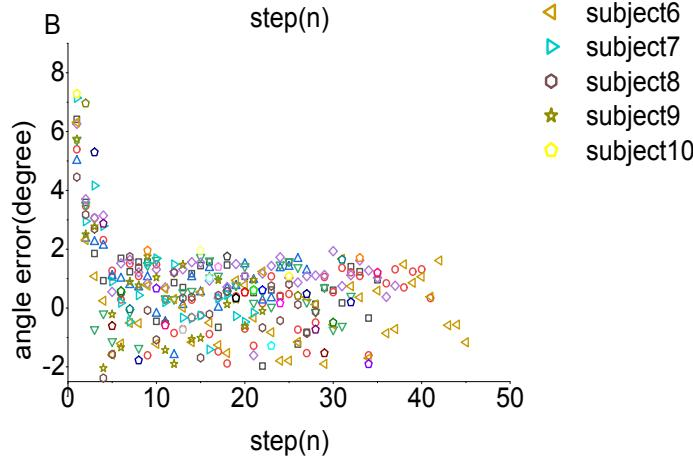
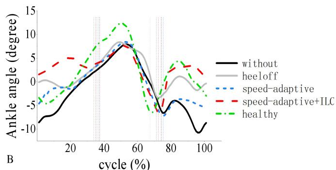
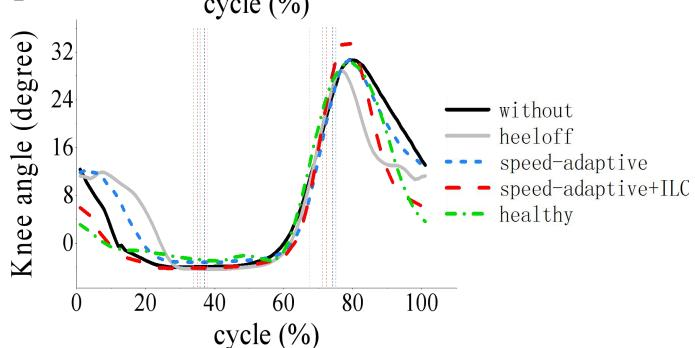
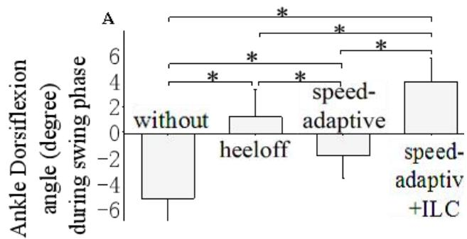
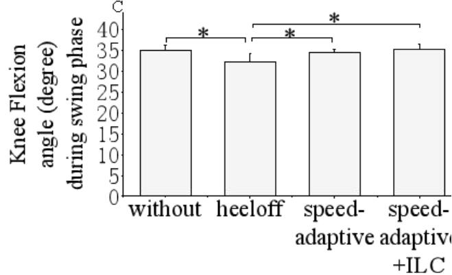

# 脑卒中后患者FES辅助跑步机步行过程中刺激时机与强度的迭代调节

Chao Jiang #, Manxu Zheng #, Yingqi Li, Xiaoyun Wang, Le Li and Rong Song \*, SeniorMember, IEEE

摘要—功能性电刺激（Functional electric stimulation, FES）是脑卒中后患者足下垂矫正的常用干预手段。由于电刺激下内部时变肌肉特性的干扰以及外部环境的不确定性，大多数现有的FES系统采用预设刺激参数，无法在FES辅助步行过程中获得良好的步态表现。因此，本研究设计了一种自适应FES控制系统，该系统在FES辅助跑步机步行过程中，利用迭代学习控制（Iterative learning control, ILC）基于运动学数据调节刺激强度，并利用线性模型基于步行速度调节刺激时机，并在十名脑卒中后足下垂患者身上进行了测试。为了检验其矫形效果，采集了患者使用所提出控制策略时的运动学数据，并与同一批患者采用其他三种FES控制策略步行时的数据进行了对比，包括：(1) 恒定预设刺激强度与时机，(2) 恒定预设刺激强度结合速度自适应刺激时机，以及 (3) 无FES干预步行。在四种条件下，采用所提出控制策略时摆动相最大踝关节背屈角与目标角度之间的误差最小。此外，在离地（toe-off）瞬间的踝关节跖屈角以及摆动相最大膝关节屈曲角方面，所提出的控制策略与无FES步行之间没有显著差异。综上所述，所提出的控制策略在应对变化时，能够通过自适应调节刺激时机和强度来提升FES辅助步行表现，具有良好的临床应用潜力。

关键词—功能性电刺激（FES），足下垂，迭代学习控制（ILC），跑步机

## I. 引言

脑卒中（Stroke）已成为全球第三大致残原因 [1]。约60%的脑卒中幸存者伴有残疾，其中20%患有足下垂 [2]，这是一种下肢运动功能受损的表现 [3]。健康个体在摆动相的最大踝关节背屈角为4.9° [4]，而脑卒中后患者的该角度往往较小，有时会导致其脚趾无法充分离地 [5]，并引起其他关节的代偿动作，如跨阈步态或提髋步态 [6]。

功能性电刺激（Functional electrical stimulation, FES）是一种通过产生电脉冲诱发肌肉收缩以矫正足下垂的常用干预手段 [7]。典型的闭环 FES 系统由传感器、控制器和刺激单元组成 [5]。传感器（例如惯性测量单元、足底开关或动作捕捉系统）向控制器提供信息 [8]。控制器根据来自传感器的信息确定刺激单元的刺激参数 [9]。随后，刺激单元向肌肉组织传递刺激脉冲以诱发肌肉收缩，从而矫正足下垂。刺激单元可以是单通道或多通道的表面或植入式刺激器。FES 最初由 Liberson 等人在 20 世纪 60 年代提出 [10]，当时 FES 被施加于胫骨前肌（TA）以矫正足下垂。然而，目前仍存在若干重要挑战，尤其是对自适应 FES 控制架构的需求 [5]。FES 控制架构可调节电脉冲的刺激时序 [11, 12] 和强度 [13-18]，以及电极的放置以寻找最佳位置 [18]。

许多先前的研究采用开环控制器来设计其控制架构，该控制器是一种具有预设参数且没有来自传感器反馈信息的前馈控制器 [19, 20]。在这些研究中，每个步态周期均使用预设的刺激参数（如刺激强度）来矫正足下垂。预设的刺激参数无法补偿由受刺激肌肉的时变特性及环境不确定性所引起的扰动。相比之下，闭环控制器能够跟踪预设目标（例如期望的踝关节角度），并补偿内外扰动造成的影响 [5]，这使其非常适合应对受刺激肌肉的非线性、时变响应 [9]。已有许多研究采用了不同类型的闭环控制器，并且发现在 FES 辅助的跑步机行走过程中，使用闭环控制器比使用开环控制器能取得更好的矫形效果 [9, 21]。Chen et al. 通过建立肌肉激活度与步行速度之间的线性模型，自适应地调节了 FES 的刺激时机，结果不仅增大了踝关节背屈角，还使踝关节跖屈角保持在可接受的范围内 [12]。Sabut et al. 利用足底压力信号来控制刺激强度，在一定程度上矫正了足下垂，但他们仅在一名称健康的受试者身上测试了其系统 [13]。Chen et al. 使用肌电信号来调节刺激强度，并发现这种方法是有益的 [14]。Thomas et al. 采用迭代学习控制（Iterative Learning Control, ILC）来控制刺激脉冲波形，以矫正矢状面和额状面上不期望出现的足下垂，从而使足部跖屈/背屈及外翻/内翻的角度误差迅速减小 [15-17]。

尽管刺激时机和刺激强度对于功能性电刺激（FES）辅助康复训练都至关重要，但以往的大多数研究仅控制了其中之一。为了同时调节刺激时机和强度，我们先前的研究分别采用了线性模型和模糊逻辑控制器。结果令人鼓舞，平均输出踝关节背屈角增加到了令人满意的平均水平，同时跖屈角度与无 FES 条件下的行走保持一致 [22]。然而，一个局限性在于，每一步的实际踝关节角度与目标角度之间的误差未能实现收敛，这可能是由于模糊逻辑算法的特性所致 [23]。这种收敛性局限可能通过迭代学习控制（ILC）控制器来解决。ILC 可以利用以往试验的数据更新控制参数，从而使其能够应对系统内部和外部的扰动 [24-26]。在先前的两项研究中，ILC 用于调节刺激强度时已展现出稳定的跟踪性能 [15-18, 27, 28]。

为了实现稳定的 FES 辅助跑步机行走，本研究开发了一种自适应 FES 控制系统，用于同时调节刺激强度和时机，并应用 ILC 控制来解决上述收敛问题。所设计的系统在中风后足下垂患者身上进行了测试，并通过膝关节和踝关节运动学进行了评估。为了进行对比，还在跑步机行走期间使用其他三种控制架构采集了这些患者的运动学数据。

## II. 方法

## A. 受试者

招募了 10 名患有中风（8 名男性和 2 名女性，表 I）且经医生诊断患有足下垂的受试者。Fugl-Meyer 下肢运动功能评定（FMA-L）由医院的物理治疗师进行。纳入标准为：中风后患者具备在跑步机上独立且连续行走至少 2 分钟的能力，年龄应大于 18 岁且小于 70 岁。此外，需具备充足的踝关节被动背屈活动度，以使患侧踝关节在膝关节屈曲 90° 时能够达到至少 $4 . 9 ^ { \circ }$ 的踝关节背屈。在参与实验之前，所有受试者均已知晓实验方案并签署了知情同意书。本研究已获得广东省工伤康复中心（Guangdong Work Injury Rehabilitation Center）伦理委员会的批准。

## B. 实验方案

实验开始前，受试者被要求在扶着扶手的情况下在跑步机上行走，以找到他们最舒适的速度 [29]。在矢状面上测量站立时的踝关节角度，并将其设定为中立背屈/跖屈角度（0°）[30]。踝关节角度的正值代表踝关节背屈；负值代表踝关节跖屈。在实验过程中，受试者在四种条件下行走：无 FES 行走（without）、由脚跟离地事件触发 FES 行走（heeloff）、刺激时机由速度自适应模型决定的 FES 行走（speed-adaptive）[22]，以及刺激时机由速度自适应模型决定且刺激强度由 ILC 控制的 FES 行走（speed-adaptive+ILC）。最大刺激强度设定为受试者处于坐位时达到 $4 . 9 ^ { \circ }$ 踝关节背屈所需的强度。如果受试者在达到 $4 . 9 ^ { \circ }$ 之前感到不适，则将最大耐受刺激强度作为最大刺激强度，这在许多以往的研究中常被采用 [14,29,31]。在 heeloff 条件下，刺激强度设定为等于最大刺激强度的恒定值，FES 分别由足底开关检测到的脚跟离地和脚跟着地事件触发和终止 [28]。在 speed-adaptive 条件下，刺激强度的设定与 heeloff 条件相同，但刺激时机由建立的线性模型和当前步行速度决定 [12]。在 speed-adaptive+ILC 条件下，刺激强度根据 ILC 规则进行调节，且不会超过最大刺激强度。刺激时机与 speed-adaptive 条件下的相同。受试者在四种条件下各进行一次步行试验，各条件的顺序是随机的。在每次试验中，受试者在一种条件下行走两分钟。相继的每次试验之间有两分钟的休息时间，以避免肌肉疲劳。

卒中后受试者的人口统计学及临床信息  
TABLE I

<table><tr><td>序号</td><td>性别</td><td>年龄</td><td>病灶侧</td><td>脑卒中后月数</td><td>FMA-L</td></tr><tr><td>1</td><td>M</td><td>68</td><td>L</td><td>9</td><td>21/34</td></tr><tr><td>2</td><td>M</td><td>51</td><td>L</td><td>11</td><td>29/34</td></tr><tr><td>3</td><td>M</td><td>32</td><td>L</td><td>8</td><td>28/34</td></tr><tr><td>4</td><td>F</td><td>28</td><td>R</td><td>13</td><td>20/34</td></tr><tr><td>5</td><td>M</td><td>64</td><td>R</td><td>14</td><td>27/34</td></tr><tr><td>6</td><td>M</td><td>52</td><td>R</td><td>10</td><td>30/34</td></tr><tr><td>7</td><td>M</td><td>40</td><td>R</td><td>9</td><td>32/34</td></tr><tr><td>8</td><td>M</td><td>48</td><td>R</td><td>12</td><td>26/34</td></tr><tr><td>9</td><td>F</td><td>56</td><td>R</td><td>18</td><td>31/34</td></tr><tr><td>10</td><td>M</td><td>44</td><td>L</td><td>8</td><td>32/34</td></tr><tr><td>平均值</td><td>-</td><td>48.3</td><td>-</td><td>11.2</td><td>27.6/34</td></tr><tr><td>标准差</td><td>-</td><td>12.8</td><td>-</td><td>3.1</td><td>4.2/34</td></tr></table>

M-男性，F-女性，L-左侧，R-右侧，FMA - 下肢Fugl-Meyer运动功能评定（Fugl-meyer motor assessment for lower limb）

  
Fig. 1. FES结合跑步机系统的示意图。圆圈框内为用于控制踝关节运动的所提出控制器。$\theta _ { i \cdot }$ 为第 $i$ 步的最大踝关节背屈角度；$~ \theta _ { r } .$ 为参考角度；ei：第 $i$ 步目标关节角度与实际关节角度之间的误差信号；$U _ { o u t I \_ I } :$ 第 $i _ { \ r { i } } { \cdot }$ 步的输出强度；$U _ { o u t I \_ i - I } { \cdot }$ 第 $i  – I$ 步的输出强度；$T \colon$ 约束函数；L：比例学习增益；vi：第 $i$ 步的步行速度；$a _ { I } , b _ { I } , a _ { 2 } , b _ { 2 } ;$ 线性模型的参数；$U _ { o u t 2 \_ i }$ ：足跟离地事件与 $\mathrm { \Delta \cdot } _ { \mathrm { F E S ; } }$ 触发时刻之间的时间间隔；$U _ { o u t 3 \_ i } \mathrm { \Delta \cdot }$ FES的持续时间。

## C. 系统结构

FES 康复系统的结构如图 1 所示。该系统由一台跑步机（G6425-F3, Beistegui Hermanos, Spain）、一个微控制器（STC89C52, Amtel, USA）、一个功能性电刺激器（P2-9632, Faisco, China）、一套动作捕捉系统（OptiTrack, NaturalPoint, USA）、一个脚踏开关（B-201, Tekscan, USA）以及一个 16 通道 A-D 转换器（PCIe-6341, National Instrument, Texas, USA）组成。脚踏开关放置在后足下方，用于记录行走过程中的脚后跟离地和足跟着地事件。这些信息以 100Hz 的采样率通过 A-D 转换器传输至个人计算机。为获取行走过程中的运动学数据，受试者的下肢贴有五个 12-mm 球形反光标记点（图 1）。从上到下的五个标记点分别放置在以下解剖参考位置：大腿中部、膝关节估计平均旋转轴正外侧、小腿中部、外踝，以及第 2 和第 3 跖骨头之间的间隙 [32]。动作捕捉系统中的四台红外摄像机以 100Hz 的采样率检测标记点的三维坐标轨迹。来自 A-D 转换器和动作捕捉系统的信号均由个人计算机中的信号处理模块进行采集和处理。在该模块中，基于下肢三段刚体模型 [32]，利用标记点信号计算踝关节背屈/跖屈角、膝关节屈曲角以及步行速度。基于先前建立的肌肉激活与步行速度之间的线性模型 [12]，FES 控制模块使用来自信号处理模块的步行速度和事件状态信号作为输入信号，然后输出脚后跟离地事件与触发时间之间的时间间隔 $( U _ { o u t 2 } )$ 以及持续时间 $( U _ { o u t 3 } )$。ILC（迭代学习控制）规则利用来自信号处理模块的运动学信号、目标信号以及先前的输出信号来计算当前的输出强度 $( U _ { o u t I } )$。最终，刺激器通过两个表面电刺激电极（M2223, 3M, USA）根据 $U _ { o u t I } , \ U _ { o u t 2 }$ 和 $U _ { o u t 3 }$ 产生刺激电流并施加至胫骨前肌（TA）（图 2）。刺激强度范围为 0 至 120 mA。脉冲宽度和刺激频率分别为 390μs 和 40Hz。刺激波形为双相波。

## D. 控制策略

刺激时序由线性模型决定，该模型的输入为脚踏开关检测到的步行事件状态信号以及根据前五步中足尖标记点的平均水平坐标变化计算出的步行速度 [33, 34]。本研究未考虑参与者质心与跑步机之间的相对运动。

输出 $U _ { o u t 2 \_ i }$ 和 $U _ { o u t 3 \_ i }$ 决定了第 $i$ 步的刺激时机。当脚踏开关检测到第 $i$ 步的足跟离地（heel-off）事件时，经过一个线性速度自适应时间间隔 $U _ { o u t 2 \_ i ; }$ 后，刺激被触发。在经过另一个线性速度自适应持续时间 $U _ { o u t 3 \_ i ; }$ 后，刺激终止 [12]。这两个线性模型分别为：

$$
U _ {o u t 2 \_ i} = - 1 1 1. 7 ^ {*} v _ {i} + 4 1 6. 9\tag{1}
$$

$$
U _ {o u t 3 \_ i} = - 2 1 3. 2 ^ {*} v _ {i} + 8 7 7. 7\tag{2}
$$

$U _ { o u t 2 \_ i }$ 和 $U _ { o u t 3 \_ i }$ 的单位为秒，$v$ 的单位为米/秒。在本研究中，刺激器在持续时间 $U _ { o u t 3 \_ i }$ 内输出刺激电流，如图 2 所示。

摆动相期间踝关节背屈的目标角度设置为 4 $. 9 ^ { \circ } \left[ 4 \right]$。ILC 规则如下：

$$
U _ {o u t 1 \_ i} = \left\{ \begin{array}{c c} \bar {u} & \text {if} U _ {o u t 1 \_ i - l} + L e _ {i} > \bar {u} \\ U _ {o u t 1 \_ i - l} + L e _ {i} & \text {if} 0 \leq U _ {o u t 1 \_ i - l} + L e _ {i} \leq \bar {u} \\ 0 & \text {if} U _ {o u t 1 \_ i - l} + L e _ {i} <   0 \end{array} \right.\tag{,(3}
$$

其中 $e _ { i }$ 为第 $i$ 步摆动相期间实际最大踝关节背屈角度与目标角度之间的误差；$U _ { o u t I }$ i 为第 $i$ 步的输出刺激强度，$U _ { o u t I \_ i - I }$ 为第 $i { - } I _ { ; }$ 步的输出刺激强度，第一步的初始强度为最大刺激强度，$L$ 为常数，通过在健康受试者身上的经验获得 [25]，$u$ 为最大刺激强度。

## E. 数据分析

采用截止频率为 15Hz 的二阶零相位低通 Butterworth 滤波器对运动学数据进行滤波。计算了每次试验中连续 40-50 步的摆动相最大踝关节背屈角、足尖离地（toe-off）事件时的踝关节跖屈角以及摆动相最大膝关节屈曲角，并求取平均值 [21]。

采用 Kolmogorov-Smirnov 检验对上述变量进行评估以确保正态性。随后，对所有数据进行单因素重复测量方差分析，并使用 Bonferroni 事后检验分析各条件（无刺激、足跟离地、速度自适应以及速度自适应+ILC）对上述变量的影响。显著性水平设置为 0.05。统计分析使用 SPSS 19（SPSS, Inc., Chicago, IL, USA）进行。

  
Fig. 2. (A) 单个步态周期内的刺激时序示意图，0 表示无刺激电流输出；1 表示刺激器输出刺激电流；$U _ { o u t 2 \_ i }$ i 是由第 i 步的线性模型（公式 (1)）决定的足跟离地（heel-off）事件与 FES 触发时间之间的时间间隔；$\bar { U _ { o u t 3 } }$ i 是由第 i 步的另一个线性模型（公式 (2)）决定的 FES 持续时间；(B) 双相脉冲波形是刺激器输出至胫骨前肌（TA）的刺激电流；脉冲幅度由第 i 步的 ILC 控制器（公式 (3)）计算出的 $U _ { o u t I _ { - } }$ i 决定；脉冲宽度和频率分别为 390μs 和 40Hz，在实验中保持恒定。注：图未按比例绘制。

## III. 结果

图 3A 和图 3B 分别显示了受试者 2 在速度自适应+ILC 条件下进行 FES 辅助跑步机步行时，每个连续步态的实际输出刺激强度以及摆动相实际最大踝关节背屈角与目标角之间的误差。在速度自适应+ILC、速度自适应、足跟离地和无刺激条件下，平均输出刺激强度分别为 20.2mA、70mA、70mA 和 0mA。在试验开始时，误差和强度都相对较大。在大约五步之后，最大踝关节背屈角与目标角之间的误差降低到小于 $2 ^ { \circ }$。

图 4 显示了受试者 2 在四种条件下进行 FES 辅助跑步机步行时，摆动相实际最大踝关节背屈角与目标角之间的误差。在无刺激、足跟离地、速度自适应和速度自适应+ILC 条件下，误差的平均值 $\pm$ 标准差分别为 $6 . 7 ^ { \circ } \ : \pm \ : 0 . 6 ^ { \circ } , \ : 3 . 3 ^ { \circ } \ : \pm \ : 0 . 7 ^ { \circ }$ 2 $4 . 8 ^ { \circ } ~ \pm ~ 0 . 5 ^ { \circ } , ~ 0 . 6 ^ { \circ } ~ \pm ~ 1 . 7 ^ { \circ }$。速度自适应+ILC 条件下的平均误差在四种条件中最小（p<0.05）。

  
A

  
Fig. 3. (A) 实际输出刺激强度，以及 (B) 10 名受试者在速度自适应+ILC 条件下进行 FES 辅助跑步机步行时，每个连续步态摆动相期间实际最大踝关节背屈与目标角之间的误差。

图 5 展示了受试者 2 在四种条件下归一化步态周期（从足跟着地事件开始）中的平均踝关节背屈/跖屈角和膝关节屈曲角。

图 6A 展示了 10 名受试者在四种条件下摆动相期间的平均最大踝关节背屈角度。在无辅助（without）、脚跟离地触发（heeloff）、速度自适应（speed-adaptive）以及速度自适应+ILC（speed-adaptive+ILC）条件下，平均最大踝关节背屈角度分别为 -5.1°、1.2°、1.7° 和 $3 . 9 ^ { \circ }$。无辅助条件下的平均最大踝关节背屈角度显著小于其余三种条件（P<0.05），而速度自适应+ILC条件下的平均最大踝关节背屈角度显著大于其余三种条件（P<0.05）。脚跟离地触发条件下的平均最大踝关节背屈角度显著大于速度自适应条件（P<0.05）。图 6B 展示了 10 名受试者在四种条件下足尖离地事件时的踝关节最大跖屈角度。在无辅助、脚跟离地触发、速度自适应和速度自适应+ILC条件下，平均最大踝关节跖屈角度分别为 $- 8 . 3 ^ { \circ } , \ - 0 . 3 ^ { \circ } , \ - 7 . 8 ^ { \circ }$ 和 $\cdot 7 . 3 ^ { \circ }$。脚跟离地触发条件下的平均最大踝关节跖屈角度显著小于其余三种条件（P<0.05）。其余三种步行条件之间均未发现显著性差异（P<0.05）。图 6C 展示了 10 名受试者在四种条件下摆动相期间的膝关节最大屈曲角度。在无辅助、脚跟离地触发、速度自适应和速度自适应+ILC条件下，平均膝关节最大屈曲角度分别为 $3 4 . 9 ^ { \circ } , 3 2 . 2 ^ { \circ } , 3 4 . 5 ^ { \circ }$ 和 $3 5 . 2 ^ { \circ }$。脚跟离地触发条件下的平均膝关节最大屈曲角度显著小于其余三种条件（P<0.05）。其余三种步行条件之间的膝关节屈曲角度均未发现显著性差异（P<0.05）。

  
图 4. 受试者 2（subject2）在无辅助、脚跟离地触发、速度自适应以及速度自适应+ILC条件下进行 FES 辅助跑步机步行时，摆动相期间实际最大踝关节背屈角度与目标角度之间的误差。

  
图 5. 受试者 2（subject2）和一名健康受试者在一个步态周期内的 (A) 踝关节跖屈/背屈角度和 (B) 膝关节屈曲角度。垂直虚线表示脚跟离地（左）和足尖离地事件（右）。

B  

  
Fig. 6. 10名脑卒中受试者的 (A) 摆动相最大踝关节背屈角、(B) 脚趾离地时刻踝关节跖屈角以及 (C) 摆动相最大膝关节屈曲角。\*显著性差异（P < 0.05）。

## IV. 讨论

在本研究中，建立了一种新型自适应控制 FES（功能性电刺激）系统，该系统分别利用线性模型和 ILC（迭代学习控制）控制器来调节刺激时序和强度。通过分析摆动相最大踝关节背屈角、脚趾离地时刻踝关节跖屈角以及摆动相最大膝关节屈曲角，评估了所提出的 speed-adaptive+ILC 条件相比于 without、heeloff 和 speed-adaptive 条件下的矫形效果。

在正常步态中，TA（胫骨前肌）激活与足跟离地事件之间的时间间隔以及 TA 从激活到终止的持续时间均与步行速度相关 [35]。与 heeloff 条件相比，speed-adaptive 条件下的 FES 刺激时序设置更符合生理特性 [12, 22]。本研究证实了这一发现，即与 heeloff 条件相比，speed-adaptive 和 speed-adaptive+ILC 条件下脚趾离地时刻的踝关节跖屈角以及摆动相最大膝关节屈曲角均有所增加。在 heeloff 条件下，摆动相最大膝关节屈曲角的减小与脚趾离地时刻踝关节跖屈角的减小相关。这可以解释为：在 heeloff 条件下，FES 分别由足跟离地和足跟着地事件触发和终止 [10]，而这种方式长期以来因会减小前向推进力而受到诟病 [29]。speed-adaptive+ILC 条件下的刺激时序并非由足跟离地事件触发，而是设置为与 speed-adaptive 条件相同，该时序已被证明是更为合理的刺激时序 [12]。如图 6 所示，speed-adaptive 和 speed-adaptive+ILC 条件下的踝关节跖屈角和最大膝关节屈曲角均与无 FES 步行时保持一致。因此可以看出，所提出的 speed-adaptive+ILC 控制能够产生与以往仅采用 speed-adaptive 控制的研究相似的自然 FES 辅助步行 [12]。

然而，速度自适应（speed-adaptive）条件下的最大踝关节背屈角小于足跟离地（heeloff）条件下的最大踝关节背屈角，这表明仅调节刺激时序是不够的。因此，在速度自适应+ILC（speed-adaptive+ILC）条件下逐周期迭代调整刺激强度是必要的。研究发现，与仅采用速度自适应相比，速度自适应+ILC改善了摆动相期间的最大踝关节背屈角。速度自适应+ILC的刺激强度小于速度自适应和足跟离地条件下的刺激强度，这可能意味着在该条件下，FES（功能性电刺激）诱导的肌肉收缩提供了最小程度的辅助。由于踝关节背屈是由患者的自主肌肉收缩与FES诱导的肌肉收缩共同产生的，因此速度自适应+ILC能够促进肌肉自主收缩，这与先前的研究论述一致 [24]。在速度自适应+ILC条件下，输出的FES强度可以基于先前的步态针对每个新步态进行更新，从而确保了对电刺激下内部时变肌肉特性扰动以及系统中外部环境不确定性干扰的响应能力 [24]。此外，与速度自适应和足跟离地条件相比，速度自适应+ILC条件下较小的刺激强度可有效避免肌肉疲劳，因为过大的刺激强度会导致摆动相期间足部过度抬高，进而引发肌肉快速疲劳 [21]。在先前的研究中，ILC（迭代学习控制）也被发现能够降低刺激强度 [15]。

所提出的速度自适应+ILC条件在四种条件中实现了摆动相期间最稳定的最大踝关节背屈角，表现为误差在五步后收敛至 $0 ^ { \circ }$，且通过对刺激强度的持续自适应调整，在随后的步态中能够保持接近 $0 ^ { \circ }$。相比之下，在其他三种条件下，误差均未收敛至 $0 ^ { \circ }$。

尽管采用速度自适应+ILC具有诸多优势，但本研究仍存在一些局限性。本研究未包含不同行走速度下的FES辅助跑步机行走实验。未来的研究将开展针对所提出控制架构在变速条件下矫形效果的分析。其次，在实验中，仅使用三个关节角度来评估FES辅助行走的性能。未来的研究中将纳入更多的评估指标，例如前向地面反作用力。第三，足部外翻/内翻也将在下一阶段予以考虑。

## V. 结论

本文提出了一种 FES（功能性电刺激）系统，分别采用线性模型和 ILC（迭代学习控制）来控制刺激时机与强度。与其他三种情况相比，本研究所提出的控制架构在 FES 辅助跑步机步行过程中，能够为足下垂患者提供稳定且更佳的矫形效果。该控制方法可以提高 FES 辅助步行的表现，并在临床上展现出良好的应用潜力。

## 致谢

作者感谢广东省传感技术与生物医疗仪器重点实验室（Key Laboratory of Sensing Technology and Biomedical Instrument of Guangdong Province）、广东省工伤康复中心（Guangdong Work Injury Rehabilitation Center）以及中山大学附属第一医院（First Affiliated Hospital of Sun Yat-sen University）脑卒中康复团队。我们也非常感谢参与本研究的所有受试者的热情配合。

## 参考文献

[1] W. Johnson, O. Onuma, M. Owolabi, and S. Sachdev, "Stroke: a global response is needed,"Bulletin of the World Health Organization, vol. 94, pp. 634-634A, 2016.

[2] C. A. Johnson, J. H. Burridge, P. W. Strike, D. E. Wood, and I. D. Swain, "The effect of combined use of botulinum toxin type A and functional electric stimulation in the treatment of spastic drop foot after stroke: a preliminary investigation,"Archives ofphysical medicine and rehabilitation, vol. 85, pp. 902-909, 2004.

[3] N. Neckel, M. Pelliccio, D. Nichols, and J. Hidler, "Quantification of functional weakness and abnormal synergy patterns in the lower limb of individuals with chronic stroke,"Journal of neuroengineering and rehabilitation, vol. 3, p. 17, 2006.

[4] A. Arifin, T. Watanabe, and N. Hoshimiya, "Fuzzy controller for cycle-to-cycle control of swing phase of FES-induced hemiplegic gait: a computer simulation in two-joints control," in Proceedings of the 25th Annual International Conference of the IEEE Engineering in Medicine and Biology Society (IEEE Cat. No. 03CH37439), 2003, pp. 1519-1522.

[5] P. Melo, M. Silva, J. Martins, and D. Newman, "Technical developments of functional electrical stimulation to correct drop

foot: Sensing, actuation and control strategies,"Clinical Biomechanics, vol. 30, pp. 101-113, 2015.

R. Don, M. Serrao, P. Vinci, A. Ranavolo, A. Cacchio, F. Ioppolo, et al., "Foot drop and plantar flexion failure determine different gait strategies in Charcot-Marie-Tooth patients,"Clinical biomechanics, vol. 22, pp. 905-916, 2007.

[7] H. Ring, I. Treger, L. Gruendlinger, and J. M. Hausdorff, "Neuroprosthesis for footdrop compared with an ankle-foot orthosis: effects on postural control during walking,"Journal of stroke and cerebrovascular diseases, vol. 18, pp. 41-47, 2009.

[8] G. Zouridakis, Biomedical technology and devices handbook: CRC press, 2003.

[9] C. Lynch and M. Popovic, "Closed-loop control for FES: Past work and future directions," in 10th Annual Conference of the International FES Society, 2005, pp. 2-4.

[10] W. T. Liberson, H. J. Holmquest, D. Scot, and M. Dow, "功能性电疗：与偏瘫患者步态摆动期同步的腓神经刺激（Functional electrotherapy: stimulation of the peroneal nerve synchronized with the swing phase of the gait of hemiplegic patients）," Am JPhys Med Rehabil, vol. 42, p. 101, 1961.

[11] E. G. Spaich, M. F. Bøg, E. Erkocevic, A. Smidstrup, O. K. Andersen, and J. F. Nielsen, "步态矫形器 Lokomat 结合功能性电刺激用于足下垂矫正：可行性研究（Gait orthosis lokomat combined with functional electrical stimulation for foot drop correction: a feasibility study）," in Replace, Repair, Restore, Relieve–Bridging Clinical and Engineering Solutions in Neurorehabilitation, ed: Springer, 2014, pp. 751-757.

[12] G. Chen, L. Ma, R. Song, L. Li, X. Wang, and K. Tong, "用于足下垂矫正的功能性电刺激速度自适应控制（Speed-adaptive control of functional electrical stimulation for dropfoot correction）," Journal of neuroengineering and rehabilitation, vol. 15, p. 98, 2018.

[13] S. K. Sabut, R. Kumar, and M. Mahadevappa, "用于脑卒中患者足下垂的鞋垫内嵌足底压力传感器控制 FES 系统的设计（Design of an insole embedded foot pressure sensor controlled FES system for foot drop in stroke patients）," in 2010 International Conference on Systems in Medicine and Biology, 2010, pp. 237-241.

[14] W.-L. Chen, S. Chen, C. Chen, C. Chou, Y. Shih, Y. Chen, et al., "非侵入式功能性电刺激系统中用于步行功能恢复的患者驱动环路控制（Patient-driven loop control for ambulation function restoration in a non-invasive functional electrical stimulation system）," Disability and rehabilitation, vol. 32, pp. 65-71, 2010.

[15] T. Seel, M. Valtin, C. Werner, and T. Schauer, "通过双皮肤电极刺激腓神经对步态中足部运动的多变量控制（Multivariable control of foot motion during gait by peroneal nerve stimulation via two skin electrodes）," IFAC-PapersOnLine, vol. 48, pp. 315-320, 2015.

[16] T. Seel, D. Laidig, M. Valtin, C. Werner, J. Raisch, and T. Schauer, "自适应腓神经刺激器中足外翻的反馈控制（Feedback control of foot eversion in the adaptive peroneal stimulator）," in 22nd Mediterranean Conference on Control and Automation, 2014, pp. 1482-1487.

[17] T. Seel, C. Werner, and T. Schauer, "自适应足下垂刺激器——轻瘫步态中足部俯仰和侧滚运动的多变量学习控制（The adaptive drop foot stimulator–Multivariable learning control of foot pitch and roll motion in paretic gait）," Medical engineering & physics, vol. 38, pp. 1205-1213, 2016.

[18] M. Valtin, T. Seel, J. Raisch, and T. Schauer, "采用阵列电极进行选择性肌肉激活的足下垂刺激迭代学习控制（Iterative learning control of drop foot stimulation with array electrodes for selective muscle activation）," IFAC Proceedings Volumes, vol. 47, pp. 6587-6592, 2014.

[19] G. M. Lyons, T. Sinkjær, J. H. Burridge, and D. J. Wilcox, "用于矫正足下垂的便携式基于 FES 的神经矫形器综述（A review of portable FES-based neural orthoses for the correction of drop foot）," IEEE Transactions on neural systems and rehabilitation engineering, vol. 10, pp. 260-279, 2002.

[20] R. Perumal, T. Kesar, A. Wexler, and S. Binder-Macleod, "脑卒中步态期间同时刺激背屈和跖屈肌的新型 FES 系统（Novel FES system to stimulate both dorsi-and plantar-flexor muscles during stroke gait）," in 12th Annual Conference of the International FES Society, 2007.

[21] C. L. Lynch and M. R. Popovic, "功能性电刺激（Functional electrical stimulation）," IEEE control systems magazine, vol. 28, pp. 40-50, 2008.

[22] G. Chen, Z. Shen, Y. Zhuang, X. Wang, and R. Song, "基于模糊逻辑控制与线性模型的强度和时长自适应功能性电刺激用于足下垂矫正（intensity-and Duration-adaptive Functional electrical stimulation Using Fuzzy logic control and a linear Model for Dropfoot correction）," Frontiers in neurology, vol. 9, p. 165, 2018.

[23] K. Yin, M. Pang, K. Xiang, J. Chen, and S. Zhou, "Fuzzy iterative learning control strategy for powered ankle prosthesis," *International Journal of Intelligent Robotics and Applications*, vol. 2, pp. 122-131, 2018.

[24] C. T. Freeman, E. Rogers, A.-M. Hughes, J. H. Burridge, and K. L. Meadmore, "Iterative learning control in health care: Electrical stimulation and robotic-assisted upper-limb stroke rehabilitation," *IEEE Control Systems Magazine*, vol. 32, pp. 18-43, 2012.

[25] S. Arimoto, S. Kawamura, and F. Miyazaki, "Bettering operation of robots by learning," *Journal of Robotic systems*, vol. 1, pp. 123-140, 1984.

[26] P. Müller, C. Balligand, T. Seel, and T. Schauer, "Iterative learning control and system identification of the antagonistic knee muscle complex during gait using functional electrical stimulation," *IFAC-PapersOnLine*, vol. 50, pp. 8786-8791, 2017.

[27] H. Nahrstaedt, T. Schauer, R. Shalaby, S. Hesse, and J. Raisch, "Automatic Control of a Drop‐Foot Stimulator Based on Angle Measurement Using Bioimpedance," *Artificial organs*, vol. 32, pp. 649-654, 2008.

[28] I. Pappas, T. Keller, S. Mangold, M. R. Popovic, V. Dietz, and M. Morari, "A reliable gyroscope-based gait-phase detection sensor embedded in a shoe insole," in *Sensors, IEEE*, 2002.

[29] T. M. Kesar, R. Perumal, A. Jancosko, D. S. Reisman, K. S. Rudolph, J. S. Higginson, et al., "Novel patterns of functional electrical stimulation have an immediate effect on dorsiflexor muscle function during gait for people poststroke," *Physical therapy*, vol. 90, pp. 55-66, 2010.

[30] G. Wu, S. Siegler, P. Allard, C. Kirtley, A. Leardini, D. Rosenbaum, et al., "ISB recommendation on definitions of joint coordinate system of various joints for the reporting of human joint motion--part I: ankle, hip, and spine. International Society of Biomechanics," *Journal of Biomechanics*, vol. 35, pp. 543-548, 2002.

[31] T. Seel, C. Werner, J. Raisch, and T. Schauer, "Iterative learning control of a drop foot neuroprosthesis—Generating physiological foot motion in paretic gait by automatic feedback control," *Control Engineering Practice*, vol. 48, pp. 87-97, 2016.

[32] M. P. Kadaba, H. K. Ramakrishnan, and M. E. Wootten, "Measurement of lower extremity kinematics during level walking," *Journal of Orthopaedic Research*, vol. 8, pp. 383-92, 1990.

[33] J. Zeni Jr, J. Richards, and J. Higginson, "Two simple methods for determining gait events during treadmill and overground walking using kinematic data," *Gait & posture*, vol. 27, pp. 710-714, 2008.

[34] Y.-H. Lee, S. Y. Yong, S. H. Kim, J. H. Kim, J. M. Shinn, Y. Kim, et al., "Functional electrical stimulation to ankle dorsiflexor and plantarflexor using single foot switch in patients with hemiplegia from hemorrhagic stroke," *Annals of rehabilitation medicine*, vol. 38, p. 310, 2014.

[35] C. C. Monaghan, R. W. J. B. M. Van, and P. H. Veltink, "步态过程中基于单轴陀螺仪的小腿姿态控制小腿三头肌刺激," Medical & Biological Engineering & Computing, vol. 47, pp. 1181-1188, 2009.