# An Electromyographic-Based Control Using Gaussian Mixture Model on an Upper-Limb Cable-Driven Rehabilitation Robot

Jianlin Zheng, Zhijun Li, Ting Xu, and Rong Song\*

Electromyographic (EMG)-based admittance control by arm force can provide continuous motion control in robot-assisted rehabilitation. Natural and complex physical human–robot interactions utilizing intelligent EMG-based interfaces require a computational estimation model for 3D voluntary forces. Existing computational models infrequently directly encode the interconnections among the spatial-dimensional components of 3D arm forces and experience performance degradation caused by confounding variables like muscle fatigue in EMGbased control. Motivated by this challenge, a computational model is proposed using the Gaussian mixture model (GMM), which only requires a user-friendly calibration by an incremental GMM approach to reduce the effect of muscle fatigue. GMM aims to encode the multivariable connection between EMG and voluntary force by joint probability density distribution. The EMG-based control system retrieves the estimated voluntary forces given EMG from GMM by utilizing the Gaussian mixture regression. Herein, the performance ofthe proposed EMG-based admittance control is tested using GMM by trajectory-tracking experiments before and after the fatigue-inducing experiment. The experiments include eight healthy participants. The experimental outcomes prove that the EMG-based control using calibrated GMM shows an increase of 23.66% and 8.17% in tracking precision and motion compliance, showing potential application across diverse domains involving physical human–robot interactions.

## 1. Introduction

Stroke can lead to movement impairments and impact the quality of life of poststroke survivors. Rehabilitation training plays a vital role in restoring damaged motor pathways[1] and improving patients’ daily functional movement ability.[2] However, physical therapists are in short supply, and the quality of their treatment can be affected due to exhaustion. As rehabilitation robots can tirelessly provide consistent therapy and facilitate the recovery of motor functions, robot-assisted rehabilitation is becoming an attractive research subject.[3]

Participant engagement influences robot-assisted rehabilitation, while the control strategy directly affects human engagement levels. One ofthe pivotal components of rehabilitation robots lies in the control strategy. Passive control schemes assist patients with severely impaired motor function to complete rehabilitation training under a robot-dominant mode, such as the passive mode in MIT-MANUS,[4] MIME,[5] and ARMin.[6] Encouraging active participation is essential to improve the efficacy of rehabilitation,[7] especially for those with fewer impairments. Active impedance control strategies can facilitate muscle recovery by promoting patients’ voluntary participation.[8,9] Electromyographic (EMG) directly reflects the intention of motions and occurs before actions happen.[10] Employing EMG as a control source can make robots sense and decode motion intentions and facilitate human–robot movement synchronization, improving the level of active participation.[11,12]

Existing EMG-based control strategies typically conducted discrete motion control by pattern recognition, such as linear discriminant analysis[13] and support vector machines.[14] However, physical interactions between human arms and intelligent rehabilitation robots are essential to robot-assisted rehabilitation.[15,16] Controlling an end-effector through arm force involves continuous changes offorces in direction and magnitude, implying that extracting voluntary force intention demands a continuous estimation approach.[17] For example, Louis et al. achieved force estimation in a single dimension and performed reaching tasks by a Hill-type model.[18] Xiong et al. developed an artificial neural network with a small input dimension[19] and a trans-scale feature decoding network[20] to extract continuous joint torques from EMG. Xie et al. applied a state-space model to decode 3D voluntary forces for reaching tasks.[21] Recently, rehabilitation robotics performed biomimetic strategies to improve the intelligence ofEMG-based control, facilitating bioinspired attributes in physical human-robot interaction (pHRI), such as adaptability.[22] For example, Zeng et al. employed Gaussian process to learn and predict EMG-based continuous motion intention.[17]

A computational model that can decode 3D voluntary forces helps perform natural and complex pHRI under intelligent EMG-based interfaces. The Hill-type model can achieve force estimation in a single dimension[18] but was limited to lowdimensional force or joint torque estimation.[23] Zhang et al. employed three parallel long short-term memory (LSTM) to estimate the direction and strength of three 1D forces separately, preventing the complexity of the network model required for directly establishing the relationship between 3D voluntary arm force and EMG signals.[24] Su et al. divided the force according to three spatial dimensions, applied a deep convolutional neural network to perform estimations, and calibrated it independently.[15] Some methods encoded the interconnections among the spatial-dimensional components ofthe 3D arm force. Zhang et al. modeled the relationship between EMG and 3D arm force by a hierarchical neural network with a low-layer shared feature extractor and three parallel high-layer dimension-specific fine-tuners.[16] The computational model that directly encodes the 3D components of voluntary forces may reduce errors attributable to modeling assumptions. Wu et al. employed a generalized regression neural network (GRNN) to estimate 3D push–pull forces but necessitated the accessibility of the original data.[25] Huang et al. utilized a state-space model for decoding 3D forces from EMG signals.[26] However, this approach was limited to specific tasks and suitable only for a simple combination of straight-line trajectory tasks. Xie et al. proposed a deep LSTM utilizing a regression layer with 3D output and demanded a time-consuming static–dynamic calibration before the experiment began.[27]

Although the field of EMG-based control made progress, existing EMG-to-force computational models insufficiently match human users and typically consider the performance without the influence of intrinsic and extrinsic factors.[28,29] Furthermore, as the upper-limb movements of humans involve three dimensions inherently,[30] a natural and complex pHRI utilizing intelligent EMG-based interfaces requires a computational model that can encode 3D voluntary forces. In this study, we proposed to use GMM to learn the nonlinear relationship between EMG and 3D force for the EMG-based control on an upper-limb cable-driven rehabilitation robot (ULCDRR). GMM can achieve a fast 3D voluntary force output in real-time through Gaussian mixture regression (GMR) without the need for original training data.[31] GMM can be regarded as a bioinspired approach as it emulates the processes of probabilistic modeling and reasoning performed by the human brain,[32,33] in which such a humanmatched model may facilitate human–robot synchronization during pHRI movement. The existing development based on GMM focused on pattern recognition[34–36] and imitation learning,[37,38] lacking research in 3D continuous motion control with intelligent EMG-based robotic systems. The need for adequateintensity treatment often leads to muscle fatigue in stroke patients,[39] which can affect the performance of EMG-based control schemes, including the accuracy of the force estimation[40,41] and control compliance.[42] Thus, we calibrated the trained GMM based on the incremental GMM approach to reduce the effect of muscle fatigue on the consistency and precision of robot-assisted rehabilitation employing intelligent EMG-based interfaces.[24,43] To perform compliance control, we employed the force estimated as the input of an EMG-based admittance controller.

The main contributions of this article are the following: 1) We proposed an EMG-based admittance control using GMM and achieved real-time 3D motion control. 2) We developed an incremental GMM technique to calibrate the GMM and embedded it into hardware to perform calibration conveniently and quickly. 3) We designed a fatigue-inducing experiment and verified the performance of the proposed approach under muscle fatigue through trajectory-tracking experiments.

## 2. System Description

We developed an upper limb cable-driven rehabilitation robot[21,44] (Figure 1). The end-effector of the robot is connected to four motors (DM1B-045G, Yokogawa, Japan) using four cables, with each cable’s tension measured by a force sensor (HSTL-BLSM, Beijing Huakong Xingye Technology Development Co., Ltd., China). The motion capture system (OptiTrack 2, NaturalPoint, USA) is to acquire the position information of the end-effector. The six-axis force sensor (SRI-V-210105-G) integrated with the end-effector measures the pHRI force. The employment of the dSPACE MicroLabBox 1202 platform (dSPACE, Paderborn, Germany) combined with MATLAB R2019b software (The Mathworks Inc., MA, USA) is to record real-time signals and generate control commands. Additionally, we design the human–robot interface using the dSPACE ControlDesk 7.2 software, and subjects can receive visual feedback of their movement performance through the computer screen in front of them.

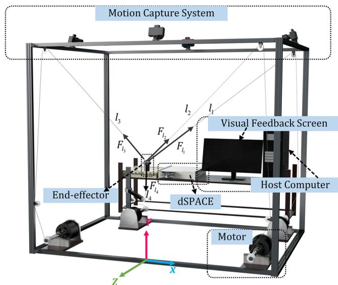  
Figure 1. Structure diagram of ULCDRR. The coordinate direction in the figure is the Cartesian coordinate system established by the motion capture system.

## 3. Experimental Section

## 3.1. Control Framework of ULCDRR

The control framework of ULCDRR comprises two essential phases (Figure 2): a learning phase and a task phase. In the learning phase, we established the joint probability density by GMM between processed EMG ${ \pmb \xi } _ { s }$ and force $\pmb { \xi } _ { f }$ signals. The incremental GMM approach was to calibrate the trained GMM $\{ \pi _ { j } , \pmb { \mu } _ { j } , \pmb { \Sigma } _ { j } \} _ { j = 1 } ^ { K }$ In the task phase, GMR utilized the new incoming ${ \pmb \xi } _ { s }$ to estimate the 3D force $\hat { \pmb { \xi } } _ { f }$ based on $\{ \pi _ { j } , \pmb { \mu } _ { j } , \pmb { \Sigma } _ { j } \} _ { j = 1 } ^ { K }$ . The desired estimated voluntary force $\hat { F }$ was the denormalization result of $\hat { \pmb { \xi } } _ { f } .$ Finally, the low-level controller converted $\hat { F }$ into the four cable forces $\mathbf { F } _ { 1 }$ ofULCDRR, thereby driving the end-effector to the target position.

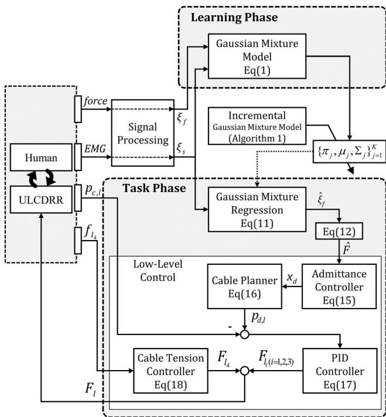  
Figure 2. The overall control framework of ULCDRR. During the learning phase, GMM encoded the relationship between the processed EMG signals $\pmb { \xi } _ { s }$ and 3D forces $\pmb { \xi } _ { f } ,$ , producing the initial parameter set $\{ \pi _ { j } , \mu _ { j } , { \pmb \Sigma } _ { j } \} _ { j = 1 } ^ { K } .$ During the task phase, GMR was initialized with the trained parameter set $\{ \pi _ { j } , \mu _ { j } , \pmb { \Sigma } _ { j } \} _ { j = 1 } ^ { K }$ and utilized the new incoming ${ \pmb \xi } _ { s }$ to estimate $\hat { \pmb { \xi } } _ { f }$ . The incremental GMM approach calibrated the trained parameter set $\{ \pi _ { j } , \mu _ { j } , \pmb { \Sigma } _ { j } \} _ { j = 1 } ^ { K } .$ The estimated forces $\hat { \pmb { \xi } } _ { f }$ were denormalized to $\hat { \pmb F } ,$ and the low-level controller converted $\hat { \pmb F }$ into four cable forces $[ F _ { { \sf I } _ { 1 } } , F _ { { \sf I } _ { 2 } } , F _ { { \sf I } _ { 3 } } , F _ { { \sf I } _ { 4 } } ]$ . Specifically, the EMG-based admittance controller converted $\hat { \pmb F }$ into the desired position $\pmb { x } _ { \mathrm { d } }$ of the end-effector based on the current position. Then, the cable planner determined the desired cable length $\pmb { p } _ { \mathrm { d , l } } = [ p _ { \mathrm { d , l _ { 1 } } } , p _ { \mathrm { d , l _ { 2 } } } , p _ { \mathrm { d , l _ { 3 } } } ]$ , and PID controller calculated the required cable force $\pmb { F } _ { 1 } = [ F _ { 1 _ { 1 } } , F _ { 1 _ { 2 } } , F _ { 1 _ { 3 } } ]$ to minimize the error between actua $\pmb { p } _ { \mathtt { C } , \rVert }$ and desired cable lengths $\pmb { p } _ { \mathrm { d } , | }$ . The cable tension controller generated $F _ { { \vert } _ { 4 } }$ to establish a positive distribution in the three upper cables. Finally, the tension of the four cables displaces the end-effector to achieve pHRI, matching the motion of a human user.

## 3.1.1. GMM

In this study, we established the joint probability density distribution between ${ \pmb \xi } _ { s }$ and $\pmb { \xi } _ { f }$ by GMM. GMM is a probabilistic model consisting of K Gaussian components and is used to encode features for classification or regression.[45] The joint probability density function $\mathcal { P }$ can be written as

$$
\mathcal {P} \left(\boldsymbol {\xi} _ {s}, \boldsymbol {\xi} _ {f}\right) = \sum_ {j = 1} ^ {K} \pi_ {j} \mathcal {N} \left(\boldsymbol {\xi} _ {s}, \boldsymbol {\xi} _ {f} \mid \boldsymbol {\mu} _ {j}, \boldsymbol {\Sigma} _ {j}\right)\tag{1}
$$

with

$$
\boldsymbol {\mu} _ {j} = \left[ \begin{array}{c} \boldsymbol {\mu} _ {s, j} \\ \boldsymbol {\mu} _ {f, j} \end{array} \right], \quad \boldsymbol {\Sigma} _ {j} = \left[ \begin{array}{c c} \boldsymbol {\Sigma} _ {s s, j} & \boldsymbol {\Sigma} _ {s f, j} \\ \boldsymbol {\Sigma} _ {f s, j} & \boldsymbol {\Sigma} _ {f f, j} \end{array} \right]\tag{2}
$$

where $\pmb { \xi } _ { s } \in \mathbb { R } ^ { D _ { s } \times N _ { 0 } }$ is the $D _ { \mathrm { s } } .$ -dimensional feature vector after principle component analysis (PCA) processing and ${ \pmb { \xi } } _ { f } \in$ $\mathbb { R } ^ { D _ { f } \times N _ { 0 } }$ is the $D _ { \mathrm { f } }$ -dimensional force vector normalized by the min–max approach. $N _ { 0 }$ denotes the amount of the training data. PCA here can mitigate the issue ofthe singular or ill-conditioned covariance matrices that can arise in training GMM due to linear correlations among input features.

We employed the shared covariance, a parameter-sharing technique, to mitigate the risk ofoverfitting and reduce the influence of the initialization method. The shared covariance is defined as

$$
\pmb {\Sigma} _ {1} = \pmb {\Sigma} _ {2} = \dots = \pmb {\Sigma} _ {K} = \pmb {\Sigma} ^ {\prime} = \frac {\sum_ {j = 1} ^ {K} \pi_ {j} \pmb {\Sigma} _ {j}}{\sum_ {j = 1} ^ {K} \pi_ {j}}\tag{3}
$$

The parameter $\boldsymbol \theta _ { j } = \left\{ \pi _ { j } , \mu _ { j } , \pmb { \Sigma } _ { j } \right\}$ of each Gaussian component was starting from a rough estimation by k-meansþþ segmentation. Then, the initial GMM $\pmb \theta = \{ \theta _ { j } \} _ { j = 1 } ^ { K }$ (Initial-GMM) was trained offline by the standard expectation–maximization (EM) algorithm. The number of Gaussian components K was determined by a fivefold cross-validation approach.

## 3.1.2. Incremental GMM

In this study, we calibrated the Initial-GMM by an incremental GMM approach. This technique assumes that the posterior probabilities $\mathscr { P } ( \pmb { \theta } | \pmb { \xi } _ { m } )$ remain the same while utilizing the new data $\{ \pmb { \xi } _ { m } \} _ { m = 1 } ^ { N _ { n } }$ to calibrate the model.[46] $N _ { n }$ represents the number ofthe recorded samples associated with the nth EM iteration. In the gth EM step of the nth EM iteration, the expectation step (E-step) is

$$
\left\{ \begin{array}{c} \mathcal {P} \Big (\boldsymbol {\theta} _ {j} ^ {(g)} | \boldsymbol {\xi} _ {m} \Big) = \frac {\pi_ {j} ^ {(g)} \mathcal {N} \Big (\boldsymbol {\xi} _ {m} | \boldsymbol {\mu} _ {j} ^ {(g)} , \boldsymbol {\Sigma} _ {j} ^ {(g)} \Big)}{\sum_ {i = 1} ^ {K} \pi_ {i} ^ {(g)} \mathcal {N} \Big (\boldsymbol {\xi} _ {m} | \boldsymbol {\mu} _ {i} ^ {(g)} , \boldsymbol {\Sigma} _ {i} ^ {(g)} \Big)} \\ E _ {j} ^ {(g + 1)} = \sum_ {m = 1} ^ {N _ {n}} \mathcal {P} \Big (\boldsymbol {\theta} _ {j} ^ {(g)} | \boldsymbol {\xi} _ {m} \Big) \end{array} \right.\tag{4}
$$

Then, the maximization step (M-step) is

$$
\left\{ \begin{array}{l} \pi_ {j} ^ {(g + 1)} = \frac {E _ {j} ^ {(0)} + E _ {j} ^ {(g + 1)}}{N _ {0} + N _ {n}} \\ \boldsymbol {\mu} _ {j} ^ {(g + 1)} = \frac {E _ {j} ^ {(0)} \boldsymbol {\mu} _ {j} ^ {(0)} + \sum_ {m = 1} ^ {N _ {n}} \mathcal {P} \left(\boldsymbol {\theta} _ {j} ^ {(g)} | \boldsymbol {\xi} _ {m}\right) \boldsymbol {\xi} _ {m}}{E _ {j} ^ {(0)} + E _ {j} ^ {(g + 1)}} \\ \boldsymbol {\Sigma} _ {j} ^ {(g + 1)} = \frac {E _ {j} ^ {(0)} \left(\boldsymbol {\Sigma} _ {j} ^ {(0)} + \left(\boldsymbol {\mu} _ {j} ^ {(0)} - \boldsymbol {\mu} _ {j} ^ {(g + 1)}\right) \left(\boldsymbol {\mu} _ {j} ^ {(0)} - \boldsymbol {\mu} _ {j} ^ {(g + 1)}\right) ^ {T}\right)}{E _ {j} ^ {(0)} + E _ {j} ^ {(g + 1)}} \\ + \frac {\sum_ {m = 1} ^ {N _ {n}} \mathcal {P} \left(\boldsymbol {\theta} _ {j} ^ {(g)} | \boldsymbol {\xi} _ {m}\right) \left(\boldsymbol {\xi} _ {m} - \boldsymbol {\mu} _ {j} ^ {(g + 1)}\right) \left(\boldsymbol {\xi} _ {m} - \boldsymbol {\mu} _ {j} ^ {(g + 1)}\right) ^ {T}}{E _ {j} ^ {(0)} + E _ {j} ^ {(g + 1)}} \end{array} \right.\tag{5}
$$

In this study, we defined the complete parameter set $\mathbf { \Theta } _ { \mathbf { \Theta } } \Theta$ as $\{ ( \pmb \theta _ { j } , E _ { j } ) \} _ { j = 1 } ^ { K } ,$ where $\begin{array} { r } { E _ { j } = \sum _ { m = 1 } ^ { N _ { n } } \mathcal { P } \big ( \pmb { \theta } _ { j } | \pmb { \xi } _ { m } \big ) } \end{array}$ . At the beginning of the first EM iteration, $\mathbf { \delta } _ { \mathbf { \Theta } } \mathbf { \Theta } \Theta _ { 0 }$ (Initial-GMM) is set as the initial, i.e., $\left\{ \pmb { \theta } _ { j } ^ { ( 0 ) } , E _ { j } ^ { ( 0 ) } \right\} _ { i = 1 } ^ { K } = \pmb { \Theta } _ { 0 } ,$ . In the incremental GMM proposed by Calinon et al.[46] they utilized the average log-likelihood to perform the convergence assessment after the M-step. The average log-likelihood is

$$
\mathcal {L} = \frac {1}{N _ {n}} \sum_ {m = 1} ^ {N _ {n}} \log \left(\sum_ {j = 1} ^ {K} \pi_ {j} \mathcal {P} (\boldsymbol {\xi} _ {m} | \boldsymbol {\theta} _ {j})\right)\tag{6}
$$

The criterion is

$$
\frac {\mathcal {L} ^ {(g + 1)}}{\mathcal {L} ^ {(g)}} <   1 + \varepsilon\tag{7}
$$

where $\mathcal { L } ^ { \left( g \right) }$ and $\mathcal { L } ^ { ( g + 1 ) }$ are based on $\mathbf { \Theta } \Theta ^ { ( g ) }$ and $\mathbf { \Theta } \Theta ^ { ( g + 1 ) }$ , respectively. If (7) returned true, the first EM iteration would stop and $\mathbf { \Theta _ { 6 } } =$ $\mathbf { \Theta } \Theta ^ { ( g + 1 ) }$ would be the calibrated result. When the nth EM iteration was completed, $\left\{ \pmb { \theta } _ { j } ^ { ( 0 ) } , E _ { j } ^ { ( 0 ) } \right\} _ { j = 1 } ^ { K }$ would be replaced by $\mathbf { \Theta } _ { \mathbf { e } }$ , and $N _ { 0 }$ would be incremented by $N _ { n }$ to prepare for the (n 1)th EM iteration. In this study, the tolerance $\varepsilon = 1 \times 1 0 ^ { - 6 }$ was set. bl displays the definitions of the parameter notations.

We implemented the incremental GMM on the dSPACE controller. In the calibration experiment, the dSPACE can automati cally calibrate the model without human intervention using the collected new incoming data. The data collection and model cali bration program run as two separate threads, wherein the sample rate for capturing is 1 kHz, and the clock rate for task scheduling in calibration program is 100 Hz. The data collector would record the mean features of each window data (including EMG and force), where we arranged 128 windows, each with an 8 ms width, of data collection at equal intervals within a 30 s single data collection cycle.

Table 1. Parameters notations for estimation model learning.

<table><tr><td>Symbols</td><td>Definition and description</td></tr><tr><td> $\xi_s, \xi_f$ </td><td>The processed EMG and force signals.</td></tr><tr><td> $\xi_f, \widehat{\Sigma}_f, F$ </td><td>The estimated conditional expectation, and extracted variability, and the estimated 3D voluntary force.</td></tr><tr><td> $D_{\text{chs}}$ </td><td>The channel number of the raw EMG signals.</td></tr><tr><td> $D_s, D_f$ </td><td>The dimensionality of EMG and force features.</td></tr><tr><td> $N_0, N_n$ </td><td>The count of data collected for the offline pretraining and the  $n$ th EM iteration.</td></tr><tr><td> $C, \nu$ </td><td>The principal component coefficients and the estimated centered mean.</td></tr><tr><td> $n_p$ </td><td>The number of components requested.</td></tr><tr><td> $K, j$ </td><td>The number of Gaussian components and the  $j$ th Gaussian component.</td></tr><tr><td> $\{ \pi_j, \mu_j, \Sigma_j \}, E_j$ </td><td>Parameters and cumulative posterior probability of the  $j$ th Gaussian component.</td></tr><tr><td> $\beta_j$ </td><td>The probability that the component  $j$  has of being responsible for  $\xi_s$ .</td></tr><tr><td> $\theta_j, \Theta$ </td><td> $\theta_j$  denotes  $\{ \pi_j, \mu_j, \Sigma_j \}$  and  $\Theta$  denotes the complete parameter set  $\{ (\theta_j, E_j) \}_{j=1}^K$ .</td></tr><tr><td> $g, n$ </td><td>The  $g$ th EM step and the  $n$ th EM iteration.</td></tr><tr><td> $\Theta_0, \Theta_n, \Theta^{(g)}$ </td><td>The parameter sets involved Initial-GMM, CA-GMM accumulated from  $n$  EM iterations, and the results of the  $g$ th EM step.</td></tr></table>

We adjusted the computation order based on the execution logic of the general incremental GMM program Calinon et $\mathrm { { \bar { a l } . ^ { [ 4 6 ] } } }$ proposed, avoiding redundant computation parts and maintaining the equivalence with Calinon’s approach. The repeated parts occur in the computation of sample likelihood, i.e., $\mathcal { P } \Big ( \pmb { \xi } _ { m } | \pmb { \theta } _ { j } ^ { ( g + 1 ) } \Big )$ . The calculation of this redundant sample likelihood appears in the calculation of the average log-likelihood value $\pmb { \mathscr { L } } ^ { ( g + 1 ) }$ when making convergence judgment in the gth EM step, and in the calculation of the responsibilities $\mathcal { P } \big ( \pmb \theta _ { j } ^ { ( g + 1 ) } | \pmb \xi _ { m } \big )$ of the subsequent (gþ1)th EM step. Algorithm 1 shows the pseudocode of the incremental GMM performed on dSPACE. In this study, after the generation of $\mathcal { P } \big ( \pmb { \xi } _ { m } | \pmb { \theta } _ { j } ^ { ( g ) } \big )$ in the E-step ofthe gth EM step (Lines 6–11), we immediately calculated $\mathcal { L } ^ { \left( g \right) }$ (Line 12) and then performed the convergence assessment (Line 14) combined with $\pmb { \mathscr { L } } ^ { ( g - 1 ) }$ stored in the (g-1)th EM step. If (7) returned false, the M-step would perform (Lines 15–18); otherwise, the program would stop and set $\mathbf { \Theta } \Theta _ { n } = \mathbf { \Theta } \Theta ^ { ( g ) }$ (Line 24). To make the program compatible with the computing capability of the dSPACE controller, we assigned the summation of the denominator described in (4) to K computation steps (Lines 6–9) and updated the parameter subset of each Gaussian component over K computation steps (Line 15–17).

Algorithm 1. Incremental GMM algorithm embedded in dSPACE controller.

Input: $K$, $\left\{\boldsymbol{\theta}_{j}^{(0)}, E_{j}^{(0)}\right\}_{j=1}^{K}$, $\mathcal{L}_{n-1}$, $\{\boldsymbol{\xi}_{m}\}_{m=1}^{N_{n}}$

Output: $\Theta_{n}$

1: MaxIter $\leftarrow 20$

2: $\varepsilon \leftarrow 1 \times 10^{-6}$

3: $\mathcal{P}_{\text{memory}} \leftarrow 0$

4: $\mathcal{L}_{\text{memory}} \leftarrow \mathcal{L}_{n-1}$

5: for $g = 1, 2, \ldots$, MaxIter do

6:    for $i = 1, 2, \ldots, K$ do

7:    $\mathcal{P}(\boldsymbol{\theta}_{i}^{(g)}|\boldsymbol{\xi}_{m}) \leftarrow \pi_{i}^{(g)}\mathcal{N}(\boldsymbol{\xi}_{m}|\boldsymbol{\mu}_{i}^{(g)}, \boldsymbol{\Sigma}_{i}^{(g)})$

8:    $\mathcal{P}_{\text{memory}} \leftarrow \mathcal{P}_{\text{memory}} + \mathcal{P}(\boldsymbol{\theta}_{i}^{(g)}|\boldsymbol{\xi}_{m})$

9:    end for

10:    normalize $\left\{\mathcal{P}(\boldsymbol{\theta}_{j}^{(g)}|\boldsymbol{\xi}_{m})\right\}_{j=1}^{K}$ by $\mathcal{P}_{\text{memory}}$

11:    $\left\{E_{j}^{(g+1)}\right\}_{j=1}^{K} \leftarrow \text{Equation (4)}$

12:    $\mathcal{L}^{(g)} \leftarrow \text{Equation (6)}$

13:    $\mathcal{L}^{(g-1)} \leftarrow \mathcal{L}_{\text{memory}}$

14:    if $\frac{\mathcal{L}^{(g)}}{\mathcal{L}^{(g-1)}} &gt; 1 + \varepsilon$ then

15:    for $j = 1, 2, \ldots, K$ do

16:    $\pi_{j}^{(g+1)}, \boldsymbol{\mu}_{j}^{(g+1)}, \boldsymbol{\Sigma}_{j}^{(g+1)} \leftarrow \text{Equation (5)}$

17:    end for

18:    $\left\{\boldsymbol{\Sigma}_{j}^{(g+1)}\right\}_{j=1}^{K} \leftarrow \text{Equation (3)}$

19:    else

20:    break

21:    end if

22:    $\mathcal{L}_{\text{memory}} \leftarrow \mathcal{L}^{(g)}$

23: end for

24: $\Theta_{n} \leftarrow \Theta^{(g)}$

## 3.1.3. GMR

We employed GMR technique to obtain the conditional expectation of $\pmb { \xi } _ { f }$ given ξ based on the joint distribution described in (1). GMR provides a fast regression approach to compute the multivariate output online.[31] Thus, the prediction task can be defined as

$$
\mathcal {P} \left(\boldsymbol {\xi} _ {f} \mid \boldsymbol {\xi} _ {s}\right) = \sum_ {j = 1} ^ {K} \beta_ {j} \mathcal {N} \left(\boldsymbol {\xi} _ {f} \mid \widehat {\boldsymbol {\mu}} _ {f | s, j}, \widehat {\boldsymbol {\Sigma}} _ {f | s, j}\right)\tag{8}
$$

with

$$
\beta_ {j} = \frac {\pi_ {j} \mathcal {N} (\boldsymbol {\xi} _ {s} | \boldsymbol {\mu} _ {s , j} , \boldsymbol {\Sigma} _ {s s , j})}{\sum_ {i = 1} ^ {K} \pi_ {i} \mathcal {N} (\boldsymbol {\xi} _ {s} | \boldsymbol {\mu} _ {s , i} , \boldsymbol {\Sigma} _ {s s , i})}\tag{9}
$$

and

$$
\left\{ \begin{array}{l} \hat {\boldsymbol {\mu}} _ {f | s, j} = \boldsymbol {\mu} _ {f, j} + \boldsymbol {\Sigma} _ {f s, j} \big (\boldsymbol {\Sigma} _ {s s, j} \big) ^ {- 1} \big (\boldsymbol {\xi} _ {s} - \boldsymbol {\mu} _ {s, j} \big) \\ \hat {\boldsymbol {\Sigma}} _ {f | s, j} = \boldsymbol {\Sigma} _ {f f, j} - \boldsymbol {\Sigma} _ {f s, j} \big (\boldsymbol {\Sigma} _ {s s, j} \big) ^ {- 1} \boldsymbol {\Sigma} _ {s f, j} \end{array} \right.\tag{10}
$$

where $\beta _ { j }$ was the responsibility of each conditional probability density distribution to the new incoming predictor ξ . The estimation $E \big [ \mathcal { P } \big ( \pmb { \xi } _ { f } | \pmb { \xi } _ { s } \big ) \big ]$ of the conditional expectation was

$$
\widehat {\boldsymbol {\xi}} _ {f} = \sum_ {j = 1} ^ {K} \beta_ {j} \widehat {\boldsymbol {\mu}} _ {f | s, j}, \quad \widehat {\boldsymbol {\Sigma}} _ {f} = \sum_ {j = 1} ^ {K} \beta_ {j} ^ {2} \widehat {\boldsymbol {\Sigma}} _ {f | s, j}\tag{11}
$$

The denormalization method of the min–max approach was

$$
\hat {\boldsymbol {F}} = (b - a) \hat {\boldsymbol {\xi}} _ {f} + a\tag{12}
$$

where the minimum a and maximum b factors were empirically set to $[ - 3 5 , - 5 5 , - 4 5 ]$ and [35, 55, 45] respectively. Finally, the estimated 3D voluntary force $\hat { F }$ was the denormalization result of $\widehat { \pmb { \xi } } _ { f } . \widehat { \pmb { \Sigma } } _ { f }$ was the variability extracted from demonstrations.[47]

## 3.1.4. Low-Level Controller

In our previous work,[21] we proposed a low-level controller responsible for converting the received estimated force $\hat { F }$ into the four cable forces $F _ { 1 }$ of ULCDRR, facilitating the movement of the end-effector to reach the target position.

The desired position $\pmb { x } _ { \mathrm { d } }$ of the end-effector was generated via the EMG-based admittance controller

$$
- M _ {\mathrm{h}} \ddot {x} _ {\mathrm{c}} - C _ {\mathrm{h}} \dot {x} _ {\mathrm{c}} + K _ {\mathrm{h}} (x _ {\mathrm{d}} - x _ {\mathrm{c}}) = F\tag{13}
$$

where $M _ { \mathrm { h } } , \thinspace C _ { \mathrm { h } } ,$ and $K _ { \mathrm { h } }$ were the mass, damper, and stiffness matrices, respectively. In this article, we used the simplified admittance mode $\cdot 1 ^ { \left[ 4 8 \right] }$ rewritten as

$$
- \boldsymbol {C} _ {\mathrm{h}} \dot {\boldsymbol {x}} _ {\mathrm{c}} + \boldsymbol {K} _ {\mathrm{h}} (\boldsymbol {x} _ {\mathrm{d}} - \boldsymbol {x} _ {\mathrm{c}}) = \boldsymbol {F}\tag{14}
$$

where $\pmb { x } _ { \mathrm { c } }$ was the current position of the end-effector. Thus, we had the following desired position

$$
\boldsymbol {x} _ {\mathrm{d}} = \boldsymbol {K} _ {\mathrm{h}} ^ {- 1} (\boldsymbol {F} + \boldsymbol {C} _ {\mathrm{h}} \dot {\boldsymbol {x}} _ {\mathrm{c}}) + \boldsymbol {x} _ {\mathrm{c}}\tag{15}
$$

Subsequently, the desired position $\pmb { x } _ { \mathrm { d } }$ of the end-effector was transformed to the desired length $\pmb { p } _ { \mathrm { d } , 1 }$ of the three upper cables using a cable planner

$$
p _ {\mathrm{d}, \mathrm{l} _ {i}} = \sqrt {\left\| \boldsymbol {x} _ {\mathrm{d}} - \boldsymbol {c} _ {\mathrm{l} _ {i}} \right\| ^ {2}}, (i = 1, 2, 3)\tag{16}
$$

where $p _ { \mathrm { d } , \mathrm { l } _ { i } }$ was the desired length of the $l _ { i }$ th cable and $c _ { \mathrm { l _ { i } } }$ was the position of the $l _ { i }$ th pulley in Cartesian coordinates. Additionally, the proportional–integral–derivative controller was applied to drive the cables of ULCDRR so that the end-effector can track the desired position

$$
\boldsymbol {F} _ {l} = \boldsymbol {K} _ {P} (\boldsymbol {p} _ {d, l} - \boldsymbol {p} _ {c, l}) + \boldsymbol {K} _ {I} \int_ {1} ^ {t} (\boldsymbol {p} _ {d, l} - \boldsymbol {p} _ {c, l}) d t + \boldsymbol {K} _ {D} (\dot {\boldsymbol {p}} _ {d, l} - \dot {\boldsymbol {p}} _ {c, l})\tag{17}
$$

where $\boldsymbol { F } _ { \mathrm { l } } = \left[ F _ { \mathrm { l } _ { 1 } } , F _ { \mathrm { l } _ { 2 } } , F _ { \mathrm { l } _ { 3 } } \right] ^ { \mathrm { T } }$ was the cable force vector (Figure 1), and $\pmb { p } _ { \mathrm { d } , \mathrm { l } }$ and $\pmb { p } _ { \mathrm { c , l } }$ were the desired and the actual position vector in joint space, respectively. $K _ { \mathrm { P } } , K _ { \mathrm { I } }$ , and $K _ { \mathrm { D } }$ were diagonal matrices. The driving force $F _ { \mathrm { l _ { 4 } } }$ ofthe lower $\mathsf { c a b l e } f _ { \mathrm { l } _ { 4 } }$ was controlled by a cable tension controller, aiming to set a positive tension distribution in the three upper cables

$$
F _ {l _ {4}} = \left\{ \begin{array}{l l} - 2 7 \Big (\min - f _ {l _ {4}} \Big) , & f _ {l _ {4}} <   f _ {\min} \\ 0 & , f _ {\min} \leq f _ {l _ {4}} \leq f _ {\max} \\ 2 7 \Big (f _ {l _ {4}} - f _ {\max} \Big) & , f _ {l _ {4}} > f _ {\max} \end{array} \right.\tag{18}
$$

where $f _ { \mathrm { l _ { 4 } } }$ was cable-force measurement, and $f _ { \mathrm { m i n } }$ and $f _ { \mathrm { m a x } }$ were set to 7 and 10 N, respectively.

## 3.1.5. Signal Processing

In this study, we recorded the raw EMG signals at a sampling frequency of 1000 Hz. The acquired EMG underwent filtering by a notch filter at 50 Hz and a band-pass filter at 20–450 Hz. The processed EMG underwent full-wave rectification and was further low-pass filtered by a fourth-order Butterworth filter with a 4 Hz cutoff frequency, thereby extracting amplitude envelopes. The amplitude signals were normalized based on the maximum voluntary isometric contraction $\mathrm { ( M V C ) , } ^ { [ 4 9 ] }$ and the MVC normalization factors were incorporated into the program. The root mean square (RMS) features $\pmb { e } ( t ) \in \mathbb { R } ^ { D _ { \mathrm { c h s } } \times \cdot }$ were extracted from the normalized signals using a 300 ms moving window,[50] where $D _ { \mathrm { c h s } }$ denotes the channel number of EMG signals and · denotes the sampling data count.

The pca function in MATLAB 2019b, utilizing the singular value decomposition algorithm, produced the principal component coefficients $\boldsymbol { C } \in \mathbb { R } ^ { n _ { \mathrm { p } } \times D _ { \mathrm { c h s } } }$ s and the estimated centered mean $\pmb { \nu } \in \mathbb { R } ^ { D _ { \mathrm { c h s } } \times 1 }$ . The determination of $n _ { \mathrm { p } } ,$ the number ofcomponents requested, was sequentially accumulating the variance contributions of the PCA components in descending order until the cumulative sum attained 99%. The coefficients of C and ν were embedded into the dSPACE controller, and ${ \pmb \xi } _ { s } = { \bf C } \times ( { \pmb e } ( t ) - { \pmb \nu } )$ was performed to obtain the predictor ξ in the real-time control.

The 3D voluntary force measured by the six-axis force sensor was processed by median filtering with a 5 ms sliding window. The force was then normalized to the range of 0–1 by min–max approach and obtained $\pmb { \xi } _ { f }$ .

## 3.2. Metrics

The accuracy oftracking tasks and smoothness oftrajectories are universally applied to assess the performance ofEMG-based control schemes used for rehabilitation robots. The root mean square error (RMSE) was employed to measure tracking accurac (RMSE ) between the actual $\pmb { x } _ { \mathrm { c } }$ and the targeted position $\pmb { x } _ { \mathrm { r } } .$ RMSE was also implemented to evaluate the estimation accuracy (RMSE ) between the prediction Fˆ and measured value F of 3D forces. The root mean square jerk (RMSJ) was utilized to analyze the compliance of trajectories. In addition, according to the study,[12] we adopted the percentage muscular activation (EMG level) and interaction force (IF) to evaluate the effort in pHRI. The mentioned metrics are as follows:

$$
\mathrm{RMSE} _ {x} = \sqrt {\frac {1}{N} \sum_ {m = 1} ^ {N} \left\| \boldsymbol {x} _ {r , m} - \boldsymbol {x} _ {c , m} \right\| ^ {2}}\tag{19}
$$

$$
\mathrm{RMSE} _ {f} = \sqrt {\frac {1}{N} \sum_ {m = 1} ^ {N} \left\| \hat {\boldsymbol {F}} _ {m} - \boldsymbol {F} _ {m} \right\| ^ {2}}
$$

(20)

$$
\mathrm{RMSJ} = \sqrt {\frac {1}{N} \sum_ {m = 1} ^ {N} \| \ddot {\boldsymbol {x}} _ {c , m} \| ^ {2}}\tag{21}
$$

$$
\mathrm{EMGlevel} _ {\mathrm{h}} = \sqrt {\frac {1}{N} \sum_ {m = 1} ^ {N} \| \boldsymbol {e} _ {\mathrm{h}} (m) \| ^ {2}}\tag{22}
$$

$$
\mathrm{IF} = \sqrt {\frac {1}{N} \sum_ {m = 1} ^ {N} \| \boldsymbol {F} _ {m} \| ^ {2}}\tag{23}
$$

where N is the number of sampling points of the trajectory, m is the mth point in the trajectory, and h is the hth channel of EMG signals.

## 3.3. Statistical Analysis

All statistical tests were at a significance level of $\alpha = 0 . 0 5$ . We performed a normality test (Lilliefors test) on the difference between the paired samples of interest. The paired-sample Wilcoxon signed-rank test and the paired-sample t-test were used for nonparametric and parametric analyses, respectively.

## 4. Experimental Protocol

In this study, the experimental protocol mainly consisted ofthree parts: 1) the data collection experiment, 2) the calibration and trajectory-tracking experiment, and 3) the fatigue-inducing experiment. We recorded EMG in real time by arranging eight sets of AgCl electrodes on the participant’s left arm: biceps brachii (BIC), long head of triceps (TRI-LO), medial head of triceps (TRI-ME), lateral head of triceps (TRI-LA), anterior of deltoid (DA), medial of deltoid (DM), posterior of deltoid (DP), and brachioradialis (BR). The 3D voluntary force data were collected by a six-axis force sensor integrated into the end-effector. In the data collection experiment, we obtained the training data (including EMG and force) for training an initial model (Initial-GMM). The one-trial experiment followed the following procedure: First, we calibrated the Initial-GMM by the incremental GMM approach to obtain a calibrated model (CA-GMM). Then, we employed the Initial-GMM and CA-GMM to perform trajectory-tracking experiments, respectively. Subsequently, we conducted the fatigueinducing experiment. Finally, we calibrated the Initial-GMM to obtain a new CA-GMM and repeated the same trajectorytracking experiments muscle fatigue. We recruited eight healthy subjects (three females and five males, $2 3 . 9 \pm 2 . 8$ years old) for the experiments. One person is left-handed, and all other participants are right-handed. All participants performed two trials following the experimental procedure above. This study was approved by School of Medicine, Sun Yat-sen University Institutional Review Board, and the ethical approval document number is Medical Ethics 2021 No. 14. All participants signed the written informed consent forms.

## 4.1. Data Collection Experiment

In the data collection experiment, we obtained training data for Initial-GMM, including EMG and force. We designed a virtual slider-tracking task on the visual feedback screen to guide this data collection experiment. The setting of the virtual task included a reference and a controlled slider (Figure 3a). The one-complete movement task of the reference slider was to complete a designed 30 s motion in the Cartesian coordinate system, corresponding to a one-cycle data collection. The magnitudes of the terminal positions along the X, Y, and Z axes were determined empirically as [35, 55, 45], respectively. Specifically, the motion was starting from the origin, advancing to the end of $+ X ,$ returning to the origin, proceeding to the end $\operatorname { o f } - X ,$ and returning to the origin, and then performing in the Z direction and finally in the Y direction. The moving direction and position ofthe reference slider guided the direction and magnitude ofthe force applied by participants. The position ofthe controlled slider reflected the direction and magnitude of the force exerted by participants, where the force-to-slider mapping was achieved by a six-axis force sensor integrated into the end-effector.

In this study, we collected training data through static isometric contraction experiments, where the end-effector was constrained at the origin by the four cables. Experiments included muscle relaxation demonstrations and force application demonstrations. During demonstrations with muscle relaxation, the participant raised the left arm without exerting force on the end-effector. In demonstrations with force application, the participant controlled the controlled slider to track the motion of the reference slider by applying force on the end-effector. We collected 20-cycle training data, including 2-cycle data from muscle relaxation demonstrations and 18-cycle data from force application demonstrations. After completing the data collection, we determined the number of Gaussian components of Initial-GMM for each subject by a fivefold cross-validation approach.[51]

(a)  
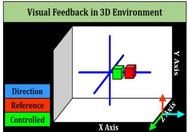

(b)  
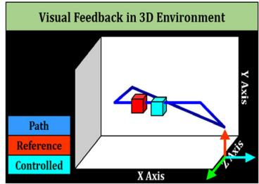  
(d)

## 4.2. Calibration and Trajectory-Tracking Experiment

In the calibration experiment, we designed a demonstration task involving six EM iterations to calibrate the Initial-GMM. The demonstration in this experiment was identical to the demonstration with force application implemented in the data-collection experiment.

In the trajectory-tracking experiment, we designed a virtual 3D task space on the visual feedback screen, including a red reference slider and a rounded rectangle trajectory (Figure 3b). The subject tracked the motion of a red reference slider, drawing the required trajectory using EMG-based control. We designed two blocks for trajectory-tracking tasks. Each block included two EMG-based control schemes: one based on Initial-GMM $( \mathbf { \Theta } _ { \mathbf { 0 } } )$ and the other based on CA-GMM $( \Theta _ { n } )$ . Each control scheme performed one trajectory-tracking cycle in each block. The selection of control schemes was random, and subjects were unaware of the current scheme.

We conducted the calibration and trajectory-tracking experiment before and after the fatigue-inducing experiment, where the CA-GMM obtained were both iterative from the Initial-GMM. Additionally, the calibration and trajectory-tracking experiments that followed the fatigue-inducing experiment were performed immediately without any rest time. Before the formal experiment, participants engaged in four to five tracking practices using the scheme based on the Initial-GMM.

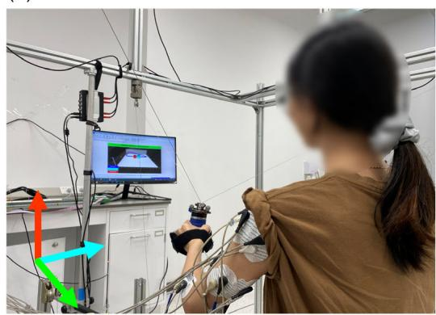

(c)  
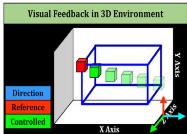

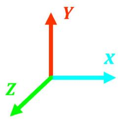  
Figure 3. Schematic diagram of the visual feedback on the visual screen in a) data collection experiment, b) trajectory-tracking experiment, and c) fatigue-inducing experiment. Participants can obtain their performance on the current control task by receiving information on a visual feedback screen. d) The real-world experimental scenarios. The Cartesian coordinate system in (a), (b), and (c) is constructed following the right-hand rule and aligns with the real-world scenarios (d).

## 4.3. Fatigue-Inducing Experiment

In the fatigue-inducing experiment, we designed an isometric contraction task to induce muscle fatigue. We utilized a targetapproaching task in a virtual space on the visual feedback screen, including a fixed red target slider and a green controlled slider (Figure 3c). The end-effector was constrained at the origin by the four cables and converted the force applied by the subject to the position of the controlled slider. The controlled slider was the force measurement that reflected the magnitude and direction of the force. This setup followed the protocol by Tkach et al.[52] where participants performed a fatigue-inducing experiment by static isometric contractions under the guidance of the force measurement. Participants controlled the controlled slider to move toward the target slider and did their best to maintain the effort level defined by the target slider. During the fatigue-inducing experiment, we encouraged participants to persevere. If subjects reported being too tired to continue, the experiment would stop. The calibration and trajectory-tracking experiments that followed the fatigue-inducing experiment were performed immediately. There was no rest time to prevent recovery from muscle fatigue. The assumption was that the same level of muscle fatigue was sustained in the calibration and trajectorytracking experiments after the fatigue-inducing experiment.[53]

## 5. Results

As shown in Figure 4, the average RMSE of 3D voluntary force estimation based on Initial-GMM and CA-GMM before the fatigue-inducing experiment was lower than that of after. As the number of EM iterations in the calibration experiment increases, the average RMSE based on CA-GMM decreases monotonically. Before the fatigue-inducing experiment, although the average RMSE of CA-GMM was higher than that of Initial-GMM, the discrepancy of average RMSE between the CA-GMM and Initial-GMM gradually narrowed with the increase of EM iterations. After the fatigue-inducing experiment, the average RMSE results of CA-GMM were higher than that of Initial-GMM during the initial four EM iterations. However, the RMSE outcome of CA-GMM was lower than that of Initial-GMM from the fifth EM iteration onward, indicating better performance in the accuracy of 3D force estimation.

Fi 5 displays tracking trajectories drawn by a subject without and with the influence of muscle fatigue. Figure 5a shows that the EMG-based control separately utilizing the Initial-GMM and CA-GMM drew 3D rounded rectangles with smoothness in trajectory-tracking experiments. Figure 5b shows the impact of muscle fatigue on the Initial-GMM-based control, manifesting as a decrease in compliance and increased tracking deviation. In contrast, the control scheme based on the CA-GMM improves tracking accuracy and compliance control.

Figure 6 illustrates the EMG level of eight-channel EMG signals in trajectory-tracking experiments, in which the high EMG level means the more muscular effort of participants during EMG-based control. Detailed values are available in T bl 2. Under muscle fatigue conditions, CA-GMM reduced the EMG level more than Initial-GMM, especially at the BIC, DM, DP, TRI-LA, and TRI-LO channels. The improvements in these channels indicate that the proposed approach can reduce the muscle efforts of human users in the current task related to the inward pulling and outward extension of the forearm. The EMG level at the BIC, DM, DP, TRI-LA, and TRI-LO channels dropped by 4.02%, 4.81%, 8.85%, 4.68%, and 13.91%, respectively.

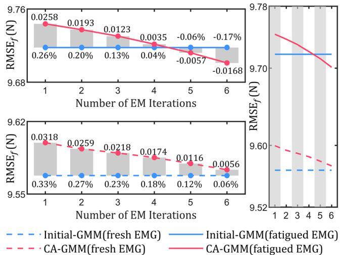  
Figure 4. The change of average RMSE for 3D voluntary force estimation with increasing EM iterations. Lower RMSE corresponds to better estimation performance. An EM iteration represents a single calibration using one-cycle data, comprising multiple EM steps to achieve convergence. Numbers 1–6 indicate the count of EM iterations. The testing data were an extra recorded one-cycle data. Gray bars in each subfigure on the left indicate the absolute change achieved by CA-GMM over Initial-GMM, where percentage values show the relative improvement and numerica values indicate the change.

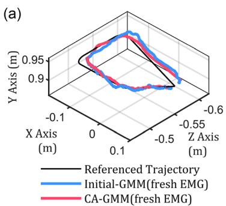

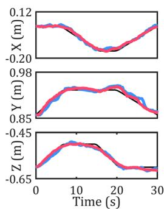

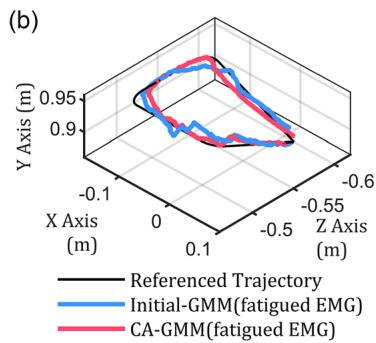

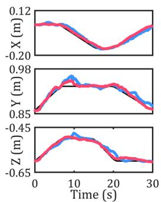  
Figure 5. Trajectory-tracking results of a subject are obtained through EMG-based control utilizing Initial-GMM and CA-GMM, respectively, on the ULCDRR platform. The tracking outcomes are present in two scenarios: a) without muscle fatigue and b) with muscle fatigue.

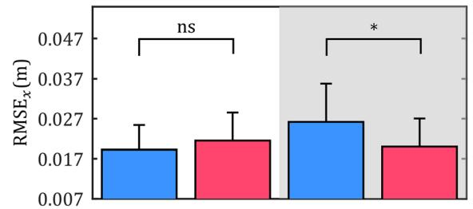

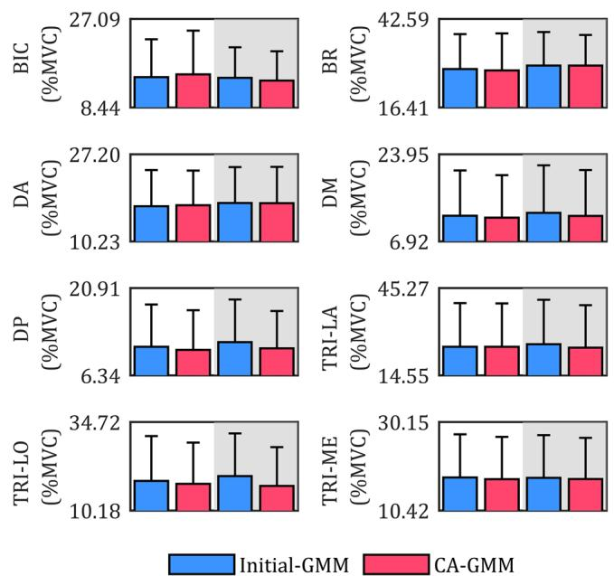  
Figure 6. Average EMG level of eight-channel EMG signals. Each bar represents the average performance of all subjects under identical experimental conditions. Bars on a white background indicate the results before a fatigue-inducing experiment, and bars on a gray background indicate the results after.

Fi 7 presents the average performance for tracking accuracy (RMSE ), trajectory smoothness (RMSJ), and IF in EMGbased control. Detailed values are available in Table 2. Before the fatigue-inducing experiment, the RMSE results obtained using the control model based on Initial-GMM were lower than those based on CA-GMM. The normality test result $( p = 0 . 1 > 0 . 0 5 )$ shows that the data should be statistically analyzed using a paired t-test. The result indicates no significant difference in the RMSE values from the Initial-GMM and CA-GMM $( p = 0 . 0 6 5 5 > 0 . 0 5 )$ . Under the influence of muscle fatigue, the EMG-based control strategy based on Initial-GMM suffered performance degradation, with a 36.46% increase in the RMSE , a 10.19% increase in the RMSJ, and a 7.29% increase in the IF. During periods when subjects experienced muscle fatigue, utilizing CA-GMM compared to Initial-GMM shows a decrease of 23.66%, 8.17%, and 5.04% in RMSE , RMSJ, and IF. The normality test result of RMSE $( p = 0 . 0 2 5 1 < 0 . 0 5 )$

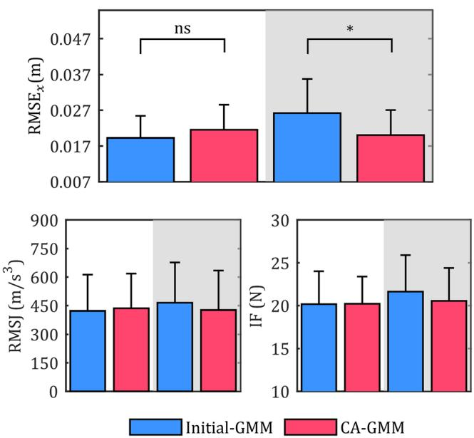  
Figure 7. Average RMSE , RMSJ, and IF in trajectory-tracking tasks. Each bar represents the average performance of all subjects under identical experimental conditions. Bars on a white background indicate the results before a fatigue-inducing experiment, and bars on a gray background indicate the results after. ns denotes no statistical difference, whereas \* denotes a statistical difference at $p < 0 . 0 0 1$

Table 2. Experimental results of trajectory-tracking experiments before and after the fatigue-inducing experiment.

<table><tr><td></td><td colspan="2">Before the fatigue-inducing experiment</td><td colspan="2">After the fatigue-inducing experiment</td></tr><tr><td>Model</td><td>Initial-GMM</td><td>CA-GMM</td><td>Initial-GMM</td><td>CA-GMM</td></tr><tr><td> $RMSE_x$ </td><td>0.0192 ± 0.0062</td><td>0.0215 ± 0.0070</td><td>0.0262 ± 0.0096</td><td>0.0200 ± 0.0070</td></tr><tr><td>RMSJ</td><td>422 ± 190.48</td><td>436 ± 182.45</td><td>465 ± 212.40</td><td>427 ± 207.74</td></tr><tr><td>IF</td><td>20.16 ± 3.86</td><td>20.22 ± 3.17</td><td>21.63 ± 4.27</td><td>20.54 ± 3.86</td></tr><tr><td>EMG level, BIC</td><td>14.80 ± 8.00</td><td>15.37 ± 9.26</td><td>14.66 ± 6.45</td><td>14.07 ± 6.19</td></tr><tr><td>EMG level, BR</td><td>27.73 ± 10.37</td><td>27.35 ± 10.96</td><td>28.75 ± 9.97</td><td>28.74 ± 9.11</td></tr><tr><td>EMG level, DA</td><td>17.05 ± 7.06</td><td>17.24 ± 6.77</td><td>17.69 ± 6.99</td><td>17.65 ± 7.08</td></tr><tr><td>EMG level, DM</td><td>11.90 ± 8.87</td><td>11.54 ± 8.32</td><td>12.47 ± 9.31</td><td>11.87 ± 8.98</td></tr><tr><td>EMG level, DP</td><td>11.08 ± 7.08</td><td>10.56 ± 6.65</td><td>11.86 ± 7.14</td><td>10.81 ± 6.26</td></tr><tr><td>EMG level, TRI-LA</td><td>24.55 ± 15.44</td><td>24.57 ± 15.30</td><td>25.44 ± 15.71</td><td>24.25 ± 15.00</td></tr><tr><td>EMG level, TRI-LO</td><td>18.36 ± 12.47</td><td>17.53 ± 11.49</td><td>19.70 ± 11.86</td><td>16.96 ± 10.79</td></tr><tr><td>EMG level, TRI-ME</td><td>17.76 ± 9.65</td><td>17.36 ± 9.48</td><td>17.68 ± 9.54</td><td>17.42 ± 9.20</td></tr></table>

indicates a statistical analysis using the paired Wilcoxon signedrank test. The analysis indicates a significant difference in the paired RMSE values obtained from the Initial-GMM and CA-GMM (p < 0.001).

## 6. Discussion

This study proposed an EMG-based control model employing GMM to estimate 3D continuous forces, wherein continuous intentions can facilitate participant-independent control tasks.[11] Chao et al. emphasized the importance of considering the coupling of dimensional components in their study on 3D finger force.[54] Compared with Hill-type model[18] and the method of parallel 1D force estimation,[15,24] GMM directly encoded the connection involving uncertainty between EMG and 3D forces by establishing the joint probability density distribution. Specifically, the cross-correlation coefficients of the GMM’s covariance matrices encoded the interconnections among the 3D components and the relationship between forces and EMG signals. Zhang et al. proposed a modeling assumption that the relationship between EMG and 3D force involved shared features and dimension-specific features.[16] Hogan et al. proposed that the Gaussian distribution can model the relationship between muscle contraction and myoelectric activity.[55] Each Gaussian component of the GMM can embody the picking of such a single event, and their weighted combination to form GMM can parallel the constitution of macroscopic muscle activity. GMM can flexibly deal with model learning of EMG–force relationships with varying complexity by adjusting the number of Gaussian components. Compared with Zhang et al.[16] GMM with multiple Gaussian components may be suitable for the estimation of 3D arm force using multichannel EMG signals.

The embedded computational model in intelligent EMGbased interfaces should consider computational cost and generalization. In contrast to kernel-based multioutput approaches such as GRNN[25] and multi-output support vector regression,[56] GMM can achieve a fast 3D voluntary force output by GMR to perform real-time EMG-based control without accessing source data during prediction.[31] Compared with models requiring specialized architectural design,[15,16,24,26,27] GMM only necessitates determining the number of Gaussian components. When it comes to the time-varying nature of EMG[42] and the increased force variability caused by muscle fatigue,[57] the variability in the EMG–force relationship encoded by GMM’s covariance can facilitate the probabilistic inference under the influence of environmental changes involving uncertainty. In this study, we also shared the covariance parameters of each component in GMM (i.e., shared covariance) to improve the generalization performance under the inductive bias.[58]

GMM combined with GMR can be regarded as a bioinspired technique because it emulates the processes of probabilistic modeling and reasoning performed by the human brain.[32,33] Complex human–robot interactions necessitate human involvement[15,59] and depend on the regulation based on the human central nervous system.[60] Bioinspired models can facilitate the control of the human central nervous system, improving the performance of EMG-based physical human– robot interaction.[22,61]

Owing to the fatigue-induced shift in the EMG–force relation ship, the performance of EMG-based admittance control might have a degradation. We integrated the incremental GMM-based calibration algorithm into a dSPACE controller in response to the effect of muscle fatigue. As shown in Figure 4, the accuracy of arm force estimation using CA-GMM could surpass that of Initial-GMM after five EM iterations under muscle fatigue. The result suggests that EMG-based computational models may not achieve performance compensation if only a single cali bration at a time. Incremental learning-based calibrations can facilitate model–subject matching by continuously accumulating experience, potentially improving robot-assisted rehabilitation with EMG-based interfaces. As shown in Figure 7, EMG-based control using CA-GMM improved the tracking accuracy under the influence of muscle fatigue, facilitating control compliance and reducing IF. The results indicated that the intelligent EMG-based human–robot interface was less affected when utilizing a suitable EMG decoder model. The improvement could be attributed to two main factors: first, inaccurate mean vectors directly reflect distribution shifts, and the calibration ofthe mean vectors allows the GMM and EMG–force relationship to be rematched. Second, the calibration of the covariance matrix accommodated the increased uncertainty of the EMG–force rela tionship caused by muscle fatigue. The EMG-based control using CA-GMM improved tracking accuracy in the presence of muscle fatigue, which did not require additional compliance loss and increased IFs. The reduced cost suggests that the proposed approach could improve the comfort and safety of EMG-based control systems, potentially facilitating sustained engagement in training among participants while maintaining consistent training intensity. Before the fatigue-inducing experiment, the EMG-based control using CA-GMM did not achieve higher tracking accuracy, potentially due to the inadequate estimation performance ofCA-GMM compared with that ofInitial-GMM in terms of the six EM iterations (shown in Figure 4). Nevertheless, the statistical result demonstrated similar tracking performance, which implicated human motion adaptation may cope with some differences in EMG-based control models.[62] However, such motion adaptability may prove insufficient in response to muscle fatigue during EMG-based pHRI, necessitating the proposed adaptive calibration via machine intelligence employing incremental GMM.

There are two limitations in this study. First, this study only involved healthy subjects. Our follow-up work will recruit suitable patient participants. Second, the proposed technique may have performance differences on different platforms, so further investigation is needed.

## 7. Conclusions

This article proposed an improved GMM to estimate the 3D voluntary force, performing the EMG-based admittance control on the ULCDRR platform. Experimental results demonstrate that the proposed EMG-based admittance control using GMM can improve control precision and compliance during physical human–robot interaction. The utilization of calibrated GMM reduced the effect of muscle fatigue during the EMG-based control. Therefore, the proposed approach holds potential applications in EMG-based robot-assisted rehabilitation and other fields that involve physical human–robot interaction. Future work can evaluate the performance of the proposed approach on different groups of participants.

## Appendix

## A1. A Formula Derivation in GMM

The maximum likelihood estimation for solving GMM encounters difficulties with partial derivatives; thus, the EM algorithm is typically employed.

$$
\boldsymbol {\theta} ^ {(g + 1)} = \arg \max \underbrace {\mathbb {E} _ {z | \boldsymbol {\xi} , \boldsymbol {\theta} ^ {(g)}} [ \log \mathcal {P} (\boldsymbol {\xi} , z | \boldsymbol {\theta}) ]} _ {\mathcal {Q} (\boldsymbol {\theta}, \boldsymbol {\theta} ^ {(g)})}\tag{A1}
$$

where $Q \big ( \pmb \theta , \pmb \theta ^ { ( g ) } \big )$ is the objective function of the EM algorithm and $z \in \{ z _ { m } = j | j = 1 , \ \cdot \ \cdot \ , K \}$ is a latent variable.

$$
\begin{array}{l} Q \big (\boldsymbol {\theta}, \boldsymbol {\theta} ^ {(g)} \big) = \int_ {Z} \log \mathcal {P} (\boldsymbol {\xi}, Z | \boldsymbol {\theta}) \times \mathcal {P} \big (Z | \boldsymbol {\xi}, \boldsymbol {\theta} ^ {(g)} \big) d Z \\ = \sum_ {z _ {1}, \dots , z _ {N}} \left\{\left[ \sum_ {m = 1} ^ {N} \log \mathcal {P} (\boldsymbol {\xi} _ {m}, z _ {m} | \boldsymbol {\theta}) \right] \prod_ {m = 1} ^ {N} \mathcal {P} \big (z _ {m} | \boldsymbol {\xi} _ {m}, \boldsymbol {\theta} ^ {(g)} \big) \right\} \\ = \sum_ {m = 1} ^ {N} \sum_ {z _ {m} = 1} ^ {K} \log \mathcal {P} (\boldsymbol {\xi} _ {m}, z _ {m} | \boldsymbol {\theta}) \times \mathcal {P} \big (z _ {m} | \boldsymbol {\xi} _ {m}, \boldsymbol {\theta} ^ {(g)} \big) \end{array}\tag{A2}
$$

According to the Bayesian rule, we have

$$
\mathcal {P} (\boldsymbol {\xi}, \boldsymbol {z} | \boldsymbol {\theta}) = \mathcal {P} (\boldsymbol {z} | \boldsymbol {\theta}) \mathcal {P} (\boldsymbol {\xi} | \boldsymbol {z}, \boldsymbol {\theta})\tag{A3}
$$

$$
\mathcal {P} \big (z | \boldsymbol {\xi}, \boldsymbol {\theta} ^ {(g)} \big) = \frac {\mathcal {P} (\boldsymbol {\xi} , z | \boldsymbol {\theta})}{\mathcal {P} \big (\boldsymbol {\xi} | \boldsymbol {\theta} ^ {(g)} \big)}\tag{A4}
$$

Substituting (A3) and (A4) into (A2), we can derive

$$
\begin{array}{l} Q (\boldsymbol {\theta}, \boldsymbol {\theta} ^ {(g)}) = \sum_ {j = 1} ^ {K} \sum_ {m = 1} ^ {N} \log \mathcal {P} (\boldsymbol {\xi} _ {m}, \boldsymbol {\theta} _ {j}) \times \mathcal {P} (\boldsymbol {\theta} _ {j} ^ {(g)} | \boldsymbol {\xi} _ {m}) \\ = \sum_ {j = 1} ^ {K} \sum_ {m = 1} ^ {N} \log \left(\pi_ {j} \mathcal {N} (\boldsymbol {\xi} _ {m} | \boldsymbol {\mu} _ {j}, \boldsymbol {\Sigma} _ {j})\right) \times \frac {\pi_ {j} ^ {(g)} \mathcal {N} (\boldsymbol {\xi} _ {m} | \boldsymbol {\mu} _ {j} ^ {(g)} , \boldsymbol {\Sigma} _ {j} ^ {(g)})}{\sum_ {i = 1} ^ {K} \pi_ {i} ^ {(g)} \mathcal {N} (\boldsymbol {\xi} _ {m} | \boldsymbol {\mu} _ {i} ^ {(g)} , \boldsymbol {\Sigma} _ {i} ^ {(g)})} \end{array}\tag{A5}
$$

To solve the partial derivative of $\pi _ { j } { \mathrm { : } }$ , we can rewrite (A5) as

$$
G (\pi , \lambda) = \sum_ {j = 1} ^ {K} \sum_ {m = 1} ^ {N} \log \pi_ {j} \times \mathcal {P} \left(\boldsymbol {\theta} _ {j} ^ {(g)} | \boldsymbol {\xi} _ {m}\right) + \lambda \left(\sum_ {j = 1} ^ {K} \pi_ {j} - 1\right)\tag{A6}
$$

where λ is the Lagrange multiplier. To solve the partial derivative of $\pmb { \mu } _ { j }$ and $\Sigma _ { j } ,$ we can simplify (A5) to

$$
G (\boldsymbol {\mu}, \boldsymbol {\Sigma}) = \sum_ {j = 1} ^ {K} \sum_ {m = 1} ^ {N} \log \mathcal {N} \left(\boldsymbol {\xi} _ {m} | \boldsymbol {\mu} _ {j}, \boldsymbol {\Sigma} _ {j}\right) \times \mathcal {P} \left(\boldsymbol {\theta} _ {j} ^ {(g)} | \boldsymbol {\xi} _ {m}\right)\tag{A7}
$$

By calculating the partial derivatives in formulas (A6) and (A7), we can obtain the iteration formula for the M-step in the EM algorithm.

$$
\left\{ \begin{array}{l} \pi_ {j} ^ {(g + 1)} = \frac {1}{N} \sum_ {m = 1} ^ {N} \mathcal {P} \left(\boldsymbol {\theta} _ {j} ^ {(g)} | \boldsymbol {\xi} _ {m}\right) \\ \boldsymbol {\mu} _ {j} ^ {(g + 1)} = \frac {\sum_ {m = 1} ^ {N} \mathcal {P} \left(\boldsymbol {\theta} _ {j} ^ {(g)} | \boldsymbol {\xi} _ {m}\right) \boldsymbol {\xi} _ {m}}{\sum_ {m = 1} ^ {N} \mathcal {P} \left(\boldsymbol {\theta} _ {j} ^ {(g)} | \boldsymbol {\xi} _ {m}\right)} \\ \boldsymbol {\Sigma} _ {j} ^ {(g + 1)} = \frac {\sum_ {m = 1} ^ {N} \mathcal {P} \left(\boldsymbol {\theta} _ {j} ^ {(g)} | \boldsymbol {\xi} _ {m}\right) \left(\boldsymbol {\xi} _ {m} - \boldsymbol {\mu} _ {j} ^ {(g + 1)}\right) \left(\boldsymbol {\xi} _ {m} - \boldsymbol {\mu} _ {j} ^ {(g + 1)}\right) ^ {T}}{\sum_ {m = 1} ^ {N} \mathcal {P} \left(\boldsymbol {\theta} _ {j} ^ {(g)} | \boldsymbol {\xi} _ {m}\right)} \end{array} \right.\tag{A8}
$$

Thus, the E-step of GMM only needs to calculate

$$
\mathcal {P} \left(\boldsymbol {\theta} _ {j} ^ {(g)} | \boldsymbol {\xi} _ {m}\right) = \frac {\pi_ {j} ^ {(g)} \mathcal {N} \left(\boldsymbol {\xi} _ {m} | \boldsymbol {\mu} _ {j} ^ {(g)} , \boldsymbol {\Sigma} _ {j} ^ {(g)}\right)}{\sum_ {i = 1} ^ {K} \pi_ {i} ^ {(g)} \mathcal {N} \left(\boldsymbol {\xi} _ {m} | \boldsymbol {\mu} _ {i} ^ {(g)} , \boldsymbol {\Sigma} _ {i} ^ {(g)}\right)} = \gamma_ {m, j} ^ {(g + 1)}\tag{A9}
$$

and $\begin{array} { r } { E _ { j } ^ { ( g + 1 ) } = \sum _ { m = 1 } ^ { N } \gamma _ { m , j } ^ { ( g + 1 ) } } \end{array}$ instead of the entire Q function.

The outcome of the incremental GMM algorithm was provided in the study.[46] The derivation trick ofdirect method based on (A8) is to separate the part that related to the initial dataset $\left\{ \pmb { \xi } _ { m } \right\} _ { m = 1 } ^ { N _ { 0 } }$ from the part that corresponding to the current sampled dataset $\{ \pmb { \xi } _ { m } \} _ { m = 1 } ^ { N _ { n } }$ . Hence, we have

$$
\pi_ {j} ^ {(g + 1)} = \frac {\sum_ {m = 1} ^ {N _ {0}} \gamma_ {m , j} ^ {(0)} + \sum_ {m = N _ {0} + 1} ^ {N _ {0} + N _ {n}} \gamma_ {m , j} ^ {(g + 1)}}{N _ {0} + N _ {n}} = \frac {E _ {j} ^ {(0)} + E _ {j} ^ {(g + 1)}}{N _ {0} + N _ {n}}\tag{A10}
$$

where $\gamma _ { m , j } ^ { ( 0 ) } = \mathcal { P } \Big ( \pmb { \theta } _ { j } ^ { ( 0 ) } | \pmb { \xi } _ { m } \Big )$ and $\begin{array} { r } { E _ { j } ^ { ( 0 ) } = \sum _ { m = 1 } ^ { N _ { 0 } } \gamma _ { m , j } ^ { ( 0 ) } } \end{array}$ . The derivation of $\pmb { \mu } _ { j } ^ { ( g + 1 ) }$ and $\pmb { \Sigma } _ { j } ^ { ( g + 1 ) }$ is

$$
\begin{array}{c} \boldsymbol {\mu} _ {j} ^ {(g + 1)} = \frac {\sum_ {m = 1} ^ {N _ {0}} \gamma_ {m , j} ^ {(0)} \boldsymbol {\xi} _ {m} + \sum_ {m = N _ {0} + 1} ^ {N _ {0} + N _ {n}} \gamma_ {m , j} ^ {(g + 1)} \boldsymbol {\xi} _ {m}}{\sum_ {m = 1} ^ {N _ {0}} \gamma_ {m , j} ^ {(0)} + \sum_ {m = N _ {0} + 1} ^ {N _ {0} + N _ {n}} \gamma_ {m , j} ^ {(g + 1)}} \\ = \frac {E _ {j} ^ {(0)} \boldsymbol {\mu} _ {j} ^ {(0)} + \sum_ {m = 1} ^ {N _ {n}} \gamma_ {m , j} ^ {(g + 1)} \boldsymbol {\xi} _ {m}}{E _ {j} ^ {(0)} + E _ {j} ^ {(g + 1)}} \end{array}\tag{A11}
$$

and

$$
\begin{array}{l} \boldsymbol {\Sigma} _ {j} ^ {(g + 1)} = \frac {\sum_ {m = 1} ^ {N _ {0}} \gamma_ {m , j} ^ {(0)} \left(\boldsymbol {\xi} _ {m} - \boldsymbol {\mu} _ {j} ^ {(g + 1)}\right) \left(\boldsymbol {\xi} _ {m} - \boldsymbol {\mu} _ {j} ^ {(g + 1)}\right) ^ {T}}{\sum_ {m = 1} ^ {N _ {0}} \gamma_ {m , j} ^ {(0)} + \sum_ {m = N _ {0} + 1} ^ {N _ {0} + N _ {n}} \gamma_ {m , j} ^ {(g + 1)}} \\ + \frac {\sum_ {m = N _ {0} + 1} ^ {N _ {0} + N _ {n}} \gamma_ {m , j} ^ {(g + 1)} \left(\boldsymbol {\xi} _ {m} - \boldsymbol {\mu} _ {j} ^ {(g + 1)}\right) \left(\boldsymbol {\xi} _ {m} - \boldsymbol {\mu} _ {j} ^ {(g + 1)}\right) ^ {T}}{\sum_ {m = 1} ^ {N _ {0}} \gamma_ {m , j} ^ {(0)}   +   \sum_ {m = N _ {0} + 1} ^ {N _ {0} + N _ {n}} \gamma_ {m , j} ^ {(g + 1)}} \end{array}
$$

(A12)

The numerator of the first fractional term in (A12) can be further derived as

© 2024 The Author(s). Advanced Intelligent Systems published by Wiley-VCH GmbH

$$
\begin{array}{l} \sum_ {m = 1} ^ {N _ {0}} \gamma_ {m, j} ^ {(0)} \times \left(\boldsymbol {\xi} _ {m} - \boldsymbol {\mu} _ {j} ^ {(g + 1)}\right) \left(\boldsymbol {\xi} _ {m} - \boldsymbol {\mu} _ {j} ^ {(g + 1)}\right) ^ {\mathrm{T}} \\ = \sum_ {m = 1} ^ {N _ {0}} \gamma_ {m, j} ^ {(0)} \times \left(\boldsymbol {\xi} _ {m} \boldsymbol {\xi} _ {m} ^ {\mathrm{T}} - \boldsymbol {\xi} _ {m} \boldsymbol {\mu} _ {j} ^ {(g + 1), \mathrm{T}} - \boldsymbol {\mu} _ {j} ^ {(g + 1)} \boldsymbol {\xi} _ {m} ^ {\mathrm{T}} + \boldsymbol {\mu} _ {j} ^ {(g + 1)} \boldsymbol {\mu} _ {j} ^ {(g + 1), \mathrm{T}}\right) \\ = \sum_ {m = 1} ^ {N _ {0}} \gamma_ {m, j} ^ {(0)} \times \left(\boldsymbol {\xi} _ {m} \boldsymbol {\xi} _ {m} ^ {\mathrm{T}} - \boldsymbol {\xi} _ {m} \boldsymbol {\mu} _ {j} ^ {(0), \mathrm{T}} - \boldsymbol {\mu} _ {j} ^ {(0)} \boldsymbol {\xi} _ {m} ^ {\mathrm{T}} + \boldsymbol {\mu} _ {j} ^ {(0)} \boldsymbol {\mu} _ {j} ^ {(0), \mathrm{T}} + \boldsymbol {\xi} _ {m} \boldsymbol {\mu} _ {j} ^ {(0), \mathrm{T}} \right. \\ \quad + \left. \boldsymbol {\mu} _ {j} ^ {(0)} \boldsymbol {\xi} _ {m} ^ {\mathrm{T}} - \boldsymbol {\mu} _ {j} ^ {(0)} \boldsymbol {\mu} _ {j} ^ {(0), \mathrm{T}} - \boldsymbol {\xi} _ {m} \boldsymbol {\mu} _ {j} ^ {(g + 1), T} - \boldsymbol {\mu} _ {j} ^ {(g + 1)} \boldsymbol {\xi} _ {m} ^ {\mathrm{T}} + \boldsymbol {\mu} _ {j} ^ {(g + 1)} \boldsymbol {\mu} _ {j} ^ {(g + 1), \mathrm{T}}\right) \\ = \sum_ {m = 1} ^ {N _ {0}} \gamma_ {m, i j} ^ {(0)} \left(\boldsymbol {\xi} _ {m} - \boldsymbol {\mu} _ {j} ^ {(0)}\right) \left(\boldsymbol {\xi} _ {m} - \boldsymbol {\mu} _ {j} ^ {(0)}\right) ^ {\mathrm{T}} + \sum_ {m = 1} ^ {N _ {0}} \gamma_ {m, j} ^ {(0)} \boldsymbol {\xi} _ {m} \left(\boldsymbol {\mu} _ {j} ^ {(0)} - \boldsymbol {\mu} _ {j} ^ {(g + 1)}\right) ^ {\mathrm{T}} \\ + \sum_ {m = 1} ^ {N _ {0}} \gamma_ {m, j} ^ {(0)} \left(\boldsymbol {\mu} _ {j} ^ {(g + 1)} \boldsymbol {\mu} _ {j} ^ {(g + 1), \mathrm{T}} - \boldsymbol {\mu} _ {j} ^ {(0)} \boldsymbol {\mu} _ {j} ^ {(0), \mathrm{T}}\right) + \sum_ {m = 1} ^ {N _ {0}} \gamma_ {m, j} ^ {(0)} \left(\boldsymbol {\mu} _ {j} ^ {(0)} - \boldsymbol {\mu} _ {j} ^ {(g + 1)}\right) \boldsymbol {\xi}. \\ = E _ {j} ^ {(0)} \boldsymbol {\Sigma} _ {j} ^ {(0)} + E _ {j} ^ {(0)} \boldsymbol {\mu} _ {j} ^ {(0)} \left(\boldsymbol {\mu} _ {j} ^ {(0)} - \boldsymbol {\mu} _ {j} ^ {(g + 1)}\right) ^ {\mathrm{T}} \\ + E _ {j} ^ {(0)} \left(\boldsymbol {\mu} _ {j} ^ {(g + 1)} \boldsymbol {\mu} _ {j} ^ {(g + 1), \mathrm{T}} - \boldsymbol {\mu} _ {j} ^ {(0)} \boldsymbol {\mu} _ {j} ^ {(0), \mathrm{T}}\right) + (\boldsymbol {\mu} - \boldsymbol {\mu} _ {j} ^ {(g + 1)}) E _ {j} ^ {(0)} \boldsymbol {\mu} _ {j} ^ {(0), \mathrm{T}} \\ = E _ {j} ^ {(0)} \left(\boldsymbol {\Sigma} _ {j} ^ {(0)} + (\boldsymbol {\mu} _ {j} ^ {(0)} - \boldsymbol {\mu} _ {j} ^ {(g + 1)}) (\boldsymbol {\mu} _ {j} ^ {(0)} - \boldsymbol {\mu} _ {j} ^ {(g + 1)}) ^ {\mathrm{T}}\right) \end{array}\tag{A13}
$$

Then, we can substitute (A13) into (A12) and obtain

$$
\begin{array}{l} \boldsymbol {\Sigma} _ {j} ^ {(g + 1)} = \frac {E _ {j} ^ {(0)} \left(\boldsymbol {\Sigma} _ {j} ^ {(0)} + \left(\boldsymbol {\mu} _ {j} ^ {(0)} - \boldsymbol {\mu} _ {j} ^ {(g + 1)}\right) \left(\boldsymbol {\mu} _ {j} ^ {(0)} - \boldsymbol {\mu} _ {j} ^ {(g + 1)}\right) ^ {T}\right)}{E _ {j} ^ {(0)} + E _ {j} ^ {(g + 1)}} \\ + \frac {\sum_ {m = 1} ^ {N _ {n}} \mathcal {P} \left(\boldsymbol {\theta} _ {j} ^ {(g)} | \boldsymbol {\xi} _ {m}\right) \left(\boldsymbol {\xi} _ {m} - \boldsymbol {\mu} _ {j} ^ {(g + 1)}\right) \left(\boldsymbol {\xi} _ {m} - \boldsymbol {\mu} _ {j} ^ {(g + 1)}\right) ^ {T}}{E _ {j} ^ {(0)} + E _ {j} ^ {(g + 1)}} \end{array}\tag{A14}
$$

## Acknowledgements

This research was supported in part by the Shenzhen Science and Technology Research Program (No. SGDX20210823103405040 and No. JCYJ20220818101602005), in part by the ANSO Collaborative Research Project (No. ANSO-CR-PP-2020-03), and in part by the Shenzhen Medical Research Fund (No. C2301002).

## Conflict of Interest

The authors declare no conflict of interest.

## Author Contributions

Jianlin Zheng: Investigation (lead); Methodology (lead); Visualization (lead); Writing—original draft (lead). Zhijun Li: Conceptualization (supporting); Writing—review and editing (supporting). Ting Xu: Investigation (supporting); Methodology (supporting); Writing—review and editing (supporting). Rong Song: Conceptualization (lead); Funding acquisition (lead); Resources (lead); Supervision (lead); Writing—review and editing (lead).

## Data Availability Statement

Research data are not shared.

## Keywords

cable-driven robot, electromyographic-based control, Gaussian mixture model, robot-assisted rehabilitation

Received: June 19, 2024

Revised: July 30, 2024

Published online: September 19, 2024

[1] H. Yang, J. Wan, Y. Jin, X. Yu, Y. Fang, IEEE Sens.J. 2022, 22, 23649.

[2] T. B. Wyller, J. Holmen, P. Laake, K. Laake, Stroke 1998, 29, 363.

[3] P. Maciejasz, J. Eschweiler, K. Gerlach-Hahn, A. Jansen-Troy, S. Leonhardt, J. NeuroEng. Rehabil. 2014, 11, 3.

[4] H. I. Krebs, M. Ferraro, S. P. Buerger, M. J. Newbery, A. Makiyama, M. Sandmann, D. Lynch, B. T. Volpe, N. Hogan,J. NeuroEng. Rehabil. 2004, 1, 5.

[5] P. S. Lum, C. G. Burgar, P. C. Shor, M. Majmundar, M. Van der Loos, Arch. Phys. Med. Rehabil. 2002, 83, 952.

[6] R. Riener, M. Guidali, U. Keller, A. Duschau-Wicke, V. Klamroth, T. Nef, Top. Spinal Cord Inj. Rehabil. 2011, 17, 54.

[7] Z. Li, K. Zhao, L. Zhang, X. Wu, T. Zhang, Q. Li, X. Li, C.-Y. Su, IEEE/ ASME Trans. Mechatron. 2021, 26, 2700.

[8] N. Stergiou, R. Harbourne, J. Cavanaugh,J. Neurol. Phys. Ther. 2006, 30, 120.

[9] N. Hogan, J. Dyn. Syst. Meas. Control. 1985, 107, 1.

[10] D. Xiong, D. Zhang, X. Zhao, Y. Zhao, IEEE/CAAJ. Autom. Sin. 2021, 8, 512.

[11] J. Xue, K. W. C. Lai, Adv. Intell. Syst. 2024, 6, 2300318.

[12] Y. Zhuang, S. Yao, C. Ma, R. Song, IEEE Trans. Ind. Inform. 2019, 15, 1211.

[13] X. Chen, D. Zhang, X. Zhu, J. NeuroEng. Rehabil. 2013, 10, 44.

[14] G. R. Naik, D. K. Kumar, IEEE T. Inf. Technol. Biomed 2010, 14, 301.

[15] H. Su, W. Qi, Z. Li, Z. Chen, G. Ferrigno, E. De Momi, IEEE Trans. Artif. Intell. 2021, 2, 404.

[16] T. Zhang, H. Chu, Y. Zou, H. Sun, Expert Syst. Appl. 2024, 238, 122003.

[17] Y. Zeng, J. Yang, C. Peng, Y. Yin, IEEE Trans. Biomed. Eng. 2019, 66, 2556.

[18] N. Louis, P. Gorce, Med. Biol. Eng. Comput. 2009, 47, 1173.

[19] B. Xiong, N. Zeng, H. Li, Y. Yang, Y. Li, M. Huang, W. Shi, M. Du, Y. Zhang, IEEE Access 2019, 7, 29973.

[20] B. Xiong, Y. Chang, N. Zeng, Y. Niu, H. Zeng, H. Li, G. Mao, Y. Xu, IEEE Trans. Instrum. Meas. 2024, 73, 2516011.

[21] C. Xie, Q. Yang, Y. Huang, S. W. Su, T. Xu, R. Song, IEEE Trans. Biomed. Circuits Syst. 2021, 15, 1332.

[22] Y. Liu, Z. Li, H. Liu, Z. Kan, B. Xu, IEEE Trans. Ind. Inform. 2020, 16, 4308.

[23] P. K. Artemiadis, K. J. Kyriakopoulos, IEEE Trans. Rob. 2010, 26, 393.

[24] T. Zhang, H. Sun, Y. Zou, H. Chu, J. Manuf. Syst. 2022, 64, 330.

[25] C. Wu, H. Zeng, A. Song, Front. Neurosci. 2017, 11, 251824.

[26] Y. Huang, R. Song, A. Argha, A. V. Savkin, B. G. Celler, S. W. Su, IEEE Trans. Neural Syst. Rehabil. Eng. 2020, 28, 277.

[27] C. Xie, Z. Li, R. Song, IEEE Trans. Ind. Electron. 2024, 1, https://doi. org/10.1109/TIE.2024.3398675.

[28] D. Farina, N. Jiang, H. Rehbaum, A. Holobar, B. Graimann, H. Dietl, O. C. Aszmann, IEEE Trans. Neural Syst. Rehabil. Eng. 2014, 22, 797.

[29] R. Roy, Y. Zheng, D. G. Kamper, X. Hu, IEEE Trans. Biomed. Eng. 2023, 70, 1911.

[30] G. Rau, C. Disselhorst-Klug, R. Schmidt, J. Biomech. 2000, 33, 1207.

[31] S. Calinon, IEEE Rob. Autom. Mag. 2020, 27, 33.

[32] T. L. Griffiths, N. Chater, C. Kemp, A. Perfors, J. B. Tenenbaum, Trends Cognit. Sci. 2010, 14, 357.

[33] A. Pouget, J. M. Beck, W. J. Ma, P. E. Latham, Nat. Neurosci. 2013, 16, 1170.

[34] Y. Huang, K. Englehart, B. Hudgins, A. Chan, IEEE Trans. Biomed. Eng 2005, 52, 1801.

[35] Q. Ding, J. Han, X. Zhao, Y. Chen, IEEE Trans. Ind. Electron. 2015, 62, 4994.

[36] J. Zheng, Z. Li, L. Huang, Y. Gao, B. Wang, M. Peng, Y. Wang, IEEE Sens. J. 2022, 22, 19556.

[37] M. Maaref, A. Rezazadeh, K. Shamaei, M. Tavakoli, IEEEJ. Sel. Top. Signal Process. 2016, 10, 904.

[38] R. J. Escarabajal, J. L. Pulloquinga, P. Zamora-Ortiz, Á Valera, V. Mata, M. Vallés, IEEE Rob. Autom. Lett. 2023, 8, 4283.

[39] E. L. Glader, B. Stegmayr, K. Asplund, Stroke 2002, 33, 1327.

[40] K. Gui, H. Liu, D. Zhang, IEEE/ASME Trans. Mechatron. 2019, 24, 483.

[41] I. Kyranou, S. Vijayakumar, M. S. Erden, Front. Neurorob. 2018, 12, 58.

[42] L. Xu, X. Chen, S. Cao, X. Zhang, X. Chen, IEEE Trans. Neural Syst. Rehabil. Eng. 2018, 26, 2153.

[43] Z. Q. Tang, H. L. Heung, X. Q. Shi, K. Y. Tong, Z. Li, IEEE Trans. Biomed. Eng. 2022, 69, 1016.

[44] X. Li, Q. Yang, R. Song, IEEE Trans. Biomed. Eng. 2021, 68, 1351.

[45] A. K. Tanwani, S. Calinon, IEEE Rob. Autom. Lett. 2016, 1, 235.

[46] S. Calinon, A. Billard, 2007 2nd ACM/IEEE International Conference on Human-Robot Interaction (HRI). Arlington, VA 2007, pp. 255–262.

[47] M. Deng, Z. Li, Y. Kang, C. L. P. Chen, X. Chu, IEEE Trans. Cybern 2020, 50, 112.

[48] Y. Li, S. S. Ge, IEEE/ASME Trans. Mechatron. 2014, 19, 1007.

[49] C. Xie, Y. Lyu, G. Li, R. K.-Y. Tong, H. Xia, R. Song, Z. Li, IEEE Trans Rob. 2024, 40, 3199.

[50] Z. Yang, Y. Chen, Z. Tang, J. Wang, Neurocomputing 2016, 207, 568.

[51] G. Hajian, A. Etemad, E. Morin, Biomed. Signal Process. Control. 2021, 70, 103012.

[52] D. Tkach, H. Huang, T. A. Kuiken,J. NeuroEng. Rehabil. 2010, 7, 21.

[53] Y. Na, J. Kim, IEEE Trans. Neural Syst. Rehabil. Eng. 2017, 25, 1431.

[54] E. Chao, J. Opgrande, F. Axmear, J. Biomech. 1976, 9, 387.

[55] N. Hogan, R. W. Mann, IEEE Trans. Biomed. Eng. 1980, BME-27, 382.

[56] S. Xu, X. An, X. Qiao, L. Zhu, L. Li, Pattern Recognit. Lett. 2013, 34, 1078.

[57] O. Missenard, D. Mottet, S. Perrey, Muscle Nerve. 2009, 40, 1019.

[58] A. Goyal, Y. Bengio, Proc. R. Soc. A 2022, 478, 20210068.

[59] H. Oliff, Y. Liu, M. Kumar, M. Williams, IEEE Trans. Autom. Sci. Eng. 2020, 17, 1597.

[60] D. P. Losey, C. G. McDonald, E. Battaglia, M. K. O’Malley, ASME Appl. Mech. Rev. 2018, 70, 010804.

[61] M. S. Madhav, N. J. Cowan, Annu. Rev. Control Rob. Autonom. Syst. 2020, 3, 243.

[62] J. He, D. Zhang, N. Jiang, X. Sheng, D. Farina, X. Zhu,J. Neural Eng. 2015, 12, 046005.