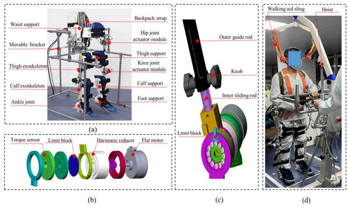
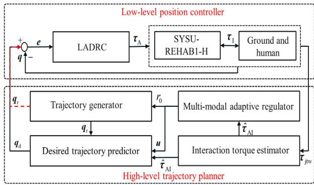
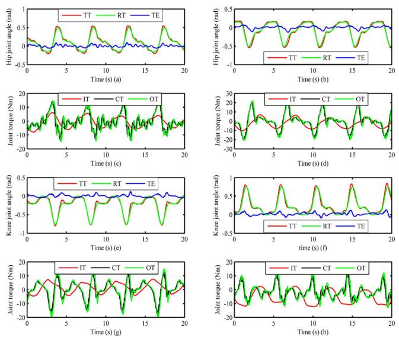
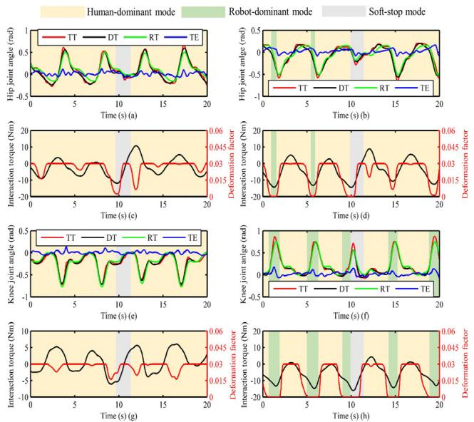
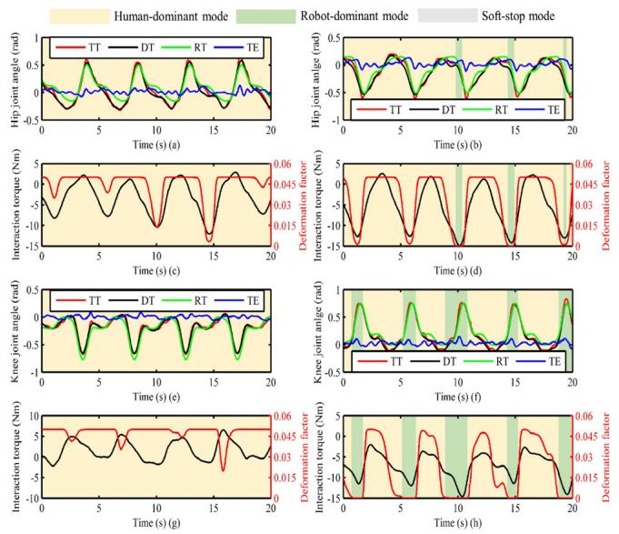
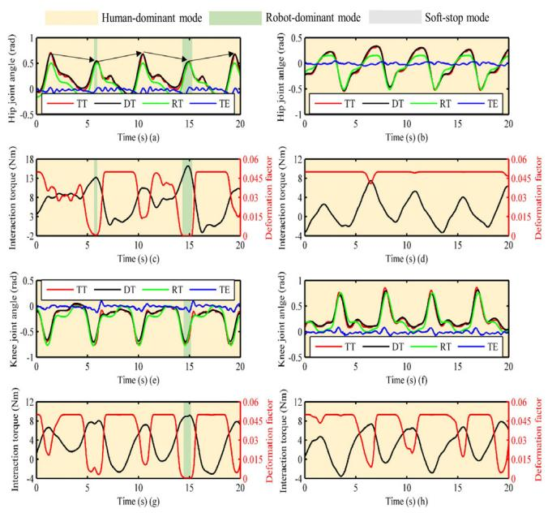
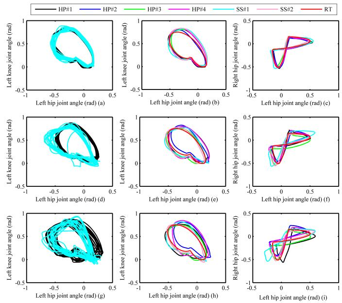

# 基于轨迹形变的穿戴式下肢康复机器人多模态自适应柔顺控制

Jie Zhou , Huanfeng Peng , Manxu Zheng , Zhe Wei , Tao Fan , and Rong Song , Senior Member, IEEE

摘要— 自适应柔顺控制对于康复机器人应对多样化的康复需求以及提高训练安全性至关重要。本文提出了一种用于穿戴式下肢康复机器人（wearable lower limb rehabilitation robot, WLLRR）的基于轨迹形变的多模态自适应柔顺控制策略（trajectory deformation-based multi-modal adaptive compliance control strategy, TD-MACCS），该策略包含上层轨迹规划器和底层位置控制器。上层轨迹规划器集成了动态运动基元（dynamic motion primitives, DMPs）和轨迹形变算法（trajectory deformation algorithm, TDA），通过物理人机交互（physical human-robot interaction, pHRI）生成多关节同步期望轨迹。特别地，DMPs 的幅值调制因子和 TDA 的形变因子由多模态自适应调节器进行调节，实现了人主导模式、机器人主导模式和软停止模式之间的平滑切换。此外，底层位置控制器设计为线性自抗扰控制器。本研究招募了四名健康受试者和两名脑卒中幸存者，使用 TD-MACCS 进行了机器人辅助步行实验。结果表明，TD-MACCS 能够在保证轨迹跟踪精度的同时平滑切换三种控制模式。此外，我们发现适当提高形变因子的上限可以提高平均步行速度（average walking speed, AWS）和轨迹偏差均方根值（root mean square of trajectory deviation, RMSTD）。

关键词— 穿戴式下肢康复机器人，物理人机交互，轨迹形变算法，动态运动基元，线性自抗扰控制。

## I. 引言

脑卒中（Stroke）是一项重大的全球性健康问题，每年导致约 550 万人死亡，预计到 2030 年全球脑卒中幸存者人数将达到 7700 万 [1]。与脑卒中相关的高致残率（例如在中国一年致残率达 44.78%）常常导致幸存者出现下肢运动和功能损伤 [2]。在满足庞大患者群体需求的驱动下，穿戴式下肢康复机器人（WLLRRs），如 H2 [3]、HAL [4]、Ekso [5] 和 BEAR-H1 [6]，已成为辅助下肢运动功能障碍的脑卒中幸存者进行步态训练的有前景的干预手段。此外，它们在促进运动功能恢复方面展现出了积极效果 [6], [7], [8]。

为了使康复机器人能够应对具有不同运动能力水平的患者，研究人员提出了多种控制策略。对于残余肌力较弱的患者，通常采用被动控制策略，沿预定轨迹提供长耐力、高强度的治疗性训练 [9]。许多被动控制策略，如线性自抗扰控制器（LADRC）[10] 和基于自适应网络的模糊逻辑控制器 [11]，已成功应用于下肢康复机器人以确保精确的轨迹跟踪。对于残余肌力较强的患者，主动控制策略因考虑了患者的主动参与（可促进神经可塑性）而受到广泛关注 [12]。阻抗控制器已被应用于下肢康复机器人（LLRR），以在可接受的跟踪误差范围内提供预设的辅助 [13]。导纳控制器已被应用于

WLLRR 以使机器人施加的运动偏离预定轨迹，从而减少步态轨迹失配并提供更舒适的步行辅助 [14], [15]。一种基于轨迹变形算法（TDA）的人机协作控制器已被提出并应用于 LLRR，能够通过人机物理交互（pHRI）预测机器人的未来轨迹 [16]。针对主动腿部外骨骼，提出了一种由法向力、切向力、阻尼力和前馈补偿力组成的力场控制器 [17]，允许患者在预设参考路径周围自由运动。此外，针对完全可反向驱动的 WLLRR 提出了基于速度场的控制器，可在地面步态训练期间提供运动引导和辅助 [18]。尽管这些主动控制策略考虑了患者的主动参与，但它们忽略了不同患者之间甚至同一患者在康复训练过程中功能障碍程度的显著变异性。

许多研究都聚焦于在多种康复训练模式之间进行自适应切换的控制策略。Li 等人基于特定的势能函数为穿戴式下肢康复机器人（WLLRR）开发了一种人在回路（human-in-the-loop）控制策略 [19]。该策略通过在人自主区域和机器人约束区域之间过渡，有效平衡了使用者与外骨骼的能力。此外，鉴于康复机器人与患者之间的紧密耦合，确保康复训练期间的安全性至关重要。为了解决这一问题，Zhang 和 Cheah [20] 提出了一种人机交互控制策略。基于实时位置误差，该策略可以在人主导模式、机器人主导模式和安全停止模式之间自适应切换。然而，冲击性接触力或较低的机器人顺应性会导致患者难以产生足够的误差信号来激活安全停止模式。为克服这一局限，有学者提出了一种多模态控制策略，并在上肢和下肢康复机器人上进行了验证 [21]。该策略基于跟踪误差在人主导模式和机器人主导模式之间自适应切换，并能利用交互力轻松激活安全停止模式。尽管误差信号在运动学习中至关重要 [22]，但在缺乏视觉反馈的机器人辅助训练中，患者无法及时感知到这些信号。此外，跟踪误差同时受到受试者运动能力和控制器性能的影响。因此，Xu 等人为坐姿下肢康复机器人提出了一种多模态自适应控制策略 [23]。该策略通过利用基于表面肌电（EMG）驱动的阻抗模型获取的交互力矩来调整权重因子，从而实现了机器人主动模式与人主动模式之间的平滑切换。尽管这些多模态自适应控制策略能够适应患者不同的运动能力，但实现顺应性人机物理交互（pHRI）并调节机器人顺应性，特别是在机器人辅助行走中，仍然面临着巨大挑战。据我们所知，如何为 WLLRR 设计一种多模态自适应顺应性控制策略，以通过顺应性 pHRI 实现人主导模式、机器人主导模式和软停止模式之间的平滑切换，目前尚未有人进行研究。

  
Fig. 1. SYSU-REHAB1-H 系统：(a) 配备移动支架的自主设计 WLLRR；(b) 髋关节执行器模块的机械结构；(c) 外骨骼长度调节及膝关节运动范围限制机械结构；(d) 一名脑卒中患者在操作员指导下由 SYSU-REHAB1-H 辅助进行地面行走。

本文针对自主设计的穿戴式下肢康复机器人（WLLRR）提出了一种基于轨迹变形的多模态自适应顺应控制策略（TD-MACCS）。此外，在四名健康受试者和两名中风患者身上进行了机器人辅助行走实验，并对结果进行了定量分析。主要贡献总结如下：

1) 我们将动态动作基元（DMPs）[24]与 TDA 集成到轨迹规划器中，使得康复任务轨迹的学习和调整更加便捷，并实现了顺应性 pHRI。此外，我们提出了一种基于 DMPs 幅度调制因子和 TDA 变形因子的多模态自适应调节器。它能够通过平滑切换不同的控制模式，使 WLLRR 适应使用者不断变化的运动能力。此外，设计了 LADRC 以确保在内外扰动下的轨迹跟踪精度。

2) 我们在四名健康受试者和两名中风患者身上初步验证了 TD-MACCS。结果表明，TD-MACCS 能够在保持高轨迹跟踪精度的同时，自适应且平滑地在人主导、机器人主导和软停止模式之间切换。此外，我们发现适当增加 TD-MACCS 中变形因子的上限可以提高平均步行速度（AWS）并减小轨迹偏差均方根（RMSTD）。

## II. WLLRR 系统设计

## A. WLLRR 的机械结构

为了给患者提供地面步态训练，我们在 [25] 中所述机器人的基础上开发了一款穿戴式下肢康复机器人 SYSU-REHAB1-H。如图 1 (a) 所示，为了构建一个简单且适用的系统，每条腿在髋关节和膝关节（屈曲/伸展）处均由两个主动自由度（DoF）驱动。腰部、大腿、小腿和足部支撑配有魔术贴绑带，用于将 WLLRR 固定在患者身体的不同部位。每个执行器模块中的限位块旨在防止关节运动超出正常范围，如图 1 (b) 和 (c) 所示。此外，通过旋转旋钮可以调节大腿和小腿外骨骼，以尽可能使使用者与 SYSU-REHAB1 的关节对齐。从图 1 (d) 可以看出，由于患者的平衡维持能力较差，采用带有助行吊带的吊架以防止使用者在机器人辅助行走过程中跌倒。

  
Fig. 2. SYSU-REHAB1-H 控制策略框架。

## B. WLLRR 的驱动系统

驱动系统包括关节执行器模块、数据采集/输出模块和紧凑型 DAQ 控制器。选用 220 W 扁平电机（EC 90 flat, Maxon, Sachseln, Switzerland）、谐波减速器（LCD-20-100-C-I, Leader, Jiangsu, China）和扭矩传感器（M2212A, SRI, Guangxi, China）构成髋关节执行器模块，如图 Fig. 1 (b) 所示。此外，采用 100 W 扁平电机（EC 60 flat, Maxon, Sachseln, Switzerland）、谐波减速器（LCD-17-100-C-I-ST, Leader, Jiangsu, China）和扭矩传感器（M2210N4, SRI, Guangxi, China）构成膝关节执行器模块。不同的电机由相同的电机驱动器（Module 50/5, Maxon, Sachseln, Switzerland）控制。每个主动关节的角位置通过置于电机内部的光学编码器（MILE 1024, Maxon, Sachseln, Switzerland）进行检测。数据采集/输出模块（NI-9205, NI-9361, NI-9403, NI-9401, National Instruments, Texas, USA）以及紧凑型 DAQ 控制器（cDAQ-9136, National Instruments, Texas, USA）被用于通过 LabVIEW 2018 软件采集、生成和输出信号，以控制每个关节的执行器模块。

## III. 控制策略设计

如图 Fig. 2 所示，针对 SYSU-REHAB1-H 提出了 TD-MACCS，其包含高层轨迹规划器和底层位置控制器。高层轨迹规划器由轨迹生成器、期望轨迹预测器、交互扭矩估计器和多模态自适应调节器组成。底层位置控制器采用 LADRC，以确保 SYSU-REHAB1-H 的每个关节在内外部扰动下跟踪期望轨迹。TD-MACCS 的各个部分将在以下各小节中进行详细讨论。

值得注意的是，为了避免参考轨迹与期望轨迹之间的混淆，我们给出如下说明：1）每个主动关节的参考轨迹是在未激活期望轨迹预测器的情况下由轨迹生成器生成的；2）每个主动关节的期望轨迹是由轨迹生成器和期望轨迹预测器共同生成的，且可以通过 pHRI 进行实时调整。

## A. 轨迹生成器

不同的非线性方法已被用作 WLLRRs 的轨迹生成器，包括 DMPs [26] 和中枢模式发生器 [27]。由于 DMPs 具有出色的运动学习和泛化能力，特别是在多关节机器人控制场景中，非常适用于周期性步态轨迹的实时编码和调整 [24]。因此，基于 DMPs 设计了轨迹生成器，其可描述如下：

$$
\left\{ \begin{array}{l} \kappa \dot {z} _ {\mathrm{q}} = \alpha_ {\mathrm{q}} (\beta_ {\mathrm{q}} (\pmb {g} _ {\mathrm{q}} - \pmb {q} _ {\mathrm{r}}) - z _ {\mathrm{q}}) + \pmb {f} _ {\mathrm{q}} \\ \kappa \dot {\pmb {q}} _ {\mathrm{r}} = z _ {\mathrm{q}} \end{array} \right.
$$

$$
\kappa \dot {\phi} = 1,\tag{1}
$$

$$
\kappa \dot {r} = \alpha_ {\mathrm{r}} (r _ {0} - r),\tag{2}
$$

(3)

$$
\boldsymbol {f} _ {\mathrm{q}} = \frac {\sum_ {i = 1} ^ {m} \psi_ {i} (\phi) \boldsymbol {w} _ {\mathrm{q} , i}}{\sum_ {i = 1} ^ {m} \psi_ {i} (\phi)} r,\tag{4}
$$

$$
\psi_ {i} (\phi) = \exp (\frac {\cos (\phi - c _ {i}) - 1}{2 \sigma_ {i} ^ {2}}),\tag{5}
$$

式中，$\kappa$ 为正时间缩放因子；${ \pmb g } _ { \mathbf { q } } \in \mathbb { R } ^ { 4 }$ 为位置目标向量；$\alpha _ { \mathrm { q } }$ 和 $\beta _ { \mathfrak { q } }$ 为正常数，临界阻尼配置 $\alpha _ { \mathrm { q } } = 4 \beta _ { \mathrm { q } }$ 可确保 DMP 的收敛性与稳定性；$f _ { \mathrm { ~ q ~ } } \in \mathrm { ~ \mathbb { R } ^ { 4 } ~ }$ 为通过监督学习获得的强迫项向量；本文采用了局部加权回归（locally weighted regression）方法 [24]；$q _ { \mathrm { r } } \in \mathbb { R } ^ { 4 }$ 和 $\dot { \pmb q } _ { \mathrm { r } } \in \mathbb { R } ^ { 4 }$ 为参考角度和角速度向量；$z _ { \mathrm { q } } ~ \in ~ \mathbb { R } ^ { 4 }$ 和 $\dot { z } _ { \mathrm { q } } ~ \in ~ \mathbb { R } ^ { 4 }$ 为伸缩后的参考角速度和角加速度；r 和 $r _ { 0 }$ 分别为幅值调制因子的状态变量和期望幅值调制因子；$\alpha _ { r }$ 为决定幅值因子变化率的正常数；$\phi$ 为相位变量；ψi (φ) 为第 $i$ 个（$i _ { \mathrm { t h } }$）核函数；$\sigma _ { i }$ 和 $c _ { i }$ 为决定第 $i$ 个（$i _ { \mathrm { t h } }$）核函数宽度和中心的常数；m 为核函数的数量；${ \pmb w } _ { { \sf q } , i } \in \mathbb { R } ^ { 4 }$ 为对应于核函数 $\psi _ { i } ( \phi )$ 的权重系数向量。

## B. 交互力矩估计器

安装在谐波减速器与外骨骼之间的力矩传感器可用于测量交互力矩 [13]。遗憾的是，由于惯性力矩、重力矩以及由科里奥利力和向心力产生的力矩，准确提取交互力矩并不容易 [28]。根据我们先前的研究，采用了一种无需使用动力学模型即可估计交互力矩的交互力矩估计器 [25]。基于 DMP 的交互力矩估计器可描述如下：

$$
\left\{ \begin{array}{l} \kappa \dot {\boldsymbol {z}} _ {\tau} = \alpha_ {\tau} (\beta_ {\tau} (\boldsymbol {g} _ {\tau} - \boldsymbol {\tau} _ {\text { nts }}) - \boldsymbol {z} _ {\tau}) + \boldsymbol {f} _ {\tau} \\ \kappa \dot {\boldsymbol {\tau}} _ {\text { nts }} = \boldsymbol {z} _ {\tau} \end{array} \right.\tag{6}
$$

$$
\boldsymbol {f} _ {\tau} = \frac {\sum_ {i = 1} ^ {m} \psi_ {i} (\phi) \boldsymbol {w} _ {\tau , i}}{\sum_ {i = 1} ^ {m} \psi_ {i} (\phi)} r,\tag{7}
$$

$$
\hat {\pmb {\tau}} _ {\mathrm{I}} = \pmb {\tau} _ {\mathrm{Rmtw}} - \pmb {\tau} _ {\mathrm{nts}},\tag{8}
$$

其中，$\tau _ { \mathrm { n t s } } \in \mathbb { R } ^ { 4 }$ 与 $\dot { \tau } _ { \mathrm { n t s } } \in \mathbb { R } ^ { 4 }$ 分别为归一化关节力矩向量及其一阶导数；$z _ { \tau } \in \mathbb { R } ^ { 4 }$ 与 $\dot { z } _ { \tau } \in \mathbb { R } ^ { 4 }$ 为缩放后 ${ \pmb \tau } _ { \mathrm { n t s } }$ 的一阶和二阶导数；$\alpha _ { \tau }$ 和 $\beta _ { \tau }$ 为交互力矩估计器中的正常数，临界阻尼配置 $\alpha _ { \tau } = 4 \beta _ { \tau }$ 能够保证 DMPs 的收敛性与稳定性；${ \pmb g } _ { \tau } \in \mathbb { R } ^ { 4 }$ 为力矩目标向量；$f _ { \tau } \in \mathbb { R } ^ { 4 }$ 为交互力矩估计器中的强迫项向量；$\pmb { w } _ { \tau , i } ~ \in ~ \mathbb { R } ^ { 4 }$ 为交互力矩估计器中对应第 $i _ { \mathrm { t h } }$ 个核函数的权重系数向量；$\tau _ { \mathrm { j t w } } \in \mathbb { R } ^ { 4 }$ 与 $\hat { \pmb { \tau } } _ { \mathrm { I } } \in \mathbb { R } ^ { 4 }$ 分别为机器人辅助行走过程中的测量力矩向量和交互力矩向量。

为避免在机器人高顺应性下由微小交互力矩引起参考轨迹的频繁调整 [27], [29]，有必要设计如下交互力矩截断函数：

$$
\hat {\tau} _ {\mathrm{IA}, k} = \left\{ \begin{array}{l l} \hat {\tau} _ {\mathrm{I}, k}, & \left| \hat {\tau} _ {\mathrm{I}, k} \right| > \bar {\tau} _ {k} \\ 0, & \left| \hat {\tau} _ {\mathrm{I}, k} \right| \leq \bar {\tau} _ {k} \end{array} \right.,\tag{9}
$$

其中 $k = 1 , 2 , 3 , 4$ 表示不同的主动关节，$k = 1$ 和 $k \ = \ 3$ 分别表示左侧和右侧髋关节，$k \ = \ 2$ 和 $k = 4$ 分别表示左侧和右侧膝关节；τˆI,k 表示第 $k _ { \mathrm { t h } }$ 个主动关节的交互力矩；$\hat { \tau } _ { \mathrm { I A } , k }$ 表示截断处理后第 $k _ { \mathrm { t h } }$ 个主动关节的交互力矩；$\bar { \tau } _ { k }$ 表示第 $k _ { \mathrm { t h } }$ 个主动关节的交互力矩阈值，即激活期望轨迹预测器所需的最小交互力矩；通常，髋关节的交互力矩阈值大于膝关节，即 $\bar { \tau } _ { 1 } > \bar { \tau } _ { 2 } , \bar { \tau } _ { 3 } > \bar { \tau } _ { 4 } , \bar { \tau } _ { 1 } > \bar { \tau } _ { 4 } , \bar { \tau } _ { 3 } >$ $\bar { \tau } _ { 2 } ,$，其数值可由物理治疗师根据实际需求进行调整 [29]。

## C. 期望轨迹预测器

物理人机交互不仅影响 WLLRR 的当前状态，还会影响其未来的行为 [30]。轨迹规划器应能够持续生成平滑的当前与未来轨迹。轨迹形变算法（TDA）能够基于交互力矩平滑地生成当前期望位置，并预测未来的期望轨迹 [16]。因此，采用 TDA 作为期望轨迹预测器。

根据我们之前的工作 [16]，我们将 $t _ { \mathrm { s } }$ 和 $t _ { \mathrm { f } }$ 定义为当前 pHRI 下轨迹形变的起始时间和结束时间。$\pmb q _ { r } ( t ) \in \mathbb { R } ^ { 4 }$ 和 $\pmb q _ { d } ( t ) \in \mathbb { R } ^ { 4 }$ 分别定义为参考轨迹和期望轨迹。$\pmb { u } \in \mathbb { R } ^ { 4 \times 4 }$ 定义为对角形变因子矩阵。$\Gamma ( \pmb { u } , t )$ 定义为形变曲线函数，通过调整形变因子，可在时间区间 $t \in [ t _ { s } , t _ { f } ]$ 内生成不同的平滑形变曲线。当前迭代和上一迭代中的期望轨迹定义如下：

$$
\boldsymbol {q} _ {d} (t) = \boldsymbol {\Gamma} (\boldsymbol {u}, t), t \in [ t _ {s}, t _ {f} ],\tag{10}
$$

$$
\begin{array}{c} \boldsymbol {\Gamma} (\boldsymbol {0}, t) = [ \boldsymbol {q} _ {d} (t _ {s}), \boldsymbol {q} _ {d} (t _ {s} + \delta), \\ \dots , \boldsymbol {q} _ {d} (t _ {s} + (N - 2) \delta), \boldsymbol {q} _ {r} (t _ {f}) ], \end{array}\tag{11}
$$

$$
N = \frac {p}{\delta} + 1,\tag{12}
$$

其中 $p$ 为预测时间；δ 为采样周期；N 为路径点数量。

pHRI 过程中当前轨迹形变的 TDA 迭代方程可描述如下：

$$
\left\{ \begin{array}{l} \boldsymbol {\Gamma} (\boldsymbol {u}, t) = \boldsymbol {\Gamma} (\boldsymbol {0}, t) + \boldsymbol {V} (t) \boldsymbol {u}, t \in [ t _ {\mathrm{s}}, t _ {\mathrm{f}} ] \\ \boldsymbol {V} (t) = \delta \boldsymbol {H} \hat {\boldsymbol {\tau}} _ {\mathrm{IA}} ^ {T} (t _ {\mathrm{s}}) \\ \boldsymbol {H} = \frac {\boldsymbol {W} \boldsymbol {\beta}}{(p + \delta) \| \boldsymbol {W} \|} \\ \boldsymbol {W} = (\boldsymbol {I} - (\boldsymbol {Z} ^ {\mathrm{T}} \boldsymbol {Z}) ^ {- 1} \boldsymbol {C} ^ {\mathrm{T}} (\boldsymbol {C} (\boldsymbol {Z} ^ {\mathrm{T}} \boldsymbol {Z}) ^ {- 1} \boldsymbol {C} ^ {\mathrm{T}}) ^ {- 1} \boldsymbol {C}) (\boldsymbol {Z} ^ {\mathrm{T}} \boldsymbol {Z}) ^ {- 1}, \\ \boldsymbol {I} \in \mathbb {R} ^ {N \times N}, \end{array} \right.\tag{13}
$$

(14)

其中 $\hat { \tau } _ { \mathrm { I A } } ( t _ { \mathrm { s } } ) = [ \hat { \tau } _ { \mathrm { I A } , 1 } ( t _ { \mathrm { s } } ) , \hat { \tau } _ { \mathrm { I A } , 2 } ( t _ { \mathrm { s } } ) , \hat { \tau } _ { \mathrm { I A } , 3 } ( t _ { \mathrm { s } } ) , \hat { \tau } _ { \mathrm { I A } , 4 } ( t _ { \mathrm { s } } ) ]$ 是在时间 ts 经截断处理后的交互力矩向量；$\pmb { \beta } \in \mathbb { R } ^ { N }$ 是交互力矩的预测向量；$\pmb { Z } \in \mathbb { R } ^ { ( N + 3 ) \times N }$ 是有限差分矩阵；$\boldsymbol { c } _ { } \in \mathbb { R } ^ { 4 \times \hat { N } }$ 是约束矩阵；$\pmb { I } \in \mathbb { R } ^ { N \times N }$ 是单位矩阵；H 与 $V ( t )$ 分别为运动基元（motor primitive）与向量场函数。

此外，值得一提的是，尽管我们重点关注当前的轨迹形变，但在人机物理交互过程中，期望轨迹可以通过线性迭代方法响应交互力矩而持续生成。此外，TDA 的具体推导过程在 [16] 中给出。

## D. 多模态自适应调节器

由于不同患者的运动能力复杂且不断变化，有必要开发一种多模态自适应调节器，以提高机器人的自适应能力和训练安全性。受 [21] 和 [23] 的启发，本文根据交互力矩提出了一种多模态自适应调节器。多模态自适应调节器的总体思想如下：1) 当运动能力令人满意时，形变因子可以在允许范围内平滑且自适应地增加，允许患者以更大的自由度运动，即人主导模式；2) 当运动能力较差时，形变因子可以自适应地减小，以强制与参考轨迹产生较小或没有偏差，从而纠正患者的异常步态轨迹，即机器人主导模式；3) 当交互力矩超出安全交互力矩区域时，参考轨迹应平滑切换至零参考位置，以提供软停止保护，即软停止模式。此外，在指定的保护时间后，参考轨迹还可以自动且平滑地切换回原始参考轨迹，以恢复机器人辅助行走。基于上述概念的多模态自适应调节器可描述如下：

$$
h (\hat {\tau} _ {I, k}) = \frac {\hat {\tau} _ {I , k} ^ {2}}{\tau_ {n , k} ^ {2}} - 1,\tag{15}
$$

$$
u _ {k} = \left\{ \begin{array}{c} u _ {u, k}, \left| \hat {\tau} _ {I, k} \right| \leq k _ {\tau , k} \tau_ {n, k} \\ u _ {u, k} + (u _ {d, k} - u _ {u, k}) \frac {[ h (\hat {\tau} _ {I , k}) ^ {4} - (k _ {\tau , k} ^ {2} - 1) ^ {4} ] ^ {4}}{(k _ {\tau , k} ^ {2} - 1) ^ {1 6}}, \\ k _ {\tau , k} \tau_ {n, k} <   \left| \hat {\tau} _ {I, k} \right| \leq \tau_ {n, k} \\ u _ {d, k}, \left| \hat {\tau} _ {I, k} \right| > \tau_ {n, k} \end{array} \right.\tag{16}
$$

$$
\hat {r} _ {k} = \left\{ \begin{array}{l} 0, \left| \hat {\tau} _ {I, k} (t _ {a, k}) \right| > \tau_ {s, k} \cup t _ {a, k} <   t \leq t _ {a, k} + L _ {s} \\ r _ {0} ^ {*}, \left| \hat {\tau} _ {I, k} (t) \right| \leq \tau_ {s, k} \cap t > t _ {a, k} + L _ {s} \end{array} \right.\tag{17}
$$

$$
r _ {0} = \min (\min (\hat {r} _ {1}, \hat {r} _ {3}), \min (\hat {r} _ {2}, \hat {r} _ {4})),\tag{18}
$$

其中 $k \ = \ 1 , 2 , 3 ,$ 4 代表 WLLRR 的不同主动关节；$\hat { \tau } _ { \mathrm { n } } = [ \hat { \tau } _ { \mathrm { n , 1 } } , \hat { \tau } _ { \mathrm { n , 2 } } , \hat { \tau } _ { \mathrm { n , 3 } } , \hat { \tau } _ { \mathrm { n , 4 } } ]$ 为标称交互力矩向量，根据患者的残疾程度进行设定；我们定义当交互力矩小于标称交互力矩时运动能力良好，否则较差。$h ( \hat { \tau } _ { \mathrm { I } , k } )$ 是第 $k _ { \mathrm { t h } }$ 个关节的交互力矩区域函数，能够以归一化形式反映交互力矩的变化；$\pmb { k } _ { \tau } = [ k _ { \tau , 1 } , k _ { \tau , 2 } , k _ { \tau , 3 } , k _ { \tau , 4 } ]$ 为常数向量，决定变形因子的变化率；$\pmb { u } = \mathrm { d i a g } ( u _ { 1 } , u _ { 2 } , u _ { 3 } , u _ { 4 } )$ 为对角变形因子矩阵；${ \pmb u } _ { \mathrm { u } } ~ = ~ \mathrm { d i a g } ( u _ { \mathrm { u } , 1 } , u _ { \mathrm { u } , 2 } , u _ { \mathrm { u } , 3 } , u _ { \mathrm { u } , 4 } )$ 和 $\pmb { u } _ { \mathrm { d } } = \mathrm { d i a g } ( u _ { \mathrm { d , 1 } } , u _ { \mathrm { d , 2 } } , u _ { \mathrm { d , 3 } } , u _ { \mathrm { d , 4 } } )$ 分别为变形因子的上界和下界矩阵；$\tau _ { \mathrm { { S } } } =$ $[ \tau _ { \mathrm { s } , 1 } , \tau _ { \mathrm { s } , 2 } , \tau _ { \mathrm { s } , 3 } , \tau _ { \mathrm { s } , 4 } ]$ 为安全交互力矩向量，其设定旨在避免过大交互力矩引发的安全问题；$t _ { \mathrm { a } , k }$ 是第 $k _ { \mathrm { t h } }$ 个关节的交互力矩大于安全交互力矩的时间；$L _ { \mathrm { s } }$ 是软停止保护启动后的规定保护时间；$\hat { r } _ { k }$ 是第 $k _ { \mathrm { t h } }$ 个关节的幅度调制因子；$r _ { 0 } ^ { \ast }$ 是各关节幅度调制因子的初始值；$r _ { 0 }$ 是交互力矩估计器和轨迹发生器中的期望幅度调制因子。

根据 (3)、(17) 和 (18)，当期望幅度因子 $r _ { 0 }$ 切换为零时，幅度调制因子的状态变量 r 将指数收敛至零。由此，强迫项向量 $f _ { \mathrm { q } } \in$ $\mathbb { R } ^ { 4 }$ 的各个分量均可收敛至零。因此，各主动关节的参考轨迹将同步收敛至目标位置向量 ${ \pmb g } _ { \mathfrak { q } } \in \mathbb { R } ^ { 4 }$，从而在机器人辅助步行过程中实现软停止保护。

## E. LADRC

无模型控制器（Model-free controllers）[10], [31] 在 WLLRR 中得到了广泛应用，因为人机耦合模型的模型参数难以通过系统辨识精确获取。近年来，自抗扰控制器已被应用于机器人中，因为它可以免除对精确人机耦合模型的需求 [32]。为了简化控制器结构并减少调优参数的数量，学者提出了 LADRC，即线性扩张状态观测器（linear extended state observer）与线性状态反馈（linear state feedback）的结合 [33]。在本部分中，基于二阶误差辅助系统设计了 LADRC，以确保各关节在内部和外部扰动下均能跟踪期望轨迹。

人机耦合系统中第 $k$ 个（$k _ { \mathrm { t h } }$）主动关节的动力学模型可简化如下：

$$
\begin{array}{c} J _ {k} \ddot {q} _ {k} + B _ {k} \dot {q} _ {k} + G _ {k} \sin (q _ {k}) + T _ {k} \mathrm{sgn} (\dot {q} _ {k}) \\ = \tau_ {\mathrm{A}, k} + \tau_ {\mathrm{u}, k} + \tau_ {\mathrm{H}, k}, \end{array}\tag{19}
$$

其中 $J _ { k }$ 是机器人外骨骼（包括受试者腿部）的转动惯量；$B _ { k }$ 是粘性摩擦力矩系数；$G _ { k }$ 是重力力矩；$T _ { k }$ 是库仑摩擦力矩；$\tau _ { \mathrm { A } , k }$ 是控制力矩；$\tau _ { \mathrm { H } , k }$ 是受试者的主动关节力矩；$\tau _ { \mathrm { u } , k }$ 是由动力学模型的不确定参数、未知摩擦特性以及外部扰动所引入的扰动力矩。

定义跟踪误差为 $\boldsymbol { e } _ { k } ~ = ~ \boldsymbol { q } _ { k } - \boldsymbol { q } _ { \mathrm { d } , k }$，可构建如下二阶误差辅助系统：

$$
\begin{array}{l} \ddot {e} _ {k} = f _ {k} + b _ {k} \tau_ {\mathrm{A}, k}, \\ f _ {k} = \frac {1}{J _ {k}} (\tau_ {\mathrm{u}, k} + \tau_ {\mathrm{H}, k} - J _ {k} \ddot {q} _ {\mathrm{d}, k} - B _ {k} \dot {q} _ {k} - G _ {k} \sin (q _ {k}) \\ \quad - T _ {k} s g n (\dot {q} _ {k}) + J _ {k} \tau_ {\mathrm{A}, k} - J _ {k} b _ {k} \tau_ {\mathrm{A}, k}), \end{array}\tag{20}
$$

(21)

其中 $q _ { \mathrm { d } , k }$ 和 $q _ { k }$ 为期望角度和实际角度；$f _ { k }$ 是由内部和外部扰动组成的总扰动；$b _ { k }$ 是由动力学特性决定的补偿因子。

式 (20) 的状态空间形式可表示如下：

$$
\left\{ \begin{array}{l} \dot {\boldsymbol {x}} _ {k} = \boldsymbol {A} _ {k} \boldsymbol {x} _ {k} + \boldsymbol {B} _ {k} \tau_ {\mathrm{A}, k} + \boldsymbol {E} _ {k} \dot {f} _ {k} \\ e _ {k} = \boldsymbol {C} _ {k} \boldsymbol {x} _ {k} \end{array} \right.,\tag{22}
$$

其中 $\mathbf { \boldsymbol { x } } _ { k } ~ = ~ [ e _ { k } , \dot { e } _ { k } , f _ { k } ] ^ { \mathrm { T } }$ 为扩张状态向量，且

$$
\boldsymbol {A} _ {k} = \left[ \begin{array}{l l l} 0 & 1 & 0 \\ 0 & 0 & 1 \\ 0 & 0 & 0 \end{array} \right] \boldsymbol {B} _ {k} = \left[ \begin{array}{c} 0 \\ b _ {k} \\ 0 \end{array} \right], \boldsymbol {E} _ {k} = \left[ \begin{array}{c} 0 \\ 0 \\ 1 \end{array} \right], \boldsymbol {C} _ {k} = \left[ \begin{array}{l l l} 1 & 0 & 0 \end{array} \right].
$$

对应于上述方程的线性扩张状态观测器可表示如下：

$$
\left\{ \begin{array}{l} \dot {\boldsymbol {z}} _ {k} = [ \boldsymbol {A} _ {k} - \boldsymbol {L} _ {k} \boldsymbol {C} _ {k} ] \boldsymbol {z} _ {k} + [ \boldsymbol {B} _ {k}, \boldsymbol {L} _ {k} ] \boldsymbol {D} _ {k} \\ \boldsymbol {y} _ {k} = \boldsymbol {z} _ {k} \end{array} \right.,\tag{23}
$$

其中 $\boldsymbol { z } _ { k } = [ \hat { e } _ { k } , \hat { \dot { e } } _ { k } , \hat { f } _ { k } ] ^ { \mathrm { T } }$ 为状态向量；$\scriptstyle L _ { k }$ 为观测器增益向量；$\mathbf { \phi } _ { { D } _ { k } } ~ = ~ [ \tau _ { \mathrm { A } , k } , e _ { k } ] ^ { \mathrm { T } }$ 为输入向量；$\begin{array} { r l } { \mathfrak { y } _ { k } } & { { } = } \end{array}$ $[ \hat { e } _ { k } , \hat { \dot { e } } _ { k } , \hat { f } _ { k } ]$ 为输出向量。

为了实现理想的状态观测，需要合理设计观测器增益向量。将观测器特征方程的极点配置在复平面左侧的同一位置，以确保观测器增益向量与观测器带宽唯一相关，即 $\bar { \bf L } _ { k } = [ 3 \omega _ { k } , 3 \omega _ { k } ^ { 2 } , \bar { \omega } _ { k } ^ { 3 } ] ^ { \mathrm { T } }$，进而可得

$$
\lambda (s) = | s \pmb {I} - (\pmb {A} _ {k} - \pmb {L} _ {k} \pmb {C} _ {k}) | = (s + \omega_ {k}) ^ {3},\tag{24}
$$

其中 $\pmb { I } \in \mathbb { R } ^ { 3 \times 3 }$ 为单位矩阵；$\omega _ { k }$ 为观测器带宽。

对于二阶误差辅助系统，线性扩张状态观测器能够实时估计外部扰动和内部扰动。因此，传统比例-积分-微分（proportional–integral–derivative）控制器中用于消除稳态误差的积分项便不再必要。由此，误差辅助系统的线性状态反馈控制律可简化为比例-微分控制器。SYSU-REHAB1-H 第 $k _ { \mathrm { t h } }$ 个主动关节的控制律可描述如下：

$$
\tau_ {A, k} = \frac {- k _ {p , k} z _ {k , 1} - k _ {d , k} z _ {k , 2} - z _ {k , 3}}{b _ {k}}, \quad k = 1, 2, 3, 4,\tag{25}
$$

其中 $k _ { p , k }$ 和 $k _ { d , k }$ 分别为比例增益和微分增益；$b _ { k }$ 为由动力学特性决定的补偿因子。

文献 [34] 已经考虑了具有动态不确定性的非线性系统的 LADRC 稳定性分析。在总扰动及其对时间的导数有界的假设下，线性扩张状态观测器的估计误差以及闭环控制系统的跟踪误差均是有界的，即有界输入有界输出稳定。

## IV. 实验设计

## A. 实验方案

我们在中国南方医科大学珠江医院（Zhujiang Hospital of Southern Medical University）康复医学科对四名健康受试者和两名脑卒中患者进行了机器人辅助行走实验。我们的研究已获得南方医科大学珠江医院伦理委员会的批准。受试者信息如 Table I 所示。脑卒中患者的纳入标准为：1）脑卒中患者应具有足够的力量通过上肢支撑维持身体平衡；2）脑卒中患者的髋关节和膝关节被动活动度无明显受限；3）脑卒中患者应具备行走能力，尽管行走稳定性有所下降且步态速度明显低于健全人；4）脑卒中患者不得存在妨碍其听从指令的视空间、认知或注意力缺陷。实验前已获得所有受试者的书面知情同意书。此外，还向受试者提供了若干指导：1）受试者应通过减重吊架保持平衡，并通过在双腿间转移重心来完成左右腿交替迈步；2）受试者应在操作人员的指导下沿着地面上的黄色引导线走到终点。此外，与文献 [25] 类似，我们通过以下步骤为 SYSU-REHAB1 选取了参考轨迹：1）通过动作捕捉系统采集健康受试者的步态轨迹；2）对步态轨迹进行归一化并取平均值，将平均步态轨迹作为参考轨迹；3）采用局部加权回归方法对参考轨迹进行编码；4）通过时间缩放因子和幅度调制因子调整步态速度和幅度，以获取合适的参考轨迹。

每位参与者都需要使用具有低、中、高形变因子上限的 TD-MACCS（TD-MACCS-L、TD-MACCS-M 和 TD-MACCS-H）进行机器人辅助行走实验。健康参与者在实验前需训练 20 分钟，以减轻初始技能差异对实验结果的影响。在每次试验中，健康参与者需完成 15 m 直线机器人辅助行走，并在完成一次试验后获准坐在椅子上休息 5 分钟。脑卒中患者在实验前必须训练两天（每天两组，每组 30 分钟）。这有助于患者熟悉 SYSU-REHAB1-H 并掌握重心转移的技巧。鉴于脑卒中患者与健康参与者之间的运动能力存在较大差异，脑卒中患者在每次试验中仅需完成 5 m 直线机器人辅助行走，并在完成三次试验后获准坐在椅子上休息 5 分钟。在机器人辅助行走实验期间，每种控制策略（TD-MACCS-L、TD-MACCS-M 和 TD-MACCS-H）均被随机且不连续地使用三次。此外，每次试验期间均记录了角度、形变因子、交互力矩、控制力矩和观测力矩。

TABLE I  
参与者信息

<table><tr><td>参数</td><td>HP#1</td><td>HP#2</td><td>HP#3</td><td>HP#4</td><td>SS#1</td><td>SS#2</td></tr><tr><td>年龄/岁</td><td>30</td><td>22</td><td>27</td><td>23</td><td>14</td><td>54</td></tr><tr><td>体重/kg</td><td>65</td><td>72</td><td>73</td><td>57</td><td>48</td><td>55</td></tr><tr><td>身高/cm</td><td>168</td><td>175</td><td>170</td><td>169</td><td>170</td><td>165</td></tr><tr><td>卒中后月数</td><td>-</td><td>-</td><td>-</td><td>-</td><td>16</td><td>6</td></tr><tr><td>偏瘫侧</td><td>-</td><td>-</td><td>-</td><td>-</td><td>左侧</td><td>右侧</td></tr></table>

HP#1、HP#2、HP#3 和 HP#4 分别代表四名健康参与者。SS#1 和 SS#2 分别代表两名脑卒中患者。

## B. 参数设置

TD-MACCS 的控制参数应合理设置。与 [25] 类似，轨迹生成器和主动力矩估计器中的正受控常数设置如下：$\alpha _ { q } = 2 5 , \beta _ { q } = 6 . 2 5 , \alpha _ { \tau } = 2 5 , \beta _ { \tau } = 6 . 2 5 , \alpha _ { r } = 1 2 . 5 , g _ { q } =$ $\begin{array} { r l r } { \mathbf { g } _ { \tau } } & { { } = } & { \mathbf { 0 } } \end{array}$。此外，时间缩放因子设置为 $\kappa \ = \ 0 . 3$，幅度调制因子的初始值设置为 $r _ { 0 } ^ { * } ~ = ~ 0 . 8$。对于轨迹预测器，预测时间设置为 $\textit { p } = \textit { 1 s }$，采样周期设置为 $\delta \ = \ 0 . 0 2 \mathrm { s }$。变形因子的下界统一定为 $\pmb { u } _ { d } = \pmb { 0 } \in \mathbb { R } ^ { 4 \times 4 }$；TD-MACCS-L、TD-MACCS-M 和 TD-MACCS-H 中的变形因子上界分别设置为：$\pmb { u } _ { u } \ = \ \mathbf { 0 } \in \ \mathbb { R } ^ { 4 \times 4 } , \pmb { u } _ { u } \ = \ \mathrm { d i a g } \{ 0 . 0 3 , 0 . 0 3 , 0 . 0 3 , 0 . 0 3 \}$，以及 $\pmb { u } _ { u } = \mathrm { d i a g } \{ 0 . 0 5 , 0 . 0 5 , 0 . 0 5 , 0 . 0 5 \}$。交互力矩阈值向量设置为 $\bar { \tau } = [ 1 , 0 . 5 , 1 , 0 . 5 ]$。对于多模态自适应调节器，常数向量、保护时间、标称交互力矩向量和安全交互力矩向量分别设置为：$\begin{array} { r } { k _ { \tau } = \left[ 0 . 1 5 , 0 . 1 5 , 0 . 1 5 , 0 . 1 5 \right] , L _ { s } = 1 \mathrm { ~ s } , \pmb { \tau } _ { n } = \left[ 1 5 , 1 0 , 1 5 , 1 0 \right] . } \end{array}$ 以及 $\tau _ { \mathrm { s } } = [ 2 0 , 1 5 , 2 0 , 1 5 ]$。对于 LADRC，补偿因子向量和观测器带宽向量设置为 b = diag{1, 1, 1, 1} 和 $\pmb { \omega } = [ 1 0 0 , 1 0 0 , 1 0 0 , 1 0 0 ]$；比例增益向量和微分增益向量设置为 $k _ { \mathrm { p } } ~ = ~ \mathrm { d i a g } \{ 1 8 0 , 1 6 0 , 1 8 0 , 1 6 0 \}$ 和 $k _ { \mathrm { d } } ~ =$ diag{25, 15, 25, 15}。请注意，TD-MACCS 的所有控制参数对不同的受试者均保持不变，以确保实验结果比较的公平性。

  
Fig. 3. 使用 TD-MACCS-L 时 SS#1 的结果。第一列和第二列分别为右腿和左腿的结果。TT、RT、TE、IT、CT 和 OT 分别代表跟踪轨迹、参考轨迹、跟踪误差、交互力矩、控制力矩和观测力矩。

## C. 评估方法

平均步行速度（average walking speed, AWS）、轨迹偏差均方根（root mean square of trajectory deviation, RMSTD）以及归一化跟踪误差均方根（normalized root mean square of tracking error, NRMSTE）被用于定量评估机器人辅助行走过程中的运动表现。各评估指标描述如下：

$$
\mathrm{AWS} = \frac {L _ {w}}{T _ {w}},\tag{26}
$$

$$
\mathrm{RMSTD} = \sqrt {\frac {\sum_ {n = 1} ^ {M} \Delta d _ {k} ^ {2} (n)}{M}},\tag{27}
$$

$$
\text { NRMSTE } = \frac {\sqrt {\frac {\sum_ {n = 1} ^ {M} e _ {k} ^ {2} (n)}{M}}}{\max (q _ {d , k}) - \min (q _ {d , k})},\tag{28}
$$

其中 $n = 1 , 2 , 3 , 4 , \dots , M$ 为样本序号；$L _ { w }$ 为机器人辅助行走的直线距离；$T _ { w }$ 为受试者完成一次试验所用的时间；$\Delta d _ { k } ( n )$ 为第 $n$ 个采样点处第 $k$ 个主动关节的参考轨迹与期望轨迹之间的偏差；$e _ { k } ( n )$ 为第 $n$ 个采样点处第 $k$ 个主动关节的期望轨迹与跟踪轨迹之间的跟踪误差；max $( q _ { d , k } )$ 和 min $( q _ { d , k } )$ 分别为第 $k$ 个主动关节的最大和最小期望位置。

## V. 实验结果

图 3 (a)、(b)、(e) 和 (f) 表明，轨迹发生器能够为 SYSU-REHAB1-H 的主动关节生成多关节同步参考轨迹，且 LADRC 能够确保各关节在较小的误差范围内跟踪参考轨迹。由于形变因子的上限被设为零以“屏蔽”期望轨迹预测器，因此在 pHRI 过程中不会实时生成期望轨迹。图 3 (c)、(d)、(g) 和 (h) 表明，在机器人辅助行走过程中，各关节的交互力矩、控制力矩和观测力矩均具有明显的周期性特征。右腿各关节的交互力矩均在 10 Nm 以内，小于左腿（偏瘫侧）。除右髋关节外，各关节的控制力矩曲线均无明显振动。此外，观测力矩的波形和幅值与控制力矩一致，这表明线性扩张状态观测器（linear extended state observer）能够有效补偿内部和外部扰动。

  
Fig. 4. 使用 TD-MACCS-M 时 SS#1 的结果。第一列和第二列分别为右腿和左腿的结果。TT、DT、RT 和 TE 分别代表跟踪轨迹、期望轨迹、参考轨迹和跟踪误差。

Fig. 4 表明，TD-MACCS-M 能够在机器人辅助行走过程中，在人主导模式、机器人主导模式和软停止模式之间平滑切换机器人的控制模式。从灰色阴影部分可以看出，当交互力矩超过安全交互力矩时，软停止模式被激活。各关节的参考轨迹迅速且平滑地收敛至零参考位置，从而实现软停止保护。同时，SYSU-REHAB1-H 的各关节能够很好地跟踪期望轨迹。从橙色阴影部分可以看出，在经过指定的保护时间后，当机器人检测到交互力矩小于安全交互力矩时，能够平滑切换到人主导模式。在人主导模式下，机器人允许患者通过物理人机交互（pHRI）自然且平滑地调整参考轨迹。从浅绿色阴影部分可以看出，当交互力矩超过标称交互力矩时，机器人主导模式被激活，这可以强制期望轨迹收敛到参考轨迹。

Fig. 5 表明，在使用 TD-MACCS-H 时，脑卒中患者的右腿处于人主导模式，而左腿（偏瘫侧）则处于机器人主导模式或人主导模式。如 Fig. 5 (a)、(c)、(e) 和 (g) 所示，各关节的轨迹变形因子在大部分时间内保持在最大值，这可以让右腿以更大的自由度运动。与 TD-MACCS-M 相比，期望轨迹与参考轨迹之间的偏差显著增加，且在 pHRI 过程中，右侧髋关节和膝关节能够精确跟踪期望轨迹。右腿髋关节和膝关节的交互力矩范围分别为 −13 ∼ 5 Nm 和 −4 ∼ 7 Nm，且具有周期性特征。从 Fig. 5 (b)、(d)、(f) 和 (h) 可以看出，各关节的交互力矩相比右腿具有更明显的周期性特征。交互力矩的幅值显著增加，且变形因子平滑减小至最小值，从而激活机器人主导模式，以防止摆动相出现异常步态轨迹。

  
Fig. 5. 使用 TD-MACCS-H 时 SS#1 的结果。第一列和第二列分别为右腿和左腿的结果。TT、DT、RT 和 TE 分别代表跟踪轨迹、期望轨迹、参考轨迹和跟踪误差。

  
Fig. 6. 使用 TD-MACCS-H 时 HP#1 的结果。第一列和第二列分别为右腿和左腿的结果。TT、DT、RT 和 TE 分别代表跟踪轨迹、期望轨迹、参考轨迹和跟踪误差。

  
Fig. 7. 不同变形因子上限下机器人辅助步行实验的运动学数据：(a)、(d) 和 (g) 为 HP#1 和 SS#1 在关节空间中 15 个步态周期的轨迹轮廓；(b)、(e) 和 (h) 为每位参与者在关节空间中 15 个步态周期的平均轨迹轮廓；(c)、(f) 和 (i) 为每位参与者左右髋关节 15 个步态周期的平均轨迹轮廓。从上到下分别为 TD-MACCS-L、TD-MACCS-M 和 TD-MACCS-H 的结果。RT 表示关节空间中的参考轨迹轮廓。

图 6 显示，在使用 TD-MACCS-H 时，健康受试者的左腿处于人主导模式，而右腿处于机器人主导模式或人主导模式。与脑卒中幸存者的结果相比，机器人辅助步行处于机器人主导模式的时间更少。从图 6 (a) 可以看出，健康受试者能够通过物理交互平滑地生成不同幅度的期望轨迹，并且一旦激活机器人主导模式，期望轨迹便能迅速收敛到参考轨迹，这与脑卒中幸存者的结果相似。此外，如图 6 (d) 和 (h) 所示，与患者的左腿（偏瘫侧）相比，健康受试者的交互力矩周期性并不明显，且幅度显著减小。

从图 7 (a)、(d) 和 (g) 可以看出，在使用 TD-MACCS-L 时，HP#1 和 SS#1 在关节空间中的轨迹轮廓呈现出较窄的条带状。增大变形因子的上限能够显著拓宽轨迹轮廓的分布范围。与 SS#1 相比，HP#1 的轨迹轮廓更加平滑。图 7 (b)、(e) 和 (h) 表明，健康受试者的平均轨迹轮廓与参考轨迹轮廓相似，但随着变形因子上限的增加，其偏移变得更加显著。与健康受试者相比，每位脑卒中幸存者在使用 TD-MACCS-M 和 TD-MACCS-H 时，其平均轨迹轮廓在形状和空间位置上均发生了显著改变。如图 7 (c)、(f) 和 (i) 所示，所有参与者的平均轨迹轮廓均呈蝴蝶状，且随着变形因子上限的扩大，步态对称性和空间位置的差异也随之增大。此外，与健康受试者相比，脑卒中幸存者在变形因子上限较高时的步态对称性最低。

TABLE II  
AWS、RMSTD 和 NRMSTE 的统计结果

<table><tr><td rowspan="2">控制策略</td><td rowspan="2">受试者</td><td colspan="4">RMSTD (rad)</td><td colspan="4">NRMSTE (%)</td><td rowspan="2">AWS (m/s)</td></tr><tr><td>LH</td><td>LK</td><td>RH</td><td>RK</td><td>LH</td><td>LK</td><td>RH</td><td>RK</td></tr><tr><td rowspan="3">TD-MACCS-L</td><td>HP</td><td>0</td><td>0</td><td>0</td><td>0</td><td>4.1±0.7</td><td>4.7±0.3</td><td>3.4±0.8</td><td>3.8±0.4</td><td>0.124±0.021</td></tr><tr><td>SS#1</td><td>0</td><td>0</td><td>0</td><td>0</td><td>5.8±0.9</td><td>7.2±2.2</td><td>5.1±0.5</td><td>5.7±1.6</td><td>0.131±0.007</td></tr><tr><td>SS#2</td><td>0</td><td>0</td><td>0</td><td>0</td><td>4.2±0.8</td><td>5.7±1.2</td><td>7.3±1.6</td><td>6.1±1.9</td><td>0.108±0.006</td></tr><tr><td rowspan="3">TD-MACCS-M</td><td>HP</td><td>0.064±0.005</td><td>0.046±0.004</td><td>0.062±0.009</td><td>0.042±0.006</td><td>3.3±0.4</td><td>4.0±0.6</td><td>3.2±0.6</td><td>4.4±0.6</td><td>0.138±0.020</td></tr><tr><td>SS#1</td><td>0.069±0.004</td><td>0.037±0.009</td><td>0.069±0.003</td><td>0.046±0.045</td><td>7.4±1.2</td><td>6.0±0.1</td><td>6.4±0.8</td><td>5.4±0.8</td><td>0.147±0.002</td></tr><tr><td>SS#2</td><td>0.065±0.005</td><td>0.044±0.003</td><td>0.059±0.015</td><td>0.040±0.012</td><td>4.4±1.2</td><td>5.4±0.5</td><td>6.6±0.9</td><td>6.3±1.2</td><td>0.113±0.003</td></tr><tr><td rowspan="3">TD-MACCS-H</td><td>HP</td><td>0.111±0.011</td><td>0.078±0.004</td><td>0.114±0.006</td><td>0.071±0.006</td><td>3.4±0.6</td><td>3.9±0.5</td><td>3.3±0.4</td><td>4.2±0.5</td><td>0.145±0.019</td></tr><tr><td>SS#1</td><td>0.099±0.004</td><td>0.059±0.003</td><td>0.107±0.003</td><td>0.071±0.004</td><td>9.0±2.4</td><td>6.2±0.7</td><td>5.7±1.1</td><td>5.1±00.8</td><td>0.138±0.003</td></tr><tr><td>SS#2</td><td>0.117±0.018</td><td>0.067±0.16</td><td>0.108±0.030</td><td>0.072±0.011</td><td>7.9±4.1</td><td>6.0±0.8</td><td>5.1±0.7</td><td>6.0±1.4</td><td>0.113±0.020</td></tr></table>

Table II 展示了在使用 TD-MACCS-L、TD-MACCS-M 和 TD-MACCS-H 时，所有健康受试者以及每位中风幸存者的 RMSTD、NRMSTE 和 AWS 均值。与 TD-MACCS-M 相比，当采用 TD-MACCS-H 时，所有健康受试者的 RMSTD 均值分别增加了 73.44%（LH）、69.57%（LK）、83.87%（RH）和 69.05%（RK）。值得注意的是，当增大形变因子的上限时，每位中风幸存者的 RMSTD 均值增加的趋势并未改变。此外，与 TD-MACCS-L 相比，除右膝关节外，所有健康受试者在使用 TD-MACCS-M 和 TD-MACCS-H 时的 NRMSTE 均值均有所下降。所有健康受试者的最大 NRMSTE 均值小于 5.00%。尽管每位中风幸存者的 NRMSTE 均值大于所有健康受试者，但各关节的跟踪精度均在可接受范围内。此外，随着形变因子上限的增大，所有健康受试者的 AWS 均值明显增加，且最大 AWS 均值达到 0.145 m/s。与所有健康受试者的结果相比，适度增加形变因子的上限可以提高每位中风幸存者的 AWS 均值，但过大的数值反而会降低 AWS 均值。

## VI. 讨论

## A. 多模态自适应柔顺控制

自适应柔顺控制策略可以使康复机器人匹配用户不断变化的运动能力，并提高训练安全性。在本文中，TDA [16] 和 DMPs [24] 被有效集成到 TD-MACCS 中，能够在人主导、机器人主导和软停止模式之间平滑切换。在人主导模式下，SYSU-REHAB1-H 允许受试者通过柔顺的 pHRI 配合可变变形因子来调整参考轨迹，从而鼓励他们主动参与机器人辅助行走。由于下肢运动功能障碍患者通常具有不同的症状，他们容易出现异常步态轨迹 [35]。在机器人主导模式下，SYSU-REHAB1-H 可以平滑地将变形因子减小至最小值，通过限制受试者的运动自由度来有效矫正其异常步态轨迹。此外，在机器人辅助训练过程中，安全防护值得引起更多关注 [20]。在软停止模式下，参考轨迹可以通过调整 DMPs 的期望幅值因子平滑切换至零参考位置。此外，在指定的保护时间过后，参考轨迹可以自动且平滑地切换回原参考轨迹。尽管可以基于误差函数来设计多模态控制策略 [9], [22], [36]，但当在不同模式之间连续切换时，它们可能会在控制信号和跟踪轨迹中引起振荡。相比之下，TD-MACCS 可以通过多模态自适应调节器实现不同模式的平滑切换，而无需考虑跟踪误差。此外，受试者可以通过交互力矩轻松激活软停止模式，有效解决了基于误差的安全停止模式在冲击力或机器人低柔顺性下难以激活的问题 [21]。与基于定制位置控制器设计的多模态控制策略 [20], [21] 相比，TD-MACCS 可以实现 LADRC 与多模态自适应调节器设计的解耦分离，从而避免复杂的位置控制器设计并简化参数调节。此外，以往的多模态控制策略 [9], [19], [20], [21], [22], [23], [36] 尚未考虑参考轨迹的学习与泛化；而基于 DMPs 的轨迹生成器能够帮助治疗师获取并调整不同康复任务的参考轨迹 [25], [37]。

## B. 对运动性能的影响

具有不同变形因子上限值的 TD-MACCS 会影响机器人辅助行走过程中的机器人顺应性、步行速度和步态对称性。在本文中，TD-MACCS-H 在所测试的三种控制策略中获得了最大的 RMSTD，同时保持了轨迹跟踪精度。其原因在于 LADRC 能够有效补偿内部和外部扰动，并保证轨迹跟踪精度 [33], [34]。此外，增加变形因子的上限值使受试者能够更容易地调整参考轨迹 [16]，从而增大了 RMSTD。尽管这可以促进患者的运动探索和学习 [25]，但过大的变形因子上限值会导致患者的 AWS 下降。原因在于，增加机器人顺应性会降低对受试者关节间协调运动学引导的程度，这增加了人机协同运动的难度，并促使患者通过降低步行速度来提高其局部动态稳定性 [38]。此外，当增加变形因子的上限值时，步态对称性显著下降。原因在于 WLLRR 降低了健康受试者的正常步行速度 [39]，并导致左右步长出现差异 [40]。与健康受试者相比，卒中患者因下肢运动障碍导致的步态不对称性可以通过 WLLRR 降低变形因子上限值来进行矫正。此外，与健康受试者相比，患者在机器人辅助行走过程中处于机器人主导模式的时长显著增加。这表明，采用 TD-MACCS 的 WLLRR 能够在预设的变形因子上限值下，通过自适应切换到与患者不同运动能力相匹配的控制模式来矫正步态不对称性。

## C. 局限性与未来工作

本文存在一些局限性，应在未来的研究中予以解决。首先，尽管我们已尽最大努力提高 TD-MACCS 各部分的稳定性，但由于参与者的动力学特性可能无法被完全获知 [41]，且难以精确建模，因此未开展稳定性分析。其次，尽管我们提出根据名义交互力矩和安全交互力矩来区分不同的控制模式，但它们需要根据患者的残疾程度和物理交互的舒适度进行合理设定；此外，为了确保患者的安全和舒适度，本研究中设定的名义交互力矩和安全交互力矩过于保守。第三，我们在实验范式中未对步行距离进行标准化，且机器人辅助步行实验中仅纳入了两名脑卒中幸存者。在进一步的研究中，我们将尝试构建参与者的动力学模型，并引入新方法（例如能量罐（energy tanks）[41], [42]）来进行稳定性分析。此外，将招募更多患者，并开展 2-min 和 10-m 步行测试以评估患者的步行功能 [43]，这有助于物理治疗师确定合适的机器人辅助步行速度和名义交互力矩。此外，还将设计一个外部信息采集系统，用于监测机器人辅助步行过程中外骨骼与皮肤之间的接触行为、躯干运动以及手臂总作用力 [15], [44]，这有助于确定合适的安全交互力矩，并客观、定量地评估患者对 TD-MACCS 的接受度。同时，将开展基于患者的机器人辅助康复训练，并获取具有统计学显著性的结果，以验证 TD-MACCS 的临床有效性。

## VII. 结论

本文针对自主设计的 WLLRR 系统 SYSU-REHAB1-H，提出了一种 TD-MACCS。进行了机器人辅助步行实验和定量分析。实验结果已证实，TD-MACCS 能够自适应且平滑地切换不同的控制模式。此外，适度提高形变因子的上限可以在将 NRMSTE 保持在允许范围内的同时，提高 AWS 和 RMSTD。因此，TD-MACCS 有潜力应用于机器人辅助训练，以适应脑卒中幸存者不同的运动能力。它还可以应用于涉及基于 pHRI 的人机协作的其他领域。

## 参考文献

[1] D. Mukherjee and C. G. Patil, “Epidemiology and the global burden of stroke,” World Neurosurg., vol. 76, no. 6, pp. S85–S90, Dec. 2011, doi: 10.1016/j.wneu.2011.07.023.

[2] G.-M. Shi et al., “Profile and 1-year outcome of ischemic stroke in East China: Nanjing first hospital stroke registry,” J. Stroke Cerebrovascular Diseases, vol. 25, no. 1, pp. 49–56, Jan. 2016, doi: 10.1016/j.jstrokecerebrovasdis.2015.08.032.

[3] M. Bortole et al., “The H2 robotic exoskeleton for gait rehabilitation after stroke: Early findings from a clinical study,” J. Neuroeng. Rehabil., vol. 12, no. 1, pp. 1–14, Jun. 2015, doi: 10.1186/s12984-015-0048-y.

[4] D. Ando et al., “Microstructural white matter changes following gait training with hybrid assistive limb initiated within 1 week of stroke onset,” J. Neurol. Sci., vol. 415, Aug. 2020, Art. no. 116939, doi: 10.1016/j.jns.2020.116939.

[5] E. Høyer, A. Opheim, and V. Jørgensen, “Implementing the exoskeleton ekso GTTM for gait rehabilitation in a stroke unit—Feasibility, functional benefits and patient experiences,” Disab. Rehabil., Assistive Technol., vol. 17, no. 4, pp. 473–479, May 2022, doi: 10.1080/17483107.2020.1800110.

[6] Y. Li et al., “Efficacy of a novel exoskeletal robot for locomotor rehabilitation in stroke patients: A multi-center, non-inferiority, randomized controlled trial,” Frontiers Aging Neurosci., vol. 13, Aug. 2021, Art. no. 706569, doi: 10.3389/fnagi.2021.706569.

[7] H. Watanabe, R. Goto, N. Tanaka, A. Matsumura, and H. Yanagi, “Effects of gait training using the hybrid assistive Limb in recoveryphase stroke patients: A 2-month follow-up, randomized, controlled study,” NeuroRehabilitation, vol. 40, no. 3, pp. 363–367, May 2017, doi: 10.3233/NRE-161424.

[8] F. Molteni et al., “Gait recovery with an overground powered exoskeleton: A randomized controlled trial on subacute stroke subjects,” Brain Sci., vol. 11, no. 1, p. 104, Jan. 2021, doi: 10.3390/brainsci11010104.

[9] Q. Wu, X. Wang, B. Chen, and H. Wu, “Development of a minimalintervention-based admittance control strategy for upper extremity rehabilitation exoskeleton,” IEEE Trans. Syst., Man, Cybern. Syst., vol. 48, no. 6, pp. 1005–1016, Jun. 2018, doi: 10.1109/TSMC.2017.2771227.

[10] Y. Long, Z. Du, L. Cong, W. Wang, Z. Zhang, and W. Dong, “Active disturbance rejection control based human gait tracking for lower extremity rehabilitation exoskeleton,” ISA Trans., vol. 67, pp. 389–397, Mar. 2017, doi: 10.1016/j.isatra.2017.01.006.

[11] Ü. Önen, F. M. Botsali, M. Kalyoncu, M. Tinkir, N. Yilmaz, and Y. Sahin, “Design and actuator selection of a lower extremity exoskeleton,” IEEE/ASME Trans. Mechatronics, vol. 19, no. 2, pp. 623–632, Apr. 2014, doi: 10.1109/TMECH.2013.2250295.

[12] Z. Warraich and J. A. Kleim, “Neural plasticity: The biological substrate for neurorehabilitation,” PM&R, vol. 2, no. 12, pp. S208–S219, Dec. 2010, doi: 10.1016/j.pmrj.2010.10.016.

[13] Z. Shen, J. Zhou, J. Gao, and R. Song, “Torque tracking impedance control for a 3DOF lower limb rehabilitation robot,” in Proc. 3rd Int. Conf. Adv. Robot. Mechatronics (ICARM), Singapore, Jul. 2018, pp. 294–299, doi: 10.1109/ICARM.2018.8610807.

[14] P. Huang, Z. Li, M. Zhou, X. Li, and M. Cheng, “Fuzzy enhanced adaptive admittance control of a wearable walking exoskeleton with step trajectory shaping,” IEEE Trans. Fuzzy Syst., vol. 30, no. 6, pp. 1541–1552, Jun. 2022, doi: 10.1109/TFUZZ.2022.3162700.

[15] B. Ugurlu, H. Oshima, E. Sariyildiz, T. Narikiyo, and J. Babic, “Active compliance control reduces upper body effort in exoskeleton-supported walking,” IEEE Trans. Human-Mach. Syst., vol. 50, no. 2, pp. 144–153, Apr. 2020, doi: 10.1109/THMS.2019.2961969.

[16] J. Zhou, Z. Li, X. Li, X. Wang, and R. Song, “Human–robot cooperation control based on trajectory deformation algorithm for a lower limb rehabilitation robot,” IEEE/ASME Trans. Mechatronics, vol. 26, no. 6, pp. 3128–3138, Dec. 2021, doi: 10.1109/TMECH.2021.3053562.

[17] S. K. Banala, S. H. Kim, S. K. Agrawal, and J. P. Scholz, “Robot assisted gait training with active leg exoskeleton (ALEX),” IEEE Trans. Neural Syst. Rehabil. Eng., vol. 17, no. 1, pp. 2–8, Feb. 2009, doi: 10.1109/TNSRE.2008.2008280.

[18] A. Martínez, B. Lawson, C. Durrough, and M. Goldfarb, “A velocityfield-based controller for assisting leg movement during walking with a bilateral hip and knee lower limb exoskeleton,” IEEE Trans. Robot., vol. 35, no. 2, pp. 307–316, Apr. 2019, doi: 10.1109/TRO.2018.2883819.

[19] Z. Li et al., “Human-in-the-loop control of a wearable lower limb exoskeleton for stable dynamic walking,” IEEE/ASME Trans. Mechatronics, vol. 26, no. 5, pp. 2700–2711, Oct. 2021, doi: 10.1109/TMECH.2020.3044289.

[20] J. Zhang and C. C. Cheah, “Passivity and stability of human–robot interaction control for upper-limb rehabilitation robots,” IEEE Trans. Robot., vol. 31, no. 2, pp. 233–245, Apr. 2015, doi: 10.1109/TRO.2015.2392451.

[21] X. Li, Y. Pan, G. Chen, and H. Yu, “Multi-modal control scheme for rehabilitation robotic exoskeletons,” Int. J. Robot. Res., vol. 36, nos. 5–7, pp. 759–777, Feb. 2017, doi: 10.1177/0278364917691111.

[22] X. Li, Q. Yang, and R. Song, “Performance-based hybrid control of a cable-driven upper-limb rehabilitation robot,” IEEE Trans. Biomed. Eng., vol. 68, no. 4, pp. 1351–1359, Apr. 2021, doi: 10.1109/TBME.2020.3027823.

[23] J. Xu et al., “A multi-mode rehabilitation robot with magnetorheological actuators based on human motion intention estimation,” IEEE Trans. Neural Syst. Rehabil. Eng., vol. 27, no. 10, pp. 2216–2228, Oct. 2019, doi: 10.1109/TNSRE.2019.2937000.

[24] A. J. Ijspeert, J. Nakanishi, H. Hoffmann, P. Pastor, and S. Schaal, “Dynamical movement primitives: Learning attractor models for motor behaviors,” Neural Comput., vol. 25, no. 2, pp. 328–373, Feb. 2013, doi: 10.1162/NECO\_a\_00393.

[25] J. Zhou, H. Peng, S. Su, and R. Song, “Spatiotemporal compliance control for a wearable lower limb rehabilitation robot,” IEEE Trans. Biomed. Eng., vol. 70, no. 6, pp. 1858–1868, Jun. 2023, doi: 10.1109/TBME.2022.3230784.

[26] Y. Yuan, Z. Li, T. Zhao, and D. Gan, “DMP-based motion generation for a walking exoskeleton robot using reinforcement learning,” IEEE Trans. Ind. Electron., vol. 67, no. 5, pp. 3830–3839, May 2020, doi: 10.1109/TIE.2019.2916396

[27] M. Sharifi, J. K. Mehr, V. K. Mushahwar, and M. Tavakoli, “Autonomous locomotion trajectory shaping and nonlinear control for lower limb exoskeletons,” IEEE/ASME Trans. Mechatronics, vol. 27, no. 2, pp. 645–655, Apr. 2022, doi: 10.1109/TMECH.2022.3156168.

[28] K. Gui, H. Liu, and D. Zhang, “A practical and adaptive method to achieve EMG-based torque estimation for a robotic exoskeleton,” IEEE/ASME Trans. Mechatronics, vol. 24, no. 2, pp. 483–494, Apr. 2019, doi: 10.1109/TMECH.2019.2893055.

[29] M. Dong et al., “A new ankle robotic system enabling wholestage compliance rehabilitation training,” IEEE/ASME Trans. Mechatronics, vol. 26, no. 3, pp. 1490–1500, Jun. 2021, doi: 10.1109/TMECH.2020.3022165.

[30] D. P. Losey and M. K. O’Malley, “Trajectory deformations from physical human–robot interaction,” IEEE Trans. Robot., vol. 34, no. 1, pp. 126–138, Feb. 2018, doi: 10.1109/TRO.2017.2765335.

[31] M. Yang, X. Wang, Z. Zhu, R. Xi, and Q. Wu, “Development and control of a robotic lower limb exoskeleton for paraplegic patients,” Proc. Inst. Mech. Eng., C, J. Mech. Eng. Sci., vol. 233, no. 3, pp. 1087–1098, Feb. 2019, doi: 10.1177/0954406218761484.

[32] R. Fareh, S. Khadraoui, M. Y. Abdallah, M. Baziyad, and M. Bettayeb, “Active disturbance rejection control for robotic systems: A review,” Mechatronics, vol. 80, Dec. 2021, Art. no. 102671, doi: 10.1016/j.mechatronics.2021.102671.

[33] Z. Gao, “Scaling and bandwidth-parameterization based controller tuning,” in Proc. Amer. Control Conf., Denver, CO, USA, Jun. 2003, pp. 4989–4996, doi: 10.1109/ACC.2003.1242516.

[34] H. Peng, J. Zhou, and R. Song, “A triple-step controller with linear active disturbance rejection control for a lower limb rehabilitation robot,” Frontiers Neurorobotics, vol. 16, Nov. 2022, Art. no. 1053360, doi: 10.3389/fnbot.2022.1053360.

[35] N. Sánchez, A. M. Acosta, R. Lopez-Rosado, A. H. A. Stienen, and J. P. A. Dewald, “Lower extremity motor impairments in ambulatory chronic hemiparetic stroke: Evidence for lower extremity weakness and abnormal muscle and joint torque coupling patterns,” Neurorehabilitation Neural Repair, vol. 31, no. 9, pp. 814–826, Aug. 2017, doi: 10.1177/1545968317721974.

[36] R. Yang, Z. Shen, Y. Lyu, Y. Zhuang, L. Li, and R. Song, “Voluntary assist-as-needed controller for an ankle power-assist rehabilitation robot,” IEEE Trans. Biomed. Eng., vol. 70, no. 6, pp. 1795–1803, Jun. 2023, doi: 10.1109/TBME.2022.3228070.

[37] J. Nielsen, A. S. Sorensen, T. S. Christensen, T. R. Savarimuthu and T. Kulvicius, “Individualised and adaptive upper limb rehabilitation with industrial robot using dynamic movement primitives,” in Proc. ICRA Workshop Adv. Challenges Develop. Test. Assessment Assistive Rehabil. Robots, Exper. From Eng. Human Sci. Res., vol. 1, 2017, p. 40.

[38] J. B. Dingwell, J. P. Cusumano, D. Sternad, and P. R. Cavanagh, “Slower speeds in patients with diabetic neuropathy lead to improved local dynamic stability of continuous overground walking,” J. Biomech., vol. 33, no. 10, pp. 1269–1277, Oct. 2000, doi: 10.1016/S0021- 9290(00)00092-0.

[39] M. Plotnik, R. P. Bartsch, A. Zeev, N. Giladi, and J. M. Hausdorff, “Effects of walking speed on asymmetry and bilateral coordination of gait,” Gait Posture, vol. 38, no. 4, pp. 864–869, Sep. 2013, doi: 10.1016/j.gaitpost.2013.04.011.

[40] Y. Xiang, J. S. Arora, and K. Abdel-Malek, “Optimization-based prediction of asymmetric human gait,” J. Biomechanics, vol. 44, no. 4, pp. 683–693, Feb. 2011, doi: 10.1016/j.jbiomech.2010.10.045.

[41] F. Benzi, F. Ferraguti, G. Riggio, and C. Secchi, “An energybased control architecture for shared autonomy,” IEEE Trans. Robot., vol. 38, no. 6, pp. 3917–3935, Dec. 2022, doi: 10.1109/TRO. 2022.3180885.

[42] Y. Michel, C. Ott, and D. Lee, “Safety-aware hierarchical passivitybased variable compliance control for redundant manipulators,” IEEE Trans. Robot., vol. 38, no. 6, pp. 3899–3916, Dec. 2022, doi: 10.1109/TRO.2022.3174478.

[43] T. Nakajima et al., “Cybernic treatment with wearable cyborg hybrid assistive limb (HAL) improves ambulatory function in patients with slowly progressive rare neuromuscular diseases: A multicentre, randomised, controlled crossover trial for efficacy and safety (NCY-3001),” Orphanet J. Rare Diseases, vol. 16, no. 1, p. 304, Jul. 2021, doi: 10.1186/s13023-021-01928-9.

[44] X. Wan, Y. Liu, Y. Akiyama, and Y. Yamada, “Monitoring contact behavior during assisted walking with a lower limb exoskeleton,” IEEE Trans. Neural Syst. Rehabil. Eng., vol. 28, no. 4, pp. 869–877, Apr. 2020, doi: 10.1109/TNSRE.2020.2979986.