# Voluntary Control of an Ankle Joint Exoskeleton by Able-Bodied Individuals and Stroke Survivors using EMG-Based Admittance Control Scheme

Yu Zhuang†, Yan Leng†, Jie Zhou, Rong Song\*, Senior Member, IEEE, Le Li\*, Steven W. Su, Member, IEEE

Abstract—Control schemes based on electromyography (EMG) have demonstrated their superiority in human-robot cooperation due to the fact that motion intention can be well estimated by EMG signals. However, there are several limitations due to the noisy nature of EMG signals and the inaccuracy of EMG-force/torque estimation, which might deteriorate the stability of human-robot cooperation movement. To improve the movement stability, an EMG-based admittance control scheme (EACS) was proposed, comprised of an EMG-driven musculoskeletal model (EDMM), an admittance filter and an inner position controller. To investigate the performance of EACS, a series of sinusoidal tracking tasks were conducted with 12 healthy participants and 4 stroke survivors in an ankle exoskeleton in comparison with the EMGbased open-loop control scheme (EOCS). The experimental results indicated that both EACS and EOCS could improve stroke survivors’ ankle range of motion (ROM). The experimental results of both healthy participants and stroke survivors showed that the assistance torque, tracking error and jerk values of EACS were lower than those of EOCS. The interaction torque of EACS decreased towards the increasing assistance ratio while that of EOCS increased. Moreover, the EMG levels of tibialis anterior (TA) decreased towards the increasing assistance ratio but were higher than those of EOCS. EACS was effective in improving movements stability, and had the potential to be applied in robotassisted rehabilitation training to address the foot-drop problem.

Index Terms—Stroke, admittance control, surface electromyography (sEMG), human-robot cooperation control, robot-assisted rehabilitation.

Manuscript received November 6, 2019; revised March 10, May 8 and June 24, 2020; accepted July 14, 2020. Date of current version July 23, 2020. This work was supported by the National Key R&D Program of China (Grant 2018YFC2001600), the Shenzhen Science and Technology Plan Project (Grant JCYJ20170818155028942) and the Guangdong Science and Technology Plan Project (Grant 2017B010110015 and Grant 2017B020210011). † indicates Yu Zhuang and Yan Leng contributes equally to this work. \* indicates the corresponding author.

## I. INTRODUCTION

SSISTIVE robots enable humans to complete movements that they cannot complete on their own, but a variety of robots still underperform in movements that require dexterity, safety and efficiency while interacting with humans [1]. In robot-assisted rehabilitation, the control scheme is important to provide mechanical power through robots on one aspect, and to receive the intended movement information from humans on the other aspect [2].

Previous study has presented various control schemes to detect human intention. Berkley Lower Extremity Exoskeleton (BLEEX) was designed to improve the controller sensitivity to human’s forces and torques without measuring directly from human. This control scheme relied on the precise dynamic model of human movement to estimate the intention [3]. Ronsse et al. proposed a method based on adaptive frequency oscillators, which predicted the human motion intention directly from joint kinematics [4]. In this method, the control of the exoskeleton was based on sensor signals. For healthy participants, interaction dynamics measurements and inverse dynamics models can be effective to control the exoskeleton. However, for stroke survivors suffering from neurological diseases, the measured sensor signals may not reflect their motion intention [5]. Apart from the dynamic models, electromyography (EMG) signals is another approach to estimate human motion intentions [6, 7]. The surface EMG provides a convenient way to detect the level of muscle activation and therefore is widely used to interpret motion intentions, which has been applied in Hybrid Assistive Limb (HAL)[8]. Lu et al. proposed a multi-degree of freedom (DOF) hand exoskeleton using myoelectric pattern recognition techniques, which could perceive human motion intention from EMG signals to regain hand dexterity [9]. Ao et al. compared an EMG-driven Hill-type neuromusculoskeletal model with a linear proportional model in an ankle exoskeleton and found that a better human-robot interaction could be achieved by using a physiologically appropriate model [10]. Zhuang et al.

Yu Zhuang, Jie Zhou and Rong Song are with the Key Laboratory of Sensing Technology and Biomedical Instrument of Guangdong Province, School of Biomedical Engineering, Sun Yat-sen University, Guangzhou, China, and the Shenzhen Research Institute of Sun Yat-sen University, Shenzhen, China. Yan Leng is with Department of Rehabilitation Medicine, The First Affiliated Hospital, Sun Yat-sen University, Guangzhou, China. Le Li is with Institute of Medical Research, Northwestern Polytechnical University, Xi’an, China. Steven W. Su is with Faculty of Engineering and Information Technology, University of Technology Sydney, Sydney, Australia. (correspondence e-mail: songrong@mail.sysu.edu.cn, proposed an EMG-based admittance control scheme to improve the human-robot synchronization by reducing of the delay between the human’s intention and the robot’s assistance [11]. With EMG signals, the human motion intention can be estimated prior to the actual movements [12]. Furthermore, detecting the motion intention from physiological signals can lead to a more natural and intuitive human-robot interaction [13]. Actually, EMG signals are random and nonlinear in nature, and thus have a number of shortcomings such as a lack of stability overtime [14]. And an open-loop control scheme may not be stable enough to compensate the system variations and modeling error compared to a closed-loop one.

Admittance control, including an inner position loop and an outer admittance filter, can provide assistance in a closed-loop structure. The admittance filter maps the estimated joint torque of to the desired trajectory [13]. The position loop follows the desired trajectory generated by the admittance filter [15, 16]. This can compensate for the effect of the unmodeled factors and thus improve the stability of human-robot cooperation movement.

Although previous studies have applied the EMG signals for real-time joint torque estimation in control schemes, few studies have focused on how to improve the movement stability of the EMG-based control method [12, 17, 18], and on what clinical impact they can bring to the stroke survivors. This work was aimed to find a control scheme for the ankle rehabilitation robot with a stable and smooth human-robot cooperation movement, because the performance of human-robot cooperation movement had great effect on rehabilitation effectiveness [19], and tested its feasibility on stroke survivors. Firstly, a simplified version of an admittance filter integrated with Hill-based model was designed to dynamically provide the reference angle for the footplate to track, and an inner proportional-derivative (PD) controller was proposed, which could evidentially enhance the stability of the EMG-based human-robot cooperation movement. Secondly, the assistance ratio was introduced in the EMG-based admittance controller (EACS) to detect the variation trend of the tracking performance. Thirdly, experiments have been designed and performed with 12 healthy participants and 4 stroke survivors, in order to compare with the EMG-based open-loop control scheme (EOCS) and explore the clinical impact of the control schemes. The RMS of interaction torque, the root mean square error (RMSE) and RMSJ of tracking trajectory were used to quantify the performance of the proposed control scheme. As these control schemes were designed for a rehabilitation robot, they should be able to assist stroke survivors to complete dorsiflexion tasks voluntarily and to address the foot-drop problem.

## II. METHODS

## A. EMG-Driven Musculoskeletal Modeling

In our previous work, an EMG-driven musculoskeletal model (EDMM) was used to estimate the ankle joint moment from real-time ankle angle and the EMG signals of dorsiflexion-related muscles (e.g., tibialis anterior (TA)). This model has been applied in the control of the ankle exoskeleton, and can be divided into the following sections [7].

1) The EMG-activation model. Firstly, the EMG signals were normalized using the maximum voluntary contraction (MVC) level. Subsequently, a full-wave rectification and a 2 Hz lowpass second-order Butterworth filter were utilized to obtain $e ( t )$ , the envelopes of the normalized EMG signals. The relationship between $e ( t )$ and �(�), i. e., the neural activation, was defined as [6]:

$$
\begin{array}{c} u (t) = 0. 9 4 8 6 e (t - d) + 0. 0 5 2 u (t - 1) \\ - 0. 0 0 0 6 2 7 u (t - 2) \end{array}\tag{1}
$$

where $d ,$ the electromechanical delay, was set as 80 ms [20]. Regarding the relationship between �(�), and the muscle activation, $\alpha ( t )$ , a one-parameter segmented transformation model was applied [21]:

$$
\left\{ \begin{array}{l} \alpha (t) = n \ln (\beta u (t) + 1), 0 \leq u (t) <   u _ {0} \\ \alpha (t) = p u (t) + c, u _ {0} \leq u (t) <   1 \end{array} \right.\tag{2}
$$

$( u _ { 0 } , \alpha _ { 0 } )$ , the node point of the curve, could be acquired by:

$$
\left\{ \begin{array}{l} u _ {0} = 0. 3 0 8 5 - A \cos 4 5 ^ {\circ} \\ \alpha_ {0} = 0. 3 0 8 5 + A \sin 4 5 ^ {\circ} \end{array} \right.\tag{3}
$$

Hence, there were strong relationships between the coefficients (�, �, � and �) and the node point $( u _ { 0 } , \alpha _ { 0 } )$ . The coefficients and the node point could be determined by a nonlinear shape factor �.

2) The musculoskeletal geometry model. The muscle-tendon unit was simplified as a straight line, and the length of the muscle-tendon unit, $l _ { m t } ,$ , in tibialis anterior (TA) was modeled as:

$$
l _ {m t} = \sqrt {\left[ \left| \overrightarrow {O A} \right| ^ {2} + \left| \overrightarrow {O B} \right| ^ {2} - 2 \left| \overrightarrow {O A} \right| * \left| \overrightarrow {O B} \right| * \cos (q) \right]}\tag{4}
$$

$$
= l _ {t} + l _ {m} \cos \phi\tag{5}
$$

where $\left| { \overrightarrow { O A } } \right|$ was the distance between the ankle joint center and the muscle-tendon origin, and |��⃗⃗⃗⃗⃗ | was that between the joint center and the muscle-tendon insertion. � represented the pennation angle. The torque arm, $r _ { m t }$ , could be derived using the ankle joint angle, �, through [22]

$$
r _ {m t} = \frac {\partial l _ {m t}}{\partial q}\tag{6}
$$

3) The Hill-based muscle-tendon model. This model consisted of a muscle fiber in series with a tendon. The muscle fiber was comprised of an active contractile element (CE) in parallel with a passive element (PE). $F _ { m t }$ , the muscle-tendon force, could be derived from:

$$
\begin{array}{r l} & F _ {m t} = F _ {t} = \left(F _ {c e} + F _ {p e}\right) \cos \phi \\ & \qquad = [ f _ {l} (l) f _ {v} (v) \alpha (t) F _ {m x} + f _ {p} (l) F _ {m x} ] \cos \phi \end{array}\tag{7}
$$

where $F _ { c e }$ and $F _ { p e }$ represented the forces generated by the active element and the passive element, respectively. $f _ { l } ( l )$ represented the relationship between the active force and the normalized muscle length [23], while $f _ { v } ( v )$ represented the relationship between the active force and the normalized velocity [24]. $f _ { p } ( l )$ represented the relationship between the passive elastic force and fiber length. $F _ { m x }$ was the maximum isometric force.

$F _ { t }$ , the force generated by the tendons, satisfied the following relationship [25]:

$$
F _ {t} = \left\{ \begin{array}{c c} 0 & s _ {t} \leq 0 \\ 1 4 8 0. 3 s _ {t} ^ {2} F _ {m x} & 0 <   s _ {t} <   0. 0 1 2 7 \\ (3 7. 5 s _ {t} - 0. 2 3 7 5) F _ {m x} & s _ {t} \geq 0. 0 1 2 7 \end{array} \right.\tag{8}
$$

where $s _ { t }$ represented the tendon strain. Then, with three sections mentioned above, the estimated torque of the specified joint, $M _ { e } ,$ , could be calculated by:

$$
M _ {e} = r _ {m t} F _ {m t}\tag{9}
$$

For calibration, some undetermined parameters $( \mathrm { e . g . } , A , l _ { s t }$ and $F _ { m x } )$ which characterize the individual properties of the neuromusculoskeletal system could be optimized by minimizing the following equation [26]:

$$
E r = \frac {1}{N} \sum_ {i = 0} ^ {N} (M _ {e} (i) - M _ {m} (i)) ^ {2}\tag{10}
$$

where $M _ { m } ( i )$ and � were the measured torque at the � th sampling instant in the MVC experiment and the total number of samples used in calibration. The results of calibration were listed in TABLE I. OpenSim (National Institutes of Health for Biomedical Computation, Stanford, USA) was utilized as references to assign the rest of undetermined parameters (e.g., $\left| \overrightarrow { O A } \right| = 0 . 7 , \left| \overrightarrow { O B } \right| = 0 . 0 3 )$ . The detailed description of the EDMM could be referred to [10].

## B. Control Schemes

In this study, EMG-based open-loop control scheme (EOCS) and EMG-based admittance control scheme (EACS) were applied in the ankle exoskeleton respectively.

In EOCS, as shown in Fig, 1(C), the motor would generate the assistance torque, �; based on $M _ { e }$ , the estimated torque of ankle joint can be calculated according to the following equation:

$$
\tau = \lambda \cdot M _ {e}\tag{11}
$$

where � represented the assistance ratio.

The EACS contained two parts (shown in Fig. 1(C)): an inner admittance model and an outer PD controller. In the admittance model, the dynamic relationship between the desired position of ankle joint, $\theta _ { d e s i r e d } ( s )$ and $M _ { e }$ could be defined as [27]:

$$
\theta_ {d e s i r e d} (s) = \theta (s) + \frac {\lambda \cdot M _ {e} (s)}{k + b s + m s ^ {2}}\tag{12}
$$

As the acceleration was small in this study, the impact of the acceleration change could be ignored [28, 29]. It was appropriate to set the mass parameter, �, as 0. The stiffness and damping parameters, �, and �, were empirically set as 2, and 0.1, respectively. $\theta ( s )$ represented the actual position of the ankle joint. The PD position controller was defined as:

$$
\tau = K \Delta \theta + B \Delta \dot {\theta}\tag{13}
$$

where ∆� represented the error between $\theta _ { d e s i r e d }$ and �(�). The proportional parameter, �, was set as 0.3 empirically and the derivative parameter, �, could be determined by:

$$
B = 0. 2 \sqrt {K}\tag{14}
$$

where 0.2 was an empirically selected coefficient[30, 31]. For all participants (including stroke survivors), the same parameter settings were applied.

## C. Ankle Exoskeleton

The ankle exoskeleton shown in Fig. 1(A) consisted of a custom-made actuated mechanical assembly, an AC motor (DM1B-045G, Yokogawa, Japan) with a servo driver (UB1DG3, Yokogawa, Japan) and an internal encoder, a controller (GTS-400-PV(G)-PCI, Googoltech, Hong Kong), and a torque sensor (AKC-205, 701st Research Institute of China Aerospace, Science and Technology Corporation, China). The sensor was used to monitor the interaction between the ankle and the exoskeleton. The EMG signals from TA were captured by Ag/AgCl bipolar surface electrodes (Noraxon, Scottsdale, USA), and were amplified 5000 times by a selfdesigned multi-channel EMG amplifier. Then they were transferred to a computer through a data acquisition device (USB-6341 DAQ card, National Instruments, USA), along with

TABLE I  
CALIBRATED PARAMETERS IN THE EDMM MODEL FOR EACH PARTICIPANT

<table><tr><td colspan="2">Participant</td><td>A</td><td> $l_{st}(m)$ </td><td> $F_{mx}(N)$ </td></tr><tr><td rowspan="12">Healthy</td><td>S1</td><td>0.06</td><td>0.2420</td><td>364.64</td></tr><tr><td>S2</td><td>0.06</td><td>0.2346</td><td>354.88</td></tr><tr><td>S3</td><td>0.06</td><td>0.2346</td><td>1031.93</td></tr><tr><td>S4</td><td>0.06</td><td>0.2346</td><td>1024.13</td></tr><tr><td>S5</td><td>0.06</td><td>0.2246</td><td>973.92</td></tr><tr><td>S6</td><td>0.06</td><td>0.2198</td><td>372.44</td></tr><tr><td>S7</td><td>0.06</td><td>0.2167</td><td>514.45</td></tr><tr><td>S8</td><td>0.06</td><td>0.2420</td><td>1168.07</td></tr><tr><td>S9</td><td>0.06</td><td>0.2321</td><td>764.21</td></tr><tr><td>S10</td><td>0.06</td><td>0.2346</td><td>282.16</td></tr><tr><td>S11</td><td>0.06</td><td>0.2346</td><td>1218.55</td></tr><tr><td>S12</td><td>0.06</td><td>0.2321</td><td>661.05</td></tr><tr><td rowspan="4">Stroke Survivor</td><td>P1</td><td>0.06</td><td>0.2346</td><td>299.94</td></tr><tr><td>P2</td><td>0.06</td><td>0.2321</td><td>188.89</td></tr><tr><td>P3</td><td>0.06</td><td>0.2346</td><td>566.67</td></tr><tr><td>P4</td><td>0.06</td><td>0.2321</td><td>233.33</td></tr></table>

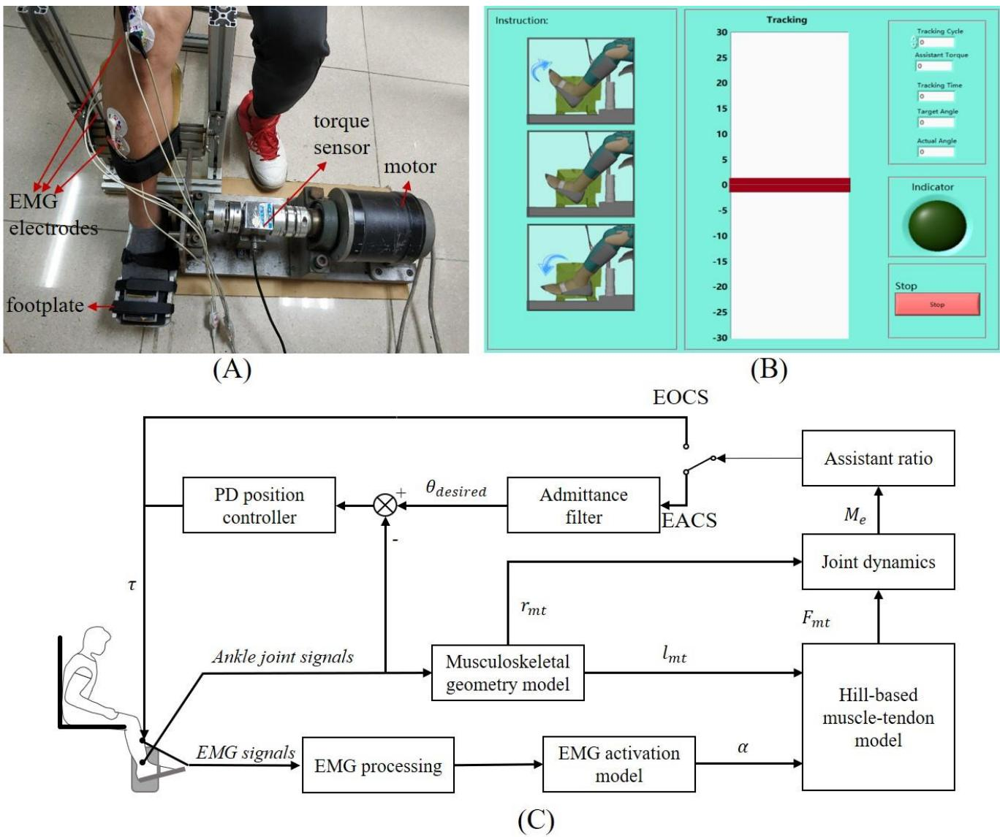

Fig. 1. (A) Photo of the ankle rehabilitation system. (B)User interface. (C)Block diagram of EACS and EOCS.  
TABLE II  
CLINICAL DATA FROM THE STROKE SURVIVORS

<table><tr><td>Participant</td><td>Type of stroke</td><td>Age/Sex</td><td>Lesion side</td><td>Months after stroke</td><td>FMA-LE (0-34)</td></tr><tr><td>P1</td><td>Hemo</td><td>45/M</td><td>L</td><td>33</td><td>26</td></tr><tr><td>P2</td><td>Isch</td><td>15/M</td><td>R</td><td>2</td><td>29</td></tr><tr><td>P3</td><td>Hemo</td><td>41/M</td><td>R</td><td>14</td><td>31</td></tr><tr><td>P4</td><td>Isch</td><td>51/M</td><td>L</td><td>1</td><td>20</td></tr></table>

Abbreviations: Hemo=Hemorrhagic Stroke; Isch=Ischemic Stroke; M=Male; L=left; R=right; FMA-LE=Fugl-Meyer Assessment for Lower Extremity.

the torque signals sensed by the torque sensor and the ankle joint angle coded by the internal encoder. The computer screen showed the target and actual ankle joint angles as real-time feedback in a LabVIEW program (National Instruments, USA). The program also generated the assistive torque signals, output the signals to the motor through DAQ card, and recorded the EMG, torque and joint signals for offline analysis. Since the exoskeleton can only assist dorsiflexion and TA was the agonistic muscle in dorsiflexion, the EMG signal from TA was used as the only source signal of the Hill-type model. EMG signals were captured at 1000 Hz, and filtered by a 4th-order Butterworth filter with a bandwidth from 10 to 400 Hz. The torque and angle signals of the ankle joint were captured at a sampling frequency of 1000 Hz.

## D. Experimental Protocol

Firstly, the movement performance was evaluated on twelve healthy participants (seven females and five males, 22.33 ± 0.89 years old). Secondly, the clinical feasibility was examined on four stroke survivors (TABLE II). Data collection was performed at the Department of Rehabilitation Medicine, First Affiliated Hospital of Sun Yat-Sen University, China. The inclusion criteria of the stroke survivors were: 1) hemiparesis resulting from a single unilateral lesion of the brain; 2) measurable EMG signal from the affected $\mathrm { T A } ;$ and 3) stroke survivors should not have visuospatial, cognitive or attention deficits which would prevent them from following the instructions or performing the experimental procedures. This study was approved by the Ethics Committee of the Guangdong Work Injury Rehabilitation Center. All procedures were conducted according to the Declaration of Helsinki and all participants provided written consent prior to testing.

The experiments mainly consisted of three parts: the range of motion (ROM) experiment, the MVC experiment and the movement tracking experiment. The ROM experiment was conducted to acquire the ROMs of the ankle joint of the participants. The MVC experiment was conducted on the purpose of calibrating the individual musculotendon parameter of the EDMM, while the movement tracking experiment was to evaluate the performance of EACS.

The ankle joint ROM was defined as the maximum angular displacement of the ankle dorsiflexion/plantarflexion from its neutral position where the joint angle was 90°. The participants ROMs were captured by a motion capture system (OptiTrack, NaturalPoint, USA). For healthy participants, the right ankle was tested, and for stroke survivors, the ankle of their lesion side was tested. Since the ROM of the ankle exoskeleton was bounded between -25 and 25 ° for training safety when continuous interaction torque existed, participants’ ROMs above $\pm 2 5 ^ { \circ }$ were recorded as $\pm 2 5 ^ { \circ }$ in the experiments [32].

After the ROM experiments, the participant was in a sitting position with his/her right or the lesion foot fastened to the pedal of the exoskeleton. A pair of electrodes were attached on the skin with a 20 mm interelectrode distance to capture the EMG signals from TA.

In the MVC experiments, the participant was instructed to activate TA as much as possible with the ankle joint fixed at 90°and 120° of ankle dorsiflexion, respectively. The calibration at each angle was repeated for three times with the duration of 5 s for each trial. There was also a 1-minute break between two trials to prevent muscle fatigue. The torque and the EMG signals were captured simultaneously during the experiments and stored for offline calibration of EDMM. The calibrated parameters were constant during the movement tracking experiment for each participant, but varied between participants.

Once the calibration was finished in MATLAB program, the participant was instructed to perform tracking tasks. As shown in Fig. 1(B), real-time visual feedback was provided on a computer screen, with a red slider performing the predefined sinusoidal trajectory between $\pm 2 5 ^ { \circ }$ , and a blue slider representing the actual one. In each trial, the participant tried his/her best to track the target slider in the dorsiflexion phase, and conducted 5 cycles of sinusoidal tracking movements, which took totally 50 s. After 2-3 tracking practices, each participant would accomplish 18 trials, which could be divided into 3 blocks consisting of 3 trials for each control scheme, and trials in the same block were made up of the tracking tasks under different assistance ratio (25%, 50% and 75%). The order of blocks would be set randomly, and the participant was ignorant of the control schemes and the assistance ratio. During the whole movement tracking experiment, the assistance torque only occurred in dorsiflexion. To prevent muscle fatigue, there was a 1-minute break between two trials. The angle signals, torque signals and EMG signals were recorded simultaneously for offline processing.

## E. Signal Processing and Statistical Analysis

Due to the inherent human motor variability and the robot perturbations caused by the noisy nature of the EMG signals [33], the stability of human-robot cooperation movement was quantified by kinematic variability (i.e., RMSE values of tracking error defined in Eq. (15)). The RMSJ values of tracking trajectories defined in Eq. (16) was used to quantify the smoothness of the human-robot cooperation movement.

$$
R M S E _ {A} = \sqrt {\frac {1}{N} \sum_ {i = 1} ^ {N} (\theta_ {t} (i) - \theta_ {a} (i)) ^ {2}}\tag{15}
$$

$$
R M S J = \sqrt {\frac {1}{N} \sum_ {i = 1} ^ {N} (J _ {t} (i) - J _ {a} (i)) ^ {2}}\tag{16}
$$

$\theta _ { t } ( i )$ and $\theta _ { a } ( i )$ represented the target ankle joint angle and the actual ankle joint angle at the � th sampling instant, respectively. $J _ { t } ( i )$ and $J _ { a } ( i )$ was calculated from the third derivative of the target and actual trajectory at the � th sampling instance, respectively.

The RMS values of EMG signals, assistance torque and interaction torque were calculated to evaluate the muscular effort, changes of assistance torque and compliance during dorsiflexion, and were defined as follow:

$$
R M S = \sqrt {\frac {1}{N} \sum_ {i = 1} ^ {N} (y (i)) ^ {2}}\tag{17}
$$

where �(�) could be the EMG signal, assistance torque and interaction torque at the � th sampling instant. To determine the influence of the two main factors, the control schemes (EOCS and EACS) and the assistance ratio (Tracking tasks: 25%, 50%, and 75%), on the indexes in Eq. (15)-(17) across the healthy participants, the two-factors repeated measures analysis of variance (rANOVA) was applied. Moreover, a paired t-test was applied to examine the difference in the indexes defined in Eq. (15)-(17) between two control schemes at the same assistance ratio and to compare the variance measurement between two successive assistance ratio. Due to the small number of stroke survivors of $n = 4$ , Friedman test was performed to examine the difference in the indexes defined in Eq. (15)-(17) between two control schemes at the same assistance ratio and to compare the variance measurement between two successive assistance ratio. The Bonferroni adjustment was applied for multiple comparisons in subsequent post-hoc tests. All statistical tests mentioned above were conducted in SPSS 23.0 (SPSS Inc., USA) and the significance was set as 0.05.

## III. RESULTS

The participants’ specific ROMs during tracking are reported in Table III. Increases in ROM were in P1, P2 and P4 when tracking with the exoskeleton controlled by EACS or EOCS compared with that of ROM experiment.

Fig. 2 illustrates the tracking performance, the estimated torque (i.e., $M _ { e } )$ , the assistance torque �, the interaction torque, and the raw EMG signal from TA in a cycle (assistance ratio = 75%) of one healthy participant (S1) for two control schemes (EACS: (A)-(E); EOCS: (F)-(J)).

The average RMS values of the assistance torque of EOCS and EACS are illustrated in Fig. 3(A)&(B) and listed in TABLE IV. The results of rANOVA suggested that both factors (control schemes and assistance ratio) had a significant impact on the magnitude of the assistance torque (both $\begin{array} { r } { \mathbf { p } < 0 . 0 0 1 , } \end{array}$ ). The results of the paired t-test and the Friedman test indicated that the average RMS values of assistance torque of EACS were significantly lower than those of EOCS at different assistance ratio (25%, 50%, and 75%: $\mathrm { p } < 0 . 0 0 1$ $\mathrm { p } < 0 . 0 0 1$ , and $\mathbf { p } < 0 . 0 0 1$ $\mathfrak { p } < 0 . 0 0 1 , \mathfrak { p } < 0 . 0 0 1$ , and $\mathrm { p } < 0 . 0 0 1$ , respectively). In addition, the paired t-test and Bonferroni adjustment also indicated that, when the assistance ratio increased, significant differences occurred in the average RMS values of assistance torque of EACS and EOCS between every two successive assistance ratio $( \mathtt { p } < 0 . 0 1 )$ .

The average RMS values of interaction torque are shown in Fig. 4 and listed in TABLE V. The rANOVA results showed that neither the control scheme nor the assistance ratio had significant influences on the magnitude of the interaction torque $( \mathtt { p } = 0 . 0 9 3$ and $\mathrm { p } = 0 . 0 7 3$ , respectively). The average RMS values of interaction torque of EACS were significantly higher than that of EOCS across healthy participants and stroke survivors when the assistance ratio was 25% $( \mathtt { p } < 0 . 0 0 1$ and $\mathsf { p } <$ 0.001, respectively), but were significantly lower than those of EOCS when the assistance ratio was 75% across healthy participants $( \mathtt { p } < 0 . 0 1 )$ . This value across stroke survivors were significantly lower than that of EOCS when the assistance ratio was 50% and 75% $( \mathtt { p } < 0 . 0 0 1$ and $\mathrm { p } < 0 . 0 0 1$ , respectively).

Moreover, when the assistance ratio increased, the average RMS values of the interaction torque declined significantly for EACS between every two successive assistance ratio across healthy participants $( \mathtt { p } < 0 . 0 0 1 )$ and between the assistance ratio of 25% and 50% across stroke survivors. This value for EOCS increased when the assistance ratio increased, and the significant difference appeared between the assistance ratio of 50% and 75% across healthy participants $( \mathtt { p } < 0 . 0 0 1 )$ and between the assistance ratio of 25% and 50% across stroke survivors $( \mathtt { p } < 0 . 0 0 1 )$ ).

The tracking performance presented by the average RMSE values of trajectory are illustrated in Fig. 5(A)&(B) and listed in TABLE VI. The rANOVA results indicated that there was significant impact of both control schemes and assistance ratio on the average RMSE values of trajectory (control schemes: p $< 0 . 0 0 1$ and assistance ratio: $\mathrm { p } < 0 . 0 0 1 )$ ). The average RMSE values of the trajectory of EACS were significantly lower than those of EOCS across healthy participants for all the different assistance ratio $( \mathtt { p } < 0 . 0 0 1 )$ and across stroke survivors when the assistance ratio was 50% and 75% $( \mathtt { p } < 0 . 0 5$ , and $\mathrm { p } < 0 . 0 1$ respectively). Consistent with our previous study, when the assistance ratio increased, significant differences appeared in the average RMSE values of the trajectory of EOCS across healthy participants between every two successive assistance ratio $( \mathbf { p } < 0 . 0 0 1 )$ , while those of EACS only appeared between assistance ratio of 50% and 75% $( \mathtt { p } < 0 . 0 5 )$ . The average RMSJ values of trajectory, are shown in Fig. $5 ( \mathrm { C } ) \& ( \mathrm { D } )$ and listed in TABLE VI. The rANOVA result suggested that there was a significant impact from both control scheme and assistance ratio on the average RMSJ values of trajectory (control scheme: $\mathrm { p } < 0 . 0 0 1$ and assistance ratio: $\mathsf { p } < 0 . 0 0 1 )$ . The average RMSJ values of the trajectory of EACS were lower than those of EOCS across healthy participants and stroke survivors for the different assistance ratio, but the significant differences only occurred across healthy participants when the assistance ratio was 50% and 75% $( \mathtt { p } < 0 . 0 0 1$ and $\mathrm { p } < 0 . 0 0 1$ , respectively) and across stroke survivors for all different assistance ratio $( \mathfrak { p } <$ 0.05). The average RMSJ values of the trajectory of EACS were similar to the result of ROM experiment compared with EOCS. In addition, when the assistance ratio increased, the average RMSJ values of the trajectory of EOCS across healthy participants between every two successive assistance ratio increased significantly $( \mathrm { p } \ < \ 0 . 0 0 1 )$ . But the significant differences didn’t occur across stroke survivors for all different assistance ratio.

TABLE III  
RANGE OF MOTION (IN DEGREES) DURING EXPERIMENTS

<table><tr><td>Participant</td><td>ROM experiment</td><td>EOCS</td><td>EACS</td></tr><tr><td>Healthy</td><td>-25 to 25</td><td>-25 to 25</td><td>-25 to 25</td></tr><tr><td>P1</td><td>-20 to 21</td><td>-20 to 24</td><td>-20 to 25</td></tr><tr><td>P2</td><td>-24 to 23</td><td>-24 to 25</td><td>-24 to 25</td></tr><tr><td>P3</td><td>-25 to 25</td><td>-25 to 25</td><td>-25 to 25</td></tr><tr><td>P4</td><td>-14 to 0</td><td>-17 to 18</td><td>-11 to 16</td></tr></table>

Ankle dorsiflexion are indicated by positive angles

EMG levels of TA of EOCS and EACS presented by the average RMS values are shown in Fig. 6(A)&(B) and listed in TABLE VII. The rANOVA result on the average RMS values of EMG signals from TA indicated that there was significant impact of the control scheme and the assistance ratio $( \mathtt { p } < 0 . 0 5$ and $\mathrm { p } < 0 . 0 0 1 $ . The average RMS values of EMG signals from

TA of EACS were higher than those of EOCS across healthy participants and stroke survivors for the different assistance ratio (25%, 50%, and 75%), but the significant difference only occurred when the assistance ratio was 50% and 75% across healthy participants $( \mathtt { p } < 0 . 0 0 1$ and $\mathrm { p } < 0 . 0 0 1$ , respectively) and across stroke survivors $( \mathtt { p } < 0 . 0 0 1$ and $\mathrm { p } < 0 . 0 0 1$ , respectively).

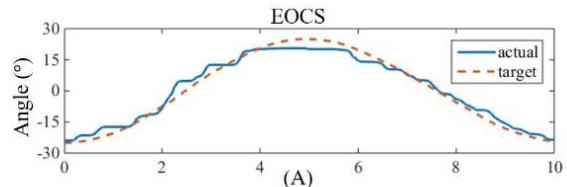

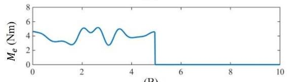

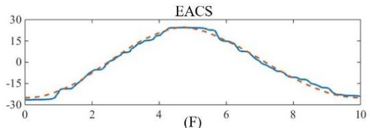

(B)  
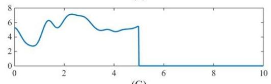

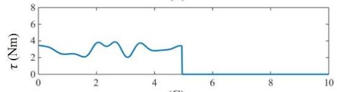  
(C)

(G)  
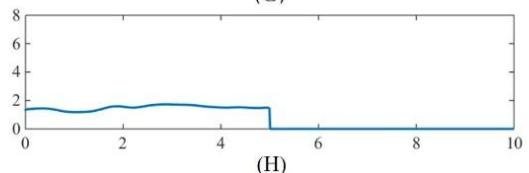

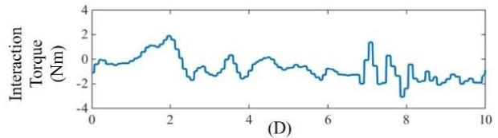

(H)  
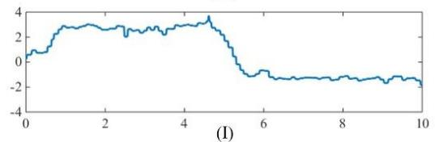

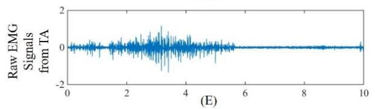  
Time (s)

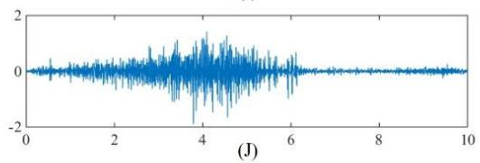  
Time (s)

Fig. 2. The target, actual ankle joint angle(A&F), the estimated torque, $M _ { e } ,$ (B&G), the assistance torque, �, (C&H, assistance $\mathrm { r a t i o } = 7 5 \% )$ , the interaction torque (D&I), raw EMG signals from TA (E&J) in a cycle of healthy participant S1.  
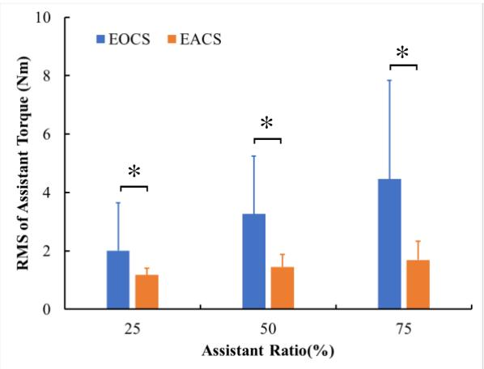  
(A)

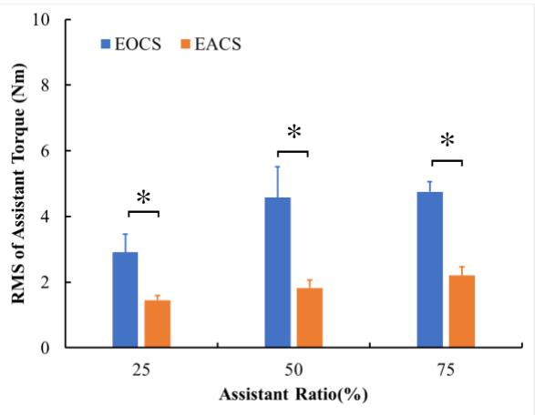  
(B)  
Fig. 3. Comparison of average amplitude of assistance torque between EOCS and EACS for each assistance ratio. (A) The average RMS values of assistance torque from healthy participants. (B) The average RMS values of assistance torque from stroke survivors.

With the increasing assistance ratio, the average RMS values of EMG signals from TA declined, but the significant decrease only occurred across healthy participants between the assistance ratio of 25% and 50% of EOCS $( \mathtt { p } < 0 . 0 0 1 )$ and across stroke survivors between the assistance ratio of 50% and 75% of both EACS and EOCS $( \mathtt { p } < 0 . 0 5 , \mathtt { p } < 0 . 0 5$ , respectively).

## IV. DISCUSSION

Since motor recovery after stroke depends on active rehabilitation by voluntary participation of stroke survivors’ paretic muscles [34], the combination of voluntary participation and mechanical assistance is important in robot-assisted rehabilitation. Makowski et al. found that the force assistance proportional to the voluntary effort on the affected side enabled participants to exert less effort and could be controlled to reach targets successfully, but participants had increased difficulty maintaining a stable position [35]. Our previous study suggested that an EMG-driven Hill-type neuromusculoskeletal model enable a more natural and human-like human-robot cooperation than a linear proportional model, but the tracking performance degraded with the increasing assistance ratio [10]. The objective of present study was to improve the stability of human-robot cooperation movement without affecting voluntary participation.

When the exoskeleton was controlled either by the EACS or the EOCS, all participants could complete the tracking task.

Trajectory error can reflect the tracking ability of the controller, verifying that it can control assistive torque while a participant uses the device [36]. Pehlivan et al. found that errors combined with visual feedback provide an impetus for active involvement [37], and error is likely a driving signal for motor learning [38]. Assistive control schemes concerning active participation can promote neural plasticity [39]. and, in turn, increase the potential for recovery of motor coordination [37]. The decrease in tracking errors of the EACS can be explained by the fact that the trajectory was determined by human intention in the admittance filter and the assistance torques were derived from participant’s desired trajectory in the PD position controller which can also guarantee the movement stability. Kwon et al. reported that the EMG-based assistance in flexion movements was gradually destabilized as the assistance increased [40], which is consistent with our previous study [10]. Moreover, the decrease in jerk values of the trajectory of the EACS demonstrated that the smoothness of the EACS improved significantly. The position controller in the EACS may compensate for the effect of unstable factors such as nonmodeling factors and disturbances during human-robot cooperation movement, and consequently, may improve the movement stability and smoothness. The result also suggested that the EACS cannot decrease the muscle effort compared with the EOCS. The higher value in the EMG activity from TA may indicate that more muscle activation was caused by the EACS

TABLE IV  
THE AVERAGE RMS VALUES (±S.D.) OF ASSISTANCE TORQUE AT EACH ASSISTANCE RATIO, AND THE RESULT OF STASTICAL TESTS BETWEEN TWO SUCCESSIVE ASSISTANCE RATIO

<table><tr><td rowspan="2"></td><td rowspan="2">Participants</td><td>Assistance ratio</td><td rowspan="2">25%</td><td rowspan="2">50%</td><td rowspan="2">75%</td></tr><tr><td>Control Scheme</td></tr><tr><td rowspan="4">RMS (Nm)</td><td rowspan="2">Healthy</td><td>EOCS</td><td> $2.01 \pm 1.64$ </td><td> $3.26 \pm 1.98^{*}$ </td><td> $4.46 \pm 3.38^{*}$ </td></tr><tr><td>EACS</td><td> $1.17 \pm 0.24$ </td><td> $1.45 \pm 0.43^{*}$ </td><td> $1.69 \pm 0.65^{*}$ </td></tr><tr><td rowspan="2">Stroke Survivors</td><td>EOCS</td><td> $2.91 \pm 0.56$ </td><td> $4.58 \pm 0.93^{*}$ </td><td> $4.75 \pm 0.31^{*}$ </td></tr><tr><td>EACS</td><td> $1.45 \pm 0.14$ </td><td> $1.82 \pm 0.23^{*}$ </td><td> $2.20 \pm 0.27^{*}$ </td></tr></table>

\* indicated significant difference between the current and the previous ratio.

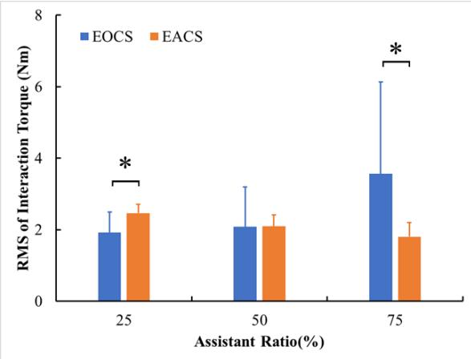  
(A)

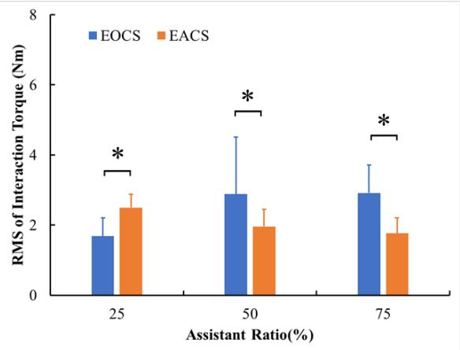  
(B)  
Fig. 4. Comparison of the RMS of interaction torque between EOCS and EACS for each assistant ratio from healthy participants (A) and stroke survivors (B).

TABLE V  
THE AVERAGE RMS VALUES (±S.D.) OF INTERACTION TORQUE AT EACH ASSISTANCE RATIO, AND THE RESULT OF STASTICAL TESTS BETWEEN TWO SUCCESSIVE ASSISTANCE RATIO

<table><tr><td rowspan="2"></td><td rowspan="2">Participants</td><td>Assistance ratio</td><td rowspan="2">25%</td><td rowspan="2">50%</td><td rowspan="2">75%</td></tr><tr><td>Control Scheme</td></tr><tr><td rowspan="4">RMS (Nm)</td><td rowspan="2">Healthy</td><td>EOCS</td><td>1.92 ± 0.58</td><td>2.07 ± 1.12</td><td>3.56 ± 2.57*</td></tr><tr><td>EACS</td><td>2.46 ± 0.25</td><td>2.09 ± 0.31*</td><td>1.81 ± 0.39*</td></tr><tr><td rowspan="2">Stroke Survivors</td><td>EOCS</td><td>1.68 ± 0.52</td><td>2.88 ± 1.63*</td><td>2.91 ± 0.80</td></tr><tr><td>EACS</td><td>2.50 ± 0.38</td><td>1.96 ± 0.49*</td><td>1.76 ± 0.44</td></tr></table>

\* indicated significant difference between the current and the previous ratio.

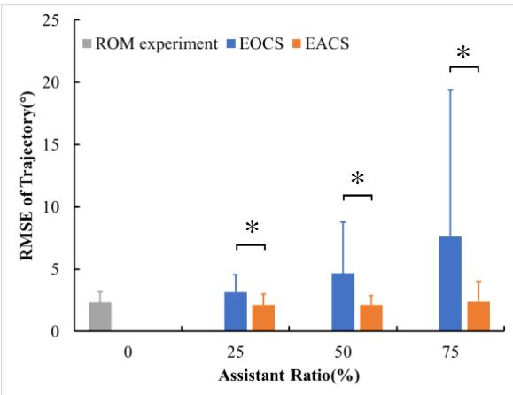

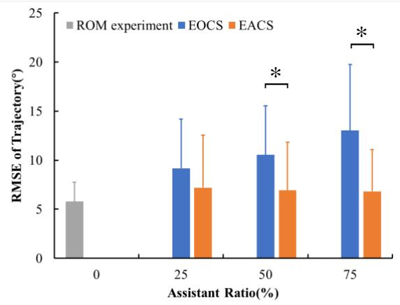

(A)  
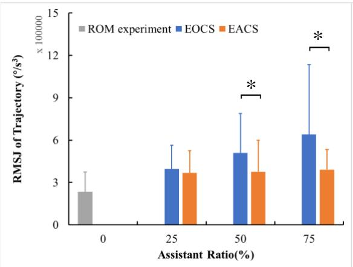  
(C)

(B)  
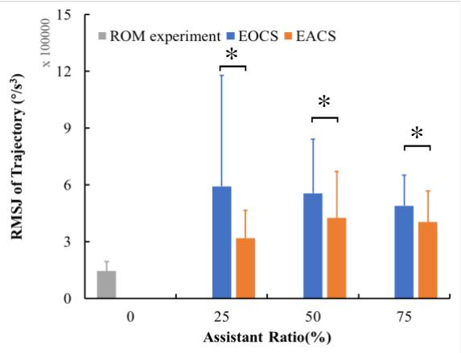  
(D)  
Fig. 5. Comparison of the RMSE and the RMSJ of trajectory between EOCS and EACS for each assistance ratio. (A) The average RMSE values of trajectory from healthy participants. (B) The average RMSE values of trajectory from stroke survivors. (C) The average RMSJ values of trajectory from healthy participants. (D) The average RMSJ values of trajectory from stroke survivors

to improve the movement stability. Although EOCS is an openloop controller, the human is inside the control loop and closes the control loop by regulating his/her muscle activation. For instance, he or she can reduce his/her voluntary effort based on the proprioceptive and visual feedback in order to depress the oscillations and guarantee movement stability [26].

Both voluntary participation and movement performance can influence the rehabilitation efficacy of robotic exoskeletons [19, 41, 42].The result of clinical experiments suggested that both

EOCS and EACS could increase stroke survivors’ joint ROMs and provide a larger workspace without affecting voluntary participation. For the EACS, performance degradation in tracking accuracy, smoothness and compliance did not occur when the assistance ratio increased. The assistance ratio determined the working load shared by robot. For higher assistance ratio, a larger assistance torque was offered to the participants and a larger part of working load was shared by the robot to perform the tracking movement. For stroke survivors

TABLE VI  
THE AVERAGE RMSE AND RMSJ VALUES (±S.D.) OF TRAJECTORY AT EACH ASSISTANCE RATIO, AND THE RESULT OF STASTICAL TESTS BETWEEN TWO SUCCESSIVE ASSISTANCE RATIO

<table><tr><td rowspan="2"></td><td rowspan="2">Participants</td><td>Assistance ratio</td><td rowspan="2">25%</td><td rowspan="2">50%</td><td rowspan="2">75%</td></tr><tr><td>Control Scheme</td></tr><tr><td rowspan="4">RMSE (°)</td><td rowspan="2">Healthy</td><td>EOCS</td><td>3.15 ± 1.42</td><td>4.66 ± 4.12*</td><td>7.61 ± 11.78*</td></tr><tr><td>EACS</td><td>2.13 ± 0.55</td><td>2.13 ± 0.73</td><td>2.40 ± 1.60*</td></tr><tr><td rowspan="2">Stroke Survivors</td><td>EOCS</td><td>9.18 ± 5.01</td><td>10.53 ± 5.00</td><td>13.03 ± 6.72</td></tr><tr><td>EACS</td><td>7.19 ± 5.37</td><td>6.92 ± 4.92</td><td>6.82 ± 4.24</td></tr><tr><td rowspan="4">RMSJ (10^5 °/s^3)</td><td rowspan="2">Healthy</td><td>EOCS</td><td>3.95 ± 1.68</td><td>5.09 ± 2.80*</td><td>6.39 ± 4.95*</td></tr><tr><td>EACS</td><td>3.68 ± 1.58</td><td>3.76 ± 2.23</td><td>3.91 ± 1.42</td></tr><tr><td rowspan="2">Stroke Survivors</td><td>EOCS</td><td>5.92 ± 5.86</td><td>5.56 ± 2.87*</td><td>4.90 ± 1.62*</td></tr><tr><td>EACS</td><td>3.18 ± 1.48</td><td>4.25 ± 2.45</td><td>4.03 ± 1.66</td></tr></table>

\* indicated significant difference between the current and the previous ratio.

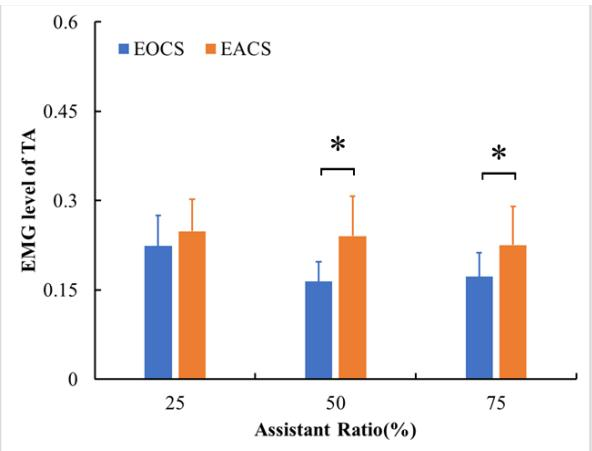  
(A)

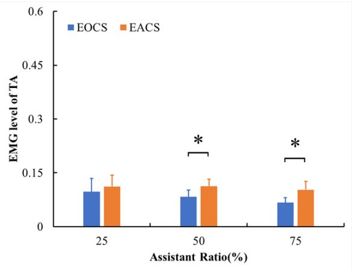  
(B)  
Fig. 6. Comparison of the average RMS values of EMG signals from TA between EOCS and EACS for each assistance ratio. (A) The average RMS values of EMG signals from TA of healthy participants. (B) The average RMS values of EMG signals from TA of stroke survivors.

TABLE VII  
THE AVERAGE RMS VALUES (±S.D.) OF EMG SIGNALS FROM TA AT EACH ASSISTANCE RATIO, AND THE RESULT OF STASTICAL TESTS BETWEEN TWO SUCCESSIVE ASSISTANCE RATIO

<table><tr><td rowspan="2"></td><td rowspan="2">participant</td><td>Assistance ratio</td><td rowspan="2">25%</td><td rowspan="2">50%</td><td rowspan="2">75%</td></tr><tr><td>Control Scheme</td></tr><tr><td rowspan="4">TA</td><td rowspan="2">Healthy</td><td>EOCS</td><td> $0.22 \pm 0.05$ </td><td> $0.16 \pm 0.03^{*}$ </td><td> $0.17 \pm 0.04$ </td></tr><tr><td>EACS</td><td> $0.25 \pm 0.05$ </td><td> $0.24 \pm 0.07$ </td><td> $0.23 \pm 0.06$ </td></tr><tr><td rowspan="2">Stroke Survivors</td><td>EOCS</td><td> $0.10 \pm 0.04$ </td><td> $0.08 \pm 0.02$ </td><td> $0.07 \pm 0.01^{*}$ </td></tr><tr><td>EACS</td><td> $0.11 \pm 0.03$ </td><td> $0.11 \pm 0.02$ </td><td> $0.10 \pm 0.02^{*}$ </td></tr></table>

\* indicated significant difference between the current and the previous ratio.

with poor motor control ability, their residual muscle forcegenerating capacity was weak, resulting in a higher assistance ratio required in robot-assisted rehabilitation to complete tracking tasks. In this case, the EACS can provide a stable and smooth tracking trajectory in robot-assisted rehabilitation for them. Thus, the EACS can generate better performance of human-robot cooperation movement without affecting voluntary participation, which may enhance rehabilitation effectiveness in future [19]. Moreover, the EACS can not only be applied in a rehabilitation device to address the foot-drop problem for the stroke survivors, but also can be run on a portable assistive device for robot-assisted walking in the future.

## V. CONCLUSION

In this study, the EACS was proposed to improve the stability of the human-robot cooperation movement without affecting the voluntary participation. Both EACS and EOCS could increase stroke survivors’ joint ROM, but the EACS could provide more stable human-robot cooperation movement even in the presence of a high assistance ratio. These results prove the feasibility of using the EACS in robot-assisted rehabilitation for stroke survivors with hemiparesis, and suggest that the EACS has a potential to be applied in clinical rehabilitation training. Future work will be conducted on more stroke survivors in clinical rehabilitation training to acquire a reliable evaluation.

## REFERENCES

[1] L. Zhang, Z. Li, and C. Yang, “Adaptive neural network based variable stiffness control of uncertain robotic systems using disturbance observer,” IEEE Trans. Ind. Electron., vol. 64, no. 3, pp. 2236-2245, Mar. 2016.

[2] D. Reinkensmeyer, and V. Dietz, Neurorehabilitation technology, second edition, 2016.

[3] H. Kazerooni, J. L. Racine, L. Huang, and R. Steger, “On the control of the berkeley lower extremity exoskeleton (BLEEX),” in IEEE International Conference on Robotics and Automation, Barcelona, Spain, Apr. 2006, pp. 4345-4352.

[4] R. Ronsse, N. Vitiello, T. Lenzi, J. V. D. Kieboom, M. C. Carrozza, and A. J. Ijspeert, “Human–robot synchrony: flexible assistance using adaptive oscillators,” IEEE Trans. Biomed. Eng., vol. 58, no. 4, pp. 1001-1012, Apr. 2011.

[5] W. Ye, Z. Li, C. Yang, F. Chen, and C.-Y. Su, “Motion detection enhanced control of an upper limb exoskeleton robot for rehabilitation training,” Int. J. Hum. Robot., vol. 14, no. 1, pp. 1-17, 2017.

[6] D. G. Lloyd, and T. F. Besier, “An EMG-driven musculoskeletal model to estimate muscle forces and knee joint moments in vivo,” J. Biomech., vol. 36, no. 6, pp. 765-776, 2003.

[7] T. S. Buchanan, D. G. Lloyd, K. Manal, and T. F. Besier, “Neuromusculoskeletal modeling: estimation of muscle forces and joint moments and movements from measurements of neural command,” J. Appl. Biomech., vol. 20, no. 4, pp. 367-395, 2004.

[8] Y. Sankai, "HAL: Hybrid Assistive Limb Based on Cybernics," Robotics Research, M. Kaneko and Y. Nakamura, eds., Berlin, Heidelberg: Springer, 2010.

[9] Z. Lu, X. Chen, X. Zhang, K. Y. Tong, and P. Zhou, “Real-time control of an exoskeleton hand robot with myoelectric pattern recognition,” Int. J. Neural Syst., vol. 27, no. 5, pp. 1-11, 2017.

[10] D. Ao, R. Song, and J. W. Gao, “Movement performance of humanrobot cooperation control based on EMG-driven Hill-type and proportional models for an ankle power-assist exoskeleton robot,” IEEE Trans. Neural Syst. Rehabil. Eng., vol. 25, no. 8, pp. 1125- 1134, Aug. 2016.

[11] Y. Zhuang, S. Yao, C. Ma, and R. Song, “Admittance control based on EMG-driven musculoskeletal model improves the human-robot synchronization,” IEEE Trans. Ind. Inform., vol. 15, no. 2, pp. 1211- 1218, Oct. 2018.

[12] T. Teramae, T. Noda, and J. Morimoto, “EMG-based model predictive control for physical human–robot interaction: application for assist-as-needed control,” IEEE Robot. Automat. Lett., vol. 3, no. 1, pp. 210-217, Jan. 2018.

[13] J. Loboprat, K. Nizamis, J. Mmhp, K. Aql, P. H. Veltink, K. Bfjm, and S. Aha, “Comparison between sEMG and force as control interfaces to support planar arm movements in adults with Duchenne: a feasibility study,” J. Neuroeng. Rehabil., vol. 14, no. 1, pp. 1-17, 2017.

[14] A. J. Young, and D. P. Ferris, “State of the art and future directions for lower limb robotic exoskeletons,” IEEE Trans. Neural. Syst. Rehabil. Eng., vol. 25, no. 2, pp. 171-182, Feb. 2017.

[15] N. Hogan, “Impedance control: an approach to manipulation,” in American Control Conference, San Diego, CA, USA, 2009, pp. 304- 313.

[16] C. Ott, R. Mukherjee, and Y. Nakamura, “Unified impedance and admittance control,” in IEEE International Conference on Robotics and Automation, Anchorage, Alaska, USA, May 2010, pp. 554-561.

[17] J. Rosen, M. Brand, M. B. Fuchs, and M. Arcan, “A myosignalbased powered exoskeleton system,” IEEE Trans. Syst. Man. Cy., vol. 31, no. 3, pp. 210-222, May 2001.

[18] K. Kiguchi, and Y. Hayashi, “An EMG-based control for an upperlimb power-assist exoskeleton robot,” IEEE Trans. Syst. Man Cybern. Part B-Cybern., vol. 42, no. 4, pp. 1064-1071, Aug. 2012.

[19] E. Guanziroli, M. Cazzaniga, L. Colombo, S. Basilico, G. Legnani, and F. Molteni, “Assistive powered exoskeleton for complete spinal cord injury: correlations between walking ability and exoskeleton control,” Eur J Phys Rehab Med, vol. 55, no. 2, pp. 209-216, 2019.

[20] D. G. Lloyd, and T. S. Buchanan, “A model of load sharing between muscles and soft tissues at the human knee during static tasks,” ASME. J Biomech Eng. , vol. 118, no. 3, pp. 367-376, 1996.

[21] K. Manal, and T. S. Buchanan, “A one-parameter neural activation to muscle activation model: estimating isometric joint moments from electromyograms,” J. Biomech., vol. 36, no. 8, pp. 1197-1202, 2003.

[22] K. N. An, K. Takahashi, T. P. Harrigan, and E. Y. Chao, “Determination of muscle orientations and moment arms,” J. Biomech., vol. 106, no. 3, pp. 280-282, Aug. 1984.

[23] Y. Giat, J. Mizrahi, W. S. Levine, and J. Chen, “Simulation of distal tendon transfer of the biceps brachii and the brachialis muscles,” J. Biomech., vol. 27, no. 8, pp. 1005-1014, 1994.

[24] L. M. Schutte, M. M. Rodgers, F. E. Zajac, and R. M. Glaser, “Improving the efficacy of electrical stimulation-induced leg cycle ergometry: an analysis based on a dynamic musculoskeletal model,” IEEE Trans. Rehabil. Eng., vol. 1, no. 2, pp. 109-125, Jun. 1993.

[25] F. E. Zajac, “Muscle and tendon: properties, models, scaling, and application to biomechanics and motor control,” Crit. Rev. Biomed. Eng., vol. 17, no. 4, pp. 359-411, 1989.

[26] C. Fleischer, and G. Hommel, “A Human-exoskeleton Interface Utilizing Electromyography,” IEEE Trans. Robot., vol. 24, no. 4, pp. 872-882, Aug. 2008.

[27] P. R. Culmer, A. E. Jackson, S. Makower, and R. Richardson, “A control strategy for upper limb robotic rehabilitation with a dual robot system,” IEEE-ASME Trans. Mech., vol. 15, no. 4, pp. 575- 585, Aug. 2010.

[28] G. Xu, A. Song, and H. Li, “Control system design for an upperlimb rehabilitation robot,” Adv Robot, vol. 25, no. 1-2, pp. 229-251, 2011.

[29] J. A. Saglia, N. G. Tsagarakis, J. S. Dai, and D. G. Caldwell, “Control strategies for patient-assisted training using the Ankle Rehabilitation Robot (ARBOT),” IEEE/ASME T Mech, vol. 18, no. 6, pp. 1799-1808, 2013.

[30] P. Liang, C. Yang, Z. Li, and R. Li, “Writing skills transfer from human to robot using stiffness extracted from sEMG,” in IEEE International Conference on Cyber Technology in Automation, Control, and Intelligent Systems, 2015, pp. 19-24.

[31] P. D. Liang, C. G. Yang, N. Wang, Z. J. Li, R. F. Li, and E. Burdet, "Implementation and test of human-operated and human-like adaptive impedance controls on Baxter robot," Advances in Autonomous Robotics Systems: 15th Annual Conference, M. Mistry, A. Leonardis, M. Witkowski and C. Melhuish, eds., pp. 109-119: Springer International Publishing, 2014.

[32] M. Zhang, S. Q. Xie, X. Li, G. Zhu, W. Meng, X. Huang, and A. Veale, “Adaptive patient-cooperative control of a compliant ankle rehabilitation robot (CARR) with enhanced training safety,” IEEE Trans Ind Electron, vol. 65, no. 2, pp. 1398-1407, 2017.

[33] E. Burdet, K. P. Tee, I. Mareels, T. E. Milner, C. M. Chew, D. W. Franklin, and R. O. M. Kawato, “Stability and motor adaptation in human arm movements,” Biol. Cybern., vol. 94, no. 1, pp. 20-32, 2006.

[34] R. Song, K. Y. Tong, X. L. Hu, and Z. Wei, “Myoelectrically controlled wrist robot for stroke rehabilitation,” J Neuroeng Rehabil, vol. 10, no. 1, pp. 52, 2013.

[35] N. S. Makowski, J. S. Knutson, J. Chae, and P. E. Crago, “Control of robotic assistance using poststroke residual voluntary effort,” IEEE Trans Neur Sys Reh, vol. 23, no. 2, pp. 221-231, 2014.

[36] C. Jarrett, and A. Mcdaid, “Robust control of a cable-driven soft exoskeleton joint for intrinsic human-robot interaction,” IEEE Transactions on Neural Systems & Rehabilitation Engineering, vol. 25, no. 7, pp. 976-986, 2017.

[37] A. U. Pehlivan, D. P. Losey, and M. K. O'Malley, “Minimal Assistas-Needed Controller for Upper Limb Robotic Rehabilitation,” IEEE Transactions on Robotics, vol. 32, no. 1, pp. 113-124, 2016.

[38] S. G. Lisberger, “The neural basis for learning of simple motor skills,” Science, vol. 242, no. 4879, pp. 728-735, 1988.

[39] Z. Warraich, and J. A. Kleim, “Neural Plasticity: The Biological Substrate For Neurorehabilitation,” Pm & R, vol. 2, no. 12, pp. S208–S219, 2010.

[40] S. Kwon, Y. Kim, and J. Kim, “Movement stability analysis of surface electromyography-based elbow power assistance,” IEEE Trans. Biomed. Eng., vol. 61, no. 4, pp. 1134-1142, Apr. 2014.

[41] M. Lotze, C. Braun, N. Birbaumer, S. Anders, and L. G. Cohen, “Motor learning elicited by voluntary drive,” Brain, vol. 126, no. 1, pp. 866-872, 2003.

S. K. Banala, S. H. Kim, S. K. Agrawal, and J. P. Scholz, “Robot assisted gait training with active leg exoskeleton (ALEX),” IEEE Trans Neur Sys Reh, vol. 17, no. 1, pp. 2-8, 2009.