# A Cable-Driven Upper Limb Rehabilitation Robot With Muscle-Synergy-Based Myoelectric Controller

Chenglin Xie , Graduate Student Member, IEEE, Yueling Lyu, Guoxin Li , Member, IEEE,

Raymond Kai-Yu Tong , Senior Member, IEEE, Haisheng Xia , Member, IEEE,

Rong Song , Senior Member, IEEE, and Zhijun Li , Fellow, IEEE

Abstract—Surface electromyography (sEMG) signal has been used in upper limb rehabilitation robots (ULRR). However, existing ULRR based on myoelectric controllers suffers from limited generalization ability in estimating three-dimensional (3-D) motion intention. This article proposes a muscle-synergy-inspired approach to enhance the generalization ability ofthe myoelectric controller of a cable-driven ULRR. Low-dimensional commands are extracted from sEMG signals based on an EMG-to-muscle activation model and non-negative matrix factorization. The extracted commands are used to estimate the 3-D human force. Two different trajectory tracking tasks are selected to test the generalization ability. The system is trained based on training sets where participants perform one task. Then the system is tested using testing sets where participants perform the other task. Finally, the system is verified on real-time robotic control experiment. Results show that the proposed controller achieves better force estimating accuracy, better trajectory tracking accuracy, and lower interaction force than the myoelectric controller without considering muscle synergies, which means the proposed controller yields better generalization performance.

Manuscript received 3 April 2024; accepted 14 May 2024. Date of publication 10 June 2024; date of current version 20 June 2024. This paper was recommended for publication by Associate Editor C. Yang and Editor K. Mombaur upon evaluation ofthe reviewers’ comments. This work was supported in part by the National Key Research and Development Program of China under Grant 2022YFE0201900 and Grant 2021YFF0501600, in part by the ANSO Collaborative Research project under Grant ANSO-CR-PP-2020-03, in part by the Natural Science Foundation of Guangdong Province under Grant 2023A1515011021, in part by the Shenzhen Science and Technology Research Program under Grant SGDX20210823103405040, and in part by the Guangdong Science and Technology Plan Project under Grant 2020B1212060077. (Corresponding author: Rong Song.)

This work involved human subjects or animals in its research. Approval of all ethical and experimental procedures and protocols was granted by School of Medicine, Sun Yat-sen University Institutional Review Board under Application No. IRB/SM-14/2021, and performed in line with the Approval document of research on control methods and key technologies of upper limb cable-driven rehabilitation robot.

Chenglin Xie, Yueling Lyu, and Rong Song are with the Key Laboratory of Sensing Technology and Biomedical Instrument ofGuangdong Province, School of Biomedical Engineering, Shenzhen Campus of Sun Yat-sen University, Shenzhen 518107, China, also with the Guangdong Provincial Engineering and Technology Center ofAdvanced and Portable Medical Devices, School ofBiomedical Engineering, Sun Yat-sen University, Guangzhou 510006, China, and also with the Shenzhen Research Institute of Sun Yat-sen University, Shenzhen 510810, China (e-mail: xiechlin@mail2.sysu.edu.cn; lvyueling88@126.com; songrong@mail.sysu.edu.cn).

Guoxin Li, Haisheng Xia, and Zhijun Li are with the School of Mechanical Engineering, Translational Research Center, Shanghai Yangzhi Rehabilitation Hospital, Tongji University, Shanghai 200070, China (e-mail: lgxin@ieee.org; hs\_xia@tongji.edu.cn; zjli@ieee.org).

Raymond Kai-Yu Tong is with the Department of Biomedical Engineering, The Chinese University of Hong Kong, Hong Kong (e-mail: kytong@cuhk.edu.hk).

Digital Object Identifier 10.1109/TRO.2024.3411849

Index Terms—Cable-driven upper limb rehabilitation robot (CDULRR), continuous myoelectric controller, generalization, muscle synergy, three-dimensional (3-D) space.

## I. INTRODUCTION

TROKE is one of the leading causes of death and long-term disability [1], [2]. It is estimated that more than 80% of stroke survivors experience some degree of upper limb motor impairment, which impacts the patients’ activities in daily life and places a great burden on poststroke care [3]. With an annual increase of over 15 million cases of stroke [4], traditional rehabilitation treatments are insufficient due to a limited number of physical therapists and heavy workloads [5]. Robot-assisted rehabilitation has the advantage of providing intensive and quantitative treatment [6]. Recently, upper limb rehabilitation robots (ULRRs) have become a beneficial complement to therapist-led upper limb rehabilitation treatments for patients after stroke [7].

The effectiveness of the robot-assisted rehabilitation largely depends on the control strategy. Various control strategies have been proposed/employed to meet the requirements of rehabilitation training. Traditionally, passive control strategies have been adopted to ensure the accuracy of tracking a given trajectory and provide passive rehabilitation training [8]. To improve the compliance of the human–robot interaction in rehabilitation, the impedance control has been employed to regulate the dynamic relationship between the interaction force and position [9], [10], [11]. Since voluntary participation is vital to promote motor function recovery for poststroke patients [12], active control strategies have attracted more and more attention to achieve human–dominated rehabilitation training [13], [14], [15]. Saglia et al. [13] constructed an admittance control strategy to generate the desired position for robots according to the interaction force as input. Surface electromyography (sEMG) signal is relevant to the motion intention and thus can also be used as the input of rehabilitation robots to realize active control [15], [16], [17], [18], [19], [20]. The sEMG signal occurred before human voluntary force, providing an opportunity to compensate for the temporal delay between the subject’s voluntary force and robot’s response, consequently enhancing the synchronization between human and robot [21]. Zhuang et al. [21] developed an sEMG-based admittance control strategy for an ankle rehabilitation robot using Hill-type musculoskeletal model (HMM). Fleischer and Hommel [22] proposed an sEMG-based torque control strategy, which was also based on HMM. Although HMM has been employed to continuously estimate one-dimensional (1-D) force, it could hardly be used for upper limb end force/position estimation in 3-D space due to the high complexity of the 3-D upper limb motion [23], [24]. State-space model has been adopted to continuously estimate 3-D end force of the upper limb via sEMG signal and endowed the ULRR with ability of providing task-specific motion assistance [25], [26].

Muscle synergy is a biological theory that takes advantages of coordination principles to extract motion intention [27], [28], [29]. Neurophysiological researches have illustrated that the central nervous system (CNS) might simplify the neural control of movement via muscle synergies, where CNS uses lower dimensional commands to recruit a larger number of muscles [28], [30], [31]. Berniker et al. [28] established a low-dimensional controller based on muscle synergy theory to reconstruct natural movement trajectories of the frog hindlimb. Saito et al. [32] provided evidence that there exist basis units of human upper limb muscle synergies in complex arm movements. Muceli et al. [33] demonstrated that muscle synergies extracted from muscle activations during movements in three sufficiently separated directions could describe those during movements in all the other directions. In order to extract muscle synergies, many algorithms have been adopted: the principle component analysis (PCA) [34], independent component analysis (ICA) [35], neural network [36], and non-negative matrix factorization (NNMF) [27], [28], [37], [38]. Among them, NNMF can be used to factorize the muscle activation matrix into two non-negative parts: the muscle synergy matrix and the low-dimensional commands [28]. NNMF algorithm has drawn particular attention because it can extract non-negative features which match the physical constraint of non-negative neuromuscular activations [36], [39].

Most existing muscle-synergy-based approaches have been applied for offline analysis [40], [41], [42], or discrete control of prosthetic hand [29] or virtual hand [43], and have not involved physical human–robot interaction (pHRI) based on sEMG, such as in robot-assisted rehabilitation training, especially in 3-D space. The pHRI in such environment is complex and continuous, therefore the combination of muscle-synergy-based approach with myoelectric controllers to enhance generalization ability is needed but absent. In this article, an end-effector-based cable-driven upper limb rehabilitation robot (CDULRR) partly based on the previous article [25] was applied to assist the upper limb gross movements. The EMG-to-muscle activation model and real-time NNMF algorithm were applied to extract 6-D commands from sEMG signals of eight upper limb muscles. The extracted commands were used to control the end-effector in real time based on a state-space model and an admittance controller. Two trajectory tracking tasks were considered: triangle-like and rectangle-like trajectory tasks. For each participant, one trajectory task was used for model training, whereas the other one was used for both the model testing and online verification (i.e., across tasks). We hypothesized that the muscle synergy theory could not only be used to reconstruct sEMG signals in reaching tasks as proof in [32], [33], and [37], but also might contribute to better generalization performance in upper limb 3-D force estimation and motion assistance during rehabilitation training across tasks. To the best of our knowledge, we are the first to apply the muscle-synergy-based myoelectric controller to the ULRR for 3-D continuous movement assistance across different trajectory tracking tasks and compare the generalization performance of continuous myoelectric controllers with and without considering muscle synergies under pHRI.

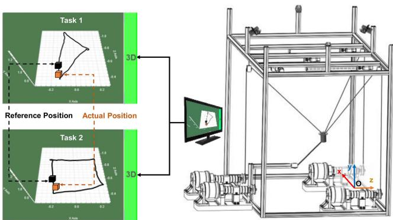  
(a)

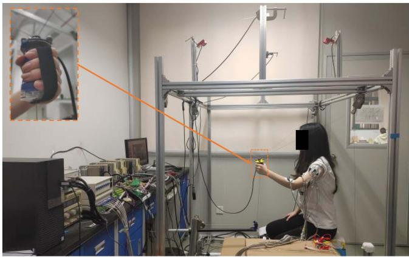  
(b)  
Fig. 1. CDULRR platform. (a) Schematic of the CDULRR. (b) Image of a participant interacting with the CDULRR and a close-up image of the endeffector.

## II. METHOD

## A. CDULRR Platform

The CDULRR platform was shown in Fig. 1, which consisted an end-effector, four motors (DM1B-045G, Yokogawa Co.), four cameras (OptiTrack-2, NaturalPoint Co.), a screen, and a real-time operating system termed dSpace (RTI-1202, dSpace Co.). The end-effector was driven by four cables, which were actuated by four motors at the control frequency of100 Hz. Three optical markers were fitted on the end-effector. The position of each marker could be obtained by four cameras with the motion capture system at the frequency of 100 Hz. The center of the three markers was regarded as the actual position of the end-effector. The participant held the end-effector, which had a Velcro strip wrapped around the hand. A screen in front of the participant provided visual feedback, where a virtual black cursor represented the reference position while an orange one represented the actual position of the end-effector. Four pressure sensors (HSTLBLSM, BHX. Tech. Dev. Co.) measured the tension of four cables. Eight pairs of AgCl electrodes measured the sEMG signals of eight muscles (listed in Table I) at the sampling frequency of 1 kHz, serving as the input signals. Different from the hardware in the previous article [25], we built a six-axis force sensor (D45MM-F400N) into the end-effector for measuring human–robot interaction force and also upgraded the control card based on the PC-NI series to an embedded real-time operating system based on dSpace RTI-1202. The dSpace operating system processed the input signals and controlled four motors in real time. The CDULRR system could provide rehabilitation tasks in 3-D working space, making it suitable for a wide range of daily activities. This kind of cable-driven parallel robot has advantages, such as good compliance, light weight, low inertia, and safety, because the motors are away from the end-effector.

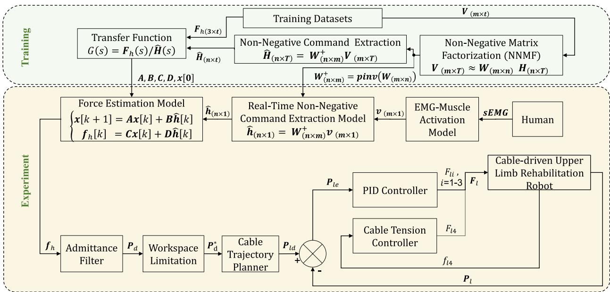  
Fig. 2. Overall control framework of muscle-synergy-based myoelectric controllers. In the training part, NNMF was applied to extract muscle synergy matrix W from muscle activation matrix V in the training datasets. $W ^ { + }$ , the pseudoinverse of $W _ { : }$ , was calculated and then the non-negative command Hˆ was obtained. A transfer function model was adopted to describe the relationship between $\hat { H }$ and the 3-D human force ${ \bf { \mathcal { F } } } _ { h }$ in the datasets. The trained transfer function model could be transformed into the state-space model with identified coefficient matrices A, B, C, D, and ${ \pmb x } [ 0 ]$ . In the experiment part, an EMG-muscle activation model calculated the muscle activation vector v using sEMG signals of eight muscles. Next, a vector of non-negative command $\hat { h }$ was extracted from v and then a force estimation model $( \mathrm { i . e . } ,$ , the state-space model) estimated the human 3-D force $f _ { h } .$ After that, an admittance filter based low-level controller was used to control the CDULRR: an admittance filter generated the original desired position $P _ { d }$ of the end-effector according to $f _ { h } . P _ { d }$ was limited into the workspace and formed $P _ { d } ^ { * }$ as the desired position. A cable trajectory planner was applied to determine the desired lengths of the three upper cables. Finally, a PID controller was used to output the actuating force of three upper cables, and the lower cable force $( F _ { l 4 } )$ was controlled by a cable tension controller according to the measured tension $( f _ { 1 4 } )$

TABLE I  
SEMG SIGNALS OF EIGHT MUSCLES SERVING AS THE CONTROL SIGNALS

<table><tr><td>No.</td><td>Muscle</td><td>Abbreviation</td></tr><tr><td>1</td><td>Brachioradialis</td><td>BR</td></tr><tr><td>2</td><td>Biceps brachii</td><td>BIC</td></tr><tr><td>3</td><td>Triceps lateral head</td><td>TRI-LA</td></tr><tr><td>4</td><td>Anterior of deltoid</td><td>DA</td></tr><tr><td>5</td><td>Medial of deltoid</td><td>DM</td></tr><tr><td>6</td><td>Posterior of deltoid</td><td>DP</td></tr><tr><td>7</td><td>Triceps long head</td><td>TRI-LO</td></tr><tr><td>8</td><td>Triceps medial head</td><td>TRI-MI</td></tr></table>

## B. Muscle-Synergy-Based Myoelectric Controller

The overall control framework, which was implemented in the dSpace operating system, was shown in Fig. 2. An EMG-muscle activation model was used to calculate muscle activation vector $\pmb { v } \in \mathbf { R } ^ { m \times 1 }$ , where $\textit { m } = \textit { 8 }$ is the number of muscles. Next, a vector of n $( n < m )$ dimensional non-negative command $\hat { h } \in { \bf R } ^ { n \times 1 }$ was extracted, and then a force estimation model estimated the 3-D human force $\pmb { f } _ { h } \in \mathbf { R } ^ { 3 \times 1 }$ . After that, an admittance filter generated the original desired position $P _ { d } \in \mathbf { R } ^ { 3 \times 1 }$ of the end-effector according to $f _ { h } . P _ { d }$ was limited into the workspace of the CDULRR, forming $P _ { d } ^ { * }$ as the desired position. The cable trajectory planner and the PID loop was the same as those described in the previous article [25].

1) EMG-to-Muscle Activation Model: The measured sEMG signals were full-wave rectified and then went through a fourthorder low-pass filter with a cutoff frequency of 4 Hz. Next, the signals were normalized via maximum voluntary isometric contraction (MVC), forming $e _ { j } ( t )$ . Details on the measurement of MVC could be found in the appendix at the end of the article. After that, the neural activation of the jth muscle at time t was calculated using a second-order linear model

$$
n _ {j} (t) = \alpha e _ {j} (t - d) - \beta_ {1} n _ {j} (t - 1) - \beta_ {2} n _ {j} (t - 2)\tag{1}
$$

where d = 100 ms, α = 0.95, β = 0.05, and $\beta _ { 2 } = 0 . 0 0 0 6$ [25].

A model from [44] was applied to calculate the muscle activation $v _ { j } ( t )$

$$
v _ {j} (t) = \left\{ \begin{array}{l l} \gamma \ln (\delta n _ {j} (t) + 1), & 0 \leq n _ {j} (t) <   n _ {0} \\ m n _ {j} (t) + c, & n _ {0} \leq n _ {j} (t) \leq 1 \end{array} \right.\tag{2}
$$

where $n _ { 0 } = ~ 0 . 2 5 , ~ \delta ~ = ~ 1 0 . 4 8 , ~ \gamma ~ = ~ 0 . 2 9 , m ~ = ~ 0 . 8 4 ,$ , and $c = 0 . 1 6 .$

2) Non-Negative Matrix Factorization: Given a matrix $V \in$ $\mathbf { R } ^ { m \times T }$ that composed of eight-channel time sequence muscle activations from the datasets, the NNMF could be used to factorize the muscle activation matrix V into two non-negative parts

$$
\boldsymbol {V} _ {(m \times T)} \approx \boldsymbol {W} _ {(m \times n)} \boldsymbol {H} _ {(n \times T)}\tag{3}
$$

where $T$ is the number of sampling time in the datasets, $V =$ $[ v _ { 1 } [ 1 ] , v _ { 1 } [ 2 ] \ldots v _ { 1 } [ T ] ; \ldots ; v _ { m } [ 1 ] , v _ { m } [ 2 ] \ldots v _ { m } [ T ] ] \in \mathbf { R } ^ { m \times T }$ ${ \cal W } \in { \bf { R } } ^ { m \times n }$ is the muscle synergy matrix, $H \in \mathbf { R } ^ { n \times T }$ is the low-dimensional non-negative command matrix, and n is the number of muscle synergies.

The alternating least squares (ALS) algorithm was used to realize NNMF [45] and the objective of the NNMF is to minimize the root mean square of the factorization residual

$$
\text { minimize }: \varepsilon = \frac {\| \boldsymbol {V} _ {(m \times T)} - \boldsymbol {W} _ {(m \times n)} \boldsymbol {H} _ {(n \times T)} \|}{\sqrt {m \times T}}.\tag{4}
$$

3) Non-Negative Command Extraction: The pseudoinverse of the muscle synergy matrix $W ^ { + } \in \mathbf { R } ^ { n \times m }$ could be obtained (the proof of pseudoinverse $W ^ { + }$ can be found in Appendix B) based on the singular value decomposition (SVD) approach and used to extract the non-negative command $\hat { H } \in \mathbf { R } ^ { n \times T }$ from the prerecorded datasets

$$
\hat {\boldsymbol {H}} _ {(n \times T)} = \boldsymbol {W} _ {(n \times m)} ^ {+} \boldsymbol {V} _ {(m \times T)}.\tag{5}
$$

4) Transfer Function: A transfer function model was adopted to describe the relationship between $\hat { H }$ and the 3-D human force $F _ { h } \in \mathbf { R } ^ { 3 \times T }$ in the datasets

$$
G (s) = \frac {F _ {h} (s)}{\hat {H} (s)} = \frac {N (s)}{D (s)}.\tag{6}
$$

The numerator coefficient vector $N ( s )$ and the denominator coefficient vector $D ( s )$ could be identified using the instrument variable algorithm [46].

5) Real-Time Non-Negative Command Extraction Model: Rooted in the need for real-time responsiveness in human–robot interaction, we combined the NNMF technique with the SVDbased pseudoinverse matrix calculations to continuously process sEMG signals and extract CNS commands, rather than one-time [40], [41] or intermittent [29] NNMF on a period of data. At each moment of human–robot interaction, the real-time non-negative command $\hat { h } \in { \mathbf { R } } ^ { n \times 1 }$ could be obtained by using $W ^ { + }$ when given the muscle activation vector $\pmb { v } \in \mathbf { R } ^ { m \times 1 }$

$$
\hat {\boldsymbol {h}} _ {(n \times 1)} = \boldsymbol {W} _ {(n \times m)} ^ {+} \boldsymbol {v} _ {(m \times 1)}.\tag{7}
$$

6) Force Estimation Model: The identified transfer function model could be transformed into the state-space model with identified coefficient matrices A, B, C, D, and x[0]. The state-space model could realize real-time force estimation conveniently

$$
\left\{ \begin{array}{l} x [ k + 1 ] = A x [ k ] + B \hat {\boldsymbol {h}} [ k ] \\ \boldsymbol {f} _ {\boldsymbol {h}} [ k ] = C x [ k ] + D \hat {\boldsymbol {h}} [ k ] \end{array} \right.\tag{8}
$$

where ${ \pmb x } [ k ]$ is the hidden state vector at kth sampling time, $\hat { h }$ is the input vector (i.e., the real-time non-negative command), $f _ { h }$ is the output vector (i.e., the estimated 3-D human force), A represents the system matrix which denotes the dynamic behavior of the state x, B represents the input matrix that incorporates the input signal into the state $^ { x , }$ and $C$ and D are the matrices that show how the state x and input $\hat { h }$ determine the output vector.

7) Admittance Filter: An admittance filter was applied to generate the original desired position $P _ { d }$ of the end-effector according to $f _ { h }$

$$
\boldsymbol {P} _ {d} = \boldsymbol {P} + \boldsymbol {f} _ {h} \big (\boldsymbol {M} _ {h} s ^ {2} + \boldsymbol {B} _ {h} s + \boldsymbol {K} _ {h} \big) ^ {- 1}\tag{9}
$$

where $P \in \mathbf { R } ^ { 3 \times 1 }$ is the vector of actual position; $M _ { h } \in { \bf R } ^ { 3 \times 3 }$ $B _ { h } \in { \bf R } ^ { 3 \times 3 }$ , and ${ \pmb K } _ { h } \in { \bf R } ^ { 3 \times 3 }$ are the mass, damper, and stiffness matrices, respectively. Since the acceleration of the arm is low in rehabilitation, the mass term $M _ { h } s ^ { 2 }$ could be ignored [13].

8) Workspace Limitation: To prevent potential danger when the end-effector interacting with human, a workspace limitation is added to make sure the position of the end-effector work in the following range U:

$$
\left\{(x, y, z) \mid \sqrt {(x - x _ {s}) ^ {2} + (y - y _ {s}) ^ {2} + (z - z _ {s}) ^ {2}} \leq r \right\}\tag{10}
$$

where $r = 0 . 2 5 m , x _ { s } = 0 m , y _ { s } = 1 m$ , and $z _ { s } = - 0 . 6 5 m$ If $P _ { d }$ is out of the range of U, the desired position $P _ { d } ^ { * }$ will equal to the actual one

$$
\boldsymbol {P} _ {d} ^ {*} = \left\{ \begin{array}{l} \boldsymbol {P} _ {d},   \boldsymbol {P} _ {d} \in U \\ P,   \boldsymbol {P} _ {d} \notin U \end{array} \right.\tag{11}
$$

9) Cable Trajectory Planner: A cable trajectory planner was then transformed the $P _ { d } ^ { * }$ to the three desired lengths of the upper cables $( P _ { l d } )$

$$
\left\{ \begin{array}{l} \boldsymbol {P} _ {l d} = [ P _ {l d, 1}, P _ {l d, 2}, P _ {l d, 3} ] ^ {T} \\ P _ {l d, i} = \| \boldsymbol {P} _ {d} ^ {*} - \boldsymbol {C} _ {i} \| \end{array} \right.\tag{12}
$$

where $C _ { i }$ denotes the 3-D position of the ith pully.

10) PID Controller and Cable Tension Controller: A PID controller was applied to control the actuating forces of three upper cables, ensuring the end-effector track of the desired position. The actuating force of the ith $( i = 1 , 2 , 3 )$ cable was determined as follows:

$$
\begin{array}{l} F _ {l, i} = K _ {p} (P _ {l d, i} - P _ {l, i}) + K _ {i} \int_ {1} ^ {t} (P _ {l d, i} - P _ {l, i}) d t \\ \qquad + K _ {d} \frac {d (P _ {l d , i} - P _ {l , i})}{d t} \end{array}\tag{13}
$$

where is the $P _ { l , v }$ i is the actual position of ith cable in joint space; and $K _ { p } , K _ { i }$ , and $K _ { d }$ are PID coefficients.

To keep tension of the cables, a cable tension controller was used to control actuating force of the lower cable according to the measured cable tension

$$
F _ {l 4} = \left\{ \begin{array}{l} - 2 7 \left(f _ {\min} - f _ {l 4}\right), f _ {l 4} <   7 N \\ 0, 7 N \leq f _ {l 4} \leq 1 0 N \\ 2 7 \left(f _ {l 4} - f _ {\max}\right), f _ {l 4} > 1 0 N \end{array} \right.\tag{14}
$$

where $f _ { l 4 }$ is the measured lower cable tension.

## C. Experimental Setup

Eight healthy participants (four males and four females; age: 24–29 years) were recruited in this study to verify the proposed controller. Participants were randomly assigned to two groups (Group1 and Group2), subjected to the rule that each group should include two males and two females. In each group, one kind of trajectory task was used for model training, whereas the other one was used for both the model testing and online verification to test the generalizability of the controller across different tasks.

The datasets were obtained by recording sEMG signals and the 3-D human end force of all participants. Details of data recording were the same as those described in the previous article (please refer to [25]). Participants were asked to sit on a chair and the coordinate was defined where the x-axis is perpendicular to the sagittal plane, y-axis is perpendicular to the horizontal plane, and z-axis is perpendicular to the coronal plane. Each participant repeated tracking a triangle-like trajectory and a rectangle-like trajectory nine times without assistance from the CDULRR. The sEMG signals were used to calculate muscle activation matrix V via (1) and (2). Next, NNMF was conducted and the pseudoinverse of the muscle synergy matrix $W ^ { + }$ and the non-negative command Hˆ were obtained by factorizing V from the training set according to (3)–(5). The 3-D position data of the end-effector recorded by the motion capture system (described in Section II-A, in the precision of0.1 mm) were input into (9) to derive the estimated 3-D force $f _ { h } ,$ , which served as the reference/observed output of the transfer function model. In Group1, datasets from triangle-like trajectory task were used in training phase and those from rectangle-like trajectory task were used in testing phase. In Group2, datasets from rectangle-like trajectory task were used in training phase while those from triangle-like trajectory task were used in testing phase. In the training phase, the transfer function model was identified to fit the relationship between the input data $\hat { H }$ and the output data $\mathbf { } F _ { h }$ , and then transformed into the state-space model. In the testing phase, the non-negative command $\hat { H }$ was derived according to the pretrained $W ^ { \bar { + } }$ from the training phase and then the 3-D human force was estimated using the state-space model. Finally, the estimated 3-D human force data were compared with the actual data.

In online verification, each participant in Group1 repeated tracking a rectangle-like trajectory nine times with assistance from the CDULRR, while each one in Group2 tracked a trianglelike trajectory. The end-effector was controlled by the sEMG signals of the participant in real time. To have a comparison, a myoelectric controller without considering muscle synergies (i.e., the muscle activation vector serves as the input of the force estimation model directly, refer to [25]) was conducted nine times for each participant. In this controller, the muscle activation matrix V instead of the non-negative command Hˆ was used to train the transfer function model and the real-time muscle activation vector v instead of hˆ was applied for real-time robotic control. The tracking errors and interaction forces of the two controllers were selected as the indicators of performance for comparison.

To simplify the above description, the experiment conducted by Group1 was named “triangle-to-rectangle,” while that operated by Group2 was termed “rectangle-to-triangle.” These two motions are related with daily activities, such as eating and object manipulation.

## D. Signal Processing and Statistical Analysis

The reconstruction quality is an important indicator for NNMF. The reconstructed matrix $\tilde { V }$ could be calculated by multiplying W and $\hat { H }$

$$
\tilde {\pmb {V}} _ {(m \times T)} = \pmb {W} _ {(m \times n)} \hat {\pmb {H}} _ {(n \times T)}.\tag{15}
$$

The reconstruction error was used as one indicator of the reconstruction quality

$$
\mathrm{RMSE} = \| \boldsymbol {V} - \tilde {\boldsymbol {V}} \|.\tag{16}
$$

The Pearson correlation coefficient between the reconstruction muscle activations and the original muscle activations was used as another indicator of the reconstruction quality.

The force estimating error was calculated to evaluate the performance of the sEMG-based force estimation in the datasets

$$
f _ {\text { RMSE } i} = \sqrt {\frac {1}{T} \sum_ {k = 1} ^ {T} \left(\boldsymbol {f} _ {\text { actual }} [ i , k ] - \boldsymbol {f} _ {\text { estimate }} [ i , k ]\right) ^ {2}}\tag{17}
$$

where $i = 1 , 2 , 3$ represent data in $x , y , z$ axis, respectively.

The integral of absolute interaction force between the robot and human was calculated to evaluate the performance of the online myoelectric control task

$$
f _ {\text { int   3D }} = \sqrt {\frac {1}{T} \sum_ {k = 1} ^ {T} \| \boldsymbol {f} _ {\text { int }} [ k ] \| ^ {2}}\tag{18}
$$

where $f _ { \mathrm { \ i n t } }$ is the interaction force measured by the force sensor which is built in the end-effector.

The tracking error was also calculated to evaluate the tracking performance of the online myoelectric control task

$$
P _ {\text { RMSE } i} = \sqrt {\frac {1}{T} \sum_ {k = 1} ^ {T} \left(\boldsymbol {P} _ {\text { reference }} [ i , k ] - \boldsymbol {P} _ {\text { actual }} [ i , k ]\right) ^ {2}}\tag{19}
$$

$$
P _ {\text { RMSE   3D }} = \sqrt {\frac {1}{T} \sum_ {k = 1} ^ {T} P _ {\text { reference }} [ k ] - P _ {\text { actual }} [ k ] ^ {2}}.\tag{20}
$$

The per-axis evaluation approach helps to analyze the arm movements in 3-D exertion characteristics and evaluate the performance of the human–robot coupling system in 3-D space.

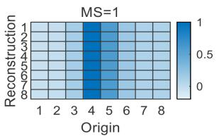  
(a)

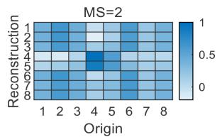

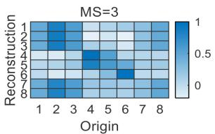  
(c)

(b)  
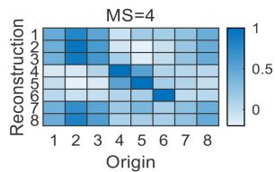

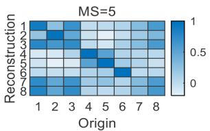  
(e)

(d)  
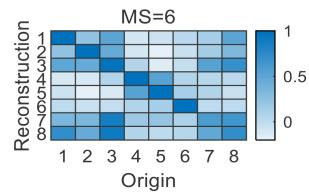

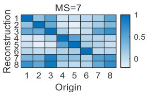  
(g)

(f)  
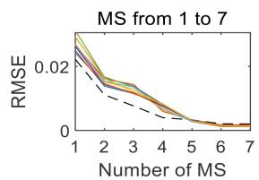  
(h)  
Fig. 3. (a)–(g) Matrices of Pearson correlation coefficient between the reconstruction muscle activations and the original muscle activations when using different number of muscle synergies (MS). (h) Reconstruction error of nine trials (nine solid curves of different colors) in the testing set and in the training set (dotted curve) of one representative participant when using different number of MS.

The paired t-tests were adopted to examine the differences between the proposed controller (MS controller) and the controller without considering muscle synergies (no-MS controller). The above examination was conducted using statistical analysis software (SPSS 23, SPSS Inc.) with the significance set as $p < 0 . 0 5$ . The number of samples for each t-test was 72 (=18 trials per participant  4 participants per experiment).

## III. RESULTS

## A. Muscle Synergy Extraction

The matrices of Pearson correlation coefficient (also called confusion matrices) between the reconstruction muscle activations and the original muscle activations in the datasets of one representative participant were shown in Fig. 3(a)–(g). In each matrix, the columns and rows corresponded to the original muscle activation vectors and the reconstruction results, respectively. Fig. 3(a)–(g) showed the confusion matrix when using $n = 1 { - } 7$ muscle synergies, respectively. Results showed that as n increased, the Pearson correlation coefficient between the reconstruction muscle activations and the corresponding original muscle activations (pixels on the diagonal of the confusion matrix) increased when $n \leq 6 .$ , while there was little difference between $n = 6$ and $n = 7 .$ . Fig. 3(h) showed the reconstruction error of nine trials in the testing set (nine solid curves of different colors) and in the training set (dotted curve) when using different number of MS. Results showed that as n increased, the reconstruction error decreased when $n \leq 6$ , while there was virtually no difference between $n = 6$ and $n = 7$ . The reconstruction error was very small when using six muscle synergies $( \mathrm { R M S E } _ { } = 0 . 0 0 1 3 \mathrm { - } 0 . 0 0 1 7 )$ . This meant $n = 6$ was enough for describing/reconstructing muscle activations of eight muscles when performing upper limb gross movements. Therefore, we chose $n = 6$ for muscle synergy extraction, which was further used for 3-D human force estimation and online robotic control.

The trajectory ofone representative Group1 participant’s hand in the training set was shown in Fig. 4(a). The non-negative command matrix H after factorization was shown in Fig. 4(b). The muscle synergy matrix W was shown in Fig. 4(c). The 3-D human force observed in the training set was shown in Fig. 4(d). The non-negative command matrix and the 3-D human force were served as the pair of input and output data for the training of the transfer function.

## B. Triangle-to-Rectangle Experiment

The force estimating performances in two Group1 representative trials of the offline testing set were shown in Fig. 5. Fig. 5(a) represented the MS controller, while Fig. 5(b) represented the no-MS controller. The black curves represented the data observed in the offline datasets and the red ones represented the estimated forces. It could be observed that the MS controller had more accurate force estimation than the no-MS one. The mean force estimating errors with standard deviation (Std) of all trials in the testing set of all Group1 participants were shown in Fig. 6. The blue bar represented the errors of MS controller, while the red bar represented that of the no-MS controller. The mean force estimating errors and the Std of the MS controller were all smaller than those of the no-MS controller. It seems that the NNMF improved the accuracy (lower mean force estimating errors) and the stability (lower Std) of 3-D human force estimation across tasks.

The real-time robotic assisted tracking performances in two Group1 representative trials of the online experiment were shown in Fig. 7. Fig. 7(a) and (c) showed the result of the MS controller, while Fig. 7(b) and (d) showed that of the no-MS controller. The black curves represented the target trajectories (rectangle-like trajectory in 3-D view) and the red ones represented the actual trajectories of the end-effector. It could be observed that the tracking performance of the MS controller was better than that of the no-MS controller. The interaction force recorded during these two trials were shown in Fig. 8(a) and (b). There was less oscillation of interaction force in the trial that using MS controller [Fig. 8(a)] than that using no-MS controller [Fig. 8(b)]. The mean integral of absolute interaction force between the robot and human and the mean tracking errors with Std of all online experiments of all Group1 participants were shown in Figs. 8(c) and 9, respectively. The blue bar represented the MS controller, while the red bar represented the no-MS controller. The mean integral of absolute interaction force using the MS controller was smaller than that using the no-MS controller and the differences were significant $( p = 0 . 0 4 3 )$ . Mean tracking errors of the MS controller were all smaller than those of the no-MS controller and the differences were all significant $( p = 0 . 0 0 2 , p = 0 . 0 0 2 , p = 0 . 0 0 1 , p < 0 . 0 0 1$ for $x , y , z ,$ and $3 { \mathrm { - D } } , \mathrm { r e s p e c t i v e l y } )$ . The results suggested that the proposed controller yielded better generalization performance in “triangle-to-rectangle” rehabilitation training.

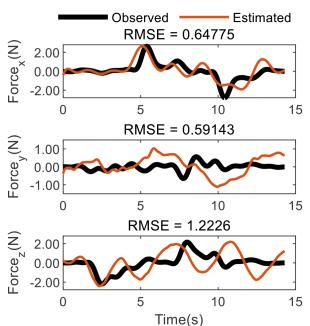

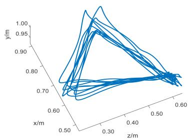  
(a)

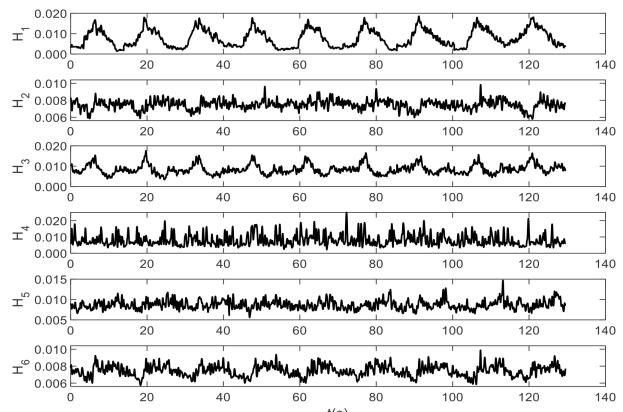

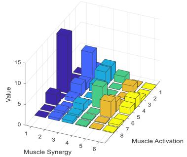  
(c)

(b)  
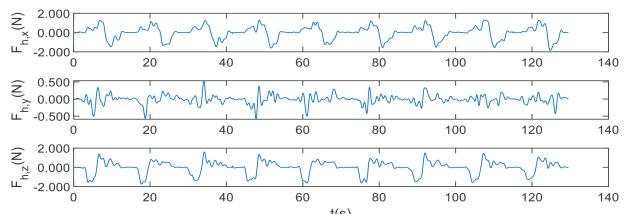  
(d)  
Fig. 4. (a) Trajectory of one representative Group1 participant’s hand in the training set. (b) Non-negative command matrix H after factorization. (c) Muscle synergy matrix W. (d) 3-D human force observed in the training set.

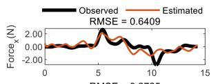

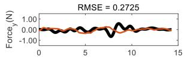

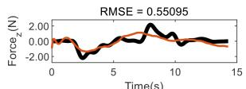  
(a)  
(b)

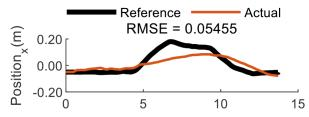

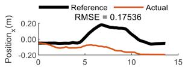

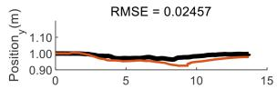

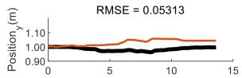

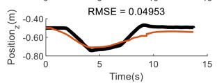  
(a)

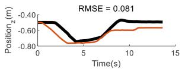  
(b)

Fig. 5. Force estimating performances in two Group1 representative trials of the testing set of (a) MS controller and (b) no-MS controller.  
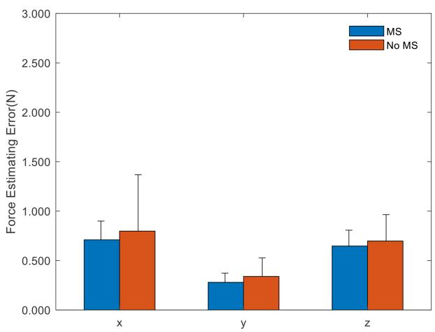  
Fig. 6. Mean force estimating errors with Std of all trials in the testing set of all Group1 participants.

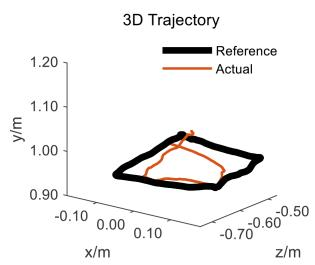  
(c)

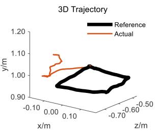  
(d)  
Fig. 7. Tracking performance of Group1 with real-time robotic assisted. (a), (c) Using the MS controller. (b), (d) Using the no-MS controller.

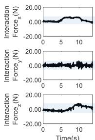  
(a)

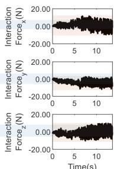  
(b)

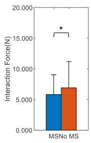  
(c)

Fig. 8. Interaction force in Group1 online experiment. (a) Interaction force in a representative trial using the MS controller. (b) Interaction force in a representative trial using the no-MS controller. (c) Mean integral of absolute interaction force between the robot and human with Std of all online experiments of all Group1 participants.  
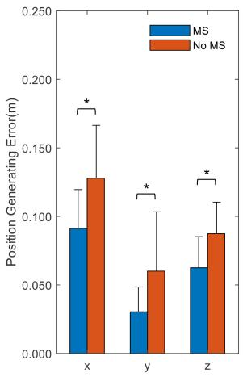

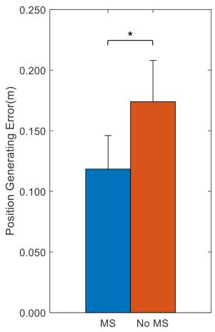  
(a)  
(b)

Fig. 9. Mean tracking errors with Std of all online experiments of all Group1 participants. (a) In x, y, z axis. (b) 3-D vector sum.  
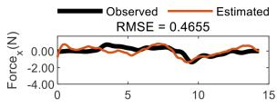

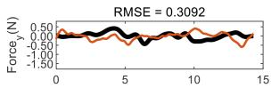

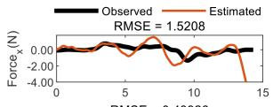

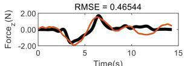

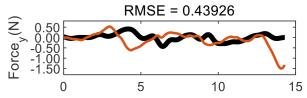

(a)  
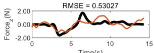  
(b)  
Fig. 10. Force estimating performances in two Group2 representative trials of the testing set of (a) MS controller and (b) no-MS controller.

## C. Rectangle-to-Triangle Experiment

The force estimating performances in two Group2 representative trials of the offline testing set were shown in Fig. 10. The mean force estimating errors with Std of all trials in the testing set of all Group2 participants were shown in Fig. 11. Similar to the “triangle-to-rectangle” experiment, it could be observed that the MS controller had more accurate force estimation than the no-MS one in the “rectangle-to-triangle” experiment. The mean force estimating errors and the Std of the MS controller were all smaller than those of the no-MS controller.

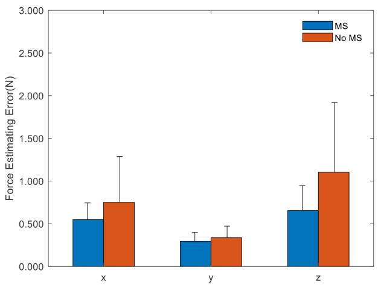  
Fig. 11. Mean force estimating errors with Std of all trials in the testing set of all Group2 participants.

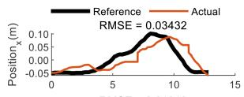

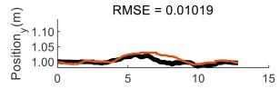

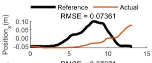

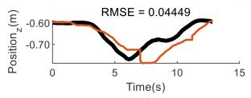  
(a)

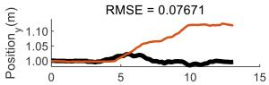

3D Trajectory  
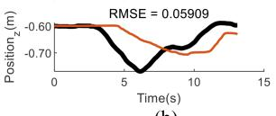

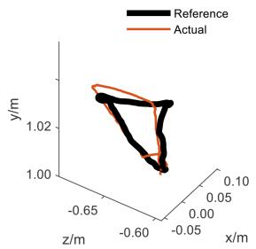  
(c)

(b)  
3D Trajectory  
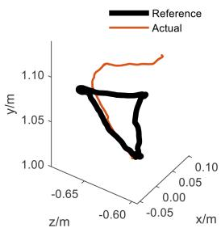  
(d)  
Fig. 12. Tracking performance of Group2 with real-time robotic assisted. (a), (c) Using the MS controller. (b), (d) Using the no-MS controller.

The real-time robotic assisted tracking performances in two Group2 representative trials of the online experiment were shown in Fig. 12. Also similar to the “triangle-to-rectangle” experiment, it could be observed that the tracking performance of the MS controller was better than that of the no-MS controller in the “rectangle-to-triangle” experiment. The interaction force recorded during these two trials were shown in Fig. 13(a) and (b). The max absolute magnitude of interaction force in the trial that using MS controller [Fig. 13(a)] was lower than that using no-MS controller [Fig. 13(b)]. The mean integral of absolute interaction force between the robot and human and the mean tracking errors with Std of all online experiments of all Group2 participants were shown in Figs. 13(c) and 14, respectively. The mean integral of absolute interaction force using the MS controller was smaller than that using the no-MS controller and the differences was significant $( p = 0 . 0 0 1 )$ ). Mean tracking errors of the MS controller were all smaller than those of the no-MS controller $( p = 0 . 0 0 1$ $p = 0 . 1 7 0$ $p < 0 . 0 0 1$ $p < 0 . 0 0 1$ for $x , y , z ,$ and 3-D, respectively). The results suggested that the proposed controller yielded better generalization performance in rehabilitation training across tasks.

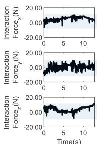  
(a)

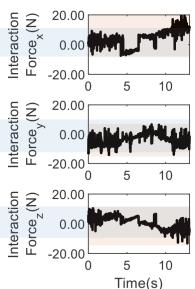  
(b)

  
(c)

Fig. 13. Interaction force in Group2 online experiment. (a) Interaction force in a representative trial using the MS controller. (b) Interaction force in a representative trial using the no-MS controller. (c) Mean integral of absolute interaction force between the robot and human with Std of all online experiments of all Group2 participants.  
  
(a)

  
(b)  
Fig. 14. Mean tracking errors with Std of all online experiments of all Group2 participants. (a) In x, y, z axis. (b) 3-D vector sum.

## IV. DISCUSSION

## A. Motivation of Developing the Muscle-Synergy-Based Myoelectric Controller

Estimating 3-D upper limb motion intention is a challenge of myoelectric controller [47]. It is difficult to model the neuromusculoskeletal system since the 3-D upper limb motion is very complex [23], [24]. The previous article trained a state-space model to describe the relationship between the muscle activations and the 3-D end force of the upper limb [25]. However, such approaches without considering physiological mechanism were task-specific and had poor generalization performance [48]. Neurophysiological researches had suggested that the CNS seems to take advantage of muscle synergies to simplify the neural control via coupling muscle activations [28], [32], [33], [49]. Muscle synergy could be used as a metric for motor assessment and has been applied for offline analysis [40], [41], [42], which provided deep understanding of human motor function as well as comprehensive and accurate evaluation. In this article, inspired by the CNS and evidence that muscle synergies extracted from movements in three sufficiently separated di rections could be used to describe those in all the other directions [33], the low-dimensional non-negative command obtained by using muscle synergy matrix seems to have intuitive and relevant relationships with 3-D upper limb force. For instance, the sixth row of the non-negative command matrix $[ H _ { 6 }$ in Fig. 4(b)] with the z-axis of the human force $[ F _ { h , z }$ in Fig. 4(d)]. Likewise, $H _ { 2 }$ with $F _ { h , y } .$ . These intuitive and relevant relationships may contribute to a superior identification performance of the force estimation model, and thus improve the generalization ability of the controller. This phenomenon is similar to the finding that a set of specific force directions was produced when a specific modular organization in the CNS of the frog was stimulated [50]. Despite NNMF, there are other dimensionality reduction techniques, such as PCA and ICA. Although the spectrum of NNMF cannot be as compact as that of PCA, and the advantages of NNMF, the sparseness and parts-based representation is at the cost of more complexity comparing to other dimensionality reduction techniques [51], [52], we employed NNMF for muscle synergy extraction because it can extract non-negative features which has physical significance and match the physical constraint of non-negative neuromuscular activations [36], [39], [53]. In robotic-assisted rehabilitation, the complex human– robot interaction required human involvement [54] and relied on CNS regulation [55]. The proposed muscle-synergy-based myoelectric controller was a bioinspired approach that imitated CNS regulation, which could facilitate human CNS contro and thus enhanced the performance of myoelectric control. Moreover, the low inertia and flexible-driven characteristics of our CDULRR may reduce the impact of the robot on pHRI.

## B. Parameter Determination of Muscle Synergy Extraction

Determining the number of muscle synergies n is required for MS extraction. Relevant study from Valk et al. [37] has illustrated that 3–5 muscle synergies could describe some restricted set of movements and suggested that 6–8 muscle synergies are required when considering a broader set of movements. Therefore, $n \geq 6$ is suitable for upper limb movements in 3-D task. Since no decrease was observed in the reconstruction error in both the training set and testing set when $n \geq 6$ [Fig. 3(h)], $n = 6$ was chosen in this article. Although the low-dimensional input might lead to the loss of information, the NNMF in this article has considered information from all the channels of muscle activations and the ALS algorithm minimizes the root mean square of the factorization residual [45]. Vital information will be retained, which could be illustrated by the evidence that the reconstruction matrix was very relevant to the original matrix and that the reconstruction error was small enough when $n = 6$ It is possible to realize low-dimensional command extraction without losing key information as the CNS regulates the redundancy that exists in the musculoskeletal system by coupling a limited set of muscle activations [56].

## C. Generalization Ability ofthe Muscle-Synergy-Based Myoelectric Controller

Although state-space model could be exploited to continuously estimate 3-D voluntary force of the upper limb according to the muscle activations and provide task-specific motion assistance as reported in the previous articles [25], [26], its performance will deteriorate when applied to a new task that has not been trained before. In comparison, using muscle-synergyinspired approach improved the generalization ability of 3-D force estimation (Figs. 5, 6, 10, and 11). The decreases of trajectory tracking errors and the interaction force reflects the natural control ofthe participants, which aligns with the previous articles [21], [57]. The accurate force estimation, low trajectory tracking errors, and low human–robot interaction force in this article demonstrate the generalization performance of the MS controller. The reason is that the intuitive and relevant relationship between the low-dimensional non-negative command and the 3-D force contributed to the identification of the force estimation model. Besides, muscle synergy extraction reduces the dimension of the input of force estimation model, which makes it more convenient to train the model. There were other studies using switching models to adapt to different tasks, in which several submodels were trained separately, and a specific submodel was chosen for a certain task [23], [26], [58]. However, the switching model still needs to take data recording in every task into the training set. In contrast to the submodel training approach, the muscle-synergy-based myoelectric controller in this article trained only using data from one task and then could be applied directly to another different task (in both the testing set and the online verification) without training again, which reflects the improvement of the generalization ability.

## D. Limitations and Future Work

1) There has been a neurophysiological study exploring the relationship between the space navigation of the limbs and the activation of the grid cells in frogs [59]. It seems that revealing the space navigation of the limbs (or activation of the grid cells) contributes to a more convenient way to estimate 3-D limb force or 3-D limb motion. Whether the muscle-synergy-based myoelectric controller imitates the activation of the grid cells remains elusive. Future article could probe into the relationship between muscle synergy and the grid cells by using the electroencephalography to locate the activated grid cells.

2) The CDULRR with the proposed controller has been tested on eight healthy participants and only 144 trials were conducted in this article. However, muscle synergies of the patients may be different from those of the healthy ones. More participants including patients after stroke should be recruited and more motions with targeted clinical benefits will be conducted in the future article.

3) Throughout the rehabilitation process, the motor skills and motor pattern representation within the patient’s CNS may undergo changes. However, these variations typically occur at a relatively gradual pace, and as a result, the system’s retraining period may span from a few weeks to several months. Future article will explore a more robust system for full-cycle rehabilitation training, including the integration of telepresence techniques.

## V. CONCLUSION

This article developed a muscle-synergy-based myoelectric controller to continuously estimate 3-D upper limb force and verified on a cable-driven rehabilitation robot. Two different trajectory tracking tasks were selected to test the generalization ability of the controller. One task was used for model training, whereas the other task was used for both the model testing and online verification. The proposed controller yielded better generalization performance in rehabilitation training across tasks than the myoelectric controller without considering the muscle synergies.

## APPENDIX

The postures for maintaining MVC for the eight muscles are depicted in Fig. 15. Participants were instructed to maintain the MVC for a duration of 2 s in each posture, during which EMG signals from the corresponding muscles were recorded.

The proof of the pseudoinverse $W ^ { + }$ exists when solving pseudoinverse through SVD [60], [61]

1) Definition

Let ${ \cal W } { \in } { \bf { R } } ^ { \mathrm { { m } } \times \mathrm { { n } } }$ . The Moore–Penrose conditions are as follows:

$$
\begin{array}{l} \boldsymbol {W} \boldsymbol {W} ^ {+} \boldsymbol {W} = \boldsymbol {W}, \\ \boldsymbol {W} ^ {+} \boldsymbol {W} \boldsymbol {W} ^ {+} = \boldsymbol {W} ^ {+}, \\ \left(\boldsymbol {W} \boldsymbol {W} ^ {+}\right) ^ {T} = \boldsymbol {W} \boldsymbol {W} ^ {+}, \\ \left(\boldsymbol {W} ^ {+} \boldsymbol {W}\right) ^ {T} = \boldsymbol {W} ^ {+} \boldsymbol {W}. \end{array}
$$

## 2) Proof of pseudoinverse existence

The theorem of SVD declares that any matrix can be separated into three components as follows:

$$
\boldsymbol {W} = \boldsymbol {P} \boldsymbol {\Sigma} \boldsymbol {Q} ^ {T}
$$

where

$\pmb { P } { \in } \mathbf { R } ^ { \mathrm { m } \times \mathrm { m } }$ is a unitary matrix.

$\scriptstyle \sum \in \mathbf { R } ^ { \mathrm { m \times n } }$ is a matrix featuring non-negative real numbers along its diagonal and zeros elsewhere.

${ \boldsymbol { Q } } \in \mathbf { R } ^ { \mathrm { n \times n } }$ is a matrix that is unitary.

Define $W ^ { + }$ as ${ \cal Q } \Sigma ^ { + } { \cal P } ^ { T } .$

  
(a)

  
(b)  
(c)

  
(d)

  
(e)

  
(f)  
Fig. 15. Postures of maintaining MVC for the selected muscles in this article. In each posture, participants were asked to exert their maximum force with the support of walls or tables for 2 s.

Then, we have

$$
\begin{array}{r l} \boldsymbol {W} \boldsymbol {W} ^ {+} \boldsymbol {W} & = \boldsymbol {P} \boldsymbol {\Sigma} \boldsymbol {Q} ^ {T} \boldsymbol {Q} \boldsymbol {\Sigma} ^ {+} \boldsymbol {P} ^ {T} \boldsymbol {P} \boldsymbol {\Sigma} \boldsymbol {Q} ^ {T} = \boldsymbol {P} \boldsymbol {\Sigma} \boldsymbol {\Sigma} ^ {+} \boldsymbol {\Sigma} \boldsymbol {Q} ^ {T} \\ & = \boldsymbol {P} \boldsymbol {\Sigma} \boldsymbol {Q} ^ {T} = \boldsymbol {W} \end{array}
$$

$$
\begin{array}{r l} \boldsymbol {W} ^ {+} \boldsymbol {W} \boldsymbol {W} ^ {+} & = \boldsymbol {Q} \boldsymbol {\Sigma} ^ {+} \boldsymbol {P} ^ {T} \boldsymbol {P} \boldsymbol {\Sigma} \boldsymbol {Q} ^ {T} \boldsymbol {Q} \boldsymbol {\Sigma} ^ {+} \boldsymbol {P} ^ {T} = \boldsymbol {Q} \boldsymbol {\Sigma} ^ {+} \boldsymbol {\Sigma} \boldsymbol {\Sigma} ^ {+} \boldsymbol {P} ^ {T} \\ & = \boldsymbol {Q} \boldsymbol {\Sigma} ^ {+} \boldsymbol {P} ^ {T} = \boldsymbol {W} ^ {+} \end{array}
$$

$$
\begin{array}{r l} \left(\mathbf {W} \mathbf {W} ^ {+}\right) ^ {T} & = \left(\mathbf {P} \boldsymbol {\Sigma} \mathbf {Q} ^ {T} \mathbf {Q} \boldsymbol {\Sigma} ^ {+} \mathbf {P} ^ {T}\right) ^ {T} = \left(\mathbf {P} \boldsymbol {\Sigma} \boldsymbol {\Sigma} ^ {+} \mathbf {P} ^ {T}\right) ^ {T} \\ & = \mathbf {P} \left(\boldsymbol {\Sigma} \boldsymbol {\Sigma} ^ {+}\right) ^ {T} \mathbf {P} ^ {T} = \mathbf {P} \left(\boldsymbol {\Sigma} \boldsymbol {\Sigma} ^ {+}\right) \mathbf {P} ^ {T} \\ & = \mathbf {P} \boldsymbol {\Sigma} \mathbf {Q} ^ {T} \mathbf {Q} \boldsymbol {\Sigma} ^ {+} \mathbf {P} ^ {T} = \mathbf {W} \mathbf {W} ^ {+} \end{array}
$$

$$
\begin{array}{l} \left(\mathbf {W} ^ {+} \mathbf {W}\right) ^ {T} = \left(\mathbf {Q} \boldsymbol {\Sigma} ^ {+} \mathbf {P} ^ {T} \mathbf {P} \boldsymbol {\Sigma} \mathbf {Q} ^ {T}\right) ^ {T} \\ = \left(\mathbf {Q} \boldsymbol {\Sigma} ^ {+} \boldsymbol {\Sigma} \mathbf {Q} ^ {T}\right) ^ {T} \\ = \mathbf {Q} \left(\boldsymbol {\Sigma} ^ {+} \boldsymbol {\Sigma}\right) ^ {T} \mathbf {Q} ^ {T} = \mathbf {Q} \left(\boldsymbol {\Sigma} ^ {+} \boldsymbol {\Sigma}\right) \mathbf {Q} ^ {T} \\ = \mathbf {Q} \boldsymbol {\Sigma} ^ {+} \mathbf {P} ^ {T} \mathbf {P} \boldsymbol {\Sigma} \mathbf {Q} ^ {T} \\ = \mathbf {W} ^ {+} \mathbf {W}. \end{array}
$$

Therefore, four criteria in the Definition are all satisfied and there exists the pseudoinverse of W.

## ACKNOWLEDGMENT

The authors acknowledge all the participants recruited in this article.

## REFERENCES

[1] J. Kim et al., “Global stroke statistics 2019,” Int. J. Stroke, vol. 15, pp. 819–838, 2020.

[2] C. O. Johnson et al., “Global, regional, and national burden of stroke, 1990–2016: A systematic analysis for the Global Burden of Disease Study 2016,” Lancet Neurol., vol. 18, no. 5, pp. 439–458, May 2019.

[3] I. Faria-Fortini, S. M. Michaelsen, J. G. Cassiano, and L. F. Teixeira-Salmela, “Upper extremity function in stroke subjects: Relationships between the international classification of functioning, disability, and health domains,” J. Hand Ther., vol. 24, no. 3, pp. 257–264, Jul.–Sep. 2011.

[4] G. Xu, A. Song, and H. Li, “Adaptive impedance control for upperlimb rehabilitation robot using evolutionary dynamic recurrent fuzzy neural network,” J. Intell. Robot. Syst., vol. 62, no. 3–4, pp. 501–525, Jun. 2011.

[5] H. S. Lo and S. Q. Xie, “Exoskeleton robots for upper-limb rehabilitation: State of the art and future prospects,” Med. Eng. Phys., vol. 34, no. 3, pp. 261–268, Apr. 2012.

[6] Y. Huang et al., “A comparison of the rehabilitation effectiveness of neuromuscular electrical stimulation robotic hand training and pure robotic hand training after stroke: A randomized controlled trial,” Biomed. Signal Process. Control, vol. 56, Feb. 2020, Art. no. 101723.

[7] C. Nam, W. Rong, W. Li, Y. Xie, X. Hu, and Y. Zheng, “The effects of upper-limb training assisted with an electromyography-driven neuromuscular electrical stimulation robotic hand on chronic stroke,” Front. Neurol., vol. 8, pp. 1–14, Dec. 2017.

[8] W. Yu and J. Rosen, “Neural PID control of robot manipulators with application to an upper limb exoskeleton,” IEEE Trans. Cybern., vol. 43, no. 2, pp. 673–684, Apr. 2013.

[9] N. Hogan, “Impedance control: An approach to manipulation. III. Applications,” Trans. ASME J. Dyn. Syst., Meas. Control, vol. 107, no. 1, pp. 17–24, Mar. 1985.

[10] N. Hogan, “Impedance control: An approach to manipulation,” in Proc. Amer. Control Conf., 1984, pp. 304–313.

[11] J. C. Perez-Ibarra, A. A. G. Siqueira, M. A. Silva-Couto, T. L. de Russo, and H. I. Krebs, “Adaptive impedance control applied to robot-aided neurorehabilitation of the ankle,” IEEE Robot. Automat. Lett., vol. 4, no. 2, pp. 185–192, Apr. 2019.

[12] M. Hallett, “Recent advances in stroke rehabilitation,” Neurorehabil. Neural Repair, vol. 16, no. 2, pp. 211–217, Jun. 2002.

[13] J. A. Saglia, N. G. Tsagarakis, J. S. Dai, and D. G. Caldwell, “Control strategies for patient-assisted training using the ankle rehabilitation robot (ARBOT),” IEEE/ASME Trans. Mechatron., vol. 18, no. 6, pp. 1799–1808, Dec. 2013.

[14] Z. Li, B. Huang, Z. Ye, M. Deng, and C. Yang, “Physical human–robot interaction of a robotic exoskeleton by admittance control,” IEEE Trans. Ind. Electron., vol. 65, no. 12, pp. 9614–9624, Dec. 2018.

[15] Q. Miao, M. Zhang, J. Cao, and S. Q. Xie, “Reviewing high-level control techniques on robot-assisted upper-limb rehabilitation,” Adv. Robot., vol. 32, no. 24, pp. 1253–1268, 2018.

[16] B. Rodriguez-Tapia, I. Soto, D. M. Marinez, and N. Candolfi Arballo, “Myoelectric interfaces and related applications: Current state of EMG signal processing-A systematic review,” IEEE Access, vol. 8, pp. 7792–7805, 2020.

[17] J. Wang, J. Liu, G. Zhang, and S. Guo, “Periodic event-triggered sliding mode control for lower limb exoskeleton based on human-robot cooperation,” ISA Trans., vol. 123, pp. 87–97, Apr. 2022.

[18] C. Nam et al., “An exoneuromusculoskeleton for self-help upper limb rehabilitation after stroke,” Soft Robot., vol. 9, no. 1, pp. 14–35, Feb. 2022.

[19] T. Lenzi, S. M. M. De Rossi, N. Vitiello, and M. C. Carrozza, “Intentionbased EMG control for powered exoskeletons,” IEEE Trans. Biomed. Eng., vol. 59, no. 8, pp. 2180–2190, Aug. 2012.

[20] X. L. Hu, K. Y. Tong, X. J. Wei, W. Rong, E. A. Susanto, and S. K. Ho, “The effects of post-stroke upper-limb training with an electromyography (EMG)-driven hand robot,” J. Electromyogr. Kinesiol., vol. 23, no. 5, pp. 1065–1074, Oct. 2013.

[21] Y. Zhuang, Y. Leng, J. Zhou, R. Song, L. Li, and S. Su, “Voluntary control of an ankle joint exoskeleton by able-bodied individuals and stroke survivors using EMG-based admittance control scheme,” IEEE Trans. Biomed. Eng., vol. 68, no. 2, pp. 695–705, Feb. 2021.

[22] C. Fleischer and G. Hommel, “A human-exoskeleton interface utilizing electromyography,” IEEE Trans. Robot., vol. 24, no. 4, pp. 872–882, Aug. 2008.

[23] P. K. Artemiadis and K. J. Kyriakopoulos, “An EMG-based robot control scheme robust to time-varying EMG signal features,” IEEE Trans. Inf. Technol. Biomed., vol. 14, no. 3, pp. 582–588, May 2010.

[24] J. Han, Q. Ding, A. Xiong, and X. Zhao, “A state-space EMG model for the estimation of continuous joint movements,” IEEE Trans. Ind. Electron., vol. 62, no. 7, pp. 4267–4275, Jul. 2015.

[25] C. Xie, Q. Yang, Y. Huang, S.W. Su, T. Xu, and R. Song, “A hybrid arm-hand rehabilitation robot with EMG-based admittance controller,” IEEE Trans. Biomed. Circuits Syst., vol. 15, no. 6, pp. 1332–1342, Dec. 2021.

[26] Y. Huang, R. Song, A. Argha, A. V. Savkin, B. G. Celler, and S. W. Su, “Continuous description of human 3D motion intent through switching mechanism,” IEEE Trans. Neural Syst. Rehabil. Eng., vol. 28, no. 1, pp. 277–286, Jan. 2020.

[27] G. Li, Z. Li, J. Li, Y. Liu, and H. Qiao, “Muscle-synergy-based planning and neural-adaptive control for a prosthetic arm,” IEEE Trans. Artif. Intell., vol. 2, no. 5, pp. 424–436, Oct. 2021.

[28] M. Berniker, A. Jarc, E. Bizzi, and M. C. Tresch, “Simplified and effective motor control based on muscle synergies to exploit musculoskeletal dynamics,” Proc. Nat. Acad. Sci. United States Amer., vol. 106, no. 18, pp. 7601–7606, May 2009.

[29] A. Furui et al., “A myoelectric prosthetic hand with muscle synergy-based motion determination and impedance model-based biomimetic control,” Sci. Robot., vol. 4, no. 31, Jun. 2019, Art. no. eaaw6339.

[30] E. Bizzi, V. C. K. Cheung, A. d’Avella, P. Saltiel, and M. Tresch, “Combining modules for movement,” Brain Res. Rev., vol. 57, no. 1, pp. 125–133, Jan. 2008.

[31] B. Pan, Z. Huang, J. Wu, and Y. Shen, “Primitive muscle synergies reflect different modes of coordination in upper limb motions,” Med. Biol. Eng. Comput., vol. 59, no. 10, pp. 2153–2163, Oct. 2021.

[32] H. Saito, H. Yokoyama, A. Sasaki, T. Kato, and K. Nakazawa, “Evidence for basic units of upper limb muscle synergies underlying a variety of complex human manipulations,” J. Neurophysiol., vol. 127, no. 4, pp. 958–968, Apr. 2022.

[33] S. Muceli, A. T. Boye, A. d’Avella, and D. Farina, “Identifying representative synergy matrices for describing muscular activation patterns during multidirectional reaching in the horizontal plane,” J. Neurophysiol., vol. 103, no. 3, pp. 1532–1542, Mar. 2010.

[34] P. K. Artemiadis and K. J. Kyriakopoulos, “EMG-based control of a robo arm using low-dimensional embeddings,” IEEE Trans. Robot., vol. 26, no. 2, pp. 393–398, Apr. 2010.

[35] Q. Zhang, R. F. Liu, W. B. Chen, and C. H. Xiong, “Simultaneous and continuous estimation of shoulder and elbow kinematics from surface EMG signals,” Front. Neurosci., vol. 11, pp. 1–12, May 2017.

[36] D. Buongiorno, G. D. Cascarano, C. Camardella, I. De Feudis, A. Frisoli, and V. Bevilacqua, “Task-oriented muscle synergy extraction using an autoencoder-based neural model,” Information, vol. 11, no. 4, Apr. 2020, Art. no. 14.

[37] T. A. Valk, L. J. Mouton, E. Otten, and R. M. Bongers, “Fixed muscle synergies and their potential to improve the intuitive control of myoelectric assistive technology for upper extremities,” J. Neuro Eng. Rehabil., vol. 16, no. 1, Jan. 2019, Art. no. 6.

[38] N. Jiang, H. Rehbaum, I. Vujaklija, B. Graimann, and D. Farina, “Intuitive, online, simultaneous, and proportional myoelectric control over two degrees-of-freedom in upper limb amputees,” IEEE Trans. Neural Syst. Rehabil. Eng., vol. 22, no. 3, pp. 501–510, May 2014.

[39] D. D. Lee and H. S. Seung, “Learning the parts of objects by non-negative matrix factorization,” Nature, vol. 401, no. 6755, pp. 788–791, Oct. 1999.

[40] C. G. McDonald, B. J. Fregly, and M. K. O’Malley, “Effect of robotic exoskeleton motion constraints on upper limb muscle synergies: A case study,” IEEE Trans. Neural Syst. Rehabil. Eng., vol. 29, pp. 2086–2095, 2021.

[41] T. Lencioni et al., “A randomized controlled trial on the effects induced by robot-assisted and usual-care rehabilitation on upper limb muscle synergies in post-stroke subjects,” Sci. Rep., vol. 11, no. 1, Mar. 2021, Art. no. 5323.

[42] A. Cancrini, P. Baitelli, M. L. Nicora, M. Malosio, A. Pedrocchi, and A. Scano, “The effects of robotic assistance on upper limb spatial muscle synergies in healthy people during planar upper-limb training,” PLoS One, vol. 17, no. 8, Aug. 2022, Art. no. e0272813.

[43] M. K. Burns, D. Pei, and R. Vinjamuri, “Dynamic control of virtual hand grasp using spatiotemporal synergies,” IEEE Access, vol. 7, pp. 112327–112338, 2019.

[44] K. Manal and T. S. Buchanan, “A one-parameter neural activation to muscle activation model: Estimating isometric joint moments from electromyograms,” J. Biomech., vol. 36, no. 8, pp. 1197–1202, Aug. 2003.

[45] M. W. Berry, M. Browne, A. N. Langville, V. P. Pauca, and R. J. Plemmons, “Algorithms and applications for approximate nonnegative matrix factorization,” Comput. Statist. Data Anal., vol. 52, no. 1, pp. 155–173, Sep. 2007.

[46] T. Vo Tan, E. Vranken, and D. Berckmans, “Data-based mechanistic modelling of three-dimensional temperature distribution in ventilated rooms filled with biological material,” J. Food Eng., vol. 86, no. 3, pp. 422–432, Jun. 2008.

[47] L. Bi, A. G. Feleke, and C. Guan, “A review on EMG-based motor intention prediction of continuous human upper limb motion for human-robo collaboration,” Biomed. Signal Process. Control, vol. 51, pp. 113–127, May 2019.

[48] W. Q. Wang et al., “Prediction of human voluntary torques based on collaborative neuromusculoskeletal modeling and adaptive learning,” IEEE Trans. Ind. Electron., vol. 68, no. 6, pp. 5217–5226, Jun. 2021.

[49] F. O. Barroso et al., “Combining muscle synergies and biomechanical analysis to assess gait in stroke patients,” J. Biomech., vol. 63, pp. 98–103, Oct. 2017.

[50] E. Bizzi, F. A. Mussa-Ivaldi, and S. Giszter, “Computations underlying the execution of movement: A biological perspective,” Science, vol. 253, no. 5017, pp. 287–291, Jul. 1991.

[51] Y.-X. Wang and Y.-J. Zhang, “Nonnegative matrix factorization: A comprehensive review,” IEEE Trans. Knowl. Data Eng., vol. 25, no. 6, pp. 1336–1353, Jun. 2013.

[52] C. Lin, B. Wang, N. Jiang, and D. Farina, “Robust extraction of basis functions for simultaneous and proportional myoelectric control via sparse non-negative matrix factorization,” J. Neural Eng., vol. 15, no. 2, Apr. 2018, Art. no. 026017.

[53] J. Li, R. Wang, and L. Pan, “An enhanced EMG-driven musculoskeleta model based on non-negative matrix factorization,” Biomed. Signal Process. Control, vol. 79, Jan. 2023, Art. no. 104178.

[54] H. Oliff, Y. Liu, M. Kumar, and M. Williams, “Improving human-robot interaction utilizing learning and intelligence: A human factors-based approach,” IEEE Trans. Automat. Sci. Eng., vol. 17, no. 3, pp. 1597–1610, Jul. 2020.

[55] D. P. Losey, C. G. McDonald, E. Battaglia, and M. K. O’Malley, “A review of intent detection, arbitration, and communication aspects of shared control for physical human-robot interaction,” Appl. Mech. Rev., vol. 70, no. 1, Jan. 2018, Art. no. 010804.

[56] L. Botzheim, J. Laczko, D. Torricelli, M. Mravcsik, J. L. Pons, and F. Oliveira Barroso, “Effects of gravity and kinematic constraints on muscle synergies in arm cycling,” J. Neurophysiol., vol. 125, no. 4, pp. 1367–1381, Apr. 2021.

[57] C. Jarrett and A. J. McDaid, “Robust control of a cable-driven soft exoskeletonjoint for intrinsic human–robot interaction,” IEEE Trans. Neura Syst. Rehabil. Eng., vol. 25, no. 7, pp. 976–986, Jul. 2017.

[58] P. K. Artemiadis and K. J. Kyriakopoulos, “A switching regime model for the EMG-based control of a robot arm,” IEEE Trans. Syst. Man Cybern. Part B-Cybern., vol. 41, no. 1, pp. 53–63, Feb. 2011.

[59] P. Saltiel, A. d’Avella, M. C. Tresch, K. Wyler, and E. Bizzi, “Critical points and traveling wave in locomotion: Experimental evidence and some theoretical considerations,” Frontier Neural Circuits, vol. 11, Dec. 2017, Art. no. 98.

[60] S. L. Campbell and C. D. Meyer, “The Moore—Penrose or generalized inverse,” in Generalized Inverses Linear Transformations, Raleigh, North Carolina, USA: SIAM, 1991, pp. 8–27.

[61] “Moore-Penrose pseudoinverse/proofs,” Wikipedia.org., 2014. [Online]. Available: https://encyclopedia.thefreedictionary.com/Moore-Penrose+pseudoinverse%2fProofs

Chenglin Xie (Graduate Student Member, IEEE) was born in Shantou, China, in 1996. He received the B.S. degree in biomedical engineering, in 2019, from the Sun Yat-sen University, Guangdong, China, where he is currently working toward the Ph.D. degree in biomedical engineering.

His research interests include rehabilitation robots, myoelectric control, human–robot interaction, neura network application, and biomedical signal processing.

Dr. Xie was the recipient ofthe Outstanding Perfor-

mance Award in IEEE-EMB Hong Kong—Macau Joint Chapter Student Project Competition 2021, and the Best Paper Finalist Award in IEEE-ARM 2020.

Yueling Lyu received the B.S. degree in mechanical engineering from the Guangdong University of Technology, Guangdong, China, in 2011, and the Ph.D. degree in mechanical engineering from the South China University of Technology, Guangdong, China, in 2016.

Since 2019, she has been an Associate Professor with the School of Biomedical Engineering, Sun Yat-sen University, Guangzhou, China. Her research interests include lower limb rehabilitation robot, musculoskeletal modeling, MR fluid damper, mechanical structure design, and tribology and surface technology.

Guoxin Li (Member, IEEE) received the B.S. degree in mechanical engineering and automation from the Hefei University of Technology, Hefei, China, in 2016, and the Ph.D. degree in control science and engineering from the University of Science and Technology of China, Hefei, in 2022.

He is currently with the Shanghai YangZhi Rehabilitation Hospital, Tongji University, Shanghai, China. His research interests include human–robot interaction, motion planning and control, and wearable robotics systems.

Raymond Kai-Yu Tong (Senior Member, IEEE) received the Ph.D. degree in bioengineering from the University of Strathclyde, Glasgow, U.K., in 1998.

He is currently a Biomedical Engineer. He is also a Professor and the Founding Chairman with the Department of Biomedical Engineering, The Chinese University of Hong Kong, Hong Kong. His research interests include rehabilitation robotics (e.g., hand of hope), brain–computer control interface, neural engineering, functional electrical stimulation, and cognitive assessment software.

Dr. Tong is recognized for his works in innovation and applied scientific research in neurorehabilitation for stroke patients and the elderly. He was the recipient of the Awardee of the 2013 Hong Kong Ten Outstanding Young Persons; Winner Award (e-Health) in the Asia Pacific ICT Award 2012; the HKIE Innovation Awards for young members in 2008; and the Gold Awards in international invention exhibitions in 2004, 2007, 2010, 2015, 2016, and 2023. He was elected to the 2022 Class of the AIMBE College of Fellows.

Haisheng Xia (Member, IEEE) received the Ph.D. degree in mechanical engineering from the Shanghai Jiao Tong University, Shanghai, China, in 2020.

From March 2019 to June 2019, he was a Visiting Scholar with the University ofBritish Columbia, Vancouver, BC, Canada, and from 2019 to 2020, he was a Visiting Scholar with the Seoul National University, Seoul, South Korea. From 2020 to 2024, he was first a Postdoc Research Fellow and then an Associate Professor with the Department of Automation, University of Science and Technology of China, Hefei,

China. He is currently an Associate Professor with the School of Mechanical Engineering, Tongji University, Shanghai, China. He has authored more than 40 papers in international journals and conferences (including first author paper on Nature Communications), more than ten invention patents, and directed ten national/provincial research projects. His research interests include wearable robotics and autonomous systems.

Dr. Xia is the Chair of the IEEE SMC Technical Committee on Flexible Electronics Systems, a member of the IEEE RAS Technical Committee on Neuro-Robotics Systems, and a member of the IEEE CIS Technical Committee on Cognitive and Developmental Systems. He was a recipient of the Best Conference Paper at the IEEE International Conference on Development and Learning (2023), Gold Medal at the International Exhibition of Inventions Geneva (2024), and the OARSI Collaborative Scholarship Award (2018).

Rong Song (Senior Member, IEEE) was born in Hubei, China, in 1975. He received the B.S. degree in electrical engineering from the Tsinghua University, Beijing, China, in 1999, the M.S. degree in electronic engineering from the Shantou University, Shantou, China, in 2002, and the Ph.D. degree in biomedical engineering from the Hong Kong Polytechnic University, Hong Kong, in 2006.

He is currently a Professor with the School of Biomedical engineering, Sun Yat-sen University, Guangdong, China. His research interests include musculoskeletal modeling, biomedical signal processing, and rehabilitation robots.

Dr. Song was the Special Session Chairs of the IEEE Conference on Advanced Robotics and Mechatronics. He has been serving as a Reviewer of several IEEE Transactions.

Zhijun Li (Fellow, IEEE) received the Ph.D. degree in mechatronics from the Shanghai Jiao Tong University, Shanghai, China, in 2002.

From 2003 to 2006, he was a Postdoctoral Fellow with the University of Electro-Communications, Tokyo, Japan, and the National University of Singapore, Singapore. He is currently a Chair Professor with the Tongji University, Shanghai, China, where he has been the Dean of the School of Mechanical Engineering, since 2024. He has authored/coauthored more than 400 papers, where the prestigious con-

tributions were wearable robotics and biomechatronics systems. His research interests include wearable robotics, biomechatronics systems, and intelligent control.

Dr. Li was the recipient of the Distinguished Lecturer (RAS), the Web of Science Highly Cited Researcher (2019–2023), the 2018 National Ten-thousand Talents Program in China, and the 2016 National Distinguished Young Scholar. He is a Fellow of AAIA.