# 基于强化学习控制的个性化自适应助力提升机器人辅助手臂伸展训练中的参与度、表现和保持效果

Andy Li, Graduate Student Member, IEEE, Riccardo Minto, Maximillan Dolling¨, Giovanni Boschetti, and Damiano Zanotto, Member, IEEE

摘要— 本研究介绍了一种新型强化学习按需助力（Reinforcement Learning Assist-as-Needed, RL-AAN）控制器，旨在用于卒中后的机器人辅助上肢康复，该控制器利用了一种改进的动作依赖启发式动态规划（Action-Dependent Heuristic Dynamic Programming, ADHDP）框架。与基于迭代学习控制的传统自适应按需助力控制器（ILC-AAN）不同，所提出的 RL-AAN 控制器能够根据用户近期的表现，实时自主调节运动误差与机器人助力之间的权衡，同时仅依赖于少量的高层可调参数，无需针对特定受试者进行手动调整。RL-AAN 控制器在一台绳驱动末端执行器型康复机器人上实现，并通过涉及一组健康受试者的基于扰动的伸展任务，与传统 ILC-AAN 控制器进行了对比验证。与 ILC-AAN 相比，RL-AAN 控制器显著减少了训练期间所需的机器人助力，促进了用户的积极参与和任务表现。在采用 RL-AAN 控制器训练后，保持测试显示出相比 ILC-AAN 训练更精确的手臂伸展轨迹，突出了 RL-AAN 在未来基于锻炼的康复中应用的潜力。总体而言，本项工作为开发能够在物理人机交互（pHRI）和机器人辅助康复中实现个性化的控制策略的持续研究做出了贡献。

索引词— 按需助力控制，强化学习控制，康复机器人，物理人机交互，绳驱动并联机器人。

## I. 引言

运动功能的康复是中枢或周围神经系统损伤（如脑卒中、创伤性脑损伤、脊髓损伤）、神经退行性疾病或肌肉骨骼损伤导致的运动障碍患者康复过程中的核心环节 [1]。高强度、重复性且任务导向的训练能够通过运动（再）学习过程，帮助脑损伤患者重新获得丧失的运动功能 [2], [3]。然而，传统的康复干预措施对治疗师而言劳动强度大且消耗体力，并受到专业人员稀缺及高昂成本的限制，从而制约了训练课程的频率和强度。机器人辅助康复旨在通过由机器人训练器介导的练习，重新训练运动规划、控制和执行能力；该设备可提供受控的助力或阻抗力，通常还结合实时多感官反馈，并记录定量数据以指导针对性治疗。这项技术有望减轻治疗师的体力负担、优化人力资源配置并实现康复方案的标准化 [4]，同时还能赋能患者参与自主进行的居家训练 [5]。

因为主动努力是运动学习的关键促成因素 [6]，所以有人假定机器人训练器应仅提供患者完成预期运动任务所需的最低辅助水平。因此，理想的设备在用户表现良好时应当是透明的（即不对用户施加力），并且仅在用户完成任务遇到困难时才进行干预，以纠正过大的运动误差。符合这一原则的控制策略被称为“按需辅助”（assist-as-needed, AAN）[7]、“患者主导”（patient-in-charge）[8] 或“患者协作”（patient-cooperative）[9] 控制器。开创性的 AAN 策略依赖于具有固定刚度和阻尼参数的传统阻抗控制器（impedance controllers, IC），在运动误差与机器人辅助之间建立了静态关系 [9], [10]。此类控制器需要大量的手动调整，因为在整个治疗计划中，机器人的顺应性必须根据患者变化的运动技能进行调整 [11]。为了克服这一缺点，后来的研究引入了自适应 AAN 控制器，利用比例迭代学习控制（iterative learning control, ILC）律，根据患者最近的表现自主调整基础 IC 的刚度 [7], [12], [13]。从初始（未训练）状态开始，ILC-AAN 控制器在每次重复运动时更新阻抗参数，方法是将先前的阻抗参数乘以常数遗忘因子，并加上前一次重复中测得的运动学误差的给定函数与常数增益的乘积。自适应 AAN 控制器的其他相关示例包括：[14] 中引入的具有 AAN 力衰减项的基于误差的控制器，该控制器通过使用径向基函数在机器人工作空间内学习患者功能损伤模型来调节机器人辅助；[15] 中开发的关节空间控制器，该控制器通过线性自适应映射，根据机载力传感器估算的人体净关节力矩来调节 IC 刚度；以及 [16] 中描述的最优控制器，其中 IC 刚度设置为与估计的人体关节刚度成反比，以最小化运动学误差和机器人用力的加权和。尽管所有这些方法都能随着用户表现的变化逐步调节机器人的辅助，但它们具有以下共同的局限性：(i) 它们假设人体运动系统将始终以相同的刻板方式对机器人施加的力做出响应，而与已提供的治疗剂量（即先前训练的累积时长、强度和重复频率）无关。这种假设未能捕捉到在多阶段训练中观察到的非线性、跨训练期的学习动态特性，特别是在有感觉或运动障碍的个体中；(ii) 除最近一次运动外，它们对先前的运动执行情况一无所知；(iii) 它们以固定的学习更新率运行，必须手动调整该更新率以匹配康复计划不同阶段用户的学习节奏。

为了解决传统自适应 AAN（按需辅助）控制器的局限性，近期的研究旨在利用更先进的基于学习的控制架构，在线实时调节机器人训练器所提供的辅助水平。Sharifi 等人开发了一种带有基于迭代学习自适应律的时变阻抗控制器，以根据人类行为调节机器人阻抗 [17]。该方法旨在优化运动精度与稳定性之间的平衡，在不需要力/力矩测量的情况下促进安全的物理人机交互。然而，它并不能直接激励用户的主动参与。Obayashi 等人提出了一种面向任务的 AAN 控制器，用于帮助用户学习掷飞镖任务 [18]。该 AAN 控制器采用策略梯度强化学习（RL）算法，根据最近一次投掷得分来调整阻抗控制（IC）刚度。然而，该方法并没有随着训练的推进调节运动表现与辅助之间的相对权重；因此，新手和熟练者都面临着相同预设控制目标的挑战。Pareek 等人 [19] 提出了一种用于书写康复的基于 RL 的 AAN 控制器，并在健康个体的便利样本中对其进行了评估。该控制器经离线训练以得出一种与个体无关的通用策略，且在运行时不会更新。因此，在不重新训练或手动调整参数的情况下，该策略无法自主适应个体间差异或不同训练阶段间的表现变化。我们课题组首次提出了用于机器人辅助步态训练的步幅相关 [20], [21] 和步相相关 [22] RL-AAN 控制器，该控制器能够根据穿戴者的训练表现实时自主重塑踝关节外骨骼的 IC 阻抗特性。随后，其他研究人员也针对下肢外骨骼提出了相关的基于 RL 的策略 [23], [24], [25]。

基于文献 [20] 和 [21] 中提出的 RL-AAN 控制器，本文利用 Actor-Critic 强化学习架构强大的表征能力，来建模在重复的机器人辅助手臂伸展训练过程中，由人机耦合系统产生的复杂且因人而异的协同适应过程。尽管强化学习已被应用于基于运动康复的功能性电刺激（functional electrical stimulation, FES）控制器，并且近年来也被应用于各种上肢和下肢辅助及康复机器人——包括动力矫形器、假肢和基于末端执行器的设备 [26]——但基于强化学习的 AAN 控制研究仍然有限。据我们所知，本文提出了首个用于康复机器人的在线强化学习 AAN 控制策略，该策略明确旨在提升上肢伸展训练中的运动准确性和用户主动努力程度。从算法的角度来看，新型 RL-AAN 控制器通过以下方式扩展了先前的研究：在 Actor 的代价函数中明确考虑了用户的主动努力；通过 Actor 的控制目标直接调节运动误差与机器人辅助之间的平衡；并遵循基于性能的课程学习方案 [27], [28], [29]，根据受试者在近期运动重复中的表现自主改变任务复杂度。由此产生的 RL-AAN 控制器仅依赖极少量的受试者无关参数，从而实现了直观的参数调节和快速收敛。为了验证其可行性，我们在使用自主研发的绳索驱动并联机器人（cable-driven parallel robot, CDPR）实施的机器人辅助手臂伸展任务训练期间及训练紧接着的阶段，比较了新型 RL-AAN 控制器与传统 ILC-AAN 控制器在人体运动适应方面的有效性。本文其余部分的结构安排如下：第 II 节介绍实验装置，包括 CDPR 装置以及机器人辅助手臂伸展训练的实现；第 III 节描述所提出的 RL-AAN 控制器以及用于对比的传统 ILC-AAN 控制器，二者在手臂伸展训练过程中调节 CDPR 的阻抗；第 IV 节介绍用于健康受试者验证的实验方案以及统计分析方法。结果在第 V 节展示并在第 VI 节讨论。最后，第 VII 节给出了结论与未来工作展望。

## II. 方法

脑损伤后肘部和肩部的一种成熟的机器人辅助康复训练包括沿一组规定方向进行的一系列平面点对点手臂伸展任务 [30]。患者被要求使用患肢，沿着参考直线路径重复移动末端执行器，朝向计算机屏幕上以随机顺序显示的目标移动。关于运动技能学习的研究

(a)

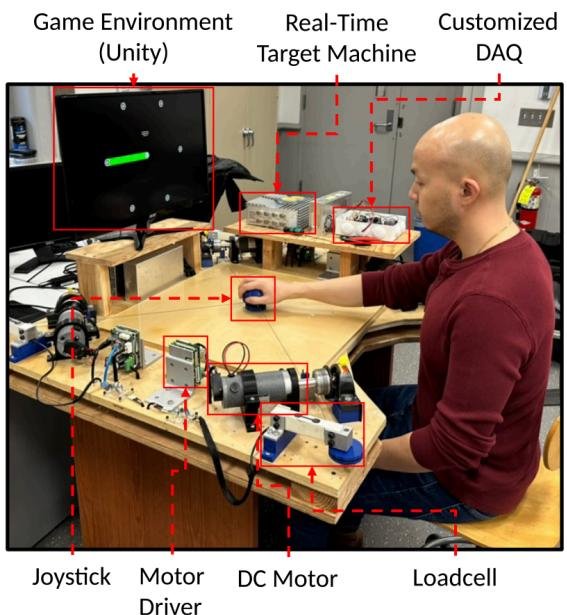  
Fig. 1. 为评估 RL-AAN 控制器而开发的绳索驱动并联机器人（CDPR）原型。

采用了类似的训练范式，通过施加机械扰动来探索健康个体在数百次重复过程中如何调整其运动模式以应对扰动 [31]。为了实现康复任务，我们受 [32] 中描述的先前设计的启发，开发了一种平面 CDPR。与常见的刚性连杆设计相比，绳索驱动设备在惯性特性、施力能力和经济性方面展现出优势 [33]。

## A. 硬件设置

图 1 所示的定制设计 CDPR 采用四根平行布置的包覆钢丝绳，在其末端执行器（操作杆）上施加所需的平面力。用户可以在平面工作空间 $( 6 3 0 \times 6 3 0 \mathrm { m m } ^ { 2 } )$ 内移动操作杆，类似于操作电脑鼠标。每根绳索由一个卷筒控制，该卷筒由有刷直流电机（Groschopp PM6015，57 W，220 mNm 额定扭矩）驱动，并配有增量式编码器（US Digital E5-1000，4000 CPR）。安装在悬臂梁式称重传感器顶部的惰轮用于测量每根绳索的拉力，并将绳索引向一对垂直安装的惰轮。每对惰轮位于方形工作空间的一个顶点，作为 CDPR 的有效出绳点。每根绳索的远端均连接到操作杆垂直轴线上的同一点。操作杆的顶部可绕同一垂直轴自由旋转，以最大程度减少运动过程中寄生力矩的传递。覆盖在 CDPR 工作空间的亚克力板以及贴在操作杆底面的低摩擦胶带最大程度地减小了滑动摩擦的影响。运行频率为 1kHz 的实时目标机（SpeedGoat Baseline）用作 CDPR 控制器，并通过 EtherCAT 现场总线处理与电机驱动器（A-M-C DZEANTU-020B200）和定制数据采集（DAQ）板的通信。在 Unity 中开发的 2D 虚拟运动场为手臂伸展练习提供了用户界面。任务相关数据通过用户数据报协议（UDP）套接字以 60 Hz 的频率从 CDPR 控制器发送至 Unity 环境。

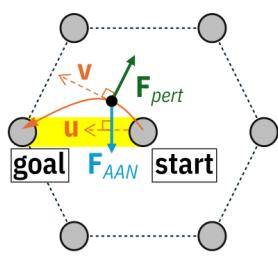

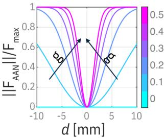  
(b)  
Fig. 2. (a) 手臂伸展训练示意图。目标是将操作杆（黑点）沿指定的直线路径（黄色高亮显示）从初始位置（起点）移动到六个可能的目标位置（终点）之一，路径方向由单位向量 u 指示。在运动过程中，用户必须克服一个扰动力 $( \bar { \mathsf { F } _ { p e r t } } )$，该力正交于操作杆的瞬时速度 (v) 且与其大小成正比，如 (1) 所述。由非线性阻抗定律 (2) 生成且正交于 $u$ 的辅助力 ${ \dot { F } } _ { A A N }$ 帮助用户克服扰动。(b) $F _ { A A N }$ 的归一化幅值随调整距离 d 和阻抗参数 g 的变化关系。

## B. 机器人辅助手臂伸展训练

在 CDPR 中实现了一款严肃游戏，以挑战用户在手臂伸展任务中对抗外部扰动力的能力。用户从工作空间的中心出发，在受到扰动的同时，尽可能精确地沿着计算机屏幕上显示的直线路径移动操作杆，以到达排列在正六边形顶点处的六个预定义目标之一，目标距离起始位置 20 cm（Fig. 2-a）。随后，用户将操作杆带回起始位置，并等待下一个目标在随机顶点出现。为了控制任务节奏，一个蓝色指示器根据 5 阶时间律 [34]，在 1 秒内从六边形中心向当前目标移动。在下一个目标出现在屏幕上与蓝色指示器开始移动之间插入了 500 ms 的停顿。参考路径的颜色由当前运动学误差 $d$ 调节，作为描述性视觉反馈。当误差较小 $( d \digamma <$ 2 5 mm) 时，颜色设置为绿色。当误差中等 $( 2 . 5 \mathrm { m m } \leq d < 7 . 5 \mathrm { m m } )$ 时，颜色逐渐从绿色变为黄色，而当误差较大 $( d \ge 7 . 5 $ mm) 时，颜色逐渐过渡为红色。外部扰动 $F _ { p e r t }$ 定义为

$$
F _ {p e r t} = \gamma_ {p e r t} \mathbf {v} _ {\perp},\tag{1}
$$

其中 $\gamma _ { p e r t } = 0 . 0 2 \mathrm { N } / ( \mathrm { m m / s } )$ 为比例因子，$\mathbf { v } _ { \perp }$ 是将操作杆当前速度 v 顺时针旋转 90 度得到的向量（Fig. 2-a）。因此，当上肢运动最快时，扰动力达到峰值。该扰动策略在先前的研究中已被验证为一种在确保安全并避免疲劳的同时，向用户手臂运动引入扰动的有效方法 [35]。除了扰动之外，CDPR 还施加了一个辅助力，定义为

$$
F _ {A A N} = - F _ {\mathrm{max}} \left[ 1 - e ^ {- (g d) ^ {2}} \right] \mathbf {u} _ {\perp},\tag{2}
$$

其中 $\mathbf { u } _ { \perp }$ 是通过将沿参考路径方向并指向目标的单位向量 u 

TABLE I  
ILC-AAN 和 RL-AAN 参数

<table><tr><td>AAN 类型</td><td>参数</td><td>定义</td><td>数值</td></tr><tr><td rowspan="3">ILC</td><td> $K$ </td><td>增益</td><td>0.015 mm $^{-2}$ </td></tr><tr><td> $\gamma_{ILC}$ </td><td>遗忘因子</td><td>0.82</td></tr><tr><td> $b$ </td><td>截距</td><td>-0.04 mm $^{-1}$ </td></tr><tr><td rowspan="8">RL</td><td> $\alpha_a$ </td><td>Actor 学习率</td><td>0.5</td></tr><tr><td> $\alpha_c$ </td><td>Critic 学习率</td><td>0.1</td></tr><tr><td> $\gamma_{RL}$ </td><td>Critic 折扣因子</td><td>0.5</td></tr><tr><td> $\Lambda$ </td><td>奖励权重矩阵</td><td>diag ([1, 1, 1.5, 1.5])</td></tr><tr><td> $\beta$ </td><td> $U_c$  步长</td><td>0.01</td></tr><tr><td> $w_U$ </td><td> $U_c$  窗口大小</td><td>6 cycles</td></tr><tr><td> $\eta$ </td><td>可接受误差</td><td>{5, 3.5, 2} mm $^2$ </td></tr><tr><td> $w_\eta$ </td><td> $\eta$  窗口大小</td><td>{6, 12, 30} cycles</td></tr></table>

顺时针旋转 90 度得到的，而 $F _ { \mathrm { m a x } } = 2 5 \mathrm { N }$ 是由 CDPR 电机饱和决定的最大辅助力，其大小与以往的上肢康复机器人一致 [36]。公式 (2) 在参考路径周围建立了一个对称的非线性弹性虚拟墙，其大小在墙外约等于 $F _ { m a x }$，在墙内逐渐减小至零（图 2-b）。非线性墙的斜率由阻抗参数 $g$ 控制。调整后的距离 d 是根据以下规律，在操纵杆当前位置与参考路径之间的几何距离（记为 ${ \tilde { d } }$）中考虑死区 $d _ { \mathrm { d b } } = 3$ mm 后得到的：

$$
d = \left\{ \begin{array}{l l} \text { sign } (\tilde {d}) (| \tilde {d} | - d _ {\text { db }}) & \text { if } | \tilde {d} | \geq d _ {\text { db }} \\ 0 & \text { if } | \tilde {d} | <   d _ {\text { db }} \end{array} \right.\tag{3}
$$

引入死区 $d _ { \mathrm { d b } }$ 是为了允许人体变异性 [7]，其数值是根据 8 名健康受试者在无辅助力或扰动力下执行到达任务的初步测试中所观察到的平均标准差选取的。

## III. 按需辅助控制

在本文中，我们研究了自适应 AAN（按需辅助，Assist-As-Needed）控制器对 (2) 中阻抗参数 $g$ 的调制。我们将一种新型 RL-AAN（强化学习按需辅助）控制器与传统的 ILC-AAN（迭代学习控制按需辅助）控制器进行了对比，并假设基于学习的方法所带来的更强的人机性能适应通用性将在锻炼过程中改善人体运动适应动态，并在借助辅助力进行训练后实现更好的保持效果。对于这两种控制器，阻抗参数 $g$ 均允许在区间 [0, 0.5] mm−1 内变化（Fig. 2-b）。

## A. ILC-AAN 控制器

ILC（迭代学习控制，Iterative Learning Control）常用于涉及重复性任务的机器人应用中。ILC 旨在利用来自先前重复周期的反馈，在每次任务重复后逐步调整控制动作，从而改善任务执行效果 [12]。在当前的实现中，P 型 ILC-AAN 控制器 [7], [37] 根据以下公式调整将在下一次运动重复（以下简称“周期”）中应用的阻抗参数 $g$：

$$
g _ {k + 1} = \gamma_ {I L C} g _ {k} + f (d _ {k}),\tag{4a}
$$

$$
f (d _ {k}) = K d _ {k} - b,\tag{4b}
$$

式中，$k$ 为最近完成的周期的索引，$f ( d )$ 为校正后运动误差 $d$ 的线性函数，具有增益 $K > 0$ 和截距 $^ { b , }$，而 $\gamma _ { I L C } \in ( 0 , 1 )$ 为遗忘因子。适当调节 $\gamma _ { I L C }$、$K$ 和 $b$ 对于确保对用户表现的适应性并促进积极主动参与至关重要。必须对遗忘项 $\gamma _ { I L C }$ 进行调节，以防止用户过度依赖 CDPR（绳索驱动并联机器人，Cable-Driven Parallel Robot）辅助，从而减少自身的努力程度 [38]。事实上，$\gamma _ { I L C }$ 决定了当运动误差较小时学习算法减小 $g$ 的速率，从而引导 CDPR 产生较弱的辅助力场 (2)，起到挑战用户的效果。这种渐隐式辅助在运动学习方面具有积极效果 [39]。如果 $K$ 与 $\gamma _ { I L C }$ 之间的匹配调节不当，控制器可能无法补偿遗忘因子的影响。这可能会导致即使在误差很大时 $g$ 也会减小，或者相反，即使在误差很小时 $g$ 也会饱和，从而实际上导致静态 IC（阻抗控制，Impedance Control）。在本文中，基于初步测试，我们选择了如 Tab. I 所示的 ILC 参数。

尽管 ILC-AAN 应用广泛，但它需要大量的试错调优，并且其短视的控制律 (4) 仅考虑用户最近的表现，可能无法有效复现人体运动适应的复杂动态过程。这推动了新型基于学习的 AAN 控制器的开发，详见 Sec. III-B。

## B. RL-AAN 控制器

与其他最优控制策略不同，RL（强化学习）控制器在与环境交互的过程中实时学习最优策略 [40]。当难以获取精确的环境模型时（例如涉及复杂人机动力学的物理人机交互（pHRI）场景），这种方法尤为适用。本文采用了 Actor-Critic（执行器-评价器）强化学习框架 [41]，其中执行器在每个周期 k 根据系统状态和来自评价器的反馈确定最合适的动作，而评价器则根据预期的长期代价评估该动作的有效性。在强化学习控制的语境下，第 k 个周期的长期代价记为 V(k)，定义为所有未来负奖励的折扣和 [42]：

$$
V (k) = \sum_ {i = 0} ^ {\infty} \gamma_ {R L} ^ {i} r (k + i + 1),\tag{5}
$$

其中 $r ( k )$ 表示在第 k 个周期产生的即时负奖励，$\gamma _ { R L } \in [ 0 , 1 ]$ 为折扣因子。启发式动态规划（HDP）的基本思想是通过函数逼近来估计 V(k) [43]。根据该方法，评价器神经网络（NN）通过最小化源自贝尔曼方程的时序差分误差 $t _ { d } ( k )$，来估计第 k 个周期的近似长期代价 $\tilde { V } ( k )$ [44]：

$$
t _ {d} (k) = r (k) + \gamma_ {R L} \tilde {V} (k) - \tilde {V} (k - 1)\tag{6}
$$

在本工作中，我们采用了动作依赖型启发式动态规划（ADHDP）[40]，这是一种改进的 HDP 算法，非常适合复杂系统，并具有良好的一致最终有界（UUB）特性 [45]。根据 ADHDP 方法，评价器神经网络将状态和动作均作为输入，将 $\tilde { V } ( k )$ 估计为状态-动作值函数（Figure 3）。因此，最优策略即为使 $\tilde { V } ( k )$ 最小化的策略。在当前的实现中，RL-AAN 模型具有以下特征：

• 状态 $\begin{array} { r c l } { S ( k ) } & { = } & { [ \bar { e } _ { p o s } ( k ) , \bar { e } _ { n e g } ( k ) , e _ { p o s } ^ { + } ( k ) , e _ { n e g } ^ { + } ( k ) ] } \end{array}$，其中 $\bar { e } _ { p o s } ( k ) , e _ { p o s } ^ { + } ( k )$ 和 $\bar { e } _ { n e g } ( k ) , e _ { n e g } ^ { + } ( k )$ 分别是在第 k 个周期测得的正、负误差的均值（由上划线表示）和峰值（由上标 + 表示）。正误差是指与扰动力 $F _ { p e r t }$ 方向相同的误差。负误差是指与 $F _ { p e r t }$ 方向相反的误差。因此，正误差和负误差分别表示用户的欠矫正和过矫正。

• 可行动作集 $g ( k ) \in [ 0 , 0 . 5 ] ~ \mathrm { m m ^ { - 1 } }$

• 即时代价 $r ( k ) = S ^ { T } ( k ) \Lambda S ( k )$，其中 $\Lambda \in \mathbb { R } ^ { 4 \times 4 }$ 是正定对角权重矩阵。

行动器（actor）和评价器（critic）网络均为含有一个隐藏层和 Sigmoid 激活函数的非线性前馈神经网络（NN）[40]。评价器 NN 参数化表示为

$$
\tilde {V} (k) = W _ {c} ^ {(2)} (k) \sigma (H _ {c} (k)),\tag{7a}
$$

$$
H _ {c} (k) = W _ {c} ^ {(1)} (k) \left[ S ^ {T} (k), \delta_ {a} (k) \right] ^ {T},\tag{7b}
$$

式中，$W _ { c } ^ { ( 1 ) } ( k )$ 和 $W _ { c } ^ { ( 2 ) } ( k )$ 分别为隐藏层和输出层的权重矩阵，$H _ { c } ( k )$ 为连接 $\bar { W } _ { c } ^ { ( 1 ) } ( k )$ 和 $W _ { c } ^ { ( 2 ) } ( k )$ 的隐藏层状态，$\delta _ { a } ( k )$ 为行动器 NN 的输出。采用学习率为 $\alpha _ { c } .$ 的梯度下降法更新评价器 NN 权重，以根据二次代价函数 $E _ { c } ( k )$ 最小化时间差分误差 (6)

$$
E _ {c} (k) = \frac {1}{2} t _ {d} ^ {2} (k)\tag{8}
$$

行动器 NN 的权重采用学习率为 $\alpha _ { a }$ 的梯度下降法进行更新，以最小化行动器代价函数 $E _ { a } ( k )$，其定义为

$$
E _ {a} (k) = \frac {1}{2} \left[ \tilde {V} (k) (1 - U _ {c} (k)) + g (k) U _ {c} (k) \right] ^ {2},\tag{9}
$$

式中，$U _ { c } ( k )$ 为指定的控制目标。由于行动器输出 $\delta _ { a } ( k )$ 受 Sigmoid 激活函数限制在区间 [0 1] 内，因此引入缩放因子 $\rho = 0 . 5 ~ \mathrm { m m ^ { - 1 } }$ 将阻抗参数映射到可行区间 [0 0 5] mm−1：

$$
g (k) = \rho \delta_ {a} (k)\tag{10}
$$

式 (9) 中的控制目标 $U _ { c } ( k )$ 在每个周期结束后根据用户在过去 $w _ { U }$ 个周期内的表现，通过以下法则进行更新

$$
U _ {c} (k + 1) = \left\{ \begin{array}{l l} \min \left(1,   U _ {c} (k) + \beta\right) & i f \overline {{r}} (k) \leq \eta (k) \\ \max \left(0,   U _ {c} (k) - \beta\right) & i f \overline {{r}} (k) > \eta (k), \end{array} \right.\tag{11}
$$

其中 ${ \overline { { r } } } ( k )$ 是在过去 $w$ 个周期内测得的即时成本的算术平均值，$\beta$ 是 $U _ { c } ( k )$ 的变化率，$\eta ( k )$ 表示当前可接受误差水平。我们注意到，根据定义，$U _ { c } ( k )$ 被约束在区间 [0 1] 内。因此，行动器（actor）成本 (9) 是表示综合运动学误差的 $\tilde { V } ( k )$ 与表示当前机器人辅助水平的 $g ( k )$ 的平方凸组合，它们的相对重要性由 $U _ { c } ( k )$ 调节。本质上，$U _ { c }$ 控制着运动训练中两个相互冲突的目标之间的平衡：最小化外部辅助以鼓励主动发力，与最小化运动误差以促进正确的任务执行。当用户表现良好时，控制器会增大 $U _ { c } ,$ ，从而允许更大的运动学误差并进一步惩罚机器人引导，这会导致操纵杆表现出更高的顺应性。相反，当运动误差增加时，控制器会减小 $U _ { c }$，加大辅助动作以减小运动学误差。

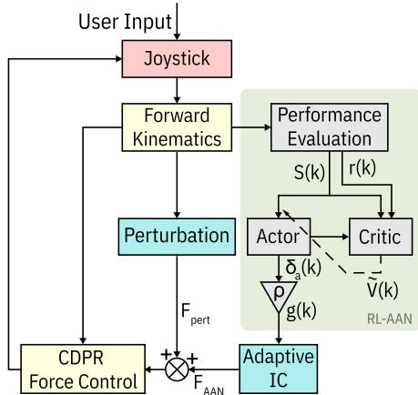  
Fig. 3. RL-AAN 控制器结构。S(k)：周期 k 时的状态向量；r(k)：即时成本；V˜ (k)：近似长期成本；$\delta _ { a } ( k ) \colon$ 行动器（actor）输出；ρ：行动器缩放因子；g(k)：阻抗参数；IC：阻抗控制器；CDPR：绳驱并联机器人。

从 (11) 可以推断出，持续保持 $U _ { c } ( k ) = 1$ 的值表明表现始终处于可接受范围，而在近期的执行中持续偏低的 $U _ { c } ( k ) < 1$ 则表明该任务对用户而言变得过于困难。利用这一规律，我们根据过去 $w _ { \eta }$ 个周期内测得的用户表现，按照以下法则更新可接受误差水平 $\eta(k)$：

$$
\eta (k + 1) = \left\{ \begin{array}{l} \max \left(\eta_ {\text { low }},   \eta (k) - \zeta\right) \text { if } U _ {c} (k - i) = 1   \forall   i \in [ 0, w _ {\eta} ] \\ \min \left(\eta_ {\text { high }},   \eta (k) + \zeta\right) \text { if } \nexists i \in [ 0, w _ {\eta} ] \text { s.t. } U _ {c} (k - i) = 1 \\ \eta (k) \qquad \qquad \qquad \qquad \qquad \qquad \text { otherwise } \end{array} \right.\tag{12}
$$

如 (12) 所示，若评估窗口 $w _ { \eta }$ 内的所有 $U _ { c }$ 值均为 1，则通过将 η 减少一个固定量 ζ 来设定更具挑战性的目标。然而，如果用户在最近 $w _ { \eta }$ 个周期内从未达到值为 1 的 $U _ { c }$，则将 η 增加相同的量以降低任务难度。基于初步测试，我们确定 $\eta _ { l o w } \ = \ 5$ mm 和 $\eta _ { h i g h } \ = \ 2$ mm 分别对应低难度和高难度级别。因此，通过设置 ζ = 1 5 mm，控制器可以在三个等间距的难度级别之间切换：$\eta _ { l o w } , \eta _ { m e d } , \eta _ { h i g h } .$ 此外，$w _ { \eta }$ 被设置为随着 η 的下降而增加 $( w _ { \eta , l o w } = 6 ,$ $w _ { \eta , m e d } ~ = ~ 1 2 , ~ w _ { \eta , h i g h } ~ = ~ 3 0 )$，以鼓励用户探索更具挑战性的运动任务。所提出的 RL-AAN 控制器的架构及其参数分别见 Fig. 3 和 Tab. I。

## IV. 实验验证

## A. 实验方案

15 名健康成年人（11 名男性，年龄 18-32 岁）自愿参与了本研究。参与者均无影响其使用优势臂完成伸手达向任务能力的肌肉骨骼或神经系统损伤。该研究已获得斯蒂文斯理工学院机构审查委员会（Institutional Review Board at Stevens Institute of Technology，方案编号 2022-034）的批准，所有参与者在数据采集前均签署了书面知情同意书。该研究包括两次测试，分别对应一种控制器（ILC-AAN 和 RL-AAN），两次测试间隔至少 48 小时以确保足够的洗脱期（washout period）[46]。为了考虑洗脱期未完全消除的任何潜在残留延续效应，实验采用拉丁方设计（Latin square design）在参与者之间平衡了控制器的测试顺序。

<table><tr><td></td><td>FAM</td><td>BSLN</td><td>PRE</td><td>T-i</td><td>PT-i</td></tr><tr><td> $F_{AAN}$ </td><td>X</td><td>X</td><td>X</td><td>✓</td><td>X</td></tr><tr><td> $F_{pert}$ </td><td>X/✓</td><td>X</td><td>✓</td><td>✓</td><td>✓</td></tr></table>

Fig. 4. 实验方案（FAM：熟悉阶段；BSLN：基线阶段；PRE：训练前阶段；T-i：第 i 次训练；PT1-PT3：训练后阶段）。符号 X 和 $x$ 表示 CDPR 生成的助力 $( F _ { A A N } )$ 或扰动力 $( F _ { p e r t } )$ 是否启用/禁用。

每次实验所遵循的方案如图 Fig. 4 所示。首先，每位参与者进行了一个包含 60 个周期的熟悉阶段（FAM），其中包括 30 次无 $F _ { p e r t }$ 的手臂伸展重复和 30 次施加 $F _ { p e r t }$ 的重复，以随机顺序涵盖所有六个方向。该阶段在 $F _ { A A N }$ 为零的情况下进行，以使参与者熟悉任务以及由 CDPR 产生的扰动类型。接下来，参与者完成了基线阶段（BSLN），该阶段包含 60 个手臂伸展周期（每个方向 10 次，随机顺序），在 $F _ { A A N }$ 和 $F _ { p e r t }$ 均为零的情况下进行，以评估其在无扰动/无辅助状态下的任务表现。随后，参与者进行了 60 个周期的预训练（PRE）阶段，在此期间他们暴露于 $F _ { p e r t }$ 之下但未获得外部辅助。该阶段的目的是评估每位参与者对意外扰动的反应。从该阶段收集的数据还与训练后数据进行了比较，以评估任何训练效果。此外，对于 RL-AAN 控制器，PRE 阶段用于预训练评价网络（critic NN），从初始状态开始并将替代行动者（actor）输出的 $g$ 设为 $g \equiv 0$。这种方法允许评价网络（critic NN）在透明策略下观察环境，从而提高数据效率 [19]。之后，参与者参加了 4 个训练阶段（T-1 至 T-4），每个阶段包含 180 个周期（即每个方向 30 个周期，随机顺序），且 $F _ { p e r t }$ 和 $F _ { A A N }$ 均处于激活状态。RL-AAN 和 ILC-AAN 控制器在整个训练期间（T-1 至 T-4）逐周期进行自适应调节而无需重置。在 PRE 以及 T-1 至 T-4 阶段之间安排了五分钟的休息时间，以最大程度地减少身体和心理疲劳。为了评估研究参与者内部前馈模型的发展情况，在每个训练阶段进行了 12 次探针试验（catch trials），均匀分布在 6 个运动方向上。具体而言，如文献 [47] 所述，通过意外移除 $F _ { A A N }$ 和 $F _ { p e r t }$，将一次探针试验随机插入到每个 30 周期的区块中。这 12 次探针试验是在构成每个训练阶段的 180 个周期之外额外进行的。最后，在三个训练后阶段（PT1 至 PT3）中评估了训练效果，每个阶段包含 60 个具有 $F _ { p e r t }$ 但无辅助的周期。与以往的研究 [22], [48] 一致，这些阶段分别在 T-4 结束后的 1 分钟、10 分钟和 20 分钟开始（Fig. 4）。

## B. 统计分析

为了比较两种控制器在训练期间促进运动适应的有效性，以控制器（Controller：ILC-AAN、RL-AAN）和阶段（Session：T-1 至 T-4）作为自变量进行了线性混合模型（linear mixed model, LMM）分析。将截距（Intercept）、Session、Controller 以及 Session × Controller 设置为固定效应，同时将截距也设置为随机效应，以考量初始表现中的个体差异：

$$
Y _ {i j} = \beta_ {0} + \beta_ {1} S _ {i j} + \beta_ {2} C _ {i j} + \beta_ {3} S _ {i j} C _ {i j} + u _ {0 i} + \varepsilon_ {i j}\tag{13}
$$

在上式中，$i$ 和 $j$ 分别是研究参与者和训练阶段的索引；$S _ { i j } \in \{ 0 , 1 , 2 , 3 \}$ 和 $C _ { i j } \in \{ 0 , 1 \}$ 分别对 Session 和 Controller 进行编码；$u$ 是受试者的随机截距，$\varepsilon _ { i j } \sim \mathcal { N } ( 0 , \sigma ^ { 2 } )$ 表示残差 [49]。因变量包括在每个 T 阶段评估的平均阻抗参数 $g$（用作机器人辅助的替代度量），以及平均正误差和负误差从 PRE 到每个 T 阶段的百分比变化 $( \Delta \bar { e } _ { p o s } \mathcal { I } _ { o } , \ \Delta \bar { e } _ { n e g } \mathcal { I } _ { o } )$，该指标量化了个体在欠校正和过校正倾向上的变化。为了评估在训练阶段中 $\eta$ 是否有所下降（表明使用 RL-AAN 控制器时的表现改善），我们对在每个 $\eta$ 下执行的总周期数进行了 LMM 分析。该模型将运动周期（Movement Cycle）作为固定效应，将截距同时作为固定效应和随机效应：

$$
Y _ {i j} = \beta_ {0} + \beta_ {1} M _ {i j} + u _ {0 i} + \varepsilon_ {i j}\tag{14}
$$

在上式中，$M _ { i j }$ 对运动周期进行编码，而所有其他参数的定义与 (13) 中相同。作为次要分析，通过对每个捕捉试验（catch trial）与其紧邻前一个周期之间的平均负误差差异应用单样本 t 检验，对捕捉试验进行了检查。

接下来，为了确定学习效应的存在，我们进行了类似于 (13) 的第三次 LMM 分析，使用截距、Session（PT1 至 PT3）、Controller 以及 Session × Controller 作为固定效应，截距作为随机效应，并将 PRE 与每个 PT 阶段之间误差指标的百分比差异 $( \Delta \bar { e } _ { p o s } \mathcal { I } _ { o } , \ \Delta \bar { e } _ { n e g } \mathcal { I } _ { o } )$ 作为因变量。该分析评估了受试者的短期保持能力，该能力定义为在缺乏机器人辅助的情况下，受试者在补偿扰动的同时追踪目标运动的能力。

正态性假设通过检查残差的 QQ 图（用于 LMM 分析）以及应用 Shapiro-Wilk 检验（用于单样本 t 检验）来进行评估。$\Delta \bar { e } _ { p o s } \%$ 与 $\Delta \bar { e } _ { n e g } \%$ 之间的潜在相关性通过 Spearman 秩相关系数（$\rho$）进行评估。在 LMM 分析中选择了对角协方差结构，以考虑可能存在的同方差性偏离。除捕捉试次（catch trials）外的所有样本（周期）均用于计算 LMM 分析所需的受试者和会话特异性均值。对于捕捉试次分析，将每位受试者在六个方向上的响应合并以获得受试者特异性均值，然后将其用于单样本检验。显著性水平设定为 $\alpha ~ = ~ . 0 5$，所有数据分析均使用 IBM SPSS Statistics 29.0 进行。

TABLE II  
训练和保持阶段的 LMM 结果

<table><tr><td rowspan="2" colspan="2"></td><td colspan="4">截距</td><td colspan="4">会话</td><td colspan="2">控制器</td><td colspan="2">会话×控制器</td></tr><tr><td colspan="2">ILC-AAN</td><td colspan="2">RL-AAN</td><td colspan="2">ILC-AAN</td><td colspan="2">RL-AAN</td><td colspan="2">RL-AAN – ILC-AAN</td><td colspan="2">RL-AAN – ILC-AAN</td></tr><tr><td></td><td></td><td> $\beta (SE)$ </td><td>p</td><td> $\beta (SE)$ </td><td>p</td><td> $\beta (SE)$ </td><td>p</td><td> $\beta (SE)$ </td><td>p</td><td> $\beta (SE)$ </td><td>p</td><td> $\beta (SE)$ </td><td>p</td></tr><tr><td rowspan="3">训练</td><td> $\Delta \bar{e}_{\text{pos}} \%$ </td><td>53.9(11.9)</td><td>&lt;.001</td><td>55.1(11.9)</td><td>&lt;.001</td><td>-</td><td>ns</td><td>4.4(1.8)</td><td>.019</td><td>-</td><td>ns</td><td>-</td><td>ns</td></tr><tr><td> $\Delta \bar{e}_{\text{neg}} \%$ </td><td>-</td><td>ns</td><td>-</td><td>ns</td><td>-</td><td>ns</td><td>-12.9(6.0)</td><td>.034</td><td>-</td><td>ns</td><td>-</td><td>ns</td></tr><tr><td>g</td><td>0.10(0.02)</td><td>&lt;.001</td><td>0.06(0.02)</td><td>.003</td><td>-</td><td>ns</td><td>-</td><td>ns</td><td>-0.04(0.008)</td><td>&lt;.001</td><td>-</td><td>ns</td></tr><tr><td rowspan="2">保持</td><td> $\Delta \bar{e}_{\text{pos}} \%$ </td><td>35.8(14.3)</td><td>.014</td><td>64.1(14.3)</td><td>&lt;.001</td><td>-</td><td>ns</td><td>-</td><td>ns</td><td>28.3(6.4)</td><td>&lt;.001</td><td>-</td><td>ns</td></tr><tr><td> $\Delta \bar{e}_{\text{neg}} \%$ </td><td>-</td><td>ns</td><td>-</td><td>ns</td><td>-</td><td>ns</td><td>-</td><td>ns</td><td>-</td><td>ns</td><td>-</td><td>ns</td></tr></table>

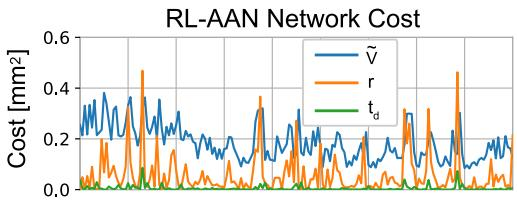

(a)  
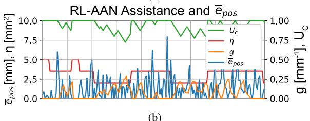  
(b)

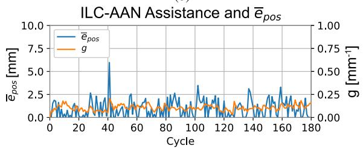  
(c)  
Fig. 5. (a) 一名代表性研究受试者在 T-1 期间 RL-AAN 控制器中评价网络（critic NN）的自适应过程；(b) 对应的 $U _ { c } , \eta$ 和 ${ \mathfrak { g } }$ 轨迹，以及产生的运动学误差 $\bar { \boldsymbol { e } } _ { p o s }；$(c) 同一受试者在 T-1 期间 ILC-AAN 控制器的 g 自适应过程及产生的运动学误差 $\bar { \boldsymbol { e } } _ { p o s }$。

## V. 结果

## A. 训练期间的运动适应

图 5a 显示了在 T-1 期间从一名代表性受试者测得的即时代价 $r$、时间差分误差 $t _ { d }$ 以及近似长期代价 ${ \tilde { V } }$ 的轨迹。可以看出，$t _ { d }$ 在运动重复（周期）中始终很小，表明对 ${ \tilde { V } }$ 的估计是准确的。从图 5b 中逐周期的 $\bar { e } _ { p o s }$ 可以推断出，$U _ { c }$ 的趋势取决于近期的运动学误差。

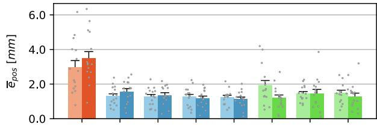

(a)  
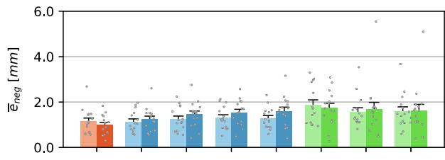  
(b)  
Fig. 6. 训练协议期间 ILC-AAN 控制器（较浅色）和 RL-AAN 控制器（较深色）的误差指标 $\bar { \boldsymbol { e } } _ { p o s }$ 和 $\bar { \pmb { e } } _ { n e g }$ 的组均值。叠加的散点表示单个受试者的数值。误差线：+1 SE（标准误）。

TABLE III  
η 的 LMM

<table><tr><td></td><td> $\beta$  (SE)</td><td>p</td></tr><tr><td>截距</td><td>3.053(.018)</td><td>&lt; .001</td></tr><tr><td>周期</td><td> $- {3.35} \times {10}^{-4}\left( {{4.93} \times {10}^{-5}}\right)$ </td><td>&lt; .001</td></tr></table>

当 $U _ { c }$ 为 1 时，RL-AAN 控制器不提供辅助（即 g 为零）。相反，当 $U _ { c }$ 减小时，执行网络（actor NN）通过增大 g 做出响应。此外，持续良好的表现会导致 RL-AAN 控制器增加任务难度（即减小 $\eta$），而表现下降则产生相反的效果。图 5c 显示了同一代表性受试者在 T-1 期间使用 ILC-AAN 控制器获得的 $g$ 和 $\bar { e } _ { p o s }$ 轨迹。与 RL-AAN 控制器相比，ILC-AAN 控制器通常产生更大且更稳定的 $g ~ ( \mathrm { I L C { - } A A N : 0 . 1 0 { \pm } 0 . 0 3 ~ m m ^ { - 1 } }$ $\mathrm { R L } \mathrm { - } \mathrm { A A N } \mathrm { : } 0 . 0 7 \mathrm { \pm } 0 . 0 8 \mathrm { m m } ^ { - 1 } )$，表明其辅助更为刚性且响应性较差。

在群体水平上，残差的 QQ 图和 Shapiro-Wilk 检验未显示出显著偏离正态分布。Spearman 秩相关系数表明 $\Delta \bar { e } _ { p o s } \%$ 与 $\Delta \bar { e } _ { n e g } \%$ 之间无显著相关性，支持了欠矫正（under-correction）和过矫正（over-correction）代表不同运动构念的假设。Figure 6a 显示了在所有训练阶段中 ILC-AAN 和 RL-AAN 控制器的 $\bar { e } _ { p o s }$ 组平均值。两种控制器均在 PRE 和 T-1 之间引起了 $\bar { e } _ { p o s }$ 的显著降低，这通过 $\Delta \bar { e } _ { p o s } \mathcal { I } _ { o } ~ ( p < . 0 0 1 )$ 的正截距得到了证实，且两种控制器之间没有实质性差异（Tab. II）。然而，如 Tab. II 和 Fig. 7a 中关于 g 的结果所示，RL-AAN 控制器表现出比 ILC-AAN 控制器更为柔顺的行为 $( p ~ < ~ . 0 0 1 )$。有趣的是，LMM 分析还显示 RL-AAN 控制器从 T-1 到 T-4 的 $\bar { e } _ { p o s } \%$ 有显著改善 $( p \ <$ 05)，并伴随着 $\bar { e } _ { n e g } \% ~ ( p < . 0 5 )$ 的显著增加。综合来看，这些趋势表明存在从欠补偿（undercompensation）向过补偿（overcompensation）的明显转变，而这在 ILC-AAN 控制器中并未观察到（Tab. II）。这种差异表明，RL-AAN 控制器在促进探索性学习和积极参与方面更为有效。1此外，Fig. 7b 表明，随着 RL-AAN 训练的进行，在高任务难度 $( \eta _ { h i g h } )$ 下执行的任务次数增加，而在低任务难度 $( \eta _ { l o w } )$ 下执行的次数减少。Tab. III 中的 LMM 分析显示的 η 从 T-1 到 T-4 的显著下降 $( p < . 0 0 1 )$ 证实了这一点。鉴于根据 (11) 和 (12)，η 的值与任务表现相关，这些趋势凸显了 RL-AAN 控制器在训练过程中诱导运动适应的能力。

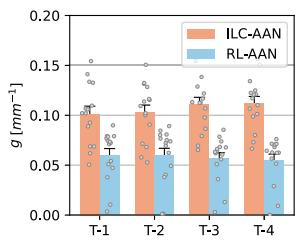  
(a)

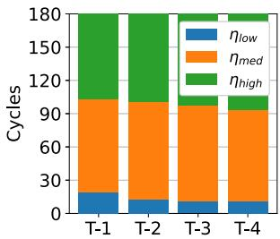  
(b)

Fig. 7. (a) 各训练阶段平均阻抗参数 g 的组平均值。叠加的散点表示单个参与者的数值。(b) RL-AAN 训练阶段中 η 的出现频次。误差棒：+1 SE。  
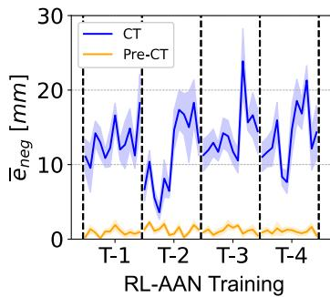

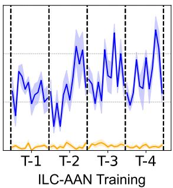  
(a)  
(b)  
Fig. 8. 两种 AAN 控制器在每个训练阶段随机插入的 12 次捕获试验（catch trials）中，紧接其前一个周期（黄色，Pre-CT）和捕获试验期间（蓝色，CT）的 $\bar { \pmb { e } } _ { n e g }$ 组平均值。阴影区域表示 ±1 SD（标准差）。

对研究参与者的一个子集（N=6）进行了捕获试验（catch trials）。单样本 t 检验（Tab. IV）显示，对于两种控制器，在紧邻每次捕获试验的前一个周期与捕获试验周期之间，$\bar { e } _ { n e g } \ ( p < . 0 0 1 )$ 均呈现显著增加。这些在与预期扰动相反方向上的显著运动学偏差，为与人类运动适应相关联的内部前馈模型形成提供了证据。作为参考，Fig. 8 展示了捕获试验紧邻前一个周期以及捕获试验期间 $\bar { e } _ { n e g }$ 的组平均值。

TABLE IV  
捕获试验的单样本 T 检验

<table><tr><td></td><td>控制器</td><td>p 值</td><td>均值, 95% CI</td></tr><tr><td rowspan="2"> $\overline{e}_{neg}(k_c) - \overline{e}_{neg}(k_c - 1)$ </td><td>ILC-AAN</td><td>&lt; .001</td><td>13.08 [11.69, 14.48]</td></tr><tr><td>RL-AAN</td><td>&lt; .001</td><td>10.81 [8.82, 12.80]</td></tr></table>

$\overline { { k _ { c } . } }$ 捕获试验周期索引

## B. 保持

对训练后数据的 LMM 分析表明，在 RL-AAN 训练后立即相对于 PRE 表现显著减少了欠补偿（即正的 $\Delta \bar { e } _ { p o s } \%$ 截距）$( p ~ < ~ . 0 0 1 )$，并且这种效果在所有三次 PT 阶段中均得以保持，性能未见明显下降（Tab. II）。尽管在 ILC-AAN 训练后也立即观察到欠补偿的显著减少 $( p ~ < ~ . 0 5 )$，但该改善不如 RL-AAN 训练后观察到的显著 $( p < . 0 0 1 )$，表明在 RL-AAN 训练后任务执行更加准确。这可能是由于参与者在训练过程中过度依赖 ILC 的助力。事实上，PT1 在 T-4 结束仅 1 分钟后即开始。随着刚性的 ILC 助力突然被移除，受试者必须在没有机器人引导的情况下重新适应，以有效抵消 $F _ { p e r t }$。RL-AAN 方法在整个训练过程中产生了更具顺应性的助力（Fig. 7a），从而减轻了这种不良的后效。综上所述，与 ILC-AAN 控制器相比，使用 RL-AAN 控制器训练期间对扰动的更高暴露在训练后引发了对目标运动更准确的保持，其性能增益主要由欠补偿 $F _ { p e r t }$ 倾向的降低所驱动。

## VI. 讨论

近年来，能够实现治疗流程个性化的康复技术受到了越来越多的关注 [50]。传统上，通用的控制方法虽已被应用，但收效有限 [38]；然而，认识到个体行为特征的变异性为机器人辅助治疗开辟了新的可能性 [51], [52], [53]。机器人技术非常适合持续评估个体的运动表现，并相应地调整训练挑战难度，从而促进持续的参与度 [54]。将个性化融入机器人辅助运动训练中，有助于促进内部模型的建立，进而提高康复治疗的有效性 [55], [56]。

本研究提出了一种用于机器人辅助手臂伸展训练的新型基于强化学习（RL）的按需辅助（AAN）控制器，证明了新型 RL-AAN 控制器在实现 AAN 控制的主要目标方面优于传统的基于迭代学习控制（ILC）的自适应控制器：该目标是根据个体的运动表现自适应调节康复机器人提供的辅助水平，仅提供完成运动任务所需的最少辅助，以鼓励主动参与并促进运动适应。传统的 ILC-AAN 控制器依赖于一种简单的规律，仅考虑最近一次的运动执行情况，且无论接受了多少训练，总是以相同的标准化方式响应用户的运动行为。相反，所提出的 RL-AAN 控制器在三个不同层面上鼓励主动参与。首先，与 ILC-AAN 不同，RL-AAN 在其状态中考虑了多个误差分量。通过区分过度补偿 $( \bar { e } _ { n e g } )$ 与不足补偿 $( \bar { e } _ { p o s } )$，它可以在每次运动执行后追踪用户参与度，并更有效地识别和利用将用户参与与长期表现联系起来的潜在模式。其次，Actor 神经网络（NN）持续寻求一种最优策略，以最小化一个动态变化的代价函数，该代价函数同时包含了个人参与度的度量（体力付出）及其未来运动行为的估计（运动学误差），并通过控制目标 $U _ { c } .$ 利用用户的历史表现来调节这两部分贡献之间的相对重要性。最后，RL 模型具有基于表现的课程学习结构 [27], [28], [29]，该结构通过动态修改可接受误差 $\eta$ 的水平来调整任务难度 [21]，从而使 RL-AAN 控制器不仅能够调整辅助水平，还能根据用户的表现缩放任务难度。这种基于课程学习的自适应机制促进了持续参与，并可能通过将任务保持在用户的最近发展区（zone of proximal development）内来促进运动学习，即学习者在没有辅助的情况下能做的事情与在有辅助的情况下能做的事情之间的空间 [57]。总体而言，LMM 分析表明，与传统的 ILC-AAN 控制器相比，RL-AAN 控制器在训练期间诱导了用户参与度的上升趋势，从而在训练后获得了更好的保留效果。

两项关于用于机器人辅助上肢康复的基于 RL 的控制器的研究，在其模型设计中纳入了机器人辅助最小化 [18], [19]。尽管这两项研究都报告了误差减小方面的改善，但它们并未对训练和保持阶段的用户参与度进行定量分析，也未进行捕获试验（catch trials）以验证内部模型的建立。在此背景下，本研究的发现提供了新的见解，支持了我们最初的假设，即与传统的 ILC-AAN 方法相比，RL-AAN 控制器增强的适应能力可以带来更高效的学习，运动过程中人类运动适应动力学的改善以及训练后更精确的保持能力证明了这一点。

由于其自适应能力有限，ILC-AAN 控制器在本质上难以针对个体进行微调。最佳遗忘因子和误差增益在不同受试者之间可能存在显著差异，且必须通过试错法来确定。这是一项极其繁琐的任务，因为它需要多轮测试和验证，且试验之间需要足够的洗脱期。因此，该主题的大多数研究都采用了通用设置 [7], [13]。相比之下，所提出的 RL-AAN 控制器通过纳入控制目标 $U _ { c }$ 和高层性能参数 $\eta$，在无需个体化调优的情况下实现了个性化。该方法考虑了用户参与度，并简化了模型的调优过程。该架构提供了一种分层结构，确保 actor 和 critic 神经网络（NNs）均能快速收敛，显著增强了模型对个体行为的实时适应能力，并消除了手动调优的需要。此外，$U _ { c }$ 和 $\eta$ 有助于实现更直观的性能监测和系统调整。

这种简化的调优过程不仅优于传统的基于 ILC 的控制器，而且优于最新的基于学习的模型。虽然与传统的基于 ILC 的控制器相比，基于 RL 的算法通常需要手动调优的参数更少，但它们也需要庞大的预训练数据集 [18], [58]，这使得它们在实际应用中的实用性较差。例如，文献 [19] 中提出的 AR3n 控制器需要大量的预训练数据和仿真训练环境，这增加了额外的复杂性。相比之下，所提出的 RL-AAN 控制器利用了基于课程学习的设计，不需要任何庞大的预训练数据集。critic 神经网络在 PRE 阶段收敛，显著降低了对数据的需求并减轻了参与者的负担。总之，通过 actor 代价 $U _ { c }$ 对运动学误差和机器人出力进行持续的重新平衡，所提出的 RL-AAN 控制器实现了超越传统 ILC 律和离线 RL 方法所能提供的用户自适应能力。

本研究还指出了所提出的 RL-AAN 框架的若干局限性。首先，可接受误差阈值 $( \eta _ { l o w } , \eta _ { m e d } ,$ 以及 $\eta _ { h i g h } )$ 对所有参与者均手动设置为统一值，且网络学习率 $( \alpha _ { c } , \ \alpha _ { a } )$ 是根据预试验数据确定的。这种方法引入了主观性，可能无法很好地推广至具有异质性功能障碍的用户。开发基于个体表现自动调整这些阈值并自适应学习率的方法，将有助于提高客观性和泛化性。其次，未来的工作应包含敏感性分析，以研究 Tab. I 中的 RL-AAN 参数对用户表现的相对影响。在实验设计方面，加入仅有视觉反馈而无物理引导的对照条件，对于阐明基于 RL 和 ILC 的辅助与无辅助练习之间的差异具有重要价值。

尽管本研究表明 RL-AAN 算法在诱导健康个体产生短期运动适应方面具有有效性，但在将该方法应用于脑卒中后个体之前，仍需要开展进一步的工作。脑卒中患者通常表现出偏瘫无力、痉挛、异常肌肉协同、肩关节和肘关节活动度降低以及感觉障碍——这些因素会深刻影响伸展任务的表现 [59]。值得注意的是，据报道该人群在横断面伸展运动中存在显著的方向依赖性差异。向对侧前象限及返回同侧后象限的对角线运动似乎对损伤程度最为敏感 [60]，这可能是由于常见的肘-肩协调缺陷（例如屈曲协同）所致。相比之下，前后向和内外向伸展任务的研究结果则存在分歧 [61], [62]。因此，未来针对脑卒中患者的研究应纳入更大的样本量并增加每个目标的重复次数，以检验运动方向是否会调节 RL-AAN 训练期间和训练后的表现。

最近两项关于脑卒中后机器人辅助上肢治疗的随机临床试验的荟萃分析发现，当总训练时间超过 15 小时、机器人以“患者主动”模式（即患者合作、AAN、IC 或基于 EMG 的控制）运行，且治疗对象为具有轻度至中度功能损伤的初次脑卒中患者时，机器人治疗相比常规护理具有显著的即时获益 [63], [64]。然而，两项研究在随访评估中均未发现机器人治疗优于传统治疗的证据。因此，在未来评估 RL-AAN 控制器安全性和概念验证临床可行性的初步横断面研究之后，应开展一项包含延长（≥ 15 小时）机器人训练和随访评估的纵向试验，以确定自适应和个性化 AAN 机器人治疗的益处是否能随时间持续保持。此外，由于康复收益在很大程度上具有任务特异性 [2]，有必要进一步研究探索所提出的 RL-AAN 策略在能够实现超越本文所研究的横断面运动的伸展任务的机器人平台上的应用，以及在能够实现上肢远端训练的平台上的应用 [64]。

## VII. 结论

本工作提出了首个在线基于强化学习（RL）的按需辅助（assist-as-needed, AAN）策略，该策略明确设计用于在上肢伸展练习中同时促进运动精度和用户的主动努力。所提出的 RL-AAN 控制器采用 ADHDP 框架，根据用户近期的表现来调节机器人辅助水平。与现有的用于上肢康复的基于 RL 的控制器不同，所提出的控制器动态调整行动器成本（actor cost）中用户表现与努力之间的平衡以及任务难度，以鼓励主动参与并促进运动适应。

通过使用绳驱动康复机器人（CDPR）对健康受试者进行测试，将 RL-AAN 控制器与传统的 ILC-AAN 控制器进行了对比验证。在训练过程中，RL-AAN 控制器的表现优于 ILC-AAN 控制器，在施加显著更低辅助力的情况下，使用户达到了相似水平的运动精度。此外，研究参与者在接受 RL-AAN 控制器训练后，对目标运动表现出更精准的保持效果。

本工作为展示物理人机交互（pHRI）和机器人辅助训练中个性化优势的持续研究做出了贡献，为未来在脑损伤人群中开展验证研究奠定了基础。

## 致谢

作者对 ADVANCED Motion Controls University Outreach Program 的支持表示感谢，该计划为实验中使用的 CDPR 提供了伺服驱动器。

## 参考文献

[1] A. Luft, A. Bastian, and V. Dietz, Learning in the Damaged Brain/spinal Cord: Neuroplasticity. Cham, Switzerland: Springer, Jan. 2016, pp. 3–17.

[2] M. Maier, B. R. Ballester, and P. F. M. J. Verschure, “Principles of neurorehabilitation after stroke based on motor learning and brain plasticity mechanisms,” Frontiers Syst. Neurosci., vol. 13, p. 74, Dec. 2019.

[3] R. L. Sainburg and P. K. Mutha, Movement Neuroscience Foundations of Neurorehabilitation. Cham, Switzerland: Springer, 2022, pp. 19–39.

[4] S. Masiero et al., “The value of robotic systems in stroke rehabilitation,” Expert Rev. Med. Devices, vol. 11, no. 2, pp. 187–198, Mar. 2014.

[5] Y. Chen, K. T. Abel, J. T. Janecek, Y. Chen, K. Zheng, and S. C. Cramer, “Home-based technologies for stroke rehabilitation: A systematic review,” Int. J. Med. Informat., vol. 123, pp. 11–22, Mar. 2019.

[6] V. S. Huang and J. W. Krakauer, “Robotic neurorehabilitation: A computational motor learning perspective,” J. NeuroEng. Rehabil., vol. 6, no. 1, pp. 1–13, Dec. 2009.

[7] J. L. Emken, R. Benitez, and D. J. Reinkensmeyer, “Human–robot cooperative movement training: Learning a novel sensory motor transformation during walking with robotic assistance-as-needed,” J. NeuroEng. Rehabil., vol. 4, no. 1, pp. 1–16, Dec. 2007.

[8] N. Vitiello et al., “NEUROExos: A powered elbow exoskeleton for physical rehabilitation,” IEEE Trans. Robot., vol. 29, no. 1, pp. 220–235, Feb. 2013.

[9] R. Riener, L. Lunenburger, S. Jezernik, M. Anderschitz, G. Colombo, and V. Dietz, “Patient-cooperative strategies for robot-aided treadmill training: First experimental results,” IEEE Trans. Neural Syst. Rehabil. Eng., vol. 13, no. 3, pp. 380–394, Sep. 2005.

[10] S. K. Banala, S. H. Kim, S. K. Agrawal, and J. P. Scholz, “Robot assisted gait training with active leg exoskeleton (ALEX),” IEEE Trans. Neural Syst. Rehabil. Eng., vol. 17, no. 1, pp. 2–8, Feb. 2009.

[11] S. Srivastava et al., “Assist-as-needed robot-aided gait training improves walking function in individuals following stroke,” IEEE Trans. Neural Syst. Rehabil. Eng., vol. 23, no. 6, pp. 956–963, Nov. 2015.

[12] C. T. Freeman, E. Rogers, A.-M. Hughes, J. H. Burridge, and K. L. Meadmore, “Iterative learning control in health care: Electrical stimulation and robotic-assisted upper-limb stroke rehabilitation,” IEEE Control Syst. Mag., vol. 32, no. 1, pp. 18–43, Feb. 2012.

[13] S. Maggioni, N. Reinert, L. Lunenburger, and A. Melendez-¨ Calderon, “An adaptive and hybrid end-point/joint impedance controller for lower limb exoskeletons,” Frontiers Robot. AI, vol. 5, p. 104, Oct. 2018.

[14] E. T. Wolbrecht, V. Chan, D. J. Reinkensmeyer, and J. E. Bobrow, “Optimizing compliant, model-based robotic assistance to promote neurorehabilitation,” IEEE Trans. Neural Syst. Rehabil. Eng., vol. 16, no. 3, pp. 286–297, Jun. 2008.

[15] S. Hussain, S. Q. Xie, and P. K. Jamwal, “Adaptive impedance control of a robotic orthosis for gait rehabilitation,” IEEE Trans. Cybern., vol. 43, no. 3, pp. 1025–1034, Jun. 2013.

[16] J. C. P. Ibarra, W. M. dos Santos, H. I. Krebs, and A. A. G. Siqueira, “Adaptive impedance control for robot-aided rehabilitation of ankle movements,” in Proc. 5th IEEE RAS/EMBS Int. Conf. Biomed. Robot. Biomechatronics, Aug. 2014, pp. 664–669.

[17] M. Sharifi, V. Azimi, V. K. Mushahwar, and M. Tavakoli, “Impedance learning-based adaptive control for human–robot interaction,” IEEE Trans. Control Syst. Technol., vol. 30, no. 4, pp. 1345–1358, Apr. 2022.

[18] C. Obayashi, T. Tamei, and T. Shibata, “Assist-as-needed robotic trainer based on reinforcement learning and its application to dart-throwing,” Neural Netw., vol. 53, pp. 52–60, May 2014.

[19] S. Pareek, H. J. Nisar, and T. Kesavadas, “AR3n: A reinforcement learning-based assist-as-needed controller for robotic rehabilitation,” IEEE Robot. Autom. Mag., vol. 31, no. 3, pp. 74–82, Mar. 2024.

[20] Y. Zhang, S. Li, K. J. Nolan, and D. Zanotto, “Adaptive assist-as-needed control based on actor-critic reinforcement learning,” in Proc. IEEE/RSJ Int. Conf. Intell. Robots Syst. (IROS), Nov. 2019, pp. 4066–4071.

[21] Y. Zhang, S. Li, K. J. Nolan, and D. Zanotto, “Reinforcement learning Assist-as-needed control for robot assisted gait training,” in Proc. 8th IEEE RAS/EMBS Int. Conf. Biomed. Robot. Biomechatronics (BioRob), Nov. 2020, pp. 785–790.

[22] Y. Zhang, S. Li, K. J. Nolan, and D. Zanotto, “Shaping individualized impedance landscapes for gait training via reinforcement learning,” IEEE Trans. Med. Robot. Bionics, vol. 4, no. 1, pp. 194–205, Feb. 2022.

[23] X. Gao, J. Si, Y. Wen, M. Li, and H. Huang, “Reinforcement learning control of robotic knee with human-in-the-loop by flexible policy iteration,” IEEE Trans. Neural Netw. Learn. Syst., vol. 33, no. 10, pp. 5873–5887, Oct. 2022.

[24] Q. Zhang et al., “Imposing healthy hip motion pattern and range by exoskeleton control for individualized assistance,” IEEE Robot. Autom. Lett., vol. 7, no. 4, pp. 11126–11133, Oct. 2022.

[25] Q. Zhang, D. Zanotto, M. Sharifi, M. Kim, and Z. Li, Closing the Loop Between Wearable Robots and Machine Learning: A New Paradigm for Steering Assistance Personalization Control. Cham, Switzerland: Springer, 2024, pp. 65–101.

[26] M. Sharifi, S. Tripathi, Y. Chen, Q. Zhang, and M. Tavakoli, “Reinforcement learning methods for assistive and rehabilitation robotic systems: A survey,” IEEE Trans. Syst., Man, Cybern., Syst., vol. 55, no. 7, pp. 4534–4551, Jul. 2025.

[27] S. Luo, H. Kasaei, and L. Schomaker, “Accelerating reinforcement learning for reaching using continuous curriculum learning,” in Proc. Int. Joint Conf. Neural Netw. (IJCNN), Jul. 2020, pp. 1–8.

[28] J. Weng, E. Hashemi, and A. Arami, “Natural walking with musculoskeletal models using deep reinforcement learning,” IEEE Robot. Autom. Lett., vol. 6, no. 2, pp. 4156–4162, Apr. 2021.

[29] K. Or et al., “Curriculum-reinforcement learning on simulation platform of tendon-driven high-degree of freedom underactuated manipulator,” Frontiers Robot. AI, vol. 10, Jul. 2023.

[30] H. I. Krebs, N. Hogan, M. L. Aisen, and B. T. Volpe, “Robotaided neurorehabilitation,” IEEE Trans. Rehabil. Eng., vol. 6, no. 1, pp. 75–87, Mar. 1998.

[31] R. T. Roemmich and A. J. Bastian, “Closing the loop: From motor neuroscience to neurorehabilitation,” Annu. Rev. Neurosci., vol. 41, no. 1, pp. 415–429, Jul. 2018.

[32] D. Zanotto, G. Rosati, S. Minto, and A. Rossi, “Sophia-3: A semiadaptive cable-driven rehabilitation device with a tilting working plane,” IEEE Trans. Robot., vol. 30, no. 4, pp. 974–979, Aug. 2014.

[33] G. Rosati, R. Secoli, D. Zanotto, A. Rossi, and G. Boschetti, “Planar robotic systems for upper-limb post-stroke rehabilitation,” in Proc. ASME Int. Mech. Eng. Congr. Expo., Oct. 2008, pp. 115–124.

[34] T. Flash and N. Hogan, “The coordination of arm movements: An experimentally confirmed mathematical model,” J. Neurosci., vol. 5, no. 7, pp. 1688–1703, Jul. 1985.

[35] I. Carpinella, D. Cattaneo, R. Bertoni, and M. Ferrarin, “Robot training of upper limb in multiple sclerosis: Comparing protocols with or without manipulative task components,” IEEE Trans. Neural Syst. Rehabil. Eng., vol. 20, no. 3, pp. 351–360, May 2012.

[36] H. I. Krebs et al., “Rehabilitation robotics: Pilot trial of a spatial extension for MIT-manus,” J. NeuroEng. Rehabil., vol. 1, no. 1, pp. 1–15, Oct. 2004.

[37] J. Liu, “Iterative learning control and applications,” in Intelligent Control Design and MATLAB Simulation. Cham, Switzerland: Springer, 2018, pp. 267–290.

[38] L. Marchal-Crespo and D. J. Reinkensmeyer, “Review of control strategies for robotic movement training after neurologic injury,” J. NeuroEng. Rehabil., vol. 6, no. 1, p. 20, Dec. 2009.

[39] L. Marchal-Crespo and D. J. Reinkensmeyer, “Haptic guidance can enhance motor learning of a steering task,” J. Motor Behav., vol. 40, no. 6, pp. 545–557, Nov. 2008.

[40] J. Si and Y.-T. Wang, “Online learning control by association and reinforcement,” IEEE Trans. Neural Netw., vol. 12, no. 2, pp. 264–276, Mar. 2001.

[41] F. Meng and Y. Dai, “Adaptive inverse optimal control for rehabilitation robot systems using actor-critic algorithm,” Math. Problems Eng., vol. 2014, no. 1, Jan. 2014.

[42] F. L. Lewis, D. Vrabie, and K. G. Vamvoudakis, “Reinforcement learning and feedback control: Using natural decision methods to design optimal adaptive controllers,” IEEE Control Syst. Mag., vol. 32, no. 6, pp. 76–105, Dec. 2012.

[43] X. Zhong, Z. Ni, and H. He, “A theoretical foundation of goal representation heuristic dynamic programming,” IEEE Trans. Neural Netw. Learn. Syst., vol. 27, no. 12, pp. 2513–2525, Dec. 2016.

[44] R. Bellman, “Dynamic programming,” Science, vol. 153, no. 3731, pp. 34–37, 2010.

[45] Y. Sokolov, R. Kozma, L. D. Werbos, and P. J. Werbos, “Complete stability analysis of a heuristic approximate dynamic programming control design,” Automatica, vol. 59, pp. 9–18, Sep. 2015.

[46] K.-F. Heise, T. S. Monteiro, I. Leunissen, D. Mantini, and S. P. Swinnen, “Distinct online and ofline efects of alpha and beta transcranial alternating current stimulation (tACS) on continuous bimanual performance and task-set switching,” Sci. Rep., vol. 9, no. 1, p. 3144, Feb. 2019.

[47] A. Focke, C. Stockinger, C. Diepold, M. Taubert, and T. Stein, “The influence of catch trials on the consolidation of motor memory in force field adaptation tasks,” Frontiers Psychol., vol. 4, Jul. 2013.

[48] D. Zanotto, G. Rosati, S. Spagnol, P. Stegall, and S. K. Agrawal, “Efects of complementary auditory feedback in robot-assisted lower extremity motor adaptation,” IEEE Trans. Neural Syst. Rehabil. Eng., vol. 21, no. 5, pp. 775–786, Sep. 2013.

[49] J. D. Singer and J. B. Willett, Applied Longitudinal Data Analysis: Modeling Change and Event Occurrence. London, U.K.: Oxford Univ. Press, May 2003.

[50] A. C. Alarcon-Aldana, M. Callejas-Cuervo, and A. P. L. Bo, “Upper limb´ physical rehabilitation using serious videogames and motion capture systems: A systematic review,” Sensors, vol. 20, no. 21, p. 5989, Oct. 2020.

[51] H. J. Asl, M. Yamashita, T. Narikiyo, and M. Kawanishi, “Field-based assist-as-needed control schemes for rehabilitation robots,” IEEE/ASME Trans. Mechatronics, vol. 25, no. 4, pp. 2100–2111, Aug. 2020.

[52] P. Agarwal and A. D. Deshpande, “Subject-specific assist-as-needed controllers for a hand exoskeleton for rehabilitation,” IEEE Robot. Autom. Lett., vol. 3, no. 1, pp. 508–515, Jan. 2018.

[53] M. Oghogho, M. Sharifi, M. Vukadin, C. Chin, V. K. Mushahwar, and M. Tavakoli, “Deep reinforcement learning for EMG-based control of assistance level in upper-limb exoskeletons,” in Proc. Int. Symp. Med. Robot. (ISMR), Apr. 2022, pp. 1–7.

[54] M. Shahbazi, S. F. Atashzar, M. Tavakoli, and R. V. Patel, “Roboticsassisted mirror rehabilitation therapy: A therapist-in-the-loop assist-asneeded architecture,” IEEE/ASME Trans. Mechatronics, vol. 21, no. 4, pp. 1954–1965, Aug. 2016.

[55] L. Luo, L. Peng, C. Wang, and Z.-G. Hou, “A greedy assist-as-needed controller for upper limb rehabilitation,” IEEE Trans. Neural Netw. Learn. Syst., vol. 30, no. 11, pp. 3433–3443, Nov. 2019.

[56] J. C. Castiblanco, I. F. Mondragon, C. Alvarado-Rojas, and J. D. Colorado, “Assist-as-needed exoskeleton for hand joint rehabilitation based on muscle efort detection,” Sensors, vol. 21, no. 13, p. 4372, Jun. 2021.

[57] C. Ferguson, E. L. van den Broek, and H. van Oostendorp, “AI-induced guidance: Preserving the optimal zone of proximal development,” Comput. Educ., Artif. Intell., vol. 3, Jan. 2022, Art. no. 100089.

[58] X. Huang, F. Naghdy, H. Du, G. Naghdy, and C. Todd, “Reinforcement learning neural network (RLNN) based adaptive control of fine hand motion rehabilitation robot,” in Proc. IEEE Conf. Control Appl. (CCA), Sep. 2015, pp. 941–946.

[59] C. Trompetto et al., “Pathophysiology of spasticity: Implications for neurorehabilitation,” BioMed Res. Int., vol. 2014, pp. 1–8, Jun. 2014.

[60] M. Hajihosseinali, S. Behzadipour, G. Taghizadeh, and F. Farahmand, “Direction-dependency of the kinematic indices in upper extremities motor assessment of stroke patients,” Med. Eng. Phys., vol. 108, Oct. 2022, Art. no. 103880

[61] A. Hussain et al., “Self-paced reaching after stroke: A quantitative assessment of longitudinal and directional sensitivity using the H-man planar robot for upper limb neurorehabilitation,” Frontiers Neurosci., vol. 10, Oct. 2016.

[62] S. Uehara et al., “Direction-dependent diferences in the quality and quantity of horizontal reaching in people after stroke,” J. Neurophysiol., vol. 130, no. 4, pp. 861–870, Oct. 2023.

[63] L. Zhang, G. Jia, J. Ma, S. Wang, and L. Cheng, “Short and longterm efects of robot-assisted therapy on upper limb motor function and activity of daily living in patients post-stroke: A meta-analysis of randomized controlled trials,” J. NeuroEng. Rehabil., vol. 19, no. 1, p. 76, Dec. 2022.

[64] K. Boardsworth et al., “Upper limb robotic rehabilitation following stroke: A systematic review and meta-analysis investigating eficacy and the influence of device features and program parameters,” J. NeuroEng. Rehabil., vol. 22, no. 1, p. 164, Jul. 2025.