# Deep-LSTM-Based Human-Robot Collaboration Control With Static-Dynamic Calibration

Chenglin Xie , Student Member, IEEE, Zhijun Li , Fellow, IEEE, and Rong Song , Senior Member, IEEE

Abstract—Using electromyography (EMG) signals to estimate human 3-D upper limb motion intention is a promising technique in human–robot collaboration systems. This technique is challenging due to the nonlinear components within the 3-D upper limb neuromusculoskeletal system and the intricate dynamic online environment in the human–robot coupling systems. In this article, a deep long short-term memory network was proposed to establish the nonlinear EMG-to-3-D-force model for an upper limb cabledriven robot (UL-CDR). To enhance the model’s adaptability to dynamic environments, we proposed a static-dynamic calibration method that initially trains the network using static measurement data and then fine-tunes it using dynamic data. Subjects were recruited to track reference trajectories for 160 trials with the assistance of the UL-CDR. Results showed that the proposed approach got better tracking accuracy than the method with only static calibration, demonstrating the effectiveness of the proposed method in transitioning between static and dynamic environments and potentially enhancing the performance of human–robot collaboration.

Manuscript received 8 December 2023; revised 24 February 2024 and 9 April 2024; accepted 26 April 2024. Date of publication 6 June 2024; date of current version 11 October 2024. This work was supported in part by the National Key Research and Development Program of China under Grant 2022YFE0201900 and Grant 2021YFF0501600, in part by the ANSO Collaborative Research project under Grant ANSO-CR-PP-2020-03, in part by the Guangdong Science and Technology Plan Project under Grant 2020B1212060077, and in part by the Shenzhen Science and Technology Research Program under Grant SGDX20210823103405040. (Corresponding author: Rong Song.)

Chenglin Xie and Rong Song are with the Key Laboratory of Sensing Technology and Biomedical Instrument of Guangdong Province, School of Biomedical Engineering, Shenzhen Campus of Sun Yat-sen University, Shenzhen 518107, China, also with Guangdong Provincial Engineering and Technology Center of Advanced and Portable Medical Devices, School of Biomedical Engineering, Sun Yat-sen University, Guangzhou, Guangdong 510006, China, and also with the Shenzhen Research Institute, Sun Yat-sen University, Shenzhen, Guangdong 510810, China (e-mail: xiechlin@mail2.sysu.edu.cn; songrong@mail.sysu.edu.cn).

Zhijun Li is with the School of Mechanical Engineering, Translational Research Center, and Shanghai Yangzhi Rehabilitation Hospital, Tongj University, Shanghai 200070, China (e-mail: zjli@ieee.org).

Color versions of one or more figures in this article are available at https://doi.org/10.1109/TIE.2024.3398675.

Digital Object Identifier 10.1109/TIE.2024.3398675

Index Terms—Deep long short-term memory network (DLN), static-dynamic calibration, human motion intention, human–robot collaboration system, myoelectric control.

## I. INTRODUCTION

H UMAN –ROBOT collaboration is a rapidly evolving field that revolutionizes the way humans and robots interact and collaborate. One key element in human–robot collaboration is the ability of robots to understand and respond to human motion intention [1]. By accurately and continuously perceiving human motion intention, robots can seamlessly collaborate with humans. Robots that work alongside humans take advantage of human tutors’ skills and thus increase flexibility, safety, and pro ductivity [2]. The potential and significance of human–robot collaboration have led to its widespread adoption in diverse domains such as manufacturing [2], prosthetics [3], assistive technologies [4], and rehabilitation [5], [6].

Electromyography (EMG) signals, which are generated from muscle cells, are relevant to the human motion intention and thus can be used in the aforementioned human–robot collabora tion systems [2], [3], [7], [8]. The relationship between EMG and human motions\forces has been explored during the past decades. Numerous researchers have concentrated on discrete motion control using EMG pattern recognition techniques such as support vector machine (SVM) [9], linear discriminant analysis (LDA) [10], and deep learning (DL) [11]. Continuous motion control is another hot issue in myoelectric control [1]. Hill based musculoskeletal model has been widely applied to robotic control to continuously obtain human motion intention using EMG signals [12], [13]. However, this model is virtually limited to low-dimensional force or joint torque estimation [14] and faces challenges in estimating the complex upper limb 3-D end force due to the intricacy of motion involved [15], [16]. Previous research has explored the possibility of using a linear state space model (SSM) to continuously estimate the 3-D end force of the upper limb as the input of an upper limb rehabilitation robot and complete simple human–robot collaboration tasks such as reach-to-grasp [17].

To achieve myoelectric control in more complex human–robot collaboration tasks, researchers have explored models with nonlinear fitting capabilities. Aung and Al-Jumaily established a back propagation neural network (BPNN) to predict upper limb joint angles using EMG signals [18]. Zhang et al. trained an artificial neural network (ANN) to build the EMG-to-joint-angle model [19]. Ding et al. proposed a nonlinear state-space model to describe the relationship between the EMG and joint angular velocity, in which the state model was an auto-regressive network and the measurement model was a BPNN [16]. In recent years, DL has gained increasing attention due to its superiority in handling complex nonlinear problems and improving generalization over traditional machine learning methods [20]. Nahid et al. employed AlexNet to classify hand gestures and applied it to a prosthetic hand [11]. Ozdemir et al. investigated several deep networks and found that ResNet-50 got the best accuracy [21]. Nasr et al. explored deep networks, including CNN, RNN, ANN, and RCNN, to map the relationship between EMG and joint angles, velocity, acceleration, and torque [22]. Long short-term memory network (LSTM) makes use of hidden state and memory state to form the short-term and long-term memory, respectively [23], thus LSTM may be a potential model to process sequential data such as EMG [24]. In our previous conference paper, a deep LSTM network (DLN)-based EMG-to-3-D-force model has been established and the model was trained using only static measurement data [25]. However, when applied to the human–robot collaboration system in tracking reference trajectories, non-negligible tracking errors in the dynamic environment were observed although the estimation accuracy in static measurement datasets was high enough. This phenomenon suggests that the model trained using static measurement data does not effectively adapt to the online dynamic environment.

Although progress has been made in the field of myoelectric control, existing nonlinear EMG-to-3-D-force studies were typically calibrated/trained under the constraint of static constant posture [25], [26], [27], [28] or offline datasets that without interacting with robots [16], [18], [19], [22], which may lead to suboptimal performance when applied to dynamic online environments in human–robot coupling systems. This study proposed a static-dynamic calibration method that initially trained the DLN-based 3-D end force estimating model using static measurement data and then updated the network using dynamic data. The trained/updated DLN model was combined with an admittance controller, which generated the desired trajectory for the upper limb cable-driven robot (UL-CDR). The overall control scheme was built into a platform termed dSpace for robotic control by using a multirate parallel computing solution, which maximized the high-frequency real-time performance of the system. Three subjects were recruited to control the UL-CDR via their EMG signals to track the rectangular and circular trajectories. Tracking errors of the proposed method were compared with those of the method without updating the DLN model in the dynamic environment. We hypothesized that the DLN with static-dynamic calibration can adapt to the transition from the static to dynamic environment and yield better trajectory tracking performance than that with only static calibration.

The main innovation of this article lies in 1) building a DLN network to fit the relationship between EMG, joint angle, and 3-D force, and embedding it into hardware to achieve highfrequency real-time myoelectric control in human–robot collaboration; and 2) proving that training DLN using static datasets cannot be perfectly applied to dynamic human–robot interaction, and the solution to this problem requires the proposed static-dynamic calibration method.

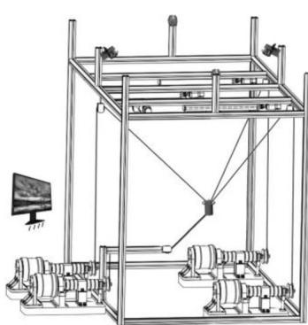  
(a)

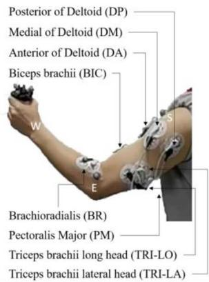  
(b)

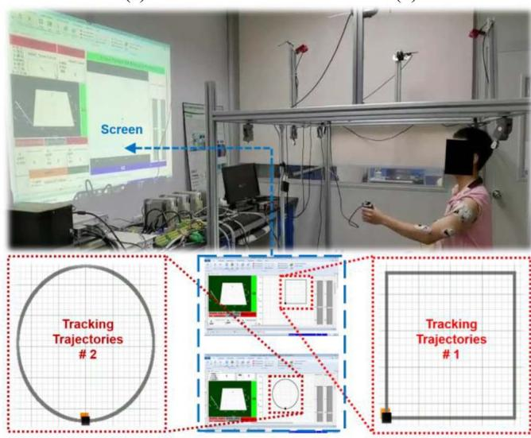  
(c)  
Fig. 1. Experimental prototype. (a) Mechanical structure of UL-CDR. (b) EMG electrodes attaching on skin over eight selected muscles. (c) Image of UL-CDR with visual feedback on screen.

## II. UL-CDR WITH DLN-BASED CONTROLLER

The experimental prototype is depicted in Fig. 1. The UL-CDR included four motors (DM1B045G, Yokogawa), four cables, an end-effector (EE) with a six-axis force sensor (D45MM-F400N, Sunrise Instruments), a motion capture system (OptiTrack2, Natural-Point) with four cameras, a real-time platform (RTI1202, dSpace, with 2 GHz Qorl0 P5020 Processor), and a screen that provided visual feedback for trajectory tracking. The EE, which interacted with the hand of subject, was driven by four cables, each actuated by one motor. Five optical markers were fixed on the elbow, shoulder, and the EE. The motion capture system was used to obtain the real-time position of optical markers.

The UL-CDR control diagram is shown in Fig. 2. A DLN was built to estimate the 3-D human voluntary force $F _ { h }$ accord ing to eight channels of muscle activations and three joint angles information. An admittance filter generated the preliminary desired position $P _ { d }$ for the EE based on $F _ { h }$ . For safety, a work space limitation module was designed to restrict $P _ { d } ,$ , forming $\boldsymbol { P } _ { d } ^ { * }$ as the desired position. A cable trajectory planner was employed to convert $\boldsymbol { P } _ { d } ^ { * }$ in task space into the desired length vector of four cables $P _ { l d }$ in joint space. A PID controller, along with a cable tension controller, determined the control signals for the four motors, actuating the EE to track the desired position $\boldsymbol { P } _ { d } ^ { * }$ . The overall control system operated in multirate parallel computing mode, maximizing the high-frequency real-time performance. The muscle activation calculation, PID controller, and cable tension controller worked at the control frequency of 1000 Hz, while the other components, such as the computationally intensive DLN, operated at 100 Hz.

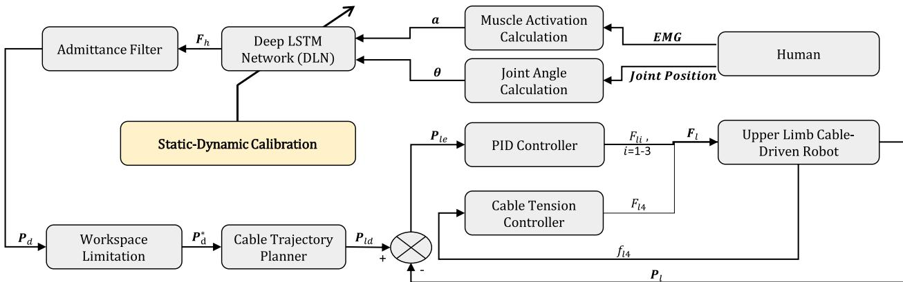  
Fig. 2. Overall control diagram of UL-CDR.

## A. Muscle Activation Calculation

The surface EMG signal of each selected muscle [as shown in Fig. 1(b)] was obtained via Ag-AgCl electrodes, which were applied on the surface of the skin according to the recommendation of SENIAM [29], [30]. The sampling frequency of the EMG signals was 1 kHz. Then, the EMG signals were amplified 5000 times through an amplifier, which also contained a built-in notch filter (50 Hz) and a bandpass filter (20–450 Hz). The filtered signals were full-wave rectified and processed by a fourth order low-pass Butterworth filter with the 4-Hz cutoff frequency [14] (the function of the above sEMG processing can be found in [31]). For the k-th $( k = 1 , 2 , \ldots , 8 )$ muscle, the processed signal was then normalized to $X _ { k }$ using maximum voluntary isometric contraction (MVC) method [32], [33]. Next, the neural activation $N _ { k }$ was obtained according to a second-order linear model

$$
N _ {k} (t) = \alpha X _ {k} (t - t _ {d}) - \beta_ {1} N _ {k} (t - 1) - \beta_ {2} N _ {k} (t - 2)\tag{1}
$$

where $\beta _ { 1 } = - 0 . 0 5 2 0 , \beta _ { 2 } = 0 . 0 0 0 6 , \alpha = 0 . 9 4 8 6$ , and the electromechanical time delay $t _ { d } = 1 0 0$ were determined according to the previous study [17].

At last, the muscle activation $a _ { k } ( t )$ was calculated according to the following model [34]:

$$
a _ {k} (t) = \left\{ \begin{array}{l l} \tau \mathrm{ln} (\omega N _ {k} (t) + 1), & 0 \leq N _ {k} (t) <   N _ {0} \\ \varphi N _ {k} (t) + \delta , & N _ {0} \leq N _ {k} (t) \leq 1 \end{array} \right.\tag{2}
$$

where $\tau = 0 . 2 8 8 2 , \omega = 1 0 . 4 7 6 0 , \varphi = 0 . 8 3 9 1 , \delta = 0 . 1 6 0 9 .$ , and $N _ { 0 } = 0 . 2 4 8 0$ were obtained via the one-parameter method with Newton–Raphson method [17], [34].

## B. Joint Angle Calculation

Five optical markers were fixed on the skin of upper limb and the EE. Two markers were attached to the elbow $( E ( x _ { E } , y _ { E } , z _ { E } ) )$ and shoulder $( S ( x _ { S } , y _ { S } , z _ { S } ) )$ ), while the other three markers were fixed on the EE. The central position of the markers on the EE rep resented the position of the subject’s hand $( H ( x _ { H } , y _ { H } , z _ { H } ) )$ ), which also represented the position of the EE. These positions could be used to calculate the following joint angles:

$$
\theta_ {\mathrm {S\_ {E} F}} = \arctan 2 (z _ {S} - z _ {E}, y _ {S} - y _ {E}).\tag{3}
$$

$$
\theta_ {S \_ A A} = \arctan 2 (x _ {S} - x _ {E}, y _ {S} - y _ {E}).\tag{4}
$$

$$
\theta_ {\mathrm {E\_EF}} = \arccos \left(\frac {H E ^ {2} + E S ^ {2} - H S ^ {2}}{2 H E E S}\right).\tag{5}
$$

where $\theta _ { \mathrm { S \_ E F } } , \quad \theta _ { S \_ A A }$ , and $\theta _ { \mathrm { E } \_ \mathrm { E F } }$ represent the shoulder extension-flexion angle, shoulder abduction-adduction, and elbow extension-flexion, respectively; and k∙k represents the Euclidean distance.

## C. DLN

At time $t ,$ the input vector $U ( t )$ of the DLN contained three joint angles and eight channels of muscle activations, while the output vector $F _ { h } ( t )$ was the estimated 3-D voluntary end force of the hand

$$
\boldsymbol {U} (t) = [ \theta_ {\mathrm {S\_EF}} (t); \theta_ {S \_ A A} (t); \theta_ {\mathrm {E\_EF}} (t); a _ {1} (t);...; a _ {8} (t) ]\tag{6}
$$

$$
\boldsymbol {F} _ {h} (t) = \left[ F _ {h \_ x} (t); F _ {h \_ y} (t); F _ {h \_ z} (t) \right].\tag{7}
$$

The DLN schematic diagram is presented in Fig. 3. To process the eleven-dimensional sequential input U, a sequence input layer was adopted. Three layers of LSTM were then cascaded. Each LSTM layer followed a dropout layer with a proba bility of 0.50. Then, a fully connected layer which contained 200 neurons followed. After that, a regression layer was applied for outputting the estimated 3-D force $F _ { h } .$ . For each LSTM layer, 200 units were constructed. Each unit consisted of an input gate $i ,$ a forgetting gate $f ,$ a candidate value ${ \tilde { c } } _ { \cdot }$ , a memory state $^ { c , }$ an output gate $^ { \bullet , }$ and a hidden state H as follows:

$$
\boldsymbol {i} (t) = \sigma (\boldsymbol {Q} _ {i} \boldsymbol {U} (t) + \boldsymbol {R} _ {i} \boldsymbol {H} (t - 1) + \varepsilon_ {i})\tag{8}
$$

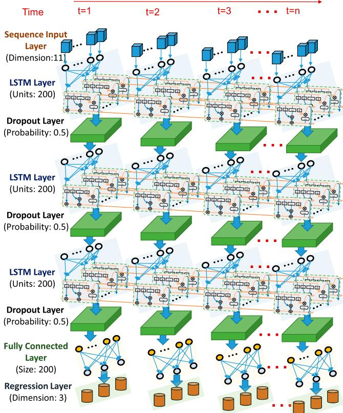  
Fig. 3. Architecture of DLN.

$$
\boldsymbol {f} (t) = \sigma (\boldsymbol {Q} _ {f} \boldsymbol {U} (t) + \boldsymbol {R} _ {f} \boldsymbol {H} (t - 1) + \boldsymbol {\varepsilon} _ {f})\tag{9}
$$

$$
\tilde {\boldsymbol {C}} (t) = \operatorname{Tanh} \left(\boldsymbol {Q} _ {\tilde {\boldsymbol {C}}} \boldsymbol {U} (t) + \boldsymbol {R} _ {\tilde {\boldsymbol {C}}} \boldsymbol {H} (t - 1) + \varepsilon_ {\tilde {\boldsymbol {C}}}\right)\tag{10}
$$

$$
\boldsymbol {C} (t) = \boldsymbol {f} (t) \odot \boldsymbol {C} (t - 1) + \boldsymbol {i} (t) \odot \tilde {\boldsymbol {C}} (t)\tag{11}
$$

$$
\boldsymbol {o} (t) = \sigma (\boldsymbol {Q} _ {o} \boldsymbol {U} (t) + \boldsymbol {R} _ {o} \boldsymbol {H} (t - 1) + \boldsymbol {\varepsilon} _ {o})\tag{12}
$$

$$
\boldsymbol {H} (t) = \boldsymbol {o} (t) \odot \operatorname{Tanh} (\boldsymbol {C} (t))\tag{13}
$$

where $Q _ { i } , Q _ { f } , Q _ { \tilde { C } } , Q _ { o } , R _ { i } , R _ { f } , R _ { \tilde { C } }$ , and $\pmb { R } _ { o }$ are weight matrices, and $\varepsilon _ { i } , ~ \varepsilon _ { f } , ~ \varepsilon _ { \tilde { C } }$ , and $\pmb { \varepsilon } _ { o }$ are bias. Details of DLN can be found in Table I.

## D. Admittance Filter

An admittance filter was adopted to generate the preliminary desired position of the EE $P _ { d }$ based on the estimated force $F _ { h }$ the output of the DLN

$$
\boldsymbol {P} _ {d} = \boldsymbol {P} + \boldsymbol {F} _ {h} (K + B s + M s ^ {2}) ^ {- 1}\tag{14}
$$

where P is the actual position which is measured via four cameras in real time; s is the Laplacian operator; and K, B, and M are the stiffness, damper, and mass parameters, respectively.

## E. Workspace Limitation

To prevent danger during the experiment, the position of the EE should be limited to the space of the workspace. The range

TABLE I PARAMETERS OF DLN STRUCTURE

<table><tr><td>Parameter</td><td>LSTM layer #1</td><td>LSTM layer #2</td><td>LSTM layer #3</td></tr><tr><td>Input size</td><td>11</td><td>200</td><td>200</td></tr><tr><td>Hidden units</td><td>200</td><td>200</td><td>200</td></tr><tr><td>Input weights</td><td> $\mathcal{Q}_{i}, \mathcal{Q}_{f}, \mathcal{Q}_{\bar{\mathcal{C}}},$  $\mathcal{Q}_{o} \in \mathbf{R}^{200 \times 11}$ </td><td> $\mathcal{Q}_{i}, \mathcal{Q}_{f}, \mathcal{Q}_{\bar{\mathcal{C}}},$  $\mathcal{Q}_{o} \in \mathbf{R}^{200 \times 200}$ </td><td> $\mathcal{Q}_{i}, \mathcal{Q}_{f}, \mathcal{Q}_{\bar{\mathcal{C}}},$  $\mathcal{Q}_{o} \in \mathbf{R}^{200 \times 200}$ </td></tr><tr><td>Recurrent weights</td><td> $\mathcal{R}_{i}, \mathcal{R}_{f}, \mathcal{R}_{\bar{\mathcal{C}}},$  $\mathcal{R}_{o} \in \mathbf{R}^{200 \times 200}$ </td><td> $\mathcal{R}_{i}, \mathcal{R}_{f}, \mathcal{R}_{\bar{\mathcal{C}}},$  $\mathcal{R}_{o} \in \mathbf{R}^{200 \times 200}$ </td><td> $\mathcal{R}_{i}, \mathcal{R}_{f}, \mathcal{R}_{\bar{\mathcal{C}}},$   $\mathcal{R}_{o} \in \mathbf{R}^{200 \times 200}$ </td></tr><tr><td>Bias</td><td> $\varepsilon_{i}, \varepsilon_{f}, \varepsilon_{\bar{\mathcal{C}}},$  $\varepsilon_{o} \in \mathbf{R}^{200 \times 1}$ </td><td> $\varepsilon_{i}, \varepsilon_{f}, \varepsilon_{\bar{\mathcal{C}}},$  $\varepsilon_{o} \in \mathbf{R}^{200 \times 1}$ </td><td> $\varepsilon_{i}, \varepsilon_{f}, \varepsilon_{\bar{\mathcal{C}}},$  $\varepsilon_{o} = \mathbf{R}^{200 \times 1}$ </td></tr><tr><td>Hidden state</td><td> $\mathcal{H} \in \mathbf{R}^{200 \times 1}$ </td><td> $\mathcal{H} \in \mathbf{R}^{200 \times 1}$ </td><td> $\mathcal{H} \in \mathbf{R}^{200 \times 1}$ </td></tr><tr><td>Memory state</td><td> $\mathcal{C} \in \mathbf{R}^{200 \times 1}$ </td><td> $\mathcal{C} \in \mathbf{R}^{200 \times 1}$ </td><td> $\mathcal{C} \in \mathbf{R}^{200 \times 1}$ </td></tr><tr><td>Weight Number</td><td>168,800</td><td>320,000</td><td>320,000</td></tr></table>

of workspace was defined as A

$$
\boldsymbol {A} = \{(x, y, z) \mid \text { distance } ((x, y, z), (x _ {l}, y _ {l}, z _ {l})) \leq r \}\tag{15}
$$

where xl ¼ 0, yl ¼ 0:99 m, $z _ { l } = - 0 . 7 6$ m, $r = 0 . 2 5$ m, and distanceð, Þ represents the Euclidean distance between two points.

The desired position $P _ { d } ^ { * }$ was equal to the actual position at the same time when beyond the range of A, otherwise it was equal to the preliminary desired position $P _ { d }$ output from the admittance filter

$$
\boldsymbol {P} _ {d} ^ {*} = \left\{ \begin{array}{c} P, \boldsymbol {P} _ {d} \notin A \\ \boldsymbol {P} _ {d}, \text { otherwise. } \end{array} \right.\tag{16}
$$

## F. Cable Trajectory Planner

To transform the desired position in task space into the desired lengths of the upper three cables in joint space, a cable trajectory planner was adopted

$$
\boldsymbol {P} _ {l d} = \left[ P _ {l d \_ 1}, P _ {l d \_ 2}, P _ {l d \_ 3} \right] ^ {T}\tag{17}
$$

$$
P _ {l d \_ j} = \text { distance } ((P _ {d \_ x} ^ {*}, P _ {d \_ y} ^ {*}, P _ {d \_ z} ^ {*}), (c _ {j \_ x}, c _ {j \_ y}, c _ {j \_ z}))\tag{18}
$$

where $( c _ { j \_ x } , \ c _ { j \_ y } , \ c _ { j \_ z } )$ is the position of the jth pully (refer to $[ 1 7 ] ) ; P _ { d _ { - } x } ^ { * } , P _ { d _ { - } y } ^ { * } ,$ , and $P _ { d _ { - } } ^ { * }$ z represent the $x , y ,$ , and z components of $\pmb { P } _ { d } ^ { * }$ , respectively.

## G. PID Controller

The actuation forces of the upper three cables were determined via a PID controller

$$
\boldsymbol {F} _ {l} = k _ {P} \left(\boldsymbol {P} _ {l d} - \boldsymbol {P} _ {l}\right) + k _ {I} \int_ {1} ^ {t} \left(\boldsymbol {P} _ {l d} - \boldsymbol {P} _ {l}\right) d t + k _ {D} \frac {d \left(\boldsymbol {P} _ {l d} - \boldsymbol {P} _ {l}\right)}{d t}\tag{19}
$$

where $F _ { l } = [ F _ { l 1 } , \ F _ { l 2 } , \ F _ { l 3 } ] ^ { T }$ is the vector of actuation forces; $k _ { P } , k _ { I }$ and $k _ { D }$ are PID coefficients; and $P _ { l }$ represents the actual length of three cables.

## H. Cable Tension Controller

The actuation force of the lower cable was determined according to the real-time cable tension and therefore maintained a proper range of tension to form the four-cable fully constrained parallel structure [17], [35]

Algorithm of static-dynamic calibration
1 Obtain dataset S: Input:  $U \in R^{11 \times T} = [\theta_{joint angle} \in R^{3 \times T}; a_{activation} \in R^{8 \times T}]$ ; Output:  $F_{h} \in R^{3 \times T} = F_{interaction force (static)} \in R^{3 \times T}$ 
2 Random Initial bias and weight matrices in (8)-(13);
3 Standardized dataset S;
4 for  $E \leftarrow 1$  to Max_epochs do
5    for  $I \leftarrow 1$  to [S_Size/batch_size] do
6    $F_{h\_estimate} = forward(U)$ ;
7    $loss \leftarrow 1/M \cdot \Sigma ||F_{h\_target} - F_{h\_estimate}||^2 + 0.0001/N \cdot \Sigma weight^2;$ 
8    Update network parameters using ADAM algorithm;
9    end for
10    Store network parameters at  $\theta(E)$ ;
11    Store validation loss at L(E);
12 end for
13 Select E'-th epoch according to early stopping strategy;
14 Network parameters  $\leftarrow \theta(E')$ ;
15 Embed network to robot for dynamic calibration;
16 Update dataset S: Input data:  $U \in R^{11 \times T} = [\theta_{joint angle} \in R^{3 \times T}; a_{activation} \in R^{8 \times T}]$ ; Output data:  $F_{h} \in R^{3 \times T} \leftarrow F_{interaction force (dynamic)} \in R^{3 \times T} + F_{estimated force} \in R^{3 \times T};$ 
17 Pre-trained optimal parameters as initial ones:  $\theta(0) \leftarrow \theta(E')$ ;
18 Redo step 3~14 and update network;
③ 19 Embed network to robot for dynamic validation experiment;

Fig. 4. Algorithm of static-dynamic calibration. ‹ Static calibration; › dynamic calibration; and fi dynamic validation.

$$
F _ {l 4} = \left\{ \begin{array}{l l} - \mu (f _ {1} - f _ {l 4}), & \quad f _ {l 4} <   f _ {1} \\ 0, & \quad f _ {1} \leq f _ {l 4} \leq f _ {2} \\ \mu (f _ {l 4} - f _ {2}), & \quad f _ {l 4} > f _ {2} \end{array} \right.\tag{20}
$$

where $\mu { = } 2 7 , f _ { 1 } { = } 1 0 \ \mathrm { N } , f _ { 2 } { = } 1 5 \ \mathrm { N } .$ , and $f _ { l 4 }$ represents the lower cable tension measured by the sensor.

## III. STATIC-DYNAMIC CALIBRATION METHOD

The algorithm of the proposed static-dynamic calibration method (illustrated in Fig. 4) included the static calibration step (DLN training), the dynamic calibration step (DLN update), and the dynamic validation step.

## A. Static Calibration

In the static calibration step, each subject was required to apply voluntary force on the EE in six random directions for 21 trials. The duration of each trial was about 15 s. In this step, the motors of UL-CDR were locked (could not move), resulting in a fixed posture of the subject’s limb. The six-axis force sensor, which was integrated into the EE, measured and recorded the static interaction force between the robot and the subject’s hand. In the static stage, the measured interaction force was equal to the voluntary force applied by subjects. The interaction force and the marker positions were recorded at 100 Hz while the EMG signals were at 1000 Hz. To prevent aliasing, muscle activations calculated using EMG signals were decimated to 100 Hz to match the frequency of other signals. In static calibration datasets, the input data U [obtained by using (1)–(6)] contained the muscle activation and joint angle signals, while the output data $F _ { h }$ consisted of three components of 3-D interaction force (recorded by the force sensor, which could be regarded as the voluntary force in the static stage). Among the 21 trials, nine were allocated to the training set, three were used as the valida tion set, and the remaining nine were assigned to the testing set. Data from the training set were used for the DLN training. The network bias and weight matrices in (8)–(13) were initialized using random numbers. ADAM algorithm described in [36] was selected for network training, and the parameters were shown in the second column of Table II. To prevent the over fitting, we monitored the validation loss and halting training before the validation loss began to increase (called early stopping strategy). Subsequently, the trained DLN was then incorporated into the system for online UL-CDR control.

TABLE II  
PARAMETERS OF DLN TRAINING AND UPDATE PROCESS

<table><tr><td>Parameter</td><td>Value(Training process)</td><td>Value(Update process)</td></tr><tr><td>Gradient threshold method</td><td>L2 norm</td><td> $\sim$ </td></tr><tr><td>Gradient threshold</td><td>1.0</td><td> $\sim$ </td></tr><tr><td>Gradient decay factor</td><td>0.9</td><td> $\sim$ </td></tr><tr><td>Initial learning rate</td><td> $5 \times 10^{-3}$ </td><td> $\sim$ </td></tr><tr><td>Learning rate drop period</td><td>125</td><td>75</td></tr><tr><td>Learning rate drop factor</td><td>0.2</td><td> $\sim$ </td></tr><tr><td>Mini-batch size</td><td>128</td><td> $\sim$ </td></tr><tr><td>Epsilon</td><td> $1 \times 10^{-8}$ </td><td> $\sim$ </td></tr><tr><td>Max epochs</td><td>250</td><td>150</td></tr></table>

Note: “ ” means the value is the same as that in the left cell

## B. Dynamic Calibration

In the dynamic calibration step, each of the three subjects inter acted with the EE, which was controlled via EMG signals of the subject to track the reference trajectory in the shape of a 0.25  0.25 m rectangle for 13 trials with visual feedback on screen [Fig. 1(c)]. The duration of each trial was about 46 s on average. In this step, the UL-CDR provided motion assistance to the subject (called dynamic environment). The EMG signals, positions of markers, and dynamic interaction force between the EE and the subject’s hand were recorded. It is worth noting that the feedback signal from the force sensor was used to calibrate the DLN later rather than con trol the robot. Among the 13 trials, seven were used as training set for DLN updating, three were allocated to the validation set, and the rest to the testing set. The input data were still the joint angles and muscle activations, while the output data were changed into the resultant force (i.e., vector sum) of the estimated force and the dynamic interaction force (Fig. 4, line 18). The initial bias and the weight matrices in (8)–(13) were set as those in the pretrained DLN in the previous step. ADAM algorithm was employed again to update the DLN. The parameters of the update/retraining process are shown in the second column of Table II. Early stopping strategy was also adopted in this process. The updated DLN was then reem bedded in the system substituting for the pretrained DLN fo dynamic validation.

## C. Dynamic Validation

In the dynamic validation step, two experiments (DLN with static-dynamic calibration and with only static calibration) were conducted for each subject. The subject interacted with the EE, which was controlled via EMG signals of the subject to track the two kinds of reference trajectories with visual feedback [Fig. 1(c)]. For subject1, both two experiments were conducted 40 times (20 for reference trajectory in the shape of a $0 . 2 5 \times 0 . 2 5$ m rectangle and 20 for reference trajectory in the shape of a circle with a diameter of 0.3 m, roughly 43 s for each trial on average) for comparison and statistical analysis. For subject2 and subject3, both two experiments were conducted only 20 times (ten for reference trajectory in the shape of the rectangle and ten for that of the circle). This was because they requested that the experiment not be carried out for too long and we respected their requirements.

In all, there were around 273, 900 (¼ 3 subjects  21 trials $\times$ $1 5 \mathrm { ~ s ~ } \times 1 0 0 \mathrm { ~ H z } + 3$ subjects  13 trials $\times 4 6 \mathrm { ~ s ~ } \times 1 0 0 \mathrm { ~ H z } )$ pairs of inputs and outputs for DLN training and updating process. Moreover, there were 160 (¼ 1 subject  2 experiments $\times 4 0$ trials þ 2 subjects  2 experiments  20 trials) trials for statistical analysis. All experiments have been approved by the School of Medicine, Sun Yat-sen University Institutional Review Board (IRB/SM-14/2021).

## IV. SIGNAL PROCESSING AND ANALYSIS

The root-mean-square-error (RMSE) of the estimated 3-D end force was adopted to evaluate the estimating accuracy of the EMG-to-3-D-force model

$$
F _ {\text { err } \_ j} = \sqrt {\frac {1}{T} \int_ {0} ^ {T} (F _ {h \_ \text { estimate } \_ j} - F _ {h \_ \text { actual } \_ j}) ^ {2}}\tag{21}
$$

$$
F _ {\text { err\_3D }} = \sqrt {\frac {1}{T} \int_ {0} ^ {T} \| \boldsymbol {F} _ {h \_ \text { estimate }} - \boldsymbol {F} _ {h \_ \text { actual }} \| ^ {2}}\tag{22}
$$

where $j { = } 1 , 2 ,$ , and 3 represent data in $\mathbf { X } , \ \mathbf { y } ;$ , and z axes; and T is the duration of the dataset.

The RMSE and relative error of RMSE $( \mathrm { R E _ { R M S E } } )$ of the position tracking was also adopted to evaluate the accuracy of the model and tracking performance

$$
P _ {\text { RMSE } \_ j} = \sqrt {\frac {1}{T} \int_ {0} ^ {T} (P _ {\text { Reference } \_ j} - P _ {\text { actual } \_ j}) ^ {2}}\tag{23}
$$

$$
P _ {\text { RMSE } \_ 3 D} = \sqrt {\frac {1}{T} \int_ {0} ^ {T} \| P _ {\text { Reference }} - P _ {\text { actual }} \| ^ {2}}\tag{24}
$$

$$
P _ {\mathrm {RE\_RMSE\_j}} = \frac {P _ {\mathrm {RMSE\_j}}}{D _ {\text { Reference }}}\tag{25}
$$

where $D _ { \mathrm { R e f e r e n c e } }$ is the length of edge/diameter of the rectangle/circle reference trajectory.

Paired t-tests were used to examine the difference in RMSE and MRE of the position tracking between two experiments (DLN with static-dynamic calibration and with only static cali bration) using SPSS 26 software.

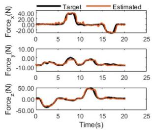  
(a)

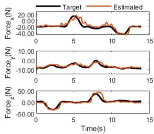  
(b)  
Fig. 5. One representative trial in the training set and one in the testing set of subject1 (target forces were recorded in the static measurement). (a) Force fitting result in one trial of training set. (b) Force estimation result in one trial of testing set.

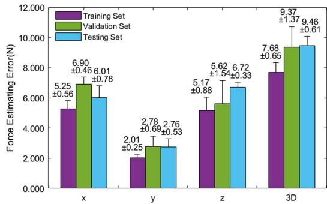  
Fig. 6. Mean RMSE of 3-D end force estimation errors in the training, validation, and testing sets of the static measurement data.

## V. RESULTS

In the static calibration step, it took approximately 19 min to train the DLN with an RTX 3070 GPU. One representative trial in the training set and one in the testing set of subject1 were depicted in Fig. 5. The fitting results in the training set and the estimated results in the testing set were depicted in Fig. 5(a) and 5(b), respectively. The orange curves represent the estimated force while the black ones represent the target force measured by the six-axis force sensor in the static measurement. The mean RMSEs of force estimation in the training, validation, and testing sets of all the subjects’ static measurement data were given in Fig. 6. Though the testing set estimation errors could not be neglected, the estimated forces in both the training set and testing set tended to target ones, as depicted in Fig. 5.

In the dynamic calibration step, the DLN built into dSpace took about $0 . 0 0 3 \mathrm { ~ s ~ } ( < 0 . 0 1 \mathrm { ~ s ~ } )$ for force estimation on each step, meaning that the DLN could be operated on the hardware at the frequency of the control system (100 Hz). The position tracking result in a chosen trial of subject1 was given in Fig. 7. Obviously, the position tracking error was not small, which meant there was still room for further optimization of the DLN. Therefore, the interaction force in a dynamic environment was used for further optimization. The dynamic interaction force plus the estimated force was considered as the output data for the dataset of the DLN updating/further training. Fig. 8(a) showed the joint angles in the training set and Fig. 8(b) depicted those in the testing set. Dynamic data provided varying joint angle information [Fig. 8(a) and 8(b)] for network training, which is not available in static datasets. Fig. 8(c) depicted the fitting result of one sample of the training set in the update step and Fig. 8(d) depicted the estimating result of one sample of the testing set. The force estimation errors in the training set, validation set, and testing set are depicted in Fig. 9. Compared to Fig. 5, the updated DLN has learned the more detailed/complex relationship between the input and output.

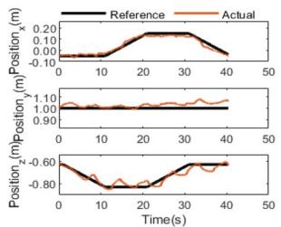  
(a)

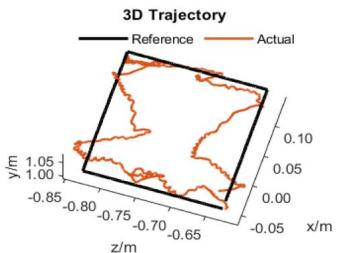  
(b)

Fig. 7. Position tracking results in a representative trial of subject1: actual trajectory and reference trajectory of the EE: (a) in x, y, and z axis; and (b) in 3-D view.  
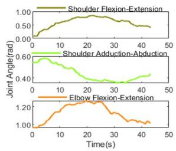  
(a)

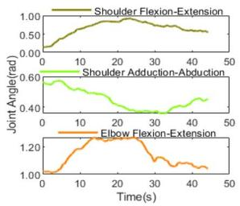

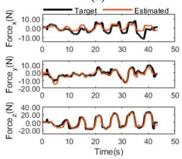  
(c)

(b)  
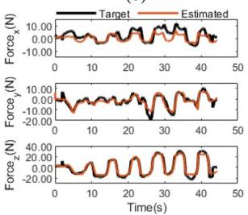  
(d)  
Fig. 8. One sample of training set and one of testing set in update pro cess (the data of target were recorded in dynamic measurement step). (a) Three joint angles in one trial of the training set. (b) Three joint angles in one trial of testing set. (c) Fitting result of training set. (d) Fitting result of testing set.

Fig. 10 shows the position tracking results of dynamic validation with static-dynamic calibration and with only static calibration when tracking the rectangular reference trajectory. Fig. 11 depicts the position tracking results of the dynamic validation when tracking the circular reference trajectory. The mean RMSE of position tracking errors in the dynamic validation using DLN with static-dynamic calibration and with only static calibration was shown in Fig. 12. The specific tracking errors (including RMSE and ${ \mathrm { R E } } _ { \mathrm { R M S E } } )$ for comparison and p-values for significance analysis were shown in Table III. It could be observed that for both the rectangular and circular trajectory tracking tasks, the controller with static-dynamic calibration significantly gained better trajectory tracking performance than that with only static calibration $( \mathtt { p } < 0 . 0 5 )$ ).

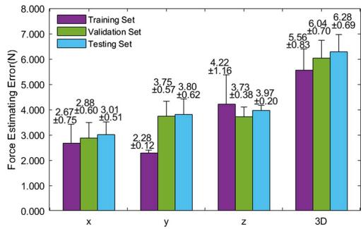  
Fig. 9. Mean RMSE of 3-D end force estimation errors in the training, validation, and testing set of dynamic data in dynamic calibration process (i.e., update process)

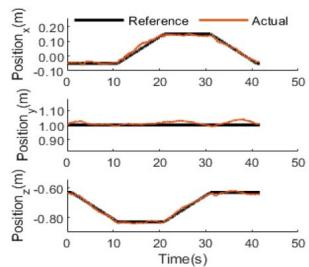

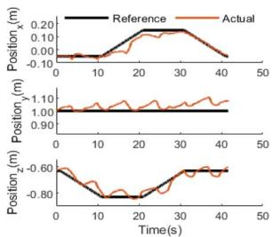

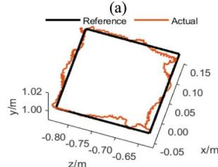  
(c)

(b)  
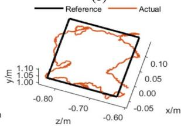  
(d)  
Fig. 10. Results of dynamic validation with static-dynamic calibration and with only static calibration in tracking the rectangular reference trajectory: actual trajectory and reference trajectory of the EE: (a) in x, y, and z axes using DLN with static-dynamic calibration; (b) in x, y, and z axes using DLN with only static calibration; (c) in 3-D view using DLN with static-dynamic calibration; and (d) in 3-D view using DLN with only static calibration.

## VI. DISCUSSION

The proposed DLN with the static-dynamic calibration method could not only eliminate the influence of the coupling effect of joint angles and human voluntary force by incorporat ing the joint angles into the input but also compensate for the impact of the uncertain dynamic of the human–robot coupling system through secondary calibration. The interaction force i equal to the human voluntary force only in static situation. How ever, in the dynamic human–robot collaboration environment, the human voluntary force is not equal to the dynamic interac tion force, but the vector sum of the robot assisting force and the measured interaction force [Fig. 8(c) and 8(d)]. During the dynamic calibration step, the vector sum of the measured dynamic interaction force and previous estimation force was used to rectify the estimation force obtained from the origina DLN model, and then the dataset was updated for secondary calibration. There were other studies attempting to solve the problems of EMG-to-force modeling, in which the impact of variable joint angle was considered. Guoxin et al. took into account the influence of upper limb posture on EMG-to-force by measuring isometric force along six directions at 72 positions in the 3-D space [37]. This method required a time-consuming process for collecting datasets $( 6 \times 7 2 = 4 3 2$ measurements). Compared with [37], our proposed method is more convenient since the DLN could be updated easily via secondary calibration using the dynamic interaction force and estimation force. Pesenti et al. estimated 1-D force using a linear parameter varying model, in which the parameter was identified under the vary ing elbow joint angle [38]. However, the linear model may not accurately estimate the 3-D voluntary force due to the complex nonlinearity in the upper limb neuromusculoskeletal system. Compared with [38], the proposed DLN is more suitable for complex nonlinear fitting, especially for 3-D upper limb motion decoding. There were also studies investigating network-based nonlinear models such as CNN [22], ANN [19], BPNN [18], RNN [22], auto-regressive network with BPNN [16], and RCNN [22], for motion intention estimation and testing their models in offline datasets. In this study, the proposed DLN with the static-dynamic calibration method was implemented in the robotic platform for real-time myoelectric control, which incorporated the uncertain dynamic of the human–robot coupling system.

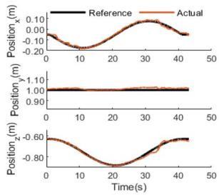  
(a)

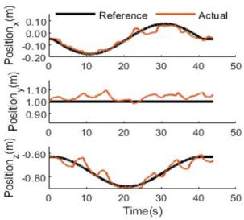  
(b)

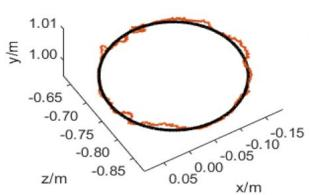  
(c)

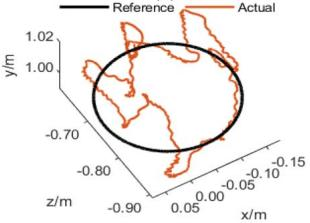  
(d)  
Fig. 11. Results of dynamic validation with static-dynamic calibration and with only static calibration in tracking the circular reference trajectory: actual trajectory and reference trajectory of the EE: (a) in x, y, and z axes using DLN with static-dynamic calibration; (b) in x, y, and z axes using DLN with only static calibration; (c) in 3-D view using DLN with staticdynamic calibration; and (d) in 3-D view using DLN with only static calibration.

  
(a)

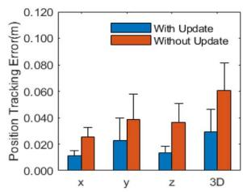  
(b)  
Fig. 12. Mean RMSE of tracking errors during dynamic validation using DLN with static-dynamic calibration and with only static calibration: (a) in rectangular reference trajectory tracking experiment; and (b) in circular ref erence trajectory tracking experiment.

TABLE III  
MEAN RMSE AND ${ \mathsf { R E } } _ { { \mathsf { R M S E } } }$ OF TRACKING ERRORS DURING DYNAMIC VALIDATION USING DLN CONTROLLER WITH STATIC-DYNAMIC CALIBRATION AND WITH ONLY STATIC CALIBRATION

<table><tr><td rowspan="2">Indicator</td><td colspan="2">Controller (Mean ± STD)</td><td rowspan="2">p Value</td></tr><tr><td>Static-Dynamic Calibration</td><td>Only Static Calibration</td></tr><tr><td>Rectangle, RMSE_x</td><td>12.8 ± 3.9 mm</td><td>28.1 ± 13.7 mm</td><td>&lt;0.001</td></tr><tr><td>Rectangle, RMSE_y</td><td>19.2 ± 8.9 mm</td><td>36.4 ± 15.6 mm</td><td>&lt;0.001</td></tr><tr><td>Rectangle, RMSE_z</td><td>15.0 ± 8.3 mm</td><td>36.0 ± 13.7 mm</td><td>&lt;0.001</td></tr><tr><td>Rectangle, RMSE_3-D</td><td>28.7 ± 10.1 mm</td><td>59.8 ± 21.1 mm</td><td>&lt;0.001</td></tr><tr><td>Circle, RMSE_x</td><td>11.4 ± 3.7 mm</td><td>25.4 ± 7.1 mm</td><td>&lt;0.001</td></tr><tr><td>Circle, RMSE_y</td><td>22.8 ± 16.9 mm</td><td>38.8 ± 18.8 mm</td><td>0.004</td></tr><tr><td>Circle, RMSE_z</td><td>13.2 ± 5.4 mm</td><td>36.6 ± 14.0 mm</td><td>&lt;0.001</td></tr><tr><td>Circle, RMSE_3-D</td><td>29.4 ± 16.8 mm</td><td>60.4 ± 21.0 mm</td><td>&lt;0.001</td></tr><tr><td>Rectangle, RE $_{RMSE\_x}$ </td><td>5.12 ± 1.56%</td><td>11.24 ± 5.48%</td><td>/</td></tr><tr><td>Rectangle, RE $_{RMSE\_y}$ </td><td>7.68 ± 3.56%</td><td>14.56 ± 6.24%</td><td>/</td></tr><tr><td>Rectangle, RE $_{RMSE\_z}$ </td><td>6.00 ± 3.32%</td><td>14.40 ± 5.48%</td><td>/</td></tr><tr><td>Circle, RE $_{RMSE\_x}$ </td><td>3.80 ± 1.23%</td><td>8.47 ± 2.37%</td><td>/</td></tr><tr><td>Circle, RE $_{RMSE\_y}$ </td><td>7.60 ± 5.63%</td><td>12.93 ± 6.27%</td><td>/</td></tr><tr><td>Circle, RE $_{RMSE\_z}$ </td><td>4.40 ± 1.80%</td><td>12.20 ± 4.67%</td><td>/</td></tr></table>

Although the DLN with only static calibration could be used to build the EMG-to-3-D-force model and applied to the UL-CDR as reported in [25], the accuracy of motion intention estimation was not high due to the difference between the dynamic application environment and the static measurement data in the training set. The large mean RMSE of tracking errors indicates the deteriorated performance of human–robot coordination. Our results suggest that the model trained using static measurement data may not perform well in the online dynamic environment when applied to the human–robot coupling system. One reason is that there is a coupling effect of joint angles and human voluntary force, in which the variation of the joint angle [Fig. 8(a) and 8(b)] influences the EMG-to-force estimation as reported in [39]. Another reason is that the model trained using only static measurement data ignores the uncertain dynamic of the human–robot coupling system. In comparison, the DLN with the static-dynamic calibration method can not only decouple the joint angles and human 3-D force but also compensate for the impact of the uncertain dynamic of the human–robot coupling system by updating the network according to dynamic data. These advantages of the proposed method contribute to the less jerky actual tracking trajectories and low RMSE of tracking errors as shown in Fig. 12. Although the position tracking error depends on both the individual dexterity and the accuracy of 3-D force estimation, we instructed all the participants to follow the reference trajectory to the best of their ability and each participant conducted an equal number of tracking experiments on both the proposed method and the baseline one. We did not inform the participants which method to use in each trial. These conditions may eliminate the influence of the dexterity of the person on the comparative experiment. One limitation of this study was that the tracking performance of Fig. 10(a) and 10(c) and Fig. 11(a) and 11(c) was not perfect, potentially due to limited data for network training, a common challenge in robotic applications. The static-dynamic calibration method could be integrated with more advanced network models in future work.

TABLE IV  
COMPARISON OF DLN (STATIC), DLN (DYNAMIC), RESIDUAL-DLN, RESIDUAL-BI-LSTM, RESIDUAL-GRU, RESIDUAL-BI-GRU, DLN-NO-DROPOUT, MUSCLENET-CNN, AND MUSCLENET-RCNN IN 3-D FORCE ESTIMATION ERRORS, WEIGHT NUMBER, AND COMPUTATION TIME

<table><tr><td rowspan="2">Network</td><td colspan="4">RMSE of Estimation Error (Mean ± STD)</td><td rowspan="2">Weight Number</td><td rowspan="2">Comput. Time Per Step (ms)</td></tr><tr><td>x (N)</td><td>y (N)</td><td>z (N)</td><td>3-D(N)</td></tr><tr><td>DLN (Static)</td><td>6.012 ± 0.780</td><td>2.760 ± 0.534</td><td>6.716 ± 0.331</td><td>9.457 ± 0.608</td><td>809 k</td><td>3.109</td></tr><tr><td>DLN (Dynamic)</td><td>3.009 ± 0.512</td><td>3.803 ± 0.621</td><td>3.970 ± 0.205</td><td>6.278 ± 0.693</td><td>809 k</td><td>3.115</td></tr><tr><td>Residual-DLN</td><td>7.160 ± 1.399</td><td>3.753 ± 0.461</td><td>7.360 ± 0.937</td><td>10.980 ± 1.370</td><td>809 k</td><td>3.143</td></tr><tr><td>Residual-Bi-LSTM</td><td>9.518 ± 1.166</td><td>3.355 ± 0.324</td><td>8.704 ± 0.970</td><td>13.355 ± 1.599</td><td>818 k</td><td>4.851</td></tr><tr><td>Residual-GRU</td><td>7.501 ± 3.682</td><td>3.162 ± 0.543</td><td>7.009 ± 2.296</td><td>10.839 ± 4.166</td><td>809 k</td><td>7.483</td></tr><tr><td>Residual-Bi-GRU</td><td>6.845 ± 0.685</td><td>2.760 ± 0.316</td><td>6.004 ± 0.419</td><td>9.551 ± 0.619</td><td>810 k</td><td>9.395</td></tr><tr><td>DLN-no-Dropout</td><td>7.565 ± 1.030</td><td>3.489 ± 0.273</td><td>6.032 ± 1.204</td><td>10.338 ± 1.281</td><td>809 k</td><td>3.112</td></tr><tr><td>MuscleNET-CNN*</td><td>9.902 ± 1.194</td><td>4.236 ± 0.496</td><td>12.078 ± 0.496</td><td>16.216 ± 2.047</td><td>70 k</td><td>3.926</td></tr><tr><td>MuscleNET-RCNN*</td><td>9.476 ± 0.987</td><td>4.137 ± 0.576</td><td>10.080 ± 1.586</td><td>14.463 ± 1.756</td><td>86 k</td><td>4.404</td></tr></table>

\*Note: MuscleNET-CNN and MuscleNET-RCNN from the literature [22] were designed for 1-D continuous motion prediction, we changed their last layers $( 1 \times 1$ regression output size) into $3 \times 1$ regression output size to match our 3-D end force data.

COMPARISON OF DLN CONTROLLER WITH STATIC-DYNAMIC CALIBRATION AND SSM CONTROLLER IN 3D TRACKING ERRORS AND TOTAL PROCESSING TIME PER STEP  
TABLE V

<table><tr><td rowspan="2">Indicator</td><td colspan="2">Controller</td></tr><tr><td>DLN with Static-Dynamic Calibration</td><td>SSM</td></tr><tr><td>Rectangle,  $RE_{RMSE\_x}$ </td><td>5.12±1.56 %</td><td>27.37±10.57</td></tr><tr><td>Rectangle,  $RE_{RMSE\_y}$ </td><td>7.68±3.56 %</td><td>22.26±43.74</td></tr><tr><td>Rectangle,  $RE_{RMSE\_z}$ </td><td>6.00±3.32 %</td><td>48.52±62.15</td></tr><tr><td>Circle,  $RE_{RMSE\_x}$ </td><td>3.80±1.23 %</td><td>22.88±5.89</td></tr><tr><td>Circle,  $RE_{RMSE\_y}$ </td><td>7.60±5.63 %</td><td>8.12±2.15</td></tr><tr><td>Circle,  $RE_{RMSE\_z}$ </td><td>4.40±1.80%</td><td>24.36±6.15</td></tr><tr><td>Total Processing Time Per Step (Include Hardware I/O and Software Processing Time)</td><td>3.1230 ms</td><td>0.0116 ms</td></tr></table>

Selecting a model to embed in hardware for real-time myoelectric human–robot interaction needs to weigh the accuracy and computational cost. We have also compared the proposed DLN with other representative networks listed in Table IV, in which the networks have similar total numbers of weights or similar computation times. To illustrate the importance of a three-layer LSTM architecture over one or two layers, we introduced a residual-DLN network. This network employs identity mapping between each layer pair to counter the issue of network degeneration with layer depth increase. It allows low-level features to bypass intermediate LSTM layers and travel directly to higher layers. However, our experimental findings reveal that the residual-DLN did not mitigate the error of our proposed DLN, thus affirming the effectiveness of employing at least a threelayer LSTM network. Besides, we found that the 3-D estimation errors of the residual-DLN, three-layer residual-bi-LSTM, threelayer residual-GRU, three-layer residual-bi-GRU, DLN-no-dropout, MuscleNET-CNN [22], and MuscleNET-RCNN [22] networks were all higher than those of our proposed DLN (static) and DLN (dynamic). Bidirectional models such as residual-Bi-LSTM have shown limited effectiveness in reducing errors in force estimation, which might be attributed to the inherent characteristic of the neuromusculoskeletal system. The current voluntary force could be impacted by the past state of the limb but had a limited relationship with future input due to the ability of the human central nervous system to arbitrarily switch commands, which limited the advantages of bidirectional models in capturing future contextual relationships of input elements. In our previous study, a linear SSM-based myoelectric controller was also embedded in an upper-limb rehabilitation robot [17]. Although the previous controller yielded faster computation performance and could be used in simple tasks such as reaching, its accuracy was worse than the proposed controller when applied to more complex tasks (rectangle and circle trajectory tracking in this study, Table V). The selection of DLN in this study achieves a harmonious equilibrium between accuracy and computationa efficiency, ensuring our model’s viability for 100-Hz human–robot interaction applications.

## VII. CONCLUSION

In this article, a DLN with a static-dynamic calibration method was proposed to establish the nonlinear EMG-to-3-Dforce model for the control system of an UL-CDR. The proposed method could adapt to the changes from the static measurement data to the dynamic environment and thus achieve better estimation accuracy in human–robot collaboration appli cations compared with that with only static calibration.

The DLN network with static-dynamic calibration method enables the robots to accurately decode the human motion inten tion online through their EMG signals, with the potential to facilitate human–robot collaboration in various aspects, includ ing: 1) enhancing manufacturing efficiency in tasks such as weight-moving, surface-polishing, and material-sawing; 2) assisting individuals with motor dysfunction and promoting their lives and capabilities; and 3) achieving active rehabilitation training and encouraging voluntary participation of poststroke patients. The DLN network with a secondary calibration method might also be used to further solve the problem of cross-subject application. It might be interesting if the DLN network trained using data from healthy subjects could be slightly calibrated again and then applied to patients after stroke.

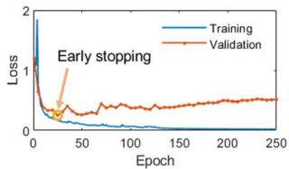  
(a)

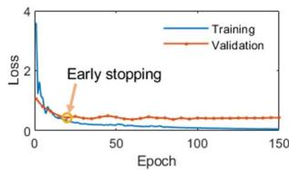  
(b)  
Fig. 13. Early stopping at specific epochs in (a) static calibration and (b) dynamic calibration.

## APPENDIX

Early stopping at specific epochs in both the static and dynamic calibration were shown in Fig. 13.

## REFERENCES

[1] L. Bi, A. G. Feleke, and C. Guan, “A review on EMG-based motor intention prediction of continuous human upper limb motion for human–robot collaboration,” Biomed. Signal Process. Control, vol. 51, pp. 113–127, May 2019.

[2] T. Zhang, H. Sun, and Y. Zou, “An electromyography signals-based human–robot collaboration system for human motion intention recognition and realization,” Robot. Comput. Integr. Manuf., vol. 77, Oct. 2022, Art. no. 102359.

[3] A. Furui et al., “A myoelectric prosthetic hand with muscle synergy based motion determination and impedance model-based biomimetic control,” Sci. Robot., vol. 4, no. 31, Jun. 2019, Art. no. eaaw6339.

[4] J. Furukawa and J. Morimoto, “Composing an assistive control strategy based on linear bellman combination from estimated user’s motor goal,” IEEE Robot. Automat. Lett., vol. 6, no. 2, pp. 1051–1058, Apr. 2021.

[5] Q. Ai, Z. Liu, W. Meng, Q. Liu, and S. Q. Xie, “Machine learning in robot assisted upper limb rehabilitation: A focused review,” IEEE Trans. Cogn. Develop. Syst., vol. 15, no. 4, pp. 2053–2063, Dec. 2023.

[6] B. Rodriguez-Tapia, I. Soto, D. M. Marinez, and N. Candolfi Arballo, “Myoelectric interfaces and related applications: Current state of EMG signal processing—A systematic review,” IEEE Access, vol. 8, pp. 7792–805, 2020.

[7] G. Kai, U. X. Tan, L. Honghai, and Z. Dingguo, “Electromyography driven progressive assist-as-needed control for lower limb exoskeleton,” IEEE Trans. Robot. Bionics, vol. 2, no. 1, pp. 50–58, Feb. 2020.

[8] J. Wang, J. Liu, G. Zhang, and S. Guo, “Periodic event-triggered sliding mode control for lower limb exoskeleton based on human–robo cooperation,” ISA Trans., vol. 123, pp. 87–97, Apr. 2022.

[9] A. Alkan and M. Gunay, “Identification of EMG signals using discriminant analysis and SVM classifier,” Expert Syst. Appl., vol. 39, no. 1, pp. 44–47, Jan. 2012.

[10] S. Pancholi and A. M. Joshi, “Advanced energy kernel-based feature extraction scheme for improved EMG-PR-based prosthesis control against force variation,” IEEE Trans. Cybern., vol. 52, no. 5, pp. 3819–3828, May 2022.

[11] N. Nahid, A. Rahman, and M. A. R. Ahad, “Deep learning based surface EMG hand gesture classification for low-cost myoelectric prosthetic hand,” in Proc. Joint 9th Int. Conf. Inform., Electron. Vis. (ICIEV); 4th Int. Conf. Image, Vis. Pattern Recognit. (ICIVPR), 2020, pp. 1–8.

[12] G. Durandau et al., “Voluntary control of wearable robotic exoskeletons by patients with paresis via neuromechanical modeling,” J. NeuroEng. Rehabil., vol. 16, no. 1, pp. 1–18, Jul. 2019.

[13] Y. Zhuang, Y. Leng, J. Zhou, R. Song, L. Li, and S. Su, “Voluntary control of an ankle joint exoskeleton by able-bodied individuals and stroke survivors using EMG-based admittance control scheme,” IEEE Trans. Biomed. Eng., vol. 68, no. 2, pp. 695–705, Feb. 2021.

[14] P. K. Artemiadis and K. J. Kyriakopoulos, “EMG-based control of a robot arm using low-dimensional embeddings,” IEEE Trans. Robot., vol. 26, no. 2, pp. 393–398, Apr. 2010.

[15] J. Han, Q. Ding, A. Xiong, and X. Zhao, “A state-space EMG model for the estimation of continuous joint movements,” IEEE Trans. Ind. Electron., vol. 62, no. 7, pp. 4267–4275, Jul. 2015.

[16] Q. Ding, J. Han, and X. Zhao, “Continuous estimation of human multijoint angles from sEMG using a state-space model,” IEEE Trans. Neural Syst. Rehabil. Eng., vol. 25, no. 9, pp. 1518–1528, Sep. 2017.

[17] C. Xie, Q. Yang, Y. Huang, S. Su, T. Xu, and R. Song, “A hybrid armhand rehabilitation robot with EMG-based admittance controller,” IEEE Trans. Biomed. Circuits Syst., vol. 15, no. 6, pp. 1332–1342, Dec. 2021.

[18] Y. M. Aung and A. Al-Jumaily, “Estimation of upper limb joint angl using surface EMG signal,” Int. J. Adv. Robot. Syst., vol. 10, pp. 1–8, Oct. 2013.

[19] Q. Zhang, R. F. Liu, W. B. Chen, and C. H. Xiong, “Simultaneous and continuous estimation of shoulder and elbow kinematics from surface EMG signals,” Frontiers Neurosci., vol. 11, pp. 1–12, May 2017.

[20] S. Pancholi, A. Giri, A. Jain, L. Kumar, and S. Roy, “Source aware deep learning framework for hand kinematic reconstruction using EEG signal,” IEEE Trans. Cybern., vol. 53, no. 7, pp. 4094–4106, Jul. 2023.

[21] M. A. Ozdemir, D. H. Kisa, O. Guren, and A. Akan, “Hand gesture classification using time-frequency images and transfer learning based on CNN,” Biomed. Signal Process. Control, vol. 77, 2022, Art. no. 103787.

[22] A. Nasr et al., “MuscleNET: Mapping electromyography to kinematic and dynamic biomechanical variables by machine learning,” J. Neural Eng., vol. 18, no. 4, pp. 1–21, Aug. 2021

[23] T. T. Dao, “From deep learning to transfer learning for the prediction of skeletal muscle forces,” Med. Biol. Eng. Comput., vol. 57, no. 5, pp. 1049–1058, May 2019.

[24] Y. Chen et al., “A continuous estimation model of upper limb joint angles by using surface electromyography and deep learning method,” IEEE Access, vol. 7, pp. 174940–174950, 2019.

[25] C. Xie, T. Xu, and R. Song, “A deep LSTM based sEMG-to-force model for a cable-driven rehabilitation robot,” in Proc. 7th IEEE Int. Conf. Adv. Robot. Mechatron. (ICARM), Guilin, China, 2022, pp. 660–665.

[26] J. Hashemi, E. Morin, P. Mousavi, and K. Hashtrudi-Zaad, “Surface EMG force modeling with joint angle based calibration,” J. Electromyogr. Kinesiol., vol. 23, no. 2, pp. 416–424, Apr. 2013.

[27] Y. Zhuang, S. Yao, C. Ma, and R. Song, “Admittance control based on EMG-driven musculoskeletal model improves the human–robot synchronization,” IEEE Trans. Ind. Inform., vol. 15, no. 2, pp. 1211–1218, Feb. 2019.

[28] L. L. Menegaldo, L. F. de Oliveira, and K. K. Minato, “EMGD-FE: An open source graphical user interface for estimating isometric muscle forces in the lower limb using an EMG-driven model,” Biomed. Eng., vol. 13, Apr. 2014, Art. no. 37.

[29] H. J. Hermens, B. Freriks, C. Disselhorst-Klug, and G. Rau, “Development of recommendations for SEMG sensors and sensor placement procedures,” J. Electromyogr. Kinesiol., vol. 10, no. 5, pp. 361–374, Oct. 2000.

[30] M. Hakonen, H. Piitulainen, and A. Visala, “Current state of digital signal processing in myoelectric interfaces and related applications,” Biomed. Signal Process. Control, vol. 18, pp. 334–359, Apr. 2015.

[31] T. S. Buchanan, D. G. Lloyd, K. Manal, and T. F. Besier, “Neuromusculoskeletal modeling: Estimation of muscle forces and joint moments and movements from measurements of neural command,” J. Appl. Biomech., vol. 20, no. 4, pp. 367–395, Nov. 2004.

[32] F. E. Zajac, “Muscle and tendon: Properties, models, scaling, and application to biomechanics and motor control,” Crit. Rev. Biomed. Eng., vol. 17, no. 4, pp. 359–411, 1989.

[33] Y. Huang, R. Song, A. Argha, A. V. Savkin, B. G. Celler, and S. W. Su, “Continuous description of human 3D motion intent through switching mechanism,” IEEE Trans. Neural Syst. Rehabil. Eng., vol. 28, no. 1, pp. 277–286, Jan. 2020.

[34] K. Manal and T. S. Buchanan, “A one-parameter neural activation to muscle activation model: Estimating isometric joint moments from electromyograms,” J. Biomech., vol. 36, no. 8, pp. 1197–1202, Aug. 2003.

[35] O. Bo and S. Weiwei, “Rapid optimization of tension distribution for cable-driven parallel manipulators with redundant cables,” Chin. J. Mech. Eng., vol. 29, no. 2, pp. 231–238, Mar. 2016.

[36] D. P. Kingma and J. Ba, “Adam: A method for stochastic optimization,” in Proc. 3rd Int. Conf. Learn. Representations, San Diego, USA, 2015, pp. 1–15.

[37] L. Guoxin, L. Zhijun, L. Junjun, L. Yueyue, and Q. Hong, “Musclesynergy-based planning and neural-adaptive control for a prosthetic arm,” IEEE Trans. Artif. Intell., vol. 2, no. 5, pp. 424–436, Jun. 2021.

[38] M. Pesenti, Z. Alkhoury, M. Bednarczyk, H. Omran, and B. Bayle, “Linear parameter-varying identification of the EMG-force relationship of the human arm,” in Proc. 28th IEEE Int. Conf. Robot Hum. Interactive Commun. (RO-MAN), New Delhi, India, 2019, pp. 1–6.

[39] E. P. Doheny, M. M. Lowery, D. P. FitzPatrick, and M. J. O’Malley, “Effect of elbow joint angle on force-EMG relationships in human elbow flexor and extensor muscles,” J. Electromyogr. Kinesiol., vol. 18, no. 5, pp. 760–770, Oct. 2008.

Chenglin Xie (Student Member, IEEE) was born in Shantou, China, in 1996. He received the B.S. degree in biomedical engineering in 2019 from Sun Yat-sen University, Guangdong, China, where he is currently working toward the Ph.D. degree in biomedical engineering.

His research interests include rehabilitation robots, myoelectric control, human–robot inter action, neural network application, and biomedi cal signal processing.

Dr. Xie received the Outstanding Performance Award in IEEE-EMB Hong Kong—Macau Joint Chapter Studen Project Competition 2021, and the Best Paper Finalist Award in IEEE ARM 2020.

Zhijun Li (Fellow, IEEE) received the Ph.D. degree in mechatronics from Shanghai Jiao Tong University, Shanghai, China, in 2002.

From 2003 to 2006, he was a Postdoctoral Fellow at the University of Electro-Communications, Tokyo, Japan, and the National University of Singapore, Singapore. Currently, he is a Chair Professor in Tongji University, Shanghai, P. R. China, where he has been the Dean of the School of Mechanical Engineering, from 2024.

Dr. Li has published over 400 papers, where the prestigious contribu tions were wearable robotics and bio-mechatronics systems. He has received the Distinguished Lecturer (RAS), the Web of Science Highly Cited Researcher (2019–2023), the 2018 National Ten-thousand Talents Program in China, the 2016 National Distinguished Young Scholar (NSFC). He is a Fellow of IEEE and AAIA. His current research interests include wearable robotics, bio-mechatronics systems, intelligent control.

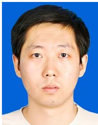

Rong Song (Senior Member, IEEE) was born in Hubei, China, in 1975. He received the B.S. degree in electrical engineering from Tsinghua University, Beijing, China, in 1999, the M.S. degree in electronic engineering from Shantou University, Shantou, China, in 2002, and the Ph.D. degree in biomedical engineering from The Hong Kong Polytechnic University, Hong Kong, China, in 2006.

He is currently a Professor with the School of Biomedical engineering, Sun Yat-sen University,

Guangdong, China. His research interests include musculoskeleta modeling, biomedical signal processing, and rehabilitation robots.

Dr. Song was the Special Session Chairs of the IEEE Conference on Advanced Robotics and Mechatronics (IEEE-ARM). He has been serv ing as a reviewer of several IEEE Transactions