# A Hybrid Arm-Hand Rehabilitation Robot With EMG-Based Admittance Controller

Chenglin Xie , Qianqian Yang , Member, IEEE, Yao Huang, Graduate Student Member, IEEE, Steven W. Su , Senior Member, IEEE, Ting Xu, and Rong Song , Senior Member, IEEE

Abstract—Reach-and-grasp is one of the most fundamental activities in daily life, while few rehabilitation robots provide integrated and active training of the arm and hand for patients after stroke to improve their mobility. In this study, a novel hybrid arm-hand rehabilitation robot (HAHRR) was built for the reachand-grasp task. This hybrid structure consisted of a cable-driven module for three-dimensional arm motion and an exoskeleton for hand motion, which enabled assistance of the arm and hand simultaneously. To implement active compliance control, an EMG-based admittance controller was applied to the HAHRR. Experimental results showed that the HAHRR with the EMG-based admittance controller could not only assist the subject in fulfilling the reachand-grasp task, but also generate smoother trajectories compared with the force-sensing-based admittance controller. These findings also suggested that the proposed approach might be applicable to post-stroke arm-hand rehabilitation training.

Index Terms—Rehabilitation robot, reach-and-grasp, hybrid structure, cable-driven parallel mechanism, hand exoskeleton, EMG, admittance control.

## I. INTRODUCTION

A PPROXIMATELY two-thirds of patients after stroke suf-fer from disability and need intensive rehabilitation treatment [1], [2]. As over 15 million stroke cases increase each year, traditional rehabilitation training is not readily available due to the insufficient number of physical therapists and huge working load [3], [4]. In recent years, rehabilitation robots have become a useful complement to traditional rehabilitation treatment [5], [6]. Robot-assisted motion training can provide sustainable and intensive rehabilitation treatment for patients and help them regain motor function [7].

The mechanical structure of the rehabilitation robot is usually designed for a particular training task. Existing upper-limb rehabilitation robots are various and can be roughly classified as exoskeletons and end-effector robots. The exoskeletons, including the CADEN-7 [8], RUPERT IV [9], BRAVO [2], and Hand of Hope [10], resemble the anatomical structure of human limbs and are suitable for assisting fine motor functions such as hand grasping. The joints of these exoskeletons can be controlled separately, thus reducing the complexity of issuing controls [11]. End-effector robots, including the MIT-MANUS [12], NeReBot [13], GENTLE/s [14], Sophia-3 [15], MIME [16], CASIA-ARM [17], and EULRR [18], work with a specific part of human limb being fixed to their end-effectors and are frequently used to assist gross motions [19]. Specifically, this type of robot has shown potential in improving the reaching motion of the proximal upper-limb [19], [20]. In recent years, the cable-driven parallel mechanism has aroused wide interest as a soft driving mode [21], such as the 3-cable-driven approach in NeReBot [13], [22] and Sophia-3 [15]. In cable-driven robots, the motors are away from the end-effector, which gives the robots advantages, such as good compliance, low inertia, light weight, and large workspace [23].

The control strategy plays a key role in the effect of the rehabilitation robot. The proportion integration differentiation (PID) controller has been commonly used to track a reference trajectory [24], [25]. The impedance controller was proposed by Hogan to enable the interaction force between the robot and the environment to modulate the reference trajectory, thereby achieving a certain degree of compliance control [26]. An admittance controller was then employed by Saglia et al. to generate the desired trajectory based on interaction force without restriction on a reference trajectory [27], which realized active compliance control and encouraged voluntary participation [28]. However, there is a delay between the human active force and the robot response when using force sensors to perceive human motion intention [29], [30]. In order to overcome this drawback, Zhuang et al. used a Hill-type musculoskeletal model and developed an EMG-based admittance controller for a one-dimensional ankle rehabilitation robot, which got better human-robot synchronization and trajectory smoothness than the torque/force-sensing-based controller [30]. Durandau et al. developed an EMG-driven lower limb exoskeleton based on Hill-type musculoskeletal model [31]. The electromechanical delay between the EMG signal and the human active force makes it possible to compensate for the time delay between human active force and robot response [32]. There are also studies constructing a state-space model based on EMG signal for multipledimensional control of robot arm [33], [34]. The Hill-type musculoskeletal model is often used in one-dimensional motion estimation but can hardly be applied to multiple-dimensional situation due to quantities of the unknown parameters [34], [35]; the state-space model, as a multiple-input multiple-output (MIMO) system, is applicable to multiple-dimensional motion estimation [33].

Reach-and-grasp is a fundamental activity of our daily living, which needs the cooperation between arm and hand. Research suggested that the integrated training of hand and arm has a superior effect for patients after stroke to the separate training [36], while there are few hybrid arm-hand rehabilitation robots (HAHRRs) for reach-and-grasp training. An EMG-based state space model was developed by Artemiadis et al. to estimate the three-dimensional motion ofthe upper-limb [33]; nevertheless, it was only used in teleoperation of the anthropomorphic robot arm and not applied to rehabilitation robots. In this study, we built a HAHRR that consisted of a cable-driven module for threedimensional arm motion and an exoskeleton for hand motion. In order to achieve active compliance control, human-robot synchronization, smooth trajectory, and three-dimensional motion estimation, an admittance controller based on EMG signal and state space model was adopted.

The main contributions of this study were listed as follows: 1) a novel hybrid arm-hand rehabilitation robot (HAHRR) was built to enable the continuous active integrated training of arm and hand in the reach-and-grasp task. 2) The EMG-based admittance controller was used to realize active control with continuous multiple-dimensional arm-hand voluntary participation.

## II. METHODS

## A. Mechanical Structure ofHAHRR

The HAHRR was composed ofa self-designed hand exoskeleton and a cable-driven module (Fig. 1). The hand exoskeleton was fixed on the end-effector (Point O) of the cable-driven module, which was driven by four cables (OA, OB, and OC denoted the three upper cables, and OD denoted the lower cable). Each cable was driven by one motor (DM1B-045G, Yokogawa, Japan), and the tension of each cable was measured by one force sensor (HSTL-BLSM, Beijing Huakong Xingye Technology Development Co., Ltd, China). The position of the end-effector was obtained by the motion capture system (OptiTrack 2, NaturalPoint, USA). The hand exoskeleton was designed in Solid-Works 2019 and then fabricated using Stereolithography (SLA) technology. The hand exoskeleton contained a hand-forearm cradle and a five-finger mechanism, in which the thumb part and the four-finger part were independently actuated by two linear actuators (L12-30-100-12-I, Actuonix-Miniature Linear Motion Series, Canada). The stroke of the linear actuator varied with the position of the threaded rod ends, and the stroke length was 0.03 m. The five-finger mechanism was adjustable in length to adapt to hands of different sizes, which relied on the rotation of the helix structure in each link [37]. The force sensors (S15-45N, Single Tact, USA) in the hand exoskeleton were located between the subject index fingertip and the finger exoskeleton. All data were collected in real time based on an I/O device (PXI-6225, National Instruments, USA) with 16 bits of analog to digital conversion (ADC).

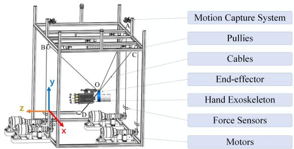  
(a)

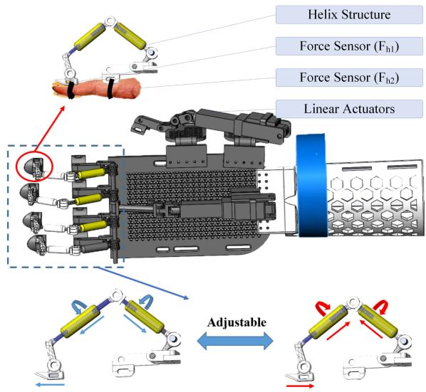  
(b)

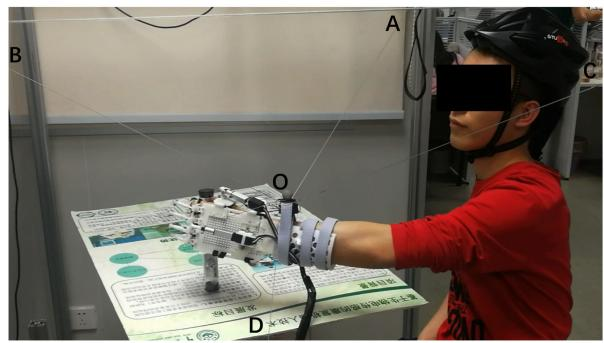  
(c)  
Fig. 1. The mechanical structure of the HAHRR: (a) The schematic of the HAHRR. (b) The schematic of the hand exoskeleton. (c) The image of a subject using the HAHRR.

## B. Control Framework ofHAHRR

The control system of the HAHRR consisted of a hand motion assistance system and an arm motion assistance system, both of which included an EMG-based admittance controller (Fig. 2). The EMG-based admittance controller was to generate the desired trajectories $( P _ { a d }$ for the arm and $P _ { h d }$ for the hand), which would be tracked by the corresponding HAHRR parts (the end-effector for the cable-driven module and the rod ends for the hand exoskeleton). The trajectory generation method of the EMG-based admittance controller was as follows: an EMG-to-MuscleActivation model was used first to estimate the three-dimensional force of the arm and onedimensional force of the hand, an admittance controller was then introduced to generate the desired positions of the endeffector and the rod ends according to the estimated forces. The trajectory-tracking control in the hand motion assistance system was achieved by a PID controller and in the arm motion assistance system by a PID controller and a cable tension controller.

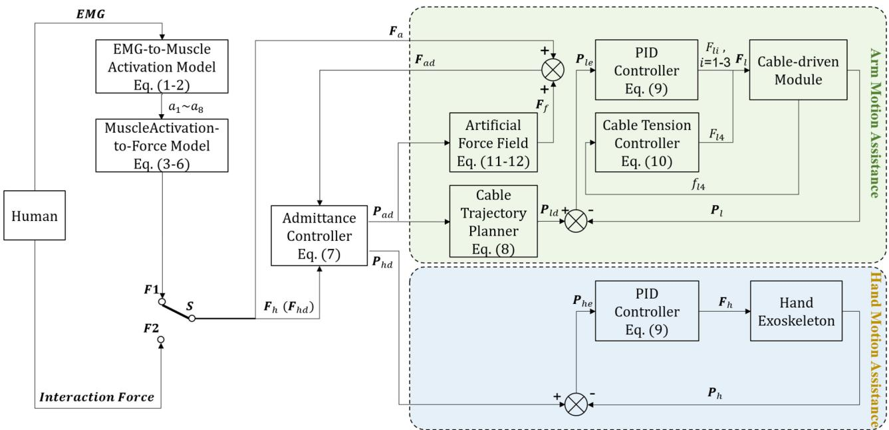  
Fig. 2. The control framework of the HAHRR. When S switched to F1, the control framework was EMG-based admittance control (the proposed one): The EMG signals of eight muscles were measured from the human body surface in real time to calculate eight muscle activations $( a _ { 1 } \sim a _ { 8 } )$ . The three-dimension force of the arm $( F _ { a } )$ and the one-dimension force of the hand $( \pmb { F } _ { h } )$ were then estimated. Next the estimated forces $( F _ { a d } = F _ { a } + F _ { f }$ and $\boldsymbol { F } _ { h d } = \boldsymbol { F } _ { h } )$ were used to generate the desired positions $( P _ { a d }$ was the desired position of the end-effector in the cable-driven module, and $P _ { h d }$ was the desired position of the rod ends of the hand exoskeleton) via the admittance controller. In the hand motion assistance system, the PID controller was applied to output the one-dimensional force $( \boldsymbol { F } _ { h } )$ ) required by the linear actuators of the hand exoskeleton to track the desired position. In the arm motion assistance system, the cable trajectory planner was used to determine the desired lengths of the three upper cables $( P _ { l d } )$ by $P _ { a d } ;$ the PID controller was applied to output the force vector $( \boldsymbol { F } _ { l } ^ { \prime } \doteq [ \boldsymbol { F } _ { l 1 } , \dot { \boldsymbol { F } _ { l 2 } } , \boldsymbol { F } _ { l 3 } ] ^ { T } )$ required by the three upper cables to track the desired position, and the lower cable force $( F _ { l 4 } )$ was controlled by the cable tension controller according to the cable tension $( \dot { f } _ { l 4 } ) ;$ the artificial force field was introduced to restrict the end-effector to a safety range of motion. When S switched to F2, the control framework was force-sensing-based admittance control (the control group), where ${ \pmb F } _ { a }$ and ${ \pmb F } _ { h }$ were measured by force sensors.

1) EMG-to-MuscleActivation Model: In this study, the EMG signals were measured from eight muscles of the arm: Biceps brachii (BIC), Triceps (TRI), Anterior of Deltoid (DA), Medial of Deltoid (DM), Posterior of Deltoid (DP), Brachioradialis (BR), Extensor Digitorum (ED), and Flexor Digitorum (FD). The signals of the first six muscles were used to control the cable-driven module, and those of the ED and the FD were applied to the hand exoskeleton. The EMG signals were acquired by eight sets of AgCl electrodes applied on the body surface with a sampling frequency of 1000 Hz and an amplification of 5000 times. The amplifier had a band-pass filter (20-450 Hz) and a notch filter (50 Hz). The signals were then full-wave rectified and low-pass filtered by a 4th-order Butterworth filter with the cut-off frequency at 4 Hz [33], [38]. After that, they were normalized to $e _ { i } ( t )$ using maximum voluntary isometric contraction (MVC) [38], [39]. The methods ofobtaining MVC from all the described muscles were the same as those in previous studies (for ED and FD please refer to [40], and for the other six muscles please refer to [38], [39]).

In the next step, a 2nd-order discrete-time linear model was used to calculate the neural activation $n _ { i } ( t )$ of the i-th muscle at time t [41]:

$$
n _ {i} (t) = \alpha e _ {i} (t - d) - \beta_ {1} n _ {i} (t - 1) - \beta_ {2} n _ {i} (t - 2)\tag{1}
$$

where the coefficients $\alpha ~ = ~ 0 . 9 4 8 6 3$ $\beta _ { 1 } = \ - 0 . 0 5 2 0 0$ $\beta _ { 2 } =$ 0.00063, and the electromechanical delay $d { = } 1 0 0$ ms were determined empirically [38].

According to the previous study, the relationship between the muscle activation $a _ { i } ( t )$ ofthe i-th muscle and its neural activation $n _ { i } ( t )$ could be approximated as follows [42]:

$$
a _ {i} \left(t\right) = \left\{ \begin{array}{l l} \gamma \ln \left(\delta n _ {i} \left(t\right) + 1\right), & 0 \leq n _ {i} \left(t\right) <   n _ {0} \\ m n _ {i} \left(t\right) + c, & n _ {0} \leq n _ {i} \left(t\right) \leq 1 \end{array} \right.\tag{2}
$$

where the coefficients $\gamma = 0 . 2 8 8 1 9 , \delta = 1 0 . 4 7 6 0 0 , m = 0 . 8 3 9 1 0 .$ $c = 0 . 1 6 0 9 0 .$ , and $n _ { 0 } = 0 . 2 4 8 0 0$ were determined using a oneparameter model based on Newton-Raphson method.

## 2) MuscleActivation-to-Force Model: a)MuscleActivation-to-ArmForce Model

The estimation of the three-dimensional force of the arm from the activations of the six muscles was implemented by a state

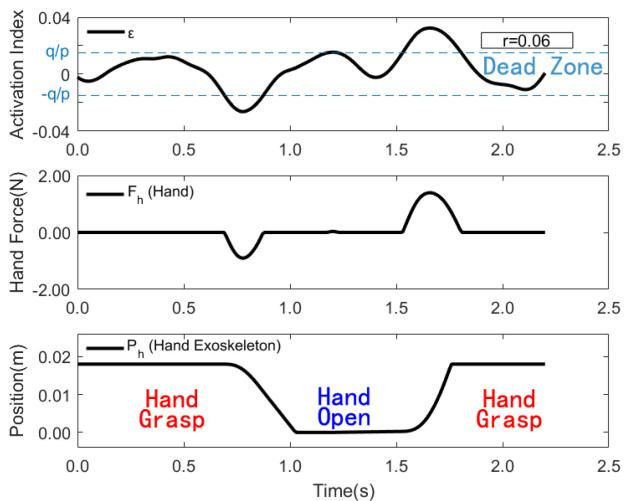  
(a)

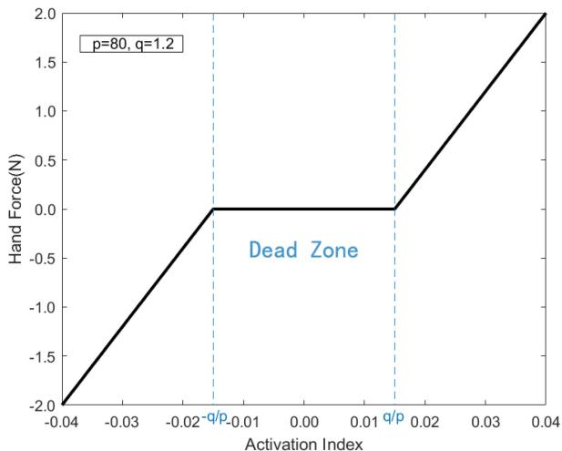  
(b)  
Fig. 3. MuscleActivation-to-HandForce model. (a) Top to bottom: the activation index ε calculated with $r = 0 . 0 6 ,$ , the hand force ${ \bf { \mathcal { F } } } _ { h }$ calculated with $p = 8 0$ and $q = 1 . 2 ,$ , and the desired position of the rod ends of the hand exoskeleton $P _ { h } . \left( \mathrm { 6 } \right)$ The relationship between the hand force ${ \bf { \mathcal { F } } } _ { h }$ and the activation index ε with $p = 8 0$ and $q = 1 . 2$

space model [34]:

$$
\pmb {u} _ {a} (t) = [ a _ {1} (t), a _ {2} (t), \ldots , a _ {6} (t) ] ^ {\mathrm{T}}\tag{3}
$$

$$
\left\{ \begin{array}{l} \boldsymbol {x} [ k + 1 ] = \boldsymbol {A x} [ k ] + \boldsymbol {B u} [ k ] \\ \boldsymbol {y} [ k ] = \boldsymbol {C x} [ k ] + \boldsymbol {D u} [ k ] \end{array} \right.\tag{4}
$$

where ${ \pmb x } [ k ] \in { \bf R } ^ { N } \ ( N$ is the order of the model) is the state vector; ${ \pmb u } [ k ] ~ ( = { \pmb u } _ { a } ( k T ) , k = 1 , 2 \dots$ , and T is the sampling period) is the input vector, that is, the activations of the six muscles; ${ \pmb y } [ k ] ~ ( = { \pmb F } _ { a d } ( k T ) )$ is the output vector, that is, the three-dimensional arm force; ${ \pmb A } \in { \bf R } ^ { N \times N }$ is the systematic matrix; $B \in \mathbf { R } ^ { N \times 6 }$ is the input matrix; $\boldsymbol { C } \in \mathbf { R } ^ { 3 \times N }$ is the output matrix; and $\pmb { D } \in \mathbf { R } ^ { 3 \times 6 }$ is the direct transfer matrix, which is set to be zero in this study.

The initial state vector x[0] and A, B, and C could be identified experimentally by the numerical subspace state-space system identification (N4SID) method [43].

With the state space model described above, the force of the arm could be estimated in a continuous way, which would enable the HAHRR to better match the human motion intention and provide more effective assistance [35].

b)MuscleActivation-to-HandForce Model

The one-dimension force of the hand was estimated from the activations of the ED and the FD as follows:

$$
\varepsilon (t) = a _ {8} (t) - a _ {7} (t) + r\tag{5}
$$

$$
F _ {h} \left(t\right) = \left\{ \begin{array}{l} p \varepsilon \left(t\right) + q, \varepsilon \left(t\right) <   - q / p \\ 0, - q / p \leq \varepsilon \left(t\right) \leq q / p \\ p \varepsilon \left(t\right) - q, \varepsilon \left(t\right) > q / p \end{array} \right.\tag{6}
$$

where $\varepsilon ( t )$ is the activation index; $r , p ,$ and q are the model parameters, which should be pre-determined empirically; when $\varepsilon ( t ) > q / p , F _ { h } ( t )$ is positive, and the hand force is dominated by grasp force; when $\varepsilon ( t ) < - q / p , F _ { h } ( t )$ is negative, and the hand force is dominated by extension force; and when $- q / p \leq \varepsilon ( t ) \leq$ $q / p , F _ { h } ( t )$ is zero, and the hand neither grasps nor extends (Fig. 3).

Physiologically, the grasping and extension of the hand mainly depends on the ED and FD, which can be described by a relatively simple model. The purpose of the dead zone $( - q / p \leq \varepsilon ( t ) \leq q / p )$ is to increase the stability of the estimated force, thus avoiding tremors due to the high-variable EMG signals.

3) Admittance Controller: The desired positions of the endeffector of the cable-driven module and the rod ends of the hand exoskeleton were generated from the estimated forces via an admittance controller [27], [30]:

$$
\left\{ \begin{array}{l} \boldsymbol {P} _ {d} = \left[ \boldsymbol {P} _ {a d} ^ {T}, \boldsymbol {P} _ {h d} \right] ^ {T} \\ \boldsymbol {F} _ {d} = \left[ \boldsymbol {F} _ {a} ^ {T}, \boldsymbol {F} _ {h} \right] ^ {T} \\ \boldsymbol {P} _ {d} = \boldsymbol {P} + \boldsymbol {F} _ {d} \big (\boldsymbol {M} _ {h} s ^ {2} + \boldsymbol {B} _ {h} s + \boldsymbol {K} _ {h} \big) ^ {- 1} \end{array} \right.\tag{7}
$$

where $P _ { d }$ is the desired position vector; $\boldsymbol { F } _ { d }$ is the estimated force vector; P is the actual position vector; and $M _ { h } \in { \bf R } ^ { 4 \times 4 }$ ${ \cal K } _ { h } \in { \bf R } ^ { 4 \times 4 }$ and $B _ { h } \in { \bf R } ^ { 4 \times \bar { 4 } }$ are the mass, stiffness and damper matrices, respectively. In rehabilitation, as the acceleration of human limb is small, the $M _ { h } s ^ { 2 }$ term can be ignored [27], [44].

To ensure that the rod ends move within the safety range, the upper bound of $P _ { h d }$ was set to 0.018 m.

4) Arm Motion Assistance: In the arm motion assistance system, the desired position of the end-effector $( P _ { a d } )$ in Cartesian coordinates was then transformed to the desired lengths of the three upper cables $( P _ { l d } )$ using a cable trajectory planner:

$$
\left\{ \begin{array}{l} \boldsymbol {P} _ {l d} = [ P _ {l d, 1}, P _ {l d, 2}, P _ {l d, 3} ] ^ {T} \\ \boldsymbol {P} _ {a d} = [ P _ {a d, x}, P _ {a d, y}, P _ {a d, z} ] ^ {T} \\ \boldsymbol {C} _ {j} = [ c _ {j, x}, c _ {j, y}, c _ {j, z} ] ^ {T} \\ P _ {l d, j} = \sqrt {(P _ {a d , x} - c _ {j , x}) ^ {2} + (P _ {a d , y} - c _ {j , y}) ^ {2} + (P _ {a d , z} - c _ {j , z}) ^ {2}} \end{array} \right.\tag{8}
$$

where $C _ { j }$ is the position of the j-th pully (which is denoted by A, B, or C in Fig. 1(a)).

The PID controller was used to control the driving forces of the three upper cables of the cable-driven module, so that the end-effector could track the desired position:

$$
\left\{ \begin{array}{l} \boldsymbol {F} _ {\boldsymbol {l}} = \boldsymbol {K} _ {p l} \left(\boldsymbol {P} _ {l d} - \boldsymbol {P} _ {l}\right) + \boldsymbol {K} _ {i l} \int_ {1} ^ {t} \left(\boldsymbol {P} _ {l d} - \boldsymbol {P} _ {l}\right) d t + \\ \boldsymbol {K} _ {d l} \left(\dot {\boldsymbol {P}} _ {l d} - \dot {\boldsymbol {P}} _ {l}\right) \\ \boldsymbol {F} _ {\boldsymbol {l}} = [ F _ {l 1}, F _ {l 2}, F _ {l 3} ] ^ {T} \end{array} \right.\tag{9}
$$

where ${ { F } _ { l } }$ is the driving force vector; $P _ { l d }$ is the desired position vector in joint space; $P _ { l }$ is the actual position vector in joint space; and $K _ { p l } , K _ { i l }$ , and $\pmb { K } _ { d l }$ are $\mathbf { R } ^ { 3 \times 3 }$ diagonal matrices.

The driving force of the lower cable of the cable-driven module was controlled by a cable tension controller according to the cable tension:

$$
F _ {l 4} = \left\{ \begin{array}{l l} - 2 7 \left(f _ {m i n} - f _ {l 4}\right), & f _ {l 4} <   f _ {m i n} \\ 0, & f _ {m i n} \leq f _ {l 4} \leq f _ {m a x} \\ 2 7 \left(f _ {l 4} - f _ {m a x}\right), & f _ {l 4} > f _ {m a x} \end{array} \right.\tag{10}
$$

where $f _ { l 4 }$ is the lower cable tension; and $f _ { m i n }$ and $f _ { m a x }$ are set to 7 N and 10 N, respectively.

The purpose of adding the cable tension controller for the lower cable was to set a positive tension distribution in the three upper cables, thus forming a four-cable-driven fully-constrained parallel structure [45].

To ensure subject safety during the experiment, an artificial force field was introduced to the arm motion assistance system. The end-effector of the cable-driven module was allowed to move freely without resistance force if its desired position was within the safety range:

$$
\left\{(x, y, z) \mid \sqrt {(x - x _ {s}) ^ {2} + (y - y _ {s}) ^ {2} + (z - z _ {s}) ^ {2}} \leq r, z <   z _ {s} \right\}\tag{11}
$$

where $( x , y , z )$ is the position in the Cartesian coordinates; $( x _ { s } , y _ { s } , z _ { s } )$ is the position of the subject shoulder; and r is the safety radius, which should be smaller than the length of the subject arm.

Once the desired position of the end-effector was beyond the safety range, a resistance force from the robot was applied to it:

$$
\boldsymbol {F} _ {f} = \left\{ \begin{array}{l} K \boldsymbol {d} _ {1}, i f b e y o n d t h e s a f e t y r a n g e \\ 0, o t h e r w i s e \end{array} \right.\tag{12}
$$

where K is the virtual stiffness; and $d _ { 1 } > 0$ is the deviation of the desired position of the end effector from the safety range.

5) Hand Motion Assistance: In the hand motion assistance system, the PID controller was used to control the linear actuators of the hand exoskeleton, so that the rod ends could track

the desired position:

$$
\begin{array}{l} \boldsymbol {F} _ {h} = \boldsymbol {K} _ {p h} \left(\boldsymbol {P} _ {h d} - \boldsymbol {P} _ {h}\right) + \boldsymbol {K} _ {i h} \int_ {1} ^ {t} \left(\boldsymbol {P} _ {h d} - \boldsymbol {P} _ {h}\right) d t \\ \quad + \boldsymbol {K} _ {d h} \left(\dot {\boldsymbol {P}} _ {h d} - \dot {\boldsymbol {P}} _ {h}\right) \end{array}\tag{13}
$$

where ${ \mathbf { } } F _ { h }$ is the driving force vector; $P _ { h d }$ is the desired position vector in joint space; $P _ { h }$ is the actual position vector in joint space; and $K _ { p h } , K _ { i h }$ , and $K _ { d h }$ are PID coefficients.

## C. Experiment

The control system described above was programmed with VC++ 6.0. One healthy subject (age: 23 years; height: 171 cm; weight: 76 kg) was then recruited in the experiment, which was approved by the Ethics Committee of the Guangdong work Injury Rehabilitation Center (AF/SC-07/2017). There were two stages of the experiment: fitting the state space model and verifying the HAHRR system.

Fitting the state space model could be divided into the training phase and the testing phase. The data used in the two phases were collected from the subject repeating reaching a cylinder-shaped object in front of him twenty times. In the process, the subject sat on a chair without assistance from the cable-driven module. The EMG signals of BIC, TRI, DA, DM, DP, and BR and the position of the end-effector were recorded simultaneously and continuously. The EMG signals were taken into (1 3) to calculate the muscle activations $( { \pmb u } _ { a } )$ , which were the input ofthe state space model. The position data were taken into (7) to derive the estimated arm force $( F _ { a } )$ , which was the output of the state space model. Among the twenty trials ofdata, ten were randomly selected for the training and the other ten for the testing. In the training phase, first order to tenth order state space models were identified one by one with the N4SID method to find the best fit of the model. In the testing phase, with the identified state space parameters (A, B, C, and x[0]), the arm force $( F _ { a } )$ was estimated from the muscle activations $( { \pmb u } _ { a } )$ . The desired position of the wrist (where the end-effector of the cable-driven module was fixed to the arm) was then obtained by taking the estimated arm force $( F _ { a } )$ into (7). Finally, the estimated arm force and the desired position were compared with the measured data to determine the optimal model order.

When verifying the HAHRR system, the subject repeated reaching and grasping the cylinder-shaped object in front of him five times (Fig. 1(c)). In the process, the subject arm was assisted by the cable-driven module and the hand was assisted by the hand exoskeleton. To have a comparison, a force-sensingbased admittance controller was used to replace the EMG-based admittance controller in the control system for another five experiments. Accordingly, the input of the admittance controller $( F _ { a }$ and $F _ { h } )$ turned to be the human-robot interaction forces measured by force sensors. The force sensors in the cable-driven module measured the cable tensions, which would be transferred to the interaction force between the subject hand and robot [46]. Two force sensors in the hand exoskeleton were used to measure the hand force $( F _ { h } = F _ { h 2 } - F _ { h 1 } , \mathrm { F i g . ~ 1 ( b ) } )$ ).

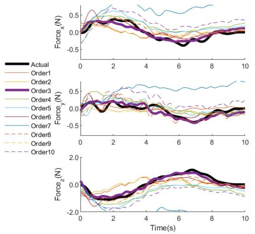  
(a)

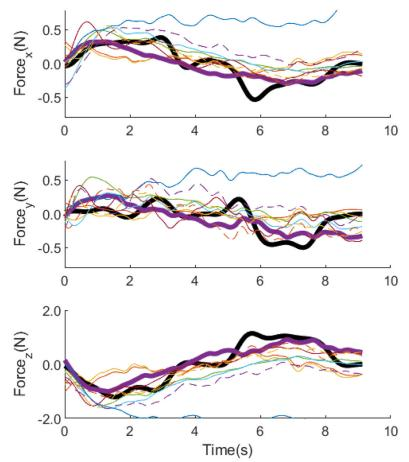  
(b)

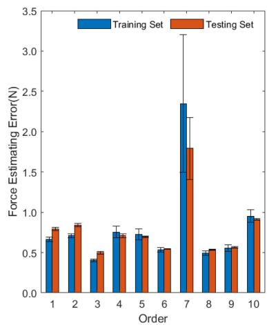  
(c)  
Fig. 4. Estimation of human’s arm three-dimensional force ${ \pmb F } _ { a }$ . Three-dimensional components of ${ \cal F } _ { a } \ ( \mathrm { i . e . , } \ F o r c e _ { x } , F o r c e _ { y } ,$ and $F o r c e _ { z } )$ were estimated within the training set (a) and the testing set (b). The black lines illustrate the actual forces measured from the dataset. The rest of the ten lines indicate the output forces estimated with orders from 1 to 10, respectively. The average arm force estimating error $( F _ { R M S E } )$ in all trial with orders from 1 to 10 (c).

## D. Signal Processing and Statistical Analysis

The root mean square error (RMSE) of the arm force was used to evaluate the fitting result of the state space model:

$$
F _ {R M S E} = \sqrt {\frac {1}{T} \int_ {0} ^ {T} \| \boldsymbol {F} _ {e s t i m a t e} (t) - \boldsymbol {F} _ {m e a s u r e} (t) \| ^ {2} d t}\tag{14}
$$

where $T$ is the time duration of each trial; $F _ { e s t i m a t e }$ is the estimated arm force; and $F _ { m e a s u r e }$ is the measured arm force.

The RMSE value of the wrist position was also used to evaluate the fitting result of the state space model:

$$
P _ {R M S E} = \sqrt {\frac {1}{T} \int_ {0} ^ {T} \| \boldsymbol {P} _ {e s t i m a t e} (t) - \boldsymbol {P} _ {m e a s u r e} (t) \| ^ {2} d t}\tag{15}
$$

where $P _ { e s t i m a t e }$ is the estimated wrist position; and P measure is the measured wrist position.

To compare the trajectory smoothness of the proposed EMGbased admittance controller and that of the force-sensing-based admittance controller, the RMS Jerk was calculated:

$$
R M S J e r k = \sqrt {\frac {1}{T} \int_ {0} ^ {T} \| \ddot {\boldsymbol {P}} _ {m e a s u r e} (t) \| ^ {2} d t}\tag{16}
$$

where $\ddot { P } _ { m e a s u r e }$ is the third derivative of the position of the end-effector of the cable-driven module or the rod ends of the hand exoskeleton.

The zero-crossing rates (FZCRs) of the estimated forces of the arm and hand were calculated to test the hypothesis that the proposed EMG-based admittance controller acted more naturally than the force-sensing-based admittance controller and therefore could generate smoother trajectory.

The paired t-tests were applied to examine the differences between the EMG-based and force-sensing-based admittance controllers. They were conducted by statistical analysis software (SPSS 24, SPSS Inc., USA) with the significance set to be 0.05.

## III. RESULTS

## A. Fitting State Space Model

The three-dimensional arm forces ${ \pmb F } _ { a }$ estimated by the state space model using the training set and the testing set data were presented in Fig. 4(a) and (b), respectively. The black lines illustrate the measured forces ${ \pmb F } _ { a }$ . The other ten lines show the output forces ${ \pmb F } _ { a }$ estimated with orders from 1 to 10, respectively.

${ \pmb F } _ { a }$ is a vector containing three components $( \mathrm { i . e . , ~ } F _ { x } , F _ { y } ,$ and $F _ { z } )$ . Each component was shown separately. The results showed that except for the 7th-order, the estimated forces had similar trends with the actual ones. Among them, output forces estimated with 3rd-order model were the closest to the actual ones.

In order to find the best order for force estimation, the average arm force estimating errors $( F _ { R M S E } )$ for all the trials with orders from 1 to 10 were calculated and shown in Fig. 4(c). The blue bar illustrates the average $F _ { R M S E }$ of all the training set, whereas the red one illustrates that of the testing sets. We found that the $F _ { R M S E }$ with a 3rd-order model is the lowest and the variance of it is very small. Therefore, the 3rd-order was chosen for the state space model.

As described in Section II, the estimated force ${ \pmb F } _ { a }$ could be used further to estimate the desired position $P _ { a d }$ . The results of the generated desired position for the training set and the testing set were shown in Fig. 5(a) and Fig. 5(b), respectively. The black lines illustrate the actual/measured position $P _ { a d } .$ The rest of the lines show the desired positions $P _ { a d }$ that were generated with orders from 1 to 10, respectively.

$P _ { a d }$ is a vector containing three position components $( \mathrm { i . e . } ,$ $P 1 _ { x } , P 1 _ { y } ,$ and $P 1 _ { z } )$ . Each component was shown separately. Results showed that the generated desired positions with the 3rd-order model were the closest to the actual ones, either in the training set or the testing set.

The average root mean square errors $P _ { R M S E }$ for orders from 1 to 10 were also calculated and shown in Fig. 5(c). The blue bar illustrates the average $P _ { R M S E }$ of all the training sets, and the red one illustrates that of the testing set. We found that the $P _ { R M S E }$ with a 3rd-order model (0.04 m for the training set and 0.05 m for the testing set) is the lowest with relatively small variances, no matter for the training set or the testing set.

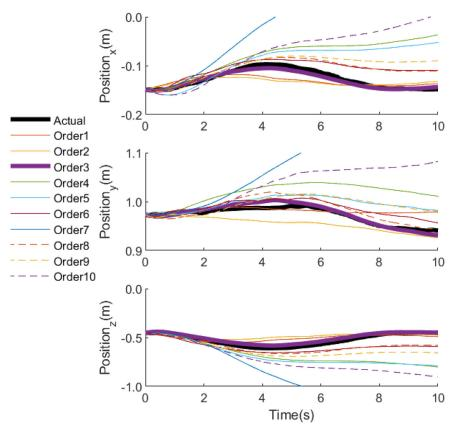  
(a)

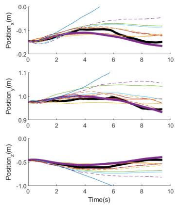  
(b)

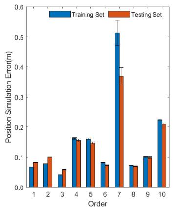  
(c)

Fig. 5. Generation of the desired position of arm $P _ { a d } .$ . Three-dimensional components of $P _ { a d }$ (i.e., Positionx, Positiony, and Positionz) were generated within the training set (a) and the testing set (b). The black lines illustrate the actual position of arm $P _ { a }$ measured from the dataset. The rest of the ten lines show the desired positions $P _ { a d }$ generated by forces $F _ { a }$ that were estimated with orders from 1 to 10, respectively. The average arm position error $P _ { R M S E }$ in all trial with orders from 1 to 10 (c).  
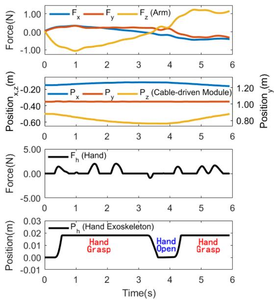  
(a)

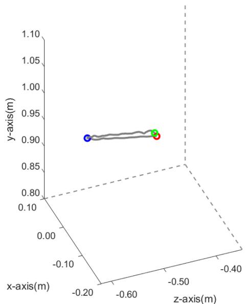  
(b)  
Fig. 6. Experimental verification for EMG-based admittance controller. (a) Top to bottom: the three-dimensional components of arm force $F _ { a }$ estimated with 3rd-order model, three-dimensional components of the actual position of the optical marker on the end-effector (equal to the arm position) obtained by the motion capture system in real time, the hand force estimation of $F _ { h } ,$ and the position of the threaded rod ends on the hand exoskeleton. (b) The actual trajectory of the optical marker (equal to the arm position) in three-dimensional space during the whole task.

## B. Verifying HAHRR System

We chose the 3rd-order state space model (which was the optimal model in fitting the state space model) for verifying the HAHRR system. One representative trial was shown in Fig. 6. From top to bottom, Fig. 6(a) shows the estimated threedimensional components of arm force $\mathbf { \nabla } _ { F _ { a } . }$ , three-dimensional components of the actual position of the optical marker on the end-effector, the hand force estimation of ${ \mathbf { } } F _ { h }$ , and the position of the threaded rod ends on the hand exoskeleton. Fig. 6(b) shows the actual trajectory of the end-effector. From 0 to around 3.5 s, the subject, with the assistance of the robot controlled by EMG signals in real-time, reached his left hand toward the location of the object (i.e., the trajectory was the path from the green point to the blue one shown in Fig. 6(b)). At around $3 . 3 \ \mathrm { s } ,$ the subject intended to open his hand $( F _ { h } < 0 )$ . Therefore, $P _ { h d }$ began to drop down according to the admittance controller, and the hand exoskeleton assisted the fingers in extending, and thus the hand opened. At around 4.1 s, the subject tried to close his hand $( F _ { h } > 0 )$ . Therefore, $P _ { h d }$ began to go upward and the hand exoskeleton assisted the hand to grasp the object. Having grasped the object, the subject, with the assistance of the robot controlled by EMG signals in real-time, then moved his left hand backward (i.e., the trajectory was from the blue point to the red one shown in Fig. 6(b)). With the security region described in Section B. 3), there was no further flexion for fingers although $F _ { h } > 0$ at around 1.5 s, 2.3 s, 5.0 s, and 5.4 s. This result proved that the subject could achieve the reach-and-grasp task with the assistance of the HAHRR controlled by eight channels of EMG signals.

TABLE I  
FORCE ZERO CROSSING RATE (FZCR) VALUE OF FORCE-SENSING-BASED ADMITTANCE CONTROLLER AND EMG-BASED ADMITTANCE CONTROLLER FOR THE ARM AND HAND

<table><tr><td></td><td>FZCR of Force-sensing-based Admittance (%)</td><td>FZCR of EMG-based Admittance (%)</td><td>p</td></tr><tr><td>Arm in x-axis</td><td>25.71±4.23</td><td>0.77±0.10</td><td>&lt;0.001</td></tr><tr><td>Arm in y-axis</td><td>24.24±5.31</td><td>1.81±1.44</td><td>&lt;0.001</td></tr><tr><td>Arm in z-axis</td><td>23.58±2.85</td><td>1.79±0.40</td><td>&lt;0.001</td></tr><tr><td>Hand</td><td>7.30±2.06</td><td>4.22±1.68</td><td>0.055</td></tr></table>

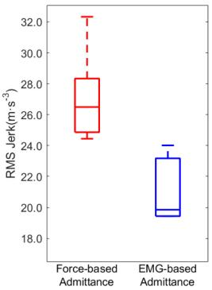  
(a)

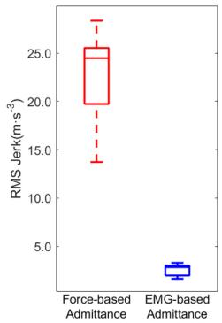  
(b)  
Fig. 7. (a) RMS Jerk of the end-effector. (b) RMS Jerk of the rod ends.

Table I shows FZCR of force-sensing-based admittance controller and EMG-based one for the arm and hand. All the FZCR values of EMG-based admittance controller were significantly lower than those of the force-sensing-based one (Arm in x-axis: $p < 0 . 0 0 1$ ; Arm in y-axis: $p < 0 . 0 0 1 ;$ Arm in z-axis: $p < 0 . 0 0 1$ ; Hand: $p > 0 . 0 5 )$ . Fig. 7 shows the RMS Jerk using the proposed EMG-based admittance controller and the force-sensing-based admittance controller. Fig. 7(a) shows the RMS Jerk of the end-effector while Fig. 7(b) shows that of the rod ends. As we expected, the proposed EMG-based admittance controller had lower RMS Jerk than the force-sensing-based admittance one in both the end-effector and rod ends trajectory, and the paired t-tests indicated that the differences were significant $( p = 0 . 0 3 6$ for end-effector, and $p = 0 . 0 0 1$ for rod ends).

## IV. DISCUSSION

In this study, a hybrid arm-hand rehabilitation robot (HAHRR) was built to enable the continuous active integrated training of arm and hand in the reach-and-grasp task.

## A. EMG-Based Controller

There have been studies using classifiers to realize EMG-based control [47]–[49]. However, the classifiers can only recognize a limited number of discrete kinds of motion [50]. Therefore, classifiers are suitable for application of hand gesture recognition such as reference [47], but not for continuous three-dimensional arm force estimation. In this study, the state space model (a MIMO system) was exploited to estimate three-dimensional arm force from the six muscle activations. At present, three-dimensional continuous motion estimation still remains a challenge. Although the Hill-type musculoskeletal model was widely used to estimate one-dimensional continuous motion from the surface EMG signal [31], [51], [52], it could hardly be applied to three-dimensional upper-limb motion estimation in real-time due to the high complexity of this task [34], [35].

Determining the model order is the key to the state space model. State space models of 1st-order and 2nd-order are simple in structure and robust to disturbances but fail to reflect the details of the upper-limb motion characteristics. State space models of 4th-order and higher orders tend to fit the actual arm force with more details but are complex in structure, sensitive to disturbances, and have greater randomness. Thus, there is a trade-off between model details and robustness. By comparing orders 1st to 10th in terms of the root mean square error of the arm force $( F _ { R M S E } )$ and that of the wrist position $( P _ { R M S E } )$ order 3rd was determined as the optimal model order. The model of 3rd-order obtained the smallest $F _ { R M S E }$ and $P _ { R M S E }$ in both training set and testing set. This is consistent with the previous research, in which a state space model of 3rd-order performed better than those of 6th-order and 10th-order [38].

The smoothness of the kinematic control is important for rehabilitation robots [53]. The jerky trajectory of the end-effector not only makes the subjects feel uncomfortable, but also may cause danger to patients. The results of the experiment illustrated that the EMG-based admittance controller achieved better smoothness in both force and trajectory than the force-sensingbased one. We attributed this phenomenon to the time delay compensation effect of EMG-based motion intention perception. In force-sensing-based motion intention perception, the response time of the robot caused the robot to act according to the previously measured force rather than the current actual force. As shown in Fig. 8, it could lead to the oscillation of the force (large FZCR values in TABLE I) and the jerky trajectory (large RMS Jerk in Fig. 7). With EMG-based motion intention perception, the smooth changes in the force (small FZCR values) and the smooth trajectory (small RMS Jerk) were observed. The EMG signal occurred before human active force [38], which could be used to compensate for the time delay between the human active force and robot response and thus improve the human-robot synchronization [30].

## B. Hybrid Rehabilitation Robot for Reach-and-Grasp Task

The hybrid rehabilitation robot in this study was specifically designed for the reach-and-grasp task. Existing rehabilitation robots either mainly focus on arm motion (such as RUPERT IV [9], NeReBot [13], GENTLE/s [14], Sophia-3 [15], MIME [16], CASIA-ARM [17], and EULRR [18]) or hand motion (such as HERO [54], iSAFER [55], HEXOES [56], RML Glove [57], BRAVO [2], and Hand of Hope [10]) [58]. However, without hand motion, people cannot eat, drink, write or type. Without arm motion, people cannot lift or take anything they grasp. In view of the fact that the reach-and-grasp task requires the coordination between arm and hand during the whole motion process [59], the mechanical structure of the robot was a hybrid of a cable-driven module and a hand exoskeleton, and the control strategy was based on continuous EMG control. The cable-driven parallel mechanism has advantages such as compliant structure, low moving mass, light-weight structure, and large workspace [23], and therefore is suitable for assisting the reaching motion of the arm. The hand exoskeleton is size-adjustable and resembles the human hand anatomy and therefore is suitable for assisting hand grasping for different subjects. In continuous EMG control, the human motion intention is continuously perceived from the EMG signal and then translated into control commands to the robot, and therefore the continuous voluntary participation of the subject is incorporated into robot control [35].

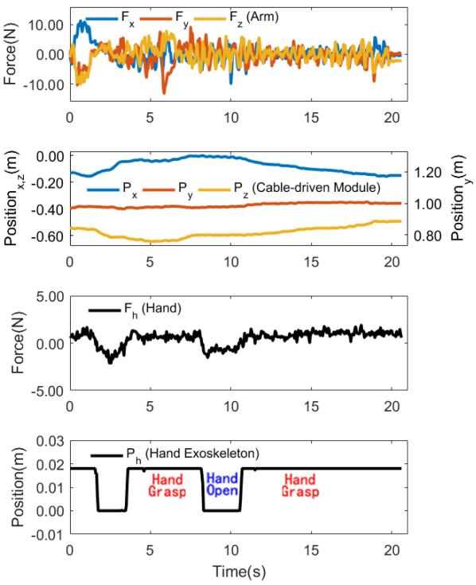

(a)  
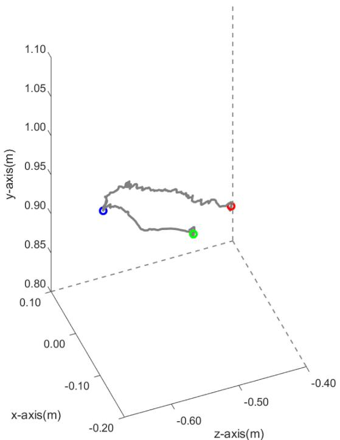  
(b)  
Fig. 8. Experimental verification for force-sensing-based admittance controller. (a) Top to bottom: the three-dimensional components of arm force $\mathrm { F _ { a } }$ measured by force sensors, three-dimensional components of the actual position of the optical marker on the end-effector (equal to the arm position) obtained by the motion capture system in real time, the hand force $\mathrm { F _ { h } }$ , and the position of the threaded rod ends on the hand exoskeleton. (b) The actual trajectory of the optical marker (equal to the arm position) in three-dimensional space during the whole task.

There was an attempt to integrate a NeuroExos Shoulderelbow Module (NESM) exoskeleton with a hand-wrist exoskeleton to assist the subjects in following the predefined trajectory to fulfill the reach-and-grasp task [60]. The whole motion process was divided into four steps, each of which was triggered by a measured electroencephalogram / electrooculogram (EEG/EOG) signal and then depended entirely on the PID-based position controller. This approach could provide motion assistance semi-automatically but lacked continuous voluntary participation of the subjects. By comparison with the aforementioned robot, the HAHRR allows continuous voluntary participation. We consider the rehabilitation robot with continuous physiological signal control to be more human-dominated, encouraging the subject to learn how to coordinate his/her muscle activation during the whole training task. Clinical research showed that rehabilitation robots based on continuous physiological signal control might be more beneficial in rehabilitation for post-stroke patients [61].

## C. Limitations and Future Work

1) The training time ofthe state-space model is around 20 minutes, which may be a limitation for the proposed EMG-based controller because it needs to be prepared for every subject. 2) The proposed HAHRR system has been tested on the healthy subject at current stage. Although the EMG activation patterns of patients are different from those of healthy subjects, the testing sets and verifying experiments may alleviate the different EMG activation patterns between patients and healthy subjects. The proposed HAHRR system will be further verified by post-stroke patients with residual EMG activity in the future. 3) This study proposed a rehabilitation robot together with the EMG-based controller for integrated and active training of the arm and hand. In the future, the control strategy needs further investigation to incorporate the arm and hand controllers, and arm-hand coordination should be evaluated quantitatively to validate the training effect.

## V. CONCLUSION

This study proposed a hybrid arm-hand rehabilitation robot (HAHRR) with an EMG-based admittance controller. Experimental results showed that the robot could continuously generate a smooth trajectory according to human motion intention and assist the subject in completing the reach-and-grasp task.

## REFERENCES

[1] A. G. Thrift et al., “Global stroke statistics,” Int. J. Stroke, vol. 9, no. 1, pp. 6–18, Jan. 2014.

[2] D. Leonardis et al., “An EMG-controlled robotic hand exoskeleton for bilateral rehabilitation,” IEEE Trans. Haptics, vol. 8, no. 2, pp. 140–151, Apr.–Jun. 2015.

[3] H. S. Lo and S. Q. Xie, “Exoskeleton robots for upper-limb rehabilitation: State of the art and future prospects,” Med. Eng. Phys., vol. 34, no. 3, pp. 261–268, Apr. 2012.

[4] J. C. Perez-Ibarra, A. A. G. Siqueira, M. A. Silva-Couto, T. L. de Russo, and H. I. Krebs, “Adaptive impedance control applied to robot-aided neurorehabilitation of the ankle,” IEEE Robot. Automat. Lett., vol. 4, no. 2, pp. 185–192, Apr. 2019.

[5] R. Bertani, C. Melegari, M. C. De Cola, A. Bramanti, P. Bramanti, and R. S. Calabro, “Effects of robot-assisted upper limb rehabilitation in stroke patients: A systematic review with meta-analysis,” Neurological Sci., vol. 38, no. 9, pp. 1561–1569, Sep. 2017.

[6] C. H. Hwang, J. W. Seong, and D. S. Son, “Individual finger synchronized robot-assisted hand rehabilitation in subacute to chronic stroke: A prospective randomized clinical trial of efficacy,” Clin. Rehabil., vol. 26, no. 8, pp. 696–704, Aug. 2012.

[7] A. C. Lo et al., “Robot-assisted therapy for long-term upper-limb impairment after stroke,” New England J. Med., vol. 362, no. 19, pp. 1772–1783, May 2010.

[8] J. C. Perry, J. Rosen, and S. Burns, “Upper-limb powered exoskeleton design,” IEEE/ASME Trans. Mechatronics, vol. 12, no. 4, pp. 408–417, Aug. 2007.

[9] S. Balasubramanian et al., “RUPERT: An exoskeleton robot for assisting rehabilitation of arm functions,” in Proc. Virtual Rehabil., Vancouver, Canada, 2008, pp. 163–167.

[10] Z. Y. Lu, X. Chen, X. Zhang, K. Y. Tong, and P. Zhou, “Real-time control of an exoskeleton hand robot with myoelectric pattern recognition,” Int. J. Neural Syst., vol. 27, no. 5, pp. 1–11, Aug. 2017.

[11] F. Ozkul and D. E. Barkana, “Upper-extremity rehabilitation robot rehabroby: Methodology, design, usability and validation,” Int. J. Adv. Robotic Syst., vol. 10, pp. 1–13, Dec. 2013.

[12] H. I. Krebs, N. Hogan, M. L. Aisen, and B. T. Volpe, “Robot-aided neurorehabilitation,” IEEE Trans. Rehabil. Eng., vol. 6, no. 1, pp. 75–87, Mar. 1998.

[13] G. Rosati, P. Gallina, and S. Masiero, “Design, implementation and clinical tests of a wire-based robot for neurorehabilitation,” IEEE Trans. Neural Syst. Rehabil. Eng., vol. 15, no. 4, pp. 560–569, Dec. 2007.

[14] R. Loureiro, F. Amirabdollahian, M. Topping, B. Driessen, and W. Harwin, “Upper limb robot mediated stroke therapy—GENTLE/s approach,” Auton. Robots, vol. 15, no. 1, pp. 35–51, Jul. 2003.

[15] D. Zanotto, G. Rosati, S. Minto, and A. Rossi, “Sophia-3: A semiadaptive cable-driven rehabilitation device with a tilting working plane,” IEEE Trans. Robot., vol. 30, no. 4, pp. 974–979, Aug. 2014.

[16] C. G. Burgar, P. S. Lum, P. C. Shor, and H. F. M. Van der Loos, “Development of robots for rehabilitation therapy: The palo alto VA/Stanford experience,” J. Rehabil. Res. Develop., vol. 37, no. 6, pp. 663–673, Nov./Dec. 2000.

[17] L. Luo, L. Peng, C. Wang, and Z.-G. Hou, “A greedy Assist-as-Needed controller for upper limb rehabilitation,” IEEE Trans. Neural Netw. Learn. Syst., vol. 30, no. 11, pp. 3433–3443, Nov. 2019.

[18] L. Zhang, S. Guo, and Q. Sun, “Development and assist-as-needed control of an end-effector upper limb rehabilitation robot,” Appl. Sci., vol. 10, no. 19, Oct. 2020, Art. no. 6694.

[19] N. G. Kutner, R. Zhang, A. J. Butler, S. L. Wolf, and J. L. Alberts, “Qualityof-life change associated with robotic-assisted therapy to improve hand motor function in patients with subacute stroke: A randomized clinical trial,” Phys. Therapy, vol. 90, no. 4, pp. 493–504, Apr. 2010.

[20] J. J. Daly et al., “Response to upper-limb robotics and functional neuromuscular stimulation following stroke,” J. Rehabil. Res. Develop., vol. 42, no. 6, pp. 723–736, Nov./Dec. 2005.

[21] H. Xiong and X. Diao, “A review of cable-driven rehabilitation devices,” Disabil. Rehabil.: Assistive Technol., vol. 15, no. 8, pp. 885–897, Nov. 2020.

[22] G. Rosati, M. Andreolli, A. Biondi, and P. Gallina, “Performance of cable suspended robots for upper limb rehabilitation,” in Proc. IEEE 10th Int. Conf. Rehabil. Robot., Noordwijk, Netherlands, 2007, pp. 385–392.

[23] S. H. Yeo, G. Yang, and W. B. Lim, “Design and analysis of cable-driven manipulators with variable stiffness,” Mechanism Mach. Theory, vol. 69, pp. 230–244, Nov. 2013.

[24] W. Meng, Q. Liu, Z. Zhou, Q. Ai, B. Sheng, and S. Xie, “Recent development of mechanisms and control strategies for robot-assisted lower limb rehabilitation,” Mechatronics, vol. 31, pp. 132–145, Oct. 2015.

[25] T. Proietti, V. Crocher, A. Roby-Brami, and N. Jarrasse, “Upper-limb robotic exoskeletons for neurorehabilitation: A review on control strategies,” IEEE Rev. Biomed. Eng., vol. 9, pp. 4–14, Apr. 2016.

[26] N. Hogan, “Impedance control: An approach to manipulation. III. Applications,” Trans. ASME J. Dynamic Syst., Meas. Control, vol. 107, no. 1, pp. 17–24, Mar. 1985.

[27] J. A. Saglia, N. G. Tsagarakis, J. S. Dai, and D. G. Caldwell, “Control strategies for patient-assisted training using the ankle rehabilitation robot (ARBOT),” IEEE/ASME Trans. Mechatronics, vol. 18, no. 6, pp. 1799–1808, Dec. 2013.

[28] S. Yao, Y. Zhuang, Z. Li, and R. Song, “Adaptive admittance control for an ankle exoskeleton using an EMG-Driven musculoskeletal model,” Front. Neurorobot., vol. 12, pp. 1–12, Apr. 2018.

[29] H. Walid, S. Mohammed, and Y. Amirat, “Real-time EMG driven lower limb actuated orthosis for assistance as needed movement strategy,” in Proc. Robot.: Sci. Syst. Conf., 2013, pp. 1–8.

[30] Y. Zhuang, S. Yao, C. Ma, and R. Song, “Admittance control based on EMG-driven musculoskeletal model improves the human–robot synchronization,” IEEE Trans. Ind. Inform., vol. 15, no. 2, pp. 1211–1218, Feb. 2019.

[31] G. Durandau et al., “Voluntary control of wearable robotic exoskeletons by patients with paresis via neuromechanical modeling,” J. Neuroeng. Rehabil., vol. 16, pp. 1–18, Jul. 2019.

[32] W. J. Ye, Z. J. Li, C. G. Yang, F. Chen, and C. Y. Su, “Motion detection enhanced control of an upper limb exoskeleton robot for rehabilitation training,” Int. J. Humanoid Robot., vol. 14, no. 1, pp. 1–17, Mar. 2017.

[33] P. K. Artemiadis and K. J. Kyriakopoulos, “EMG-based control of a robot arm using low-dimensional embeddings,” IEEE Trans. Robot., vol. 26, no. 2, pp. 393–398, Apr. 2010.

[34] P. K. Artemiadis and K. J. Kyriakopoulos, “An EMG-based robot control scheme robust to time-varying EMG signal features,” IEEE Trans. Inf. Technol. Biomed., vol. 14, no. 3, pp. 582–588, May 2010.

[35] J. Han, Q. Ding, A. Xiong, and X. Zhao, “A state-space EMG model for the estimation of continuous joint movements,” IEEE Trans. Ind. Electron., vol. 62, no. 7, pp. 4267–4275, Jul. 2015.

[36] G. G. Fluet, A. S. Merians, Q. Qiu, A. Davidow, and S. V. Adamovich, “Comparing integrated training of the hand and arm with isolated training of the same effectors in persons with stroke using haptically rendered virtual environments, a randomized clinical trial,” J. Neuroeng. Rehabil., vol. 11, 2014, Art. no. 126.

[37] L. Zhao, C. Xie, and R. Song, “Design and validation of a wearable hand exoskeleton system,” in Proc. 5th Int. Conf. Adv. Robot. Mechatronics, 2020, pp. 559–563.

[38] Y. Huang, R. Song, A. Argha, A. V. Savkin, B. G. Celler, and S. W. Su, “Continuous description of human 3D motion intent through switching mechanism,” IEEE Trans. Neural Syst. Rehabil. Eng., vol. 28, no. 1, pp. 277–286, Jan. 2020.

[39] F. E. Zajac, “Muscle and tendon: Properties, models, scaling, and application to biomechanics and motor control,” Crit. Rev. Biomed. Eng., vol. 17, no. 4, pp. 359–411, 1989.

[40] C. Nam, W. Rong, W. Li, Y. Xie, X. Hu, and Y. Zheng, “The effects of upper-limb training assisted with an electromyography-driven neuromuscular electrical stimulation robotic hand on chronic stroke,” Front. Neurol., vol. 8, pp. 1–14, Dec. 2017.

[41] Q. Shao, D. N. Bassett, K. Manal, and T. S. Buchanan, “An EMG-driven model to estimate muscle forces and joint moments in stroke patients,” Comput. Biol. Med., vol. 39, no. 12, pp. 1083–1088, Dec. 2009.

[42] K. Manal and T. S. Buchanan, “A one-parameter neural activation to muscle activation model: Estimating isometric joint moments from electromyograms,” J. Biomech., vol. 36, no. 8, pp. 1197–1202, Aug. 2003.

[43] L. Pan, X. Sheng, D. Zhang, and X. Zhu, “Simultaneous and proportional estimation offingerjoint angles from surface EMG signals during mirrored bilateral movements,” in Proc. 6th Int. Conf. Intell. Robot. Appl., Busan, South Korea, 2013, pp. 493–499.

[44] G. Xu, A. Song, and H. Li, “Control system design for an upper-limb rehabilitation robot,” Adv. Robot., vol. 25, no. 1/2, pp. 229–251, 2012.

[45] O. Bo and S. Weiwei, “Rapid optimization oftension distribution for cabledriven parallel manipulators with redundant cables,” Chin. J. Mech. Eng., vol. 29, no. 2, pp. 231–238, Mar. 2016.

[46] Q. Yang, C. Xie, R. Tang, H. Liu, and R. Song, “Hybrid active control with human intention detection of an upper-limb cable-driven rehabilitation robot,” IEEE Access, vol. 8, pp. 195206–195215, Oct. 2020.

[47] H. Su, S. E. Ovur, X. Zhou, W. Qi, G. Ferrigno, and E. De Momi, “Depth vision guided hand gesture recognition using electromyographic signals,” Adv. Robot., vol. 34, no. 15, pp. 985–997, Aug. 2020.

[48] L. Liu, P. Liu, E. A. Clancy, E. Scheme, and K. B. Englehart, “Electromyogram whitening for improved classification accuracy in upper limb prosthesis control,” IEEE Trans. Neural Syst. Rehabil. Eng., vol. 21, no. 5, pp. 767–774, Sep. 2013.

[49] K. Kita, R. Kato, H. Yokoi, and T. Arai, “Development of autonomous assistive devices - Analysis of change of human motion patterns,” in Proc. IEEE Int. Conf. Syst., Man Cybern., Taipei, Taiwan, 2006, pp. 593–598.

[50] Q. Ding, J. Han, and X. Zhao, “Continuous estimation of human multi-joint angles from sEMG using a state-space model,” IEEE Trans. Neural Syst. Rehabil. Eng., vol. 25, no. 9, pp. 1518–1528, Sep. 2017.

[51] C. Fleischer and G. Hommel, “A human-exoskeleton interface utilizing electromyography,” IEEE Trans. Robot., vol. 24, no. 4, pp. 872–882, Aug. 2008.

[52] T. S. Buchanan, D. G. Lloyd, K. Manal, and T. F. Besier, “Neuromusculoskeletal modeling: Estimation of muscle forces and joint moments and movements from measurements of neural command,” J. Appl. Biomech., vol. 20, no. 4, pp. 367–395, Nov. 2004.

[53] E. Guanziroli, M. Cazzaniga, L. Colombo, S. Basilico, G. Legnani, and F. Molteni, “Assistive powered exoskeleton for complete spinal cord injury: Correlations between walking ability and exoskeleton control,” Eur. J. Phys. Rehabil. Med., vol. 55, no. 2, pp. 209–216, Apr. 2019.

[54] A. Yurkewich, D. Hebert, R. H. Wang, and A. Mihailidis, “Hand extension robot orthosis (HERO) glove: Development and testing with stroke survivors with severe hand impairment,” IEEE Trans. Neural Syst. Rehabil. Eng., vol. 27, no. 5, pp. 916–926, May 2019.

[55] B. J. B. Lee, A. Williams, and P. Ben-Tzvi, “Intelligent object grasping with sensor fusion for rehabilitation and assistive applications,” IEEE Trans. Neural Syst. Rehabil. Eng., vol. 26, no. 8, pp. 1556–1565, Aug. 2018.

[56] M. K. Burns, D. Pei, and R. Vinjamuri, “Myoelectric control of a soft hand exoskeleton using kinematic synergies,” IEEE Trans. Biomed. Circuits Syst., vol. 13, no. 6, pp. 1351–1361, Dec. 2019.

[57] Z. Ma and P. Ben-Tzvi, “RML glove—An exoskeleton glove mechanism with haptics feedback,” IEEE/ASME Trans. Mechatronics, vol. 20, no. 2, pp. 641–652, 2015.

[58] A. Basteris, S. M. Nijenhuis, A. H. A. Stienen, J. H. Buurke, G. B. Prange, and F. Amirabdollahian, “Training modalities in robot-mediated upper limb rehabilitation in stroke: A framework for classification based on a systematic review,” J. Neuroeng. Rehabil., vol. 11, pp. 1–15, Jul. 2014.

[59] Y. Choi, J. Gordon, D. Kim, and N. Schweighofer, “An adaptive automated robotic task-practice system for rehabilitation of arm functions after stroke,” IEEE Trans. Robot., vol. 25, no. 3, pp. 556–568, Jun. 2009.

[60] S. Crea et al., “Feasibility and safety of shared EEG/EOG and visionguided autonomous whole-arm exoskeleton control to perform activities of daily living,” Sci. Rep., vol. 8, pp. 1–9, Jul. 2018.

[61] R. Song, K. Y. Tong, X. L. Hu, and L. Li, “Assistive control system using continuous myoelectric signal in robot-aided arm training for patients after stroke,” IEEE Trans. Neural Syst. Rehabil. Eng., vol. 16, no. 4, pp. 371–379, Aug. 2008.

  
Chenglin Xie was born in Shantou, Guangdong, China in 1996. He received the B.S. degree in 2019 in biomedical engineering from Sun Yat-sen University, Guangdong, China, where he is currently working toward the Ph.D. degree in biomedical engineering. His research interests include robot-assisted stroke rehabilitation, mechanical design, human motion analysis, human-robot interaction, biomedical signal processing, and signal system identification.

Qianqian Yang (Member, IEEE) was born in Henan, China in 1988. She received the B.S. degree in mechanical and electronic engineering, and the Ph.D. degree in mechanical engineering from the South China University of Technology, Guangzhou, China, in 2011 and 2016, respectively. Since 2016, she has been an Associate Professor with the Schoo of Biomedical Engineering, Sun Yat-sen University, Guangdong, China. She is the Author ofone book and more than ten articles. Her research interests include design and control of rehabilitation robots, modeling drehabilitat

of human movement, and rehabilitation evaluation.

Yao Huang (Graduate Student Member, IEEE) was born in China, 1993. She received the B.S. degree in transport engineering and the M.S degree in biomedical engineering from Sun Yat-sen University, Guangdong, China, in 2014 and 2017, respectively, and the Ph.D. degree in biomedical engineering from the University of Technology Sydney, Sydney, NSW, Australia, in 2021. Her main research interests include control strategy of rehabilitation robotics, biomedical signal processing and modeling, and machine learning application in multi-sensor platforms.

Steven W. Su (Senior Member, IEEE) was born in China, 1968. He received the Ph.D. degree in control engineering from RSISE the Australian National University, Canberra, ACT, Australia, in May 2003. He was then a Research Fellow for nearly four years with the Faculty of Engineering, University of New South Wales, Sydney, NSW, Australia. He is currently an Associate Professor with the Faculty of Engineering and IT, and the Core Member of the Center for Health Technologies and the Centre for Global Big Data Technologies Centre, UTS. He has more than 20 years

of experience in rehabilitation engineering, biomedical instrumentation, physiological system modeling, data acquisition and distribution, system control, and parameter identification, having published one book and more than 270 refereed research papers in these areas. He was recognized by the NSW state iAwards 2020 (iAward NSW for Business and Industry Solution) as one of the main technology contributors ofthe electronic-nose (Nos.e). The AI Exoskeleton developed by his team was the recipient of the Most Innovative Prototype Award 2020 from Techcelerator.

Ting Xu was born in China. She received the B.S. degree in automation from Shandong University, Jinan, China, in 2011 and the Ph.D. degree in biomedical engineering from the City University of Hong Kong, Hong Kong, in 2020. She is currently an Associate Professor with the School of Biomedica Engineering, Sun Yat-sen University, Guangdong, China. Her research interests include artificial intelligence, biomedical signal processing, and robotassisted stroke rehabilitation.

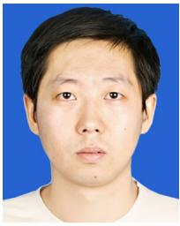

Rong Song (Senior Member, IEEE) was born in Hubei, China, in 1975. He received the B.S. degree in electrical engineering from Tsinghua University, Beijing, China, in 1999, the M.S. degree in electronic engineering from Shantou University, Shantou, China, in 2002, and the Ph.D. degree in biomedical engineering from the Hong Kong Polytechnic University, Hong Kong, in 2006. He is currently a Professor with the School of Biomedical engineering, Sun Yat-sen University, Guangdong, China. His research interests include musculoskeletal modeling, biomedical signa

processing, human motion analysis, and robot-assisted stroke rehabilitation.