# Assist-as-Needed Control of a Shoulder Rehabilitation Robot Using a Virtual Biomechanical Model and Online Stiffness Adaptation

Muhammad Faizan Shah , Prashant K. Jamwal , Senior Member, IEEE, Mergen H. Ghayesh , and Shahid Hussain

Abstract— This paper presents an adaptive Assist-as-Needed (AAN) control framework for a shoulder rehabilitation robot enhanced by a Virtual Biomechanical Shoulder Robot Model (VBSRM) and an online stiffness adaptation module. The proposed system adapts support levels dynamically based on user interaction and motor effort, ensuring both safety and active participation during rehabilitation training. The VBSRM is first calibrated to each user’s anthropometric dimensions and used to estimate joint torques during movement. Assistance coefficient β(t), is then dynamically updated based on the user’s measured interaction force, increasing support when effort is low and reducing it when active participation improves. The AAN controller features a gradient-based online stiffness learning mechanism, enabling the system to dynamically adjust joint stiffness during movement based on tracking errors and interaction forces. This dual adaptation enhances rehabilitation training individualization. Experiments with ten healthy subjects performing an Activity of Daily Living (ADL) task demonstrated improved torque profiles, effective stiffness modulation, and reduced trajectory tracking errors in active and passive modes. The proposed control scheme demonstrates high potential for patient-specific, responsive rehabilitation training in neurorehabilitation and post-stroke therapy.

Index Terms— Shoulder, upper limb, rehabilitation, exoskeleton, assist-as-needed, control.

## I. INTRODUCTION

OBOT-ASSISTED therapy has emerged as a viable method in realm of rehabilitation, tailored to revitalize the muscle strength of the patients suffering from neurological injuries [1], [2]. In contrast to manual physical therapy, the robots can provide repetitive and objective training [3], [4]. Literature documents various shoulder limb rehabilitation robots that are employed in the clinics, featuring different design and control paradigms [5], [6]. Sustained success of rehabilitation robots in clinical practice is contingent upon the development of the real time controllers that provide reliable and accurate functionality. Assistive control strategies are commonly designed to address severely to mildly impaired subjects and are the most commonly explored controller paradigm in the rehabilitation robotics [7], [8]. These techniques have proven to be the most promising strategies for enhancing post-stroke recovery [9]. Ensuring safe human-robot interaction is typically achieved by using compliant control techniques, which attune the robot’s movements according to human inputs, normally through impedance or admittance models [10], [11], [12]. These controllers are typically complemented with additional layers, such as intent detection frameworks or advanced machine learning techniques, to enhance flexibility and responsiveness in human-robot interaction [13], [14].

An important aspect of ensuring the effectiveness of robot-assisted rehabilitation is to create controllers that, not only assist but also adapt to the capability of the user in real time [15]. Assist-as-Needed (AAN) strategies, serve as a bridge between traditional compliant control strategies and personalized rehabilitation [16]. By means of dynamic adjustment of the robot assistance level, AAN controllers promote patient engagement and guarantee safety and efficacy [17]. The AAN method is a widely recognized method in rehabilitation robotics to foster active patient involvement [18], [19]. This method emphasizes on providing minimal robotic assistance to the patient to complete a task. The assistance is withdrawn if the patient is able to execute the task flawlessly else, assistance is offered only as much required [20]. The success of such methods largely relies on accurate estimation of human effort and interaction forces, which have a direct influence on the manner in which assistance is provided [21]. Therefore, the adaptive control methods are necessary to integrate real-time user-state estimation harmoniously with compliant control models to enable optimal rehabilitation outcome [22].

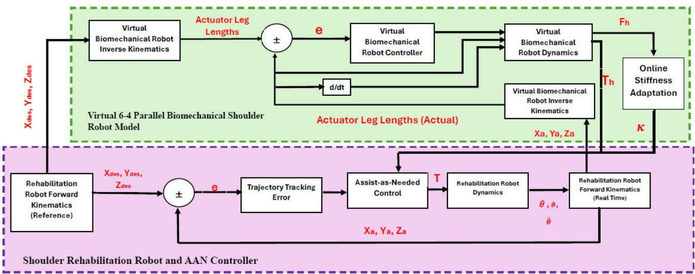  
Fig. 1. Schematic of the proposed control framework utilized in this study integrating a Virtual biomechanical shoulder robot model (VBSRM) with an adaptive assist-as-needed (AAN) controller. The VBSRM, modeled as a 6 − 4 parallel mechanism, simulates human shoulder biomechanics to estimate the required human torque (T ) and interaction force (F ). These estimates are used to drive an online stiffness adaptation module that continuously adjusts joint stiffness (κ) based on subject performance. The AAN controller receives tracking error and stiffness-modulated torque input to compute the appropriate robotic assistance (T). This assistance is applied to the shoulder rehabilitation robot, which follows a desired trajectory while adapting to real-time patient interaction. The architecture enables personalized, responsive, and biomechanically informed rehabilitation.

Over the years, many researchers have deployed AAN based controllers for reliable and efficient control of rehabilitation robots [21], [23], [24]. A disturbance observer-based AAN controller has been deployed in by Pehlivan et al. [25] for an upper limb rehabilitation robot, designed to nullify estimated user inputs offers adjustable tracking error. Assuming the robot is fully back drivable, an impedance controller based AAN method is presented in [26], by integrating a torque free region around the reference trajectory. An AAN controller based on the functional ability of the subject is presented in [27], in which the authors propose an estimation algorithm to estimate the functional ability index of the subject, which serves as the input to the adaptation control law. One of the most important challenges in rehabilitation is the estimation of human user effort and interaction forces with robots. This is particularly crucial if adaptive controllers are to be developed, which can respond appropriately to the patient’s needs.

This paper presents a novel Assist-as-Needed (AAN) control strategy for a shoulder rehabilitation robot that leverages a Virtual Biomechanical Shoulder Robot Model (VBSRM) with an integrated online stiffness learning module. The VBSRM is a parallel mechanism and is designed to replicate the kinematic and dynamic behavior of the human shoulder. With the simulation of biomechanical attributes including joint torques and adaptive stiffness, the VBSRM facilitates the generation of more physiologically representative assistance profiles from the rehabilitation system. The integration of an online stiffness estimation mechanism further enhances this capability by continuously adapting the model parameters based on real-time interaction data, enabling the system to respond to changes in muscle tone, fatigue, and motor effort throughout the rehabilitation process.

The control structure, demonstrated in Figure 1, has VBSRM and shoulder rehabilitation robot integrated. The VBSRM performs calculation of actuator leg lengths based on inverse kinematics and approximation of the desired torque through analysis of dynamics. The approximation of the torque is fed into the AAN controller, and from this, it computes the maximum assistance force that should be administered by the rehabilitation robot. The online stiffness learning module identifies the stiffness parameters of the shoulder model in real time, enhancing torque estimation accuracy, and enabling the control system to more effectively distinguish between active patient contribution and passive movement. By continuous comparison between the reference path and the actual movement of the user, the system continuously adjusted the degree of assistance to supply smooth and efficient rehabilitation training. An AAN controller continuously monitors the tracking error between the actual and reference motion paths, as well as the human-robot interaction forces. It then uses this information, in conjunction with the adaptive stiffness profile, to adjust the assistance torque to deliver only the level of assistance required. In this way, it keeps patients actively involved in the rehabilitation exercise, with voluntary effort encouraged and guided assistance offered if and when required. The addition of online stiffness adaptation will allow more subtle and context-dependent control, particularly for patients with variation in joint compliance or neuromuscular response.

One of the most significant advantages of integrating the VBSRM into the control system is the potential for individualized rehabilitation therapy. Since the virtual model simulates human torque in real time, the AAN control strategy can be adjusted according to the specific patient’s physical status and recovery progress. This individualization is particularly valuable in neurorehabilitation, as patients possess varying degrees of muscle strength, coordination, and motor control. Through dynamically adjusting levels of support, the system prompts active patient involvement, which is of particular importance in rehabilitation. The use of a virtual biomechanical model and online stiffness learning within the control system represents a significant step towards patientspecific, intelligent rehabilitation systems capable of adapting to individual needs and attaining quicker recovery.

To the best of authors’ knowledge, this is the first AAN control strategy reported for a shoulder rehabilitation robot that integrates a virtual biomechanical model and an online stiffness learning mechanism. This innovation is a significant stride toward intelligent, customized rehabilitation systems that can deliver adaptive, focused, and clinically meaningful therapy interventions.

The remainder of the article is organized as follows: Section II covers the details on system description and mathematical modeling of shoulder limb rehabilitation robot and virtual biomechanical shoulder robot model. Section III is dedicated to controller design. Section IV details the experimental methods, results and discussion are presented in Section V, whereas Section VI concludes the article.

## II. SYSTEM DESCRIPTION AND MODELING

## A. Human Shoulder Biomechanics

The shoulder complex consists of four interconnected joints: the glenohumeral (GH), sternoclavicular (SC), acromioclavicular (AC), and scapulothoracic (ST) joints. These joints function collectively to create the shoulder’s complex and highly mobile movement [28]. The GH joint is the primary joint, which is formed by the humeral head and the glenoid cavity of the scapula, constituting a ball-and-socket joint. Due to its low bone congruency and capsular laxity, the GH joint possesses the largest range of motion (ROM) among all the shoulder joints. The sternoclavicular joint is formed by the sternal end of the clavicle and the clavicular notch on the sternum, which are connected by ligaments. Similarly, the acromioclavicular joint is formed by the articulation between the scapular acromion and the distal end of the clavicle. Situated posterior to the rib cage, the scapulothoracic joint connects the scapula to the thoracic spine and contributes approximately one-third of the shoulder’s total ROM [29].

Three DOF of the shoulder joint alone provides it with the capability to move along the frontal, sagittal, and longitudinal axes. In the frontal plane, it provides flexion and extension from $- 5 0 \mathrm { ~ ^ { \circ } ~ t o ~ } 1 8 0 \mathrm { ~ ^ { \circ } } .$ . Abduction and adduction between $0 ~ ^ { \circ }$ to $1 8 0 ^ { \circ }$ is possible in the sagittal plane. Rotation is around the longitudinal axis, with internal rotation ranging from $- 9 0 ^ { \circ }$ to $0 ^ { \circ }$ and external rotation ranging from $0 ^ { \circ } \mathrm { t o } 9 0 ^ { \circ }$ . Further, the shoulder girdle, or the movements of scapulae, has two DOF. On the sagittal axis, it has depression and elevation between $- ~ 1 0 ~ ^ { \circ }$ and $2 0 ^ { \circ }$ , and the frontal axis provides protraction and retraction between − $2 0 ^ { \circ }$ and $2 0 ^ { \circ }$ . These synergistic motions are accountable for the remarkable flexibility and utilization of the shoulder complex [5], [30].

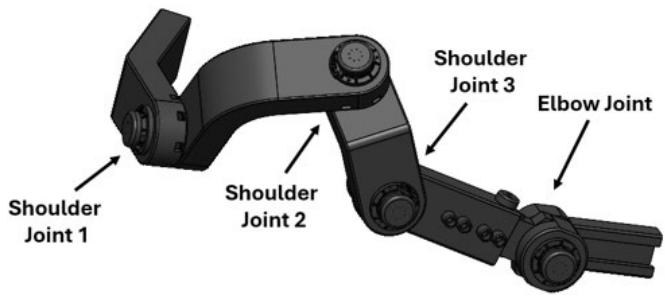  
(a)

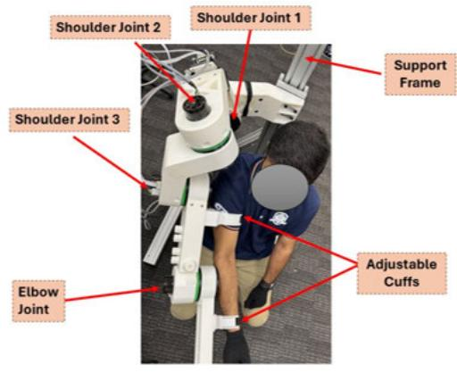  
(b)  
Fig. 2. CAD model and experimental prototype of the shoulder rehabilitation robot under study.

## B. Shoulder Rehabilitation Robot

1) System Description: Anatomically the upper limb comprises of three joints: shoulder, elbow, and wrist joints [31]. The shoulder joint is one of the most complex and flexible joints in the human body which can perform flexion/extension, internal/external rotations, and abduction/adduction movements. The overall workspace of the human limb is most affected by the shoulder joint. Loss of any one of the three degree of freedoms associated with the shoulder joint may prevent the hand to perform basic active daily life tasks [32]. The elbow joint connects the upper arm to the forearm. The flexion/extension of the upper arm and the internal/external rotations of the forearm depend on the elbow joint [33].

The proposed shoulder rehabilitation robot has motorized shoulder, elbow, and wrist joints. The mechanical design of the shoulder rehabilitation robot is illustrated in Figure 2. The overall configuration of the rehabilitation robot is designed to follow the natural movement of the shoulder joint. The shoulder provides three degrees of freedom: flexion/extension in the frontal plane, abduction/adduction in the sagittal plane, and internal/external rotation along the longitudinal axis. The elbow joint is modeled to allow flexion and extension in the frontal plane. To ensure proper alignment between the robot and the user’s anatomy, the upper arm linkage of the robot is designed to be telescopic so that the robot’s elbow joint aligns closely with the subject’s elbow. Additionally, the lengths of the back support, upper arm, and forearm segments can be customized to match the user’s body dimensions. In this study, only the shoulder module of the robot was utilized, while data from the elbow and wrist modules were excluded.

TABLE I  
DH PARAMETERS OF THE SHOULDER REHABILITATION ROBOT

<table><tr><td>Joint</td><td> $\alpha_i$ (deg)</td><td> $a_i(mm)$ </td><td> $d_i(mm)$ </td><td> $\theta_i(deg)$ </td><td> $\theta_i$  Limitations (deg)</td></tr><tr><td>1</td><td>0</td><td>0</td><td>L1</td><td> $\theta_1$ </td><td>[0,180]</td></tr><tr><td>2</td><td>-90</td><td>L2</td><td>0</td><td> $\theta_2$ </td><td>[0,90]</td></tr><tr><td>3</td><td>0</td><td>0</td><td>L3</td><td> $\theta_3$ </td><td>[0,90]</td></tr></table>

TABLE II

TRAJECTORY TRACKING ERROR OF THE ROBOT IN ACTIVE, PID, AND PASSIVE CONTROL MODES

<table><tr><td>Axis</td><td>Active Control Mode (mm)</td><td>Passive Control Mode (mm)</td><td>PID Control Mode (mm)</td></tr><tr><td>X</td><td>9.6±1.1</td><td>10.4±2.1</td><td>10.1±1.8</td></tr><tr><td>Y</td><td>9.1±5.5</td><td>13.7±2.9</td><td>12.4±2.1</td></tr><tr><td>Z</td><td>11.4±1.6</td><td>13.9±1.7</td><td>12.3±1.9</td></tr></table>

2) Forward Kinematic Modeling: As explained earlier, the upper limb rehabilitation robot under study is a serial manipulator. The closed form solutions for such manipulators can be computed by the forward kinematics [34]. The Denavit–Hartenberg (DH) convention is usually used in robotics to carry out the kinematics of the manipulators [35]. The upper limb rehabilitation robot with affixed reference frames according to the DH convention is shown in Figure $^ { 2 , }$ while the corresponding DH parameters are presented in Table I. The transformation matrix can be calculated as in (1). Where, $A _ { i } ^ { i - 1 }$ is the resulting transformation matrix from frame i − 1 to i , $R _ { 3 }$ is a $3 \times 3$ rotation matrix and $P _ { 3 }$ is the $3 \times 1$ position vector of the end-effector with respect to the base frame.

$$
T _ {3} ^ {1} = \prod_ {i = 1} ^ {3} A _ {i} ^ {i - 1} = A _ {1} ^ {0} A _ {2} ^ {1} A _ {3} ^ {2} = \left[ \begin{array}{c c} R _ {3} & P _ {3} \\ 0 & 1 \end{array} \right]\tag{1}
$$

3) Dynamic Modeling: The dynamic model of the upper limb rehabilitation robot is given by (2). Where $\theta , { \dot { \theta } } ,$ , and $\ddot { \theta }$ represent the angular displacement, angular velocity, and angular acceleration respectively. $M _ { r }$ is the mass matrix of the system, $C _ { r }$ is the Coriolis and centrifugal torque matrix, and $G _ { r }$ is the gravitational torque matrix. $\tau _ { r }$ is the torque applied by the robot to guide the subject’s arm on desired trajectories.

$$
M _ {r} (\theta) \ddot {\theta} + C _ {r} (\theta , \dot {\theta}) \dot {\theta} + G _ {r} (\theta) = \tau_ {r}\tag{2}
$$

## C. Virtual Biomechanical Shoulder Robot Model

1) Model Description: This study employs a virtual biomechanical shoulder robot model based on a parallel mechanism proposed in authors previously published work in [36]. The design of the VBSRM is presented in Figure 4. The VBSRM provides four degrees of freedom for the human shoulder girdle. The mechanism consists of a moving platform (scapula) and a fixed platform (thorax). The two platforms are connected by six kinematic chains. These kinematic chains consist of a prismatic joint that is connected to the moving plate by a ball and socket joint, and to the base platform by a universal joint. The SC-AC link is fixed while the ST-E link is considered as a passive link. The readers are referred to [36], [37], and [38] for more details on VBSRM.

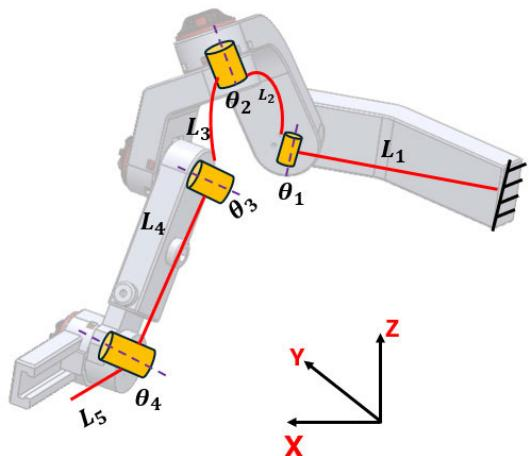

Fig. 3. Attachment of coordinate frames to the joints and links of the shoulder rehabilitation robot. This frame definition supports consistent kinematic modeling and real-time trajectory tracking.  
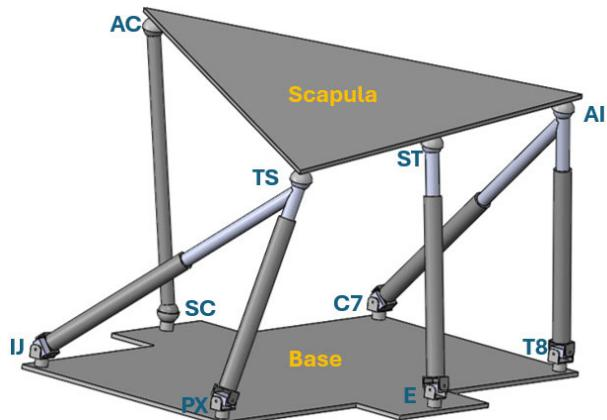  
Fig. 4. CAD model of the 6 − 4 parallel mechanism-based virtual biomechanical shoulder robot model (VBSRM). The model replicates scapular kinematics and approximates human shoulder biomechanics, allowing for real-time estimation of actuator leg lengths and human joint torques.

2) Inverse Kinematics: Inverse kinematics of refers to computing the link lengths when the position of the end effector is known [39]. The link length for the VBSRM can be computed as given in (3), where $d _ { i }$ is the link length, $p$ is the translation vector, $b _ { j }$ is the distance between the center of the moving top plate and the anchor point where the prismatic link is attached, $a _ { i }$ is the distance from the center of the fixed base plate and the anchor point where the prismatic link is attached, and $^ A _ { B } R$ is the rotation matrix of the VBSRM which can be computed as (4).

$$
d _ {i} = p + \mathbf {\Lambda} _ {B} ^ {A} R b _ {j} - a _ {i}
$$

$$
{ } _ { B } ^ { A } R = R _ { Z } ( \psi ) R _ { Y } ( \theta ) R _ { X } ( \varphi )\tag{3}
$$

(4)

3) Dynamic Modeling: The dynamic modelling of the VBSRM is crucial for accurately estimating the torques and interaction forces to replicate the human shoulder movements. The active actuators in the VBSRM contribute to the motion and force generation, whereas the passive and fixed links impose kinematic constraints that affect the overall dynamics. The primary goal of this section is to derive the equations of motion governing VBSRM, considering both actuator dynamics and passive constraints that influence force transmission. To establish the dynamic equations, we employ the Lagrangian formulation, which provides an analytical approach to describing the system’s energy and force interactions [40], [41]. Initially, the generalized equations of motion are developed for the active actuators and the moving platform (scapula). Then, the passive constraint equation due to the ST-E link that influence the VBSRM’s mobility is introduced. Finally, the actuation torques required to generate desired end-effector forces are formulated. The developed dynamic model is the basis for the implementation of controller designs that facilitate natural and smooth humanrobot interaction in the rehabilitation environment.

The four DOF associated with the VBSRM can be defined as in (5). Where x and y are associated with the translational DOF (elevation/depression and abduction/adduction) whereas $\theta _ { x }$ and $\theta _ { z }$ represent the rotational DOF (anterior/posterior tilting and upward rotation) of the VBSRM.

$$
q = [ x y \theta_ {x} \theta_ {z} ]\tag{5}
$$

The total kinetic energy of the system can be expressed as (6). Where the mass of moving platform (scapula) is represented by $m _ { s } .$ , The moment of inertia of the platform is given by $I _ { x } ,$ , and $I _ { z } , m _ { i }$ is the mass of actuators, and $\dot { d } _ { i }$ are the actuator velocities.

The actuator velocities $\dot { d } _ { i }$ and the motion of the moving platform $\dot { q } .$ , can be expressed using the Jacobian matrix $^ { J , }$ and be computed as (7). So, the total kinetic energy can be computed as (8). Where $M \left( q \right)$ is the matrix of generalized masses incorporating both moving platform (scapula) and actuators.

$$
K = \frac {1}{2} m _ {s} \dot {x} ^ {2} + \frac {1}{2} m _ {s} \dot {y} ^ {2} + \frac {1}{2} I _ {x} \dot {\theta} _ {x} ^ {2} + \frac {1}{2} I _ {z} \dot {\theta} _ {z} ^ {2} + \sum_ {i = 1} ^ {4} \frac {1}{2} m _ {i} \dot {d} _ {i} ^ {2}\tag{6}
$$

$$
\dot {d} _ {i} = J \dot {q}\tag{7}
$$

$$
K = \frac {1}{2} \dot {q} ^ {T} M (q) \dot {q}\tag{8}
$$

The total potential energy of the VBSRM arises from the gravity force acting on the moving platform (scapula) and actuators, which can be computed as (9).

$$
P = m _ {s} g y + \sum_ {i = 1} ^ {4} m _ {i} g d _ {i}\tag{9}
$$

Substituting the actuator positions in terms of generalized coordinates, the potential energy $P ,$ can be computed as (10).

$$
P = g (m _ {s} y + \sum_ {i = 1} ^ {4} m _ {i} J _ {i} q)\tag{10}
$$

The Lagrangian function L can this be defined as:

$$
L = K - P
$$

$$
{\cal L} = \frac {1}{2} \dot {q} ^ {T} M (q) \dot {q} - g (m _ {s} y + \sum_ {i = 1} ^ {4} m _ {i} J _ {i} q)\tag{11}
$$

(12)

By using the Lagrangian formulation, the equation of motion for the VBSRM can be computed as given in (13).

$$
M (q) \ddot {q} + C (q, \dot {q}) \dot {q} + G (q) = J ^ {T} \tau_ {h}\tag{13}
$$

For the passive link ST-E, the Jacobian matrix is used to introduce the constraint forces as in (14).

$$
J _ {p} \ddot {q} + J _ {p} \dot {q} = 0\tag{14}
$$

After combining the dynamics of active and passive links, the modified system can thus be defined as (15). Where $\lambda _ { p }$ represents the constraint forces in the passive links.

$$
\left[ \begin{array}{c c} M & J _ {p} ^ {T} \\ J _ {p} & 0 \end{array} \right] \left[ \begin{array}{c} \ddot {q} \\ \lambda_ {p} \end{array} \right] = \left[ \begin{array}{c} J ^ {T} \tau_ {h} - C (q, \dot {q}) \dot {q} - G (q) \\ - \dot {J} _ {p} \dot {q} \end{array} \right]\tag{15}
$$

4) Stiffness Modeling: Following the dynamics modeling of the VBSRM, it is essential to analyze the systems stiffness characteristics, as they are vital in understanding the biomechanical behavior of the human shoulder. Since the VBSRM is designed to replicate the structural and functional properties of the human shoulder complex, it is important to have a precise estimation of its stiffness to ensure safe, effective, and adaptive physical human-robot interaction during rehabilitation. The overall stiffness matrix, κ of the VBSRM can be computed as given in (16). resulting transformation matrix from frame

$$
\kappa = J ^ {T} \xi J\tag{16}
$$

$$
\xi = \frac {d F}{d l}\tag{17}
$$

The overall stiffness matrix of the VBSRM can be computed as (18). Where $k _ { 2 - 6 }$ represent the link stiffness. This stiffness matrix can be further decomposed by utilizing singular value decomposition as in (19). Where the orthogonal matrices are represented by X and Y, and 6 contains singular values.

$$
K = J ^ {T} \operatorname{diag} (k _ {2}, k _ {3}, k _ {5}, k _ {6}) J
$$

$$
S = \left[ X ^ {T} \right] _ {4 \times 4} [ \Sigma ] _ {4 \times 4} [ Y ] _ {4 \times 4}\tag{18}
$$

$$
\text { III.   CONTROLLER   DESIGN }\tag{19}
$$

The AAN control framework in the proposed study integrates the Virtual Biomechanical Shoulder Robot Model and a Shoulder Rehabilitation Robot (as shown in Figure 1) to provide adaptive assistance based on the patient’s movement capability. The aim of this control scheme is to provide the patient with only necessary assistance required and promote voluntary contribution. Each subsystem (see Figure 1) has a specific task in the generation of reference trajectories, the calculation of actuator commands, and the adaptive modulation of control forces.

## A. Virtual Biomechanical Controller

In this work, we have employed a VBSRM to replicate the kinematics and dynamics of the human shoulder by using a parallel mechanism. The virtual biomechanical controller provides a reference for the rehabilitation process by computing the desired torques and actuator leg lengths for the given reference trajectory. For the given trajectory of the moving platform (scapula), the leg lengths $d _ { i } ^ { d }$ , are computed using the inverse kinematics as in (3). These leg lengths are compared against the actual actuator lengths $d _ { i } ^ { a }$ to generate an error signal, e as in (20), which is processed by the Virtual Biomechanical Robot Controller to refine the actuator commands.

$$
e = d _ {i} ^ {a} - d _ {i} ^ {d}\tag{20}
$$

To regulate the actuator lengths of the VBSRM, a PID (Proportional, Integral, and Derivate) based control strategy is implemented. The PID controller compensates for tracking errors by adjusting actuator commands dynamically. The control law is given by (21). Where $k _ { p } , k _ { i }$ , and $k _ { d }$ are the proportional, integral, and derivative gains respectively. By employing PID control, the virtual model ensures actuator displacements converge smoothly to desired values. This minimizes tracking errors, enhances stability, and ensures biomechanical fidelity in the rehabilitation motions.

$$
u (t) = k _ {p} e (t) + k _ {i} \int_ {0} ^ {t} e (t) d t + k _ {d} \frac {d}{d x} e (t)\tag{21}
$$

Apart from producing reference trajectories, the VBSRM controller also delivers a torque signal $\tau _ { h }$ , which serves as an input to the Assist-as-Needed (AAN) Controller. This reference torque is computed based on the virtual model’s dynamic equations (Section II-B (3)), ensuring that the rehabilitation robot follows biomechanically realistic force profiles during rehabilitation exercises.

## B. Assist-as-Needed Controller

The AAN control strategy in this research is designed to provide adaptive support to the subject during rehabilitation training. This controller also ensures that the subjects are receiving the required level of support while facilitating active participation and providing guidance without excessive intervention. The control approach modifies assistance torque adaptively relative to tracking errors, effort from the subject, and interaction forces with the aim of enhancing motor learning as well as functional recovery. At the core of AAN control scheme (Figure 1) is the torque assistance equation that blends the computed torque of the robot and the torque contributed by the VBSRM. Thus, the adaptive torque T, can be expressed as (22). Where $\beta$ is the adaptive coefficient that scales the assistance based on the engagement of subject.

$$
\mathrm{T} = (1 - \beta) \tau_ {r} + \beta \tau_ {h}\tag{22}
$$

The main feature of the AAN controller is the dynamic adjustment of the assistance level (β). This ensures that the subject receives the required level of assistance. The scaling function for $\beta$ is given by (23). The assistance level $\beta \left( \mathrm { t } \right)$ is dynamically adjusted based on the interaction force $F _ { h }$ exerted by the subject. This ensures that robotic assistance is minimized when the subject exerts sufficient force, and it increases when additional support is needed. In (23), $\beta _ { 0 }$ is the initial assistance level, k is the gain parameter that determines the sensitivity of assistance adjustment, and $F _ { t h r e s h o l d }$ is the predefined threshold force. If the force exerted by the subject exceeds this value, assistance is required.

$$
\beta (t) = \max (0, \min (1, \beta_ {0} + k (F _ {h} - F _ {\text { threshold }})))\tag{23}
$$

The AAN controller integrates a PID-based trajectory tracking control mechanism to regulate the robot’s response.

The trajectory tracking error can be computed as (24). Where $X _ { d e s }$ is the desired position and $X _ { a }$ is the actual position of the robot. A PID controller is then utilized to minimize this error. The control law is given in (25).

$$
e _ {r} = X _ {d e s} - X _ {a}\tag{24}
$$

$$
\omega (t) = k _ {p} e _ {r} (t) + k _ {i} \int_ {0} ^ {t} e _ {r} (t) d t + k _ {d} \frac {d}{d x} e _ {r} (t)\tag{25}
$$

## C. Online Stiffness Adaptation

To further refine the performance of the robot and mimic human joint movement more accurately, online stiffness learning is integrated into the VBSRM. Using the impedancebased model, dynamic torque can now be computed as in (26). Where K (t) is the time-varying joint stiffness parameter and $e _ { r } \left( t \right)$ is the trajectory tracking error. The joint stiffness parameter is adapted online using the gradient-based update approach as given in (27). Where η is the online adaptation gain. This formulation ensures that when the tracking errors are increasing or large, the model infers less human effort and increases the estimated stiffness, thereby giving more assistance share. Conversely when the subject improves and begins to track more accurately, the stiffness estimate truncates, signifying more voluntary activity. This gradient based stiffness adaptation module is inspired by the errorgradient form widely used in adaptive impedance controllers for rehabilitation robots [42], [43].

$$
\tau_ {h} = \mathrm{K} (t). e _ {r} (t)
$$

$$
\mathrm{K} (t) = \eta . e _ {r} ^ {\cdot} (t). e _ {r} (t)\tag{26}
$$

(27)

By incorporating the stiffness adaptation module into the AAN control loop, the system is able to distinguish between passive and active subject behavior. It encourages safety by offering greater robotic support as patient effort declines, and it encourages independence by reducing assistance as performance improves. This model-based, dynamic adaptation is a necessary bridge between physical biomechanics and control automation in patient-specific rehabilitation protocols.

## D. Stability Considerations

The stability of the proposed control scheme can be justified through a comprehensive analysis of the two interconnected control loops (see Figure 1). The VBSRM controller block operates to provide torques for the active actuators. The second AAN control layer serves as an interface between the VBSRM and the robot. This layer integrates the torque signals from VBSRM with the rehabilitation robot. Impedance control is commonly employed in human-robot interaction systems and is known for its stability when combined with well-tuned PID characteristics. The stability of the PID controller can be attained with the correct values of the control parameters [14]. The overall stability of the proposed control scheme depends upon the stability of each control loop and their interaction (Figure 1). This is maintained through controller gains and ensuring the movement of the shoulder joint of the rehabilitation robot remains within the geometric limits mentioned in Table I.

## IV. EXPERIMENTAL SETUP

To further validate the proposed assist-as-needed control based on virtual biomechanical shoulder robot model, the experiments were conducted on the shoulder module of the upper limb rehabilitation robot. The control scheme was tested with ten healthy subjects (7 males and 3 females, 22-38 years; height: 143-183cm, weight: 52-98kg) with no prior neurological disorder. All participants provided written informed consent before participating in the study, and ethical approval was granted by the local Human Research Ethics Committee at the University of Canberra (ref: 11800). Detailed information regarding the experimental procedure was provided to the subjects and they were encouraged to ask questions.

Before beginning the experiment with healthy subjects, the actuation mechanism was brought to the homing position. The experiments were then conducted in two phases (active and passive). In active control mode, the subject voluntarily moved their shoulder with minimal assistance from the robot. In passive control mode, the robot entirely moved the subject’s upper limb along pre-defined trajectories without exertion on their part using the fixed stiffness values from the VBSRM. In active control (AAN control mode), the system continuously monitored the position and velocity of the limb and regulated the applied force to provide smooth and natural movement. The controller dynamically estimates joint stiffness using a gradient-based rule. For passive control, the robot controlled the movement, modulating interaction forces to minimize resistance and ensure smooth motion along the predetermined path. The participants were given a ten-minute flush-out between experiments.

Safety during physical human-robot interaction was prioritized throughout the control design and experimental implementation. To ensure safety, the assistance coefficient was constrained to remain within the bounded range [0,1] preventing excessive torque delivery. Joint limits and maximum torque outputs were enforced both in software and at the actuator level to prevent mechanical overextension or excessive force. An emergency stop switch was made available to all participants, and all sessions were supervised by an operator.

## V. RESULTS AND DISCUSSION

The primary aim of this study is to demonstrate the efficacy of the proposed AAN controller integrated with the VBSRM. The performance of the Assist-as-Needed (AAN) controller was evaluated based on the accuracy of the trajectory tracking, joint torque oscillations, and joint angle responses during active and passive modes. For this purpose, a trajectory from the ADL was selected and given as a reference as shown in Figure 5. This figure also illustrates the reference path tracking under active and passive control. It can be observed that in both control modes the robot follows the trajectory very closely to the reference path, with the active mode (red dashed) appearing to be more responsive, while passive mode (blue dashed) traces small deviations primarily in the Y and Z directions. The initiating and terminating points are the same for all of the trajectories and demonstrate successful tracking throughout. Table II shows a quantitative assessment of the

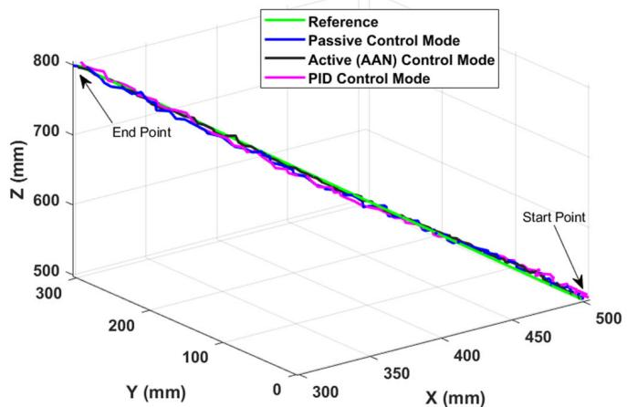  
Fig. 5. Comparison of trajectory tracking performance under three control modes averaged over 10 healthy subjects.

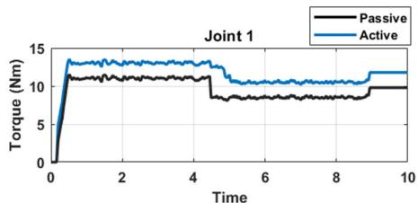

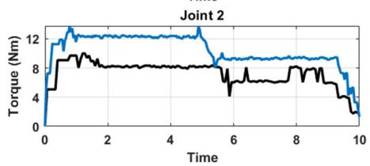

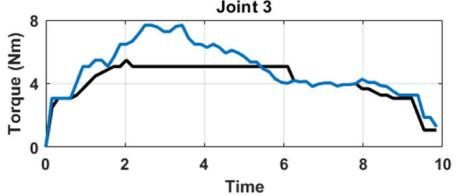  
Fig. 6. Joint torques of the shoulder rehabilitation robot during active (AAN) and passive control modes averaged over 10 healthy subjects.

X, Y, and Z axes errors in trajectory tracking. The active mode shows slightly lower errors along the X -axis $( 9 . 6 \pm 1 . 1$ mm) compared to that of the passive mode (10.4±2.1 mm). Further, in Y and Z directions, the active mode is also more precise with less mean errors $( 9 . 1 \pm 5 . 5 $ mm and $1 1 . 4 \pm 1 . 6$ mm, respectively) than the passive mode $( 1 3 . 7 \pm 2 . 9$ mm and $1 3 . 9 \pm 1 . 7 ~ m m )$ . This indicates that the active control mode adapts better to user motion and extraneous forces, especially in vertical and lateral directions. Moreover, the proposed AAN method was compared with PID controller as well. he PID controller used fixed gains optimized for trajectory tracking, without incorporating human effort estimation or stiffness adaptation. The trajectory tracking error for the PID control mode are also presented in Table II. It can be observed that the error in the active mode is less due to the real time assistance and effort adaptation whereas in the PID control mode there is more because of minimal assistance and lack of corrective human effort.

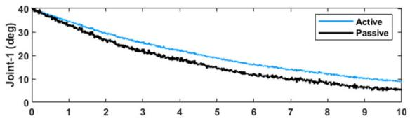

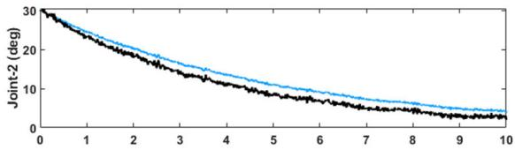

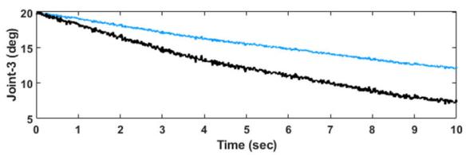  
Fig. 7. Joint angle profiles during active (AAN) and passive contro modes averaged over 10 healthy subjects.

The torque profiles of three joints in both active and passive modes are illustrated in Figure 6. Active mode torques are larger than passive mode torques, particularly at movement initiation. This is expected since, in the active mode, the AAN controller provides additional torque to help the movement if the patient’s effort is insufficient. The time-varying torques show dynamic adaptation, confirming that the controller modulates assistance based on effort estimation in real time.

The joint angle responses with time under active and passive control modes are shown in Figure 7. It can be observed that the active mode generates higher angular displacements, reflecting the ability of the controller to enable more movement when help is provided. The passive mode generates lower motion, reflecting the lower level of external help. The smooth angular movement through different joints confirms that the controller provides adaptive support without abrupt changes, ensuring patient comfort and natural joint movement.

The peak torques in both the modes are presented in Table III. In order to evaluate the statistical significance of the experimental outcome of the proposed control scheme a $p$ -value test was also conducted as shown in Table III. It is evident from the results that for most observations, the null hypothesis can be rejected owing to the small p -values. This difference between active, passive, and PID control conditions on all metrics illustrates the effectiveness of the AAN strategy in rehabilitation. Confidence intervals (CIs) are also reported alongside mean values to convey the precision of torque measurements and support interpretation of the results beyond statistical significance in Table III. Narrow CIs in Joints 1 and 3 reflect consistent participant responses, while overlapping CIs in Joint 2 suggest limited practical difference despite statistical significance. These intervals also provide an estimate of the likely performance range in similar user populations, supporting future clinical translation. The controller can successfully bargain off assistance and autonomy, engaging patient contribution without allowing over-reliance on robotic assistance. This bargain is critical in facilitating motor learning and provoking neuroplasticity in rehabilitation situations.

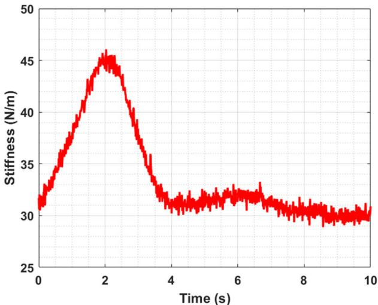

Fig. 8. Online estimated joint stiffness under the proposed AAN control strategy, averaged over 10 healthy subjects. The stiffness adapts in real time using a gradient-based rule, increasing when subject engagement is low and decreasing when voluntary effort improves.  
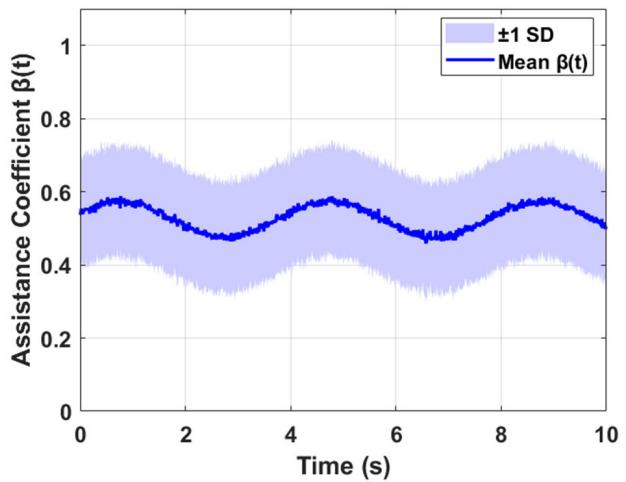  
Fig. 9. Variation of assistance coefficient during experiments averaged over 10 healthy subjects.

Figure 8 displays the evolution of online-estimated stiffness throughout the ADL task for ten subjects. Real-time adaptation of joint stiffness is achieved by the gradient-based adaptation mechanism. The stiffness is increased at the beginning, which corresponds to higher resistance when the subject begins using the device. After about 4 seconds, the stiffness gradually relaxes, demonstrating the decrement in voluntary muscular exertion or adaptation to repeated motion. Such adjustment improves the AAN paradigm by varying support with respect to user engagement level. The variation in the assistance coefficient $\beta ( { \mathfrak { t } } )$ over the experiments averaged over the 10 healthy subjects is presented in Figure 9, along with ±1 standard deviation (SD). The initial value was set to $\beta _ { 0 }$ $= ~ 0 . 5$ for all trials, reflecting an equal contribution from the rehabilitation robot and the virtual biomechanical model. During the trajectory tracking task, $\beta ( { \mathfrak { t } } )$ was continuously updated based on the subject’s interaction force using the update law described in (23). Figure 9 demonstrates that $\beta _ { o } ( \mathfrak { t } )$ remained bounded within [0.4, 0.6] and varied gradually in response to subject interaction dynamics, with a mean centered around 0.5. This confirms the controller’s ability to adjust assistance in real time, promoting patient engagement without abrupt changes.

TABLE III  
PEAK VALUES OF TORQUES IN AAN, PID, AND PASSIVE CONTROL MODES. STANDARD DEVIATIONS ± ARE PRESENTED FOR VARIABILITY WITHIN SUBJECTS

<table><tr><td>Joint</td><td>Peak Torque (Active) Nm</td><td>95% CI (Active)</td><td>Peak Torque (Passive) Nm</td><td>95% CI (Passive)</td><td>Peak Torque (PID) Nm</td><td>p-values</td></tr><tr><td>1</td><td> $13.1 \pm 2.09$ </td><td>[11.7,14.5]</td><td> $11.3 \pm 2.61$ </td><td>[9.6,13.0]</td><td> $12.3 \pm 1.43$ </td><td>0.0042</td></tr><tr><td>2</td><td> $9.1 \pm 2.66$ </td><td>[7.2,11.0]</td><td> $8.9 \pm 1.96$ </td><td>[7.5,10.3]</td><td> $10.3 \pm 1.14$ </td><td>0.0039</td></tr><tr><td>3</td><td> $7.6 \pm 1.05$ </td><td>[6.9, 8.3]</td><td> $6.25 \pm 1.27$ </td><td>[5.4, 7.1]</td><td> $7.28 \pm 1.38$ </td><td>0.0021</td></tr></table>

Additionally, the integration of the VBSRM within the AAN framework enhances the accuracy of the controller in estimating patient effort and adjusting assistance levels. This model provides realistic torque estimations that allow for precise tuning of assistance parameters, thus ensuring the rehabilitation robot operates in a patient-specific manner and optimizes recovery outcomes. In general, the results validate the effectiveness of the proposed AAN controller in providing adaptive assistance that is tailored to the needs of a patient. Real-time stiffness adaptation and biomechanical modeling together ensure that the rehabilitation training provided is both demanding and assisting while ensuring progressive recovery.

In this study, a novel adaptive AAN control for shoulder rehabilitation robot was presented by utilizing the VBSRM. The VBSRM was used to compute the desired human torque through inverse dynamics, as a biomechanically inspired reference for assistance calculation. The AAN controller then computed the robotic assistance adaptively by blending the VBSRM-based torque and the calculated torque of the robot, modulated by an adaptive coefficient. Another novel contribution of this work is the addition of an online stiffness adaptation module, which is updating joint stiffness values continuously as a function of subject interaction with a gradient-based learning rule. This module allows the control system to assess the subject’s engagement level and modulate assistance dynamically to suit their ongoing ability. When the subject is actively contributing, the adaptive coefficient reduces robotic torque, promoting effortful contribution; under low engagement, stiffness is amplified, and the robot assists more to ensure accurate and smooth movement execution. This closed-loop integration of AAN control, biomechanical modeling, and real-time stiffness learning results in a highly personalized and responsive rehabilitation approach. Not only does the control framework preserve the biomechanical integrity of human movement, promote active contribution and motor recovery, but it also achieves a balance between assistance and autonomy that is critical for effective neurorehabilitation.

Despite demonstrating potential efficacy, this study has several limitations. First, experiments were conducted on healthy subjects alone, which may not necessarily translate to the motor impairments and heterogeneity of clinical populations such as stroke patients. Healthy participants possess intact neuromuscular coordination, consistent motor output, and predictable biomechanical responses, which may not reflect the variability and impairments observed in stroke survivors or patients with neurological disorders. In contrast, clinical populations often exhibit spasticity, motor deficits, muscle weakness, or abnormal joint stiffness, which could alter the dynamics of human-robot interaction. As such, the current results may overestimate system performance and underrepresent potential control challenges in real rehabilitation settings. Second, online stiffness adaptation was limited to a gradient-based approach, which cannot capture the full nonlinearities of human-robot interaction in all scenarios. Lastly, environmental disturbances and long-term adaptability of the system were not tested comprehensively, which are important for actual clinical applications.

## VI. CONCLUSION

This paper proposed a novel Assist-as-Needed control strategy for a shoulder rehabilitation robot, integrating a Virtual Biomechanical Shoulder Robot Model (VBSRM) and an online stiffness adaptation module. The VBSRM enabled real-time torque predictability, allowing the system to modulate assistance based on human joint effort. Incorporating a gradient-based stiffness learning rule enhanced the controller’s responsiveness through the dynamic tuning of joint stiffness based on user performance. Experimental trials on ten healthy subjects during an ADL task demonstrated that the proposed method effectively differentiates between active and passive control modes, modulates assistance torque accordingly, and promotes smoother and more natural joint trajectories. Realtime estimation of stiffness not only enabled the achievement of improved tracking accuracy but also allowed patientspecific adaptation, which is a key requirement in personalized rehabilitation. In conclusion, the results exhibit the potential of the proposed AAN control system for use in clinical rehabilitation, offering a scalable and smart platform for future human-in-the-loop neurorehabilitation systems. Future work will include clinical evaluation of the proposed AAN control framework with stroke patients over prolonged durations. In addition, integration of EMG signals for improved human intention recognition and multi-joint coordination will be explored.

While the current work focuses on a shoulder rehabilitation robot with a 6−4 parallel mechanism, the proposed Assistas-Needed (AAN) control paradigm consisting of virtual biomechanical modeling, adaptive stiffness learning, and effort-sensitive torque blending is extensible to other joints and rehabilitation systems. For instance, the rule of stiffness adaptation and assistance modulation as a function of interaction are joint and mechanism-independent and hence extensible to lower limb systems or elbow/wrist exoskeletons. The VBSRM module would require kinematic reconfiguration to model joint-specific dynamics, but the control logic would be functionally identical. We intend to extend this framework to multi-joint rehabilitation (e.g., shoulder-elbow coordination) and evaluate its scalability to variations in anatomical and mechanical configuration in future research.

## REFERENCES

[1] H. J. Asl, M. Yamashita, T. Narikiyo, and M. Kawanishi, “Field-based assist-as-needed control schemes for rehabilitation robots,” IEEE/ASME Trans. Mechatronics, vol. 25, no. 4, pp. 2100–2111, Aug. 2020, doi: 10.1109/TMECH.2020.2992090.

[2] S. Samuelkamaleshkumar et al., “Comparative scoping review: Robotassisted upper limb stroke rehabilitation in low- and middle-income countries versus high-income nations,” Arch. Phys. Med. Rehabil., vol. 106, no. 3, pp. 424–432, Mar. 2025.

[3] K. C. Tseng, L. Wang, C. Hsieh, and A. M. Wong, “Portable robots for upper-limb rehabilitation after stroke: A systematic review and metaanalysis,” Ann. Med., vol. 56, no. 1, Dec. 2024, Art. no. 2337735.

[4] S. Cai, P. Xie, G. Li, and L. Xie, “Compensation-corrective adaptive control strategy for upper-limb rehabilitation robots,” Robot. Auto. Syst., vol. 177, Jul. 2024, Art. no. 104701.

[5] M. F. Shah, S. Hussain, R. Goecke, and P. K. Jamwal, “Mechanism design and control of shoulder rehabilitation robots: A review,” IEEE Trans. Med. Robot. Bionics, vol. 5, no. 4, pp. 780–792, Nov. 2023, doi: 10.1109/TMRB.2023.3310086.

[6] S. Khalid, F. Alnajjar, M. Gochoo, A. Renawi, and S. Shimoda, “Robotic assistive and rehabilitation devices leading to motor recovery in upper limb: A systematic review,” Disab. Rehabil., Assistive Technol., vol. 18, no. 5, pp. 658–672, Jul. 2023.

[7] T. Proietti, V. Crocher, A. Roby-Brami, and N. Jarrassé, “Upperlimb robotic exoskeletons for neurorehabilitation: A review on control strategies,” IEEE Rev. Biomed. Eng., vol. 9, pp. 4–14, 2016.

[8] A. Kalsoom, M. F. Shah, and M. U. Farooq, “Advancements in state-ofthe-art ankle rehabilitation robotic devices: A review of design, actuation and control strategies,” Machines, vol. 13, no. 5, p. 429, May 2025.

[9] G. Bauer and Y.-J. Pan, “Review of control methods for upper limb telerehabilitation with robotic exoskeletons,” IEEE Access, vol. 8, pp. 203382–203397, 2020.

[10] A. S. Niyetkaliyev, S. Hussain, M. H. Ghayesh, and G. Alici, “Review on design and control aspects of robotic shoulder rehabilitation orthoses,” IEEE Trans. Human–Mach. Syst., vol. 47, no. 6, pp. 1134–1145, Dec. 2017, doi: 10.1109/THMS.2017.2700634.

[11] Y. Li et al., “A review on interaction control for contact robots through intent detection,” Prog. Biomed. Eng., vol. 4, no. 3, Jul. 2022, Art. no. 032004.

[12] Z. Li, B. Huang, Z. Ye, M. Deng, and C. Yang, “Physical human–robot interaction of a robotic exoskeleton by admittance control,” IEEE Trans. Ind. Electron., vol. 65, no. 12, pp. 9614–9624, Dec. 2018.

[13] N. Rehmat, J. Zuo, W. Meng, Q. Liu, S. Q. Xie, and H. Liang, “Upper limb rehabilitation using robotic exoskeleton systems: A systematic review,” Int. J. Intell. Robot. Appl., vol. 2, no. 3, pp. 283–295, Sep. 2018.

[14] R. J. Escarabajal, P. Zamora-Ortiz, J. L. Pulloquinga, M. Vallés, and Á. Valera, “Muscle-targeted robotic assistive control using musculoskeletal model of the lower limb,” IEEE Trans. Syst. Man, Cybern. Syst., vol. 55, no. 2, pp. 1537–1548, Feb. 2025.

[15] S. Hussain, P. K. Jamwal, P. V. Vliet, and N. A. T. Brown, “Robot assisted ankle neuro-rehabilitation: State of the art and future challenges,” Expert Rev. Neurotherapeutics, vol. 21, no. 1, pp. 111–121, Jan. 2021.

[16] S. Dalla Gasperina, L. Roveda, A. Pedrocchi, F. Braghin, and M. Gandolla, “Review on patient-cooperative control strategies for upperlimb rehabilitation exoskeletons,” Frontiers Robot. AI, vol. 8, Dec. 2021, Art. no. 745018.

[17] S. H. Chen et al., “Assistive control system for upper limb rehabilitation robot,” IEEE Trans. Neural Syst. Rehabil. Eng., vol. 24, no. 11, pp. 1199–1209, Nov. 2016, doi: 10.1109/TNSRE.2016.2532478.

[18] S. Hussain, P. K. Jamwal, M. H. Ghayesh, and S. Q. Xie, “Assistas-needed control of an intrinsically compliant robotic gait training orthosis,” IEEE Trans. Ind. Electron., vol. 64, no. 2, pp. 1675–1685, Feb. 2017.

[19] D. Felix Brown and S. Quan Xie, “Effectiveness of intelligent control strategies in robot-assisted rehabilitation—A systematic review,” IEEE Trans. Neural Syst. Rehabil. Eng., vol. 32, pp. 1828–1840, 2024.

[20] A. A. Blank, J. A. French, A. U. Pehlivan, and M. K. O’Malley, “Current trends in robot-assisted upper-limb stroke rehabilitation: Promoting patient engagement in therapy,” Current Phys. Med. Rehabil. Rep., vol. 2, no. 3, pp. 184–195, Sep. 2014.

[21] L. Zhang, S. Guo, and Q. Sun, “Development and assist-as-needed control of an end-effector upper limb rehabilitation robot,” Appl. Sci., vol. 10, no. 19, p. 6684, Sep. 2020.

[22] M. Li, J. Zhang, G. Zuo, G. Feng, and X. Zhang, “Assist-as-needed control strategy of bilateral upper limb rehabilitation robot based on GMM,” Machines, vol. 10, no. 2, p. 76, Jan. 2022.

[23] H. M. Qassim and W. Z. Wan Hasan, “A review on upper limb rehabilitation robots,” Appl. Sci., vol. 10, no. 19, p. 6976, Oct. 2020.

[24] P. K. Jamwal, S. Hussain, and M. H. Ghayesh, “Robotic orthoses for gait rehabilitation: An overview of mechanical design and control strategies,” Proc. Inst. Mech. Eng. H, J. Eng. Med., vol. 234, no. 5, pp. 444–457, 2020.

[25] A. U. Pehlivan, D. P. Losey, and M. K. O’Malley, “Minimal assist-asneeded controller for upper limb robotic rehabilitation,” IEEE Trans. Robot., vol. 32, no. 1, pp. 113–124, Feb. 2016.

[26] M. Mihelj, T. Nef, and R. Riener, “A novel paradigm for patientcooperative control of upper-limb rehabilitation robots,” Adv. Robot., vol. 21, no. 8, pp. 843–867, Jan. 2007.

[27] S. Y. A. Mounis, N. Z. Azlan, and F. Sado, “Assist-as-needed control strategy for upper-limb rehabilitation based on subject’s functional ability,” Meas. Control, vol. 52, nos. 9–10, pp. 1354–1361, Nov. 2019.

[28] L. Funk, “Biomechanics of the Shoulder,” in Shoulder Arthroscopy: Principles and Practice. Cham, Switzerland: Springer, 2023, pp. 17–32.

[29] J. Cornejo et al., “Mechatronic exoskeleton systems for supporting the biomechanics of shoulder-elbow-wrist: An innovative review,” in Proc. IEEE Int. IoT, Electron. Mechatronics Conf. (IEMTRONICS), Apr. 2021, pp. 1–9.

[30] A. Yataganbaba, E. Ceyhan, and G. Huri, “Shoulder kinematics and biomechanics,” in Fundamentals of the Shoulder. Cham, Switzerland: Springer, 2022, pp. 23–36.

[31] Z. Pang, T. Wang, Z. Wang, J. Yu, Z. Sun, and S. Liu, “Design and analysis of a wearable upper limb rehabilitation robot with characteristics of tension mechanism,” Appl. Sci., vol. 10, no. 6, p. 2101, Mar. 2020, doi: 10.3390/app10062101.

[32] J. Roh, W. Z. Rymer, E. J. Perreault, S. B. Yoo, and R. F. Beer, “Alterations in upper limb muscle synergy structure in chronic stroke survivors,” J. Neurophysiol., vol. 109, no. 3, pp. 768–781, Feb. 2013, doi: 10.1152/jn.00670.2012.

[33] K. A. M. Major et al., “Ranges of motion as basis for robot-assisted poststroke rehabilitation,” Hum. Veterinary Med., vol. 8, no. 3, pp. 192–196, Aug. 2016.

[34] T. Zahid, Z. Kausar, M. F. Shah, M. T. Saeed, and J. Pan, “Workspace design and trajectory planning of a five degree of freedom mobile welding manipulator for spherical objects,” IEEE Access, vol. 9, pp. 73843–73856, 2021, doi: 10.1109/ACCESS.2021.3080299.

[35] A. A. Hayat, R. G. Chittawadigi, A. D. Udai, and S. K. Saha, “Identification of denavit-hartenberg parameters of an industrial robot,” in Proc. Conf. Adv. Robot., Jul. 2013, pp. 1–6.

[36] M. F. Shah, P. K. Jamwal, R. Goecke, A. S. Niyetkaliyev, and S. Hussain, “A parallel mechanism-based virtual biomechanical shoulder robot model: Mechanism design optimization and motion planning,” Mech. Based Design Struct. Mach., vol. 53, no. 4, pp. 2744–2764, Apr. 2025.

[37] M. F. Shah, F. Hussain, P. K. Jamwal, and S. Hussain, “Design and performance analysis of a parallel mechanism based virtual biomechanical shoulder robot model,” in Proc. 30th Int. Conf. Mechatronics Mach. Vis. Pract. (M2VIP), Oct. 2024, pp. 1–6.

[38] M. F. Shah, P. K. Jamwal, R. Goecke, M. H. Ghayesh, and S. Hussain, “Performance-based design synthesis and analysis of a 6-4 UPS parallel mechanism based virtual biomechanical shoulder robot model,” Mech. Based Design Struct. Mach., vol. 53, pp. 1–21, Feb. 2025.

[39] M. F. Shah, N. A. Khan, F. Hussain, P. K. Jamwal, and S. Hussain, “A deep learning-aided framework for joint angle estimation of an upper limb rehabilitation robot,” in Proc. 26th Int. Multi-Topic Conf. (INMIC), Dec. 2024, pp. 1–6.

[40] F. Malvezzi, R. M. Orsino, and T. A. H. Coelho, “Lagrange’s, Maggi’s and Kane’s equations applied to the dynamic modelling of serial manipulator,” in Proc. Int. Symp. Dyn. Problems Mech. 2017: Cham, Switzerland: Springer, pp. 291–304.

[41] M. F. Shah, S. S. A. Shah, F. Hussain, P. K. Jamwal, and S. Hussain, “Inverse dynamics solution of an upper limb rehabilitation robot using deep learning approach,” in Proc. Int. Conf. Sustain. Comput. Intell. Syst., Jan. 2025, pp. 235–244.

[42] N. Hogan, “Impedance control: An approach to manipulation: Part II— Implementation,” J. Dyn. Syst., Meas., Control, vol. 107, no. 1, pp. 8–16, Mar. 1985.

[43] Y. Zhang et al., “Research on adaptive impedance control technology of upper limb rehabilitation robot based on impedance parameter prediction,” Frontiers Bioeng. Biotechnol., vol. 11, Jan. 2024, Art. no. 1332689.