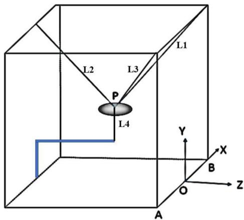
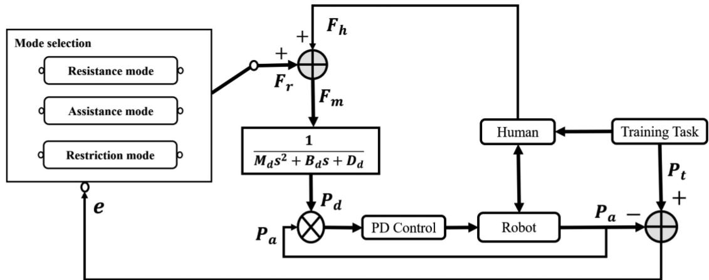
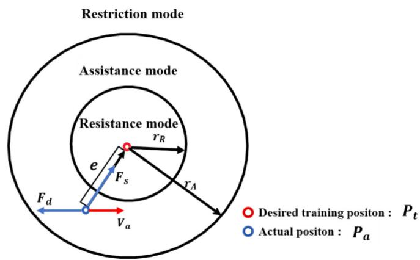
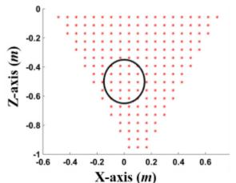
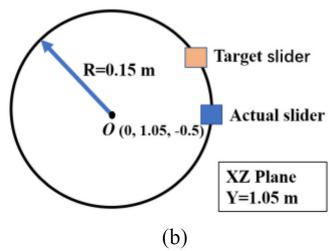
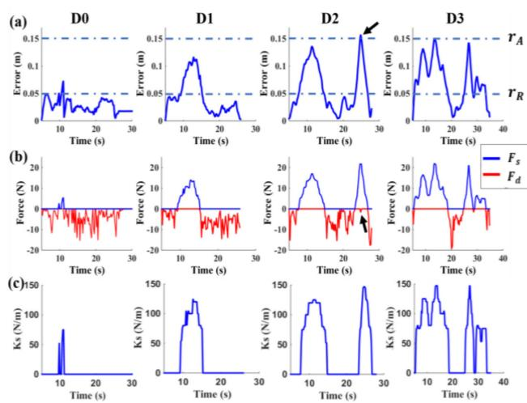
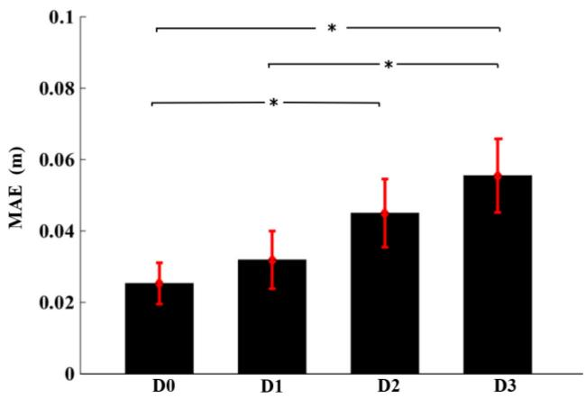

# Performance-Based Hybrid Control of a Cable-Driven Upper-Limb Rehabilitation Robot

Xianming Li , Qianqian Yang , and Rong Song , Senior Member, IEEE

Abstract—Patients after stroke may have different rehabilitation needs due to various levels of disability. To satisfy such needs, a performance-based hybrid control is proposed for a cable-driven upper-limb rehabilitation robot (CDULRR). The controller includes three working modes, i.e., resistance mode, assistance mode and restriction mode, which are switched by the tracking error since it is a common index to represent motor performance. In resistance mode, the proper damping force would be provided for subjects, which is in the opposite direction to the actual velocity. In assistance mode, a method of adjusting stiffness coefficient by fuzzy logic is adopted to provide suitable assistance to help subjects. In restriction mode, the damping force is applied again to limit the movement and ensure the safety. To verify the effectiveness of the controller, the task-oriented experiments with different disturbance were conducted by ten healthy subjects. The experiments results demonstrated that the controller can adjust working modes by the subjects’ motor performance. It was found that, as the increasing disturbance led to a decrease in the motor performance, the robot provided more assistance in the trainings. Adaptive adjustment of damping force and stiffness coefficient allowed the controller to induce more active effort.

Index Terms—Stroke, upper-limb rehabilitation, cabledriven robot, assist-as-needed control.

## I. INTRODUCTION

WO-THIRDS of patients have different motor impairof daily living (ADL). Rehabilitation training can help patients regain motor function by sufficiently repeating exercises with careful guidance [2]. Traditional rehabilitation treatments are labor intensive, and rehabilitation robots can provide wellfocused and repeated training. Moreover, robot-assisted rehabilitation training has been proven to have positive effects on regaining motor function based on clinical results [3], [4].

Mechanical structures play important roles in robot-assisted rehabilitation training. A large number of robots with different types of mechanical structures have been applied for upper-limb rehabilitation training in the past few decades, and they can be divided into serial robots with one unique sequence of links and actuated joints, and parallel robots with more than one kinematic chain to connect the end-effector [5]. Among the series robots, some end-effector robots such as MIT-MANUS [6], MIME [7] and ARC-MIME [8] have been successfully used in clinical upper-limb therapy. In addition, the exoskeleton robots, such as ARMin [9], RUPERT [10] and CADEN-7 [11] were developed to assist the joints of the upper limb. These series robots can provide sufficient support for patients. Among the available parallel robots, CUBE [12], PARM [13] and a parallel shoulder exoskeleton robot [14] were designed for rehabilitation training. Parallel robots have some advantages over serious robots, such as their high motion control accuracy and simple structure.

Cable-driven rehabilitation robots (CDRRs), a type of parallel robot, are driven by cables and keep motors away from the end-effector [15]. These robots are characterized by advanced features such as large workspace, low inertia and compliant structure. NeReBot was developed for poststroke upper-limb rehabilitation with three cables [16]. Sophia-3 was a planar cable-driven device, featuring a moving pulley-block that allows the robot to achieve remarkable force capacity [17]. D. Cafolla et al. designed a cable-driven parallel robot, CUBE for both clinical and home exercises [12]. Such end-effector structures have advantages of easy set-up and suitability for different patients but suffer from limited control of the arm joints. With the aim of assisting the whole arm, there were some cable-driven arm exoskeleton robots that has been design, such as CAREX [18] and CAREX-7 [19].

The control strategy of the rehabilitation robot also plays a critical role in performance. Some controllers, such as impedance [6], proportion-integration-derivative (PID) [20], sliding mode controllers [21], were used for rehabilitation robots to assist the limbs and complete the predefined trajectories as patients in a more or less passive mode. The patients’ active participation is considered as a key factor contributing to motor recovery based on the sensorimotor integration theory [22]. The assist-as-needed (AAN) control strategy can promote patients active efforts, and the robots will only give assistance when they require it [23]. Teramae et al. designed a novel AAN controller with EMG-based model predictive control [24], where the EMG signals were used to estimate human active torque. As a result, the force required to accomplish a task can be guaranteed and the tracking errors can ultimately stabilize at a relatively low value, which may cause training slacking especially for patients with mild or moderate disability.

It should be noted that the training error can be the key factor that influences human motor learning. Patton et al. found that compared with the therapy that assisted the subjects in reducing their errors, error-enhancing therapy restored significant after-effects in experiments involving eighteen stroke survivors [25]. Thus, the controllers should be able to tolerate a certain degree of training errors to promote patients’ motor relearning. Wu et al. proposed a minimal-intervention-based admittance controller with fixed parameters including three control modes based on tracking errors [26]. However, fixed levels of robotic assistance cannot be suitable for all patients, and the controller should be able to adjust assistance level based on patients’ motor performance. Moreover, the application of performance-based controllers in CDRRs is rare. As patients at different levels of motor impairment and rehabilitation stages need subject-specified training tasks and active participation, a performance-based hybrid control was proposed to switch training modes based on patients’ motor performance for a cable-driven upper-limb rehabilitation robot (CDULRR) in this study, in order to promote patients’ own effort. Moreover, a novel adaptive fuzzy logic tuner was designed in assistance mode to adaptively and dynamically modify robotic assistance level to avoid patients’ dependence on robotic assistance.

This paper is organized as follows. First, the structure, kinematics, dynamics and workspace analysis of the CDULRR are introduced. Second, a performance-based hybrid control method is proposed. Third, the performance of the controller is evaluated by experiments with ten healthy subjects. Finally, the discussion and conclusion of our work are presented.

## II. MATERIALS AND METHODS

## A. Mechanical Structure and Modeling

The n-DOF cable-driven platform requires a minimum of n + 1 cables with positive tension to fully constrain the system [27]. A 3-DOF CDULRR (Fig. 1) has been developed for the rehabilitation training of subjects suffering from upper-limb hemiplegia after stroke. A motion capture system, comprising four infrared cameras, is used to obtain the position of the end-effector. According to the cooperative operation of the four motors, the length of each cable is changed to adjust the spatial position of the end-effector.

The Cartesian coordinate system of the CDULRR is established as shown in Fig. 2. The length, width and height of the CDULRR are 1.30 m, 1.14 m and 1.52 m, respectively. The end-effector is assumed as a point-mass platform, and the coordinate origin O is the midpoint of A and B. Then in terms of dynamics analysis, the dynamic equation can be established

Fig. 1. The mechanical structure of the cable-driven upper-limb rehabilitation robot (CDULRR).  
  
Fig. 2. The Cartesian coordinate system of the CDULRR.

referring to [28]:

$$
M (\boldsymbol {p}) \ddot {\boldsymbol {p}} + C (\boldsymbol {p}, \dot {\boldsymbol {p}}) \dot {\boldsymbol {p}} + G (\boldsymbol {p}) = \boldsymbol {u} + \boldsymbol {d},\tag{1}
$$

where $M ( p )$ is the inertia matrix, $C ( p , \dot { p } )$ is the matrix of Coriolis and centripetal terms, G() represents the gravity terms, u denotes the externally applied forces, and d represents the disturbances. u can be can be expressed as

$$
\left\{ \begin{array}{l} \boldsymbol {u} = \boldsymbol {F} _ {c} + \boldsymbol {F} _ {h} \\ \boldsymbol {F} _ {c} = \boldsymbol {J} ^ {T} \boldsymbol {T} \end{array} \right.,\tag{2}
$$

where ${ \cal F } _ { c } ~ \in ~ { \bf R } ^ { 3 }$ denotes the actual force applied by four cables, ${ \cal F } _ { h } ~ \in ~ { \bf R } ^ { 3 }$ denotes the active force applied by the subject. $\pmb { T } = [ t _ { 1 } t _ { 2 } t _ { 3 } t _ { 4 } ] ^ { \mathrm { T } }$ and $t _ { i } ~ ( t _ { i } \geq 0 )$ denotes the tensile force of the ith cable, measured by four S-shaped tensor force sensors (HSTL-BLSM, Beijing Hua Kong Xing Ye Technology Company, China) on the cables. $J ^ { T }$ , as a Jacobian matrix, can be written as

$$
\boldsymbol {J} ^ {\boldsymbol {T}} = \left[ \begin{array}{c c c c} \boldsymbol {w} _ {1} & \boldsymbol {w} _ {2} & \boldsymbol {w} _ {3} & \boldsymbol {w} _ {4} \end{array} \right] ^ {\boldsymbol {T}},\tag{3}
$$

where ${ \pmb w } _ { i }$ is the unit vector along the ith cable.

Furthermore, the workspace is another neglectable issue for cable-driven robots. Previous studies gave several workspace solutions, and this study mainly focuses on the wrench-feasibleworkspace (WFW) solution [29]. References [30]–[32] provided some practicable ways to solve this problem. To enable each cable to work under tension, (1) can be written as

TABLE I PARAMETERS FOR WFW ANALYSIS SIMULATION

<table><tr><td>Parameter</td><td>Value</td></tr><tr><td>m</td><td>0.25 kg</td></tr><tr><td>g</td><td>9.8 m/kg</td></tr><tr><td> $W_E$ </td><td>[0; -2.45; 0]</td></tr><tr><td> $t_{imin}$ </td><td>2 N</td></tr><tr><td> $t_{imax}$ </td><td>2 N</td></tr></table>

  
Fig. 3. The wrench-feasible-workspace (WFW) of the CDULRR.

$$
\boldsymbol {W} _ {\boldsymbol {E}} = - \boldsymbol {J} ^ {T} \boldsymbol {T} (\forall \boldsymbol {t} _ {i} \in [ \boldsymbol {t} _ {i \min}, \boldsymbol {t} _ {i \max} ]),\tag{4}
$$

where $W _ { E }$ denotes the sum of the external forces. Our solution to this problem mainly referred to the references [30], [31]. In this paper, we solved the workspace problem by treating it as the following linear programming problem:

$$
\min | | \boldsymbol {T} | | = \sum_ {i = 1} ^ {n} t _ {i}\tag{5}
$$

with

$$
\text {s.t.} \left\{ \begin{array}{l} W _ {e} = - J ^ {T} T \\ T _ {m i n} \leq T \leq T _ {m a x} \end{array} \right.,\tag{6}
$$

where n is the number of cables. If a pose has a feasible solution under this optimal condition, this pose belongs to the workspace. Some concrete parameters in WFW simulation are listed in Table I, where m is the mass of the end-effector, and $g$ is the gravity constant. The result of WFW simulation for the CDULRR was shown in Fig. 3.

## B. Control Law

Fig. 4 shows the overall structure of the performance-based hybrid control strategy. Patients with the various training requirements need different training modes. Thus, it is necessary to design reasonable and effective modes to promote rehabilitation training.

There are three modes which are switched by the trajectory tracking error [26], as shown in Fig. 5. When the tracking error is small, the robot works in resistance mode. The subject is deemed to possess sufficient capacity to fulfill tasks in this mode. Then the robot applies resistance force to increase the difficulty of the training, which requires the subject to put effort into the training. When the tracking error is large, the assistance mode is selected. In such a situation, the subject cannot finish the task. Thus, it is necessary to provide some positive assistance, which can prevent the subject from losing confidence because of poor performance. However, in some cases, if the error becomes too large, the robot works in restriction mode. In these cases, some procedures should be taken into consideration to protect the subject from injury.

In the training, the subject can exert an active force $\mathbf { } F _ { h }$ on the end-effector to complete trajectory tracking. Considering the small mass and acceleration of the end-effector, $\mathbf { } F _ { h }$ is calculated ${ \mathrm { a s } } - \mathbf { { \cal F } } _ { c }$ referencing to the equation (2). The trajectory tracking error e can be calculated using the motion capture system. Based on this tracking error, the controller will select an appropriate mode to provide a robot force $\boldsymbol { F } _ { r }$ on the end-effector. Then, the desired position $P _ { d }$ of the end-effector can be derived by admittance control as follows:

$$
\boldsymbol {P} _ {d} = \left(\boldsymbol {F} _ {h} + \boldsymbol {F} _ {r}\right) \cdot \left(M _ {d} s ^ {2} + B _ {d} s + D _ {d}\right) ^ {- 1},\tag{7}
$$

where $M _ { d } , B _ { d }$ and ${ \cal D } _ { d } ~ \in ~ { \cal R } ^ { 3 }$ are the inertia matrix, damping matrix and stiffness matrix of the admittance filter. In other words, the robot force and human force together decide $P _ { d }$ according to admittance relationship. Finally, a proportional derivative (PD) control is adopted to track $P _ { d }$ . Additionally, details of the mode design will be given in the following three sections.

1) Resistance Mode: The trajectory tracking error e can be defined as

$$
e = \left\| \boldsymbol {P} _ {\boldsymbol {t}} - \boldsymbol {P} _ {\boldsymbol {a}} \right\| _ {2},\tag{8}
$$

where $P _ { a }$ is the actual position and $P _ { t }$ is the desired training position of the end-effector. When $e \in [ 0 , r _ { R } ]$ , the CDULRR works in resistance mode. The resistance force is defined as a damping force $\mathbf { \nabla } _ { F _ { d } }$ in the direction opposite the actual velocity $V _ { a }$ of the end-effector. Moreover, the assistance force is defined as a stiffness force ${ \boldsymbol { F } } _ { s }$ in the direction from the actual position to the desired training position. In resistance mode, ${ \boldsymbol { F } } _ { s }$ and $\mathbf { \nabla } _ { F _ { d } }$ can be obtained as

$$
\left\{ \begin{array}{l} \boldsymbol {F} _ {d} = - \frac {\boldsymbol {K} _ {d} \cdot (\boldsymbol {r} _ {R} - e)}{\boldsymbol {r} _ {R}} \cdot \boldsymbol {V} _ {a}, \text {   if   } \mathbf {e} \in [ 0, \boldsymbol {r} _ {R} ], \\ \boldsymbol {F} _ {s} = 0 \end{array} \right.\tag{9}
$$

where $K _ { d }$ is a $\phantom { - } 1 3 \times 3$ positive diagonal damping matrix. Notably, at the same velocity, the damping force decreases with increasing error, which indicates that the subject experiences less resistance as their motor performance decreases.

2) Assistance Mode: In the case that the deviation continues to increase and $e \in ( r _ { R } , r _ { A } ]$ , the assistance mode is adopted. We can define the damping force and assistance force as follows:

$$
\left\{ \begin{array}{l} \boldsymbol {F} _ {d} = 0 \\ \boldsymbol {F} _ {s} = \boldsymbol {K} _ {s} \cdot (\boldsymbol {e} - \boldsymbol {r} _ {R}) \cdot \boldsymbol {n} \end{array} , \text {   if   } \mathbf {e} \in [ \boldsymbol {r} _ {R}, \boldsymbol {r} _ {A} ], \right.\tag{10}
$$

$$
n = \frac {P _ {t} - P _ {a}}{e},\tag{11}
$$

  
Fig. 4. The overall control structure.

  
Fig. 5. Three training modes.

where $\pmb { K } _ { s }$ is a $3 \times 3$ positive diagonal stiffness matrix and n denotes the direction of $\pmb { F } _ { s }$ from $P _ { a }$ to $P _ { t }$

A large stiffness coefficient can provide high $\boldsymbol { F } _ { s }$ values at the same error level. However, using a fixed parameter cannot meet the need for personalized adjustment according to various situations. In this study, a double input and single output fuzzy logic tuner is employed to adjust the stiffness coefficient, which can effectively deal with the uncertainties and time-varying properties of the system. The error e and its rate ec are regarded as the inputs, and the increment of the stiffness coefficient, $\Delta K _ { s } ,$ is regarded as the output. The fuzzy sets are defined by triangular membership functions, including NB (negative big), NM(negative middle), NS (negative small), ZO (zero), PS (positive small), PM(positive middle) and PB (positive big). The inference rules are formulated as shown in Table II based on the prior experience ofthe experiments. We make a tradeoffbetween the tracking performance and subjects’ active effort in assistance mode. Ifthe error tends to decrease, a smaller stiffness coefficient should be used to induce this kind of active and correct effort from the subjects. Conversely, as the error tends to increase, a larger stiffness coefficient should be adopted to help the subjects reduce tracking errors effectively. In the defuzzification process, $\Delta K _ { s }$ is calculated by the center-of-area(COA) method. Finally, the stiffness coefficient matrix $\pmb { K } _ { s }$ is updated by

TABLE II THE INFERENCE RULE TABLE

<table><tr><td> $\frac{e}{ec}$ </td><td>ZO</td><td>PS</td><td>PM</td><td>PB</td></tr><tr><td>NB</td><td>ZO</td><td>ZO</td><td>ZO</td><td>PS</td></tr><tr><td>NM</td><td>ZO</td><td>ZO</td><td>PS</td><td>PM</td></tr><tr><td>NS</td><td>ZO</td><td>PS</td><td>PM</td><td>PB</td></tr><tr><td>Z</td><td>ZO</td><td>PS</td><td>PM</td><td>PB</td></tr><tr><td>PS</td><td>ZO</td><td>PS</td><td>PB</td><td>PB</td></tr><tr><td>PM</td><td>PS</td><td>PM</td><td>PB</td><td>PB</td></tr><tr><td>PB</td><td>PS</td><td>PM</td><td>PB</td><td>PB</td></tr></table>

$$
\pmb {K} _ {s} = \pmb {K} _ {s m i n} + \Delta \pmb {K} _ {s},\tag{12}
$$

where $K _ { s m i n }$ consists of the preset minimum of each element in $K _ { s } .$ It should be noted that there are different ways to scale the damping force or stiffness force, because the damping force is velocity dependent and stiffness force is position dependent.

3) Restriction Mode: When the error is larger than $r _ { A } .$ , the restriction mode is selected. If the subject still cannot reduce the tracking error with the help of the robot, we consider the training to be too difficult, and the training should be stopped and adjusted.

In this case, the damping force $F _ { d }$ is applied again to restrict movement. To prevent the saltation in mode switching, the stiffness force $\boldsymbol { F } _ { s }$ should be decreased exponentially to zero. $F _ { d }$ and $\boldsymbol { F } _ { s }$ can be expressed as follows:

$$
\left\{ \begin{array}{l} \boldsymbol {F} _ {\boldsymbol {d}} = - \boldsymbol {K} _ {\boldsymbol {d}} \cdot \boldsymbol {V} _ {\boldsymbol {a}} \cdot \exp \left[ \gamma_ {d} \cdot (e - r _ {A}) \right] \\ \boldsymbol {F}, _ {S} = \boldsymbol {K} _ {\text {slast}} \cdot (r _ {A} - r _ {R}) \cdot \boldsymbol {n} \cdot \exp \left[ \gamma_ {s} \cdot (r _ {A} - e) \right] \\ \qquad \qquad \qquad \qquad \qquad \qquad \qquad \qquad \qquad \qquad \qquad \qquad \text {if}   \mathbf {e} \in (\boldsymbol {r} _ {\boldsymbol {A}}, + \infty)  , \end{array} \right.\tag{13}
$$

  
Fig. 6. The result of the simulation calculation for force design analysis.

TABLE III  
PARAMETERS OF THE SIMULATION FOR FORCE DESIGN ANALYSIS

<table><tr><td>Parameter</td><td>Value</td></tr><tr><td> $r_R$ </td><td>0.05 m</td></tr><tr><td> $r_A$ </td><td>0.15 m</td></tr><tr><td> $K_d$ </td><td>diag[300,300,300](Ns/m)</td></tr><tr><td> $K_{smin}$ </td><td>diag[40,40,40] (N/m)</td></tr><tr><td> $γ_d$ </td><td>15</td></tr><tr><td> $γ_s$ </td><td>50</td></tr></table>

where $K _ { s l a s t }$ is the last updated stiffness matrix in assistance mode, $\gamma _ { d } ~ ( \gamma _ { d } > 0 )$ and $\gamma _ { s } \left( \gamma _ { s } > 0 \right)$ represent the damping regulation constant and stiffness regulation constant, respectively. The robot force $\boldsymbol { F } _ { r }$ can be obtained as follows:

$$
\boldsymbol {F} _ {r} = \boldsymbol {F} _ {d} + \boldsymbol {F} _ {S}\tag{14}
$$

## III. EXPERIMENT SETUP

The purpose of these experiments was to observe how the hybrid controller designed in this study adjust working modes based on different motor performance levels.

Ten healthy subjects [6 males and 4 females, age (mean(M) 25.3 years with a standard deviation(SD) of 4.22), height (M 1.67 m with SD 4.78), weight (M 61.3 kg with SD 7.32)] with no history of neurological impairment were recruited for the experiments. This study was approved by the Ethics Committee of the Guangdong work Injury Rehabilitation Center. Written informed consents were collected from all subjects.

The switching of each mode is triggered by the trajectory tracking error. To evaluate whether there is force saltation in the above three modes, simulations are conducted, and some key parameters are set as shown in Table III. The definition of the radiuses to distinguish the modes is based on the prior experiments. Similarly, the value of velocity is set from 0 m/s to 0.05 m/s and the step size is 0.01 m/s in the simulations.

The subjects were asked to actively draw circles in a horizontal plane, which was the XZ plane of the CDULRR. In this case, the initial height is equal to 1.05 m. Based on the WFW of the CDULRR, we designed a circular training trajectory with a radius of 0.15 m and center coordinates of (0, 0.15, 0.5). Fig. 7(a) shows that the training space was entirely included in the WFW of the robot. The visual feedback about the target and actual position of the end-effector were provided on the computer screen in front of the subjects, as shown in Fig. 7(b). In the experiment, the subject was asked to follow the target slider, which was designed to move slowly on the desired trajectory.

  
(a)

  
Fig. 7. The design of the training task. (a) The WFW of the CDULRR at 1.05 m height. (b) The circular training trajectory.

TABLE IV  
THE DESIGN OF FOUR-GROUP EXPERIMENTS

<table><tr><td>Group</td><td>Amplitude of disturbance force</td></tr><tr><td>D0</td><td>0 N</td></tr><tr><td>D1</td><td>random (-5 N, 5 N)</td></tr><tr><td>D2</td><td>random (-10 N, 10 N)</td></tr><tr><td>D3</td><td>random (-15 N, 15 N)</td></tr></table>

Normally, the healthy subjects can perform well in such training, and the robot works almost entirely in resistance mode. To verify the effects ofdifferent working modes ofthe controller, varying degrees of disturbance were exerted on the subjects during the training to reduce their motor performance. In this study, four kinds of tasks with different disturbance forces were designed, as shown in Table IV. In each task, the disturbance force, at a frequency of 1 HZ, was applied along the X and Z axes, with the amplitude set as a different random value.

Before the experiments, the subjects could complete some simple tasks until they became familiar with the use of the CDULRR. When the experiments started, tasks were randomly assigned to the subjects, namely D0, D1, D2, D3. Subjects were required to try their best to follow the target, and they were not informed of which group of experiments they were completing. At the end of each task, the participants would have a break for 2 minutes. A force protection algorithm in software was used to limit the tension of the cable to a safety range. In the case of emergency, the whole system could be stopped immediately by a scram button for safety.

In the experiments, the kinematic data of the end effector and the tension forces of the four cables were collected. To evaluate the motor performance, the mean absolute error (MAE) between the actual position and target position was calculated, which was defined as follows:

$$
M A E = \frac {1}{N} \sum_ {j = 1} ^ {N} \| P _ {a} (j) - P _ {t} (j) \| _ {2},\tag{15}
$$

  
Fig. 8. The trajectory tracking performance and the disturbance force of the four tasks conducted by one healthy subject. (a) The results of circle drawing in the XZ plane. (b) The trajectory tracking effect in the X direction. (c) The trajectory tracking effect in the Z direction. (d) The disturbance in the X and Z direction.

where N is the number of sampling points in each task.

To analyze the assistance from the CDULRR, the average assistance force (AAF) was defined as follows:

$$
\boldsymbol {A} \boldsymbol {A} \boldsymbol {F} = \frac {1}{N} \sum_ {j = 1} ^ {N} \left(\| \boldsymbol {F} _ {\boldsymbol {s}} (\boldsymbol {j}) \| _ {2} - \| \boldsymbol {F} _ {\boldsymbol {d}} (\boldsymbol {j}) \| _ {2}\right).\tag{16}
$$

Here we defined the value of the damping force as negative and the value of the stiffness force as positive. A negative AAF indicated that the force given by the robot more in the form of damping force, and a positive value suggested that the force was more in the form of stiffness force. The smaller the AAF was, the better the motor performance of the subjects.

To determine the influence of four disturbance force settings on the mean MAE and AAF of ten subjects, a Kruskal-Wallis test was applied due to the small sample size. The significant level was set at $\mathrm { P } < 0 . 0 5$ . If the main effect was significant, we used Wilcoxon signed-rank test as a post hoc test for multiple comparisons between D0-D3. A Bonferroni correction was used to adjust the significant level which was divided by 6 tests performed $( \mathrm { P } < 0 . 0 0 8 )$ .

## IV. RESULTS

The controller parameters of the experiments are shown in the Table III. The admittance parameters were set as $M _ { d } = \ d i a g [ 0 , 0 , 0 ] ( \mathrm { N s ^ { 2 } / m } ) , \ B _ { d } = \ d i a g [ 8 0 , 8 0 , 8 0 ] ( \mathrm { N s / m } )$ and $D _ { d } = \ d i a g [ 0 , 0 , 0 ] \mathrm { ( N / m ) }$ , referencing to [33].

To evaluate the modes design, according to equations (9)-(13), the mean and SD of the force provided by the CDULRR can be seen in Fig. 6. There was no force saltation in the switching of different modes. The amplitudes of both the damping force and stiffness force can be adjusted based on the concrete conditions before the experiment starts.

Fig. 8(a) shows the results of circle drawing in the XZ plane. Fig. 8(b)–(c) shows the effect of slider tracking on the X and Z axes. The mean and SD of the MAE between the actual position and target position in D0, D1, D2, D3 were $0 . 0 2 \pm 0 . 0 1 2$ m, $0 . 0 4 \pm 0 . 0 3 3 \mathrm { m } , 0 . 0 6 \pm 0 . 0 4 3 \mathrm { m } , 0 . 7 1 \pm 0 . 0 3 9 \mathrm { m }$ , respectively. Fig. 8(d) shows the random disturbance force in different disturbance experiments. In D0, the subject kept the actual slider close to the target slider. In other three groups, the error between the actual slider and the target slider increased with the increasing disturbance force. The increase in SD of the MAE also indicated that the large disturbance degraded the motor performance of the subject. Fig. 9(a)–(b) shows the change in the damping force and stiffness force in response to the change in the tracking error in the experiments. The AAFs in D0, D1, D2, and D3 were 3.182 N, 1.542 N, 1.863 N, and 4.884 N, respectively.

  
Fig. 9. As the tracking error changes, results of assistance adjustment by the controller in the experiments conducted by one subject. (a) The change of the tracking error e. (b) The change of the damping force $F _ { d }$ and the stiffness force $F _ { s }$ . (c) The change of the stiffness coefficient $K _ { s } .$

Fig. 9 shows how the controller switches between the three modes. When the error was less than 0.05 m, the robot worked in resistance mode and only provided a damping force $F _ { d } .$ . In this case, the subject required more efforts to complete the slider tracking task. When the error was ranged between 0.05 m and 0.15 m, the assistance mode was selected and the stiffness force $F _ { s }$ was only provided to assist the subject in reducing the tracking error. Fig. 9(c) displays the change in the stiffness coefficient, $K _ { s }$ , which was adjusted through the fuzzy logic tuner. As shown in Fig. 9(a), when the error was greater than 0.15 m at 24.85 seconds in D2, both a damping force and a stiffness force existed, which indicated that the robot worked in restriction mode.

The result of the Kruskal-Wallis test showed that the different disturbance force settings in four groups had a significant impact both on the mean MAEs and the mean AAFs of the ten healthy subjects (both $\mathrm { { P } < 0 . 0 0 1 ) }$ . From group D0 to D3, the mean MAEs were $0 . 0 2 5 \pm 0 . 0 0 5 \mathrm { { \ m } , \ 0 . 0 3 2 \pm 0 . 0 0 8 \mathrm { { \ m } , \ 0 . 0 4 5 \pm } }$ 0.009 m and $0 . 0 5 5 \pm 0 . 0 1 0$ m, respectively, as illustrated in Fig. 10, and the mean AAFs were -5.349 1.229 N, 3.727 $\pm 1 . 8 4 4 \mathrm { N } , - 0 . 6 1 5 \pm 2 . 3 1 8 \mathrm { N } \mathrm { a n d } 1 . 4 8 8 \pm 2 . 1 9 5 \mathrm { N }$ , respectively, as shown in Fig. 11. Post-hoc tests indicated that significant increases in both the mean MAE and mean AAF were found between D2, D3 and D0 and between D3 and D1 (Wilcoxon signed rank tests, $\mathrm { { P } < 0 . 0 0 8 }$ after Bonferroni correction). It revealed that to some extent, the greater the disturbance was, the worse the motor performance of healthy subjects, and then the more assistance the robot provided.

  
Fig. 10. The mean MAE of ten healthy subjects. ∗P < 0.008 (Bonferroni correction).

  
Fig. 11. The mean AAF of ten healthy subjects. $^ { * } \mathsf { P } < 0 . 0 0 8$ (Bonferroni correction).

  
Fig. 12. The average percentage of total training time that the robot worked in each mode in four groups.

Fig. 12 shows the average percentage of the total time that the robot worked in each mode for the four groups. Because the average percentage of time in restriction mode was almost zero, it is not shown in Fig. 12. The average percentage of time spent working in resistance mode from group D0 to D3 were $9 2 . 4 8 \% \pm 0 . 0 5 8 5 , 8 5 . 2 3 \% \pm 0 . 1 1 4 8 , 6 8 . 6 4 \% \pm 0 . 1 1 6 9 , 5 4 . 6$ 66% $\pm \ 0 . 1 6 7 2$ . The average percentage of time spent working in assistance mode from group D0 to D3 were $7 . 5 2 \% \pm 0 . 0 5 8 5$ $1 4 . 7 7 \% \pm 0 . 1 1 4 8 , 3 1 . 3 6 \% \pm 0 . 1 1 6 9 , 4 5 . 3 4 \% \pm 0 . 1 6 7 2$ , which indicated that the worse the motor performance was, the more time the robot spent in assistance mode.

## V. DISCUSSION

A CDULRR with a four-cable structure was designed for upper-limb rehabilitation training. The performance-based hybrid control proposed in this study includes three different training modes, which are switched by tracking errors to provoke the active participation of subjects while ensuring safety. A series of disturbance experiments was performed with the CDULRR to verify the performance of this control strategy.

The use of cable-driven robots for upper-limb rehabilitation training has been previously reported in [16], [34], and a cablesuspended structure with three cables has been employed. Based on that a n-DOF cable-driven platform requires a minimum of n + 1 cables to fully constrain the system [17], [27], this kind of suspended structure is under-constrained, which must depend on the weight of the upper-limb to maintain positive tension in all cables especially during upward movements [35]. Our CDULRR improves these restrictions by adding a downwardoriented cable to form a four-cable fully-constrained structure, which can use the redundant cable to set a required positive tension distribution in the cables [36]. Another 6-DOF CDRR with eight cables requires a complex controller to distribute desired tensions [37], and the interference with cables tends to obstruct the effective workspace in the rehabilitation training. There is a trade-off between reducing complexity of control and obtaining large workspace for this four-cable structure in our CDULRR.

Traditional AAN controllers have the effect ofreducing movement errors and may cause slacking especially for the patients with mild or moderate disability [23], [24]. Researches on motor learning have emphasized that error is the key signal to drive human motor relearning in the rehabilitation training [25], [38]. In this study, when the error is smaller than $r _ { R }$ indicating that the subjects can perform the tasks well, the robot works in resistance mode rather than the assistance mode, in order to provide damping forces to increase the training difficulty and avoid slacking. Many studies have reported that such resistive type training can help patients post-stroke improve motor function [39]–[41]. Moreover, the proposed controller adopts a fuzzy logic tuner to adjust the stiffness coefficient in assistance mode, which is different from the stiffness forces with fixed stiffness coefficients in previous studies [26], [42], [43]. Fixed coefficients cannot meet the actual requirements of rehabilitation training as the disability level of patients various from subject to subject, while our controller can adjust the stiffness coefficient by the fuzzy logic tuner based on the error and its rate. The fuzzy logic tuner does not need to establish precise mathematical model and can use human practical experience and human-like fuzzy reasoning ability as an intelligent adjustment method for the robot control [44]. It has been widely used in the control of rehabilitation robots [45]–[47], but most of which only aimed at improving the trajectory tracking ability subject to external disturbances. Different to previously designed fuzzy logic tuner, a novel fuzzy logic tuner was designed in assistance mode to adaptively and dynamically modify robotic assistance level to avoid patients’ dependence on robotic assistance. Once the tracking error and its rate decrease, a smaller stiffness coefficient would be selected to reduce the level of assistance, thus inducing this kind of active and correct efforts from the subjects.

In order to evaluate the performance ofthe controller, different levels of extra disturbances were applied to simulate patients with various levels of motor disabilities. With the increase of the disturbance, the increase of AAF and the training time in assistance mode indicates that the patients with more serious disabilities need more assistance from the robot. When the patients have regained some motor function and perform well in the training, the robot can switch from the assistance mode to the resistance mode and provide more resistance to avoid training slacking. When the movement is outside the predefined range, the robot switches to the restriction mode to ensure safety. Moreover, the MAE, AAF and the training time may be used for clinical evaluation of motor function recovery.

In this study, there are a few limitations that need to be improved in the future. Disadvantages of the cable-driven robot used in this study included possible inaccuracies at the end-effector caused by cable deformation and cable interference in workspace, which should be improved by adopting high-stiffness cables and optimizing the distribution of cables, respectively. Besides, the measurement of human active force should be improved by constructing a three-dimensional force sensor on the end-effector. In the case of the simulation of stroke injury using random disturbances, a better simulation should be designed, such as inability to provide hand forces in certain directions as the circles are being tracked. Moreover, to further the clinical application of the developed robot and the controller, further study should be conducted based on long-term patient-based experiments.

## VI. CONCLUSION

Patients after stroke have various rehabilitation needs in different recovery stages. To meet such needs and promote active recovery, this paper applied performance-based hybrid control to a cable-driven robot with a four-cable compliant structure. The experiments results demonstrated that the controller can adjust the training modes by the subjects’ motor performance. In resistance mode, our controller can provide proper damping force to avoid slacking when subjects perform well in the task. Moreover, a fuzzy logic tuner was designed in assistance mode to adaptively and dynamically modify robotic assistance level to avoid patients’ dependence on robotic assistance. Besides, the restriction mode can prevent subjects from injury due to excessive error. The CDULRR with its evaluation parameters displays great potential in the clinical rehabilitation training.

## REFERENCES

[1] A. G. Thrift et al., “Global stroke statistics,” Int. J. Stroke, vol. 9, no. 1, pp. 6–18, Jan. 2013.

[2] G. Kwakkel, “Impact of intensity of practice after stroke: Issues for consideration,” Disability Rehabil., vol. 28, nos. 13/14, pp. 823–830, Jul. 2006.

[3] A. C. Lo et al., “Robot-assisted therapy for long-term upper-limb impairment after stroke,” New England J. Med., vol. 362, no. 19, pp. 1772–1783, Apr. 2010.

[4] G. Kwakkel et al., “Effects of robot-assisted therapy on upper limb recovery after stroke: A systematic review,” Neurorehabil. Neural Repair, vol. 22, no. 2, pp. 111–124, Aug. 2008.

[5] P. Maciejasz et al., “A survey on robotic devices for upper limb rehabilitation,” J. Neuroeng. Rehabil., vol. 11, no. 1, pp. 1–29, Jan. 2014.

[6] H. I. Krebs et al., “Robot-aided neurorehabilitation,” IEEE Trans. Rehabil. Eng., vol. 6, no. 1, pp. 75–87, Mar. 1998.

[7] C. G. Burgar et al., “Development of robots for rehabilitation therapy: The Palo Alto VA/Stanford experience,” J. Rehabil. Res. Develop., vol. 37, no. 6, pp. 663–673, Nov. 2000.

[8] R. M. Mahoney et al., “Robotic stroke therapy assistant,” Robotica, vol. 21, no. 1, pp. 33–44, Jan./Feb. 2003.

[9] T. Nefet al., “ARMin - exoskeleton robot for stroke rehabilitation,” IFMBE Proc., vol. 25, no. 9, pp. 127–130, Apr. 2009.

[10] J. Huang, X. Tu, and J. He, “Design and evaluation of the RUPERT wearable upper extremity exoskeleton robot for clinical and in-home therapies,” IEEE Trans. Syst., Man, Cybern., vol. 46, no. 7, pp. 926–935, Jul. 2016.

[11] J. C. Perry et al., “Upper-limb powered exoskeleton design,” IEEE/ASME Trans. Mechatronics, vol. 12, no. 4, pp. 408–417, Aug. 2007.

[12] D. Cafolla, M. Russo, and G. Carbone, “CUBE, a cable-driven device for limb rehabilitation,” J. Bionic Eng., vol. 16, no. 3, pp. 492–502, May. 2019.

[13] H. Guang et al., “Dynamic modeling and interactive performance of PARM: A parallel upper-limb rehabilitation robot using impedance control for patients after stroke,” J. Healthcare Eng., vol. 2018, no. 1, pp. 1–11, Apr. 2018.

[14] H.-C. Hsieh et al., “Design of a parallel actuated exoskeleton for adaptive and safe robotic shoulder rehabilitation,” IEEE/ASME Trans. Mechatronics, vol. 22, no. 5, pp. 2034–2045, Oct. 2017.

[15] S. Masiero et al., “Robotic-assisted rehabilitation of the upper limb after acute stroke,” Arch. Physical Med. Rehabil., vol. 88, no. 2, pp. 142–149, Feb. 2007.

[16] R. Giulio et al., “Design, implementation and clinical tests of a wire-based robot for neurorehabilitation,” IEEE Trans. Neural Syst. Rehabil. Eng., vol. 15, no. 4, pp. 560–569, Dec. 2007.

[17] D. Zanotto et al., “Sophia-3: A semiadaptive cable-driven rehabilitation device with a tilting working plane,” IEEE Trans. Robot., vol. 30, no. 4, pp. 974–979, Aug. 2014.

[18] Y. Mao and S. K. Agrawal, “Design of a cable-driven arm exoskeleton (CAREX) for neural rehabilitation,” IEEE Trans. Robot., vol. 28, no. 4, pp. 922–931, Aug. 2012.

[19] C. Xiang et al., “Design of a 7-DOF cable-driven arm exoskeleton (CAREX-7) and a controller for dexterous motion training or assistance,” IEEE/ASME Trans. Mechatronics, vol. 22, no. 1, p. 1, 2016.

[20] M. K. Joyo et al., “Optimized proportional-integral-derivative controller for upper limb rehabilitation robot,” Electron., vol. 8, no. 8, pp. 826–852, Aug. 2019.

[21] N. Jie et al., “Sliding mode tracking control of a wire-driven upper-limb rehabilitation robot with nonlinear disturbance observer,” Front. Neurol., vol. 8, p. 646, Dec. 2017.

[22] J. H. Cauraugh et al., “Chronic motor dysfunction after stroke : Recovering wrist and finger extension by electromyography-triggered neuromuscular stimulation,” Stroke, vol. 31, no. 6, pp. 1360–1364, Jun. 2000.

[23] E. T. Wolbrecht et al., “Optimizing compliant, model-based robotic assistance to promote neurorehabilitation,” IEEE Trans. Neural Syst. Rehabil. Eng., vol. 16, no. 3, pp. 286–297, Jun. 2008.

[24] T. Teramae et al., “EMG-based model predictive control for physical human–robot interaction: Application for assist-as-needed control,” IEEE Robot. Automat. Lett., vol. 3, no. 1, pp. 210–217, Jan. 2017.

[25] J. L. Patton et al., “Evaluation of robotic training forces that either enhance or reduce error in chronic hemiparetic stroke survivors,” Exp. Brain Res., vol. 168, no. 3, pp. 368–383, Jan. 2006.

[26] Q. Wu, X. Wang, B. Chen, and H. Wu, “Development of a minimalintervention-based admittance control strategy for upper extremity rehabilitation exoskeleton,” IEEE Trans. Syst. Man Cybern. Syst., vol. 48, no. 6, pp. 1005–1016, Jun. 2018.

[27] S. K. Mustafa and S. K. Agrawal, “On the force-closure analysis of n-DOF cable-driven open chains based on reciprocal screw theory,” IEEE Trans. Robot., vol. 28, no. 1, pp. 22–31, Feb. 2012.

[28] B. Zi et al., “Dynamic modeling and active control of a cable-suspended parallel robot,” Mechatronics, vol. 18, no. 1, pp. 1–12, Feb. 2008.

[29] A. T. Riechel and I. Ebert-Uphoff, “Force-feasible workspace analysis for underconstrained, point-mass cable robots,” in Proc. IEEE Int. Conf. Robot. Automat., 2004, pp. 4956–4962.

[30] P. Bosscher, A. T. Riechel, and I. Ebert-Uphoff, “Wrench-feasible workspace generation for cable-driven robots,” IEEE Trans. Robot., vol. 22, no. 5, pp. 890–902, Oct. 2006.

[31] M. Gouttefarde, D. Daney, and J. Merlet, “Interval-analysis-based determination of the wrench-feasible workspace of parallel cable-driven robots,” IEEE Trans. Robot., vol. 27, no. 1, pp. 1–13, Feb. 2011.

[32] M. Gouttefarde and C. M. Gosselin, “Analysis of the wrench-closure workspace of planar parallel cable-driven mechanisms,” IEEE Trans. Robot., vol. 22, no. 3, pp. 434–445, Jun. 2006.

[33] T. K. Arbuckle, “Velocity-control performance with a fingertip controlled admittance-type haptic device,” Diss. Theses Gradworks, vol. 1, no. 1, pp. 1–60, Dec. 2012.

[34] G. Rosati et al., “Design of a new 5 DOF wire-based robot for rehabilitation,” in Proc. Int. Conf. Rehabil. Robot., 2005, pp. 430–433.

[35] G. Boschetti et al., “Cable failure operation strategy for a rehabilitation cable-driven robot,” Robotics, vol. 8, no. 1, p. 17, Aug. 2018.

[36] O. Bo and W. Shang, “Rapid optimization of tension distribution for cabledriven parallel manipulators with redundant cables,” Chin. J. Mech. Eng., vol. 29, no. 2, pp. 231–238, Nov. 2016.

[37] D. Mayhew et al., “Development of the MACARM - a novel cable robot for upper limb neurorehabilitation,” in Proc. Int. Conf. Rehabil. Robot., 2016, pp. 299–302.

[38] J. L. Emken and D. J. Reinkensmeyer, “Robot-enhanced motor learning: Accelerating internal model formation during locomotion by transient dynamic amplification,” IEEE Trans. Neural Syst. Rehabil. Eng., vol. 13, no. 1, pp. 33–39, Mar. 2005.

[39] A. Weiss et al., “High intensity strength training improves strength and functional performance after stroke,” Amer. J. Phys. Med. Rehabil., vol. 79, no. 4, pp. 369–376, Jul.-Aug. 2000.

[40] M. M. Ouellette et al., “High-intensity resistance training improves muscle strength, self-reported function, and disability in long-term stroke survivors,” Stroke, vol. 35, no. 6, Jun. 2004, Art. no. 1404.

[41] C. Patten et al., “Combined functional task practice and dynamic high intensity resistance training promotes recovery of upper-extremity motor function in post-stroke hemiparesis: A case study,” J. Neurologic Phys. Ther., vol. 30, no. 3, pp. 99–115, Sep. 2006.

[42] S. K. Banala et al., “Robot assisted gait training with active leg exoskeleton (ALEX),” IEEE Trans. Neural Syst. Rehabil. Eng., vol. 17, no. 1, pp. 2–8, Feb. 2009.

[43] A. Duschau-Wicke et al., “Path control: A method for patient-cooperative robot-aided gait rehabilitation,” IEEE Trans. Neural Syst. Rehabil. Eng., vol. 18, no. 1, pp. 38–48, Feb. 2010.

[44] J. Yang et al., “Adaptive control with a fuzzy tuner for cable-based rehabilitation robot,” Int. J. Control, Automat. Syst., vol. 14, no. 3, pp. 865–875, Jun. 2016.

[45] J. Bai et al., “A novel backstepping adaptive impedance control for an upper limb rehabilitation robot,” Comput. Elect. Eng., vol. 80, 2019, doi: 10.1016/j.compeleceng.2019.106465.

[46] Y. Bouteraa et al., “A fuzzy logic architecture for rehabilitation robotic systems,” Int. J. Comput. Commun. Control, vol. 15, no. 4, 2020, doi: 10.15837/ijccc.2020.4.3814.

[47] M. S. Ju et al., “A rehabilitation robot with force-position hybrid fuzzy controller: Hybrid fuzzy control of rehabilitation robot,” IEEE Trans. Neural Syst. Rehabil. Eng., vol. 13, no. 3, pp. 349–358, Sep. 2005.