由利兹大学（The University of Leeds）存入。

本文在 White Rose Research Online 的 URL：https://eprints.whiterose.ac.uk/id/eprint/231974/

版本：已接收版本（Accepted Version）

## 文章：

Cao, Y., Ma, S., Zhang, M. et al. (2025) Neuro-Fuzzy Musculoskeletal Model-Driven Assistas-Needed Control via Impedance Regulation for Rehabilitation Robots. IEEE Transactions on Fuzzy Systems, 33 (12). pp. 4277-4288. ISSN: 1063-6706

https://doi.org/10.1109/tfuzz.2025.3611266

© 2025 IEEE. 允许个人使用本材料。对于所有其他用途，包括在任何当前或未来媒体中重印/重新发布本材料用于广告或促销目的、创建新的集体作品、转售或重新分发到服务器或列表，或在其他作品中重复使用本作品的任何受版权保护的组件，均必须获得 IEEE 的许可。

## 重新使用

存入 White Rose Research Online 的条目受版权保护，除非另有说明，否则保留所有权利。可以出于个人学习或国家版权法允许的其他行为下载和/或打印。出版商或其他版权所有者可能允许全文版本的进一步复制和重新使用。这在 White Rose Research Online 该条目的许可信息中有所指明。

## 撤回

如果您认为 White Rose Research Online 中的内容违反了英国法律，请发送电子邮件至 eprints@whiterose.ac.uk 通知我们，并在邮件中包含该记录的 URL 以及撤回请求的原因。

# 基于阻抗调节的神经模糊肌骨模型驱动康复机器人按需辅助控制

Yu Cao, Member, IEEE, Shuhao Ma, Mengshi Zhang, Jindong Liu, Jian Huang, Senior Member, IEEE and Zhi-Qiang Zhang, Senior Member, IEEE

摘要——在康复应用中，鼓励患者积极参与训练对于有效康复至关重要。然而，由于患者运动能力的个体差异，机器人辅助治疗中的个性化控制设计仍然极具挑战。为解决这一问题，本文提出了一种按需辅助（assist-as-needed, AAN）控制框架，该框架将混合模糊Transformer神经网络（hybrid fuzzy-transformer neural network, HFTN）与基于模糊回声状态网络（fuzzy echo state network, FESN）的可变阻抗控制器相融合，以确保个性化支持和积极参与。HFTN在并行路径中集成了模糊逻辑与Transformer架构，将表面肌电（surface electromyography, sEMG）信号不确定性的可解释建模与高效的时间依赖性分析相结合，以提高实时关节力矩估计的性能。可变阻抗控制器通过FESN构建机器人系统的刚度和阻尼矩阵，并为FESN输出权重设计了自适应更新律，有效解决了变刚度控制中的不稳定性问题。此外，在HFTN生理估计关节力矩的驱动下，FESN储备池状态的自适应调整实现了刚度和阻尼的实时调节，促进了人主导模式与机器人主导模式之间的平滑切换。这践行了AAN理念，确保了个性化且响应迅速的辅助。在上肢康复机器人上进行了多项实验，验证了神经模糊肌肉骨骼（musculoskeletal, MSK）模型和AAN控制器在提供最佳辅助的同时促进用户主动参与的有效性。

索引词——按需辅助控制，混合模糊Transformer神经网络，基于FESN的阻抗控制，阻抗调节。

## I. 引言

脑卒中患者由于运动功能受损，往往需要长期的康复治疗。近年来，康复领域在机器人疗法方面取得了显著进展 [1], [2]。其中一种特别有效的策略是按需辅助（assist-as-needed, AAN），即机器人仅在需要时提供支持 [3]。这种方法鼓励患者积极参与，确保他们在获得必要辅助的同时不会产生过度依赖，从而促进运动功能的恢复 [4]。这意味着其关键在于两个核心方面：准确评估患者的运动能力，以及在此评估基础上设计合适的机器人控制策略。

在评估人体运动能力方面，按需辅助（Assist-As-Needed, AAN）中的常用方法包括基于位置/速度的方法 [5], [6]、基于力的方法 [7]、基于位置-力混合的方法 [8], [9] 以及基于表面肌电（surface electromyography, sEMG）的方法 [10], [11], [12]。与基于位置/速度和基于力的方法相比，基于 sEMG 的方法通过直接测量肌肉激活信号而具有显著优势。这使得能够更精确地评估运动功能，并能更早、更快速地检测运动意图，这在主动康复训练中尤为有益 [13]。然而，仅依靠 sEMG 不足以进行精确的关节力矩估计，因为关节运动输出还受到肌肉骨骼结构和动力学的显著影响。因此，将肌肉骨骼（musculoskeletal, MSK）建模与 sEMG 分析相结合，有望提高关节力矩估计的准确性 [14], [15], [16]。然而，传统的 MSK 方法计算复杂度高，且难以进行个性化建模，限制了其在实时应用中的有效性。

近年来，随着人工智能技术的进步，数据驱动方法已成为 MSK 建模的可行替代方案，包括前馈神经网络（feed forward neural network, FNN）[17]、卷积神经网络（convolutional neural networks, CNN）[18]、循环神经网络（recurrent neural networks, RNN）[19]、生成对抗网络（generative adversarial networks, GAN）[20]、图神经网络（graph neural networks, GNN）[21]等。近来，Transformer 架构因其复杂的自注意力机制能够高效捕获时间依赖性和上下文关系，而在 MSK 建模中引起了广泛关注 [22], [23]。它们对复杂动力学建模以及对序列数据中的长程依赖进行编码的能力，使其在 sEMG 特征提取和表示学习中特别具有优势 [24], [25]。例如，Lin 等人 [26] 开发了用于基于 sEMG 的手部运动学估计的高能效且省时的 Transformer 网络。Wang 等人 [27] 开发了一种双 Transformer 网络（dual transformer network, DTN），可根据下肢多通道 sEMG 信号同时估计多个关节角度和力矩。尽管这些方法通过自动化特征学习和非线性映射在 MSK 建模中表现出色，但其确定性架构难以应对生物学不确定性，例如带噪的 sEMG 信号和运动变异性 [28]。这促使将模糊逻辑原理与神经计算相结合，以系统地管理建模不确定性，通过基于规则的推理机制增强系统可解释性，并确保对测量噪声的鲁棒性 [29], [30], [31]。基于这一理论依据，将模糊逻辑与 Transformer 架构相结合在兼顾可解释性和时间动力学方面展现出广阔前景；然而，设计一个有效且紧密结合的融合框架仍是一个需要进一步探索的重大挑战。

另一方面，机器人运动控制在实现按需辅助（Assist-As-Needed, AAN）中起着至关重要的作用。其关键在于使机器人能够在人主导模式与机器人主导模式之间无缝切换，确保仅在必要时提供辅助 [32]。这要求机器人根据用户的运动能力在低水平和高水平之间调节其刚度。目前，AAN 控制策略主要包括基于加权增益的位置/速度控制 [9], [11]、基于强化学习的控制 [33], [34] 以及可变阻抗控制 [35]。位置/速度控制严重依赖于权重调整，而强化学习则需要庞大的数据集和高计算复杂度。相比之下，可变阻抗控制因其直观性以及在人机交互中的灵活性，特别适合用于实现 AAN 策略 [36]。然而，刚度的变化可能会向系统中引入能量，因此需要严格的条件来保证稳定性 [37]。基于神经网络的阻抗控制方法已被证明是颇具前景的有效途径 [38]。例如，Asl 等人 [39] 提出了一种利用径向基函数（Radial Basis Function, RBF）神经网络的基于速度场的 AAN 控制方法。类似地，Pezeshki 等人 [40] 将基于能量的性能指标融入 RBF 神经网络以实现 AAN 策略。然而，这些方法主要从实验角度解释阻抗变化，缺乏对机器人阻抗自适应的显式且直观的公式化表达。这种局限性使得清晰区分人主导模式和机器人主导模式变得十分困难。鉴于自适应阻抗控制对动态记忆和可解释结构的双重需求，模糊回声状态网络（Fuzzy Echo State Network, FESN）提供了一种将时间建模与基于规则的逻辑相结合的极具前景的框架 [41], [42]。与通常依赖静态规则且缺乏时间适应性的传统模糊逻辑或固定映射方法相比，FESN 能够根据输入历史动态演化刚度和阻尼曲线。这使其特别适用于时变阻抗应用的建模。然而，利用 FESN 构建一个既能确保系统稳定性又能契合 AAN 策略的可变阻抗控制器，仍然是一个具有挑战性的难题。

为了解决上述问题，本文提出了一种 AAN（按需辅助）控制框架，该框架将神经模糊 MSK（肌肉骨骼）模型与变阻抗控制器相结合用于主动康复训练，确保了个性化辅助并促进了用户的积极参与。本文的主要贡献如下：1）提出了一种用于估计肘关节力矩的新型数据驱动混合模糊 Transformer 网络（HFTN）。这种并行神经架构将模糊逻辑与 Transformer 机制无缝结合，代表了此类混合框架在 MSK 建模中的首次应用。2）将 HFTN 估计的关节力矩整合到基于 FESN 的阻抗控制器的储备池状态自适应中，实现了刚度和阻尼的动态调节，从而在人主导和机器人主导的控制模式之间实现无缝切换。3）开展了一系列实验研究，以验证数据驱动的神经模糊 MSK 模型及所提出的 AAN 控制框架。

本文其余部分的结构安排如下：第 II 节介绍康复机器人的动力学模型。第 III 节提出了用于 MSK 建模的 HFTN。第 IV 节提出了用于 AAN 策略的基于 FESN 的变阻抗控制。第 V 节展示实验研究，第 VI 节给出结论。

## II. 问题描述

## A. 上肢康复机器人

具有 $n$ 自由度（DOF）的康复机械臂在人机交互作用下的动力学方程可描述如下：

$$
M (\boldsymbol {q}) \ddot {\boldsymbol {q}} + C (\boldsymbol {q}, \dot {\boldsymbol {q}}) \dot {\boldsymbol {q}} + \boldsymbol {g} (\boldsymbol {q}) = \boldsymbol {\tau} + \boldsymbol {\tau} _ {e}\tag{1}
$$

其中 $\pmb q \in \mathbb { R } ^ { n }$ 为关节变量向量，$M ( q ) \in \mathbb { R } ^ { n \times n }$ 为惯性矩阵，$C ( \pmb q , \dot { \pmb q } ) \in \mathbb { R } ^ { n \times n }$ 为离心力与科里奥利力矩阵，$\pmb { g } ( \pmb { q } ) ~ \in ~ \mathbb { R } ^ { n }$ 为重力力矩向量。$\tau \in \mathbb { R } ^ { n }$ 与 $\pmb { \tau _ { e } } ~ = ~ \pmb { J } ( \pmb q ) ^ { T } \pmb { F _ { e } } ~ \in ~ \mathbb { R } ^ { n }$ 分别表示受控关节力矩以及由外力 $\pmb { F } _ { e } \in \mathbb { R } ^ { m }$ 结合雅可比矩阵（Jacobian）$\pmb { J } ( \pmb q ) \in \mathbb { R } ^ { m \times n }$ 作用于关节上的人机交互力矩。

性质 1. 惯性矩阵 $M ( q )$ 是对称正定的，满足 $M ( \pmb q ) = M ( \pmb q ) ^ { T } \succ 0 .$

性质 2. 矩阵 $\dot { M } ( q ) - 2 C ( q , \dot { q } )$ 是斜对称的，并满足如下条件：

$$
\boldsymbol {x} _ {0} ^ {T} \left(\dot {\boldsymbol {M}} (\boldsymbol {q}) - 2 \boldsymbol {C} (\boldsymbol {q}, \dot {\boldsymbol {q}})\right) \boldsymbol {x} _ {0} = 0, \forall \boldsymbol {x} _ {0} \in \mathbb {R} ^ {n},\tag{2}
$$

性质 3. 对于 $\pmb { A } \in \mathbb { R } ^ { m \times n } , \ \pmb { B } \in \mathbb { R } ^ { n \times p } , \ \pmb { C } \in \mathbb { R } ^ { p \times m }$ 以及 $D \in \mathbb { R } ^ { m \times n } , ~ t r ( \cdot )$ 算子具有以下性质：

$$
1) t r (\boldsymbol {A}) = t r \left(\boldsymbol {A} ^ {T}\right);
$$

$$
2) t r (\boldsymbol {A} + \boldsymbol {D}) = t r (\boldsymbol {A}) + t r (\boldsymbol {D});
$$

$$
3) t r (\boldsymbol {A} ^ {T} \boldsymbol {D}) = t r (\boldsymbol {D} ^ {T} \boldsymbol {A});
$$

$$
4) t r (\boldsymbol {A B C}) = t r (\boldsymbol {B C A}) = t r (\boldsymbol {C A B}).
$$

## B. 预备知识

FESN 由五层组成。输入层包含表示输入变量的节点，记为 $\boldsymbol { z } = [ z _ { 1 } , . . . , z _ { N _ { u } } ] \in \mathbb { R } ^ { N _ { u } }$。第二层和第三层对应于模糊逻辑系统（FLS），其中模糊化层由 $N _ { q }$ 个神经元组成，模糊规则层由 $N _ { m }$ 个神经元组成。在模糊化层中，第 $i$ 个输入的第 $j$ 个隶属度函数被建模为高斯函数 $\mu _ { i j } ^ { k } ( z _ { i } )$。模糊规则层的输出表示为：

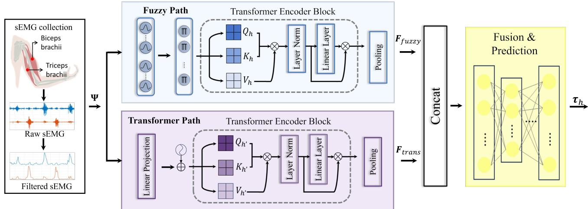  
Fig. 1. HFTN 框架。

$$
\Upsilon_ {k} = \prod_ {j = 1} ^ {N _ {q}} \mu_ {i j} ^ {k}, k = 1, \dots , N _ {m}\tag{3}
$$

令 $\pmb { u } _ { \Upsilon } = [ \Upsilon _ { 1 } , . . . , \Upsilon _ { N _ { m } } ] \in \mathbb { R } ^ { N _ { m } }$ 表示下一层的输入。因此，第四层是动态储备池，其内部状态 $\boldsymbol { x } \in \mathbb { R } ^ { N }$ 由以下更新律决定：

$$
\dot {\boldsymbol {\chi}} = \tanh (\boldsymbol {W} ^ {i} \boldsymbol {u} _ {\Upsilon} + \boldsymbol {W} \boldsymbol {\chi} + \boldsymbol {b})\tag{4}
$$

其中 tanh( ) 表示双曲正切函数。$W ^ { i } \in$ R $\nu \times N _ { m }$ 和 $\pmb { W } \in \mathbb { R } ^ { N \times N }$ 分别表示输入权重矩阵和内部连接权重矩阵。$\pmb { b } \in \mathbb { R } ^ { N }$ 为偏置。对应于输出层的 FESN 输出由下式给出：

$$
\pmb {y} = (\pmb {W} ^ {o}) ^ {T} \pmb {\chi}\tag{5}
$$

其中 $\boldsymbol { y } \in \mathbb { R } ^ { N _ { y } }$ 为 FESN 的输出。$W ^ { o } \in \mathbb R ^ { N \times N _ { y } }$ 为输出权重矩阵。

## III. 神经模糊 MSK 模型

神经模糊 MSK（肌骨）模型基于提出的 HFTN 架构实现，如图 1 所示。HFTN 处理通过滑动窗口分割获得的序列长度为 $S$ 的输入 sEMG 信号 $\pmb { \Psi } = \{ \pmb { \Psi } _ { 1 } , \pmb { \Psi } _ { 2 } \}$。这些信号对应于肱二头肌 $( \Psi _ { 1 } )$ 和肱三头肌 $( \Psi _ { 2 } )$。每个信号通过不同但互补的路径进行处理，以估计肘关节力矩。

1) 模糊路径（Fuzzy Path）：模糊路径通过结构化特征提取方法对 sEMG 信号中的不确定性和非线性进行建模。每个输入维度连接到一个具有 $M$ 个隶属度函数的专用模糊隶属度层，计算用于量化输入值与模糊概念之间关系的隶属度，定义为：

$$
\mu_ {i, j} (\Psi_ {i}) = \exp \left(- \frac {\left(\Psi_ {i} - c _ {i , j}\right) ^ {2}}{\sigma_ {i , j} ^ {2}}\right), j \in \{1, 2, \dots , M \}\tag{6}
$$

其中 $c _ { i , j }$ 为第 $i$ 个 sEMG 通道的第 $j$ 个隶属度函数的中心参数（模糊度），$\sigma _ { i , j }$ 为宽度参数。第 $i$ 个通道的模糊隶属度函数的输出为 $\pmb { \mu } _ { i } = [ \mu _ { i , 1 } ( \Psi _ { i } ) , \mu _ { i , 2 } ( \Psi _ { i } ) , \dots , \mu _ { i , M } ( \Psi _ { i } ) ] \in$ $\mathbb { R } ^ { B \times S \times M }$，其中 $B$ 表示训练过程中的批次大小。对于跨两个通道的所有隶属度函数，拼接后的输出为：$\mathbf { \bar { \mu } } \mathbf { \mu } = [ \pmb { \mu } _ { 1 } \parallel \pmb { \mu } _ { 2 } ] \in \mathbb { R } ^ { B \times S \times 2 M }$

模糊规则层在相应隶属度函数之间执行 $\because \mathrm { A N D } ^ { \prime \prime }$ 模糊逻辑操作 [43]：

$$
\boldsymbol {R} _ {j} = \mu_ {1, j} (\boldsymbol {\Psi} _ {1}) \odot \mu_ {2, j} (\boldsymbol {\Psi} _ {2}), \quad j \in \{1, 2, \dots , M \}\tag{7}
$$

其中 $\odot$ 表示逐元素乘法。模糊规则层的完整输出表示为：$\scriptscriptstyle R \_ =$ $[ \bar { R _ { 1 } } , \bar { R _ { 2 } } , \dotsc , \bar { R _ { M } } ] \stackrel { * } { \in } \mathbb { R } ^ { B \times S \times \bar { M } }$

为了增强模糊路径的表征能力，我们在模糊规则层之后策略性地引入了一个 Transformer 编码器块。该 Transformer 块专门关注不确定性感知模糊规则空间内的时序模式，从而能够有效提取整个序列中规则输出之间的时序关系。对于 Transformer 编码器块，查询 $\mathcal { Q } _ { h }$、键 $\kappa _ { h }$ 和值 $\nu _ { h }$ 通过线性变换导出，利用自注意力机制通过计算目标智能体每个子空间之间的注意力得分来建模趋势依赖关系：

$$
\boldsymbol {A} _ {h} = \operatorname{softmax} \left(\frac {\mathcal {Q} _ {h} (\mathcal {K} _ {h}) ^ {T}}{\sqrt {d _ {k}}}\right) \mathcal {V} _ {h}.\tag{8}
$$

其中 $\pmb { A } _ { h }$ 表示每个注意力头 $h \in \{ 1 , 2 , \ldots , H \}$ 的输出。$H$ 为注意力头的数量，且 $d _ { k } \ : = \ : M / H$ 为每个头的维度。多头注意力（MHA）的输出为：$\mathbf { M H A } = \mathbf { C o n c a t } ( A _ { 1 } , A _ { 2 } , \ldots , A _ { H } ) \mathbf { W } _ { O }$，其中 $W _ { O }$ 为可学习参数矩阵。遵循标准 Transformer 编码器架构，我们通过层归一化（Layer Normalization）实现第一个残差连接：

$$
\boldsymbol {\Lambda} = \text { LayerNorm } (\boldsymbol {R} + \text { Dropout } (\text { MHA })).\tag{9}
$$

随后，$\boldsymbol{\Lambda}$ 经过全连接（FC）网络处理，并与第二个残差连接相整合：

$$
\boldsymbol {F} ^ {\text { out }} = \operatorname{LayerNorm} (\boldsymbol {\Lambda} + \operatorname{Dropout} (\mathrm{FC} (\boldsymbol {\Lambda}))).\tag{10}
$$

这些双残差连接有效地缓解了训练过程中的梯度退化问题。最后，对 Transformer 编码器输出 ${ \pmb F } ^ { o u t }$ 执行全局平均池化（GAP），以生成模糊路径的最终表示：

$$
\boldsymbol {F} _ {f u z z y} = \frac {1}{S} \sum_ {s = 1} ^ {S} \boldsymbol {F} _ {:, s,:} ^ {o u t} \in \mathbb {R} ^ {B \times M}.\tag{11}
$$

2) Transformer 路径：平行的 Transformer 路径直接捕获 sEMG 信号中全面的时序依赖关系，提取纯时域特征，与模糊路径的不确定性建模能力形成互补。

Transformer 路径包含若干按序连接的组件：首先，线性投影层将输入的 sEMG 信号 $\boldsymbol{\Psi}$ 转换到更高维的嵌入空间：

$$
\boldsymbol {F} _ {p r o j} = \mathcal {F} _ {\mathrm{proj}} (\boldsymbol {\Psi}) \in \mathbb {R} ^ {B \times S \times D _ {p r o j}},\tag{12}
$$

其中 $D _ { p r o j }$ 为线性投影层的嵌入维度，$\mathcal { F } _ { \mathrm { p r o j } } ( \cdot )$ 表示线性投影操作。随后，位置编码层融入序列中标记（tokens）的绝对位置信息：

$$
\pmb {F} _ {p o s} = \pmb {F} _ {p r o j} + \mathbf {P} \in \mathbb {R} ^ {B \times S \times D _ {p r o j}},\tag{13}
$$

其中 $\mathbf{P}$ 表示将时序位置信息整合到特征表示中的位置编码矩阵。

Transformer 路径的核心架构由 $l \in \{ 1 , 2 , \ldots , L \}$ 个 Transformer 编码器块组成，这些编码器块实现了具有 $H ^ { \prime }$ 个注意力头的 MHA（多头注意力）机制，每个注意力头的维度为 $d _ { k } ^ { \prime } = D _ { p r o j } / H ^ { \prime }$。这些 Transformer 编码器块与模糊路径中的编码器块具有相同的架构配置（相同的 FC 层、层归一化操作和残差连接）。第 $l$ 个 Transformer 编码器块按如下方式处理特征：

$$
\mathbf {F} ^ {(t, l)} = \mathcal {F} _ {\mathrm{Trans} _ {l}} (\mathbf {F} ^ {(t, l - 1)}) \in \mathbb {R} ^ {B \times S \times D _ {p r o j}},\tag{14}
$$

其中 $\mathbf { F } ^ { ( t , 0 ) } = F _ { p o s } . \ F _ { \mathrm { T r a n s } _ { l } } ( \cdot )$ 表示第 $l$ 个 Transformer 编码器块的操作，$\mathbf { F } ^ { ( t , l ) }$ 为得到的输出。在 Transformer 块之后应用 GAP（全局平均池化），其参数与模糊逻辑通路中所使用的参数完全相同。该操作生成 Transformer 通路的最终输出表示 $\mathbf { \Delta } \mathbf { \mathcal { F } } _ { t r a n s }$ 为：

$$
\boldsymbol {F} _ {\text { trans }} = \frac {1}{S} \sum_ {s = 1} ^ {S} \boldsymbol {F} _ {:, s,:} ^ {(t, L)} \in \mathbb {R} ^ {B \times D _ {\text { proj }}}.\tag{15}
$$

3) 融合部分：融合部分利用多模态融合的概念，有效合并来自两条通路的互补表示——来自模糊路径的可解释不确定性感知特征 $( \bar { F _ { f u z z y } } \in \mathbb { R } ^ { B \times M } )$ 以及由 Transformer 路径捕获的复杂时间依赖性 $( \boldsymbol { F } _ { t r a n s } \in \mathbb { R } ^ { B \times D _ { p r o j } } )$。该过程首先通过拼接操作沿特征维度将 $F _ { f u z z y }$ 和 $\mathbf { \Delta } \mathbf { \mathcal { F } } _ { t r a n s }$ 结合起来，构建一个捕获全局特性的统一表示：

$$
\boldsymbol {F} _ {\text { concat }} = \operatorname{Concat} \left(\boldsymbol {F} _ {\text { fuzzy }}, \boldsymbol {F} _ {\text { trans }}\right) \in \mathbb {R} ^ {B \times (M + D _ {\text { proj }})}.\tag{16}
$$

随后，$\mathbf { \Delta } \mathbf { \mathcal { F } } _ { c o n c a t }$ 通过一个融合层（FC 层后接 ReLU 激活函数）进行变换，将组合特征投射到一个统一的潜在空间中：

$$
\boldsymbol {F} _ {f u s e d} = \mathcal {F} _ {\mathrm{fusion}} (\boldsymbol {F} _ {c o n c a t}) \in \mathbb {R} ^ {B \times D _ {f u s i o n}},\tag{17}
$$

其中 $\mathcal { F } _ { \mathrm { f u s i o n } } ( \cdot )$ 表示融合操作，$D _ { f u s i o n }$ 是融合表示空间的维度。

融合后的表示最后通过一个由多个非线性变换组成的回归组件进行处理，以生成最终的关节扭矩预测：

$$
\hat {\boldsymbol {\tau}} _ {h} ^ {n} = \mathcal {F} _ {\text { regression }} (\boldsymbol {F} _ {f u s e d}),\tag{18}
$$

其中 $\hat { \tau } _ { h } ^ { n }$ 表示预测的关节力矩。$\mathcal { F } _ { \mathrm { r e g r e s s i o n } } ( \cdot )$ 表示由三个 FC（全连接）层组成的回归网络，除最终输出层外，每层后均接 ReLU 激活函数，用于将融合特征映射到输出空间。鉴于本应用的高采样率和实时性约束，该设计为整合模糊分支与 Transformer 分支的异构输出提供了一种轻量且高效的解决方案，能够有效处理特征融合与最终回归。

4) 训练策略：所提出的神经网络通过最小化关节力矩预测值 $\hat { \tau } _ { h } ^ { n }$ 与从 OpenSim 逆动力学获得的真实力矩值 $\tau _ { h } ^ { n }$ 之间的均方误差（MSE）来进行训练。损失函数表示为：

$$
\mathcal {L} \mathrm{MSE} = \frac {1}{N _ {s}} \sum_ {n = 1} ^ {N _ {s}} (\hat {\boldsymbol {\tau}} _ {h} ^ {n} - \boldsymbol {\tau} _ {h} ^ {n}) ^ {2},\tag{19}
$$

其中 $N _ { s }$ 表示分段窗口的总数。

## IV. 控制器设计

该控制器接收来自神经模糊 MSK（肌肉骨骼）模型的估计肘部人体关节力矩，并利用 FESN 构建 AAN（按需辅助）策略，在人主导模式与机器人主导模式之间运行。设期望轨迹为 $\mathbf { \Delta } q _ { d } \in \mathbb { R } ^ { n }$。滑模流形定义为 $s _ { x } =$ $\pmb { \dot { e } } + \lambda _ { e } \pmb { e } \in \mathbb { R } ^ { n }$，其中 $\ b  \ b { \ b { \ b { \ b { \ b { \ b { \ b { \ b { \ b { \ b { \ b { \ b { \ b { \ b { \ b { \ b { \ b { \ b { \ b { \ b } { \ b { \ b { \ b { \ b { \ b } { \ b { \ b } { \ b { \ b { \ b } { \ b { \ b } { \ b { \ b } { \ b { \ b { \ b } { \ b { \ b } { \ b { \ b } { \ b { \ b } { \ b } { \ b { \ b } { \ b { \ b } { \ b { \ b } { \ b { \ b } } } } } } } } } } } } } } } } } } } } } } } } } } } } } } } } } } } } }$ 为正定对角矩阵，跟踪误差由 $\pmb { e } = \pmb { q } - \pmb { q } _ { d } \in \mathbb { R } ^ { n }$ 给出。

为了实现该目标，我们首先设计了一种具有可变刚度和阻尼的新型阻抗模型，其表达式为：

$$
\begin{array}{l} \boldsymbol {\tau} _ {e} = M (\boldsymbol {q}) \ddot {\boldsymbol {e}} + (D (t) + C (\boldsymbol {q}, \dot {\boldsymbol {q}})) \dot {\boldsymbol {e}} \\ \quad + (D (t) \boldsymbol {\lambda} _ {e} + C (\boldsymbol {q}, \dot {\boldsymbol {q}}) \boldsymbol {\lambda} _ {e} + K (t) - M (\boldsymbol {q}) \boldsymbol {\lambda} _ {e} \boldsymbol {\lambda} _ {e}) \boldsymbol {e} \end{array}\tag{20}
$$

其中 $D ( t ) \in \mathbb { R } ^ { n \times n }$ 和 $\pmb { K } ( t ) \in \mathbb { R } ^ { n \times n }$ 分别表示时变阻尼和刚度。这通过在阻抗模型中引入 $M ( q )$ 免去了对 $\tau _ { e }$ 感知的需求，从而简化了控制器设计的实现。因此，将 (20) 代入 (1) 可获得控制输入指令，如下式所示：

$$
\begin{array}{c} \boldsymbol {\tau} = M (\boldsymbol {q}) \ddot {\boldsymbol {q}} _ {d} + C (\boldsymbol {q}, \dot {\boldsymbol {q}}) \dot {\boldsymbol {q}} _ {d} + \boldsymbol {g} (\boldsymbol {q}) - D (t) \boldsymbol {s} _ {x} \\ - (\boldsymbol {K} (t) + C (\boldsymbol {q}, \dot {\boldsymbol {q}}) \boldsymbol {\lambda} _ {e} - M (\boldsymbol {q}) \boldsymbol {\lambda} _ {e} \boldsymbol {\lambda} _ {e}) \boldsymbol {e} \end{array}\tag{21}
$$

注 1（Remark 1）。所提出的阻抗模型 (20) 在结构上从两个关键方面不同于传统构型。首先，通过嵌入机器人的惯性项和科里奥利项（Coriolis terms），消除了对人机交互力直接感知的需求，实现了无传感器实现。其次，通过引入耦合位置与速度的复合误差，该模型不仅像经典设计那样在速度域强制实现无源性，而且在位置域也强制实现了无源性。这种双通道无源性增强了整个系统的稳定性，促进了速度和位置误差的调节，并增强了人机交互的鲁棒性。因此，所提出的构型将经典阻抗模型拓展为适用于传感器受限应用的更通用且实用的结构。

## A. 基于 FESN 的阻抗生成

鉴于人机交互的复杂性，我们采用 FESN（分数阶回声状态网络）以动态、状态相关的方式生成时变刚度 $\mathbf { K } ( t )$ 和阻尼 D(t)，同时通过基于 Lyapunov 的输出权重自适应律来确保闭环稳定性。输出层经过显式设计，以保证系统在连续变化的刚度下的无源行为。用于生成刚度和阻尼的所提 FESN 结构如图 2 所示。

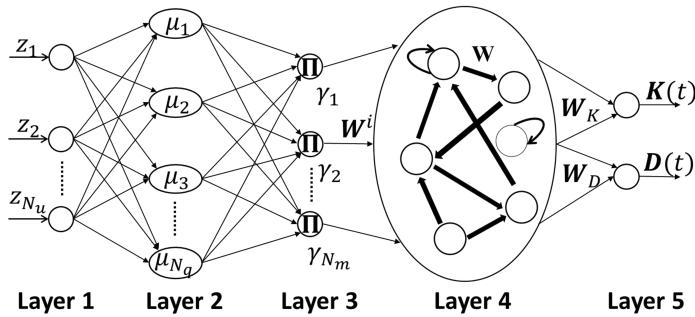  
Fig. 2. 用于阻抗调节的 FESN 框架。

首先，我们将 FESN 输出定义为机器人的刚度和阻尼，其中 $W ^ { o } = [ { \pmb W } _ { K } , { \pmb W } _ { D } ] \in \mathbb { R } ^ { N \times 2 n ^ { 2 } }$，表示为

$$
\left[ \boldsymbol {K} _ {v} ^ {T}, \boldsymbol {D} _ {v} ^ {T} \right] ^ {T} = \left[ \begin{array}{l} \boldsymbol {W} _ {K} ^ {T} \\ \boldsymbol {W} _ {D} ^ {T} \end{array} \right] \boldsymbol {\chi}\tag{22}
$$

其中 $\ b { K _ { v } } \in \mathbb { R } ^ { n ^ { 2 } }$ 和 $D _ { v } \in \mathbb { R } ^ { n ^ { 2 } }$ 表示刚度和阻尼矩阵的向量化形式，记为：$\begin{array} { r } { K _ { v } = \pmb { W } _ { K } ^ { T } \pmb { \chi } = } \end{array}$ $v e c ( \pmb { K } ( t ) )$ 以及 $D _ { v } = W _ { D } ^ { T } \chi = v e c ( D ( t ) )$，其中 $v e c ( \cdot )$ 为列向量化算子。${ \bf { \cal W } } _ { K } \in \mathbb { R } ^ { N \times n ^ { 2 } }$ 和 $W _ { D } \in$ $\mathbb { R } ^ { N \times n ^ { 2 } }$ 为 FESN 的输出权重矩阵。

我们提出了 FESN 输出层 $W ^ { o }$ 的自适应律，以抵消变刚度的影响，同时确保 $W ^ { o }$ 保持最终一致有界。$\dot { W } _ { K }$ 和 $\dot { W } _ { D }$ 的定义表示为：

$$
\dot {\pmb {W}} _ {K} = \varsigma_ {K} \pmb {\chi} \pmb {\sigma} _ {K} ^ {T} - \pmb {\nu} _ {K} \pmb {W} _ {K}\tag{23}
$$

$$
\dot {\boldsymbol {W}} _ {D} = \varsigma_ {D} \chi \boldsymbol {\sigma} _ {D} ^ {T} - \nu_ {D} \boldsymbol {W} _ {D}\tag{24}
$$

其中 $\pmb { \sigma } _ { K } = v e c ( \pmb { s } _ { x } \pmb { e } ^ { T } ) \in \mathbb { R } ^ { n ^ { 2 } }$ 且 ${ \pmb \sigma } _ { D } = v e c ( { \pmb s } _ { x } { \pmb \dot { e } } ^ { T } ) \ \in$ $\mathbb { R } ^ { n ^ { 2 } }$。$\varsigma _ { K } \in \mathbb { R } ^ { N \times N } , \varsigma _ { D } \in \mathbb { R } ^ { N \times N } , \nu _ { K } \in \mathbb { R } ^ { N \times N } , \nu _ { D } \in \mathbb { R } ^ { \dot { N } \times N }$ 表示对角正定常数矩阵。

定理 1. 对于由 (1) 描述的机器人系统，在满足由 (20) 给出的阻抗模型以及 (23) 中所述的 FESN 权重自适应律的情况下，只要以下条件成立，系统在 $\tau _ { e }$ 与 $s _ { x }$ 之间的动力学就具有无源性：

$$
\pmb {D} (t) - \pmb {M} (\pmb {q}) \pmb {\lambda} _ {e} \succ 0\tag{25}
$$

证明. 定义 Lyapunov 候选函数为：

$$
V (e) = \frac {1}{2} \boldsymbol {s} _ {x} ^ {T} \boldsymbol {M} (\boldsymbol {q}) \boldsymbol {s} _ {x} + \frac {1}{2} t r (\boldsymbol {W} _ {K} ^ {T} \boldsymbol {\varsigma} _ {K} ^ {- 1} \boldsymbol {W} _ {K})\tag{26}
$$

根据性质 2，$V ( e )$ 的导数为：

$$
\begin{array}{l} \dot {V} (e) = \boldsymbol {s} _ {x} ^ {T} \boldsymbol {M} (\boldsymbol {q}) \dot {\boldsymbol {s}} _ {x} + \frac {1}{2} \boldsymbol {s} _ {x} ^ {T} \dot {\boldsymbol {M}} (\boldsymbol {q}) \boldsymbol {s} _ {x} + t r (\boldsymbol {W} _ {K} ^ {T} \boldsymbol {\varsigma} _ {K} ^ {- 1} \dot {\boldsymbol {W}} _ {K}) \\ \quad = \boldsymbol {s} _ {x} ^ {T} (\boldsymbol {M} (\boldsymbol {q}) \ddot {\boldsymbol {e}} + \boldsymbol {M} (\boldsymbol {q}) \boldsymbol {\lambda} _ {e} \dot {\boldsymbol {e}}) + \frac {1}{2} \boldsymbol {s} _ {x} ^ {T} \dot {\boldsymbol {M}} (\boldsymbol {q}) \boldsymbol {s} _ {x} \quad (2 \\ \quad + t r (\boldsymbol {W} _ {K} ^ {T} \boldsymbol {\chi} \boldsymbol {\sigma} _ {K} ^ {T} - \boldsymbol {W} _ {K} ^ {T} \boldsymbol {\varsigma} _ {K} ^ {- 1} \boldsymbol {\nu} _ {K} \boldsymbol {W} _ {K}) \\ \quad = \boldsymbol {s} _ {x} ^ {T} (\boldsymbol {\tau} _ {e} - (\boldsymbol {D} (t) - \boldsymbol {M} (\boldsymbol {q}) \boldsymbol {\lambda} _ {e})   \boldsymbol {s} _ {x}) - \boldsymbol {s} _ {x} ^ {T} \boldsymbol {K} (t) \boldsymbol {e} \\ \quad + t r (\boldsymbol {K} _ {v} \boldsymbol {\sigma} _ {K} ^ {T}) - t r (\boldsymbol {W} _ {K} ^ {T} \boldsymbol {\varsigma} _ {K} ^ {- 1} \boldsymbol {\nu} _ {K} \boldsymbol {W} _ {K}) \end{array}\tag{27}
$$

根据性质 3，可得

$$
\begin{array}{r l} & {t r (\pmb {K} _ {v} \pmb {\sigma} _ {K} ^ {T}) = \pmb {\sigma} _ {K} ^ {T} \pmb {K} _ {v} = t r \left((\pmb {s} _ {x} \pmb {e} ^ {T}) ^ {T} \pmb {K} (t)\right)} \\ & {\qquad = t r (\pmb {e s} _ {x} ^ {T} \pmb {K} (t)) = t r (\pmb {s} _ {x} ^ {T} \pmb {K} (t) \pmb {e})} \\ & {\qquad = \pmb {s} _ {x} ^ {T} \pmb {K} (t) \pmb {e}} \end{array}\tag{28}
$$

这意味着由变刚度 $\mathbf { } K ( t )$ 产生的能量被 FESN 通过输出层自适应 (23) 所抵消。因此，可得

$$
\begin{array}{r l} & {\dot {V} (e) = \pmb {s} _ {x} ^ {T} \pmb {\tau} _ {e} - \pmb {s} _ {x} ^ {T} (\pmb {D} (t) - \pmb {M} (\pmb {q}) \pmb {\lambda} _ {e}) \pmb {s} _ {x}} \\ & {\qquad - t r (\pmb {W} _ {K} ^ {T} \pmb {\varsigma} _ {K} ^ {- 1} \pmb {\nu} _ {K} \pmb {W} _ {K})} \\ & {\qquad = - W + \pmb {s} _ {x} ^ {T} \pmb {\tau} _ {e}} \end{array}\tag{29}
$$

其中 $W = s _ { x } ^ { T } ( D ( t ) - M ( \ b { q } ) \lambda _ { e } ) s _ { x } + t r ( W _ { K } ^ { T } \varsigma _ { K } ^ { - 1 } \nu _ { K } W _ { K } ) \geq$ 0。因此，有 $W + \dot { V } ( e ) = s _ { x } ^ { T } \tau _ { e } ,$ ，在 [0, t] 上的时间积分可得

$$
\int_ {0} ^ {t} \boldsymbol {s} _ {x} ^ {T} \boldsymbol {\tau} _ {e} d t = \int_ {0} ^ {t} W d t + V (e (t)) - V (e (0))\tag{30}
$$

当 $\| \tau _ { e } \|$ 有界于 $\bar { \tau } _ { e } ~ ( \| \tau _ { e } \| < \bar { \tau } _ { e } )$ 时，我们可以进一步得到：

$$
\begin{array}{c} \dot {V} (e) \leq \| \boldsymbol {\tau} _ {e} \|   \| \boldsymbol {s} _ {x} \| - \lambda_ {m} (\boldsymbol {D} (t) - \boldsymbol {M} (\boldsymbol {q}) \boldsymbol {\lambda} _ {e}) \| \boldsymbol {s} _ {x} \| ^ {2} \\ \leq - \| \boldsymbol {s} _ {x} \|   (\lambda_ {m} (\boldsymbol {D} (t) - \boldsymbol {M} (\boldsymbol {q}) \boldsymbol {\lambda} _ {e})   \| \boldsymbol {s} _ {x} \| - \bar {\tau} _ {e}) \end{array}\tag{31}
$$

其中 $\lambda _ { m } ( \cdot )$ 表示矩阵的最小特征值。因此，$\| s _ { x } \|$ 最终一致有界于：

$$
\| \boldsymbol {s} _ {x} \| \leq \frac {\bar {\tau} _ {e}}{\lambda_ {m} (\boldsymbol {D} (t) - \boldsymbol {M} (\boldsymbol {q}) \boldsymbol {\lambda} _ {e})}\tag{32}
$$

证明完成。

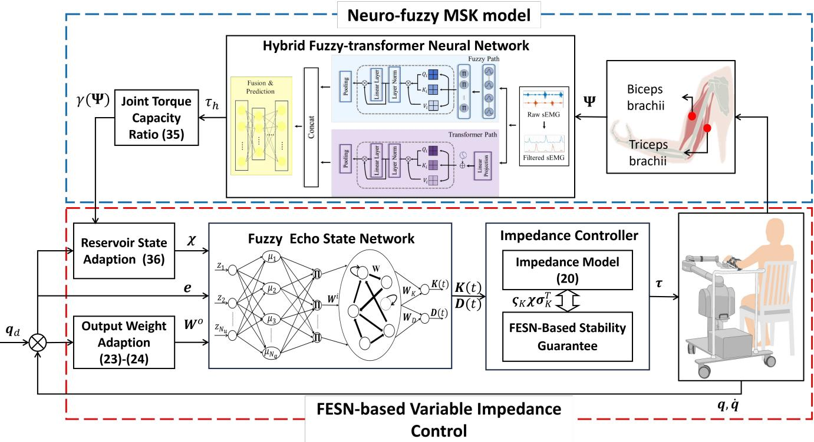  
Fig. 3. AAN 策略的框架。

## B. 用于 AAN 的阻抗调制

除了生成刚度和阻尼之外，在 AAN（按需辅助）康复中，根据用户的体力消耗（physical effort）自适应调整系统行为也是至关重要的。为此，我们以估计的关节力矩作为发力指标来调制 FESN 储备池的内部更新率，进而分析刚度变化率 $\dot { \kappa } _ { \iota }$ 和阻尼变化率 $\dot { D } _ { \ i }$。当用户发力较小时，储备池动力学更为活跃，能够提供更大的刚度 $\mathbf { K } ( t )$ 和阻尼 $\mathbf { D } ( t )$，对应于机器人主导模式。相反，当发力较大时，储备池的活动受到抑制以减少机器人干预，形成人主导模式。这种发力感知的调制符合 AAN 的核心原则。整体控制框架如图 Fig. 3 所示。

将 (23) 和 (24) 代入 (22) 的导数中可得：

$$
\begin{array}{r l} \dot {\boldsymbol {K}} _ {v} & = \dot {\boldsymbol {W}} _ {K} ^ {T} \boldsymbol {\chi} + \boldsymbol {W} _ {K} ^ {T} \dot {\boldsymbol {\chi}} \\ & = (\boldsymbol {\chi} ^ {T} \boldsymbol {\varsigma} _ {K} ^ {T} \boldsymbol {\chi}) \boldsymbol {\sigma} _ {K} - \boldsymbol {v} _ {K} \boldsymbol {K} _ {v} + \boldsymbol {W} _ {K} ^ {T} \dot {\boldsymbol {\chi}} \\ \dot {\boldsymbol {D}} _ {v} & = \dot {\boldsymbol {W}} _ {D} ^ {T} \boldsymbol {\chi} + \boldsymbol {W} _ {D} ^ {T} \dot {\boldsymbol {\chi}} \\ & = (\boldsymbol {\chi} ^ {T} \boldsymbol {\varsigma} _ {D} ^ {T} \boldsymbol {\chi}) \boldsymbol {\sigma} _ {D} - \boldsymbol {v} _ {D} \boldsymbol {D} _ {v} + \boldsymbol {W} _ {D} ^ {T} \dot {\boldsymbol {\chi}} \end{array}\tag{33}
$$

(34)

由上述公式可知，$\dot { K } _ { v }$ 和 $\dot { D _ { v } }$ 受三个主要部分支配。1) 项 $\left( \boldsymbol { \chi } ^ { T } \mathsf { S } _ { K } ^ { T } \boldsymbol { \chi } \right) \boldsymbol { \sigma } _ { K }$ 和 $\left( \chi ^ { T } \varsigma _ { D } ^ { T } \chi \right) \sigma _ { D }$ 代表增益部分，其中 $\boldsymbol { x } ^ { T } \mathsf { S } _ { K } ^ { T } \boldsymbol { x } \in \ \mathbb { R } ^ { + }$ 与 $\boldsymbol { x } ^ { T } \boldsymbol { \varsigma } _ { D } ^ { T } \boldsymbol { x } ~ \in ~ \mathbb { R } ^ { + }$ 为正增益因子。2) 项 $- { \pmb v } _ { K } { \pmb K } _ { v }$ 和 ${ - } v _ { D } D _ { v }$ 对应刚度和阻尼的衰减部分。3) $W _ { K } ^ { T } \dot { x }$ 决定了刚度和阻尼的调节模式。由于 $\chi ^ { T } \varsigma _ { K } ^ { T } \chi$ 和 $\chi ^ { T } \varsigma _ { D } ^ { T } \chi$ 直接影响系统刚度和阻尼的变化率，合理构造的 $\dot { x }$ 有助于实现平滑且自适应的阻抗过渡，从而确保稳定性和有效的人机交互。

为了使由神经模糊肌肉骨骼模型（neuro-fuzzy MSK model）估计的人体关节力矩 $\tau _ { h } ( \Psi )$ 能够直接影响机器人阻抗，定义关节力矩容量比（joint torque capacity ratio, JTCR）如下：

$$
\gamma (\pmb {\Psi}) = \frac {1}{1 + \exp (- k _ {0} (\tau_ {h} (\pmb {\Psi}) - \tau_ {m}))}\tag{35}
$$

其中 $\tau _ { m }$ 表示人体最大关节力矩，$k _ { 0 }$ 是控制过渡速率的斜率参数。相应地，将 $0 < \gamma ( \Psi ) < 1$ 引入 $\dot { x }$ 的动力学中，以调节机器人的阻抗自适应速率。

(4) 式中 $\dot { x }$ 的动力学被重新设计为：

$$
\dot {\boldsymbol {\chi}} = - \gamma (\boldsymbol {\Psi}) \boldsymbol {W} \boldsymbol {\chi} + (1 - \gamma (\boldsymbol {\Psi})) \left(\boldsymbol {W} ^ {i} \boldsymbol {u} _ {\gamma} + \boldsymbol {b}\right)\tag{36}
$$

该设计包含以下三个关键方面：

1) $0 < \gamma ( \Psi ) < 1$ 主要决定了 $x$ 的速率，进而影响 $\dot { K } _ { v }$ 和 $\dot { D } _ { v }$ 的演化。具体而言，当 $\gamma ( \Psi ) \to 0$ 时，$x$ 的衰减率减小，使得项 $\left( W ^ { i } u _ { \gamma } + b \right)$ 能够产生更大的影响。因此，$\| \boldsymbol { x } \|$ 增大，导致增益项系数 $\chi ^ { T } \varsigma _ { K } ^ { T } \chi$ 和 $x ^ { T } \varsigma _ { D } ^ { T } x ,$ 变大，从而增强了系统的刚度和阻尼，并导致机器人主导模式。相反，当 $\gamma ( \Psi ) \to 1$ 时，$\chi$ 迅速衰减，减弱了 $\left( W ^ { i } { \pmb u } _ { \gamma } + { \pmb b } \right)$ 的作用。这降低了系数 $\bar { \chi ^ { T } } \varsigma _ { K } ^ { T } \chi$ 和 $\chi ^ { T } \varsigma _ { D } ^ { T } \chi$ ，减小了系统的刚度和阻尼，并促进了人主导模式。连续的 $\gamma ( \Psi )$ 确保了在人主导模式与机器人主导模式之间的平滑过渡。

2) 储备池（reservoir）的内部权重矩阵 W 必须设计为正定的，以确保 $x ,$ 的有界性，从而实现阻抗的动态调节。

3) 令 $z ~ = ~ \left\lceil e ^ { T } , \dot { e } ^ { T } \right\rceil ^ { T }$ 表示式 (4) 中 FESN 的输入。根据定理 1，$\| z \|$ 是一致最终有界的。项 $\pmb { u } _ { \Upsilon }$ 表示 FESN 的模糊化状态，且 $\| \boldsymbol { u } _ { \Upsilon } \|$ 也是有界的。

引理 1. 设 $x$ 根据式 $( 3 6 )$ 中的动力学演化，其中 $\gamma ( \Psi )$ 由 (35) 定义。若输入 $\mathbf { \Delta } \pmb { u } _ { \gamma }$ 是一致有界的，满足 $\| \boldsymbol { u } _ { \gamma } \| \le \bar { \boldsymbol { u } } _ { \gamma }$，且矩阵 W 正定，则状态 $x$ 是最终有界的，满足

$$
\| \boldsymbol {\chi} (t) \| \leq \bar {\chi}, \quad f o r \quad \bar {\chi} > 0.\tag{37}
$$

证明. 我们定义如下 Lyapunov 候选函数：

$$
V (\chi) = \frac {1}{2} \pmb {\chi} ^ {T} \pmb {\chi}\tag{38}
$$

对其求导可得：

$$
\begin{array}{l} \dot {V} (\chi) = \frac {1}{2} \boldsymbol {\chi} ^ {T} \dot {\boldsymbol {\chi}} \\ = \boldsymbol {\chi} ^ {T} (- \gamma (\boldsymbol {\Psi}) \boldsymbol {W} \boldsymbol {\chi} + (1 - \gamma (\boldsymbol {\Psi})) (\boldsymbol {W} ^ {i} \boldsymbol {u} _ {\gamma} + \boldsymbol {b})) \\ = - \gamma (\boldsymbol {\Psi}) \boldsymbol {\chi} ^ {T} \boldsymbol {W} \boldsymbol {\chi} + (1 - \gamma (\boldsymbol {\Psi})) \boldsymbol {\chi} ^ {T} (\boldsymbol {W} ^ {i} \boldsymbol {u} _ {\gamma} + \boldsymbol {b}) \\ \leq - \gamma (\boldsymbol {\Psi}) \lambda_ {\mathrm{m}} (\boldsymbol {W}) \| \boldsymbol {\chi} \| ^ {2} \\ + (1 - \gamma (\boldsymbol {\Psi})) \left(\left\| \boldsymbol {W} ^ {i} \right\| \bar {u} _ {\gamma} + \| \boldsymbol {b} \|\right) \| \boldsymbol {\chi} \| \end{array}\tag{39}
$$

因此，$\lVert \boldsymbol { x } \rVert$ 最终一致有界于：

$$
\| \boldsymbol {\chi} \| \leq \bar {\chi} = \frac {\bar {u} _ {\gamma} \left\| \boldsymbol {W} ^ {i} \right\| + \| \boldsymbol {b} \|}{\rho_ {\gamma} \lambda_ {m} (\boldsymbol {W})}, \rho_ {\gamma} = \frac {\gamma (\boldsymbol {\Psi})}{(1 - \gamma (\boldsymbol {\Psi}))}\tag{40}
$$

证明完成。

引理 2. 若 $W ^ { o }$ 按照 (23) 和 $( 2 4 ) _ { ; }$ 中给出的自适应律演化，且 $x$ 由动力学方程 (36) 支配，则 $W ^ { o }$ 保持一致有界。

证明. 定义一个新的 Lyapunov 候选函数为：

$$
V (W) = \frac {1}{2} t r (\pmb {W} _ {K} ^ {T} \pmb {\varsigma} _ {K} ^ {- 1} \pmb {W} _ {K}) + \frac {1}{2} t r (\pmb {W} _ {D} ^ {T} \pmb {\varsigma} _ {D} ^ {- 1} \pmb {W} _ {D})\tag{41}
$$

其导数为：

$$
\begin{array}{l} \dot {V} (W) = t r (\boldsymbol {W} _ {K} ^ {T} \boldsymbol {\varsigma} _ {K} ^ {- 1} \dot {\boldsymbol {W}} _ {K}) + t r (\boldsymbol {W} _ {D} ^ {T} \boldsymbol {\varsigma} _ {D} ^ {- 1} \dot {\boldsymbol {W}} _ {D}) \\ = t r (\boldsymbol {W} _ {K} ^ {T} \boldsymbol {\chi} \boldsymbol {\sigma} _ {K} ^ {T}) + t r (\boldsymbol {W} _ {D} ^ {T} \boldsymbol {\chi} \boldsymbol {\sigma} _ {D} ^ {T}) \\ - t r (\boldsymbol {W} _ {K} ^ {T} \boldsymbol {\varsigma} _ {K} ^ {- 1} \boldsymbol {v} _ {K} \boldsymbol {W} _ {K}) - t r (\boldsymbol {W} _ {D} ^ {T} \boldsymbol {\varsigma} _ {D} ^ {- 1} \boldsymbol {v} _ {D} \boldsymbol {W} _ {D}) \end{array}\tag{42}
$$

此外，$\| { \boldsymbol { x } } \|$ 有界于 $\bar { \chi }$，且定理 1 确立了 $\left\| \sigma _ { K } \right\|$ 和 $\| \sigma _ { D } \|$ 均有界。因此，$\dot { V } ( W )$ 满足以下关系：

$$
\dot {V} (W) \leq \| \boldsymbol {\chi} \| \| \boldsymbol {\sigma} _ {K} \| \| \boldsymbol {W} _ {K} \| + \| \boldsymbol {\chi} \| \| \boldsymbol {\sigma} _ {D} \| \| \boldsymbol {W} _ {D} \|\tag{43}
$$

$$
- \lambda_ {m} (\boldsymbol {\varsigma} _ {K} ^ {- 1} \boldsymbol {v} _ {K}) \| \boldsymbol {W} _ {K} \| ^ {2} - \lambda_ {m} (\boldsymbol {\varsigma} _ {D} ^ {- 1} \boldsymbol {v} _ {D}) \| \boldsymbol {W} _ {D} \| ^ {2}
$$

$$
\leq \bar {\chi} \boldsymbol {\Lambda} ^ {o T} \boldsymbol {\Theta} - \boldsymbol {\Theta} ^ {T} \left[ \begin{array}{c c} \lambda_ {m} (\boldsymbol {\varsigma} _ {K} ^ {- 1} \boldsymbol {v} _ {K}) & 0 \\ 0 & \lambda_ {m} (\boldsymbol {\varsigma} _ {D} ^ {- 1} \boldsymbol {v} _ {D}) \end{array} \right] \boldsymbol {\Theta}
$$

$$
\leq \bar {\chi} \left\| \boldsymbol {\Lambda} ^ {o} \right\| \left\| \boldsymbol {\Theta} \right\| - \min (\lambda_ {m} (\boldsymbol {\varsigma} _ {K} ^ {- 1} \boldsymbol {v} _ {K}), \lambda_ {m} (\boldsymbol {\varsigma} _ {D} ^ {- 1} \boldsymbol {v} _ {D})) \| \boldsymbol {\Theta} \| ^ {2}
$$

其中 $\lambda _ { m } ( \cdot )$ 表示矩阵的最小特征值。$\pmb { \Lambda } ^ { o } = [ \| \pmb { \sigma } _ { K } \| , \| \pmb { \sigma } _ { D } \| ] ^ { T } , \pmb { \Theta } = [ \| \pmb { W } _ { K } \| , \| \pmb { W } _ { D } \| ] ^ { T }$。因此，$W ^ { o }$ 一致有界于：

$$
\| \boldsymbol {W} ^ {o} \| \leq \frac {\bar {\chi} \| \boldsymbol {\Lambda} ^ {o} \|}{\min (\lambda_ {m} (\boldsymbol {\varsigma} _ {K} ^ {- 1} \boldsymbol {v} _ {K}) , \lambda_ {m} (\boldsymbol {\varsigma} _ {D} ^ {- 1} \boldsymbol {v} _ {D}))}\tag{44}
$$

证明完毕。

注 2. 所提出的方法保留了 FESN 的基本架构特征：具有内部状态 $x$ 的循环储备池、输入驱动的更新机制，以及输出用于可变阻抗控制的刚度和阻尼参数的读出层。尽管输出权重是显式构建而非学习得到的，且储备池动力学根据用户用力情况进行调制，但整体架构仍与标准的 FESN 公式保持一致。此外，储备池动力学 (36) 的设计确保了理想的记忆特性：当 $\gamma ( \Psi )$ 趋近于 1 时，储备池状态呈现指数衰减；当 $\gamma ( \Psi )$ 趋近于 0 时，它变为输入驱动。这保证了渐消记忆性，并确保储备池状态由最近的输入历史唯一确定，从而保持了回声状态特性（echo state property）。

## V. 实验研究

实验验证将分三个阶段进行：1）神经模糊 MSK 模型的评估，2）基于 FESN 的可变阻抗控制器的评估，以及 3）整合这两个组件以验证个性化 AAN 策略。物理平台如图 4 所示。三名健康受试者（S1：年龄 24 岁，性别男，身高 185 cm，体重 77 kg；S2：年龄 26 岁，性别男，身高 174 cm，体重 66 kg；S3：年龄 29 岁，性别男，身高 173 cm，体重 90.3 kg）参与了本实验。针对健康受试者实验的伦理批准由 University of Leeds（利兹大学）工程与物理科学学部研究伦理委员会授予（LTELEC-001）。

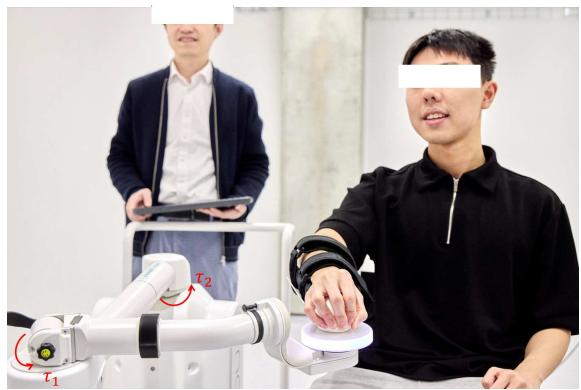  
Fig. 4. 康复机器人平台。

## A. 神经模糊 MSK 模型

神经模糊 MSK 模型使用通过 Delsys Trigno™ 系统以 2148 Hz 采集的肱二头肌和肱三头肌的 sEMG 数据进行测试。原始信号经过二阶巴特沃斯带通滤波（25±450 Hz）进行去噪，并经过四阶低通滤波（4 Hz）以建立肌电-肌力相关性，然后使用峰值等长最大自主收缩进行归一化。滤波后的 sEMG 数据采用 20 点分段和 2 点步长（stride）的滑动窗口进行处理，以作为 HFTN 的输入。

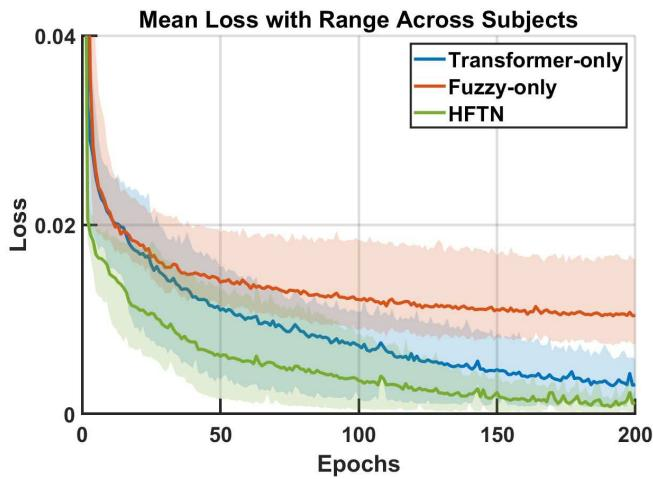  
Fig. 5. 跨受试者三种神经网络架构训练损失动态的对比分析。

决定系数 $R ^ { 2 }$ 和均方根误差（RMSE）被用作我们的主要评估指标。具体而言，RMSE 定义为：

$$
R M S E = \sqrt {\frac {1}{W} \sum_ {w = 1} ^ {W} (\mathbf {Y} _ {w} - \hat {\mathbf {Y}} _ {w}) ^ {2}}\tag{45}
$$

其中 W 表示应用滑动窗口分段后评估数据集中的样本总数，$\mathbf { { { Y } } } _ { w }$ 和 $\hat { Y } _ { w }$ 分别表示第 w 个样本的实际值和预测值。$R ^ { 2 }$ 值通过以下公式计算：

$$
R ^ {2} = 1 - \frac {\sum_ {w = 1} ^ {W} (\mathbf {Y} _ {w} - \hat {\mathbf {Y}} _ {w}) ^ {2}}{\sum_ {w = 1} ^ {W} (\mathbf {Y} _ {w} - \overline {{\mathbf {Y}}} _ {w}) ^ {2}}\tag{46}
$$

其中 $\overline { { Y } } _ { w }$ 表示评估数据集中所有样本的平均值。

HFTN 使用 Adam 优化器进行训练，学习率为 $5 \times 1 0 ^ { - 4 }$，批次大小（batch size）为 16，最大训练轮数（epochs）为 200 且包含早停机制（early stopping）。Transformer 组件采用嵌入维度 $D _ { p r o j } = 3 2$、$H = H ^ { \prime } = 2$ 个注意力头、$L = 1$ 个 Transformer 块，以及全连接层（FC）维度 32。注意力输出和前馈网络均应用了 0.2 的 Dropout 率。模糊路径（fuzzy path）对每个输入特征使用 $M \ = \ 8$ 个隶属度函数。这些架构超参数是基于实证比较选定的，以平衡预测准确性与推理效率。针对模糊路径与 Transformer 路径之间的不平衡问题，尽管这两个分支在维度（32 与 8）和统计特性上均存在差异，我们通过在特征融合前引入 L2 归一化评估了这种不平衡的影响。该调整有效均衡了两条路径的量级，消除了 Transformer 特征的主导地位。然而，性能提升微乎其微（$R ^ { 2 }$ 提升 0.001；RMSE 降低 0.002），表明原始融合层在训练过程中已经学会了平衡两者的贡献。这表明该模型能够通过反向传播隐式调整各路径的相对影响力。因此，为了保持架构的简洁性和计算效率，我们在最终实现中保留了原始的未归一化设计。

为了全面评估各架构组件的贡献，我们在三名受试者上进行了消融实验，评估了具有一致参数化设置的：(a) 纯 Transformer（Transformer-only）、(b) 纯模糊（Fuzzy-only）以及 (c) HFTN 架构。图 5 展示了 200 轮训练期间的平均训练损失轨迹，阴影区域表示受试者间的变异性。结果表明，与纯 Transformer（0.015）和纯模糊（> 0.01）相比，HFTN 表现出最快的早期收敛速度（0-20 轮），并在整个训练过程中保持最低的损失，最终收敛至 0.01。HFTN 还表现出最小的受试者间方差，表明其具有卓越的泛化能力，而纯模糊模型表现出显著的异质性，纯 Transformer 模型则表现出中等程度的方差。这些发现支持了 HFTN 相较于单一范式方法在误差最小化、收敛速度以及跨受试者一致性方面的优越性能。

Fig. 6 展示了 HFTN 与纯模糊（Fuzzy-only）和纯 Transformer（Transformer-only）架构相比的优越性能。在 (a) 中，HFTN 获得了最高的平均 $R ^ { \overset { . } { 2 } } \ ( { \sim } 0 . 9 7 )$，优于纯 Transformer（0.96），并大幅超过纯模糊（0.84）。在 (b) 中，与纯 Transformer（0.01-0.04）和纯模糊（0.11-0.12）相比，HFTN 保持了最低的 RMSE 值（0.01-0.03）。HFTN 的平均 RMSE 误差棒中的极小方差表明其具有出色的稳定性和泛化能力。通过将模糊逻辑与神经网络相结合，HFTN 利用了两者的互补优势，实现了更高的预测精度、更低的误差率以及更优的跨受试者可靠性。

TABLE I  
模型推理时间对比 (MS)

<table><tr><td>受试者\模型</td><td>Transformer-only</td><td>Fuzzy-only</td><td>HFTN</td></tr><tr><td>S1</td><td>0.73 ms</td><td>0.46 ms</td><td>1.05 ms</td></tr><tr><td>S2</td><td>0.67 ms</td><td>0.40 ms</td><td>1.03 ms</td></tr><tr><td>S3</td><td>0.75 ms</td><td>0.45 ms</td><td>1.02 ms</td></tr><tr><td>Average</td><td>0.72 ms</td><td>0.44 ms</td><td>1.03 ms</td></tr></table>

为了量化实时性能，我们在 NVIDIA RTX 3070ti GPU 上测量了推理时间，每个模型-受试者组合进行 500 次连续操作，并在迭代之间进行 GPU 同步。如表 I 所示，所有模型在受试者间的推理时间均低于 1.5 ms，远在机器人系统所需的 2 ms 控制周期之内，从而证实了它们在该应用中进行实时部署的适用性。此外，所提出的 HFTN 架构明确优先考虑轻量化实现，以满足此类实时约束。具体而言，Transformer 分支被设计得很紧凑，仅包含 1 个编码器层，每层具有 2 个注意力头。与此同时，模糊分支在低维手工特征向量上运行，进一步提升了模型的简洁性和效率。尽管 HFTN 的推理时间略长于纯模糊模型，但它仍保持了 1.03 ms 的低延迟——完全在实时要求之内——并提供了更高的估计精度。

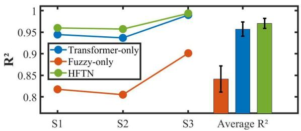  
(a) 模型决定系数对比 $( R ^ { 2 } )$  
Fig. 6. 三种神经网络架构在受试者间的性能对比。

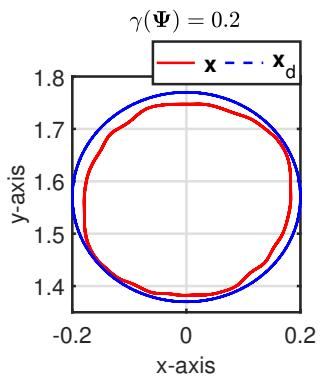

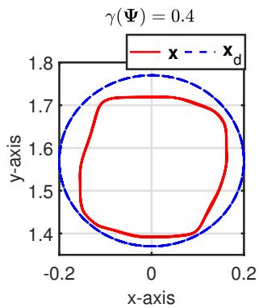  
Fig. 7. 特定 γ(Ψ) = {0.2, 0.4, 0.6, 0.8} 下的跟踪性能。

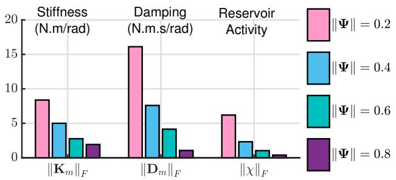  
(a) 不同 γ(Ψ) 下的系统刚度、阻尼和储能器（reservoir）活动性能  
Fig. 8. 不同 γ(Ψ) 下的可变阻抗控制器相关参数。

## B. 可变阻抗控制器

该可变阻抗控制器在由埃斯顿医疗科技有限公司（ESTUN Medical Technology Co., Ltd.）研发的绳驱动上肢康复机器人 Burt 上实现。评估重点针对最靠近末端执行器的 2 个自由度（2-DOF），构成平面 2-DOF 构型。该机器人通过网络接口实现直接关节力矩控制，采样间隔为 0.002 秒。

我们注意到，本研究中给出的刚度和阻尼值均定义在机器人的电机侧，而非关节侧。由于减速机构的存在，关节处实际感受到的阻抗被显著放大。设 $\mathbf q _ { m } = [ q _ { m 1 } , q _ { m 2 } ] ^ { T }$ 表示电机轴角，$\mathbf { q } = [ q _ { 1 } , q _ { 2 } ] ^ { T }$ 表示关节角。它们通过由齿轮传动矩阵 R 控制的线性变换关联，如下所示：

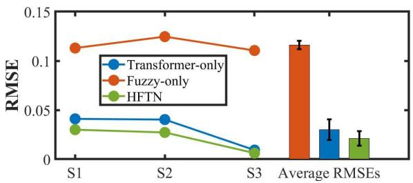  
(b) 模型误差比较（RMSE）

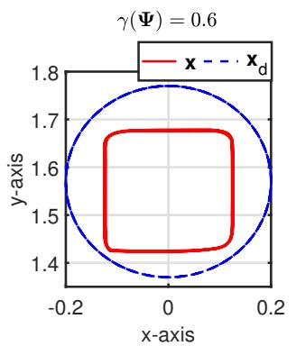

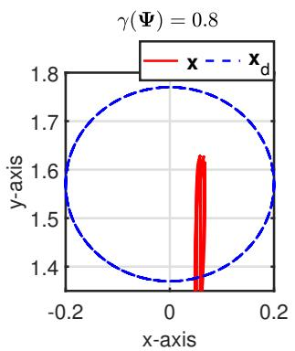

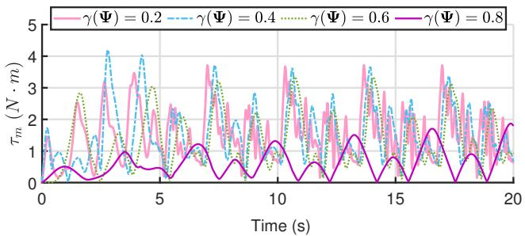  
(b) 不同 γ(Ψ) 下的电机产生力矩

$$
\mathbf {q} _ {m} = \mathbf {R} \mathbf {q}, \quad \mathbf {R} = \left[ \begin{array}{c c} - 1 5. 1 9 & 0 \\ 0 & - 9. 5 7 0 0 2 \end{array} \right]\tag{47}
$$

在该变换下，电机侧力矩 $\tau _ { m }$ 与关节侧力矩 τ 根据虚功原理相关联：

$$
\pmb {\tau} = \mathbf {R} ^ {\top} \pmb {\tau} _ {m}\tag{48}
$$

该关系表明，关节侧力矩按传动比成比例放大，这与角位移的反变换是一致的。

因此，关节侧刚度 $\mathbf { K } ( t )$ 和阻尼 $\mathbf { D } ( t )$ 由电机侧数值 ${ \bf K } _ { m }$ 和 $\mathbf { D } _ { m }$ 通过下式计算：

$$
\mathbf {K} (t) = \mathbf {R} ^ {\top} \mathbf {K} _ {m} \mathbf {R}, \quad \mathbf {D} (t) = \mathbf {R} ^ {\top} \mathbf {D} _ {m} \mathbf {R}\tag{49}
$$

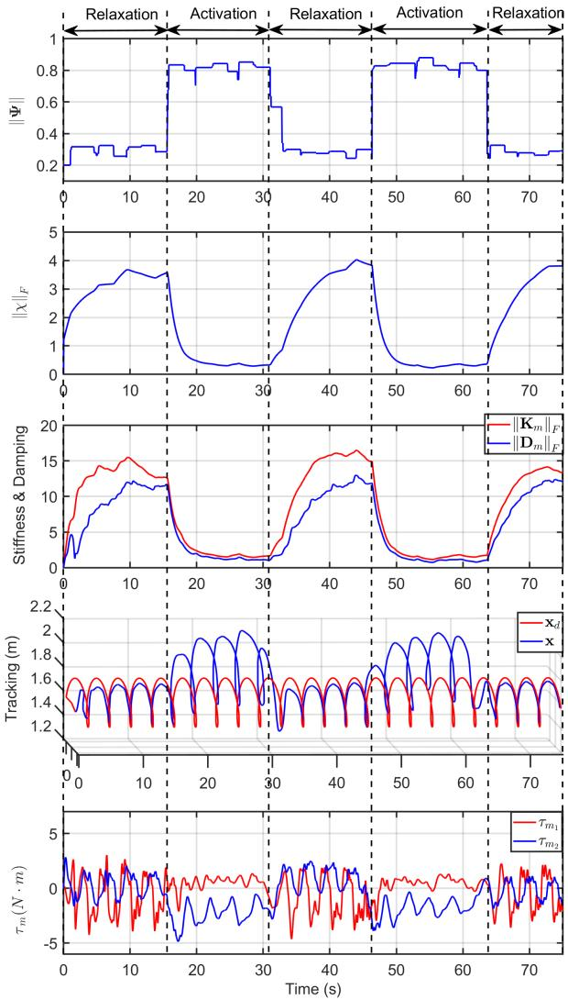  
Fig. 9. 不同人体行为（包括主动肌肉激活与放松状态）下人机交互的时间演化过程。

该变换表明，电机侧相对较低的阻抗值会转化为关节水平上高得多的有效阻抗。

在本实验中，我们将 $\gamma ( \Psi ) = \{ 0 . 2 , 0 . 4 , 0 . 6 , 0 . 8 \}$ 用于评估性能。结果如图 Fig. 7 和图 Fig. 8 所示，前者展示了跟踪性能，后者描绘了控制器相关参数。当 $\begin{array} { l } { \gamma ( \Psi ) } \end{array} = \begin{array} { l } { 0 . 2 } \end{array}$ 时，由于较高的储备池活跃度（reservoir activity）、刚度和阻尼（分别达到 $\| \pmb { \chi } \| _ { F } = 6 . 1 9$、$\| \pmb { K } _ { m } \| _ { F } =$ $8 . 3 8 ( N \cdot m / r a d )$ 以及 $\| \pmb { \cal D } _ { m } \| _ { F } = 1 6 . \bar { 1 } 1 ( N \cdot m \cdot s / r a d )$），系统实现了相对较高的跟踪精度。随着 $\gamma ( \Psi )$ 的增加，跟踪精度有所恶化。这是因为如公式 (33) 和 (34) 所述，更大的 $\gamma ( \Psi )$ 会导致更低的 $\| { \boldsymbol { x } } \| _ { F }$ 稳态值，进而降低刚度和阻尼。当 $\gamma ( \Psi )$ 增加至 0.8 时，$\| \chi \| _ { F }$ 的值变得非常小，接近 0.39。因此，系统表现出显著低的阻抗 $( \left\| \pmb { K _ { m } } \right\| _ { F } = 1 . 9 2 ( N \cdot m / r a d ) , \left\| \pmb { D _ { m } } \right\| _ { F } = 1 . 0 6 ( N \cdot m \cdot s / r a d ) )$，导致难以跟踪期望的末端执行器轨迹 $x _ { d }$。此外，输入力矩进一步证实了较低的 $\gamma ( \Psi )$ 值会导致更大的输入力矩和更强的振动，从而增加了对跟踪误差的敏感性并提高了控制精度。因此，我们可以得出结论：较小的 $\gamma ( \Psi )$ 会增加系统的阻抗，提高跟踪精度，并使机器人处于机器人主导模式（robot-dominated mode）。相反，较大的 $\gamma ( \Psi )$ 会降低机器人的控制力度，使用户能够轻松驱动其运动，从而产生人主导模式（human-dominated mode）。

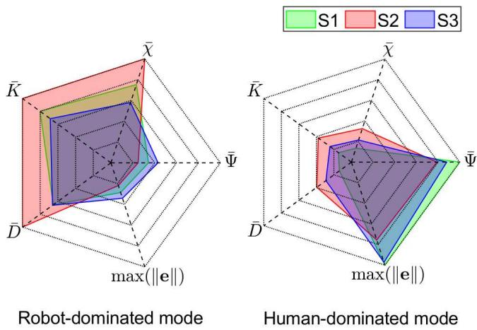  
${ \mathrm { F i g . } }$ 10. 与三位不同参与者交互过程中的系统行为。

## C. AAN 策略

在本实验中，我们通过网络接口将 sEMG 采集设备与康复机器人集成。计算得到的 JTCR $\gamma ( \Psi )$ 通过网络接口以 1058 Hz 的频率传输至机器人控制板。由于肘部力矩在屈曲过程中上升而在伸展过程中下降，因此对 sEMG 应用滑动窗口，以便在用户持续发力期间保持较低的机器人刚度。在每个窗口内提取最大值，如下式所示：

$$
\gamma (\boldsymbol {\Psi}) = \max \{\gamma (\boldsymbol {\Psi} (t - \Delta t)),..., \gamma (\boldsymbol {\Psi} (t)) \}\tag{50}
$$

实验过程构建如下。系统激活后，人体保持被动状态，在 15 秒内不施加任何力量。随后，人体开始施力以引导机器人的运动，持续 15 秒，以模拟具有部分运动功能的患者。接着是持续 15 秒的人体撤去施力阶段，代表患者力量不足的场景。然后人体再次施加力量 15 秒，最后再次撤去施力。

实验结果如图 Fig. 9 所示。人体关节力矩指标 $\gamma ( \Psi )$ 在系统的行为中起决定性作用。当 $\gamma ( \Psi )$ 保持在较低水平时，表明肌肉未激活且人体未施加力量（对应 0-15s、30-45s 和 62-75s），FESN 的储备池活性（记为 $\| { \boldsymbol { x } } \| _ { F } ,$）逐渐增加。这导致输出刚度 $\Vert K _ { m } \Vert _ { F }$ 和阻尼 $\| D _ { m } \| _ { F } ,$ 增大，使系统对跟踪误差更加敏感。结果，控制输入表现出更强的振荡，产生更高的跟踪精度，并表征了机器人主导模式。相反，当 $\gamma ( \Psi )$ 达到较高水平时，表明人体肘关节周围的肌肉被激活（对应 15-30s 和 45-62s），FESN 的储备池活性 $\| \chi \| _ { F }$ 迅速降低。这导致输出刚度 $\| \pmb { K } _ { m } \| _ { F }$ 和阻尼 $\Vert D _ { m } \Vert _ { F }$ 减小。在此状态下，系统阻抗变得非常低，使人体能够轻松引导机器人的运动。因此，系统轨迹受期望轨迹的约束减弱，能够自由变化，代表了人主导模式。此外，人主导模式与机器人主导模式之间的转换主要由 $\gamma ( \Psi )$ 的变化驱动，表明这是一种平滑且连续的转变而非突变。这种渐进的转变有助于提升系统的整体稳定性。

Fig. 10 a 展示了三名受试者在主动和被动运动任务中的运动性能指标。这些指标包括人体平均关节发力 Ψ¯ 、机器人的平均刚度 $\bar { K }$ 和阻尼 ${ \bar { D } } ,$、FESN 储备池的平均活跃水平 ${ \bar { \chi } } ,$ 以及最大跟踪误差 max( e )。在不同受试者之间观察到了一致的变化模式，这与先前的理论分析高度吻合，并与先前的实验结果相匹配。肌肉力量和主动参与程度等因素的个体差异导致了机器人在不同受试者身上的表现存在差异。具体而言，在机器人主导模式下，与 S1 和 S3 相比，S2 表现出更低的 EMG 活性，这导致了更高的 $\bar { \chi }$ 以及增大的 K¯ 和 D¯ 。在人主导模式下，S1 表现出最高的 Ψ¯ ，对应于最低的 K¯ 和 D¯ 水平，这表明来自人体受试者更强的主动发力有效地主导了机器人的运动，从而导致了最大的 max( e )。

## VI. 结论

本文提出了一种神经模糊 MSK 模型驱动的可变阻抗控制框架，用于实现面向个性化康复的 AAN（按需辅助）策略。首先，提出了一种 HFTN，通过并行通路将模糊逻辑与 Transformer 架构相结合，以实现人体关节力矩的实时估计。随后，开发了一种基于 FESN 的可变阻抗控制器，在输出权重矩阵和内部储备池状态中均引入了自适应机制。这实现了人主导与机器人主导交互模式之间的动态切换，从而践行了 AAN 的理念。大量实验证实了神经模糊 MSK 模型和所提控制器的有效性，表明该 AAN 策略能够自适应用户的运动能力和参与度。

## 参考文献

[1] M. Kennedy, ªThe role of collaborative robotics in assistive and rehabilitation applications,º Sci. Robot., vol. 8, no. 83, p. eadk6743, 2023.

[2] Y. Cao et al., ªPrescribed performance control of a link-type exoskeleton powered by pneumatic muscles with virtual elasticity,º Nonlinear Dyn., vol. 112, pp. 10043±10060, 2024.

[3] L. L. Cai, A. J. Fong, Yongqiang Liang, J. Burdick and V. R. Edgerton, ºAssist-as-needed training paradigms for robotic rehabilitation of spinal cord injuries,º Proc. IEEE Int. Conf. Robot. Autom. (ICRA), 2006. ICRA 2006., Orlando, FL, USA, 2006, pp. 3504-3511

[4] X. Chen, Y. Zheng, Z. Su, Y. Leng, J. Huang and C. Fu, ºAn Assist-as-Needed Variable Admittance Controller for Adaptive Support of Mobile Walking Assistive Robots,º Proc. 30th Int. Conf. Mechatronics Mach. Vis. Pract. (M2VIP), Leeds, United Kingdom, 2024, pp. 1-6

[5] A. Duschau-Wicke, J. von Zitzewitz, A. Caprez, L. Lunenburger and R. Riener, "Path Control: A Method for Patient-Cooperative Robot-Aided Gait Rehabilitation," IEEE Trans. Neural Syst. Rehabil. Eng., vol. 18, no. 1, pp. 38-48, Feb. 2010

[6] R. S. Zarrin, A. Zeiaee and R. Langari, "A Variable-Admittance Assist-As-Needed Controller for Upper-Limb Rehabilitation Exoskeletons," IEEE Robot. Autom. Lett., vol. 9, no. 6, pp. 5903-5910, June 2024.

[7] A. U. Pehlivan, D. P. Losey and M. K. O’Malley, "Minimal Assist-as-Needed Controller for Upper Limb Robotic Rehabilitation," IEEE Trans. Robot., vol. 32, no. 1, pp. 113-124, Feb. 2016

[8] N. Naghavi, A. Akbarzadeh, S. M. Tahamipour-Z., and I. Kardan, "Assist-as-needed control of a hip exoskeleton based on a novel strength index," Robot. Auton. Syst., vol. 134, p. 103667, 2020

[9] Y. Cao, X. Chen, M. Zhang and J. Huang, "Adaptive Position Constrained Assist-as-Needed Control for Rehabilitation Robots," IEEE Trans. Ind. Electron., vol. 71, no. 4, pp. 4059-4068, April 2024.

[10] T. Teramae, T. Noda and J. Morimoto, "EMG-Based Model Predictive Control for Physical Human-Robot Interaction: Application for Assist-As-Needed Control," IEEE Robot. Autom. Lett., vol. 3, no. 1, pp. 210-217, Jan. 2018

[11] N. Garcia-Hernandez, C. Munguia-Angeles and V. Parra-Vega, "Assist-as-Needed Robotic Strategy Based on Velocity Fields for Enhancing Motor Training," IEEE/ASME Trans. Mechatron., doi: 10.1109/TMECH.2024.3445314 (Early access)

[12] C. Xie et al., "A Cable-Driven Upper Limb Rehabilitation Robot With Muscle-Synergy-Based Myoelectric Controller," IEEE Trans. Robot., vol. 40, pp. 3199-3211, 2024

[13] P. Sedighi, X. Li and M. Tavakoli, "EMG-Based Intention Detection Using Deep Learning for Shared Control in Upper-Limb Assistive Exoskeletons," IEEE Robot. Autom. Lett., vol. 9, no. 1, pp. 41-48, Jan. 2024

[14] Y. Dai, J. Wu, Y. Fan, J. Wang, J. Niu, F. Gu, and S. Shen, "MSEva: A musculoskeletal rehabilitation evaluation system based on EMG signals," ACM Trans. Sens. Networks, vol. 19, no. 1, pp. 1-23, Feb. 2023

[15] Y. Zhao et al., "An EMG-Driven Musculoskeletal Model for Estimating Continuous Wrist Motion," IEEE Trans. Neural Syst. Rehabil. Eng., vol. 28, no. 12, pp. 3113-3120, Dec. 2020

[16] Y. Cao et al., "Musculoskeletal Model-Based Adaptive Variable Impedance Control With Flexible Prescribed Performance for Rehabilitation Robots," IEEE/ASME Trans. Mechatron., doi: 10.1109/TMECH.2025.3562670. (Early access)

[17] S. Ma et al., "Physics-Informed Deep Learning for Muscle Force Prediction With Unlabeled sEMG Signals," IEEE Trans. Neural Syst. Rehabil. Eng., vol. 32, pp. 1246-1256, 2024

[18] J. Zhang et al., "Physics-Informed Deep Learning for Musculoskeletal Modeling: Predicting Muscle Forces and Joint Kinematics From Surface EMG," IEEE Trans. Neural Syst. Rehabil. Eng., vol. 31, pp. 484-493, 2023

[19] Y. Huang et al., ºReal-Time Intended Knee Joint Motion Prediction by Deep-Recurrent Neural Networks,º IEEE Sens. J., vol. 19, no. 23, pp. 11503-11509, 2019

[20] Y. Shi, S. Ma, Y. Zhao, C. Shi and Z. Zhang, ºA Physics-Informed Low-Shot Adversarial Learning for sEMG-Based Estimation of Muscle Force and Joint Kinematics,º IEEE J. Biomed. Health Informat., vol. 28, no. 3, pp. 1309-1320, 2024

[21] A. Vijayvargiya, R. Kumar and P. Sharma, ºPC-GNN: Pearson Correlation-Based Graph Neural Network for Recognition of Human Lower Limb Activity Using sEMG Signal,º IEEE Trans. Hum.-Mach. Syst., vol. 53, no. 6, pp. 945-954, 2023

[22] Z. Chen, H. Wang, H. Chen, and T. Wei, ªContinuous motion finger joint angle estimation utilizing hybrid sEMG-FMG modality driven transformer-based deep learning model,º Biomed. Signal Process. Control, vol. 85, pp. 105030, 2023

[23] T. Liang et al., ºsEMG-Based End-to-End Continues Prediction of Human Knee Joint Angles Using the Tightly Coupled Convolutional Transformer Model,º IEEE J. Biomed. Health Informat., vol. 27, no. 11, pp. 5272-5280, 2023

[24] Y. Liu, X. Li, L. Yang and H. Yu, ºA Transformer-Based Gesture Prediction Model via sEMG Sensor for Human±Robot Interaction,º IEEE Trans. Instrum. Meas., vol. 73, pp. 1-15, 2024

[25] S. A. Zendehbad, A. S. Razavi, M. A. Sanjani, Z. Sedaghat, and S. Lashkari, ªTraxVBF: A hybrid transformer-xLSTM framework for EMG signal processing and assistive technology development in rehabilitation,º Sensing Bio-Sens. Res., vol. 47, p. 100749, Feb. 2025

[26] C. Lin et al., ºContinuous Estimation of Hand Kinematics From Electromyographic Signals Based on Power-and Time-Efficient Transformer Deep Learning Network,º IEEE Trans. Neural Syst. Rehabil. Eng., vol. 33, pp. 58-67, 2025

[27] Z. Wang, C. Chen, H. Chen, Y. Zhou, X. Wang and X. Wu, ºDual Transformer Network for Predicting Joint Angles and Torques From Multi-Channel EMG Signals in the Lower Limbs,º IEEE J. Biomed. Health Informat., doi: 10.1109/JBHI.2025.3555255

[28] W. Zhong, X. Fu and M. Zhang, ºA Muscle Synergy-Driven ANFIS Approach to Predict Continuous Knee Joint Movement,º IEEE Trans. Fuzzy Syst., vol. 30, no. 6, pp. 1553-1563, June 2022

[29] J. Lu, G. Ma and G. Zhang, ºFuzzy Machine Learning: A Comprehensive Framework and Systematic Review,º IEEE Trans. Fuzzy Syst., vol. 32, no. 7, pp. 3861-3878, July 2024

[30] H. Xia, M. Pi, L. Jin, R. Song and Z. Li, ºHuman Collaborative Control of Lower-Limb Prosthesis Based on Game Theory and Fuzzy Approximation,º IEEE Transactions on Cybernetics, vol. 55, no. 1, pp. 247-258, Jan. 2025

[31] C. Chen, Y. Cao, X. Chen, D. Wu, C. Xiong and J. Huang, ºA Fused Deep Fuzzy Neural Network Controller and Its Application to Pneumatic Flexible Joint,º IEEE/ASME Trans. Mechatron., vol. 28, no. 6, pp. 3214- 3225, Dec. 2023

[32] E. T. Wolbrecht, V. Chan, D. J. Reinkensmeyer and J. E. Bobrow, “优化顺应性、基于模型的机器人辅助以促进神经康复,” IEEE Trans. Neural Syst. Rehabil. Eng., vol. 16, no. 3, pp. 286-297, June 2008

[33] Y. Zhang, S. Li, K. J. Nolan and D. Zanotto, “基于行动者-评论家强化学习的自适应按需辅助控制,” Proc. IEEE/RSJ Int. Conf. Intell. Robots Syst. (IROS), Macau, China, 2019, pp. 4066-4071.

[34] S. Pareek, H. J. Nisar and T. Kesavadas, “AR3n：一种用于机器人康复的基于强化学习的按需辅助控制器,” IEEE Robot. Autom. Mag., vol. 31, no. 3, pp. 74-82, Sept. 2024

[35] P. Agarwal and A. D. Deshpande, “用于康复手部外骨骼的特定受试者按需辅助控制器,” IEEE Robot Autom. Lett., vol. 3, no. 1, pp. 508-515, Jan. 2018

[36] Y. Cao, M. Zhang, J. Huang and S. Mohammed, “具备仿生隔振功能的载荷转移悬浮背包用于在多种地形下减轻肩部压力,” IEEE Trans. Robot., vol. 41, pp. 3059-3077, 2025

[37] K. Kronander and A. Billard, “变阻抗控制的稳定性考量,” IEEE Trans. Robot., vol. 32, no. 5, pp. 1298-1305, Oct. 2016

[38] G. Li, J. Yu and X. Chen, “基于扰动观测器的受约束机械臂自适应模糊神经网络指令滤波阻抗控制,” IEEE Trans. Neural Netw. Learn. Syst., vol. 34, no. 8, pp. 5171-5180, Aug. 2023

[39] H. J. Asl, et al., “用于康复机器人的基于场的按需辅助控制方案,” IEEE/ASME Trans. Mechatron., vol. 25, no. 4, pp. 2100-2111, Aug. 2020.

[40] L. Pezeshki, H. Sadeghian, A. Mohebbi, M. Keshmiri and S. Haddadin, “机器人康复中的个性化辅助：通过基于能量的性能监测实现实时自适应,” IEEE Trans. Autom. Sci. Eng., vol. 22, pp. 13298-13309, 2025

[41] S. I. Han and J. M. Lee, “用于非线性动态系统规定性能的模糊回声状态神经网络与漏斗动态面控制,” IEEE Trans. Ind. Electron., vol. 61, no. 2, pp. 1099- 1112, Feb. 2014

[42] Q. Wang, Y. Pan, J. Cao and H. Liu, “具有时变延迟约束的分数阶大规模非线性系统的自适应模糊回声状态网络控制,” IEEE Trans. Fuzzy Syst., vol. 32, no. 2, pp. 634-648, Feb. 2024

[43] Y. Deng, Z. Ren, Y. Kong, F. Bao and Q. Dai, “一种用于数据分类的分层融合模糊深度神经网络,” IEEE Trans. Fuzzy Syst., vol. 25, no. 4, pp. 1006-1012, Aug. 2017