# 惯性测量单元在上肢关节活动度测量中的同时效度：一份系统综述与Meta分析

Jinfeng Li<sup>1</sup>，Fanji Qiu<sup>2</sup>，Liaoyan Gan<sup>3</sup> 和 Li-Shan Chou<sup>1</sup>

<sup>1</sup>艾奥瓦州立大学（Iowa State University）运动机能学系，美国艾姆斯（Ames, IA, USA）

<sup>2</sup>柏林洪堡大学（Humboldt-Universität zu Berlin）运动科学研究所运动生物力学，德国柏林

<sup>3</sup>阿尔伯塔大学（University of Alberta）健康科学学院运动机能学、运动与娱乐系，加拿大埃德蒙顿（Edmonton, AB, Canada） 通讯作者：Li-Shan Chou；邮箱：chou@iastate.edu

收稿日期：2023年6月29日；修订日期：2024年2月12日；接受日期：2024年5月10日

关键词：惯性测量单元（Inertial Measurement Unit, IMU）；运动分析；上肢

## 摘要

惯性测量单元（Inertial Measurement Units, IMUs）已被证明是测量人体上肢关节活动度（Range of Motion, RoM）的有价值工具。尽管已有若干研究报告了IMUs与金标准（光学运动捕捉系统，Optical Motion Capture System, OMC）相比的效度，但目前仍缺乏对IMUs在上肢关节RoM测量准确性的定量总结。因此，本系统综述与Meta分析的主要目的是确定IMUs在成人上肢RoM测量中的同时效度。共51篇文章被纳入系统综述，其中16篇的数据被汇总用于Meta分析。同时效度结果如下：肩关节屈伸（Pearson’s r = 0.969 [0.935, 0.986]，ICC = 0.935 [0.749, 0.984]，均值差 = 3.19（p = 0.55））、肘关节屈伸<sub>–</sub>（Pearson’s r = 0.954 [0.929, 0.970]，ICC = 0.929 [0.814, 0.974]，均值差 = 10.61（p = 0.36））、腕关节屈伸（Pearson’s r = 0.974 [0.945, 0.988]，均值差 = 4.20（p = 0.58））表现出极佳的同时效度；肩关节外展–内收（Pearson’s r = 0.919 [0.848, 0.957]，ICC = 0.840 [0.430, 0.963]，均值差 = 7.10（p = 0.50））以及肘关节旋前–旋后（Pearson’s r = 0.966 [0.939, 0.981]，ICC = 0.821 [0.696, 0.900]）表现出良好至极佳的同时效度。肩关节内–外旋的结果存在一定不一致性（Pearson’s r = 0.939 [0.894, 0.965]，均值差 = 9.13（p < 0.0001））。综上，结果支持将IMU作为测量上肢RoM的可行工具，但对于某些特定关节运动，例如肩关节旋转和腕关节尺桡偏，IMU的测量结果需谨慎使用。

## 1. 背景

关节活动度（Range of Motion, RoM）描述了围绕关节或在身体特定点上可实现的运动范围。在临床评估中，测量 RoM 至关重要，例如在评估肩关节活动度以诊断和分期冻结肩时（Ješić 等，2022）。准确且可靠的 RoM 测量对于临床医生指导其诊断和治疗策略至关重要。在临床环境中，关节角度计因其经济实惠、便携以及易于使用的特性，已成为测量 RoM 的流行选择。然而，它们存在显著的局限性。首先，关节角度计只能测量单一平面内、静态位置下的关节角度，这限制了它们评估动态关节运动的能力。其次，使用关节角度计进行测量的可靠性和准确性可能差异很大。肩关节和肘关节 RoM 测量的组内相关系数（intraclass correlation coefficients, ICCs）范围分别为 0.76 至 0.94 和 0.36 至 0.91（Muir 等，2010；Walmsley 等，2018）。这种测量可靠性的差异可能源于被测关节的解剖特异性以及评估者经验水平的不同。因此，关节角度计应被视为 RoM 测量的基础工具。其显著的测量误差限制了它们在更精确的临床研究和运动学研究中的应用。

商用基于标记的动作捕捉系统，也称为光学动作捕捉系统（optical motion capture systems, OMCs），例如 Vicon（Vicon Motion Systems Ltd., Oxford, UK），被广泛视为临床人体运动分析和生物力学研究中的「金标准」（Nagymáté 和 Kiss，2018；Valevicius 等，2018），一项系统综述指出在步态测量中矢状面内的评估者内误差小于 $4 . 0 ^ { \circ }$，冠状面内低于 $2 . 0 ^ { \circ }$（McGinley 等，2009）。对于这类系统，被动反射标记被策略性地放置在身体的特定骨性标志上，对应于待分析的节段。这些标记将光线反射回相机，使相关的生物力学模型能够在空间中重建三维人体运动（Colyer 等，2018）。然而，这些系统存在相当大的局限性：成本高昂、缺乏便携性、需要专门的实验室环境，并且涉及冗长的设置和校准流程（Sessa 等，2013；Wu 等，2022），这使得这些系统对于常规临床使用而言并不实用。此外，标记被衣物遮挡会显著影响结果的可靠性，限制了基于标记的系统在真实场景中的应用（van der Kruk 和 Reijne，2018）。

惯性测量单元（Inertial Measurement Units，IMU），或称可穿戴传感器，已成为一种能够克服上述局限性的替代方法。IMU 因其便携性与经济性，广泛应用于人体运动学分析研究和临床步态评估中。通常，IMU 由三轴加速度计、三轴陀螺仪组成，并可选择性地包含三轴磁力计（Seel 等，2014）。使用者可通过数据融合算法和生物力学模型估算身体各环节在三维空间中的运动学参数（Poitras 等，2019）。因此，使用多个 IMU 可为在日常生活中采集上肢运动参数提供可能性。尽管 IMU 作为运动追踪工具展现出良好前景，但在大规模推广使用之前，必须对其进行全面的计量学验证以确保其有效性与可靠性。已有大量研究考察了 IMU 在测量各类运动中人体运动学参数时的有效性与可靠性。目前已存在若干针对下肢运动学 IMU 测量有效性与可靠性的系统综述及荟萃分析（Kobsar 等，2020；Zeng 等，2022），其结果表明 IMU 是测量下肢关节活动度（Range of Motion，RoM）的可靠工具。在上肢领域，Walmsley 等（2018）开展的一项系统综述分析了 22 项于 2018 年之前进行的研究，发现虽然 IMU 在体内测量中相较于光学动作捕捉（Optical Motion Capture，OMC）系统表现出更高的误差，但通过大量的定制化工作，仍有可能将误差控制在 $5^{\circ}$ 以内。此外，另一项系统综述指出，IMU 在测量上肢关节运动时存在较宽的误差范围：肩关节（均方根误差（Root Mean Square Error，RMSE）0.2°–64.5°）、肘关节（RMSE 0.2°–30.6°）以及腕关节（RMSE 2.2°–30°）（Poitras 等，2019），这些误差均是与 OMC 系统比较的结果。然而，现有文献中关于上肢运动分析中 IMU 测量有效性荟萃分析方面存在明显空白。虽然已有一些文章对 IMU 用于上肢关节运动测量的有效性进行了系统综述，但它们主要提供定性总结，尚缺乏高质量的荟萃分析对 IMU 的测量有效性进行定量评估并检验测量误差的统计学显著性。因此，在常规使用 IMU 进行评估之前，有必要对其进行定量验证。本综述研究的主要目标为：（1）总结商用可穿戴传感器的特性；（2）通过对比 IMU 与 OMC，定量汇总现有的心理测量学特性；（3）为使用 IMU 测量上肢 RoM 提供循证支持。

## 2. 方法

## 2.1. 方案与注册

本系统综述和 Meta 分析遵循系统综述和 Meta 分析优先报告条目（Preferred Reporting Items for Systematic Reviews and Meta-Analyses, PRISMA）指南（Page et al., 2021），方案已于 2022 年 12 月 28 日在国际系统综述前瞻性注册平台（International Prospective Register of Systematic Review）注册（PROSPERO 编号：CRD42022384738）。

## 2.2. 检索策略

我们通过检索 PubMed、Web of Science、Scopus、IEEE Xplore 电子数据库以及 ClinicalTrials 注册系统，筛选了 2016 年 1 月 1 日至 2022 年 12 月 19 日期间发表的相关研究。检索词包括可穿戴传感器（wearable sensor）、运动分析（motion analysis）、关节活动度（range of motion）、上肢（upper limbs）和光学运动捕捉系统（optical motion capture system）。PubMed 中的具体检索策略如下：（wearable sens\*[标题/摘要] OR inertial motion unit\*[标题/摘要] OR inertial movement unit\*[标题/摘要] OR inertial sens\*[标题/摘要] OR sensor[标题/摘要] OR accelerometer\*[标题/摘要] OR gyro scope\*[标题/摘要]）AND（movement\*analysis[标题/摘要] OR motion analysis\*[标题/摘要] OR motion track\*[标题/摘要] OR track\* motion\*[标题/摘要] OR measurement system\*[标题/摘要] OR movement[标题/摘要]）AND（joint angle\*[标题/摘要] OR angle\*[标题/摘要] OR kinematic\*[标题/摘要] OR range of motion\*[标题/摘要]）AND（upper limb\*[标题/摘要] OR upper extremit\*[标题/摘要] OR arm\*[标题/摘要] OR elbow\*[标题/摘要] OR wrist\*[标题/摘要] OR shoulder\*[标题/摘要] OR humerus\*[标题/摘要]）AND（motion capture system [标题/摘要] OR 3D motion capture[标题/摘要] OR marker\*[标题/摘要] OR optical[标题/摘要] OR camera\*[标题/摘要] OR optoelectronic[标题/摘要]）NOT（review[标题/摘要]）AND（筛选条件：2016–2022）。不同数据库之间的基本检索词相似，仅做细微调整。此外，我们还通过查阅以往综述文章的参考文献进行了手工检索。所有数据库的完整检索策略详见表 1。

## 2.3. 纳入与排除标准

符合以下标准的研究被纳入本系统综述：（1）评估 IMU 的有效性；（2）测量并报告具体的上肢关节活动度（RoM）结果；（3）将 IMU 采集的测量值与基于标记点的运动捕捉系统进行比较；（4）研究对象为人类；（5）以英文发表。排除标准如下：（1）无相关结局指标；（2）未与标准基于标记点的运动捕捉系统进行比较；（3）仅评估下肢运动；（4）仅评估非自然人体运动；（5）动物模型研究；（6）仅评估儿童和婴幼儿；（7）非研究性文章或无全文；（8）以其他语言发表。纳入与排除标准的更多详细信息见补充文件 1。

## 2.4. 文献筛选

所有检索结果均录入文献管理工具（Endnote X9, Thomson Reuters, New York, USA），重复文献由 Endnote 自动剔除。两位作者（Li 和 Qiu）独立地筛选检索到的标题与摘要，以纳入符合标准的文献，随后阅读全文以确定最终是否合格。任何分歧均通过与第三位评审者（Gan）协商达成一致来解决。

## 2.5. 偏倚风险与证据水平的评估

纳入的研究依据《心理测量学文章研究设计的严格评价》（Critical Appraisal of Study Design for Psychometric Articles）进行评估。为了使其更适用于评估惯性测量单元（IMUs）的心理测量学特性，Kobsar 等人（Kobsar et al., 2020）对检查清单进行了修改。该修订版评价检查清单包含五个不同领域的 12 个条目：（1）研究问题，（2）研究设计，（3）测量，（4）分析，以及（5）推荐建议。每个条目按 0、1 或 2 分进行评分，总分最高为 24 分。各条目的具体评分标准与描述可参见补充文件 2（Supplementary file 2）。需要注意的是，第 6 题仅针对在方法学上涵盖可靠性测试（即患者再次评估）的文献，但并非所有纳入本次综述的文献都需要针对这一具体条目进行评估。因此，对于与该条目无关的文献，总分为 22 分。最初，两名评审者（Li 和 Qiu）同时评估三篇文章，就每个条目进行讨论并达成共识，随后两名评审者采用相同标准分别评估其余文献。两位评分者之间的一致性采用 Cohen's kappa 系数进行评估。通常认为 Cohen's kappa 系数大于 0.60 表示一致性可接受（Henry et al., 2016）。两位评分者通过讨论解决了大多数分歧；若仍无法达成共识，则邀请第三位评分者（Gan）进行裁决。

表 1. 完整检索策略

```clojure
Search strategy in PubMed
((((((((((wearable sens*[Title/Abstract]) OR (inertial motion unit*[Title/Abstract])) OR (inertial movement unit*[Title/Abstract])) OR (inertial sens*[Title/Abstract])) OR (sensor[Title/Abstract])) OR (accelerometer*[Title/Abstract])) OR (gyroscope*[Title/Abstract])) AND (((((((movement* analysis[Title/Abstract])) OR (motion analysis*[Title/Abstract])) OR (motion track*[Title/Abstract])) OR (track* motion*[Title/Abstract])) OR (measurement system*[Title/Abstract])) OR (movement[Title/Abstract]))) AND (((((joint angle* [Title/Abstract])) OR (angle*[Title/Abstract])) OR (kinematic*[Title/Abstract])) OR (range of motion*[Title/Abstract]))) AND (((((((upper limb*[Title/Abstract])) OR (upper extremit*[Title/Abstract])) OR (arm*[Title/Abstract])) OR (elbow*[Title/Abstract])) OR (wrist*[Title/Abstract])) OR (shoulder*[Title/Abstract])) OR (humerus*[Title/Abstract]))) AND (((((motion capture system[Title/Abstract])) OR (3D motion capture[Title/Abstract])) OR (marker*[Title/Abstract])) OR (optical[Title/Abstract])) OR (camera*[Title/Abstract])) OR (optoelectronic[Title/Abstract])) NOT (review[Title/ Abstract]) AND (Filter:2016-2022)
Search strategy in Scopus
(TITLE-ABS-KEY (wearable AND sens* OR inertial AND motion AND unit* OR inertial AND movement AND unit* OR inertial AND sens* OR sensor)) AND (TITLE-ABS-KEY (movement* AND analysis OR motion AND analysis* OR motion AND track* OR track* AND motion* OR measurement AND system* OR movement)) AND (TITLE-ABS-KEY (joint AND angle* OR angle* OR kinematic* OR range AND of AND motion*)) AND (TITLE-ABS- KEY (upper AND limb* OR upper AND extremit* OR arm* OR elbow* OR wrist* OR shoulder* OR humerus*)) AND (TITLE-ABS-KEY (motion AND capture AND system OR 3D AND motion AND capture OR marker* OR optical OR camera*))
```

\*（星号）可代替任意数量的字符，例如 extremit\* 可匹配"extremity"和"extremities"。

根据评分百分比，所纳入文献的质量可分为四个等级（Kobsar et al., 2020）：（1）评分百分比高于 85% 者归为高质量（High Quality, HQ），（2）介于 70% 至 85% 之间者归为中等质量（Moderate Quality, MQ），（3）介于 50% 至 70% 之间者归为低质量（Low Quality, LQ），（4）低于 50% 者视为极低质量（Very Low Quality, VLQ）。质量评估的结果随后用于确定证据等级（van Tulder et al., 2003）：

（1）强证据（Strong）：多项高质量研究（HQ）结果一致。

（2）中等证据（Moderate）：多项中等质量研究（MQ）结果一致和/或仅有一项高质量研究（HQ）。

（3）有限证据（Limited）：多项低质量研究（LQ）结果一致和/或仅有一项中等质量研究（MQ）。

（4）非常有限证据（Very limited）：多项极低质量研究（VLQ）结果一致和/或仅有一项低质量研究（LQ）。

（5）证据冲突（Conflicting）：多项试验结果不一致，无论研究质量如何。

## 2.6. 数据提取

数据提取和结果汇总由两名独立评审者（Li 和 Qiu）完成，数据录入 Microsoft Excel。如出现分歧，由第三位研究者（Gan）介入裁决。从各研究中提取的数据包括以下信息：（1）研究信息（作者及发表年份），（2）样本量，（3）可穿戴传感器信息（传感器品牌、采样率、数据融合算法/滤波器、校准方法及佩戴位置），（4）参考系统，（5）测量的关节和/或运动（肩、肘、腕，或特定的复合运动），以及（6）结果和统计学参数。

由于本 meta 分析仅评估 IMU 相对于基于标记点的动作捕捉系统（marker-based motion capture system）在上肢关节活动度（Range of Motion, RoM）测量中的效度，因此提取的统计量包括：均值±标准差（SD）、ICC、Pearson 相关系数 r、RMSE、偏倚（均差）、一致性界限（Limits of Agreement, LoA）以及其他统计量（即决定系数 $[ r ^ { 2 } ]$ 和多重相关系数 [CMC]）。随后，根据不同的上肢关节及关节运动平面，将所提取的数据分为以下组别：肩关节（屈曲/伸展、外展/内收以及内旋/外旋）、肘关节/前臂（屈曲/伸展以及旋前/旋后）以及腕关节（屈曲/伸展以及尺偏/桡偏）。

## 2.7. 统计分析

荟萃分析使用 Review Manager 5.4.1 版（The Cochrane Collaboration，丹麦哥本哈根）完成。效度结局数据基于均数±标准差、组内相关系数（ICC）和 Pearson 相关系数 r 进行荟萃分析。ICC 一致性指标的解读参照（Han, 2020）：（1）差（< 0.500）、（2）中等（0.500<sub>–</sub>0.749）、（3）良好（0.750<sub>–</sub>0.899）和（4）优秀（≥ 0.900）；r 的解读参照（Wahyuni and Purwanto, 2020）：（1）极弱相关（< 0.2）、（2）弱相关（0.2–0.4）、（3）中等相关（0.4–0.6）、（4）强相关（0.6–0.8）和（5）极强相关（>0.8）。点估计值根据纳入研究的样本量进行加权，并考虑 ICC 和 r 这两个参数的非正态性。有必要执行 Fisher Z 变换（Fisher's Z-transformation）（Cozzolino, 2009; Kobsar et al., 2020），然后再变换回 ICC/r 用于报告，公式如下（Kobsar et al., 2020; Zeng et al., 2022）：

$$
F i s h e r ^ {\prime} s Z _ {I C C / r} = 0. 5 * \frac {1 + I C C / r}{1 - I C C / r},
$$

$$
S E _ {r} = \sqrt {\frac {1}{n - 3}},
$$

$$
S E _ {I C C} = \sqrt {\frac {1}{(n - 3 / 2)}},
$$

$$
S u m m a r y \frac {I C C}{r} = \frac {e ^ {2 Z} - 1}{e ^ {2 Z} + 1}.
$$

当研究之间存在异质性且研究数量大于或等于三项时，需考虑敏感性分析。采用 Tau² 和 I² 统计量评估数据中的异质性。Tau² 值为 0 表明不存在异质性。I² 值的解释如下：小于 25% 表示低度异质性，26–50% 表示中度异质性，超过 75% 表示高度异质性（Higgins et al., 2003; Walmsley et al., 2018; Zeng et al., 2022）。当 $\setminus { }$ 值超过 $5 0 \%$ 时，进行敏感性分析。该方法依次剔除每项纳入研究，然后对剩余研究进行 meta 分析。若剔除后 I² 下降至 50% 以下，且 meta 分析结果保持不变，则表明原始 meta 分析结果具有稳健性。相反，若 I² 下降至 50% 以下但 meta 分析结果发生变化，则表明原始 meta 分析结果不稳健。显著性水平为 $p < 0 . 0 5$。鉴于纳入研究试验条件的异质性，采用 95% CI 的随机效应模型（Huedo-Medina et al., 2006）。当研究数量充足（$n \geq 3$）时（Zeng et al., 2022），进行亚组分析以探讨研究特征与 IMUs 测量有效性之间可能存在的关联。

## 3. 结果

## 3.1. 纳入研究的特征

我们的检索策略通过数据库和交叉引用共识别出 1,081 篇文章。去除重复文献后，剩余 639 篇文章。筛选标题、摘要和全文后，本系统综述共纳入 51 篇文章。图 1 显示了 PRISMA 筛选流程图。这些研究共纳入 491 名成人（样本量：9.6（5.8）；中位样本量：10；范围：1–24）。可穿戴传感器最常用的采样频率为 100 Hz（n = 15，范围：20–1,000 Hz）。所有纳入文章的特征详见表 2。

## 3.2. 纳入研究的偏倚风险

七篇文章被评为高质量（HQ），14 篇为中等质量（MQ），23 篇为低质量（LQ），7 篇为极低质量（VLQ）（表 3）。两位评估者之间的一致性可接受（Cohen's kappa = 0.65；95% CI = 0.59<sub>–</sub>0.71）。超过半数的纳入文章在 Q1（背景与研究问题，Background & Research Question）、Q8（方案，Protocol）和 Q12（结论/建议，Conclusion/Recommendations）项中获得最高分，但仅三篇文章（5.7%）报告了完整的样本量计算过程（Q5：样本，Sample）。

  

图 1. 根据 2020 年 PRISMA 流程图的研究选择。

## 3.3. 可穿戴传感器的特性

所使用的常见商用惯性测量单元（IMU）系统包括 Xsens (n = 13)、APDM/Opal (n = 4) 和 Perception Neuron $( n = 4 ) ;$；值得注意的是，有七项研究使用了定制化的 IMU 系统。共有 32 篇论文报告了数据采集前的校准过程。静态解剖学校准较为常用 (n = 24)，动态解剖学校准则有 5 项研究采用 (n = 5)。

## 3.4. 可穿戴传感器的有效性

有效性评估以 Vicon 系统 (n = 22)、OptiTrack (n = 12)、Qualisys (n = 6)、Smart DX (n = 4) 以及其他系统 (n = 7) 作为参考系统。尽管在数据提取过程中纳入了许多与 IMU 有效性相关的统计参数，但通过分析我们发现，由于研究数量的限制以及所报告结果（例如均方根误差（RMSE）和一致性界限（LoA））的不一致性，最终只有均值±标准差（mean ± SD）、组内相关系数（ICC）和皮尔逊相关系数（Pearson's r）这三项统计量能够纳入荟萃分析。对于未纳入荟萃分析的研究，我们还在补充文件 3 中对所提取的数据进行了定量汇总，这些数据在讨论荟萃分析结果时作为补充与参考。

## 3.4.1. 肩关节屈伸

来自七项研究（三项高质量（HQ）、两项由中等质量下调至低质量（MQ to LQ）、两项极低质量（VLQ）；Poitras 等，2019；Ligorio 等，2020；Truppa 等，2021a,b；Choo 等，2022；Slade 等，2022；Wu 等，2022）的数据表明，在肩关节屈伸测量中，IMU 与光学动作捕捉系统（OMC）之间存在非常强的相关性（总样本量 n = 60；r = 0.969, 95% CI [0.935, 0.986]；Tau<sup>2</sup> = 0.51；I<sup>2</sup> = 73%）（图 2a）。敏感性分析显示，即使剔除 Poitras 等 (2019) 的研究，结果仍然稳健 $( I ^ { 2 } = \dot { 4 } 3 \%$ 且 r = 0.954 [0.914, 0.976])。根据所纳入研究的质量，该结果的证据水平较高。

Table 2<sub>.</sub> 纳入研究的基本信息

<table><tr><td colspan="2">Study information</td><td></td><td></td><td></td><td></td><td></td><td></td><td rowspan="2">Marker-based motion capture system</td><td colspan="4">Measured joints and/or movements</td></tr><tr><td>Author</td><td>Year</td><td>Sample size (N)</td><td>Sensor brands</td><td>Sampling rate of sensors (Hz)</td><td>Data fusion algorithm/ filter</td><td>Placement of sensors (only upper limbs)</td><td>Calibration methods</td><td>Shoulder</td><td>Elbow/ forearm</td><td>Wrist</td><td>Specific tasks</td></tr><tr><td>Abbasi-Kesbi et al.</td><td>2018</td><td>1</td><td>MPU-9150 (InvenSense)</td><td>50</td><td>Complementary filter + L2 norm total variation algorithm</td><td>S1: wrist S2: elbow S3: shoulder (reference)</td><td>N/A</td><td>Qualisys</td><td>N/A</td><td>Flex./Ext.</td><td>Flex/Ext.</td><td>Movement 1: Changes the joint angle of his wrist and elbow simultaneously 90 degrees from the first state counterclockwise and then returns them to the first state Movement 2: Angular variations simultaneously until reaching angular variations of wrist to 150 degrees and elbow to 90 degrees</td></tr><tr><td>Alarcon-Aldana et al.</td><td>2022</td><td>1</td><td>Customized (Imocap-GIS)</td><td>60 (default)</td><td>Kalman filter + Madwik filters</td><td>S1: arm (outer side in the lower third of the arm segment) S2: forearm (the lower third of the forearm)</td><td>Static calibration</td><td>OptiTrack</td><td>N/A</td><td>Flex./Ext. Prona../ Supin.</td><td>N/A</td><td>N/A</td></tr><tr><td>Barreto et al.</td><td>2021</td><td>10</td><td>Xsens</td><td>240</td><td>N/A</td><td>S1: shoulders (middle of the scapula spine) S2: upper arms (lateral side above elbow) S3: forearms (medial side of wrist) S4: hands (posterior side)</td><td>N-pose + walk + N-pose</td><td>Qualisys</td><td>Abd./Add. Flex./Ext. IR/ER</td><td>Flex./Ext.</td><td>Flex./Ext.</td><td>Round-off back handsprings</td></tr><tr><td>Bessone et al.</td><td>2022</td><td>14</td><td>Aktos-t system</td><td>143</td><td>10 Hz, 2nd Butterworth filter</td><td>S1: upper arms S2: forearm S3: hands</td><td>T-pose</td><td>Vicon</td><td>Flex./Ext. Abd./Add.</td><td>Flex./Ext.</td><td>Flex./Ext. Ulnar deviation</td><td>1. Repetitive movement test 2. Walking 3. Squat jumping</td></tr><tr><td>Boddy et al.</td><td>2019</td><td>10</td><td>MotusBASEBALL</td><td>1,000</td><td>N/A</td><td>S: forearm (2 finger widths below the medial epicondyle)</td><td>N/A</td><td>OptiTrack</td><td>Rotation</td><td>N/A</td><td>N/A</td><td>Pitches of baseball</td></tr><tr><td>Callejas-Cuervo et al.</td><td>2017</td><td>1</td><td>Customized (MPU-9150)</td><td>30</td><td>Kalman filter</td><td>S1: upper arm (external part of humerus) S2: forearm (between radial styloid and ulnar styloid)</td><td>N/A</td><td>Qualisys</td><td>N/A</td><td>Flex./Ext.</td><td>N/A</td><td>N/A</td></tr><tr><td colspan="2">Study information</td><td rowspan="2">Sample size (N)</td><td rowspan="2">Sensor brands</td><td rowspan="2">Sampling rate of sensors (Hz)</td><td rowspan="2">Data fusion algorithm/ filter</td><td rowspan="2">Placement of sensors (only upper limbs)</td><td rowspan="2">Calibration methods</td><td rowspan="2">Marker-based motion capture system</td><td colspan="4">Measured joints and/or movements</td></tr><tr><td>Author</td><td>Year</td><td>Shoulder</td><td>Elbow/ forearm</td><td>Wrist</td><td>Specific tasks</td></tr><tr><td>Camp et al.</td><td>2021</td><td>10</td><td>MotusBASEBALL</td><td>1,000</td><td>N/A</td><td>S: forearm (2 finger widths below the medial epicondyle)</td><td>N/A</td><td>Raptor</td><td>Rotation</td><td>N/A</td><td>N/A</td><td>Pitches of baseball</td></tr><tr><td>Chan et al.</td><td>2022</td><td>19</td><td>XCLR8 IMU</td><td>20</td><td>N/A</td><td>S1: forearm</td><td>N/A</td><td>Motion Analysis Corp.</td><td>Flex./Ext. ER. Abd.</td><td>N/A</td><td>N/A</td><td>N/A</td></tr><tr><td>Chapman et al.</td><td>2019</td><td>10</td><td>APDM</td><td>128</td><td>5 Hz, 5th Butterworth filter</td><td>S1: humerus S2: sternum (reference)</td><td>N/A</td><td>OptiTrack</td><td>Flex. Abd. IR/ER</td><td>N/A</td><td>N/A</td><td>N/A</td></tr><tr><td>Chen et al.</td><td>2020</td><td>14</td><td>APDM</td><td>128</td><td>Kalman filter versus complementary filter</td><td>S1: upper arm S2: forearm S3: hand</td><td>Stationary calibration</td><td>OptiTrack</td><td>N/A</td><td>N/A</td><td>N/A</td><td>1. Grasping a wooden dowel2. Transferring the dowel to the unloading container 3. Returning the hand back to the material feed container to grasp the next dowel</td></tr><tr><td>Choo et al.</td><td>2022</td><td>7</td><td>PNS (Perception Neuron)</td><td>120</td><td>N/A</td><td>S1: upper arms S2: wrists S3: hands</td><td>Perception Neuron 4-step calibration</td><td>Vicon</td><td>Flex./Ext. Abd./Add.</td><td>Flex./Ext.</td><td>N/A</td><td>1. Stationary walk2. Distance walk3. Stationary jog4. Distance jog5. Stationary floorball wrist shot6. Moving wrist shot</td></tr><tr><td>Contreras-Gonzalez et al.</td><td>2020</td><td>9</td><td>LP-RESEARCH (LPMS-URS2)</td><td>400</td><td>Kalman filter</td><td>S1: shoulder (shoulder ends) S2: elbow (beginning of elbow)</td><td>Functional calibration</td><td>OptiTrack</td><td>Abd./Add. Flex./Ext. Horiz. Add. Rotation</td><td>N/A</td><td>N/A</td><td>N/A</td></tr><tr><td>Digo et al.</td><td>2022</td><td>6</td><td>Xsens</td><td>50</td><td>Gradient descent algorithm</td><td>S1: right upper arm S2: right forearm S3: thorax</td><td>A algebraic quaternion</td><td>OptiTrack</td><td>Elevation</td><td>Flex./Ext.</td><td>N/A</td><td>Place the box over the cross marked on the table</td></tr><tr><td>Dufour et al.</td><td>2021</td><td>11</td><td>Xsens</td><td>100</td><td>N/A</td><td>S1: chest S2: upper arm</td><td>N/A</td><td>OptiTrack</td><td>Elevation</td><td>N/A</td><td>N/A</td><td>place a small machine screw in a small bin 0.56 m in front of them using their right hand</td></tr><tr><td>Rovini et al.</td><td>2019</td><td>20</td><td>SensHand (DAPHNE)</td><td>100</td><td>Custom-made algorithms</td><td>S1: forearm</td><td>N/A</td><td>SMART DX</td><td>N/A</td><td>N/A</td><td>N/A</td><td>Forearm pronation-supination</td></tr></table>

表 2（续）

<table><tr><td colspan="2">Study information</td><td></td><td></td><td></td><td></td><td></td><td></td><td></td><td colspan="4">Measured joints and/or movements</td></tr><tr><td>Author</td><td>Year</td><td>Sample size (N)</td><td>Sensor brands</td><td>Sampling rate of sensors (Hz)</td><td>Data fusion algorithm/ filter</td><td>Placement of sensors (only upper limbs)</td><td>Calibration methods</td><td>Marker-based motion capture system</td><td>Shoulder</td><td>Elbow/ forearm</td><td>Wrist</td><td>Specific tasks</td></tr><tr><td>Ertzgaard et al.</td><td>2016</td><td>10</td><td>Customized</td><td>100</td><td>Kalman filter</td><td>S1: upper body S2: upper arms S3: lower arms</td><td>Functional calibration</td><td>CodaMotion</td><td>Flex./Ext. Abd./Add. ER/IR</td><td>Flex. Prona./ Supina.</td><td>N/A</td><td>1. A lifting and dropping task, where the subject moved 4 cones from one lower level on a table to a higher in a forward direction2. A throwing and catching task that mainly involved elbow flexion3. Hands moved from the starting position to the top of the head, to the shoulder, clapping back of hands together, moved hands to the knee and then to the toe4. The hands moved from the starting position to the ears, to the eyes and then to the mouth</td></tr><tr><td>Esfahani et al.</td><td>2018</td><td>1</td><td>Customized</td><td>100</td><td>Kalman filter with adaptive approach</td><td>S1: hands S2: forearms S3: upper arms S4: sternum</td><td>Accelerometer calibration + gyroscope calibration</td><td>Vicon</td><td>Flex. (45,90,135,180) Ext. Abd. (45,90,135,180) IR/ER</td><td>N/A</td><td>N/A</td><td>N/A</td></tr><tr><td>Fantozzi et al.</td><td>2016</td><td>8</td><td>APDM</td><td>128</td><td>Kalman-based algorithm</td><td>S1: sternum S2: humerus S3: forearm (just above the ulnar and radial styloids) S4: hand</td><td>Static calibration + functional calibration</td><td>SMART DX</td><td>Flex./Ext. Abd./Add. IR/ER</td><td>Flex./Ext. Prona./ Supina.</td><td>Flex./Ext. Radial- ulnar deviation</td><td>Front-crawl swimming Breaststroke swimming</td></tr><tr><td>Fischer et al.</td><td>2021</td><td>10</td><td>IMU DyCare</td><td>104</td><td>N/A</td><td>S1: hand S2: forearm</td><td>N/A</td><td>Vicon</td><td>N/A</td><td>N/A</td><td>Flex./Ext. Radial- ulnar angle</td><td>Dart-throwing motion task</td></tr></table>

请把需要翻译的英文论文 Markdown 内容发给我，我再开始翻译。

<table><tr><td colspan="2">Study information</td><td colspan="7"></td><td colspan="4">Measured joints and/or movements</td></tr><tr><td>Author</td><td>Year</td><td>Sample size (N)</td><td>Sensor brands</td><td>Sampling rate of sensors (Hz)</td><td>Data fusion algorithm/ filter</td><td>Placement of sensors (only upper limbs)</td><td>Calibration methods</td><td>Marker-based motion capture system</td><td>Shoulder</td><td>Elbow/ forearm</td><td>Wrist</td><td>Specific tasks</td></tr><tr><td>Goreham et al.</td><td>2022</td><td>15</td><td>Notch</td><td>40</td><td>N/A</td><td>S1: sternumS2: forearms (50% of distance between distal and proximal segment landmarks)S3: upper arms</td><td>Static and dynamic calibration</td><td>OptiTrack</td><td>Flex./Ext.Abd./Add.IR/ER</td><td>Flex./Ext.</td><td>N/A</td><td>1. Hand to back pocket2. Hand to the contralateral shoulder3. Hand to the top of head</td></tr><tr><td>Guignard et al.</td><td>2021</td><td>5</td><td>Hikob Fox</td><td>100</td><td>6 Hz, 4th Butterworth filter</td><td>S1: upper armS2: forearm (50% of distance between distal and proximal segment landmarks)</td><td>Functional calibration</td><td>OptiTrack</td><td>N/A</td><td>Flex./Ext.Prona./Supina.</td><td>N/A</td><td>1. Walking2. Crawl3. Rowing</td></tr><tr><td>Henschke et al.</td><td>2022</td><td>24</td><td>Wave Track</td><td>147</td><td>N/A</td><td>S1: sternum (10 cm below the jugular fossa)S2: upper arm (15 cm below the acromion process)</td><td>T-pose</td><td>Vicon</td><td>Abd./Add.ER/IRVertical Flex./Ext.Horiz. Flex./Ext.</td><td>N/A</td><td>N/A</td><td>Multiplanar shoulder-elbow movement</td></tr><tr><td>Hubaut et al.</td><td>2022</td><td>10</td><td>Dramco KUL</td><td>50</td><td>6 Hz, 4th Butterworth filter</td><td>S1: center of forearmS2: center of upper armS3:C7 vertebra</td><td>N/A</td><td>Vicon</td><td>N/A</td><td>N/A</td><td>N/A</td><td>1. Pushing the pole2. Snatching the mass with the pole3. Pulling the pole</td></tr><tr><td>Humadi et al.</td><td>2021</td><td>10</td><td>Xsens</td><td>60</td><td>3rd one-dimensional median filter</td><td>S1: upper armsS2: forearmsS3: hands</td><td>N-pose</td><td>Vicon</td><td>Add.Flex.Rotation</td><td>Flex./Ext.</td><td>N/A</td><td>1. Packing2. Package inspection3. Reaching an object</td></tr><tr><td>Laidig et al.</td><td>2017</td><td>1</td><td>Xsens</td><td>N/A</td><td>N/A</td><td>S1: upper arm close to the elbowS2: forearm close to the wrist</td><td>Anatomical calibration</td><td>Vicon</td><td>N/A</td><td>Flex./Ext.Prona./Supin.</td><td>N/A</td><td>N/A</td></tr><tr><td>Ligorio et al.</td><td>2017</td><td>15</td><td>YEI technology</td><td>220</td><td>Kalman filter</td><td>S1: upper arm close to the elbowS2: forearm close to the wrist</td><td>Functional calibration + static N-pose</td><td>Vicon</td><td>N/A</td><td>Flex./Ext.Prona./Supina.</td><td>N/A</td><td>N/A</td></tr><tr><td>Ligorio et al.</td><td>2020</td><td>10</td><td>Pivot</td><td>100</td><td>Kalman filter</td><td>S1: handS2: forearmS3: upper armS4: sternum</td><td>N-pose</td><td>Vicon</td><td>Flex./Ext.Abd./Add.IR.ER</td><td>Flex./Ext.Carrying angleProna./Supina.</td><td>Flex.Ext.Abd./Add.IR/ER</td><td>Sun salutation</td></tr><tr><td>Lin et al.</td><td>2021</td><td>13</td><td>Customized (WISN)</td><td>75</td><td>Quaternion-based complementary nonlinear filter</td><td>S1: sternum (xiphoid process)S2: upper arm (middle point between the acromion and lateral epicondyle of the humerus)S3: forearm (middle point between the olecranon process and the styloid process of the ulna)</td><td>N/A</td><td>Vicon</td><td>Flex./Ext.Abd.ER/IR</td><td>N/A</td><td>N/A</td><td>N/A</td></tr></table>

表 2 （续）

<table><tr><td colspan="2">Study information</td><td></td><td></td><td></td><td></td><td></td><td></td><td></td><td colspan="4">Measured joints and/or movements</td></tr><tr><td>Author</td><td>Year</td><td>Sample size (N)</td><td>Sensor brands</td><td>Sampling rate of sensors (Hz)</td><td>Data fusion algorithm/ filter</td><td>Placement of sensors (only upper limbs)</td><td>Calibration methods</td><td>Marker-based motion capture system</td><td>Shoulder</td><td>Elbow/ forearm</td><td>Wrist</td><td>Specific tasks</td></tr><tr><td>Marta et al.</td><td>2020</td><td>2</td><td>Customized</td><td>20</td><td>Kalman filter</td><td>S1: trunkS2: upper armS3: low arm</td><td>Static + dynamic calibration</td><td>Smart DX</td><td>Flex./Ext. Abd./Add.</td><td>N/A</td><td>N/A</td><td>N/A</td></tr><tr><td>Mavor et al.</td><td>2020</td><td>20</td><td>Xsens</td><td>240</td><td>N/A</td><td>S1: sternumS2: upper armsS3: forearmsS4: hands</td><td>N/A</td><td>Vicon</td><td>Flex./Ext. Abd./Add. Axial Rotation</td><td>Flex./Ext. Abd./Add. Axial Rotation</td><td>N/A</td><td>1. Kneel-to-prone2. Kneel-to-run3. Prone-to-run4. Walking5. Prone-to-kneel6. Run-to-kneel7. Run-to-prone8. Running</td></tr><tr><td>Mihcin,et al.</td><td>2019</td><td>1</td><td>Smartsuit Pro</td><td>100</td><td>N/A</td><td>S1: handsS2: forearmsS3: upper armsS4: shoulders</td><td>N/A</td><td>OptiTrack</td><td>Flex.</td><td>Flex.</td><td>N/A</td><td>The shoulder and also elbow flexion movements both begin with the palms against subject&#x27;s sides of a body. Then the subject raises the right/left arm in front of the body to highest point over the head</td></tr><tr><td>Morrow et al.</td><td>2017</td><td>6</td><td>APDM</td><td>80</td><td>6 Hz, 4th Butterworth filter</td><td>S1: sternumS2: upper armS3: forearm</td><td>Static calibration</td><td>Motion Analysis Corp.</td><td>Elevation</td><td>Flex.</td><td>N/A</td><td>Surgical task</td></tr><tr><td>Muller et al.</td><td>2017</td><td>1</td><td>Xsens</td><td>N/A</td><td>Gradient descent algorithm</td><td>S1: upper armS2: wrist</td><td>N/A</td><td>Vicon</td><td>N/A</td><td>Flex./Ext. Prona./ Supina.</td><td>N/A</td><td>Grabbing a door knob, turning the knob and opening the door</td></tr><tr><td>Ohberg et al.</td><td>2019</td><td>20</td><td>MoLab POSE</td><td>128</td><td>N/A</td><td>S1: xiphoid processS2: upper armS3: forearm</td><td>N/A</td><td>Qualisys</td><td>Flex./Ext. Abd./Add. IR/ER</td><td>Flex./Ext. IR/ER</td><td>N/A</td><td>1. Drinking task2. Finger to nose task</td></tr><tr><td>Pedro et al.</td><td>2021</td><td>18</td><td>Xsens</td><td>N/A</td><td>N/A</td><td>S1: sternumS2: upper armsS3: forearms (close to wrist)S4: hands</td><td>N/A</td><td>Qualisys</td><td>Flex./Ext. Abd./Add. IR/ER</td><td>Flex./Ext. Prona./ Supina.</td><td>Flex./Ext.</td><td>Hitting the ball as fast as they can against a hanging cotton cloth of 3X2 to cushion the ball</td></tr><tr><td>Picerno et al.</td><td>2019</td><td>14</td><td>Xsens</td><td>100</td><td>N/A</td><td>S1: thoraxS2: upper armS3: forearm</td><td>Anatomical calibration</td><td>Smat DX</td><td>Elevation Axial Rotation</td><td>Flex./Ext. Prono./ Supina.</td><td>N/A</td><td>N/A</td></tr><tr><td>Poitras et al.</td><td>2019</td><td>16</td><td>Xsens</td><td>60</td><td>N/A</td><td>S1: shouldersS2: sternumS3: upper armsS4: forearms</td><td>N–pose</td><td>Vicon</td><td>Flex. Abd.</td><td>N/A</td><td>N/A</td><td>Lifting tasks</td></tr></table>

您好，您发送的「(continued)」我没有看到对应的前文内容，无法直接续译。请把需要翻译的论文 Markdown 文本贴过来，我会按学术翻译规范完整译成中文。

如果方便，也请一并说明：
- 文档是接着上一段还是新一篇论文；
- 是否需要我先把上一轮未完成的部分重新对齐。

把原文发给我即可，我立即开始翻译。

<table><tr><td colspan="2">Study information</td><td rowspan="2">Sample size (N)</td><td rowspan="2">Sensor brands</td><td rowspan="2">Sampling rate of sensors (Hz)</td><td rowspan="2">Data fusion algorithm/ filter</td><td rowspan="2">Placement of sensors (only upper limbs)</td><td rowspan="2">Calibration methods</td><td rowspan="2">Marker-based motion capture system</td><td colspan="4">Measured joints and/or movements</td></tr><tr><td>Author</td><td>Year</td><td>Shoulder</td><td>Elbow/ forearm</td><td>Wrist</td><td>Specific tasks</td></tr><tr><td>Robert-Lachaine et al.</td><td>2020</td><td>5</td><td>Perception Neuron</td><td>120</td><td>Dynamic time wrapping algorithm</td><td>S1: sternumS2: upper armsS3: forearms</td><td>Steady pose + A–pose + T–pose + S–pose</td><td>Optotrak</td><td>Flex./Ext.Abd./Add.IR/ER</td><td>Flex./Ext.Prona./Supina.</td><td>Flex./Ext.</td><td>Moved five empty boxes one at the time from four stations at each corner of the platform</td></tr><tr><td>Robert-Lachaine et al.</td><td>2017b</td><td>12</td><td>Xsens</td><td>30</td><td>N/A</td><td>S1: sternumS2: upper armsS3: forearmsS4: hands</td><td>T–pose</td><td>Optotrak</td><td>Flex./Ext.Abd./Add.IR/ER</td><td>Flex./Ext.Prona./Supina.</td><td>Flex./Ext.</td><td>Moved five empty boxes one at the time from four stations at each corner of the platform</td></tr><tr><td>Robert-Lachaine et al.</td><td>2017a</td><td>12</td><td>Xsens</td><td>30</td><td>N/A</td><td>S1: sternumS2: upper armsS3: forearmsS4: hands</td><td>T–pose + N–pose</td><td>Optotrak</td><td>N/A</td><td>N/A</td><td>N/A</td><td>1.Turning gait2.Deep squat to pick a box</td></tr><tr><td>Ruiz-Malagon et al.</td><td>2022</td><td>15</td><td>NOTCH</td><td>100/250/500</td><td>N/A</td><td>S1: upper armS2: forearm</td><td>Steady pose</td><td>Qualisys</td><td>N/A</td><td>Flex./Ext.Prona./Supina.</td><td>N/A</td><td>Hitting ball</td></tr><tr><td>Schall et al.</td><td>2016</td><td>6</td><td>I2 M Motion Tracking</td><td>20</td><td>Complementary weighting algorithm</td><td>S1: sternal notchS2: upper arm</td><td>N/A</td><td>Vicon</td><td>Elevation</td><td>N/A</td><td>N/A</td><td>Milking cluster attachment task</td></tr><tr><td>Sers et al.</td><td>2020</td><td>8</td><td>Perception Neuron</td><td>120</td><td>N/A</td><td>S1: upper spine (C7)S2: center of humerusS3: acromions</td><td>Perception Neuron 4-step calibration</td><td>Vicon</td><td>Abd.</td><td>N/A</td><td>N/A</td><td>N/A</td></tr><tr><td>Shepherd et al.</td><td>2017</td><td>4</td><td>SABELSense</td><td>100</td><td>Heading Reference System orientation filter</td><td>S1: superior to the distal radioulnar articulation</td><td>T–pose</td><td>Vicon</td><td>Flex./Ext.Abd./Add/</td><td>Flex./Ext.</td><td>Flex./Ext.</td><td>Synchronized ball release</td></tr><tr><td>Slade et al.</td><td>2022</td><td>5</td><td>OpenSenseRT</td><td>30</td><td>Mahony filter</td><td>S1: upper armsS2: forearmsS3: handsS4: torso</td><td>Static calibration</td><td>OptiTrack</td><td>Flex Add, Rotation</td><td>Flex.</td><td>Flex.</td><td>1. Pick up a knife from table2. Cutting3. Place the knife back on table</td></tr><tr><td>Truppa et al.</td><td>2021a</td><td>10</td><td>TuringSense</td><td>100</td><td>Masgwick filter versus Mahony filter versus Customized filter</td><td>S1: handS2: forearmS3: upper armS4: trunk</td><td>N/A</td><td>Vicon</td><td>Flex./Ext.Abd./Add.IR.ER</td><td>Flex./Ext.Carrying angleProna./Supina.</td><td>Flex.Ext.Abd./Add.IR/ER</td><td>Sun salutation</td></tr></table>

表 2 （续）

<table><tr><td colspan="2">Study information</td><td></td><td></td><td></td><td></td><td></td><td></td><td></td><td colspan="4">Measured joints and/or movements</td></tr><tr><td>Author</td><td>Year</td><td>Sample size (N)</td><td>Sensor brands</td><td>Sampling rate of sensors (Hz)</td><td>Data fusion algorithm/ filter</td><td>Placement of sensors (only upper limbs)</td><td>Calibration methods</td><td>Marker-based motion capture system</td><td>Shoulder</td><td>Elbow/ forearm</td><td>Wrist</td><td>Specific tasks</td></tr><tr><td>Truppa et al.</td><td>2021b</td><td>5</td><td>TuringSense</td><td>100</td><td>Extend Kalman filter</td><td>S1: handS2: forearmS3: upper armS4: trunk</td><td>N–pose</td><td>Vicon</td><td>Flex./Ext.Abd./Add.IR.ER</td><td>Flex./Ext.Carrying angleProna./Supina.</td><td>Flex.Ext.Abd./Add.IR/ER</td><td>Sun salutation</td></tr><tr><td>Truppa et al.</td><td>2022</td><td>10</td><td>TuringSense</td><td>100</td><td>Robust unscented Kalman filter</td><td>S1: handS2: forearmS3: upper armS4: trunk</td><td>N–pose</td><td>Vicon</td><td>Flex./Ext.Abd./Add.IR.ER</td><td>Flex./Ext.Carrying angleProna./Supina.</td><td>Flex.Ext.Abd./Add.IR/ER</td><td>Sun salutation</td></tr><tr><td>Wells et al.</td><td>2019</td><td>9</td><td>Xsens</td><td>100</td><td>Kalman filter</td><td>S1: upper armS2: forearm</td><td>Anatomical calibration + functional calibration</td><td>Vicon</td><td>N/A</td><td>Flex./Ext.Prona./Supina.</td><td>N/A</td><td>N/A</td></tr><tr><td>Wirth et al.</td><td>2019</td><td>10</td><td>DyCare Lynx</td><td>102.4</td><td>N/A</td><td>S1: handS2: forearm</td><td>N/A</td><td>Vicon</td><td>N/A</td><td>N/A</td><td>Flex./Ext.Radial–ulnar dev.</td><td>N/A</td></tr><tr><td>Wu et al.</td><td>2022</td><td>7</td><td>Perception Neuron</td><td>100</td><td>N/A</td><td>S1: shoulders (upper portion of the scapula)S2: upper spineS3: upper arms (above the lateral elbow)S4: forearms (just above the lateral side of the wrist)</td><td>Static calibration</td><td>OptiTrack</td><td>Flex./Ext.Abd./Add.IR/ER</td><td>Flex./Ext.Prona./Supina.</td><td>N/A</td><td>Lifting box over the shoulder</td></tr></table>

缩写（Abbreviations）：Abd 外展（abduction）；Add 内收（adduction）；ER 外旋（external rotation）；Ext 伸展（extension）；Flex 屈曲（flexion）；IR 内旋（internal rotation）；Pron 旋前（pronation）；Supi 旋后（supination）；N/A 不适用（not applicable）

表 3. 根据心理测量学文章研究设计的批判性评估工具（Critical Appraisal of Study Design for Psychometric Articles）对纳入研究的偏倚风险评估

<table><tr><td>Study information</td><td>Study question</td><td colspan="5">Study design</td><td colspan="2">Measurement</td><td colspan="3">Analyses</td><td colspan="2">Rec.</td><td colspan="2">Total</td><td>Quality</td></tr><tr><td>Author</td><td>Year</td><td>Q1</td><td>Q2</td><td>Q3</td><td>Q4</td><td>Q5</td><td>Q6</td><td>Q7</td><td>Q8</td><td>Q9</td><td>Q10</td><td>Q11</td><td>Q12</td><td>/24</td><td>%</td><td></td></tr><tr><td>Abbasi-Kesbi et al.</td><td>2018</td><td>2</td><td>0</td><td>0</td><td>1</td><td>0</td><td>N/A</td><td>1</td><td>1</td><td>2</td><td>2</td><td>1</td><td>1</td><td>11</td><td>50.0</td><td>LQ</td></tr><tr><td>Alarcon-Aldana et al.</td><td>2022</td><td>2</td><td>0</td><td>1</td><td>1</td><td>0</td><td>N/A</td><td>2</td><td>2</td><td>2</td><td>1</td><td>0</td><td>2</td><td>13</td><td>59.1</td><td>LQ</td></tr><tr><td>Barreto et al.</td><td>2021</td><td>2</td><td>2</td><td>2</td><td>2</td><td>2</td><td>N/A</td><td>2</td><td>2</td><td>2</td><td>1</td><td>1</td><td>2</td><td>20</td><td>90.9</td><td>HQ</td></tr><tr><td>Bessone et al.</td><td>2022</td><td>2</td><td>1</td><td>1</td><td>1</td><td>1</td><td>N/A</td><td>2</td><td>2</td><td>1</td><td>2</td><td>2</td><td>2</td><td>17</td><td>77.3</td><td>MQ</td></tr><tr><td>Boddy et al.</td><td>2019</td><td>1</td><td>1</td><td>1</td><td>1</td><td>1</td><td>N/A</td><td>1</td><td>2</td><td>1</td><td>2</td><td>1</td><td>1</td><td>13</td><td>59.1</td><td>LQ</td></tr><tr><td>Callejas-Cuervo et al.</td><td>2017</td><td>1</td><td>0</td><td>0</td><td>1</td><td>0</td><td>N/A</td><td>1</td><td>1</td><td>0</td><td>1</td><td>0</td><td>1</td><td>6</td><td>27.3</td><td>VLQ</td></tr><tr><td>Camp et al.</td><td>2021</td><td>2</td><td>2</td><td>1</td><td>1</td><td>1</td><td>N/A</td><td>2</td><td>2</td><td>1</td><td>1</td><td>1</td><td>2</td><td>16</td><td>72.7</td><td>MQ</td></tr><tr><td>Chan et al.</td><td>2022</td><td>2</td><td>1</td><td>2</td><td>2</td><td>2</td><td>N/A</td><td>2</td><td>2</td><td>2</td><td>2</td><td>2</td><td>2</td><td>21</td><td>95.5</td><td>HQ</td></tr><tr><td>Chapman et al.</td><td>2019</td><td>2</td><td>1</td><td>2</td><td>1</td><td>1</td><td>N/A</td><td>1</td><td>2</td><td>2</td><td>1</td><td>1</td><td>1</td><td>13</td><td>59.1</td><td>LQ</td></tr><tr><td>Chen et al.</td><td>2020</td><td>1</td><td>2</td><td>1</td><td>0</td><td>1</td><td>N/A</td><td>2</td><td>2</td><td>1</td><td>0</td><td>0</td><td>1</td><td>11</td><td>50.0</td><td>LQ</td></tr><tr><td>Choo et al.</td><td>2022</td><td>2</td><td>2</td><td>2</td><td>2</td><td>1</td><td>N/A</td><td>1</td><td>2</td><td>2</td><td>2</td><td>2</td><td>1</td><td>19</td><td>86.4</td><td>HQ</td></tr><tr><td>Contreras et al.</td><td>2020</td><td>2</td><td>1</td><td>1</td><td>0</td><td>1</td><td>N/A</td><td>1</td><td>2</td><td>1</td><td>1</td><td>1</td><td>1</td><td>12</td><td>54.5</td><td>LQ</td></tr><tr><td>Digo et al.</td><td>2022</td><td>1</td><td>1</td><td>2</td><td>1</td><td>1</td><td>N/A</td><td>1</td><td>1</td><td>1</td><td>1</td><td>0</td><td>1</td><td>11</td><td>50.0</td><td>LQ</td></tr><tr><td>Dufour et al.</td><td>2021</td><td>1</td><td>1</td><td>1</td><td>1</td><td>1</td><td>N/A</td><td>2</td><td>2</td><td>1</td><td>1</td><td>1</td><td>1</td><td>13</td><td>59.1</td><td>LQ</td></tr><tr><td>Rovini et al.</td><td>2019</td><td>0</td><td>1</td><td>1</td><td>2</td><td>1</td><td>N/A</td><td>1</td><td>1</td><td>1</td><td>1</td><td>1</td><td>2</td><td>12</td><td>54.5</td><td>LQ</td></tr><tr><td>Ertzgaard et al.</td><td>2016</td><td>2</td><td>2</td><td>1</td><td>1</td><td>1</td><td>2</td><td>1</td><td>1</td><td>1</td><td>2</td><td>1</td><td>2</td><td>17</td><td>70.8</td><td>MQ</td></tr><tr><td>Esfahani et al.</td><td>2018</td><td>2</td><td>1</td><td>0</td><td>0</td><td>0</td><td>N/A</td><td>2</td><td>2</td><td>2</td><td>2</td><td>1</td><td>1</td><td>13</td><td>59.1</td><td>LQ</td></tr><tr><td>Fantozzi et al.</td><td>2016</td><td>2</td><td>2</td><td>1</td><td>2</td><td>1</td><td>N/A</td><td>2</td><td>2</td><td>1</td><td>1</td><td>1</td><td>2</td><td>17</td><td>77.2</td><td>MQ</td></tr><tr><td>Fischer et al.</td><td>2021</td><td>2</td><td>2</td><td>1</td><td>1</td><td>1</td><td>2</td><td>1</td><td>2</td><td>1</td><td>1</td><td>1</td><td>2</td><td>17</td><td>70.8</td><td>MQ</td></tr><tr><td>Goreham et al.</td><td>2022</td><td>1</td><td>1</td><td>1</td><td>2</td><td>1</td><td>N/A</td><td>2</td><td>2</td><td>2</td><td>1</td><td>2</td><td>1</td><td>16</td><td>72.7</td><td>MQ</td></tr><tr><td>Guignard et al.</td><td>2021</td><td>2</td><td>1</td><td>1</td><td>2</td><td>1</td><td>2</td><td>2</td><td>2</td><td>2</td><td>2</td><td>2</td><td>2</td><td>21</td><td>87.5</td><td>HQ</td></tr><tr><td>Henschke et al.</td><td>2022</td><td>2</td><td>2</td><td>2</td><td>2</td><td>1</td><td>N/A</td><td>2</td><td>2</td><td>2</td><td>2</td><td>1</td><td>2</td><td>20</td><td>90.9</td><td>HQ</td></tr><tr><td>Hubaut et al.</td><td>2022</td><td>1</td><td>2</td><td>1</td><td>0</td><td>1</td><td>N/A</td><td>2</td><td>2</td><td>1</td><td>1</td><td>1</td><td>1</td><td>13</td><td>59.1</td><td>LQ</td></tr><tr><td>Humadi et al.</td><td>2021</td><td>2</td><td>2</td><td>1</td><td>1</td><td>1</td><td>1</td><td>1</td><td>2</td><td>2</td><td>1</td><td>1</td><td>2</td><td>17</td><td>70.8</td><td>MQ</td></tr><tr><td>Laidig et al.</td><td>2017</td><td>0</td><td>0</td><td>0</td><td>0</td><td>0</td><td>N/A</td><td>1</td><td>0</td><td>1</td><td>0</td><td>0</td><td>1</td><td>3</td><td>13.6</td><td>VLQ</td></tr><tr><td>Ligorio et al.</td><td>2017</td><td>1</td><td>1</td><td>1</td><td>0</td><td>1</td><td>2</td><td>2</td><td>2</td><td>1</td><td>1</td><td>0</td><td>1</td><td>13</td><td>54.2</td><td>LQ</td></tr><tr><td>Ligorio et al.</td><td>2020</td><td>0</td><td>1</td><td>0</td><td>0</td><td>1</td><td>N/A</td><td>1</td><td>1</td><td>1</td><td>1</td><td>0</td><td>1</td><td>7</td><td>31.8</td><td>VLQ</td></tr><tr><td>Lin et al.</td><td>2021</td><td>2</td><td>2</td><td>0</td><td>1</td><td>1</td><td>2</td><td>2</td><td>2</td><td>1</td><td>1</td><td>1</td><td>2</td><td>17</td><td>70.8</td><td>MQ</td></tr><tr><td>Marta et al.</td><td>2020</td><td>1</td><td>0</td><td>1</td><td>1</td><td>0</td><td>N/A</td><td>1</td><td>1</td><td>2</td><td>0</td><td>0</td><td>1</td><td>8</td><td>36.4</td><td>VLQ</td></tr><tr><td>Mavor et al.</td><td>2020</td><td>2</td><td>1</td><td>0</td><td>1</td><td>1</td><td>N/A</td><td>1</td><td>1</td><td>1</td><td>0</td><td>1</td><td>2</td><td>11</td><td>50.0</td><td>LQ</td></tr><tr><td>Mihcin,et al.</td><td>2019</td><td>1</td><td>0</td><td>0</td><td>0</td><td>0</td><td>N/A</td><td>1</td><td>1</td><td>1</td><td>1</td><td>1</td><td>1</td><td>7</td><td>31.8</td><td>VLQ</td></tr><tr><td>Morrow et al.</td><td>2017</td><td>1</td><td>1</td><td>1</td><td>1</td><td>1</td><td>N/A</td><td>2</td><td>1</td><td>1</td><td>2</td><td>1</td><td>1</td><td>13</td><td>59.1</td><td>LQ</td></tr><tr><td>Muller et al.</td><td>2017</td><td>1</td><td>0</td><td>0</td><td>0</td><td>0</td><td>N/A</td><td>1</td><td>0</td><td>0</td><td>0</td><td>0</td><td>1</td><td>3</td><td>13.6</td><td>VLQ</td></tr><tr><td>Ohberg et al.</td><td>2019</td><td>2</td><td>2</td><td>1</td><td>1</td><td>1</td><td>2</td><td>1</td><td>1</td><td>1</td><td>2</td><td>1</td><td>2</td><td>17</td><td>70.8</td><td>MQ</td></tr><tr><td>Pedro et al.</td><td>2021</td><td>2</td><td>2</td><td>1</td><td>1</td><td>1</td><td>N/A</td><td>1</td><td>1</td><td>1</td><td>1</td><td>1</td><td>1</td><td>13</td><td>59.1</td><td>LQ</td></tr><tr><td>Picerno et al.</td><td>2019</td><td>1</td><td>1</td><td>1</td><td>1</td><td>1</td><td>N/A</td><td>1</td><td>1</td><td>2</td><td>1</td><td>1</td><td>2</td><td>13</td><td>59.1</td><td>LQ</td></tr><tr><td>Poitras et al.</td><td>2019</td><td>2</td><td>2</td><td>2</td><td>2</td><td>2</td><td>N/A</td><td>1</td><td>2</td><td>2</td><td>2</td><td>1</td><td>2</td><td>20</td><td>90.9</td><td>HQ</td></tr><tr><td>Robert-Lachaine et al.</td><td>2020</td><td>2</td><td>1</td><td>0</td><td>1</td><td>0</td><td>N/A</td><td>2</td><td>1</td><td>1</td><td>1</td><td>0</td><td>2</td><td>11</td><td>50.0</td><td>LQ</td></tr><tr><td>Robert-Lachaine et al.</td><td>2017b</td><td>2</td><td>2</td><td>0</td><td>1</td><td>1</td><td>N/A</td><td>1</td><td>2</td><td>2</td><td>2</td><td>1</td><td>2</td><td>16</td><td>72.7</td><td>MQ</td></tr><tr><td>Robert-Lachaine et al.</td><td>2017a</td><td>1</td><td>1</td><td>0</td><td>0</td><td>1</td><td>2</td><td>1</td><td>1</td><td>1</td><td>2</td><td>1</td><td>2</td><td>13</td><td>54.2</td><td>LQ</td></tr><tr><td>Ruiz-Malagon et al.</td><td>2022</td><td>2</td><td>2</td><td>1</td><td>1</td><td>1</td><td>2</td><td>2</td><td>2</td><td>2</td><td>2</td><td>1</td><td>2</td><td>20</td><td>83.3</td><td>MQ</td></tr><tr><td>Schall et al.</td><td>2016</td><td>1</td><td>1</td><td>1</td><td>1</td><td>1</td><td>2</td><td>2</td><td>2</td><td>2</td><td>1</td><td>1</td><td>2</td><td>17</td><td>70.8</td><td>MQ</td></tr><tr><td>Sers et al.</td><td>2020</td><td>1</td><td>2</td><td>1</td><td>1</td><td>1</td><td>N/A</td><td>2</td><td>2</td><td>2</td><td>2</td><td>1</td><td>2</td><td>17</td><td>77.3</td><td>MQ</td></tr><tr><td>Shepherd et al.</td><td>2017</td><td>1</td><td>1</td><td>1</td><td>1</td><td>1</td><td>N/A</td><td>1</td><td>1</td><td>1</td><td>1</td><td>1</td><td>1</td><td>11</td><td>50.0</td><td>LQ</td></tr><tr><td>Slade et al.</td><td>2022</td><td>2</td><td>2</td><td>1</td><td>1</td><td>1</td><td>N/A</td><td>2</td><td>2</td><td>1</td><td>1</td><td>1</td><td>2</td><td>16</td><td>72.7</td><td>MQ</td></tr><tr><td>Truppa et al.</td><td>2021a</td><td>1</td><td>1</td><td>0</td><td>0</td><td>1</td><td>N/A</td><td>1</td><td>0</td><td>1</td><td>0</td><td>0</td><td>1</td><td>6</td><td>27.3</td><td>VLQ</td></tr><tr><td>Truppa et al.</td><td>2021b</td><td>2</td><td>2</td><td>0</td><td>1</td><td>1</td><td>N/A</td><td>2</td><td>1</td><td>1</td><td>1</td><td>0</td><td>2</td><td>13</td><td>59.1</td><td>LQ</td></tr><tr><td>Truppa et al.</td><td>2022</td><td>2</td><td>1</td><td>1</td><td>0</td><td>1</td><td>N/A</td><td>2</td><td>1</td><td>2</td><td>0</td><td>0</td><td>1</td><td>11</td><td>50.0</td><td>LQ</td></tr><tr><td>Wells et al.</td><td>2019</td><td>1</td><td>1</td><td>0</td><td>0</td><td>1</td><td>N/A</td><td>2</td><td>2</td><td>1</td><td>1</td><td>0</td><td>1</td><td>11</td><td>50.0</td><td>LQ</td></tr><tr><td>Wirth et al.</td><td>2019</td><td>2</td><td>2</td><td>0</td><td>0</td><td>1</td><td>N/A</td><td>2</td><td>1</td><td>1</td><td>1</td><td>0</td><td>2</td><td>12</td><td>54.5</td><td>LQ</td></tr><tr><td>Wu et al.</td><td>2022</td><td>2</td><td>2</td><td>2</td><td>2</td><td>1</td><td>2</td><td>1</td><td>2</td><td>2</td><td>2</td><td>2</td><td>2</td><td>22</td><td>91.7</td><td>HQ</td></tr></table>

HQ，high quality（高质量）；LQ，low quality（低质量）；MQ，moderate quality（中等质量）；N/A，not applicable（不适用）；VLQ，very low quality（极低质量）。

## a Pearson's r

<table><tr><td>Study or Subgroup</td><td>Fisher&#x27;s Z</td><td>SE</td><td>Weight</td><td>Fisher&#x27;s Z IV, Random, 95% CI</td></tr><tr><td>Choo et al.A</td><td>1.099</td><td>0.5</td><td>5.1%</td><td>1.10 [0.12, 2.08]</td></tr><tr><td>Choo et al.B</td><td>0.678</td><td>0.5</td><td>5.1%</td><td>0.68 [-0.30, 1.66]</td></tr><tr><td>Choo et al.C</td><td>1.157</td><td>0.5</td><td>5.1%</td><td>1.16 [0.18, 2.14]</td></tr><tr><td>Choo et al.D</td><td>1.376</td><td>0.5</td><td>5.1%</td><td>1.38 [0.40, 2.36]</td></tr><tr><td>Choo et al.E</td><td>0.996</td><td>0.5</td><td>5.1%</td><td>1.00 [0.02, 1.98]</td></tr><tr><td>Choo et al.F</td><td>1.528</td><td>0.5</td><td>5.1%</td><td>1.53 [0.55, 2.51]</td></tr><tr><td>Ligorio et al.</td><td>1.946</td><td>0.378</td><td>5.9%</td><td>1.95 [1.21, 2.69]</td></tr><tr><td>Poitras et al.A</td><td>2.06</td><td>0.277</td><td>6.6%</td><td>2.06 [1.52, 2.60]</td></tr><tr><td>Poitras et al.B</td><td>3.453</td><td>0.277</td><td>6.6%</td><td>3.45 [2.91, 4.00]</td></tr><tr><td>Poitras et al.C</td><td>3.25</td><td>0.277</td><td>6.6%</td><td>3.25 [2.71, 3.79]</td></tr><tr><td>Slade et al.</td><td>2.127</td><td>0.707</td><td>3.8%</td><td>2.13 [0.74, 3.51]</td></tr><tr><td>Truppa et al. 2021A</td><td>2.647</td><td>0.378</td><td>5.9%</td><td>2.65 [1.91, 3.39]</td></tr><tr><td>Truppa et al. 2021B</td><td>2.647</td><td>0.707</td><td>3.8%</td><td>2.65 [1.26, 4.03]</td></tr><tr><td>Wu et al.A</td><td>2.647</td><td>0.5</td><td>5.1%</td><td>2.65 [1.67, 3.63]</td></tr><tr><td>Wu et al.B</td><td>2.647</td><td>0.5</td><td>5.1%</td><td>2.65 [1.67, 3.63]</td></tr><tr><td>Wu et al.C</td><td>2.092</td><td>0.5</td><td>5.1%</td><td>2.09 [1.11, 3.07]</td></tr><tr><td>Wu et al.D</td><td>2.092</td><td>0.5</td><td>5.1%</td><td>2.09 [1.11, 3.07]</td></tr><tr><td>Wu et al.E</td><td>2.298</td><td>0.5</td><td>5.1%</td><td>2.30 [1.32, 3.28]</td></tr><tr><td>Wu et al.F</td><td>2.092</td><td>0.5</td><td>5.1%</td><td>2.09 [1.11, 3.07]</td></tr><tr><td>Total (95% CI)</td><td></td><td></td><td>100.0%</td><td>2.08 [1.70, 2.46]</td></tr></table>

异质性。Tau = 0.51；Chi = 67.38，df = 18 (P < 0.00001)；P = 73%
总体效应检验 Z = 10.61 (P < 0.00001)

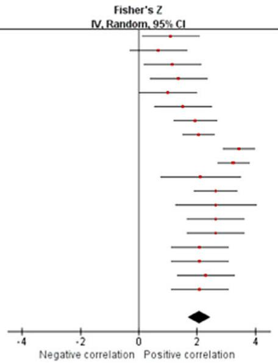

您提供的内容似乎不完整——仅包含一个 Markdown 标题片段 `## b ICC`，没有正文段落、公式、表格或其他可翻译的内容。

请将需要翻译的英文论文 Markdown 完整粘贴过来（包含标题、摘要、正文、参考文献等全部章节），我会按规则完整翻译成中文。

<table><tr><td>Study or Subgroup</td><td>Fisher&#x27;s Z</td><td>SE</td><td>Weight</td><td>Fisher&#x27;s Z IV, Random, 95% CI</td></tr><tr><td>Ertzgaard et al.A</td><td>1.853</td><td>0.343</td><td>16.5%</td><td>1.85 [1.18, 2.53]</td></tr><tr><td>Ertzgaard et al.B</td><td>2.185</td><td>0.343</td><td>16.5%</td><td>2.19 [1.51, 2.86]</td></tr><tr><td>Ertzgaard et al.C</td><td>1.483</td><td>0.343</td><td>16.5%</td><td>1.48 [0.81, 2.16]</td></tr><tr><td>Ertzgaard et al.D</td><td>1.764</td><td>0.343</td><td>16.5%</td><td>1.76 [1.09, 2.44]</td></tr><tr><td>Fantozzi et al.</td><td>2.647</td><td>0.392</td><td>15.8%</td><td>2.65 [1.88, 3.42]</td></tr><tr><td>Henschke et al.</td><td>0.414</td><td>0.211</td><td>18.1%</td><td>0.41 [0.00, 0.83]</td></tr><tr><td>Total (95% CI)</td><td></td><td></td><td>100.0%</td><td>1.70 [0.97, 2.42]</td></tr></table>

异质性：Tau² = 0.71；Chi² = 40.12，df = 5 (P < 0.00001)；I² = 88%  
总体效应检验：Z = 4.60 (P < 0.00001)


## c 均数差

异质性：Tau² = 91.55；Chi² = 25.59，df = 3（P < 0.0001）；I² = 88%

总体效应检验 Z = 0.60（P = 0.55）


图 2. 肩部屈伸（Shoulder flexion/extension）。森林图（Forest plots）展示了使用 IMU 测量肩部屈伸的有效性。红色方块表示 Fisher’s Z；绿色方块表示平均差（mean difference）；横线表示 95% 置信区间（95% CI）；黑色菱形表示汇总数据（total data）。面板 (a) 展示了 Pearson’s r 的结果：Choo 等人的 A（原地上肢摆动，stationary walk）、B（距离上肢摆动，distance walk）、C（原地上肢慢跑，stationary jog）、D（距离上肢慢跑，distance jog）、E（原地腕部投掷，stationary wrist shot）、F（距离腕部投掷，distance wrist shot）；Poitras 等人的 A（60° 关节活动度，60° RoM）、B（90° 关节活动度，90° RoM）、C（120° 关节活动度，120° RoM）；Wu 等人的 A（快速简单任务屈曲，fast sample task (flexion)）、B（慢速简单任务屈曲，slow simple task (flexion)）、C（快速简单任务伸展，fast simple task (extension)）、D（慢速简单任务伸展，slow simple task (extension)）、E（快速复杂任务，fast complex task）、F（慢速复杂任务，slow complex task）。面板 (b) 展示了 ICC 的结果：Ertzgaard 等人的 A（锥筒任务，cone task）、B（投掷任务，throw task）、C（协调任务一，coordination task one）、D（协调任务二，coordination task two）。面板 (c) 展示了平均差的结果：Chan 等人的 A（屈曲，flexion）、B（伸展，extension）。CI 为置信区间（confidence interval）；IV 为逆方差（inverse variance）；SE 为标准误（standard error）。

<table><tr><td rowspan="2">Study or Subgroup</td><td colspan="2">IMU</td><td colspan="5">OMC</td><td rowspan="2">Mean Difference IV, Random, 95% CI</td></tr><tr><td>Mean</td><td>SD</td><td>Total</td><td>Mean</td><td>SD</td><td>Total</td><td>Weight</td></tr><tr><td>Bessone, et al.</td><td>96.3</td><td>8.6</td><td>14</td><td>89.4</td><td>11.7</td><td>14</td><td>33.8%</td><td>6.90 [-0.71, 14.51]</td></tr><tr><td>Chan et al.</td><td>92.42</td><td>4.48</td><td>19</td><td>84.87</td><td>6.19</td><td>19</td><td>35.1%</td><td>7.55 [4.11, 10.99]</td></tr><tr><td>Henschke et al.</td><td>155.2</td><td>19.9</td><td>24</td><td>194</td><td>24.9</td><td>24</td><td>31.1%</td><td>-38.80 [-51.55, -26.05]</td></tr><tr><td>Total (95% CI)</td><td></td><td></td><td>57</td><td></td><td></td><td>57</td><td>100.0%</td><td>-7.10 [-27.56, 13.35]</td></tr></table>

## a 皮尔逊相关系数（Pearson's r）

<table><tr><td>Study or Subgroup</td><td>Fisher&#x27;s Z</td><td>SE</td><td>Weight</td><td>IV, Random, 95% CI</td></tr><tr><td>Choo et al.A</td><td>1.02</td><td>0.5</td><td>5.5%</td><td>1.02 [0.04, 2.00]</td></tr><tr><td>Choo et al.B</td><td>0.793</td><td>0.5</td><td>5.5%</td><td>0.79 [-0.19, 1.77]</td></tr><tr><td>Choo et al.C</td><td>1.071</td><td>0.5</td><td>5.5%</td><td>1.07 [0.09, 2.05]</td></tr><tr><td>Choo et al.D</td><td>1.333</td><td>0.5</td><td>5.5%</td><td>1.33 [0.35, 2.31]</td></tr><tr><td>Choo et al.E</td><td>0.662</td><td>0.5</td><td>5.5%</td><td>0.66 [-0.32, 1.64]</td></tr><tr><td>Choo et al.F</td><td>0.549</td><td>0.5</td><td>5.5%</td><td>0.55 [-0.43, 1.53]</td></tr><tr><td>Fantozzi et al.A</td><td>1.832</td><td>0.447</td><td>6.1%</td><td>1.83 [0.96, 2.71]</td></tr><tr><td>Fantozzi et al.B</td><td>2.647</td><td>0.447</td><td>6.1%</td><td>2.65 [1.77, 3.52]</td></tr><tr><td>Ligorio et al.</td><td>1.658</td><td>0.378</td><td>7.0%</td><td>1.66 [0.92, 2.40]</td></tr><tr><td>Slade et al.</td><td>1.337</td><td>0.707</td><td>3.7%</td><td>1.34 [-0.05, 2.72]</td></tr><tr><td>Truppa et al. 2021A</td><td>2.647</td><td>0.378</td><td>7.0%</td><td>2.65 [1.91, 3.39]</td></tr><tr><td>Truppa et al. 2021B</td><td>2.298</td><td>0.707</td><td>3.7%</td><td>2.30 [0.91, 3.68]</td></tr><tr><td>Wu et al.A</td><td>1.221</td><td>0.5</td><td>5.5%</td><td>1.22 [0.24, 2.20]</td></tr><tr><td>Wu et al.B</td><td>1.256</td><td>0.5</td><td>5.5%</td><td>1.26 [0.28, 2.24]</td></tr><tr><td>Wu et al.C</td><td>2.298</td><td>0.5</td><td>5.5%</td><td>2.30 [1.32, 3.28]</td></tr><tr><td>Wu et al.D</td><td>2.647</td><td>0.5</td><td>5.5%</td><td>2.65 [1.67, 3.63]</td></tr><tr><td>Wu et al.E</td><td>1.376</td><td>0.5</td><td>5.5%</td><td>1.38 [0.40, 2.36]</td></tr><tr><td>Wu et al.F</td><td>1.472</td><td>0.5</td><td>5.5%</td><td>1.47 [0.49, 2.45]</td></tr><tr><td>Total (95% CI)</td><td></td><td></td><td>100.0%</td><td>1.58 [1.25, 1.91]</td></tr></table>

异质性：Tau² = 0.26；Chi² = 35.49，df = 17（P = 0.005）；I² = 52%
整体效应检验 Z = 9.41（P < 0.00001）

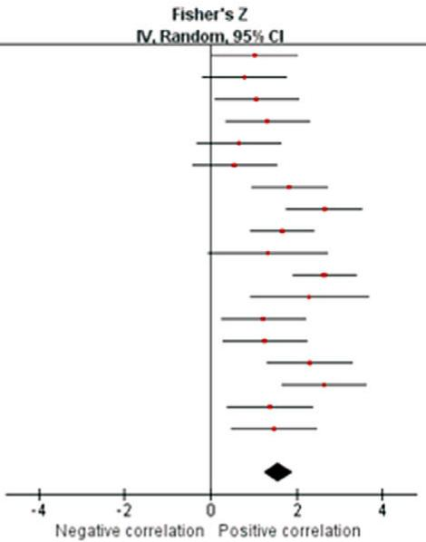

## b 组内相关系数（ICC）

<table><tr><td>Study or Subgroup</td><td>Fisher&#x27;s Z</td><td>SE</td><td>Weight</td><td>IV, Random, 95% CI</td></tr><tr><td>Ertzgaard et al.A</td><td>1.371</td><td>0.343</td><td>19.6%</td><td>1.37 [0.70, 2.04]</td></tr><tr><td>Ertzgaard et al.B</td><td>1.148</td><td>0.343</td><td>19.6%</td><td>1.15 [0.48, 1.82]</td></tr><tr><td>Ertzgaard et al.C</td><td>1.822</td><td>0.343</td><td>19.6%</td><td>1.82 [1.15, 2.49]</td></tr><tr><td>Ertzgaard et al.D</td><td>1.792</td><td>0.343</td><td>19.6%</td><td>1.79 [1.12, 2.46]</td></tr><tr><td>Henschke et al.</td><td>0.075</td><td>0.211</td><td>21.7%</td><td>0.07 [-0.34, 0.49]</td></tr><tr><td>Total (95% CI)</td><td></td><td></td><td>100.0%</td><td>1.22 [0.46, 1.98]</td></tr></table>

异质性：Tau²= 0.65；Chi²= 31.53, df= 4 (P < 0.00001)；I²= 87%
总体效应检验 Z= 3.14 (P = 0.002)

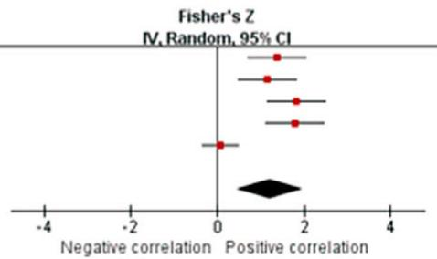

均数差（Mean difference）

异质性：Tau²= 307.30；卡方（Ch²）= 47.66，自由度（df）= 2（P < 0.00001）；P= 96%

  

总体效应检验 Z = 0.68（P = 0.50）

图 3. 肩部外展/内收。森林图展示了使用 IMU 测量的肩部外展/内收的效度。红色方块代表 Fisher's Z；绿色方块代表均差（mean difference）；横线表示 95% 置信区间（CI），黑色菱形代表汇总数据。面板 (a) 描述 Pearson's r 的结果：Choo 等人 A（原地行走，stationary walk）、B（距离行走，distance walk）、C（原地慢跑，stationary jog）、D（距离慢跑，distance jog）、E（原地腕部射门，stationary wrist shot）、F（距离腕部射门，distance wrist shot）；Fantozzi 等人 A（自由泳任务，front-crawl task）、B（蛙泳任务，breaststroke task）；Wu 等人 A（快速样本任务（屈曲），fast sample task (flexion)）、B（慢速简单任务（屈曲），slow simple task (flexion)）、C（快速简单任务（伸展），fast simple task (extension)）、D（慢速简单任务（伸展），slow simple task (extension)）、E（快速复杂任务，fast complex task）、F（慢速复杂任务，slow complex task）。面板 (b) 描述 ICC 的结果：Ertzgaard 等人 A（锥筒任务，cone task）、B（投掷任务，throw task）、C（协调任务一，coordination task one）、D（协调任务二，coordination task two）。面板 (c) 描述均差（mean difference）的结果。CI，置信区间（confidence interval）；IV，逆方差（inverse variance）；SD，标准差（standard deviation）；SE，标准误（standard error）。

## a Pearson's r

<table><tr><td>Study or Subgroup</td><td>Fisher&#x27;s Z</td><td>SE</td><td>Weight</td><td>IV, Random, 95% CI</td></tr><tr><td>Boddy et al.A</td><td>0.887</td><td>0.378</td><td>6.6%</td><td>0.89 [0.15, 1.63]</td></tr><tr><td>Boddy et al.B</td><td>1.056</td><td>0.378</td><td>6.6%</td><td>1.06 [0.32, 1.80]</td></tr><tr><td>Ertzgaard et al.A</td><td>1.764</td><td>0.378</td><td>6.6%</td><td>1.76 [1.02, 2.50]</td></tr><tr><td>Ertzgaard et al.B</td><td>1.499</td><td>0.378</td><td>6.6%</td><td>1.50 [0.76, 2.24]</td></tr><tr><td>Ertzgaard et al.C</td><td>1.096</td><td>0.378</td><td>6.6%</td><td>1.10 [0.36, 1.84]</td></tr><tr><td>Ertzgaard et al.D</td><td>1.015</td><td>0.378</td><td>6.6%</td><td>1.01 [0.27, 1.76]</td></tr><tr><td>Fantozzi et al.A</td><td>2.298</td><td>0.447</td><td>5.6%</td><td>2.30 [1.42, 3.17]</td></tr><tr><td>Fantozzi et al.B</td><td>2.647</td><td>0.447</td><td>5.6%</td><td>2.65 [1.77, 3.52]</td></tr><tr><td>Ligorio et al.</td><td>1.589</td><td>0.378</td><td>6.6%</td><td>1.59 [0.85, 2.33]</td></tr><tr><td>Slade et al.</td><td>1.05</td><td>0.707</td><td>3.1%</td><td>1.05 [-0.34, 2.44]</td></tr><tr><td>Truppa et al. 2021A</td><td>2.298</td><td>0.378</td><td>6.6%</td><td>2.30 [1.56, 3.04]</td></tr><tr><td>Truppa et al. 2021B</td><td>2.298</td><td>0.707</td><td>3.1%</td><td>2.30 [0.91, 3.68]</td></tr><tr><td>Wu et al.A</td><td>2.298</td><td>0.5</td><td>5.0%</td><td>2.30 [1.32, 3.28]</td></tr><tr><td>Wu et al.B</td><td>2.298</td><td>0.5</td><td>5.0%</td><td>2.30 [1.32, 3.28]</td></tr><tr><td>Wu et al.C</td><td>2.298</td><td>0.5</td><td>5.0%</td><td>2.30 [1.32, 3.28]</td></tr><tr><td>Wu et al.D</td><td>2.647</td><td>0.5</td><td>5.0%</td><td>2.65 [1.67, 3.63]</td></tr><tr><td>Wu et al.E</td><td>1.376</td><td>0.5</td><td>5.0%</td><td>1.38 [0.40, 2.36]</td></tr><tr><td>Wu et al.F</td><td>1.376</td><td>0.5</td><td>5.0%</td><td>1.38 [0.40, 2.36]</td></tr><tr><td>Total (95% CI)</td><td></td><td></td><td>100.0%</td><td>1.73 [1.44, 2.02]</td></tr></table>

异质性：Tau² = 0.18；Chi² = 32.82，df = 17（P = 0.01）；I² = 48%
总体效应检验 Z = 11.87（P < 0.00001）


b 平均差（Mean Difference）

  

异质性。Tau² = 60.98；Chi² = 39.88，df = 4（P < 0.00001）；I² = 90%  
总体效应检验 Z = 2.80（P = 0.005）

Figure 4. 肩关节内旋/外旋。森林图展示了使用惯性测量单元（IMU）测量肩关节旋转的有效性。红色方块代表Fisher's Z；绿色方块代表均数差；横线表示95%置信区间，黑色菱形代表汇总数据。(a)子图描述了皮尔逊相关系数r（Pearson's r）的结果：Boddy等人（2019）A（快速球）、B（变速球）；Ertzgaard等人 A（圆锥任务）、B（投掷任务）、C（协调任务一）、D（协调任务二）；Fantozzi等人 A（自由泳任务）、B（蛙泳任务）；Wu等人 A（快速简单任务（屈曲））、B（慢速简单任务（屈曲））、C（快速简单任务（伸展））、D（慢速简单任务（伸展））、E（快速复杂任务）、F（慢速复杂任务）。(b)子图描述了均数差的结果：Boddy等人 A（快速球）、B（变速球）。CI，置信区间；IV，逆方差；SD，标准差；SE，标准误。

来自三项研究（一项高质量（HQ）研究和两项中等质量（MQ）研究；Ertzgaard等人, 2016; Fantozzi等人, 2016; Henschke等人, 2022）的数据表明，IMU与光运动捕捉系统（OMC）在肩关节屈伸测量方面具有极佳的一致性（总样本量n = 42；ICC = 0.935，95% CI [0.749, 0.984]；Tau<sup>2</sup> = 0.71；I<sup>2</sup> = 88%）（图2b）。敏感性分析显示，排除Henschke等人（2022）的研究后，$I ^ { 2 }$降至32%，ICC变为0.961 [0.920, 0.982]。敏感性分析表明结果稳健。根据纳入研究的质量，该结果证据等级为中等。

## a 皮尔逊相关系数r

<table><tr><td>Study or Subgroup</td><td>Fisher&#x27;s Z</td><td>SE</td><td>Weight</td><td>IV, Random, 95% CI</td></tr><tr><td>Choo et al.A</td><td>1.946</td><td>0.5</td><td>5.3%</td><td>1.95 [0.97, 2.93]</td></tr><tr><td>Choo et al.B</td><td>1.528</td><td>0.5</td><td>5.3%</td><td>1.53 [0.55, 2.51]</td></tr><tr><td>Choo et al.C</td><td>1.256</td><td>0.5</td><td>5.3%</td><td>1.26 [0.28, 2.24]</td></tr><tr><td>Choo et al.D</td><td>1.738</td><td>0.5</td><td>5.3%</td><td>1.74 [0.76, 2.72]</td></tr><tr><td>Choo et al.E</td><td>1.221</td><td>0.5</td><td>5.3%</td><td>1.22 [0.24, 2.20]</td></tr><tr><td>Choo et al.F</td><td>1.256</td><td>0.5</td><td>5.3%</td><td>1.26 [0.28, 2.24]</td></tr><tr><td>Fantozzi et al.A</td><td>1.946</td><td>0.447</td><td>6.6%</td><td>1.95 [1.07, 2.82]</td></tr><tr><td>Fantozzi et al.B</td><td>2.647</td><td>0.447</td><td>6.6%</td><td>2.65 [1.77, 3.52]</td></tr><tr><td>Ligorio et al.</td><td>1.832</td><td>0.378</td><td>9.2%</td><td>1.83 [1.09, 2.57]</td></tr><tr><td>Slade et al.</td><td>2.515</td><td>0.707</td><td>2.6%</td><td>2.52 [1.13, 3.90]</td></tr><tr><td>Truppa et al. 2021A</td><td>2.092</td><td>0.378</td><td>9.2%</td><td>2.09 [1.35, 2.83]</td></tr><tr><td>Truppa et al. 2021B</td><td>1.376</td><td>0.707</td><td>2.6%</td><td>1.38 [-0.01, 2.76]</td></tr><tr><td>Wu et al.A</td><td>2.298</td><td>0.5</td><td>5.3%</td><td>2.30 [1.32, 3.28]</td></tr><tr><td>Wu et al.B</td><td>2.647</td><td>0.5</td><td>5.3%</td><td>2.65 [1.67, 3.63]</td></tr><tr><td>Wu et al.C</td><td>1.946</td><td>0.5</td><td>5.3%</td><td>1.95 [0.97, 2.93]</td></tr><tr><td>Wu et al.D</td><td>1.832</td><td>0.5</td><td>5.3%</td><td>1.83 [0.85, 2.81]</td></tr><tr><td>Wu et al.E</td><td>1.832</td><td>0.5</td><td>5.3%</td><td>1.83 [0.85, 2.81]</td></tr><tr><td>Wu et al.F</td><td>1.589</td><td>0.5</td><td>5.3%</td><td>1.59 [0.61, 2.57]</td></tr><tr><td>Total (95% CI)</td><td></td><td></td><td>100.0%</td><td>1.88 [1.65, 2.10]</td></tr></table>

异质性：Tau² = 0.00；Chi² = 13.48，df = 17（P = 0.70）；I² = 0%
总体效应检验 Z = 16.36（P < 0.00001）

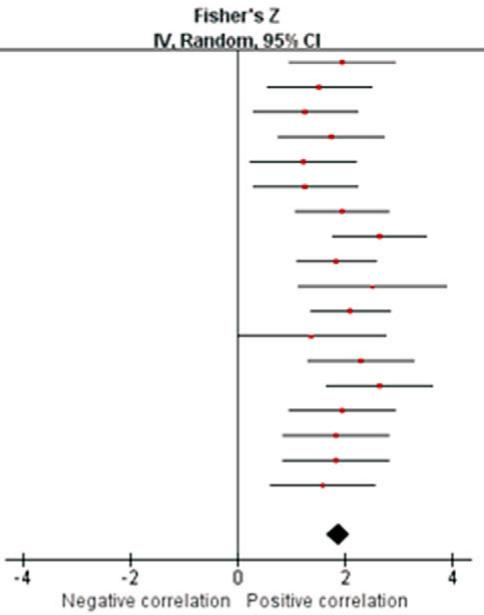

## b ICC（Intraclass Correlation Coefficient，组内相关系数）

<table><tr><td>Study or Subgroup</td><td>Fisher&#x27;s Z</td><td>SE</td><td>Weight</td><td>Fisher&#x27;s Z IV, Random, 95% CI</td></tr><tr><td>Ertzgaard et al.A</td><td>2.41</td><td>0.343</td><td>25.0%</td><td>2.41 [1.74, 3.08]</td></tr><tr><td>Ertzgaard et al.B</td><td>1.238</td><td>0.343</td><td>25.0%</td><td>1.24 [0.57, 1.91]</td></tr><tr><td>Ertzgaard et al.C</td><td>1.551</td><td>0.343</td><td>25.0%</td><td>1.55 [0.88, 2.22]</td></tr><tr><td>Ertzgaard et al.D</td><td>1.412</td><td>0.343</td><td>25.0%</td><td>1.41 [0.74, 2.08]</td></tr><tr><td>Total (95% CI)</td><td></td><td></td><td>100.0%</td><td>1.65 [1.14, 2.16]</td></tr></table>

异质性：Tau²= 0.15；Ch²= 6.92，df= 3（P = 0.07）；I²= 57%
总体效应检验：Z = 6.35（P < 0.00001）

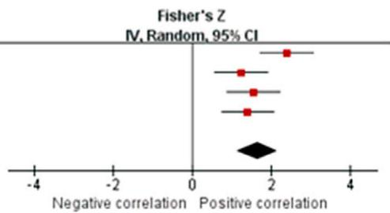

## c 均值差（Mean Difference）

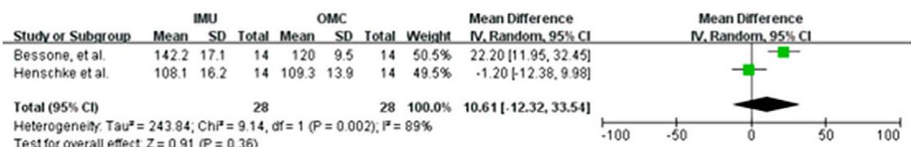  

异质性。Tau = 243.84；Chi² = 9.14，df = 1（P = 0.002）；I² = 89%
总体效应检验 Z = 0.91（P = 0.36）

图5. 肘关节屈曲/伸展。森林图显示了使用 IMU 测量肘关节屈曲/伸展的有效性。红色方块代表 Fisher Z 值；绿色方块代表平均差；横条表示 95% 置信区间，黑色菱形表示汇总数据。面板（a）展示了 Pearson 相关系数 r 的结果：Choo 等的研究中 A（原地行走）、B（距离行走）、C（原地慢跑）、D（距离慢跑）、E（原地手腕射门）、F（距离手腕射门）；Fantozzi 等的研究中 A（自由泳任务）、B（蛙泳任务）；Wu 等的研究中 A（快速样本任务（屈曲））、B（慢速简单任务（屈曲））、C（快速简单任务（伸展））、D（慢速简单任务（伸展））、E（快速复杂任务）、F（慢速复杂任务）。面板（b）展示了 ICC 的结果：Ertzgaard 等的研究中 A（锥桶任务）、B（投掷任务）、C（协调任务一）、D（协调任务二）。面板（c）展示了平均差的结果。CI，置信区间；IV，逆方差；SD，标准差；SE，标准误差。

## a Pearson 相关系数 r

<table><tr><td>Study or Subgroup</td><td>Fisher&#x27;s Z</td><td>SE</td><td>Weight</td><td>IV, Random, 95% CI</td></tr><tr><td>Fantozzi et al.A</td><td>1.589</td><td>0.447</td><td>11.6%</td><td>1.59 [0.71, 2.47]</td></tr><tr><td>Fantozzi et al.B</td><td>2.647</td><td>0.447</td><td>11.6%</td><td>2.65 [1.77, 3.52]</td></tr><tr><td>Truppa et al. 2021A</td><td>1.832</td><td>0.378</td><td>16.3%</td><td>1.83 [1.09, 2.57]</td></tr><tr><td>Truppa et al. 2021B</td><td>1.946</td><td>0.707</td><td>4.7%</td><td>1.95 [0.56, 3.33]</td></tr><tr><td>Wu et al.A</td><td>2.647</td><td>0.5</td><td>9.3%</td><td>2.65 [1.67, 3.63]</td></tr><tr><td>Wu et al.B</td><td>2.647</td><td>0.5</td><td>9.3%</td><td>2.65 [1.67, 3.63]</td></tr><tr><td>Wu et al.C</td><td>2.092</td><td>0.5</td><td>9.3%</td><td>2.09 [1.11, 3.07]</td></tr><tr><td>Wu et al.D</td><td>2.092</td><td>0.5</td><td>9.3%</td><td>2.09 [1.11, 3.07]</td></tr><tr><td>Wu et al.E</td><td>1.422</td><td>0.5</td><td>9.3%</td><td>1.42 [0.44, 2.40]</td></tr><tr><td>Wu et al.F</td><td>1.472</td><td>0.5</td><td>9.3%</td><td>1.47 [0.49, 2.45]</td></tr></table>

异质性：Tau² = 0.00；Chi² = 8.97，df = 9（P = 0.44）；I² = 0%
总体效应检验 Z = 13.33（P < 0.00001）

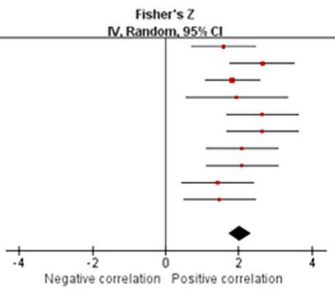

您发送的内容似乎不完整，只看到了一个片段：

## b ICC


这看起来像是某个小节标题的一部分（例如 "b ICC" 可能指 "Inter-Class Correlation" 之类），但缺少上下文。

请您重新发送完整的论文 Markdown 内容，我会按照学术翻译规范为您完整翻译。

<table><tr><td>Study or Subgroup</td><td>Fisher&#x27;s Z</td><td>SE</td><td>Weight</td><td>Fisher&#x27;s Z IV, Random, 95% CI</td></tr><tr><td>Ertzgaard et al.A</td><td>0.833</td><td>0.343</td><td>20.0%</td><td>0.83 [0.16, 1.51]</td></tr><tr><td>Ertzgaard et al.B</td><td>1.053</td><td>0.343</td><td>20.0%</td><td>1.05 [0.38, 1.73]</td></tr><tr><td>Ertzgaard et al.C</td><td>1.077</td><td>0.343</td><td>20.0%</td><td>1.08 [0.40, 1.75]</td></tr><tr><td>Ertzgaard et al.D</td><td>1.121</td><td>0.343</td><td>20.0%</td><td>1.12 [0.45, 1.79]</td></tr><tr><td>Ligorio et al.</td><td>1.738</td><td>0.343</td><td>20.0%</td><td>1.74 [1.07, 2.41]</td></tr><tr><td>Total (95% CI)</td><td></td><td></td><td>100.0%</td><td>1.16 [0.86, 1.47]</td></tr></table>

整体效应检验（Test for overall effect）：Z = 7.59 (P < 0.00001)
异质性（Heterogeneity）：Tau²= 0.00；Chi²= 3.92，df= 4 (P = 0.42)；I²= 0%

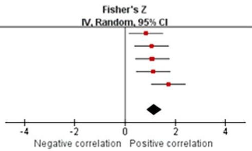

图6. 肘关节旋前（Pronation）/旋后（Supination）。森林图展示了使用IMU测量的肘关节旋前/旋后的效度。红色方块代表Fisher's Z；绿色方块表示平均差；横杠表示95% CI，黑色菱形代表合并总数据。Panel (a) 描述了Pearson's r的结果：Fantozzi等人 A（自由泳任务），B（蛙泳任务）；Wu等人 A（快速样本任务（屈曲）），B（慢速简单任务（屈曲）），C（快速简单任务（伸展）），D（慢速简单任务（伸展）），E（快速复杂任务），F（慢速复杂任务）。Panel (b) 描述了ICC的结果：Ertzgaard等人 A（圆锥任务），B（投掷任务），C（协调任务一），D（协调任务二）。CI，置信区间（confidence interval）；IV，逆方差（inverse variance）；SE，标准误（standard error）。

三项研究（两项高质量（HQ）和一项中等质量（MQ）；Bessone等人, 2022; Chan等人, 2022; Henschke等人, 2022）的数据表明，对于肩关节屈曲（Flexion）/伸展（Extension）测量，IMU与OMC之间不存在显著测量差异（总样本量 $n = 5 7$；平均差 = 3.19，95% CI [ 13.57, 7.18]；Tau<sup>2</sup> = 91.55；$I ^ { 2 } { = } 8 8 ^ { \circ } { \% } ; Z { = } 0 . 6 0 ( p { = } 0 . 5 5 ) ) ( \mathrm { F i g u r e } 2 \mathrm { c } )$。进行了一项敏感性分析，结果显示当排除Henschke等人（2022）的研究后，$\dot { I } ^ { 2 }$降低至67%，平均差为2.39 [4.04, 8.82]，Z分数为0.73（p = 0.47）。该分析表明结果是稳健的。根据所纳入研究的质量，该结果的证据等级为强。

## 3.4.2. 肩关节外展（Abduction）/内收（Adduction）

七项研究（两项高质量（HQ）、三项中等质量至低质量（MQ to LQ）和两项极低质量（VLQ）；Fantozzi等人, 2016; Ligorio等人, 2020; Truppa等人, 2021a,b; Choo等人, 2022; Slade等人, 2022; Wu等人, 2022）的数据表明，对于肩关节外展/内收测量，IMU与OMC之间存在非常强的相关性（总样本量 n = 52；r = 0.919，95% CI [0.848, 0.957]；Tau<sup>2</sup> = 0.29；I<sup>2</sup> = 52%）（图3a）。在进行敏感性分析并排除Truppa等人（2021a）的研究后，$I ^ { 2 }$下降至41%，而Pearson's r

## a Pearson's r

<table><tr><td>Study or Subgroup</td><td>Fisher&#x27;s Z</td><td>SE</td><td>Weight</td><td>Fisher&#x27;s Z IV, Random, 95% CI</td></tr><tr><td>Fantozzi et al.A</td><td>1.946</td><td>0.447</td><td>19.2%</td><td>1.95 [1.07, 2.82]</td></tr><tr><td>Fantozzi et al.B</td><td>2.298</td><td>0.447</td><td>19.2%</td><td>2.30 [1.42, 3.17]</td></tr><tr><td>Ligorio et al.</td><td>2.298</td><td>0.378</td><td>26.9%</td><td>2.30 [1.56, 3.04]</td></tr><tr><td>Truppa et al. 2021A</td><td>1.946</td><td>0.378</td><td>26.9%</td><td>1.95 [1.21, 2.69]</td></tr><tr><td>Truppa et al. 2021B</td><td>2.647</td><td>0.707</td><td>7.7%</td><td>2.65 [1.26, 4.03]</td></tr><tr><td>Total (95% CI)</td><td></td><td></td><td>100.0%</td><td>2.16 [1.78, 2.55]</td></tr></table>

异质性：Tau²= 0.00；Chi²= 1.25，自由度 df= 4（P = 0.87）；I²= 0%  
总体效应检验 Z= 11.03（P < 0.00001）

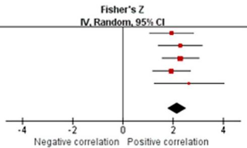

## b 均值差（Mean difference）

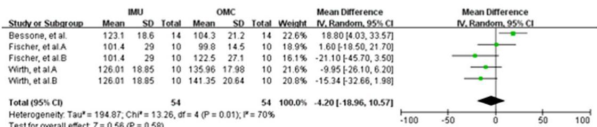  

异质性。Tau\* = 194.87；Chi\* = 13.26，df = 4（P = 0.01）；I² = 70%
总体效应检验 Z = 0.56（P = 0.58）

图 7. 腕屈/伸（Wrist flexion/extension）。森林图显示了使用 IMU 测量的腕屈/伸的有效性。红色方块代表 Fisher's Z；绿色方块代表平均差；条形表示 95% CI，黑色菱形表示汇总数据。(a) 面板描述了 Pearson's r 的结果：Fantozzi 等人 A（自由泳任务），B（蛙泳任务）。(b) 面板描述了平均差的结果：Wirth 等人 A（皮肤上的标记），B（传感器上的标记）；Fischer 等人 A（皮肤上的标记），B（传感器上的标记）。CI，置信区间；IV，逆方差；SD，标准差；SE，标准误差。

汇总相关系数（remained high at 0.905 with a confidence interval of [0.831, 0.948]）仍然较高，为 0.905，置信区间为 [0.831, 0.948]。敏感性分析显示结果稳健。基于纳入研究的质量，此结果的证据等级为强。

来自两项研究（1 项 HQ 和 1 项 MQ；Ertzgaard 等人，2016；Henschke 等人，2022）的数据表明，IMU 和 OMC 在肩外展/内收测量方面具有良好一致性（总 n = 34；ICC = 0.840，95% CI [0.430, 0.963]；Tau<sup>2</sup> = 0.65；I<sup>2</sup> = 87%）（图 3b）。由于研究数量不足，无法进行敏感性分析。基于纳入研究的质量，此结果的证据等级为中等。

来自三项研究（2 项 HQ 和 1 项 MQ；Bessone 等人，2022；Chan 等人，2022；Henschke 等人，2022）的数据表明，IMU 和 OMC 在肩外展/内收测量方面无显著测量差异（总 n = 57；平均差 = 7.10，95% CI [ 27.56, 13.35]；Tau<sup>2</sup> = 307.30；I<sup>2</sup> = 96%；Z = 0.68 (p = 0.50)）（图 3c）。在排除 Henschke 等人（2022）的研究后，敏感性分析显示 $I ^ { 2 }$ 降至 0%，平均差为 7.44 [4.31, 10.57]，Z 值为 $4 . 6 6 ( p < 0 . 0 0 0 0 1 )$。敏感性分析显示结果不稳健。基于纳入研究的质量，此结果的证据等级为强。

## 3.4.3. 肩内旋/外旋（Shoulder internal/external rotation）

来自七项研究（1 项 HQ，4 项 MQ 至 LQ，以及 2 项 VLQ；Ertzgaard 等人，2016；Fantozzi 等人，$2 0 1 6 ;$ Boddy 等人，2019；Ligorio 等人，2020；Truppa 等人，2021a,b；Slade 等人，2022；Wu 等人，2022）的数据

  

整体效应检验：Z = 1.74 (P = 0.08)

Figure 8. 腕关节尺偏/桡偏（wrist ulnar/radial deviation）。森林图（Forest plot）显示使用 IMU 测量的腕关节尺偏/桡偏的有效性。绿色方块代表均差；横线表示 95% CI，黑色菱形表示汇总数据。该图描述均差结果：Wirth et al. A（marker on the skin，皮肤上的标记），B（marker on the sensor，传感器上的标记）；Fischer et al. A（marker on the skin，皮肤上的标记），B（marker on the sensor，传感器上的标记）。CI，confidence interval，置信区间；IV，inverse variance，逆方差；SD，standard deviation，标准差。

suggest that very strong relationship between IMU and OMC for shoulder internal/external rotation measurements (total $n = 6 4 ; r = 0 . 9 3 9 , 9 5 \% \mathrm { C I } [ 0 . 8 9 4 , 0 . 9 6 5 ] ; \mathrm { T a u } ^ { 2 } = 0 . 1 8 ; I ^ { 2 } = 4 8 \%$ (Figure 4a). Based on the quality of the included studies, the level of evidence for this result is moderate.

Data from four studies (two HQ and two LQ; Boddy et al., 2019; Picerno et al., 2019; Chan et al., 2022; Henschke et al., 2022) suggest that significant measurement difference between IMU and OMC for shoulder internal/external rotation measurements (total n = 67; mean difference = 11.03, 95% CI $[ - 1 8 . 7 6 , - 3 . 3 1 ] ; \mathrm { T a u } ^ { 2 } = 6 0 . 9 8 ; I ^ { 2 } = 9 0 \% ; Z = 2 . 8 0 \ ( p = 0 . 0 0 5 ) )$ (Figure 4b). Sensitivity analysis showed that after excluding the study of Chan et al. (2022) and Henschke et al. (2022), the $\dot { I } ^ { 2 }$ value decreased to 67% and the mean difference was $- 9 . 1 3 \ [ - 1 3 . 0 9 , \ - 5 . 1 7 ]$ , with Z-score of 4.52 $( p < 0 . 0 0 0 0 1 )$ Sensitivity analysis showed that the results were robust. Based on the quality of the included studies, the level of evidence for this result is strong.

## 3.4.4. Elbowflexion/extension

Data from seven studies (two HQ, three MQ to LQ, and two VLQ; Fantozzi et al., 2016; Ligorio et al., 2020; Truppa et al., 2021a,b; Choo et al., 2022; Slade et al., 2022; Wu et al., 2022) suggest that very strong relationship between IMU and OMC for elbow flexion/extension measurements (total $n = 5 2 ; r = 0 . 9 5 4 .$ 95% CI [0.929, 0.970]; Tau<sup>2</sup> = 0.00; I<sup>2</sup> = 0%) (Figure 5a). Based on the quality of the included studies, the level of evidence for this result is strong.

一项中等质量（MQ）研究（Ertzgaard 等, 2016）的数据表明，IMU 与 OMC 在肘关节屈/伸测量上具有极佳的一致性（总样本量 $n = 1 0 ; \bar { \mathrm { I C C } } = 0 . 9 2 9 , 9 5 ^ { \circ } \% \mathrm { C I } [ 0 . 8 1 4 , 0 . 9 7 4 ] ; \mathrm { T a u } ^ { 2 } = 0 . 1 5 ;$ $1 ^ { 2 } = 5 7 \%$）。基于所纳入研究的质量，该结果的证据等级有限。

两项研究（一项高质量、一项中等质量；Bessone 等, 2022；Henschke 等, 2022）的数据表明，IMU 与 OMC 在肩关节屈/伸测量上无显著测量差异（总样本量 $n = 3 8 ; \mathrm { 1 i f f e r e n c e } = 1 0 . 6 1 , 9 5 \% \mathrm { C I } [ - 1 2 . 3 2 , 3 3 . 5 4 ] ; \mathrm { T a u } ^ { 2 } = 2 4 3 . 8 4 ; I ^ { 2 } = 8 9 \% ; Z = 0 . 9 1$ $( p = 0 . 3 6 )$）（图 5b）。由于纳入研究数量不足，无法进行敏感性分析。基于所纳入研究的质量，该结果的证据等级为中等。

## 3.4.5. 肘关节旋前/旋后

四项研究（一项高质量、两项中等至低质量、一项极低质量；Fantozzi 等, 2016；Truppa 等, 2021a, b；Wu 等, 2022）的数据表明，IMU 与 OMC 在肘关节旋前/旋后测量上具有非常强的相关性（总样本量 n = 30；r = 0.966, 95% CI [0.939, 0.981]；Tau<sup>2</sup> = 0.00；I<sup>2</sup> = 0%）（图 6a）。基于所纳入研究的质量，该结果的证据等级为中等。

两项研究（Ertzgaard 等, 2016；Ligorio 等, 2020）的数据表明，IMU 与 OMC 在肘关节旋前/旋后测量上具有良好的一致性（总样本量 n = 20；ICC = 0.821, 95% CI [0.696,

11.1.2 简单任务

<table><tr><td>Study or Subgroup</td><td>Fisher&#x27;s Z</td><td>SE</td><td>Weight</td><td>Fisher&#x27;s ZIV, Random, 95% CI</td><td>Fisher&#x27;s ZIV, Random, 95% CI</td></tr><tr><td colspan="6">11.1.1 Complex task</td></tr><tr><td>Choo et al.B</td><td>0.678</td><td>0.5</td><td>8.3%</td><td>0.68 [-0.30, 1.66]</td><td></td></tr><tr><td>Choo et al.D</td><td>1.376</td><td>0.5</td><td>8.3%</td><td>1.38 [0.40, 2.36]</td><td></td></tr><tr><td>Choo et al.E</td><td>0.996</td><td>0.5</td><td>8.3%</td><td>1.00 [0.02, 1.98]</td><td></td></tr><tr><td>Choo et al.F</td><td>1.528</td><td>0.5</td><td>8.3%</td><td>1.53 [0.55, 2.51]</td><td></td></tr><tr><td>Wu et al.E</td><td>2.298</td><td>0.5</td><td>8.3%</td><td>2.30 [1.32, 3.28]</td><td></td></tr><tr><td>Wu et al.F</td><td>2.092</td><td>0.5</td><td>8.3%</td><td>2.09 [1.11, 3.07]</td><td></td></tr><tr><td>Subtotal (95% CI)</td><td></td><td></td><td>50.0%</td><td>1.49 [1.00, 1.99]</td><td></td></tr></table>

整体效应检验 Z= 5.89 (P < 0.00001)

## a 肩部屈伸的 Pearson's r

异质性: Tau²= 0.14; Chi²= 7.73, df= 5 (P = 0.17); I²= 35%

<table><tr><td>Choo et al.A</td><td>1.099</td><td>0.5</td><td>8.3%</td><td>1.10 [0.12, 2.08]</td></tr><tr><td>Choo et al.C</td><td>1.157</td><td>0.5</td><td>8.3%</td><td>1.16 [0.18, 2.14]</td></tr><tr><td>Wu et al.A</td><td>2.647</td><td>0.5</td><td>8.3%</td><td>2.65 [1.67, 3.63]</td></tr><tr><td>Wu et al.B</td><td>2.647</td><td>0.5</td><td>8.3%</td><td>2.65 [1.67, 3.63]</td></tr><tr><td>Wu et al.C</td><td>2.092</td><td>0.5</td><td>8.3%</td><td>2.09 [1.11, 3.07]</td></tr><tr><td>Wu et al.D</td><td>2.092</td><td>0.5</td><td>8.3%</td><td>2.09 [1.11, 3.07]</td></tr><tr><td>Subtotal (95% CI)</td><td></td><td></td><td>50.0%</td><td>1.96 [1.41, 2.51]</td></tr></table>

异质性：Tau²=0.22；Chi²=9.46，df=5（P=0.09）；I²=47%  
总体效应检验 Z=6.97（P<0.00001）  
100.0% 1.73[1.35, 2.10]

  

异质性：Tau² = 0.20；Chi² = 19.74，df = 11 (P = 0.05)；I² = 44%

整体效应检验 Z = 8.92 (P < 0.00001)

亚组差异检验：Chi² = 1.48，df = 1 (P = 0.22)，I² = 32.6%

## b 肩部外展/内收的皮尔逊相关系数（Pearson's r）

<table><tr><td>Study or Subgroup</td><td>Fisher&#x27;s Z</td><td>SE</td><td>Weight</td><td>IV, Random, 95% CI</td></tr><tr><td colspan="5">12.1.1 Complex task</td></tr><tr><td>Choo et al.B</td><td>0.793</td><td>0.5</td><td>8.3%</td><td>0.79 [-0.19, 1.77]</td></tr><tr><td>Choo et al.D</td><td>1.333</td><td>0.5</td><td>8.3%</td><td>1.33 [0.35, 2.31]</td></tr><tr><td>Choo et al.E</td><td>0.662</td><td>0.5</td><td>8.3%</td><td>0.66 [-0.32, 1.64]</td></tr><tr><td>Choo et al.F</td><td>0.549</td><td>0.5</td><td>8.3%</td><td>0.55 [-0.43, 1.53]</td></tr><tr><td>Wu et al.E</td><td>1.376</td><td>0.5</td><td>8.3%</td><td>1.38 [0.40, 2.36]</td></tr><tr><td>Wu et al.F</td><td>1.472</td><td>0.5</td><td>8.3%</td><td>1.47 [0.49, 2.45]</td></tr><tr><td>Subtotal (95% CI)</td><td></td><td></td><td>50.0%</td><td>1.03 [0.63, 1.43]</td></tr></table>

异质性：Tau² = 0.00；Chi² = 3.32，df = 5（P = 0.65）；I² = 0%  
整体效应检验 Z = 5.05（P < 0.00001）

<table><tr><td colspan="5">12.1.2 Simple task</td></tr><tr><td>Choo et al.A</td><td>1.02</td><td>0.5</td><td>8.3%</td><td>1.02 [0.04, 2.00]</td></tr><tr><td>Choo et al.C</td><td>1.071</td><td>0.5</td><td>8.3%</td><td>1.07 [0.09, 2.05]</td></tr><tr><td>Wu et al.A</td><td>1.221</td><td>0.5</td><td>8.3%</td><td>1.22 [0.24, 2.20]</td></tr><tr><td>Wu et al.B</td><td>1.256</td><td>0.5</td><td>8.3%</td><td>1.26 [0.28, 2.24]</td></tr><tr><td>Wu et al.C</td><td>2.298</td><td>0.5</td><td>8.3%</td><td>2.30 [1.32, 3.28]</td></tr><tr><td>Wu et al.D</td><td>2.647</td><td>0.5</td><td>8.3%</td><td>2.65 [1.67, 3.63]</td></tr><tr><td>Subtotal (95% CI)</td><td></td><td></td><td>50.0%</td><td>1.59 [1.02, 2.15]</td></tr></table>

异质性：Tau² = 0.24；Chi² = 9.84，df = 5（P = 0.08）；I² = 49%  
整体效应检验 Z = 5.54（P < 0.00001）  
合计（95% CI）

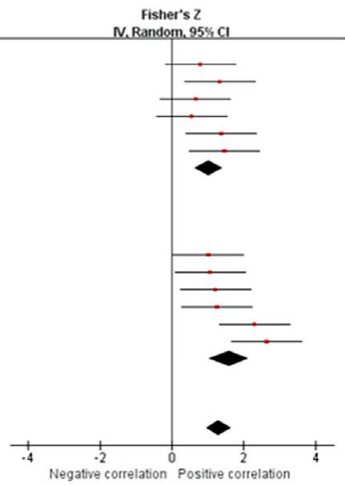  

100.0% 1.31 [0.96, 1.66]  
异质性：Tau²= 0.13；Chi²= 16.85，df= 11（P = 0.11）；I²= 35%  
总体效应检验 Z= 7.32（P < 0.00001）  
亚组差异检验：Chi²= 2.49，df= 1（P = 0.11），I²= 59.8%

图9. 运动任务的复杂性（Complexity of motion task）。亚组分析展示了惯性测量单元（IMU）在不同运动任务复杂性下测量关节活动范围的效度。红色方块表示 Fisher's Z 值；绿色方块表示平均差；误差棒表示 95% 置信区间（CI），黑色菱形表示汇总数据。（a）面板描述了采用 Pearson's r 测量肩关节屈曲/伸展的结果。（b）面板描述了采用 Pearson's r 测量肩关节外展/内收的结果。（c）面板描述了采用 Pearson's r 测量肩关节内旋/外旋的结果。（d）面板描述了采用 Pearson's r 测量肘关节屈曲/伸展的结果。（e）面板描述了采用平均差测量肩关节内旋/外旋的结果。（续）

Total (95% CI) 100.0% 1.57 [1.24, 1.90] → 总体（95% CI）100.0% 1.57 [1.24, 1.90]

## c Pearson's r on shoulder internal/external rotation
## c 肩关节内旋/外旋的 Pearson's r

<table><tr><td>Study or Subgroup</td><td>Fisher&#x27;s Z</td><td>SE</td><td>Weight</td><td>Fisher&#x27;s ZIV, Random, 95% CI</td><td>Fisher&#x27;s ZIV, Random, 95% CI</td></tr><tr><td colspan="6">13.1.1 Complex task</td></tr><tr><td>Boddy et al.A</td><td>0.887</td><td>0.378</td><td>9.6%</td><td>0.89 [0.15, 1.63]</td><td></td></tr><tr><td>Boddy et al.B</td><td>1.056</td><td>0.378</td><td>9.6%</td><td>1.06 [0.32, 1.80]</td><td></td></tr><tr><td>Ertzgaard et al.C</td><td>1.096</td><td>0.378</td><td>9.6%</td><td>1.10 [0.36, 1.84]</td><td></td></tr><tr><td>Ertzgaard et al.D</td><td>1.015</td><td>0.378</td><td>9.6%</td><td>1.01 [0.27, 1.76]</td><td></td></tr><tr><td>Wu et al.E</td><td>1.376</td><td>0.5</td><td>7.1%</td><td>1.38 [0.40, 2.36]</td><td></td></tr><tr><td>Wu et al.F</td><td>1.376</td><td>0.5</td><td>7.1%</td><td>1.38 [0.40, 2.36]</td><td></td></tr><tr><td>Subtotal (95% CI)</td><td></td><td></td><td>52.5%</td><td>1.09 [0.77, 1.42]</td><td></td></tr></table>

异质性：Tau= 0.00；Chi²= 0.99，df= 5（P = 0.96）；I²= 0%
总体效应检验：Z= 6.56（P < 0.00001）

<table><tr><td>Ertzgaard et al.A</td><td>1.764</td><td>0.378</td><td>9.6%</td><td>1.76 [1.02, 2.50]</td></tr><tr><td>Ertzgaard et al.B</td><td>1.499</td><td>0.378</td><td>9.6%</td><td>1.50 [0.76, 2.24]</td></tr><tr><td>Wu et al.A</td><td>2.298</td><td>0.5</td><td>7.1%</td><td>2.30 [1.32, 3.28]</td></tr><tr><td>Wu et al.B</td><td>2.298</td><td>0.5</td><td>7.1%</td><td>2.30 [1.32, 3.28]</td></tr><tr><td>Wu et al.C</td><td>2.298</td><td>0.5</td><td>7.1%</td><td>2.30 [1.32, 3.28]</td></tr><tr><td>Wu et al.D</td><td>2.647</td><td>0.5</td><td>7.1%</td><td>2.65 [1.67, 3.63]</td></tr><tr><td>Subtotal (95% CI)</td><td></td><td></td><td>47.5%</td><td>2.03 [1.68, 2.39]</td></tr></table>

异质性：Tau²= 0.00；Chi²= 4.85，df= 5（P = 0.43）；I2= 0%  
总体效应检验：Z = 11.14（P < 0.00001）  
异质性：Tau²= 0.15；Chi²= 20.28，df= 11（P = 0.04）；P²= 46%

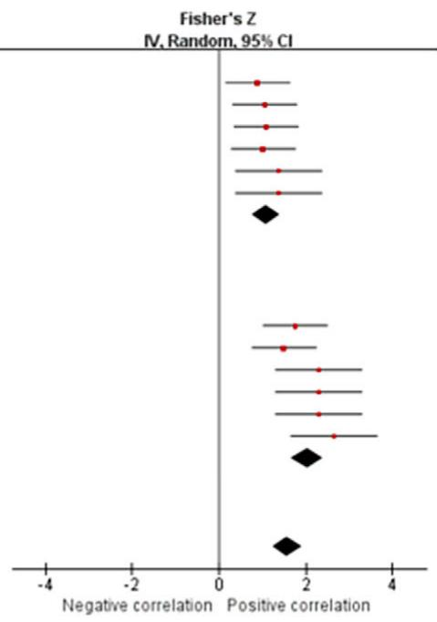  

整体效应检验：Z = 9.29（P < 0.00001）

亚组差异检验：Chi² = 14.44，df = 1（P = 0.0001），I² = 93.1%

d 肘关节屈/伸的 Pearson 相关系数 r

  

亚组差异检验：χ² = 2.54，df = 1（P = 0.11）。= 60.6%

图 9.（续）

e 肩关节内旋/外旋的平均差异

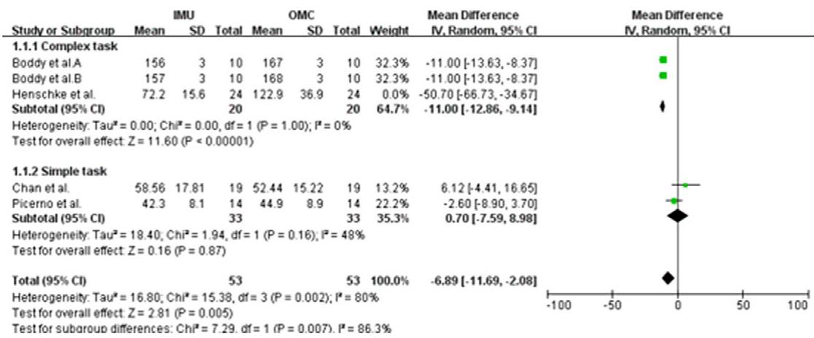  

总体效应检验 Z = 2.81（P = 0.005）
亚组差异检验：χ² = 7.29，自由度 df = 1（P = 0.007），I² = 86.3%

图 9.（续）

0.900]；Tau<sup>2</sup> = 0.00；$I ^ { 2 } = 0 \%$）（图 6b）。基于所纳入研究的质量，该结果的证据等级有限。

## 3.4.6. 腕关节屈/伸（wrist flexion/extension）

来自四项研究（两项中等质量（MQ）至低质量（LQ），两项极低质量（VLQ）；Fantozzi 等，2016；Ligorio 等，2020；Truppa 等，2021a,b）的数据表明，IMU（惯性测量单元）与 OMC（光学运动捕捉）在腕关节屈/伸测量之间存在非常强的相关性（总 n = 33；r = 0.974，95% CI [0.945, 0.988]；Tau<sup>2</sup> = 0.00；I<sup>2</sup> = 0%）（图 7a）。基于所纳入研究的质量，该结果的证据等级为中等。来自三项研究（两项中等质量（MQ）和一项低质量（LQ）；Wirth 等，2019；Fischer 等，2021；Bessone 等，2022）的数据表明，IMU 与 OMC 在腕关节屈/伸测量之间无显著测量差异（总 n = 34；均差 = 4.20，95% CI [ 18.96, 10.57]；Tau<sup>2</sup> = 194.87；I<sup>2</sup> = 70%；Z = 0.56（p = 0.58））（图 7b）。敏感性分析显示，在排除 Bessone 等（2022）的研究后，$I ^ { 2 }$ 值下降至 0%。此外，均差为 10.64，95% 置信区间为 [ 20.05, 1.23]，Z 分数为 2.22（p = 0.03）。敏感性分析显示结果不具备稳健性。基于所纳入研究的质量，该结果的证据等级为中等。

## 3.4.7. 腕关节尺偏/桡偏（wrist ulnar/radial deviation）

来自三项研究（两项中等质量（MQ）和一项低质量（LQ）；Wirth 等，2019；Fischer 等，2021；Bessone 等，2022）的数据表明，采用 IMU 测量的腕关节尺偏/桡偏的效度（总 n = 34；均差 = 4.98，95% CI [ 0.64, 10.59]；Tau<sup>2</sup> = 22.64；I<sup>2</sup> = 55%；Z = 1.74（p = 0.08））（图 8）。敏感性分析显示，在排除 Wirth 等（2019）的研究后，I<sup>2</sup> 下降至 38%，均差为 8.85 [2.27, 15.42]，Z 分数为 2.64（p = 0.008）。敏感性分析显示结果不具备稳健性。基于所纳入研究的质量，该结果的证据等级为中等。

## 3.5. 亚组分析（subgroup analysis）

亚组分析的选择主要基于两个关键考量。首先，亚组分类需要具有实际意义，并可能影响 IMU 测量的效度，例如不同的融合算法、所测运动（measured motion）的复杂程度等。其次，需要

## a<sup>a</sup>腕关节屈/伸（wrist flexion/extension）的均差

  

异质性。Tau² = 0.00；Chi² = 2.41, df = 3 (P = 0.49)；I² = 0%  
总体效应检验：Z = 2.22 (P = 0.03)  
亚组差异检验：Chi² = 1.50, df = 1 (P = 0.22)，I² = 33.2%

## b 手腕尺偏/桡偏的平均差异

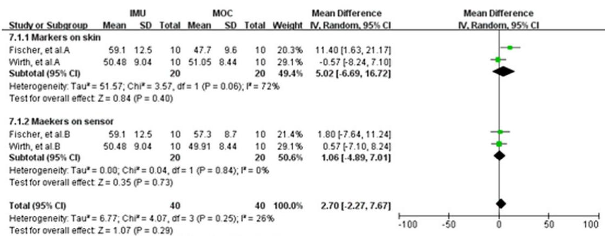  

总体效应检验 Z = 1.07 (P = 0.29)  
亚组差异检验：Chi\* = 0.35，df = 1 (P = 0.55)，P = 0%

图 10. 标记放置。基于不同标记放置位置，展示了 IMU 在测量关节活动度方面的有效性的亚组分析。绿色方块表示均值差；线条表示 95% 置信区间，黑色菱形表示全部数据。(a) 面板描述了腕关节屈伸测量均值差的结果。(b) 面板描述了腕关节尺偏/桡偏测量均值差的结果。

对应亚组具备足够的样本量（至少三项研究且不少于 20 名受试者）。通过阅读纳入的文献并比较不同研究的特点，本研究主要基于两种不同的分类方式开展亚组分析：任务的复杂程度和标记放置位置。然而，需要指出的是，关于融合算法（对 IMU 的数据处理至关重要）存在一定的局限性。我们观察到，大多数研究未对其使用的算法参数进行详细报告。这种报告的缺失阻碍了我们对算法进行有效归纳和分类以开展亚组分析。因此，融合算法在本研究中无法作为一个独立的亚组进行分类。

## 3.5.1. 运动任务的复杂程度

根据上肢运动任务的复杂程度，本研究将所纳入的运动任务分为复杂任务（complex tasks, CTs）和简单任务（simple tasks, STs）。复杂任务被定义为涉及多个运动平面的上肢运动，例如棒球投掷或搬运物体。简单任务则指仅在一个运动平面上发生的上肢运动，例如简单的肩关节屈伸。此外，行走过程中上肢的摆动运动由于具有周期性且主要发生在矢状面，也被归类为简单运动任务。

亚组分析结果显示，惯性测量单元（IMU, Inertial Measurement Unit）在测量复杂运动任务下的肩关节屈/伸时的效度与简单运动任务下的效度相当（CT：Pearson’s $r = 0 . 9 0 3$ [0.762, 0.963]，ST：Pearson’s $r = 0 . 9 6 1 \ [ 0 . 8 8 7 , 0 . 9 8 7 ]$）（Figure 9a）。IMU 在测量复杂运动任务下的肩关节外展/内收时的效度低于测量简单运动任务时的效度（CT：Pearson’s $r = 0 . 7 7 4$ [0.558, 0.892]，ST：Pearson’s $r = 0 . 9 2 0 \ [ 0 . 7 7 0 , 0 . 9 7 3 ]$）（Figure 9b）。IMU 在测量复杂运动任务下的肩关节内/外旋时的效度低于测量简单运动任务时的效度（CT：Pearson’s $r = 0 . 7 9 7$ [0.647, 0.890]，ST：Pearson’s $r = 0 . 9 6 6 [ 0 . 9 3 3 , 0 . 9 8 3 ]$）（Figure 9c）。IMU 在测量复杂运动任务下的肘关节屈/伸时的效度与测量简单运动任务下的效度相当（CT：Pearson’s $r = 0 . 9 1 0 \ [ 0 . 8 1 1 , 0 . 9 5 9 ]$，ST：Pearson’s $r = 0 . 9 6 3$ [0.920, 0.983]）（Figure 9d）。亚组分析结果显示，对于肩关节内/外旋，CT 和 ST 两组中 IMU 与 OMC 测量值之间均显示出显著的平均差（$p < 0 . 0 0 0 0 1$ 和 0.005）（Figure 9e）。

## 3.5.2. 标记点放置（Placements of markers）

绝大多数纳入的研究使用标准标记点放置方案，但有 2 项研究（Wirth et al., 2019；Fischer et al., 2021）比较了标记点放置于皮肤上和传感器上时的关节活动度（RoM, Range of Motion）测量结果。亚组分析结果显示，对于腕关节屈/伸，当标记点放置于传感器上时，IMU 与 OMC 之间的关节 RoM 测量值存在统计学显著差异（平均差 = 17.25 [31.41, 3.08]，Z = 2.39（p = 0.02）），而当标记点放置于皮肤上时，两种测量结果之间无统计学显著差异（平均差 = 5.42 [18.01, 7.17]，Z = 0.84（p = 0.40））（Figure 10a）。对于腕关节尺偏/桡偏，标记点放置于皮肤上和传感器上时均未显示出显著差异（$p = 0 . 4 0$ 和 0.73）（Figure 10b）。

## 4. 讨论（Discussions）

## 4.1. 主要发现（Principal findings）

本系统综述概述了用于测量上肢运动的惯性测量单元（IMU）的特性，并评估了其在测量上肢关节活动度（RoM）方面相对于基于标记点的运动捕捉系统的同时效度。本综述共纳入 51 篇文章，并对文献中的数据进行了定量整合与元分析。据我们所知，这是首个针对 IMU 测量上肢 RoM 效度开展的元分析研究，因此关于方法学与数据提取方面的相关参考文献较为匮乏。本文采用的研究方法主要依据 PRISMA 所推荐的元分析流程，以及先前聚焦于 IMU 测量下肢与上肢运动学参数的系统综述和/或元分析研究（Walmsley et al., 2018; Kobsar et al., 2020; Zeng et al., 2022）。

与基于标记点的运动捕捉系统不同，在测量人体运动学参数时，IMU 的放置位置尚未形成共识。既往研究亦得出相同结论。Kobsar 等（2020）和 Zeng 等（2022）的系统综述均指出，在测量下肢运动学参数时，相关文献所报告的 IMU 放置位置各异；类似结论在上肢运动学测量中亦有出现。本综述中，各研究对 IMU 放置位置的描述存在差异，即便针对同一品牌的 IMU 亦不例外。事实上，我们发现部分商用 IMU 仅提供有限或模糊的解剖位置描述（如上臂或前臂）来指导其放置。在缺乏相对统一的 IMU 放置规范的情况下，测量不一致性将不可避免地被引入。

惯性测量单元（IMU）系统的标定方法同样缺乏统一标准。大多数研究采用静态标定（也称为解剖学标定），这与制造商所推荐的方法一致，其主要目的是为关节建立解剖学参考系统，例如 T-pose（受试者双肩外展 $9 0 ^ { \circ }$，手掌朝下）和 S-pose（受试者双膝屈曲约 $4 5 ^ { \circ }$，双臂前伸并与地面保持平行）。动态标定（亦称功能性标定）是一种根据待测关节运动模式而定制的标定方法，可用于估计关节的旋转轴；例如，在测量肘关节运动时，需要预先标定其屈伸轴与旋前–旋后轴。多数声称采用动态标定的文献并未描述具体的标定过程，使得相关方法缺乏可重复性。此外，一项研究（Ligorio 等，2017）比较了解剖学标定与动态标定对 IMU 测量肘关节角度精度的影响，结果发现动态标定更具针对性，这表明在估计肘关节角度时，功能性标定方法比解剖学标定方法更为准确。

此外，IMU数据处理主要使用三种类型的数据融合算法：卡尔曼（Kalman）滤波、互补滤波和定制算法。经典卡尔曼算法是用于降低传感器信号噪声的最常见模型之一，它基于递归贝叶斯滤波，并假设噪声服从高斯分布（Marta et al., 2020）。基于卡尔曼算法的其他一些滤波器，例如扩展卡尔曼算法（EKF; Truppa et al., 2021），也用于处理IMU信号。然而，卡尔曼滤波器具有复杂的数学模型，对非专业人员并不友好，因此出现了更简单的互补滤波器。互补滤波器包括低通滤波器和高通滤波器。低通滤波器去除加速度计在振动等情况下的高频噪声，高通滤波器去除陀螺仪漂移等低频噪声。Chen等人（2020）比较了四种数据融合算法在IMU测量上肢运动学中的有效性，包括卡尔曼滤波器和互补滤波器。结果表明，与参考系统（OMC）相比，四种算法对峰值关节角度的测量误差均小于 $4 . 5 ^ { \circ }$ ，作者认为互补滤波器与更复杂的卡尔曼滤波器具有可比性。然而，在近一半的纳入文献（43%）中未报告数据融合算法，原因可能是大多数商用可穿戴传感器使用带有嵌入式算法的内置信号处理软件，因此用户并不知道所使用的算法类型。此外，许多文献使用了各种定制算法（Truppa等人, 2021, 2022; Yang等人, 2022），这种不一致性与之前的综述文章（Zeng等人, 2022）类似，使得难以定量比较不同算法对IMU测量有效性的影响。

本综述聚焦于惯性测量单元（IMUs）在成年人上肢三大关节、七个自由度（肩关节：3 个自由度；肘关节：2 个自由度；腕关节：2 个自由度）的关节活动度（RoM）测量中的效度。与先前的综述（Walmsley 等，2018；Poitras 等，2019）类似，本综述发现 IMUs 在测量上肢关节矢状面运动（屈曲与伸展）方面具有较高的效度。然而，IMUs 在测量肩关节内收–外展以及肘关节旋前–旋后时的效度相对较低，但仍处于可接受范围内。上述结果的证据等级为中等和/或较强。值得注意的是，肩关节旋转的测量结果存在冲突。Pearson 相关系数 r 显示 IMU 与 OMC 之间具有极好的一致性，但两种测量系统间的平均差异具有统计学显著性。此外，尽管 Meta 分析结果显示 IMU 与 OMC 系统在测量腕关节尺偏–桡偏方面无显著差异，但 p 值为 0.08，因此无法得出明确结论，未来仍需要更多高质量研究。如前所述，许多纳入的文献仅报告了 RMSE（均方根误差）和 LoA（一致性界限）等统计参数。由于这些结果缺乏同质性，无法进行 Meta 分析。在本综述中，肩关节 3 个自由度的 RMSE 均小于等于 $1 6 ^ { \circ }$（Callejas-Cuervo 等，2017；Mavor 等，2020；Lin 等，2021；Bessone 等，2022；Choo 等，2022），肘关节屈伸的 RMSE 范围为 1.9° 至 27.1°，肘关节旋前–旋后的 RMSE 范围为 $6 ^ { \circ }$ 至 $1 6 . 7 ^ { \circ }$（Fantozzi 等，2016；Mavor 等，2020；Bessone 等，2022）。这些发现基本与 Poitras 等（2019）所报告的结果一致。

尽管本综述未讨论 IMUs 测量上肢关节活动度的信度，但在先前的系统综述中已有报告（Walmsley 等，2018；Poitras 等，2019）。Walmsley 等（2018）报告，肩关节 2 个自由度具有充分到极好的一致性（ICC 0.68–0.81），肘关节 2 个自由度的一致性为较差到中等（ICC 0.16–0.83），腕关节 2 个自由度的一致性最高，ICC 值范围为 0.65 至 0.89。Poitras 等（2019）的文章中也发现了类似的结论，结果显示肘关节的信度为较差到良好（ICC = 0.2 至 0.77），而所有关节运动具有良好的到极好的评定者内信度（CMC 和 ICC 在 0.79 至 0.96 之间）。然而，与效度相比，关于 IMU 测量结果信度的文献较少，且上述综述文章中仅纳入了少量参考文献，因此这些结论的证据等级不足。

运动的复杂性可能会影响 IMU 测量的有效性。亚组分析显示，复杂运动中 IMU 测量的有效性低于简单运动，特别是在肩关节的内收-外展（adduction–abduction）和内旋-外旋（internal–external rotation）动作中，IMU 与 OMC 测量之间表现出中等一致性。Walmsley 等人（2018）的研究结果支持了这一结论。未来研究需要探讨影响复杂运动中 IMU 测量有效性的因素，并制定相应策略以提高 IMU 在这些场景下的测量精度。

我们采用敏感性分析以降低 meta 分析中的异质性。异质性的主要来源为三项特定文献（Wirth 等，2019；Bessone 等，2022；Henschke 等，2022）。通过进一步查阅全文发现，这三项研究采用了来自不太知名品牌的 IMU，这些品牌缺乏在大样本上的信效度检验。因此，这些来源中的研究被视为探索性心理测量学研究，其结果可用于提升 IMU 产品的性能。一些可穿戴传感器主要供临床医生和物理治疗师使用，其测量精度可能无法满足实验室要求。因此，建议实验室用户评估当前使用的 IMU 系统是否有相关的心理测量学研究报告。在针对肩关节屈曲/伸展和旋转平均差异的敏感性分析中，排除某些研究后，I<sup>2</sup> 值有所下降但未降至 50% 以下。这表明其余研究之间仍存在中等程度的异质性。因此，对于这两部分的结果应谨慎对待，并认识到各研究之间仍存在变异性。

活动度的计算基于关节峰值角度之间的差异。然而，一个潜在的问题是，即使 IMU 测得的关节峰值角度与参考系统差异很大，仍有可能获得相同的活动度。在我们评估的研究中，很少有研究提供关节峰值角度数据，但部分资料给出了 IMU 和 OMC 两个系统的绝对关节角度曲线，大多数曲线表明这两个系统的测量曲线相对接近。然而，Bessone 等人（2022）对 Vicon（OMC）和 aktos-t（IMU）两个系统进行了比较，发现虽然两者在测量肩关节和肘关节总活动度方面具有中等到良好的一致性，但在两个关节运动峰值角度的测量上存在显著差异。尽管我们这项系统综述的发现为基于 IMU 的上肢活动度测量的有效性提供了支持性证据，但仍需进一步研究以确定基于 IMU 的关节峰值角度测量的准确性。

在实际应用中，IMU 固有的局限性和缺点不容忽视。IMU 的一个显著问题是漂移（drift），即传感器测量值随时间逐渐偏离基准，这种现象在通过对加速度数据进行积分以计算速度和位置的过程中尤为明显，并导致累积误差。此外，IMU 对环境因素（如温度变化、电磁场和振动）较为敏感，这些因素都会显著损害传感器的精度。IMU 的另一个挑战——尤其是在可穿戴应用中——是其有限的运行时间，这源于其对电池供电的依赖。这一限制在长期监测或追踪任务中成为一个重要问题。此外，IMU 设备的尺寸和设计可能会影响用户佩戴的舒适度与接受度，特别是在需要长时间佩戴的场景中。最后，尽管 IMU 擅长测量加速度和旋转变化，但它们并不能直接提供空间信息。

获取位置数据需要额外的处理和积分过程，这可能引入进一步的误差。

## 4.2. 对未来研究的建议（Recommendations for future studies）

最后，值得指出的是，我们纳入的研究中超过一半被认为方法学质量较低或极低，这一发现与若干先前系统综述的结果一致（Walmsley 等，2018；Poitras 等，2019；Kobsar 等，2020；Zeng 等，2022）。此外，我们回顾的大部分文献未提供有关样本量估算方法的信息，且超过一半的研究样本由 10 名或更少的受试者组成，这进一步削弱了本研究所得结论的稳健性。同样重要的是，由于效度结果缺乏标准化报告规范，导致纳入文献之间的统计参数差异显著，从而限制了可用于数据整合与荟萃分析的来源数量。因此，未来研究必须通过考虑上述发现来提高其研究的方法学质量。

## 4.3. 综述局限性

本系统综述仅考察了 IMU 技术在上肢关节活动范围（RoM）测量中的效度，而未涉及信度。此外，由于我们回顾的所有文献均为 IMU 与基于标记的运动捕捉系统之间的对比研究，因此 IMU 的适用性仅限于实验室环境。相应地，本研究的结论不能被轻易外推以评估 IMU 在真实工作环境中的测量性能。未来综述应转而致力于评估 IMU 在非实验室环境中的测量表现。

鉴于商用 IMU 系统的更新与迭代速度很快，加之先前已有一份系统综述总结了 2016 年之前的相关研究（Walmsley 等，2018），我们的系统综述仅纳入了 2016 年之后发表的文献，这一做法可能会引入潜在偏倚，并影响我们结论的准确性。尽管我们纳入的研究数量相当可观（51 项研究），但大多数文献质量仅为低到中等，仅有 13.4% 为高质量研究。这种偏倚风险的增加可能会影响我们研究结果的效度。此外，本综述所纳入研究的样本量从 1 名到 24 名受试者不等。一般而言，对于心理测量学研究，理想的样本量应超过 50 名受试者（Mokkink 等，2010）。这种相对较小的样本量同样可能在我们结论中引入额外偏倚，并导致后续的误读。

此外，所纳入研究的异质性是另一个潜在的偏倚来源。目前，尚无标准化的 IMU 测量流程。在纳入本综述的 51 项研究中，对于所采用的标准系统校准方法、数据融合算法以及生物力学模型尚未形成共识。此外，不同研究使用的结果参数种类繁多（如 ICC、r、RMSE、LoA 等），这使得提取高质量数据和开展准确的荟萃分析面临挑战。

本研究中，荟萃分析所采用的方法与 Zeng 等人（2022）用于数据纳入的方法类似。该方法对同一研究内不同任务下的 IMU 测量效度结果进行荟萃分析。这种方法的主要优点是能够纳入更大的样本量，从而提高统计检验的效率。然而，这种方法也存在潜在的不足。重复纳入来自同一研究的结果可能会掩盖不同研究之间存在的异质性。此外，如果某项研究采用了更可靠的融合算法或测量误差更低的 IMU，那么在相同实验条件下重复纳入其数据可能会高估 IMU 的测量效度。相反，使用算法可靠性较低或测量误差较大的研究则可能导致效度被低估。因此，尽管该方法允许更广泛地纳入数据，但它也会在 IMU 测量效度的整体评估中引入偏倚风险。

## 5. 结论

本系统综述的结果表明，与 OMC 相比，IMU 是测量上肢活动度（RoM）的一种有前景的工具，具有良好至极佳的一致性和非常强的相关性。然而，在使用 IMU 测量某些关节运动时（例如肩关节内外旋以及腕关节尺桡偏），应加以谨慎。亚组分析显示，在跨多个运动平面测量复杂上肢运动时，IMU 的效度低于 OMC。为了促进实际应用，仍需进一步研究和标准化工作，以建立关于传感器放置、校准方法和数据融合算法的指南。

## 缩略语

Abd 外展（abduction） Add 内收（adduction） CMC 多重相关系数（coefficient of multiple correlation） ER 外旋（external rotation） Ext 伸展（extension） Flex 屈曲（flexion） HQ 高质量（high quality） ICC 组内相关系数（intraclass correlation coefficient） IMUs 惯性测量单元（inertial measurement units） IR 内旋（internal rotation） LoA 一致性界限（limit of agreement） LQ 低质量（low quality） MQ 中等质量（moderate quality） OMC 基于标记点的运动捕捉系统（marker-based motion capture system） PRISMA 系统综述与荟萃分析优先报告条目（Preferred Reporting Items for Systematic Reviews and Meta-Analyses） Pron 旋前（pronation） RMSE 均方根误差（root mean square error） SD 标准差（standard deviation） Supi 旋后（supination） VLQ 极低质量（very low quality）。

补充材料。本文的补充材料可在 https://doi.org/10.1017/wtc.2024.6 获取。

数据可用性声明。本系统综述中报告的所有数据和材料均来自同行评审的出版物。

作者贡献。J.L. 和 L.-S.C. 提出了研究构思和设计的最初想法。J.L.、F.Q. 和 L.G. 筛选了纳入研究并提取了数据。J.L.、F.Q. 和 L.G. 评估了文献质量并从纳入文章中提取数据。J.L. 进行了统计分析并撰写了初稿。L.-S.C. 对论文中重要智力内容进行了批判性修订。通讯作者可完全访问本研究中的所有数据，并对提交发表的决定负有最终责任。所有作者批准了最终稿。

资助声明。本研究未接受任何资助，也无任何商业实体参与。

竞争利益。作者声明不存在竞争利益。

伦理标准。不适用。

## 参考文献

Abbasi-Kesbi R 和 Nikfarjam A (2018) 用于精确手部位置监测的微型传感器系统. IEEE Sensors Journal 18(6), 2577–2584. https://doi.org/10.1109/jsen.2018.2795751

ó , , ó (2022) 一种使用来自惯性和磁性运动捕捉系统的数字信号的运动学信息采集模式. Sensors 22(13), 4898. https://doi.org/10.3390 s22134898

Barreto J, Peixoto C, Cabral S, Williams AM, Casanova F, Pedro B 和 Veloso AP (2021) 使用惯性测量单元对体操技术中的三维关节角度进行同步验证. Electronics 10(11), 1251. https://doi.org/10.3390 electronics10111251

Bessone V, Hoschele N, Schwirtz A 和 Seiberl W (2022) 基于不同动态运动对新型惯性测量单元系统的验证及其在未来现场应用中的适用性. Sports Biomechanics 21(6), 685–700. https://doi.org/10.1080 14763141.2019.1671486

Boddy KJ, Marsh JA, Caravan A, Lindley KE, Scheffey JO 和 O'Connell ME (2019) 探索可穿戴传感器作为投球动作中基于标记的运动捕捉的替代方案. PeerJ 7, e6365. https://doi.org/10.7717/peerj.6365

Callejas-Cuervo M, Gutierrez RM 和 Hernandez AI (2017) 用于低成本和高可及性远程康复的基于MEMS的关节幅度测量平台：肘部案例研究. Journal of Bodywork and Movement Therapies 21(3), 574–581. https://doi.org/10.1016/j.jbmt.2016.08.016

Camp CL, Loushin S, Nezlek S, Fiegen AP, Christoffer D 和 Kaufman K (2021) 可穿戴传感器对于研究棒球投球动作是否有效可靠？一项与基于标记的运动捕捉的独立比较. American Journal of Sports Medicine 49(11), 3094–3101. https://doi.org/10.1177/03635465211029017

Chan LYT, Chua CS, Chou SM, Seah RYB, Huang Y, Luo Y 和 Bin Abd Razak HR (2022) 使用商用可穿戴传感器评估肩关节活动度的验证研究. Mhealth 8, 30. https://doi.org/10.21037/mhealth-22-

Chapman RM, Torchia MT, Bell JE and Van Citters DW (2019) 使用惯性测量单元评估健康老年个体日常活动中的肩部生物力学：可达最大抬臂高度但实际使用率较低。《Journal of Biomechanical Engineering-Transactions of the Asme》141(4), 0410011–0410017. https://doi.org/10.1115/1.4042433

Chen H, Schall MC and Fethke NB (2020) 使用惯性测量单元测量上臂抬升：传感器融合算法与陀螺仪模型的探讨。《Applied Ergonomics》89, 103187. https://doi.org/10.1016/j.apergo.2020.103187

Choo CZY, Chow JY and Komar J (2022) Perception Neuron 系统用于全身运动捕捉的验证。《PLoS One》17(1), e0262730. https://doi.org/10.1371/journal.pone.0262730

Colyer SL, Evans M, Cosker DP and Salo AIT (2018) 基于视觉的运动分析技术演进综述及融合先进计算机视觉方法开发无标记系统的进展。《Sports Medicine - Open》4(1), 24. https://doi.org/10.1186/s40798-018-0139-y

Contreras-González AF, Ferre M, Sánchez-Urán MÁ, Sáez-Sáez FJ and Haro FB (2020) 基于角位移传感器的高效上肢位置估计用于可穿戴设备。《Sensors》(瑞士) 20(22), 1–20. https://doi.org/10.3390/s20226452

Cozzolino M (2009) 书评：《循证康复：实践指南（第二版）》(2008)。《Occupational Therapy in Health Care》23(1), 75–76. https://doi.org/10.1080/07380570802552858

Digo E, Gastaldi L, Antonelli M, Pastorelli S, Cereatti A and Caruso M (2022) 在典型工业手势动作中使用 IMU 实时估计上肢运动学。《Procedia Computer Science》200, 1041–1047.

Dufour JS, Aurand AM, Weston EB, Haritos CN, Souchereau RA and Marras WS (2021) 职业环境中作为肌肉骨骼损伤风险潜在指标的动态关节运动。《Journal of Applied Biomechanics》37(3), 196–203. https://doi.org/10.1123/jab.2020-0213

Ertzgaard P, Ohberg F, Gerdle B and Grip H (2016) 基于运动学暴露变异分析与便携式惯性传感器评估活动中手臂功能的新方法——一项效度研究。《Manual Therapy》21, 241–249. https://doi.org/10.1016/j.math.2015.09.004

Esfahani MIM, Akbari A, Zobeiri O, Rashedi E and Parnianpour M (2018) Sharif 人体运动测量系统（SHARIF-HMIS）的开发与验证。《Medical Engineering & Physics》61, 87–94. https://doi.org/10.1016/j.medengphy.2018.07.008

Fantozzi S, Giovanardi A, Magalhaes FA, Di Michele R, Cortesi M and Gatta G (2016) 使用可穿戴惯性-磁性测量单元评估模拟游泳中上肢的三维关节运动学。《Journal of Sports Sciences》34(11), 1073-1080. https://doi.org/10.1080/02640414.2015.1088659

Fischer G, Wirth MA, Balocco S and Calcagni M (2021) 使用惯性测量单元对飞镖投掷动作中腕部运动的活体测量. Sensors 21(16), 5623. https://doi.org/10.3390/s21165623

Goreham JA. MacLean KFE and Ladouceur M (2022) 一种用于量化简单与复杂上肢关节角度的低成本惯性测量单元系统的验证. Journal of Biomechanics 134, 111000. https://doi.org/10.1016/j.jbiomech.2022.111000

Guignard B, Ayad O, Baillet H, Mell F, Escobar DS, Boulanger J and Seifert L (2021) 惯性测量单元（IMUs）测量角度的效度、信度与精度：在游泳中的应用. Sports Biomechanics, 1–33. https://doi.org/10.1080/14763141.2021.1945136

(2020) 关于数据质量评估的统计度量. Journal of Geographic Information System, 178–187. https://doi.org/10.4236/jgis.2020.123011

Henry F, Herwindiati D, Mulyono S and Hendryli J (2016) 使用逻辑回归模型对卫星图像进行甘蔗地分类. IOP Conference Series: Materials Science and Engineering 185, 012024.

, , (2022) 使用商用传感器-软件系统评估惯性测量单元在肩关节运动学中的效度：一项验证研究. Health Science Reports 5(5), e772. https://doi.org/10.1002/hsr2.772

Higgins JP, Thompson SG, Deeks JJ and Altman DG (2003) 测量荟萃分析中的不一致性. BMJ 327(7414), 557–560. https://doi.org/10.1136/bmj.327.7414.557

Hubaut R, Guichard R, Greenfield J and Blandeau M (2022) 用于分析井盖搬运过程中肌肉骨骼障碍风险的嵌入式运动捕捉与肌电系统的验证. Sensors 22(2), 436. https://doi.org/10.3390/s22020436

Huedo-Medina TB, Sánchez-Meca J, Marín-Martínez F and Botella J (2006) 评估荟萃分析中的异质性：Q统计量还是I<sup>2</sup>指数？ Psychological Methods 11, 193–206. https://doi.org/10.1037/1082-989X.11.2.193

Humadi A, Nazarahari M, Ahmad R and Rouhani H (2021) 使用可穿戴惯性测量单元进行仪器化人体工程学风险评估：关节角度约定的影响. IEEE Access 9, 7293–7305. https://doi.org/10.1109/access.2020.3048645

Ješić T, Grabljevec K and Kuret Z (2022) 冻结肩的功能状态、疼痛与肩关节活动度：一项前瞻性研究. Ortopedia Traumatologia Rehabilitacia 24(6), 385–391. https://doi.org/10.5604/01.3001.0016.2320

Kobsar D, Charlton JM, Tse CTF, Esculier J-F, Graffos A, Krowchuk NM and Hunt MA (2020) 可穿戴惯性传感器在健康成人步态中的效度与信度：系统综述与荟萃分析. Journal of Neuroengineering and Rehabilitation 17(1), 62. https://doi.org/10.1186/s12984-020-00685-3

Laidig D, Müller P and Seel T (2017) 在受扰磁场中基于IMU的肘关节角度测量的自动解剖学标定. Current Directions in Biomedical Engineering 3(2), 167–170. https://doi.org/10.1515/cdbme-2017-0035

Ligorio G, Bergamini E, Truppa L, Guaitolini M, Raggi M, Mannini A and Garofalo P (2020) 一种可穿戴的无磁力计动作捕捉系统：面向真实世界应用的创新方案。IEEE Sensors Journal 20(15), 8844–8857. https://doi.org/10.1109/JSEN.2020.2983695

Ligorio G, Zanotto D, Sabatini AM and Agrawal SK (2017) 一种用于实时肘关节角度估计的磁性-惯性传感器新型功能标定方法。Journal of Biomechanics 54, 106–110. https://doi.org/10.1016/j.jbiomech.2017.01.024

Lin YC, Tsai YJ, Hsu YL, Yen MH and Wang JS (2021) 基于可穿戴惯性传感器网络的肩关节活动度评估。IEEE Sensors Journal 21(13), 15330–15341. https://doi.org/10.1109/jsen.2021.3073569

Marta G, Alessandra P, Simona F, Andrea C, Dario B, Stefano S and Stefano M (2020) 用于促进和监测水上运动训练的可穿戴生物反馈服：可行性研究。IEEE Transactions on Instrumentation and Measurement 69(4), 1219–1231. https://doi.org/10.1109/tim.2019.2911756

Mavor MP, Ross GB, Clouthier AL, Karakolis T and Graham RB (2020) 用于军事任务的 IMU 服的验证。Sensors 20(15), 4280. https://doi.org/10.3390/s20154280

McGinley JL, Baker R, Wolfe R and Morris ME (2009) 三维运动学步态测量的可靠性：系统综述。Gait & Posture 29(3), 360–369. https://doi.org/10.1016/j.gaitpost.2008.09.003

Mihcin S, Kose H, Cizmeciogullari S, Ciklacandir S, Kocak M, Tosun A and Akan A (2019) 面向生物力学建模的可穿戴运动捕捉系统研究。载于：2019 年 IEEE 国际医学测量与应用研讨会（MeMeA），土耳其伊斯坦布尔：IEEE，第 1–5 页。

Mokkink L, Terwee C, Patrick D, Alonso J, Stratford P, Knol D and De Vet H (2010) COSMIN 研究就健康相关患者报告结局测量属性的分类学、术语和定义达成国际共识。Journal of Clinical Epidemiology, 737–745. https://doi.org/10.1016/j.jclinepi.2010.02.006

Morrow MMB, Lowndes B, Fortune E, Kaufman KR and Hallbeck MS (2017) 用于上肢运动学测量的惯性测量单元的验证。Journal of Applied Biomechanics 33(3), 227–232. https://doi.org/10.1123/jab.2016-0120

Muir SW, Corea CL and Beaupre L (2010) 临床状态变化的评估：盂肱关节活动度评估的可靠性与一致性测量。North American Journal of Sports Physical Therapy: NAJSPT 5(3), 98.

Muller P, Begin MA, Schauer T and Seel T (2017) 基于惯性传感器的无需对齐、自标定肘关节角度测量方法。IEEE Journal of Biomedical and Health Informatics (2), 312–319. https://doi.org/10.1109/jbhi.2016.2639537

Nagymáté G and Kiss RM (2018) OptiTrack 运动捕捉系统在人体运动分析中的应用：系统文献综述。Recent Innovations in Mechatronics 5(1), 1–9. https://doi.org/10.17667/riim.2018.1/13

Öhberg F, Bäcklund T, Sundström N and Grip H (2019) 便携式传感器为上肢功能评估提供可靠的运动学测量指标。Sensors (Switzerland) 19(5), 1241. https://doi.org/10.3390/s19051241

Page MJ, Moher D, Bossuyt PM, Boutron I, Hoffmann TC, Mulrow CD and McKenzie JE (2021) PRISMA 2020 解释与阐述：系统综述报告的最新指南与示例。BMJ372, n160. https://doi.org/10.1136/bmj. n160

Pedro B, Cabral S and Veloso AP (2021) 惯性测量系统在网球正手击球中的同时效度。Journal of Biomechanics 121, 110410. https://doi.org/10.1016/j.jbiomech.2021.110410

Picerno P, Caliandro P, Iacovelli C, Simbolotti C, Crabolu M, Pani D and Cereatti A (2019) 基于可穿戴磁性和惯性测量单元的上肢关节运动学：一种基于骨性标志识别的解剖学标定程序。Scientific Reports 9, 14449. https://doi.org/10.1038/s41598-019-50759-z

Poitras I, Bielmann M, Campeau-Lecours A, Mercier C, Bouyer LJ and Roy JS (2019) 肩关节处可穿戴传感器的有效性：结合无线肌电传感器和惯性测量单元进行体力工作场所评估。Sensors 19(8), 1885. https://doi.org/10.3390/s19081885

Poitras I, Dupuis F, Bielmann M, Campeau-Lecours A, Mercier C, Bouyer LJ and Roy J-S (2019) 可穿戴传感器关节角度估计的有效性和可靠性：一项系统综述。Sensors (Basel) 19(7), 1555.

Robert-Lachaine X, Mecheri H, Larue C and Plamondon A (2017a) 单姿态标定用于全身运动分析的惯性测量单元的准确性和重复性。Gait & Posture 54, 80–86. https://doi.org/10.1016/j.gaitpost.2017.02.029

Robert-Lachaine X, Mecheri H, Larue C and Plamondon A (2017b) 使用光电系统对惯性测量单元进行全身运动分析的验证。Medical & Biological Engineering & Computing 55(4), 609–619 https://doi.org/10.1007/s11517-016-1537-2

Robert-Lachaine X, Mecheri H, Muller A, Larue C and Plamondon A (2020) 一种用于全身运动分析的低成本惯性运动捕捉系统的验证。Journal of Biomechanics 99, 109520. https://doi.org/10.1016/j.jbiomech.2019.109520

i i , i , i , i S, i C (2019) 基于视觉光学的Senshand精度评估用于帕金森病运动功能评估。发表于2019年IEEE测量与网络国际研讨会（M&N）。意大利卡塔尼亚：IEEE，第1–6页。

Ruiz-Malagón EJ, Delgado-García G, Castro-Infantes S, Ritacco-Real M and Soto-Hermoso VM (2022) NOTCH<sup>®</sup>惯性传感器在不同采样频率下测量网球正手肘关节角度的有效性和可靠性。Measurement: Journal of the International Measurement Confederation 201, 111666. https://doi.org/10.1016/i.measurement.2022.111666

Schall MC, Fethke NB, Chen H, Oyama S and Douphrate DI (2016) 用于现场职业研究的惯性测量单元系统的精度和重复性。Ergonomics 59(4), 591–602. https://doi.org/10.1080/00140139.2015.1079335

Seel T, Raisch J and Schauer T (2014) 基于IMU的步态分析关节角度测量。Sensors (Basel) 14(4), 6891–6909. https://doi.org/10.3390/s140406891

Sers R, Forrester S, Moss E, Ward S, Ma JJ and Zecca M (2020) Perception Neuron惯性运动捕捉系统用于上肢运动分析的有效性。Measurement 149, 107024. https://doi.org/10.1016/j.measurement.2019.107024

Sessa S, Zecca M, Lin Z, Bartolomeo L, Ishii H and Takanishi A (2013) 惯性测量单元性能评估的方法学。Journal of Intelligent & Robotic Systems (2), 143–157. https://doi.org/10.1007/s10846-012-9772-8

Shepherd JB, Giblin G, Pepping GJ, Thiel D and Rowlands D (2017) 用于精英无挡板篮球投篮生物力学表现分析的单腕戴惯性传感器的开发与验证。IEEE Sensors Letters 1(5), 1–4. https://doi.org 10.1109/lsens.2017.2750695

Slade P, Habib A, Hicks JL and Delp SL (2022) 用于实时测量三维人体运动的开放式可穿戴系统。IEEE Transactions on Biomedical Engineering 69(2), 678–688. https://doi.org/10.1109/tbme.2021.3103201

Truppa L, Bergamini E, Garofalo P, Costantini M, Fiorentino C, Vannozzi G and Mannini A (2021a) 一种具有在线偏差补偿的创新传感器融合运动跟踪算法：在瑜伽关节角度估计中的应用。IEEE Sensors Journal 21(19), 21285–21294. https://doi.org/10.1109/jsen.2021.3101295

Truppa L, Bergamini E, Garofalo P, Vannozzi G, Sabatini AM and Mannini A (2022) 用于上肢运动学分析的无磁基于四元数的鲁棒无迹卡尔曼滤波器。IEEE Sensors Journal 23(3), 3212–3219. https://doi.org/10.1109/JSEN.2022.3225931

Truppa L, Garofalo P, Raggi M, Bergamini E, Vannozzi G, Sabatini AM, Ieee. (2021b) 用于瑜伽上肢运动学评估的无磁扩展卡尔曼滤波器。发表于第43届IEEE医学与生物工程学会国际年会（IEEE EMBC），线上会议。

Valevicius AM, Jun PY, Hebert JS and Vette AH (2018) 使用光学运动捕捉分析功能性上肢任务中的正常上肢运动学：系统综述。Journal of Electromyography and Kinesiology 40, 1–15. https://doi.org/10.1016/j.jelekin.2018.02.011

van der Kruk E and Reijne MM (2018) 人体运动捕捉系统在体育应用中的精度：最新综述。European Journal of Sport Science 18(6), 806–819. https://doi.org/10.1080/17461391.2018.1463397

van Tulder M, Furlan A, Bombardier C, Bouter L and the Editorial Board of the Cochrane Collaboration Back Review Group (2003) Cochrane 协作组织 Back Review Group 系统综述的方法学指南更新. 脊柱（Spine）28(12), 1290–1299.

Wahyuni T and Purwanto K (2020) 学生对酸碱滴定的概念理解及其与滴定曲线绘图技能的关系. 物理学报：会议系列（Journal of Physics: Conference Series）1440, 012018. https://doi.org/10.1088/1742-6596/1440/1/ 012018

Walmsley C, Williams S, Grisbrook T, Elliott C, Imms C and Campbell A (2018) 使用可穿戴传感器测量上肢关节活动度的系统综述. 运动医学-开放获取（Sports Medicine - Open）4, 53. https://doi.org/10.1186/s40798-018-0167-7

Wells D, Alderson J, Camomilla V, Donnelly C, Elliott B and Cereatti A (2019) 使用磁惯性传感器研究板球投球过程中的肘关节运动学：一项可行性研究. 运动科学学报（Journal of Sports Sciences）37(5), 515–524. https://doi.org/10.1080 02640414.2018.1512845

Wirth MA. Fischer G. Verdú J. Reissner L. Balocco S and Calcagni M (2019) 新型基于惯性传感器的系统与光电运动捕捉系统在健康人腕关节运动分析中的比较. 传感器（Sensors）（巴塞尔）19(23), 5297. https://doi.org/10.3390/s19235297

Wu YW, Tao K, Chen Q, Tian YS and Sun LX (2022) 关于 Perception Neuron Studio 用于上半身运动捕捉的有效性与可靠性的综合分析. 传感器（Sensors）22(18), 6954. https://doi.org/10.3390/s22186954

Yang HR, Wang Y, Wang HQ, Shi YD, Zhu LF, Kuang YJ and Yang Y (2022) 基于多惯性传感器的使用 Elman 神经网络的手臂三维运动追踪. 传感器学报（Journal of Sensors）2022, 1–11. https://doi.org/10.1155/2022/3926417

Zeng Z, Liu Y, Hu X, Tang M and Wang L (2022) 惯性测量单元在跑步下肢运动学中的有效性与可靠性：系统综述与 Meta 分析. 运动医学-开放获取（Sports Medicine - Open）8(1), 86. https://doi.org/10.1186 s40798-022-00477-0