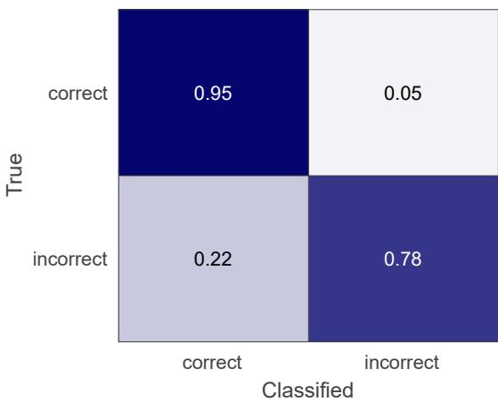
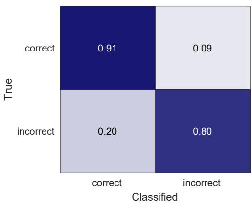
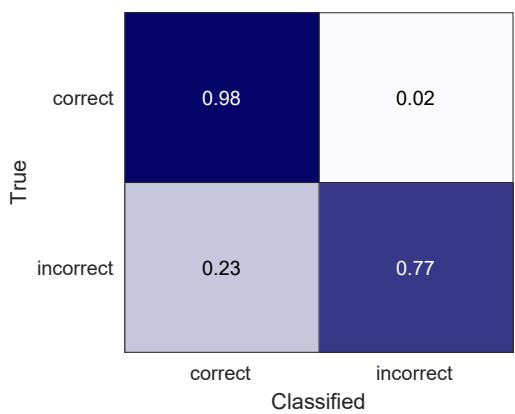

# 用于监测居家脑卒中幸存者上肢任务练习质量的可穿戴传感器

Na Jin Seo1,2,3,*、Kristen Coupland2,3、Christian Finetto2,3 和 Gabrielle Scronce2,3

Ralph H. Johnson VA Health Care System, Charleston, SC 29401, USA

*通讯作者：seon@musc.edu；电话：+1-843-792-0084

摘要：许多脑卒中（stroke）幸存者存在持续的上肢功能损害，限制了其在日常生活活动（activities of daily living, ADL）中的表现。上肢功能的恢复需要大量重复的、任务特定的练习。脑卒中幸存者通常被要求在家进行任务练习，以补充康复治疗。若任务练习质量不佳（例如使用代偿性运动模式），会导致不良的神经可塑性（neuroplasticity）变化和欠佳的运动恢复效果。目前尚缺乏能够远程监测脑卒中幸存者居家任务练习运动质量的工具。本研究旨在评估使用可穿戴惯性测量单元（Inertial Measurement Unit, IMU）对居家运动质量进行分类的可行性。十九名脑卒中幸存者在偏瘫侧（paretic）手腕佩戴IMU传感器，先在实验室完成四项功能性上肢任务，之后在居家环境中自行录像完成相同任务。实验室数据作为参考数据，通过动态时间规整（dynamic time warping, DTW）方法对居家运动质量进行分类。错误与正确的运动质量由一名治疗师进行标注。在所有任务合并的情况下，居家任务练习的运动质量分类准确率达到92%，F1分数为0.95。本研究还对导致误分类的运动类型进行了进一步分析。研究结果支持构建居家运动质量监测系统的可行性，以辅助脑卒中后的上肢康复。

引用：Seo, N.J.; Coupland, K.; Finetto, C.; Scronce, G. 用于在家中监测脑卒中存活者上肢任务练习质量的可穿戴传感器（Wearable Sensor to Monitor Quality of Upper Limb Task Practice for Stroke Survivors at Home）。*Sensors* **2024**, *24*, 554. https://doi.org/10.3390/s24020554

学术编辑：Giorgio Biagetti 和 Paolo Crippa

收稿日期：2023年12月22日 修订日期：2024年1月10日 接受日期：2024年1月12日 发表日期：2024年1月16日

版权：© 2024 by the authors. 出版许可方 MDPI，巴塞尔（Basel），瑞士。本文为开放获取文章，依据知识共享署名许可协议（Creative Commons Attribution, CC BY, https://creativecommons.org/licenses/by/4.0/）的条款和条件进行分发。

关键词：脑卒中（stroke）；上肢（upper extremity）；康复（rehabilitation）；加速度计（accelerometer）；惯性测量单元（inertial measurement unit, IMU）；可穿戴传感器（wearable sensor）；机器学习（machine learning）；远程监测（remote monitoring）；家庭监测（home monitoring）

## 1. 引言（Introduction）

脑卒中（stroke）是全球范围内导致长期残疾的主要原因 [1]。仅在美国，就有近 700 万脑卒中幸存者 [2]。约 3% 的成年人曾罹患脑卒中，到 2030 年美国相关的医疗费用预计将增至 2400 亿美元 [3]。约 77% 的脑卒中幸存者会出现上肢运动功能障碍 [4–6]。上肢运动功能障碍会降低个体执行日常生活活动（如自我护理、个人卫生、就业和娱乐活动）的能力，从而削弱其独立性和生活质量 [7,8]。

既往研究表明，脑卒中幸存者可通过大量的任务练习重复来恢复其上肢功能 [9–12]。然而，仅依靠患者在治疗门诊期间的训练时间，无法完成所需的大量任务练习重复 [13–15]。为了弥补治疗门诊可用时间的不足，康复治疗师通常会开具一份由在家自行进行的上肢任务练习所组成的家庭训练计划（home exercise program）[16]。研究表明，与不依从或依从程度较低的患者相比，对家庭训练计划依从程度更高的患者可获得更显著的运动功能恢复 [17,18]。因此，对家庭训练的依从程度在脑卒中后的运动功能恢复中起着重要作用 [16–21]。此外，如果患者在家不练习新学到的功能性动作，其在治疗门诊中所获得的运动能力可能无法转化到日常生活活动中，进而可能无法实现功能改善 [14,18]。

要使家庭训练有效，不仅任务的练习量重要，练习的质量同样关键，因为在任务练习中使用代偿性动作（compensatory motions）并不能解决脑卒中后的运动功能障碍，并可能导致适应不良性可塑性（maladaptive plasticity），进而阻碍运动功能的恢复 [22–24]。因此，如表 1 所示，许多近期研究致力于开发用于监测脑卒中后康复运动质量的系统。这些既往研究的优势在于，他们通过佩戴在手腕上的惯性测量单元（IMU）传感器来采集上肢运动数据，以便患者在家庭环境中方便使用。

之前研究的主要局限性在于，虽然这些系统是为家庭使用而开发的，但其准确性的测试仅在实验室环境中进行。为了支持在患者家中使用该监测系统，有必要在家庭环境中进行验证。此外，大多数研究将动作分为粗大类而不考虑其动作质量（例如，包括饮水、书写在内的功能性动作与步行期间的非功能性手臂动作）。有一项研究在抬臂任务中区分了代偿性运动模式与正确动作[25]。然而，该任务与通常涉及手部物体操作的日常生活活动的相关性有限。另一项研究区分了多种代表性功能性任务练习中的动作质量[26]，但仅测试了健康成人。因此，使用腕戴式IMU传感器检测脑卒中幸存者在执行功能性任务时是否使用代偿性运动模式所产生的细微差异，尚未得到研究。为此，本研究的目的在于探究使用腕戴式IMU传感器在家中监测脑卒中幸存者在功能性任务练习中的动作质量的可行性。

Table 1. 此前使用腕戴式IMU传感器数据对上肢动作类型进行分类以用于康复目的的研究总结（RF = 随机森林（random forest），CNN = 卷积神经网络（convolutional neural network），DTW = 动态时间规整（dynamic time warping），LSTM = 长短期记忆网络（Long Short-Term Memory），LDA = 线性判别分析（linear discriminant analysis），SVM = 支持向量机（support vector machine），KNN = K近邻（K-Nearest Neighbors），CT = 分类树（classification trees））。

<table><tr><td>Reference</td><td>Participant</td><td>Method</td><td>Setting</td><td>Finding</td></tr><tr><td>Bochniewicz 2017 [27]</td><td>10 healthy persons, 10 stroke survivors</td><td>RF</td><td>Lab</td><td>Classified functional vs. nonfunctional movement</td></tr><tr><td>David 2021 [28]</td><td>5 healthy persons, 5 hemiparetic patients</td><td>Thresholding</td><td>Lab</td><td>Classified functional vs. nonfunctional movement</td></tr><tr><td>Gomez-Arrunategui 2022 [29]</td><td>12 stroke survivors</td><td>RF, CNN</td><td>Lab</td><td>Detected reach time and number of reaching gestures during prescribed tasks.</td></tr><tr><td>Lee 2018 [25]</td><td>9 healthy persons, 11 stroke survivors</td><td>RF</td><td>Lab</td><td>Classified quality of arm raise</td></tr><tr><td>Bhagat 2020 [30]</td><td>2 persons with spinal cord injury</td><td>DTW, LSTM</td><td>Lab</td><td>Classified cylindrical vs. pincer grasp (to pick up a water bottle vs. pen)</td></tr><tr><td>Li 2023 [26]</td><td>20 healthy persons</td><td>LSTM</td><td>Lab</td><td>Classified functional task practice quality</td></tr><tr><td>Lui 2019 [31]</td><td>11 healthy persons</td><td>LDA, SVM, KNN, CT</td><td>Lab</td><td>Classified pre-selected upper limb movements</td></tr></table>

## 2. 材料与方法

## 2.1. 参与者

十九名患有上肢偏瘫的成年脑卒中幸存者参与了本研究。他们的人口学信息汇总于表 2 中。所有受试者均具备一定的手部运动能力，能够参与涉及物体操控的功能性任务练习。受试者不存在以下合并症：限制运动的骨科疾病、既往神经疾病、腕部皮肤完整性受损，或妨碍理解指令和/或签署知情同意的语言障碍或认知障碍。在研究流程开始前，已获得所有受试者的书面知情同意。

Table 2. 受试者特征。

<table><tr><td>Characteristics</td><td>Descriptive Statistics</td></tr><tr><td>Age (mean ± SD years)</td><td>61 ± 12</td></tr><tr><td>Sex (M/F)</td><td>12/7</td></tr><tr><td>Time since stroke (mean ± SD years)</td><td>4 ± 3</td></tr><tr><td>Stroke type (ischemic/hemorrhagic)</td><td>14/5</td></tr><tr><td>Fugl-Meyer Assessment of Motor Recovery after Stroke—Upper Extremity (mean ± SD out of 66)</td><td>45 ± 9</td></tr></table>

## 2.2. 流程（Procedure）

本研究的流程根据系统的预期应用场景进行设计。流程如下：治疗师在门诊治疗过程中为患者确定合适的治疗目标，并布置居家练习任务。然后，通过腕戴式 IMU（惯性测量单元）监测居家练习的质量，即患者是否遵循了治疗过程中学习到的运动模式。练习质量通过 DTW（动态时间规整）算法将居家运动与门诊参考运动进行比较来评估。

首先，参与者来到实验室，在偏瘫侧手腕佩戴 IMU 传感器（ActiGraph GT9X link，ActiGraph Corporation，Pensacola, FL, USA），用偏瘫手完成 4 项功能性任务。一名作业治疗师观察他们的运动质量，并识别每位参与者个体的代偿性运动模式。然后，治疗师提供反馈以纠正其运动模式，这与典型的门诊治疗过程类似。本研究使用的 4 项功能性任务见表 3。这些任务的更多细节，包括任务说明和图片，可参见 Li 等人 2023 年的研究 [26]。这些任务选自任务练习手册 [32] 中居家练习方案所规定的代表性功能性任务，且难度各异。具体而言，任务 1 和任务 2 需要柱状抓握，其中任务 1 还需要肩关节屈曲。任务 3 和任务 4 相对于任务 1 和任务 2 难度更高，因为它们对手部的控制和灵活性要求更高。如果参与者在某项任务中没有表现出错误的运动模式，则要求他们模拟一个应当避免的代偿性运动模式。每种运动质量完成 3 到 6 次试验。这一试验次数在标准康复治疗过程中是可行的 [13]。每次试验的开始和结束由治疗师通过按下电脑上的按钮进行时间标记。试验的运动质量由治疗师标注为正确或错误（代偿性或不完整）。

在实验环节结束时，受试者被要求在另一天在家练习这 4 项功能性任务。他们被要求按在实验环节学到的正确运动模式，对每项任务练习 75 次试做。受试者在家佩戴了一个 IMU 传感器，固定在其患侧手腕上。选择 IMU 传感器是因为脑卒中幸存者在家使用时操作简便，只需像戴手表一样将其戴在手腕上，从而提高了可行性。为了获得真值标注，他们还对自己在家进行功能性任务练习的过程进行了录像。这些视频随后由作业治疗师进行回顾，以划分每次试做的起止时间，并对每次试做的运动质量进行标注。该作业治疗师拥有 15 年治疗脑卒中幸存者的经验。治疗师还记录了每种错误运动的类型（例如，躯干屈曲和前臂异常旋后），以便于结果的解读。具体流程如图 1 所示。

  

表 3. 四个功能性任务的描述。1. 杯子放到架子上（架子上有平板）  
图 1. 流程图。图 1. 流程图。

分析 IMU 传感器以 100 Hz 的频率在三个维度上记录了加速度计、陀螺仪和磁力计数据，采集场景包括实验室和家庭。在实验室获取的 IMU 传感器数据被用作正确与错误运动模式的参考数据。家庭环境中采集的 IMU 传感器数据通过动态时间规整（Dynamic Time Warping，DTW）[33] 与实验室参考数据进行比较，以对每个家庭试验的运动质量进行分类。

## 2.3. 分析

我们采用了参与者特异性分类方法，将参与者的实验室数据作为参照，与其家庭数据进行比较。我们采用这种参与者特异性的方法，是因为不同的脑卒中幸存者由于损伤程度、损伤特征以及所采用的代偿策略的差异，在执行上肢任务时表现各不相同。因此，我们选择 DTW 作为算法，因为它能够实现患者特异性的分类方法。DTW 还能适应不同时间长度的运动试验 [25,33]。以往使用 DTW 应用于 IMU 数据的研究能够区分圆柱抓握与捏取抓握 [30]、偏瘫侧上肢抬举过程中的代偿性动作 [25]，以及不同的运动类型 [33]。

对于实验室数据，我们探索了多种数据处理与 DTW（Dynamic Time Warping）方法，并选择了能在统计学上区分同一参与者不同运动类型试验的最佳方法，用于其家庭数据的分析。为每位参与者选择最佳方法的理由在于：个体参与者具有不同的损伤特征和代偿策略，不同的方法可能更有效地检测出这些特征与策略。仅使用由治疗师明确判定为正确或错误动作的合格试验作为实验室参考数据。方法探索包括使用 IMU（Inertial Measurement Unit）数据的不同组合，即去除重力后的加速度、重力向量、陀螺仪以及三维磁力计。重力向量通过使用六轴卡尔曼滤波器（MATLAB 中的 imufilter 函数，MathWorks，Natick，MA，USA）根据加速度计与陀螺仪数据估计传感器方向计算得到。重力向量从加速度数据中减去，得到去除重力后的加速度。方法探索还包括数据归一化（按每个轴的标准差进行归一化）或不进行归一化，以及 DTW 的各种最大规整长度（MATLAB dtw 函数的 maxsamp 变量从采样频率的一半到 4 倍不等）。为处理 DTW 所产生的不同数据长度，将规整后的数据投影到原始测试数据，并以一致的采样率按原始测试数据的长度计算 DTW 距离。

对于每种方法，在同一运动类型的所有试验之间，以及在两种不同运动类型、不同运动质量（*正确与错误*）的试验之间分别计算 DTW 距离。对同一运动类型内的 DTW 距离簇与两种不同运动类型、不同运动质量之间的 DTW 距离簇进行比较，获得所有运动类型的 *p* 值。*p* 值通过单侧 *t* 检验获得，备择假设为同一运动类型内的 DTW 距离小于两种不同运动类型之间的 DTW 距离。最大 *p* 值用于表示在给定 DTW 方法下给定参与者运动质量的可分辨性。选择 *p* 值最小或 *p* 值 < 0.05 的方法。

如果多种方法能够在统计学上区分不同描述的试验，则采用留一试验法（leave-one-trial-out）检验每种方法在参考所有其他实验数据时对每个实验试验进行分类的准确率，并选择能产生最高准确率的方法。如果有多种方法在统计可区分性和实验准确率方面都表现良好，则选择包含加速度（不含重力）、重力向量和陀螺仪数据，并采用更长规整窗口大小进行归一化的方法。磁力计不被认为能提供关于运动模式的有价值信息，因为它反映的是相对于地球的方位，而该方位在实验室和家中可能会发生变化。

一旦从给定参与者的实验数据中选定了最佳的数据处理和 DTW 方法，便将该方法应用于分析该参与者的家庭数据。对于每个家庭试验，计算其与每个实验室试验之间的 DTW 距离。将 DTW 距离最小的实验室试验所对应的运动质量标签，用于对该家庭试验的运动质量进行分类。

检查分类结果的混淆矩阵以及准确率和 F1 分数。对所有任务合并后的分类结果以及每个任务单独的分类结果都进行了考察。还考察了各单独运动类型的分类结果。为了检验在牺牲电池续航的前提下，额外采集陀螺仪数据（而不仅采集加速度数据）的必要性，对比了利用所有可用数据（含陀螺仪）进行分类的准确率与仅使用加速度数据进行分类的准确率。

## 3. 结果

基于实验室参考数据的家庭任务练习的运动质量分类结果如图 2 的混淆矩阵所示。具体而言，图 2A 显示了所有任务和参与者数据合并后的结果。总体准确率为 92%。总体 F1 分数为 0.95。每个任务的结果如图 2B–E 所示。任务 1 至任务 4 的准确率分别为 94%、95%、86% 和 93%。任务 1 至任务 4 的 F1 分数分别为 0.96、0.97、0.91 和 0.96。不同参与者之间的准确率存在差异。对于任务 1，各参与者的准确率范围为 80% 到 100%，中位数为 95%。对于任务 2，各参与者的准确率范围为 86% 到 100%，中位数为 97%。对于任务 3，范围为 68% 到 100%，中位数为 86%。对于任务 4，范围为 72% 到 100%，中位数为 97%。

  

(A) 所有任务合并

  

(B) 任务 1

  

(C)任务 2

  

(D) Task 3

  

（E）任务4  
图2. 在家中对所有任务（A）的正确与错误动作的分类结果图2. 在家中对所有任务（A）的正确与错误动作的分类结果以及四个任务中的每一个（B–E），使用包括陀螺仪在内的所有可用数据。单元格颜色越深表示准确率百分比越高。

图3展示了单个家庭试验相对于实验室参考数据的DTW（Dynamic Time Warping）距离分布示例，针对的是一名执行任务2的受试者。具体而言，根据治疗师对视频的回顾，此次家庭试验采用的是肩外展动作。该家庭试验的DTW距离是针对三类实验室数据运动类型计算得出的，分别是肩外展、正确动作以及无法抓握杯子，每类包含6次试验。DTW距离分布表明，与采用正确动作模式的实验室试验或受试者无法抓握杯子的实验室试验相比，此次家庭试验与采用肩外展动作的实验室试验之间的DTW距离更小。

  

图 3. 一个箱线图，展示了单个家庭任务试验相对于实验室参考数据的 DTW 距离分布示例，针对任务 2，包含 3 种运动类型（肩外展、正确运动，以及无法握住杯子）。每个点代表单个家庭试验与一次实验室参考试验之间的 DTW 距离。该家庭试验是在肩外展条件下完成的。家庭试验与同样在肩外展条件下完成的实验室试验之间的 DTW 距离较小。而相对于正确完成的实验室试验以及参与者无法握住杯子的实验室试验，DTW 距离则较大。

使用仅加速度数据（不使用陀螺仪数据）进行家庭任务练习的运动质量分类结果如图 4 的混淆矩阵所示。对于所有任务合并，分类准确率为 81%，F1 分数为 0.88。任务 1 至任务 4 的个体任务准确率分别为 89%、95%、73% 和 88%。

对个体运动类型的分类结果进行了进一步分析，以了解其趋势（表 4）。在错误运动中，家庭环境中观察到的最常见运动类型是使用躯干和/或肩部的代偿性运动（例如，够取时的躯干屈曲，以及抬举时的耸肩或肩外展）。该0.81 0.19运动类型约占家庭环境中观察到的错误运动的一半。该运动类型被正确分类（判定为错误运动），灵敏度为 86%。

表 4. 家庭环境中观察到的不完整运动类型、其分类灵敏度以及 0.20 0.80相关观察。

<table><tr><td>Movement Type</td><td>Sensitivity</td><td>Observations</td></tr><tr><td>Compensatory trunk and/or shoulder involvement</td><td>86%</td><td>Trunk flexion for reaching and shoulder hike or shoulder abduction for lifting were identified.</td></tr><tr><td>Unable to complete</td><td>68%</td><td>Classification errors were from earlier object drop and repeated grip attempts in tasks 3–4 and object drop after release in task 1.</td></tr><tr><td>Use of the nonparetic hand to assist</td><td>62%</td><td>Classification errors were from the participants who exhibited this movement type at home but not in the lab. This movement type occurred most for task 3, the most difficult task.</td></tr><tr><td>Compensatory grip</td><td>83%</td><td>Use of key grip or whole hand grip instead of precision grip for task 4 and noncylindrical grip for task 1 were identified. Classification errors were from dragging of the object for task 3 misclassified as correct.</td></tr></table>

  

（A）所有任务合并

  

(B) Task 1

  

您还没有粘贴需要翻译的英文论文内容。请将 Markdown 格式的论文文本发给我，我会按照规则完整翻译成中文。

  

(D) 任务 3

  

图 4. 在家中对所有任务（A）以及四个任务中的每一个（B–E）进行正确与错误动作分类的结果，仅使用加速度数据。单元格颜色越深表示正确率（percent accuracy）越高。

为了进一步理解这一趋势（表 4），我们对各类运动的分类结果进行了进一步考察。在家庭环境下观察到的错误运动中，最常见的运动类型是躯干与肩部的代偿性运动（例如：伸手时的躯干前屈，以及耸肩或肩外展）。

第二常见的错误运动类型是无法完成任务（例如：无法抓握，或在到达目标前即掉落），约占家庭环境下所观察到的错误运动的 23%。该运动类型的分类灵敏度为 68%。分类错误主要来自任务 3–4，发生在参与者将患侧手移向目标位置时方块掉落的过程中；任务 3–4 中参与者反复尝试抓握而未成功，也是误分类的来源之一。此外，少数分类错误出现在任务 1 中，发生在参与者放置杯子或将患侧手返回桌面时，杯子从架子上掉落。

另一种观察到的错误运动类型是使用非患侧手辅助完成任务。使用非患侧手这一运动类型约占家庭环境下所观察到的错误运动的 13%。大多数此类情况发生在任务 3 中，可能是因为任务 3 是四个任务中难度最高的。该运动类型的分类灵敏度为 62%。值得注意的是，在实验室条件下，仅有 3 名参与者出现了使用非患侧手的情况；然而在家中，又有 5 名参与者使用了非患侧手。由于这 5 名参与者在实验室条件下并未表现出该运动类型（即使用非患侧手），参考数据中因此缺乏相应样本，这也解释了为何他们在家庭环境中使用该运动类型的数据无法获得较高的分类准确率。

家庭环境下观察到的最后一种错误运动类型是代偿性抓握（例如：在任务 4 中使用钥匙捏或全手握替代精细捏握，在任务 1 中使用非圆柱握）。该运动类型约占家庭环境下所观察到的错误运动的 13%，且被正确归类为错误运动，分类灵敏度为 83%。分类错误主要发生在任务 3 中参与者拖动夹子或方块时。

## 4. 讨论

本研究考察了使用通过腕戴式惯性测量单元（IMU, Inertial Measurement Unit）传感器收集的数据进行动态时间规整（DTW, Dynamic Time Warping）建模，能否用于辨别脑卒中幸存者在家中进行功能性任务练习时的上肢运动质量。具体而言，本研究采用个体特异性建模，以解释脑卒中幸存者之间异质的运动模式，并聚焦于每位脑卒中幸存者各自的代偿性运动模式以进行检测。在实验室中获得的个体参与者数据被用作对其家庭数据进行分类的参考。家庭数据的真值标注通过视频回顾获得。总体而言，脑卒中幸存者在家中进行任务练习的运动质量分类准确率达到 92%。在家进行的正确运动以 95% 的灵敏度被正确分类，而在家进行的错误运动以 78% 的灵敏度被正确分类。据我们所知，本研究是首个评估脑卒中幸存者在家中进行运动质量监测性能的研究。

本研究的分类结果与先前在实验室中观察到的结果相当。具体而言，一项先前的研究在使用随机森林（Random Forest）检测神经正常成人和脑卒中幸存者在简单抬臂任务中的代偿运动时，发现 F1 分数为 0.84 [25]。另一项研究在使用长短期记忆网络（Long Short-Term Memory, LSTM）检测神经正常成人在功能性任务中的代偿和不完整运动时，发现 F1 分数为 0.89 [26]。本研究在脑卒中幸存者中发现的 F1 分数为 0.95，这可能归因于与其他研究相比采用了个体特异性建模方法。

考虑到本研究仅使用了佩戴在偏瘫侧手腕上的 1 个 IMU 传感器的数据，以及 DTW 方法中仅使用了每位参与者在实验室中的有限次数运动质量试验作为参考数据，该分类结果被认为适用于其预期的临床用途。躯干和肩部的代偿得到了相对良好的分类，针对任务 4 的代偿性抓握策略（例如使用钥匙捏（key grip）或全手握（whole hand grip）而非精确捏（precision grip））也同样得到了相对良好的分类。躯干和肩部姿态会影响前臂朝向，从而可能影响腕部的运动，使得躯干/肩部代偿的参与得以被检测。抓握姿态对于任务 4 也可被辨别，可能是因为精确捏需要放慢手部和腕关节伸展/稳定的速度，以便将指尖适当地定位在积木周围，而钥匙捏或全手握通常涉及更大的加速度且无需对手部位置进行精细调整。总之，本研究的结果表明，使用腕戴式 IMU 传感器和 DTW 方法，可以检测出脑卒中幸存者在执行功能性任务时存在与不存在代偿性运动模式之间的这些细微差异。

对错误动作分类的灵敏度较低，似乎是由于家庭环境中出现了实验室中未使用的新型动作类型，包括使用非瘫痪手辅助、未被检测到的物体掉落、物体拖拽，以及在任务 3–4（涉及抓握夹子、抓握方块，然后释放方块和夹子）中无法与任务完成相区分的反复抓握尝试。这些不足之处可通过如下方式加以解决。使用非瘫痪手辅助完成任务的情况，可通过在非瘫痪手腕上加装另一枚 IMU 传感器来检测。瘫痪手释放物体后物体掉落的情况，可通过在物体上加装另一枚传感器以检测其运动来识别。练习任务的设计可采用不同的起始与终止位置高度（例如，抓握采用较高位置、释放采用较低位置），以避免拖拽的可能性。采用不同的起始与终止位置还可在抓握与释放动作之间引入一个垂直方向的运动，有助于更好地区分反复抓握尝试与任务完成。

此外，家庭环境中出现实验室中未曾观察到的新型动作类型这一问题，可通过从更大规模的数据集中进行推断来评估动作质量。例如，Li 等人（2023）[26] 收集了一个涵盖多种错误动作类型的大型数据集，包含多人多次重复的样本，据此训练了一个用于分类动作质量的深度学习模型。尽管该研究使用的是来自未患卒中的人员模拟偏瘫上肢运动的数据，但类似的方法可考虑应用于大量具有不同损伤程度和特征的卒中幸存者。利用该大型数据集所构建的模型，可通过迁移学习 [34] 使用来自个体患者的小量数据进行微调。

相较于仅使用加速度数据，使用全部可用数据（包括陀螺仪数据）能够获得更好的分类结果。这一发现与以往文献 [35] 相一致。仅采集加速度数据时，传感器在充电后可连续采集 24 小时，持续数周；而采集包括陀螺仪在内的全部数据时，电池在充电后仅能维持一两天便会耗尽。因此，为了使用全部 IMU 数据以提高分类精度，IMU 数据的采集需仅限于家庭任务练习时段，而不能延伸至全天日常活动期间，以避免患者在家中需要频繁为传感器充电。随着电池续航能力的不断提升，这一权衡有望在未来得以解决。

本研究的重要贡献在于，其支持了在家庭环境中监测脑卒中幸存者任务练习动作质量的技术可行性。仅使用 1 个腕戴式 IMU（Inertial Measurement Unit，惯性测量单元）传感器简单易行，且具备长期家庭使用的可行性，这已在先前的研究中得到了证实 [18,36]。此外，仅需在实验室中获取少量任务练习试验作为参考数据，便可对更多的家庭数据加以分类。实验室所需的试验次数远在标准康复治疗疗程中所观察到的可行试验次数范围之内 [13]，因此最大程度地提升了向临床场景转化的潜力。本研究中腕戴式 IMU 传感器的分类准确率与基于摄像头的传感器及运动检测算法相当或更优 [37]。DTW（Dynamic Time Warping，动态时间规整）算法足够简单，可以被植入智能手机应用程序中，无需服务器连接即可在家庭环境中使用。这一简洁性进一步提升了可用性，并增强了面向潜在临床实施的可行性 [38]。

本研究预期的影响是开发一套面向脑卒中幸存者家庭任务练习的客观质量监测系统。当前，脑卒中幸存者对家庭锻炼的依从性通常通过自我报告来评估 [19,39]，而众所周知，自我报告并不准确 [19,20]。客观质量监测至关重要，因为有效的家庭锻炼要求以正确的动作模式执行任务，避免代偿策略，以促进神经可塑性并恢复脑卒中后的运动功能 [22–24]。尽管家庭锻炼在数量层面的依从程度与运动恢复之间的关联已得到研究 [17,18]，但家庭锻炼质量与运动恢复之间的关联尚未得到研究，这源于目前缺乏此类客观监测能力。客观家庭任务练习质量监测系统可被纳入康复干预试验中的转化方案（transfer packages）[40–42]，以提升脑卒中幸存者在现实世界中患侧手的使用。因此，本研究为未来开展新型研究、探究家庭任务练习质量监测系统在改善脑卒中幸存者运动恢复方面的临床效用铺平了道路。

若该客观质量监测系统有效，则有望在临床实践中推广应用，以改善运动功能恢复。我们设想将该技术整合到临床实践与康复方案中，具体方式如下：客观监测系统可在家庭中对任务练习的质量进行评估，向患者提供反馈以改善其家庭任务练习中的动作质量，并向临床医生提供一份摘要报告，作为远程监测的一部分进行审阅 [43]。在面对面治疗预约时，该摘要报告可为治疗师与脑卒中幸存者提供机会，通过示范、可视化展示以及辅助器械来增加对正确动作模式的使用 [44]，并就高质量家庭任务练习对康复的重要性展开交流。高质量家庭练习的高发生率可作为患者努力实现的目标。低质量动作的高发生率则可能向临床医生提示，所开处的任务可能超出患者能力的承受范围，需要对任务难度进行调整，以达到最佳挑战水平，确保患者的参与度，从而提高依从性并促进康复 [32,45]。该监测系统（采用腕戴式设备与智能手机应用程序）可与其他康复技术（如活动追踪 [46]、提醒活动 [47,48]、作为运动康复辅助手段的感觉刺激 [18,36,49] 以及家庭锻炼追踪 [50]）相整合，以进一步增强效果。最终，这些工作有望为脑卒中后最大限度的运动功能恢复提供高效的康复服务。

本研究存在一定局限性，未来研究可着力加以解决。在本研究中，如果参与者未在某项任务中表现出错误动作模式，则要求其模拟一种本应避免的代偿性动作模式。考虑到患者特异性动态时间规整（Dynamic Time Warping, DTW）算法，未来研究可在兼顾实际应用可行性的前提下，探索使用针对个体患者运动技能水平量身定制的患者特异性任务，并对其准确度进行考察。此外，本研究仅考察了四项功能性任务。有限的任务范围可能无法全面代表脑卒中综合康复所需的多样化活动。未来研究可考察更广泛的任务谱系，以提升其适用性与相关性。同样，未来研究可纳入更广泛的患者群体，以考察该技术在具有不同严重程度与损伤特征的脑卒中幸存者中的技术可行性与可用性的普适性。这样的研究将提升其对更广泛脑卒中幸存者群体的相关性。此外，本研究仅使用了一个腕戴式惯性测量单元（Inertial Measurement Unit, IMU）传感器。正如上文所讨论，未来可探索在非瘫痪侧腕部或物体上增设额外传感器以提升准确度。

在当前研究中，家庭任务重复次数的划分是通过视频回顾完成的。未来研究可以使用专为脑卒中幸存者设计的智能手机应用程序，让其在家中自行标记每次任务重复的开始与结束，从而减轻脑卒中幸存者手动计数自身重复次数的负担，以及研究人员进行视频回顾的负担。包含该定制智能手机应用程序与传感器的整套系统，应针对脑卒中幸存者 [36] 与临床医师 [51] 开展技术接受度与可用性评估，因为对实际场景中的实践挑战、用户友好性与接受度的洞察，对于成功的临床实施至关重要 [38]。尽管本研究聚焦于该系统的技术可行性与即时准确性，但并未提供长期临床结局的数据。未来研究可考察家庭任务练习质量监测系统在改善脑卒中幸存者运动功能与生活质量方面的临床效用。

## 5. 结论（Conclusions）

综上所述，本研究证明了使用腕戴式 IMU 传感器与 DTW 算法客观监测脑卒中幸存者家庭任务练习动作质量的可行性。我们仅使用了在实验室中从每位受试者获取的少量运动数据作为参考数据，来对受试者在家中自行完成的任务练习进行分类。据我们所知，这是首次针对脑卒中幸存者在家庭环境中开展此类动作质量监测的研究。本研究的结果鼓励未来研究考察家庭任务练习质量与脑卒中幸存者运动恢复之间的直接关联，以及通过个性化反馈来提高任务练习质量，从而改善脑卒中幸存者的运动恢复。一套客观的动作质量监测系统在临床上的实施，有望提供远程监测手段并提高康复治疗服务的效率，以获得更好的患者结局。

作者贡献（Author Contributions）：概念化，N.J.S. 与 G.S.；方法学，N.J.S.、K.C.、G.S. 与 C.F.；软件，C.F.；验证，N.J.S. 与 C.F.；形式分析，N.J.S.；调查，N.J.S.、K.C.、G.S. 与 C.F.；资源，N.J.S.；数据管理，K.C. 与 C.F.；撰写——原稿准备，N.J.S.；撰写——评审与编辑，N.J.S.、K.C.、G.S. 与 C.F.；可视化，N.J.S.；监督，N.J.S.；项目管理，N.J.S.；经费获取，N.J.S. 与 G.S.。所有作者均已阅读并同意最终发表版本的稿件。

资助（Funding）：本研究由 NIH/NICHD P2C HD101913 试点项目基金与 NIH/NIGMS P20 GM109040 资助。

机构审查委员会声明（Institutional Review Board Statement）：本研究根据《赫尔辛基宣言》开展，并经南卡罗来纳医科大学（Medical University of South Carolina）机构审查委员会批准（Pro00107753，批准日期：2021 年 3 月 31 日）。

知情同意声明：在所有受试者参与研究之前，已获得其书面知情同意。

数据可用性声明：数据将根据请求共享。

致谢：我们感谢 Nader Naghavi、Adam Baker、Feng Luo 和 Mingqi Li 在本研究初期的帮助。

利益冲突：作者声明不存在利益冲突。资助方未参与研究的设计；数据的收集、分析或解读；手稿的撰写；以及发表结果的决定。

## 参考文献

1. Katan, M.; Luft, A. 全球脑卒中负担（Global Burden of Stroke）. *Semin. Neurol.* 2018, 38, 208–211. [CrossRef] [PubMed]

3. Ovbiagele, B.; Goldstein, L.B.; Higashida, R.T.; Howard, V.J.; Johnston, S.C.; Khavjou, O.A.; Lackland, D.T.; Lichtman, J.H.; Mohl, S.; Sacco, R.L.; et al. 预测美国脑卒中的未来：美国心脏协会和美国卒中协会的政策声明（Forecasting the future of stroke in the United States: A policy statement from the American Heart Association and American Stroke Association）. *Stroke* 2013, 44, 2361–2375. [CrossRef] [PubMed]

4. Hendricks. H.T.: Van Limbeek. L.: Geurts. A.C.: Zwarts. M.I. 脑卒中后的运动功能恢复：文献的系统综述（Motor recovery after stroke: A systematic review of the literature）. *Arch. Phys. Med. Rehabil.* 2002, 83, 1629–1637. [CrossRef] [PubMed]

5. Lawrence, E.S.; Coshall, C.; Dundas, R.; Stewart, J.; Rudd, A.G.; Howard, R.; Wolfe, C.D. 多族群人群中急性脑卒中损伤和残疾患病率的估计（Estimates of the prevalence of acute stroke impairments and disability in a multiethnic population）. *Stroke* 2001, 32, 1279–1284. [CrossRef] [PubMed]

6. Sathian, K.; Buxbaum, L.J.; Cohen, L.G.; Krakauer, J.W.; Lang, C.E.; Corbetta, M.; Fitzpatrick, S.M. 动作障碍的神经学原理与康复：常见临床功能缺损（Neurological principles and rehabilitation of action disorders: Common clinical deficits）. *Neurorehabil. Neural. Repair* 2011, 25 (Suppl. S5), 21S–32S. [CrossRef] [PubMed]

7. Dobkin, B.H. 临床实践：脑卒中后的康复（Clinical practice. Rehabilitation after stroke）. *N. Engl. J. Med.* 2005, 352, 1677–1684.

8. Stewart, J.C.; Cramer, S.C. 患者报告的测量指标为脑卒中后运动功能提供了独特见解（Patient-reported measures provide unique insights into motor function after stroke）. *Stroke* 2013, 44, 1111–1116. [CrossRef]

9. Dobkin, B.H. 脑卒中康复策略（Strategies for stroke rehabilitation）. *Lancet Neurol.* 2004, 3, 528–536. [CrossRef]

10. Schaefer, S.Y.; Patterson, C.B.; Lang, C.E. 脑卒中后不同运动任务间训练效果的迁移：对上肢神经康复任务特异性方法的意义（Transfer of training between distinct motor tasks after stroke: Implications for task specific approaches to upper-extremity neurorehabilitation）. *Neurorehabil. Neural. Repair* 2013, 27, 602–612. [CrossRef]

11. Lohse, K.R.; Lang, C.E.; Boyd, L.A. 越多越好吗？利用元数据探索脑卒中康复中的剂量-反应关系（Is more better? Using metadata to explore dose-response relationships in stroke rehabilitation）. *Stroke* 2014, 45, 2053–2058. [CrossRef] [PubMed]

12. Winstein, C.; Kim, B.; Kim, S.; Martinez, C.; Schweighofer, N. 剂量至关重要：脑卒中慢性期运动治疗的IIb期随机对照试验。*Stroke* **2019**, *50*, 1831–1837.

13. Lang, C.E.; MacDonald, J.R.; Reisman, D.S.; Boyd, L.; Kimberley, T.J.; Schindler-Ivens, S.M.; Hornby, T.G.; Ross, S.A.; Scheets, P.L. 脑卒中康复期间所提供的运动练习量的观察。*Arch. Phys. Med. Rehabil.* **2009**, *90*, 1692–1698.

14. Lang, C.E.; Strube, M.J.; Bland, M.D.; Waddell, K.J.; Cherry-Allen, K.M.; Nudo, R.J.; Dromerick, A.W.; Birkenmeier, R.L. 脑卒中后至少6个月患者任务特异性上肢训练的剂量反应：一项II期、单盲、随机对照试验。*Ann. Neurol.* **2016**, *80*, 342–354.

15. Schneider, E.J.; Lannin, N.A.; Ada, L.; Schmidt, J. 增加常规康复量可改善脑卒中后的活动能力：一项系统综述。*J. Physiother.* **2016**, *62*, 182–187.

16. Miller, K.K.; Porter, R.E.; DeBaun-Sprague, E.; Van Puymbroeck, M.; Schmid, A.A. 脑卒中后的运动锻炼：康复出院后患者的依从性与信念。*Top. Stroke Rehabil.* **2017**, *24*, 142–148.

17. Gunnes, M.; Indredavik, B.; Langhammer, B.; Lydersen, S.; Ihle-Hansen, H.; Dahl, A.E.; Askim, T. LAST研究中所应用的身体活动与运动锻炼方案的依从性与脑卒中后功能恢复之间的关联。*Arch. Phys. Med. Rehabil.* **2019**, *100*, 2251–2259.

18. Scronce, G.; Ramakrishnan, V.; Vatinno, A.A.; Seo, N.J. 自我导向家庭治疗依从性联合TheraBracelet对脑卒中后手功能恢复的影响：一项初步研究。*Stroke Res. Treat.* **2023**, *2023*, 3682898.

19. Levy, T.; Laver, K.; Killington, M.; Lannin, N.; Crotty, M. 脑卒中患者身体锻炼建议依从性测量工具的系统综述。*Clin. Rehabil.* **2019**, *33*, 535–545.

20. Waddell, K.J.; Lang, C.E. 临床外上肢活动量测量中自报告法与基于传感器方法之比较。*Arch. Phys. Med. Rehabil.* **2018**, *99*, 1913–1916.

21. Mahmood, A.; Solomon, J.M.; English, C.; Bhaskaran, U.; Menon, G.; Manikandan, N. 印度社区居住脑卒中幸存者居家锻炼依从性的测量。*Physiother. Res. Int.* **2020**, *25*, e1827.

22. Cirstea, M.C.; Levin, M.F. 脑卒中幸存者手臂运动模式及终点控制的改善取决于练习过程中的反馈类型。*Neurorehabil. Neural. Repair* **2007**, *21*, 398–411.

23. Jones, T.A. 脑卒中后的运动代偿及其对神经重组的影响。*Nat. Rev. Neurosci.* **2017**, *18*, 267–280.

24. Jang, S.H. 脑卒中与运动功能相关的不良适应性可塑性：一项综述。*NeuroRehabilitation* **2013**, *32*, 311–316.

在家庭和社区环境中开展脑卒中康复：一种基于可穿戴传感器的上肢运动训练方法。《IEEE 转化工程与健康医学杂志》2018年，第6卷，文章编号 2100411。[CrossRef]

深度学习算法在上肢任务练习监测中的应用。《传感器》2023年，第23卷，文章编号 6110。[CrossRef]

使用单一腕戴式传感器和机器学习测量脑卒中后功能性手臂运动。《脑卒中与脑血管病杂志》2017年，第26卷，第2880–2887页。[CrossRef]

使用惯性测量单元量化偏瘫患者手臂的相对使用情况。《康复辅助技术工程杂志》2021年，第8卷，文章编号 20556683211019694。[CrossRef]

脑卒中后手臂运动监测在康复和家庭场景中的应用。《IEEE 神经系统与康复工程汇刊》2022年，第30卷，第2312–2321页。[CrossRef] [PubMed]

通过深度学习从手臂运动轨迹确定抓握选择以实现四肢瘫痪患者的手部功能性运动。《生物电子医学》2020年，第6卷，文章编号 17。[CrossRef]

热传感器能否提高单一腕戴式惯性设备的手臂运动分类精度？《在线生物医学工程》2019年，第18卷，文章编号 53。[CrossRef] [PubMed]

脑卒中或残疾后的上肢任务特异性训练：作业治疗与物理治疗手册。AOTA Press，美国马里兰州贝塞斯达，2013年。

使用多模板动态时间规整算法在可穿戴传感器信号上自动评估物理治疗练习。《生物医学中的计算方法与程序》2014年，第117卷，第189–207页。[CrossRef] [PubMed]

使用循环卷积神经网络结合迁移学习进行位置感知肌电假肢控制的病例研究。《IEEE 国际康复机器人会议论文集》2023年，2023卷，第1–6页。

用于日常生活活动无创分类的肌肉激活与惯性运动数据。《IEEE 生物医学工程汇刊》2018年，第65卷，第1069–1076页。

一期安全性试验：使用腕戴式振动器对脑卒中存活者进行延长的日常外周感觉刺激。《转化神经病学研究》2020年，第11卷，第204–213页。[CrossRef] [PubMed]

37. Seo, N.J.; Crocher, V.; Spaho, E.; Ewert, C.R.; Fathi, M.F.; Hur, P.; Lum, S.A.; Humanitzki, E.M.; Kelly, A.L.; Ramakrishnan, V.; 等. 使用 Kinect(R) 传感器捕捉上肢粗大运动类别. *Am. J. Occup. Ther.* 2019, 73, p1–p7304205090. [CrossRef] [PubMed]

38. Morrow, C.M.; Johnson, E.; Simpson, K.N.; Seo, N.J. 确定影响新型卒中后感觉运动康复设备在美国采用的因素. *IEEE Trans. Neural Syst. Rehabil. Eng.* 2021, 29, 1213–1222. [CrossRef] [PubMed]

39. Donoso Brown, E.V.; Nolfi, D.; Wallace, S.E.; Eskander, J.; Hoffman, J.M. 卒中后康复中用于支持和测量依从性的居家训练方案实践：一项范围综述. *Top. Stroke Rehabil.* 2020, 27, 377–400. [CrossRef]

40. Takebayashi, T.; Koyama, T.; Amano, S.; Hanada, K.; Tabusadani, M.; Hosomi, M.; Marumoto, K.; Takahashi, K.; Domen, K. 卒中后偏瘫患者接受强制性运动疗法联合与不联合转化包的 6 个月随访：一项初步准随机对照试验. *Clin. Rehabil.* 2013, 27, 418–426. [CrossRef]

41. Taub, E.; Uswatte, G.; Mark, V.W.; Morris, D.M.; Barman, J.; Bowman, M.H.; Bryson, C.; Delgado, A.; Bishop-McKay, S. 在慢性卒中中增强患侧手臂真实世界使用的方法：强制性运动疗法的转化包. *Stroke* 2013, 44, 1383–1388. [CrossRef]

42. Seo, N.J.; Ramakrishnan, V.; Woodbury, M.L.; Bonilha, L.; Finetto, C.; Schranz, C.; Scronce, G.; Coupland, K.; Blaschke, J.; Baker, A.; 等. 治疗期间伴随感觉刺激以增强卒中后手功能恢复. *Trials* 2022, 23, 262. [CrossRef] [PubMed]

43. Swanson, V.A.; Chan, V.; Cruz-Coble, B.; Alcantara, C.M.; Scott, D.; Jones, M.; Zondervan, D.K.; Khan, N.; Ichimura, J.; Reinkensmeyer, D.J. COVID-19 大流行期间通过传感器增强的活动管理系统促进居家康复锻炼的初步研究：治疗师经验、报销及实施建议. *Int. J. Environ. Res. Public Health* 2021, 18, 10186. [CrossRef] [PubMed]

44. Michaelsen, S.M.; Dannenbaum, R.; Levin, M.F. 卒中后手臂恢复中采用躯干约束的任务特异性训练：随机对照试验. *Stroke* 2006, 37, 186–192. [CrossRef]

45. Guadagnoli, M.A.; Lee, T.D. 挑战点：用于概念化运动学习中各种练习条件影响的框架. *J. Mot. Behav.* 2004, 36, 212–224. [CrossRef] [PubMed]

46. Held, J.P.O.; Luft, A.R.; Veerbeek, J.M. 通过追踪与反馈设备在真实世界中鼓励卒中后上肢使用：一项多中心、评估者盲法、随机对照试验的研究方案. *Front. Neurol.* 2018, 9, 13. [CrossRef]

47. Signal, N.E.; McLaren, R.; Rashid, U.; Vandal, A.; King, M.; Almesfer, F.; Henderson, J.; Taylor, D. 触觉提示在住院脑卒中康复中增加患侧上肢运动：多周期随机交叉研究. JMIR Mhealth Uhealth 2020, 8, e17036. [CrossRef]

48. Wei, W.X.; Fong, K.N.; Chung, R.C.; Cheung, H.K.; Chow, E.S. 利用可穿戴设备"提醒活动"促进亚急性脑卒中后上肢恢复：一项多中心随机对照研究. IEEE Trans. Neural Syst. Rehabil. Eng. 2019, 27, 51–59. [CrossRef] [PubMed]

49. Seo, N.J.; Woodbury, M.L.; Bonilha, L.; Ramakrishnan, V.; Kautz, S.A.; Downey, R.J.; Dellenbach, B.H.; Lauer, A.W.; Roark, C.M.; Landers, L.E.; 等. 任务练习治疗期间使用 TheraBracelet 刺激改善脑卒中后上肢功能的初步随机对照研究. Phys. Ther. 2019, 99, 319–328. [CrossRef]

50. Jones, M.; Collier, G.; Reinkensmeyer, D.J.; DeRuyter, F.; Dzivak, J.; Zondervan, D.; Morris, J. 大数据分析与传感器增强的活动管理以提高门诊医疗康复的有效性和效率. Int. J. Environ. Res. Public Health 2020, 17, 748. [CrossRef] [PubMed]

51. Judy, L.M.; Morrow, C.; Seo, N.J. 一种高效培训方案的制定与评价，以促进新型神经康复设备的采用. J. Rehabil. Assist. Technol. Eng. 2023, 10, 20556683231158552. [CrossRef] [PubMed]

免责声明/出版商说明：所有出版物中所载的观点、意见和数据仅为各作者及贡献者个人的观点、意见和数据，不代表 MDPI 及/或其编辑的立场。MDPI 及/或其编辑对因内容中所提及的任何理念、方法、说明或产品而对人员或财产造成的任何损害不承担责任。