# 二头肌弯举中疲劳诱发代偿动作的分析：为可穿戴传感器的部署提供见解

Ming Xuan Chua, Yoshiro Okubo, Shuhua Peng, Thanh Nho Do, Chun Hui Wang, and Liao Wu, Member, IEEE

摘要—二头肌弯举（Bicep Curls）康复训练中的一个常见挑战是肌肉代偿（muscle compensation），即当主要肌群因损伤或疲劳无法发挥作用时，患者会采用替代动作模式，从而显著降低康复效果。随着从院内康复向居家康复转变的趋势日益明显，由于物理治疗师进行持续监测和纠正的机会有限，这一问题变得更加严峻。开发能够检测肌肉代偿的可穿戴传感器对于应对这一挑战至关重要。本研究旨在通过对二头肌弯举中肌肉代偿的综合研究，为可穿戴传感器的最优部署提供见解。我们采集了 12 名健康受试者在标准阶段和疲劳阶段的上肢关节运动学数据以及来自八块肌肉的表面肌电信号（surface electromyography, sEMG）。从 sEMG 信号中提取了两种肌肉协同（muscle synergies），并结合关节运动学进行了综合分析。我们的研究结果表明，前臂肌肉对肩部肌肉的相对贡献发生了转变，同时两种协同的激活幅度均显著增加。此外，在疲劳期间观察到肩关节处出现更明显的运动。这些结果表明，在部署可穿戴传感器以有效检测代偿动作时，应重点关注肩部肌肉活动和关节运动。

关键词—疲劳诱发的代偿动作（Fatigue-Induced Compensatory Movement），肌肉协同（Muscle Synergy），康复（Rehabilitation），二头肌弯举（Bicep Curls），可穿戴传感器（Wearable Sensors）

## I. 引言

二头肌弯举运动通常用于上肢疾病的康复治疗，例如二头肌腱炎（bicep tendonitis）[1]——一种由反复过顶动作或与年龄相关的磨损等原因引起的二头肌腱炎症。该治疗通常包括高重复次数、低负重的二头肌弯举训练。它能在炎症缓解后增强肱二头

肌（Bicep Brachii）。整个康复过程包括四个步骤：1）控制疼痛；2）增加柔韧性和关节活动度（range of motion, ROM）；3）恢复肌肉力量；4）专项运动功能训练 [2]。二头肌腱炎的康复可能是一个长期的治疗过程，需要患者首先在医院或诊所接受监督指导下的治疗（通常是在急性期），随后长期在家中继续进行锻炼，直至完全康复。

肌肉代偿（Muscle compensation）是康复过程中经常出现的显著问题，包括涉及二头肌弯举的上肢康复。该术语描述了患者由于肌肉疲劳或疼痛，在完成特定动作时未能使用目标肌肉，而是无意识地选择其他肌肉来执行指定动作的行为。因此，康复效果显著降低，并可能导致进一步的损伤。如果康复治疗持续较长时间，错误的肌肉使用甚至可能导致永久性姿势异常 [3]。

当患者在医院或诊所接受康复治疗时，物理治疗师可以通过直接观察和指导来识别并纠正肌肉代偿。然而，由于居家康复过程缺乏监督，检测患者在家进行康复时的肌肉代偿具有挑战性。随着人口老龄化带来的需求急剧增加，康复治疗正从院内转向居家，这使得该问题变得日益严峻。多项调查表明，医院外的持续性支持十分有限 [4]。Moksnes et al. [5] 也表明，患者住所的中心度越低，遭受严重损伤的可能性就越大。

虚拟现实 [6]、远程医疗 [7]、可穿戴传感器 [8]、机械臂 [9] 和外骨骼 [10], [11] 等技术的最新进展缓解了所面临的问题。具体而言，可穿戴传感器的发展为该问题提供了一种替代解决方案。虽然在识别二头肌弯举中的肌肉代偿方面的报道工作较少，但已有研究针对其他动作提出了用于类似目的的传感器，例如伸手够物 [12]、行走 [13]、坐姿 [14] 以及由坐到站 [15]。一般来说，这些传感器可以分为两类。第一类用于捕获与人体运动相关的患者物理参数。该类别中的典型代表包括无标记相机 [16]、动作捕捉系统 [17]、惯性测量单元（inertial measurement units）[18]–[20]、应变传感器 [21] 和压力传感器 [12], [22]。第二类主要基于表面肌电图（surface electromyography, sEMG），直接检测患者的肌肉活动 [23]–[31]。

肌肉协同（Muscle synergy）分析已被广泛用于比较不同阶段之间的肌肉协调情况。它主要是通过一种数据降维算法——非负矩阵分解（Non Negative Matrix Factorization, NNMF）提取的。Dupuis 等人 [32] 利用来自 sEMG 传感器的肌肉协同分析，研究了疲劳后伸手任务中肩部运动的变化。Hajiloo 等人 [26] 研究了跑步过程中疲劳前后下肢肌肉协同模式的变化，发现不同肌肉的相对权重和激活程度存在显著差异。Thomas 等人 [33] 开展了一项类似的工作，用于识别移动手柄时肩关节的肌肉协同。Matsunaga 等人 [34] 还发现，在单腿着地过程中，臀大肌的疲劳需要腘绳肌进行代偿。这些研究表明，肌肉协同分析能够反映受试者状态的变化，包括疲劳状态。然而，这些研究均未探讨二头肌弯举中的代偿动作。这些研究提供了可以区分运动过程中肌肉状态的肌肉贡献显著特征。然而，将肌肉协同模式的变化与传感器开发联系起来的研究仍然较少。

虽然二头肌弯举主要包含肘部屈伸动作，但其代偿动作可能涉及肩部上提-下沉、肩部屈伸以及手腕屈伸 [35], [36]。在此过程中，可能会激活多种肌肉，包括：

• 原动肌：肱二头肌（Biceps Brachii, BIC）；

• 协同肌：肱肌（Brachialis, BR）和肱桡肌（Brachioradialis, BRA）；

• 稳定肌：三角肌前束（Anterior Deltoid, AD）、三角肌后束（Posterior Deltoid, PD）、上斜方肌（Upper Trapezius, UT）、尺侧腕屈肌（Flexor Carpi Ulnaris, FCU）以及桡侧腕屈肌（Flexor Carpi Radialis, FCR）；以及

• 拮抗肌：肱三头肌（Triceps, TRI）。

因此，为了捕捉并全面分析二头肌弯举运动，需要一组机械和 sEMG 传感器来监测上述所有关节和肌肉。可以预见，所开发的可穿戴传感器系统将十分复杂且成本高昂 [37]。因此，有必要对二头肌弯举中的代偿动作进行系统分析，以降低标准二头肌弯举运动与疲劳二头肌弯举运动之间的特征维度，从而简化传感器的设计和部署，据作者所知，这在现有文献中尚属空白。

为此，在本文中，我们使用动作捕捉系统来捕获标准和疲劳二头肌弯举（bicep curls）下的肩部和手臂关节运动学参数，例如肩部上提-下沉（elevation-depression）、肩部屈曲-伸展（flexion-extension）、肘部屈曲-伸展以及腕部屈曲-伸展。虽然在此使用动作捕捉系统进行分析，但我们注意到，该结果同样适用于其他能够测量关节运动的机械传感器。此外，我们使用 sEMG 传感器测量了八块肌肉，包括 BIC、BRA、UT、TRI、FCU、FCR、AD 和 PD。

BR 肌肉被排除在外，因为它不是浅层肌肉，因此无法通过 sEMG 进行恰当测量。选择动作捕捉系统和 sEMG 传感器的理论依据在于二者均具有高精度，并广泛应用于体育运动分析中 [8]。考虑到本研究旨在确定标准二头肌弯举与疲劳二头肌弯举之间的真实基准差异，这些传感器是最为合适的。为了比较哪一组肌肉子集对代偿运动的贡献最大，我们使用 NNMF 算法从 sEMG 信号中提取了肌肉协同特征。

本文的贡献主要有两点：

• 确定了在无负重、标准以及疲劳二头肌弯举之间肌肉协同和关节运动学的显著差异。

• 基于 sEMG 数据和关节运动学的对比，提出了一种用于检测二头肌弯举中疲劳诱发代偿运动的最佳指标。

本文呈现的结果可为家庭康复中用于二头肌弯举自动肌肉代偿检测的可穿戴传感器的优化开发与部署提供潜在指导。

## II. 数据收集

## A. 受试者

本研究招募了 12 名男性受试者。受试者的年龄在 18 至 35 岁之间，体重在 65kg 至 90kg 之间，身高在 165cm 至 185cm 之间。他们均无身体损伤、残疾或中风病史。其自述的每周锻炼时间从 1 小时到 7 小时以上不等。Table I 展示了受试者的人口统计学特征。该实验已获得 UNSW 人类研究伦理委员会（UNSW Human Research Ethics Committee）的批准，参考编号为 HC220573。所有受试者均签署了书面知情同意书。受试者参与研究完全基于自愿原则，并可在研究成果发表前的任何时间终止参与。

TABLE I: 受试者人口统计学特征

<table><tr><td>受试者</td><td>年龄（岁）</td><td>身高 (cm)</td><td>体重 (kg)</td><td>每周运动时长（小时）</td></tr><tr><td>1</td><td>18-23</td><td>175-180</td><td>60-70</td><td>3-5</td></tr><tr><td>2</td><td>18-23</td><td>175-180</td><td>70-80</td><td>5-7</td></tr><tr><td>3</td><td>24-29</td><td>175-180</td><td>70-80</td><td>3-5</td></tr><tr><td>4</td><td>30-35</td><td>175-180</td><td>80-90</td><td>1-3</td></tr><tr><td>5</td><td>24-29</td><td>175-180</td><td>60-70</td><td>5-7</td></tr><tr><td>6</td><td>18-23</td><td>170-175</td><td>70-80</td><td>7+</td></tr><tr><td>7</td><td>18-23</td><td>175-180</td><td>60-70</td><td>5-7</td></tr><tr><td>8</td><td>18-23</td><td>180-185</td><td>70-80</td><td>5-7</td></tr><tr><td>9</td><td>18-23</td><td>170-175</td><td>60-70</td><td>5-7</td></tr><tr><td>10</td><td>18-23</td><td>175-180</td><td>70-80</td><td>1-3</td></tr><tr><td>11</td><td>18-23</td><td>165-170</td><td>70-80</td><td>7+</td></tr><tr><td>12</td><td>24-29</td><td>170-175</td><td>70-80</td><td>5-7</td></tr></table>

## B. 实验设置

实验在澳大利亚 NeuRA 跌倒、平衡与损伤研究中心（Falls, Balance, and Injury Research Centre, FBIRC）的步态实验室进行。实验场景如图 1 所示。

实验使用了八台动作捕捉摄像机（Vantage，VICON Motion Systems，英国）和八个表面肌电（sEMG）传感器（Myon 320，zFlo Motion，美国）。根据 VICON Motion System 编写的《上肢模型产品指南》（Upper Limb Model Product Guide）[38]，在受试者身上放置了十三个反光标记点，以捕捉受试者的运动学数据。使用 VICON 右上肢模型计算肩关节屈曲-伸展角度 $\theta _ { s } ^ { f e }$、肘关节屈曲-伸展角度 $\theta _ { e } ^ { f e }$、腕关节屈曲-伸展角度 $\theta _ { w } ^ { f e }$ 以及肩关节抬高-下沉角度 $\theta _ { s } ^ { e d }$，其定义如图 2 所示。具体而言：

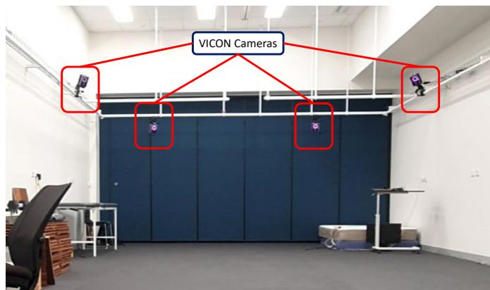  
(a)  
图 1: 带有 VICON 动作捕捉摄像机的实验场景。

• 肩关节屈曲-伸展 $\theta _ { s } ^ { f e }$ 描述肩关节向前和向上的运动，定义为矢状面上臂与躯干之间的夹角（零度表示肩关节完全屈曲并与躯干对齐的状态）；

• 肘关节屈曲-伸展 $\theta _ { e } ^ { f e }$ 表示肘关节的弯曲运动，定义为矢状面上臂与前臂之间的夹角（零度表示肘关节完全屈曲的状态）；

• 腕关节屈曲-伸展 $\theta _ { w } ^ { f e }$ 表示腕关节的弯曲运动，定义为矢状面前臂与手腕之间的夹角（零度表示腕关节完全屈曲的状态）；

• 肩部上提-下降（shoulder elevation-depression）$\theta _ { s } ^ { e d }$ 描述了肩关节的向上运动，并定义为在冠状面上从锁骨到肩带的连线与从锁骨到 C7 椎骨的连线之间的夹角。

数据采样频率为 100Hz。

如 Fig. 3 所示，sEMG 传感器放置在每位受试者右臂和肩部的八块不同肌肉上，包括 BIC、BRA、UT、TRI、FCU、FCR、AD 和 PD。电极根据 SENIAM 指南 [23], [39] 进行放置。数据采样频率为 1000Hz。

## C. 实验方案

1) 肱二头肌弯举方案：本项训练选择了标准肱二头肌弯举，受试者在实验前接受了培训，以确保他们能够正确执行相同的弯举动作。受试者被要求旋后其右侧肘关节以使手掌朝上。随后，受试者被要求在保持大臂靠近躯干的同时屈曲肘部。当手腕到达肩部高度时，受试者被指示伸展肘关节回到起始位置。在研究过程中，受试者被要求跟随每分钟 30 拍的节拍器，使用 5kg 哑铃完成 5 次肱二头肌弯举。在本研究中，一个肱二头肌弯举周期被定义为从受试者开始屈曲肘关节直到受试者的肘关节返回到起始位置的时间。

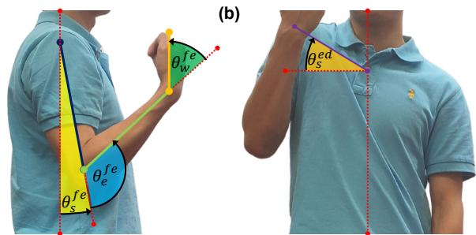  
Fig. 2: 本研究中肱二头肌弯举期间的四个关节角。(a) 矢状面视图。(b) 冠状面视图。红色虚线代表参考线；紫色线连接锁骨和肩锁关节；蓝色、绿色和黄色线分别描绘了大臂、小臂和手腕。箭头表示正方向。

2) 疲劳方案：我们的研究在数据采集阶段使用 Borg CR-10 量表 [23] 来确定疲劳。受试者被要求在运动过程中进行自我评估。疲劳阶段被定义为受试者的主观疲劳感觉等级（Rated Perceived Exertion, PRE）达到 7 级时（即受试者无法完成一个完整的周期，或受试者口头表示无法完成任务时）。多项文献 [40] 表明，sEMG 信号被证明是反映肌肉疲劳程度的良好指标。当肌肉出现疲劳时，sEMG 的幅值增加而其中值频率降低。考虑到 RPE 是一种主观的、受试者自我评定的量表，在数据采集后获取了 sEMG 信号的最大均方根（RMS）幅值和中值频率，以验证受试者对其疲劳状态的陈述。

3) 实验步骤：研究人员在当天对受试者进行了检查，以确保他们符合所有的纳入标准。随后，收集受试者的体重、身高和运动习惯等数据，研究人员向受试者解释了二头肌弯举方案和疲劳方案。sEMG（表面肌电图）传感器和 VICON 标记点贴附在图 3 所示的位置。接着，指导受试者在无负重条件下完成五次二头肌弯举，在标准条件下使用 5kg 哑铃完成五次重复，以及在疲劳条件下使用 5kg 哑铃完成五次重复。

## III. 方法

## A. 数据预处理

对二头肌弯举测量进行了分析，并提取五个周期取平均值以减少差异。收集到的 sEMG 数据首先使用带通滤波器（30Hz-80Hz）进行滤波以去除噪声 [40]。然后使用 MATLAB 的 'envelope' 函数获取信号的包络线。

  
Fig. 3: 受试者身上 sEMG 传感器和 VICON 标记点的放置位置。(a) sEMG 传感器 (b) VICON 标记点

1) 疲劳分析：为了验证疲劳的存在，从在标准条件和疲劳条件下采集的原始 sEMG 信号 $E _ { r a w }$ 中提取均方根（RMS）幅值 $E _ { R M S }$ 和中位频率 $E _ { f r e q } .$。信号的中位频率使用 MATLAB 的 'medfreq' 函数计算。

$$
E _ {R M S} = \sqrt {\frac {1}{n} \sum_ {i} E _ {i} ^ {2}}\tag{1}
$$

$$
E _ {f r e q} = \operatorname{medfreq} (E _ {r a w})\tag{2}
$$

## B. 肌肉协同

肌肉协同是由单一神经指令信号招募的肌肉协同激活模式。它反映了在时间序列和肌肉贡献方面，我们的肌肉如何协同工作以产生任何动作。本研究使用默认的 MATLAB 'nnmf' 函数将滤波后的 sEMG 包络线 $\boldsymbol { E } \in \mathbb { R } ^ { m \times t }$ 分解为协同向量 $W \in \mathbb { R } ^ { m \times n }$ 和激活系数 $C \in \mathbb { R } ^ { n \times t }$，如下式所示：

$$
W, C = \operatorname{nnmf} (E), \quad \min _ {W, C} | W \times C - E |\tag{3}
$$

其中 $m , n ,$ 和 t 分别代表观察到的肌肉数量、协同数量和数据点数量。关于该方法的更多细节，读者可参考 [41]。

1) 相对肌肉协同：在提取所有受试者的肌肉协同后，使用 L2 归一化 [41] 将数据归一化到 [0 1] 之间的值，以便进行受试者间比较。随后将归一化系数的逆 $D$ 整合到激活中。L2 归一化的数学模型以及相对肌肉协同 $w$ 和激活模式 $c$ 的计算如下式所示：

$$
w = W \times D ^ {- 1}, \quad c = D \times C\tag{4}
$$

其中

$$
D = \sqrt {\sum_ {i = 1} ^ {n} \| W _ {i} \|}\tag{5}
$$

2) 解释方差比（Variance Accounted For, VAF）：肌肉协同的数量由权重协同系数与激活系数的乘积同 sEMG 包络之间的 VAF 值决定。协同数量定义为在 $\mathrm { V A F } \geq 0 . 9$ 且增长率小于 3% 的前提下的最小协同数。VAF 的数学模型如下所示。

$$
V A F = 1 - \frac {(E - w \times c) ^ {2}}{E ^ {2}}\tag{6}
$$

3) 余弦相似度（Cosine Similarity）：余弦相似度用于测量两个向量之间的夹角余弦，用于比较和匹配协同作用。公式如下所示。

$$
\cos (V _ {1}, V _ {2}) = \frac {V _ {1} \cdot V _ {2}}{\| V _ {1} \| \| V _ {2} \|}\tag{7}
$$

4) 单块肌肉疲劳识别（Single Muscle Fatigue Identification）：在计算不同条件下二头肌弯举（Bicep Curl）的肌肉协同后，我们可以识别出所选肌肉之间相对贡献的变化。这种变化可以解释为中枢神经系统为了维持完成该动作的表现而改变了肌肉募集策略。因此，我们选择了肌肉协同模型中变化最显著的肌肉子集，并制表列出了它们 RMS 幅值的增量。

## C. 运动学

VICON 软件基于 VICON 标记点的坐标和 VICON 上肢模型（VICON Upper Limb Model）输出各种关节运动学参数，包括肩关节屈曲-伸展、外展-内收、上提-下沉、内旋-外旋，肘关节屈曲-伸展，以及腕关节屈曲-伸展。随后，使用滑动平均算法（move mean algorithm）对这些关节角度轨迹进行滤波，窗口大小为总数据长度的 1%。

1) 时间尺度归一化（Time Scale Normalization）：研究中观察到的关节运动学 $\textbf { \textit { J } } \in \textbf { \textit { R } } ^ { j \times d }$ 采用样条插值法进行了分段和归一化，其中 j 和 d 分别表示观察到的关节运动学数量和数据长度。根据 II-C1 节中描述的二头肌弯举定义，关节运动学 J 被归一化为 ℓ 个数据点以便于比较。二头肌弯举被分为举起阶段（lifting-up phase）和放下阶段（lowering-down phase）。举起阶段范围为 0% 至 50%，放下阶段范围为 50% 至 100%。归一化采用 MATLAB 中的“interp1”函数进行。

$$
\| J \| _ {t} := \operatorname{interp1} (J, \ell)\tag{8}
$$

2) 受试者间的相似性与差异性（Similarity & Discrepancy Among Subjects）：对所有受试者进行的二头肌弯举时间尺度进行归一化后，平均归一化关节运动学 $\bar { J } \in \mathbb { R } ^ { j \times \ell }$ 可获得如下：

$$
\bar {J} = \frac {1}{s} \sum_ {i = 1} ^ {s} \left\| J _ {i} \right\| _ {t}.\tag{9}
$$

其中 s 表示受试者总数。

然后，所有数据点的平均差异 $\mathcal { I } \in \mathbb { R } ^ { j \times \ell }$（即平均关节运动学 J¯ 与每个受试者的个体关节运动学 $\| J \| _ { t }$ 之间的差异）由下式给出：

$$
\mathcal {J} = \omega (\bar {J}, \| J \|)\tag{10}
$$

其中 $\omega ( \cdot , \cdot )$ 是定义如下的辅助函数：

$$
\omega (x, y) := \frac {1}{n} \sum_ {i = 1} ^ {n} (x _ {i} - y _ {i}), \quad \forall x, y \in \mathbb {R} ^ {n}.\tag{11}
$$

然后，通过计算 $\mathcal { I }$ 的均值和标准差来评估关节运动学相对于其平均关节运动学的相似度 $\overline { { \mathcal { I } } }$ 和离散度 $\sigma _ { \mathcal { I } }$，如下所示：

$$
\overline {{\mathcal {J}}} = \frac {1}{s} \sum_ {i = 1} ^ {s} \mathcal {J} _ {i}\tag{12}
$$

$$
\sigma_ {\mathcal {J}} = \sqrt {\frac {1}{s - 1} \sum_ {i = 1} ^ {s} (\mathcal {J} _ {i} - \overline {{\mathcal {J}}}) ^ {2}}\tag{13}
$$

## D. 统计分析

使用 MATLAB 进行统计分析，p 值设定为 5%。使用 Shapiro-Wilk 检验测试数据的正态性，并使用 Levene 检验测试方差齐性。若两项条件均满足，配对 t 检验（paired t-test）是最合适的方法。否则，应使用 Wilcoxon 符号秩检验（Wilcoxon signed rank test）。由于本研究的样本量较小（12），低于使中心极限定理（Central Limit Theorem）成立所通常建议的最小样本量（30）。因此，采用了 Wilcoxon 符号秩检验，因为所比较的数据是配对的，且该检验不要求数据呈正态分布。

## IV. 结果

本研究展示了肱二头肌弯举在无负重、标准以及疲劳状态下的肌肉协同和运动学动作。我们还提供了这些模式下的关节运动学。此外，我们讨论了这些状态下肱二头肌弯举的总体差异，以及观察和捕捉这些状态之间变化所需的肌肉。

## A. 肌电图的中值频率与均方根分析

本节概述了标准二头弯举与疲劳二头弯举之间所有肌肉信号的中值频率和 RMS 幅值的变化，如图 Fig. 4 所示。结果表明，AD、FCU、PD 和 TRI 肌肉的中值频率显著降低。与标准状态相比，在疲劳状态下所有肌肉的中值频率降低了 0.50% 至 7.01%。通过 Wilcoxon 符号秩检验（Wilcoxon signed rank test），两种状态下一半肌肉的中值频率表现出具有统计学意义的显著差异（p-value < 0.05），这证明了在所有受试者中，肌肉在标准和疲劳状态下的中值频率之间存在可测量的差异。BIC 肌肉记录的 p-value 为 0.054，与阈值较为接近。值得注意的是，拮抗肌 TRI 和协同肌 BRA 均报告了疲劳，这符合 Boyas 等人 [42] 和 Wang 等人 [43] 关于重复运动诱发疲劳期间协同肌和拮抗肌在频域上变化的研究结果。因此，我们可以得出结论，受试者已达到疲劳状态。

结果表明，与标准状态相比，疲劳状态下所有肌肉的 sEMG 信号 RMS 幅值均出现了显著增长，增幅从 17.2% 到 127.2% 不等。使用 Wilcoxon 符号秩检验证明了该效应，结果显示所有肌肉在 RMS 幅值上的增幅均具有统计学意义（p-value < 0.05）。从理论上讲，sEMG 信号的 RMS 会受到疲劳和肌肉施加力量的影响。考虑到运动强度、ROM 和负荷保持恒定，我们可以推断 RMS 的变化包含了疲劳因素以及为维持运动表现而发生的肌肉募集策略改变。

## B. 最小肌肉协同

所有状态下不同肌肉协同数量对应的整体 VAF 值如图 Fig. 5 所示。该值基于公式 6 计算得出。结果表明，当所有状态选择两个作为最小肌肉协同数量时，VAF 值达到 90%，且增长率不超过 3%。这表明状态的变化并未改变肌肉协调的复杂性。因此，我们在所有受试者和状态中提取了两个肌肉协同。

## C. 肌肉协同分析

所有受试者的肌肉协同模式已被提取并展示于图 Fig. 6 中。NNMF 算法输出了未经任何顺序排列的协同与激活模式。利用余弦相似度，我们将肌肉协同按特定顺序进行了区分与分组。我们将 BIC 肌肉相对贡献最高的协同定义为协同 I（Synergy I）。其余的定义为协同 II（Synergy II）。所有阶段的协同 I 均由较高权重的 BIC 肌肉贡献组成（占总权重的 75% 至 86%），代表了本研究的主要运动——屈肘。

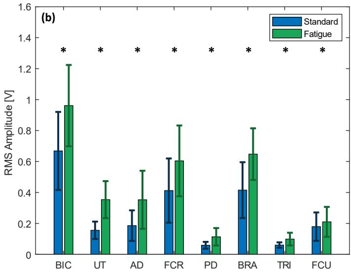  
Fig. 4: 疲劳指标。(a) 受试者的平均中值频率。(b) 受试者的平均 RMS 幅度。蓝色柱状图和误差线表示在标准条件下采集的 sEMG 的平均中值频率和 RMS 幅度。相比之下，绿色柱状图和误差线代表疲劳条件下的数据。

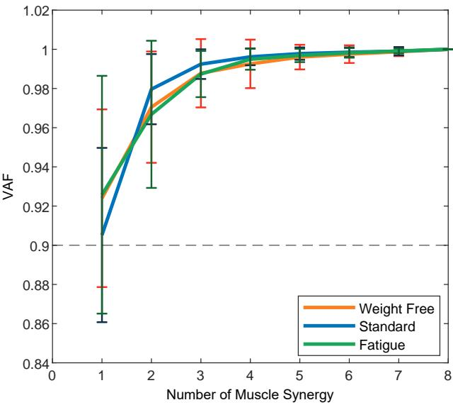  
Fig. 5: 不同阶段不同协同数量的平均 VAF 值。橙色图表表示徒手（weight-free）条件下的平均 VAF 值；蓝色图表表示标准条件下的平均 VAF 值，绿色图表表示疲劳条件下的平均 VAF 值。

1) 徒手肱二头肌弯举：在该组中，平均 VAF 为 94.5%，标准差为 2.38%。协同 II（Synergy II）由肩部和前臂肌肉之间相对平衡的贡献组成。UT、AD、FCR 和 BRA 肌肉具有相似的相对贡献，范围在 19.9% 至 36.2% 之间。

2) 标准肱二头肌弯举：在标准条件下，我们注意到与徒手肱二头肌弯举相比，协同 II 下的几种肌肉贡献发生了显著变化。我们观察到肩部肌肉（如 UT 和 AD）的相对贡献分别从 19.9% 和 33.3% 下降至

11.2% 和 13.8%。我们注意到前臂肌肉（如 FCR 和 BRA）的相对贡献分别从 36.2% 和 27.5% 增加至 46.6% 和 48.1%。然而，基于 Wilcoxon 符号秩检验，仅 AD、PD 和 BRA 肌肉的变化具有统计学意义。此外，协同 I 中肌肉的相对贡献没有明显变化。值得注意的是，TRI 肌肉的相对贡献出现了具有统计学意义的下降，从 6.25% 降至 4.56%。

3) 疲劳肱二头肌弯举：在疲劳条件下，我们注意到与标准肱二头肌弯举相比，协同 II 下的几种肌肉贡献发生了显著变化。我们观察到肩部肌肉（如 UT 和 AD）的相对贡献分别从 11.2% 和 13.8% 增加至 18.2% 和 18.3%。我们还注意到前臂肌肉（如 FCR 和 FCU）的相对贡献略有下降，分别从 46.6% 和 14.3% 降至 44.7% 和 9.06%。使用 Wilcoxon 符号秩检验，仅 UT 和 FCU 肌肉的相对贡献变化具有统计学意义。与标准条件类似，协同 I 中肌肉的相对贡献没有明显变化。值得注意的是，该条件下的 PD 和 UT 肌肉与标准肱二头肌弯举条件相比存在显著差异。

4) 激活度：本节的结果展示了受试者之间的平均激活模式。对于 Synergy I，无负重条件下激活度的 RMS 振幅约为 0.19，且在整个二头肌弯举周期中保持不变。在标准条件下，RMS 振幅增加至约 0.86，并且在弯举周期约 50% 处可以看到急剧下降，随后趋于稳定。最后，在疲劳条件下，激活度的 RMS 振幅增加至约 1.3。在此条件下，其形态呈现为正弦波状，启动较早，在弯举周期约 10% 处达到第一个峰值，在约 50% 处达到第一个波谷，随后形成第二个波峰，其振幅约为第一个波峰的一半。

对于 Synergy II，在无负重条件下观察到了与 Synergy I 相似的激活情况。在标准条件下，RMS 振幅增加至约 0.88，且从开始到弯举周期约 20% 处呈现上升趋势，随后保持恒定至约 50% 处，之后有所下降。最后，在疲劳条件下，激活度的 RMS 振幅增加至约 1.3。其波形呈现为正弦波状，在弯举周期约 30% 处达到第一个峰值，在约 60% 处达到第一个波谷，随后形成第二个峰值，其振幅为第一个峰值的一半。

## D. 运动学

在本研究中，采集了肘关节屈曲-伸展、肩关节屈曲-伸展、肩关节上提-下压以及腕关节屈曲-伸展等关节运动学数据。与此同时，受试者在各种条件下进行了二头肌弯举运动。结果如 Fig. 7 所示，每位受试者的运动学数据与平均运动学数据之间的差异列于 Table. II 中。

1) 肘关节屈曲 - 伸展：我们注意到肘关节屈曲-伸展具有相似的活动范围，在 50 到 150 度之间。无负重与负重条件下的运动轨迹没有明显差异。在疲劳条件下，我们注意到在上举阶段轨迹出现右移，在二头肌弯举约 30% 到 40% 处达到峰值。受试者之间的准确性和相似性在无负重条件下最低，其次是疲劳条件，标准条件下最高。

2) 肩部屈曲 - 伸展：对比所有三个阶段，肩部以相似的轨迹进行屈曲。在无负重条件下，肩部保持稳定，几乎未发生屈曲。在标准条件下，我们注意到起始位置降低到了约 -10 度，这表明由于哑铃的存在，受试者的起始位置略微向躯干中心后方屈曲。肩部在肱二头肌弯举周期约 30% 处轻微屈曲约 10 度，并在约 60% 处恢复。在疲劳条件下，我们注意到与标准条件相比，肩部屈曲更为剧烈，在弯举周期约 20% 处屈曲约 20 度，并在约 80% 处恢复。受试者之间的准确性和相似度在疲劳条件下最低，其次是无负重条件，最后是标准条件。

3) 肩部上提 - 下沉：在无负重条件下，肩部起始角度约为 15 度，在肱二头肌弯举约 30% 处上提，在约 40% 处达到 25 度，并在约 70% 处恢复至约 15 度。在标准条件下，肩部在整个周期中保持稳定，起始角度约为 16 度，在弯举约 25% 处达到 20 度的峰值。在疲劳条件下，我们观察到了与无负重条件相似的模式。不同之处在于肩部上提更为剧烈，在弯举周期约 20% 处达到 30 度，并在周期约 70% 处恢复到初始水平。在受试者之间的准确性和相似度方面，无负重条件下最低，其次是标准条件，最后是疲劳条件。

4) 腕部屈曲 - 伸展：与肩关节不同，腕部屈曲角度在所有三种条件下整个过程中均保持恒定。唯一的区别在于，所有三个阶段的初始角度在各条件间依次减小。无负重条件、标准条件和疲劳条件下的初始腕部屈伸角度分别约为 -17 度、-21 度和 -29 度。关于受试者之间的准确性和相似度，无负重条件下最高，其次是标准条件和疲劳条件。

TABLE II: 个体受试者与平均关节轨迹之间的相似度与差异性。

<table><tr><td rowspan="2">关节轨迹</td><td colspan="2">无负重</td><td colspan="2">标准</td><td colspan="2">疲劳</td></tr><tr><td> $\mathcal{J}$ (deg)</td><td> $\sigma_{\mathcal{J}}$ (deg)</td><td> $\mathcal{J}$ (deg)</td><td> $\sigma_{\mathcal{J}}$ (deg)</td><td> $\mathcal{J}$ (deg)</td><td> $\sigma_{\mathcal{J}}$ (deg)</td></tr><tr><td> $\theta_{e}^{fe}$ </td><td>14.2</td><td>18.2</td><td>9.39</td><td>11.8</td><td>11.8</td><td>14.8</td></tr><tr><td> $\theta_{s}^{fe}$ </td><td>8.60</td><td>11.7</td><td>6.38</td><td>8.71</td><td>10.7</td><td>13.4</td></tr><tr><td> $\theta_{s}^{ed}$ </td><td>7.61</td><td>9.51</td><td>6.47</td><td>7.85</td><td>5.32</td><td>6.45</td></tr><tr><td> $\theta_{w}^{fe}$ </td><td>5.17</td><td>6.67</td><td>10.5</td><td>12.8</td><td>10.2</td><td>13.2</td></tr></table>

## V. 讨论

本研究首次探讨了受试者在无负重、标准和疲劳条件下进行二头弯举时肩部与肢体肌肉协调性的差异。从结果中，我们观察到 RMS 与中值频率与受试者的 RPE 量表呈正相关。通过中值频率分析，我们注意到二头弯举动作中的协同肌、部分固定肌以及拮抗肌均出现了疲劳。

## A. 肌肉协同

在所有条件下发现的协同数量均为两个，表明肌肉协调复杂性没有显著变化。从结果部分可以看出，协同 I（Synergy I）在不同条件下均无显著差异；因此，讨论将集中于协同 II（Synergy II）。在我们的研究中，当受试者进行二头弯举动作时，我们注意到肌肉贡献从肩部肌肉向由前臂肌肉发生了具有统计学意义的转移。负重的存在降低了手腕的稳定性，需要更大的力量来应对增加的负荷。当受试者在疲劳条件下进行二头弯举时，我们观察到肌肉贡献从前臂肌肉向肩部肌肉转移。与 Liu 等人 [23] 的结果（其表明在疲劳过程中 FCU、FCR 和 BRA 肌肉的相干性增加）相反，我们发现负荷相比于前臂肌肉更多地向肩部肌肉转移。然而，他们的研究并未纳入肩部肌肉，这可能是导致得出该结论的原因。

无负重 标准 疲劳

1  
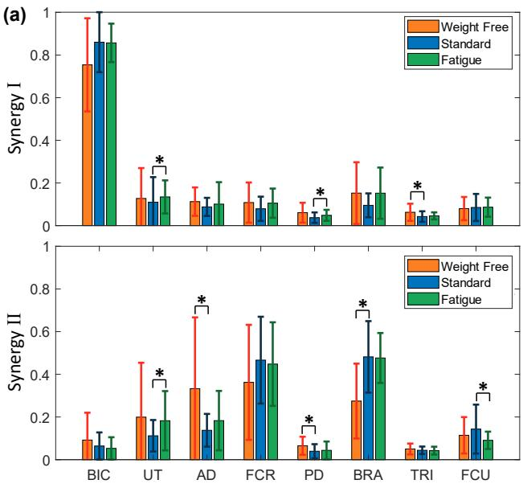

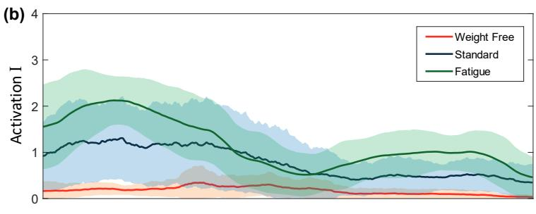

  
Fig. 6: 各阶段间的肌肉协同与激活曲线。(a) 各阶段间的肌肉协同比较。橙色柱代表无负重条件下的平均协同；蓝色柱代表标准条件下的平均协同；绿色柱代表疲劳条件下的平均协同。每个柱状图的误差线代表数据的标准差。柱顶部的 ∗ 符号代表数据集之间的统计学显著性差异。(b) 各阶段间的激活曲线。橙色线代表无负重条件下的平均激活曲线；蓝色线代表负重条件下的平均激活曲线；绿色线代表疲劳条件下的平均激活曲线。阴影区域代表标准误。

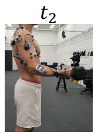

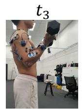

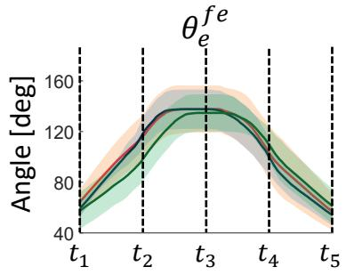  
(a)

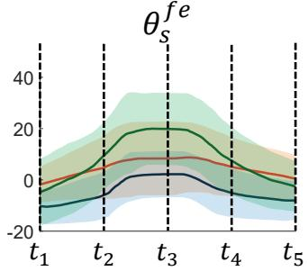  
(b)

  
(c)

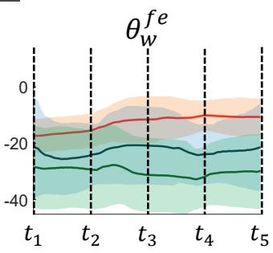  
(d)  
Fig. 7: 肱二头肌弯举的关节运动学。肱二头肌弯举动作被划分为五个阶段。图像展示了受试者在每个阶段进行肱二头肌弯举时的状态。橙色线代表无负重条件下的平均关节运动学；蓝色线代表标准条件下的平均关节运动学；绿色线代表疲劳条件下的平均关节运动学。各自的阴影区域代表轨迹的标准误。(a) 肘关节屈曲 - 伸展 (b) 肩关节屈曲 - 伸展 (c) 肩部上提 - 下压 (d) 腕关节屈曲 - 伸展

## B. 激活模式

与协同模式相比，激活模式提供了更具洞察力的信息。在所有实验条件下，激活曲线的幅度均有所增加。这种改变是由于在不同条件下进行二头肌弯举训练时所付出的努力逐渐增加所致。对于协同 I（Synergy I），肌肉在二头肌弯举开始时被激活，表明处于二头肌弯举的向心阶段。在约占二头肌弯举 50% 的等长阶段，激活程度急剧下降，随后在离心阶段保持恒定。对于协同 II（Synergy II），肌肉在向心阶段逐渐被激活，这是由于哑铃远离躯干时稳定握力所需的努力增加。在约占二头肌弯举 50% 的等长阶段，激活在离心阶段保持恒定。在疲劳条件下，协同 I 在初始阶段被高度激活，以补偿肌力生成能力的下降。一旦动作开始，激活程度便会下降，在等长阶段达到第一个低谷。在离心阶段，激活程度逐渐增加以控制哑铃的下落。在协同 II 中，激活程度逐渐增加，并在二头肌弯举的约 25% 和 75% 处达到峰值，该位置对应向心和离心阶段中哑铃与躯干距离最远的点，用以提供额外的握力。

## C. 运动学

从结果来看，二头肌弯举（肘关节屈曲）的运动学测量并未显著改变关节活动度。然而，无负重条件下的平均角度差异最大，这可能是由于在进行二头肌弯举时难以保持一致的动作节奏所致。此外，我们注意到在不同条件下存在明显的变化，尤其是肩关节。结果表明，肩关节屈伸以及肩关节上提-下降运动发生了显著变化。中枢神经系统通过调节肩部来辅助二头肌弯举动作。有趣的是，与其他条件相比，疲劳条件下肩关节上提-下降运动的角度差异和离散度最低，表明受试者倾向于通过耸肩来补偿疲劳。另一方面，与其他条件相比，疲劳条件下肩关节屈伸的角度差异和离散度最高，表明在疲劳状态下引入过度的肩关节屈曲是不稳定且不一致的。最后，结果表明在不同条件下手腕变得更加不稳定。

## D. 对传感器开发的启示

从结果来看，我们注意到在标准状态与疲劳状态之间，肩部肌肉（尤其是 UT）的相对贡献出现了具有统计学意义的显著增加。另一方面，前臂肌肉（尤其是 FCU）则出现了具有统计学意义的显著减少。结合 Fig. 4 中的 RMS 振幅图和中值频率图，我们可以得出结论：当受试者处于疲劳状态时，来自 UT 和 FCU 的 sEMG 信号的 RMS 振幅与标准动作相比分别增加了 127% 和 17.2%。然而，这两块肌肉中值频率的变化在统计学上并不显著，因此不能断定这两块肌肉发生了疲劳。RMS 的变化应主要源自肌力贡献的变化。不过，我们不建议将 FCU 选作最佳指标，因为其 RMS 的变化并不显著。

同样地，我们观察到了肩部的显著运动。肩部上提-下沉的活动度（ROM）增加了约 6 度，从 [16,20] 度增加至 [20,30] 度；而肩部屈伸的活动度增加了约 10 度，从 [- 10,0] 度增加至 [0,20] 度。两组数据对于捕捉从标准状态到疲劳状态的转变均具有显著意义。简而言之，我们的研究发现，当疲劳发生时：

• UT 肌肉的相对贡献增加了约 62.5%，且 UT 肌肉 sEMG 信号的 RMS 振幅增加了 127%。

• 肩关节的运动更为剧烈，包括肩部上提-下沉运动和肩部屈伸运动的幅度均有所增加。

从生物力学角度来看，上斜方肌（upper trapezius muscle）是肩部上提运动的原动肌。结合这些发现，我们可以得出结论：中枢神经系统招募了上斜方肌来协助完成二头肌弯举（Bicep Curl）训练，从而导致了过度的肩部上提-下沉运动。根据上述研究结果，我们可以为在二头肌弯举训练期间利用不同指标检测疲劳提供建议。在已知受试者正在进行二头肌弯举的先验条件下，在不改变负荷且保持恒定 ROM 的情况下，未来的研究可以通过以下途径检测疲劳：

• 采集 UT 肌肉的 sEMG 信号或监测其肌力。疲劳发生时，预计会出现显著增加。或

• 采集肩关节运动学的 ROM。疲劳发生时，预计会出现显著增加。

## E. 局限性

本研究重点关注了与二头肌弯举（Bicep Curls）直接相关的上肢肌肉和关节。直接从本研究拓展的未来工作包括利用不同传感器来开发可穿戴传感器，以识别患者的状态。相关传感器包括惯性测量单元、摄像头、表面肌电（sEMG）传感器、肌音图（MMG）传感器和弯曲传感器 [44]。在调查过程中，我们指示受试者站立不动，并将动作限制在上肢，试图隔离其他肌肉的贡献。然而，其他肌肉（如核心躯干肌肉）也可能对二头肌弯举中的代偿运动产生影响。进一步研究这些肌肉在二头肌弯举代偿中的作用可能是值得的。此外，未来的研究可以利用 OpenSim 和 Anybody 等生物力学建模软件，探索在不同速度、握法和负重等条件下二头肌弯举运动的肌肉贡献。另外，肌电（EMG）传感器高度敏感；其在肌肉上的放置位置至关重要。考虑到我们对可穿戴传感器开发的建议（包括使用 sEMG 传感器检测上斜方肌（UT）），患者由于未受过专业培训很可能会放置错误，而本研究未考虑传感器错位对结果的影响。未来的研究可以设计可穿戴传感器以减少或调查错位的影响。

## VI. 结论

本研究检测了在徒手（weight-free）、标准和疲劳条件下的肌肉协同和关节运动学。与标准阶段相比，我们的研究结果表明相对贡献从前臂肌肉转移到了肩部肌肉，且两种协同的激活幅度均显著增加。此外，在疲劳状态下，肩关节捕获到了更明显的运动。这项工作为运动科学和康复领域识别疲劳引起的肌肉代偿提供了宝贵的见解，并为捕获疲劳阶段的传感器开发建立了数值基准。基于这项工作的发现，团队正在研究部署在肩部周围的新型基于应变的可穿戴传感器，用于自动检测二头肌弯举中由疲劳引起的代偿运动。

## VII. 致谢

我们向 Nan Hu 博士（UNSW 临床医学院）在统计分析方面的建议，以及 Mohit Shivdasani 副教授和 Luca Modenese 博士（UNSW 生物医学工程研究生院）在 sEMG 处理方面的建议表示感谢。我们还要感谢 UNSW 机械与制造工程学院以及 NeuRA 跌倒、平衡与损伤研究中心为完成本研究提供的资源支持。

## 参考文献

[1] C. A. Churgay, “Diagnosis and treatment of biceps tendinitis and tendinosis,” American family physician, vol. 80, no. 5, pp. 470–476, 2009.

[2] Physiopedia, “体育运动中的康复（Rehabilitation in sport physiopedia）,” 2022, [Online; accessed 17-January-2024]. [Online]. Available: https://www.physio-pedia.com/index.php?title=Rehabilitation in Sport&oldid=323414

[3] M. F. Levin, J. A. Kleim, and S. L. Wolf, “脑卒中后患者的运动‘恢复’与‘代偿’意味着什么？” Neurorehabilitation and neural repair, vol. 23, no. 4, pp. 313–319, 2009.

[4] C. Van Walraven, M. Mamdani, J. Fang, and P. C. Austin, “出院后护理连续性与患者预后,” Journal of general internal medicine, vol. 19, no. 6, pp. 624–631, 2004.

[5] H. Ø. Moksnes, C. Schafer, M. S. Rasmussen, H. L. Søberg, O. Røise,¨ A. Anke, C. Røe, P. A. Næss, C. Gaarder, E. Helseth et al., “挪威中重度创伤急性期救治后出院去向的相关因素：一项前瞻性人群队列研究,” Injury epidemiology, vol. 10, no. 1, p. 20, 2023.

[6] M. Lin, J. Huang, J. Fu, Y. Sun, and Q. Fang, “一种基于虚拟现实且具备肌电实时反馈的脑卒中后康复运动想象训练系统,” IEEE Transactions on Neural Systems and Rehabilitation Engineering, vol. 31, pp. 1–10, 2022.

[7] A. Arntz, F. Weber, M. Handgraaf, K. Lall¨ a, K. Korniloff, K.-P.¨ Murtonen, J. Chichaeva, A. Kidritsch, M. Heller, E. Sakellari et al., “居家数字化康复中的技术：范围综述,” JMIR rehabilitation and assistive technologies, vol. 10, no. 1, p. e43615, 2023.

[8] X. Wang, Y. Fu, B. Ye, J. Babineau, Y. Ding, and A. Mihailidis, “基于技术的脑卒中存活者上肢活动代偿评估与检测：系统评价,” Journal of Medical Internet Research, vol. 24, no. 6, p. e34307, 2022.

[9] C. Nicholson-Smith, V. Mehrabi, S. F. Atashzar, and R. V. Patel, “一种用于脑卒中上下肢康复的多功能机器人,” IEEE Transactions on Medical Robotics and Bionics, vol. 2, no. 4, pp. 549– 552, 2020.

[10] Y. Liu, S. Guo, Z. Yang, H. Hirata, and T. Tamiya, “一种增强医患远程交互的居家远程康复系统：可行性研究,” IEEE Journal ofBiomedical and Health Informatics, vol. 26, no. 8, pp. 4176–4186, 2022.

[11] M. A. Darmanian, M. X. Chua, and L. Wu, “一种完全便携且可隐蔽穿戴的轻量级上肢助力外骨骼衣,” in 2023 45th Annual International Conference of the IEEE Engineering in Medicine & Biology Society (EMBC). IEEE, 2023, pp. 1–4.

[12] S. Cai, G. Li, E. Su, X. Wei, S. Huang, K. Ma, H. Zheng, and L. Xie, “脑卒中患者代偿模式的实时检测以减少机器人康复治疗中的代偿,” IEEE journal of biomedical and health informatics, vol. 24, no. 9, pp. 2630– 2638, 2020.

[13] G. Durandau, W. F. Rampeltshammer, H. v. d. Kooij, and M. Sartori, “Neuromechanical model-based adaptive control of bilateral ankle exoskeletons: Biological joint torque and electromyogram reduction across walking conditions（基于神经力学模型的双侧踝关节外骨骼自适应控制：不同行走条件下生物关节力矩与肌电信号的降低）,” IEEE Transactions on Robotics, vol. 38, no. 3, pp. 1380–1394, 2022.

[14] M. Zaltieri, D. L. Presti, M. Bravi, M. A. Caponero, S. Sterzi, E. Schena, and C. Massaroni, “Assessment of a multi-sensor fbg-based wearable system in sitting postures recognition and respiratory rate evaluation of office workers（基于多传感器光纤布拉格光栅的可穿戴系统在办公室职员坐姿识别与呼吸频率评估中的应用评估）,” IEEE Transactions on Biomedical Engineering, vol. 70, no. 5, pp. 1673–1682, 2022.

[15] J. He, D. Liu, M. Hou, A. Luo, S. Wang, and Y. Ma, “Analysis of interjoint coordination during the sit-to-stand and stand-to-sit tasks in stroke patients with hemiplegia（脑卒中偏瘫患者坐-站及站-坐任务中关节间协调性的分析）,” 2023.

[16] R. Sugai, S. Maeda, R. Shibuya, Y. Sekiguchi, S.-I. Izumi, M. Hayashibe, and D. Owaki, “Lstm network-based estimation of ground reaction forces during walking in stroke patients using markerless motion capture system（基于无标记动作捕捉系统和 LSTM 网络对脑卒中患者步行过程中地面反作用力的估计）,” IEEE Transactions on Medical Robotics and Bionics, 2023.

[17] X. Zhao, S. Li et al., “A biomechanical analysis of lower limb movement on the backcourt forehand clear stroke among badminton players of different levels（不同水平羽毛球运动员后场正手高远球下肢动作的生物力学分析）,” Applied Bionics and Biomechanics, vol. 2019, 2019.

[18] G. Nguyen, J. Maclean, and L. Stirling, “Quantification of compensatory torso motion in post-stroke patients using wearable inertial measurement units（基于可穿戴惯性测量单元量化脑卒中后患者躯干代偿运动）,” IEEE Sensors Journal, vol. 21, no. 13, pp. 15 349–15 360, 2021.

[19] H. Zhao, H. Xu, Z. Wang, L. Wang, S. Qiu, D. Peng, J. Li, and J. Jiang, “Analysis and evaluation of hemiplegic gait based on wearable sensor network（基于可穿戴传感器网络的偏瘫步态分析与评估）,” Information Fusion, vol. 90, pp. 382–391, 2023.

[20] B. Oubre, J.-F. Daneault, K. Boyer, J. H. Kim, M. Jasim, P. Bonato, and S. I. Lee, “A simple low-cost wearable sensor for long-term ambulatory monitoring of knee joint kinematics（一种用于膝关节运动学长期动态监测的简易低成本可穿戴传感器）,” IEEE Transactions on Biomedical Engineering, vol. 67, no. 12, pp. 3483–3490, 2020.

[21] P. Eizentals, A. Katashev, A. Oks, and G. Semjonova, “Smart shirt system for compensatory movement retraining assistance: Feasibility study（用于代偿运动再训练辅助的智能衬衫系统：可行性研究）,” Health and Technology, vol. 10, pp. 861–874, 2020.

[22] S. Cai, G. Li, S. Huang, H. Zheng, and L. Xie, “Automatic detection of compensatory movement patterns by a pressure distribution mattress using machine learning methods: a pilot study（基于压力分布床垫和机器学习方法的代偿运动模式自动检测：一项初步研究）,” IEEE Access, vol. 7, pp. 80 300–80 309, 2019.

[23] X. Liu, B. Yang, T. Liang, J. Li, C. Lou, H. Wang, and X. Liu, “Muscle compensation analysis during motion based on muscle functional network（基于肌肉功能网络的运动过程中肌肉代偿分析）,” IEEE Sensors Journal, vol. 22, no. 3, pp. 2370–2378, 2021.

[24] T. Afzal, F. Zhu, S.-C. Tseng, J. A. Lincoln, G. E. Francisco, H. Su, and S.-H. Chang, “Evaluation of muscle synergy during exoskeletonassisted walking in persons with multiple sclerosis（多发性硬化症患者在外骨骼辅助行走过程中肌肉协同作用的评估）,” IEEE Transactions on Biomedical Engineering, vol. 69, no. 10, pp. 3265–3274, 2022.

[25] A. Asemi, K. Maghooli, F. N. Rahatabad, and H. Azadeh, “Handwritten signatures verification based on arm and hand muscles synergy,” Biomedical Signal Processing and Control, vol. 76, p. 103697, 2022.

[26] B. Hajiloo, M. Anbarian, H. Esmaeili, and M. Mirzapour, “The effects of fatigue on synergy of selected lower limb muscles during running,” Journal of Biomechanics, vol. 103, p. 109692, 2020.

[27] M. Ghislieri, M. Knaflitz, L. Labanca, G. Barone, L. Bragonzoni, M. G. Benedetti, and V. Agostini, “Muscle synergy assessment during singleleg stance,” IEEE Transactions on Neural Systems and Rehabilitation Engineering, vol. 28, no. 12, pp. 2914–2922, 2020.

[28] K. Kubota, H. Hanawa, M. Yokoyama, S. Kita, K. Hirata, T. Fujino, T. Kokubun, T. Ishibashi, and N. Kanemura, “Usefulness of muscle synergy analysis in individuals with knee osteoarthritis during gait,” IEEE Transactions on Neural Systems and Rehabilitation Engineering, vol. 29, pp. 239–248, 2020.

[29] Y.-X. Liu and E. M. Gutierrez-Farewik, “Joint kinematics, kinetics and muscle synergy patterns during transitions between locomotion modes,” IEEE Transactions on Biomedical Engineering, vol. 70, no. 3, pp. 1062– 1071, 2022.

[30] Y. Sheng, J. Zeng, J. Liu, and H. Liu, “Metric-based muscle synergy consistency for upper limb motor functions,” IEEE Transactions on Instrumentation and Measurement, vol. 71, pp. 1–11, 2021.

[31] N. Yang, Q. An, H. Yamakawa, Y. Tamura, A. Yamashita, and H. Asama, “Muscle synergy structure using different strategies in human standingup motion,” Advanced Robotics, vol. 31, no. 1-2, pp. 40–54, 2017.

[32] F. Dupuis, G. Sole, C. Wassinger, M. Bielmann, L. J. Bouyer, and J.-S. Roy, “Fatigue, induced via repetitive upper-limb motor tasks, influences trunk and shoulder kinematics during an upper limb reaching task in a virtual reality environment,” PloS one, vol. 16, no. 4, p. e0249403, 2021.

[33] S. J. Thomas, G. C. Castillo, M. Topley, and R. W. Paul, “The effects of fatigue on muscle synergies in the shoulders of baseball players,” Sports Health, vol. 15, no. 2, pp. 282–289, 2023.

[34] N. Matsunaga, Y. Okubo, S. Isagawa, J. Niitsuma, T. Otsudo, Y. Sawada, and K. Akasaka, “Muscle fatigue in the gluteus maximus changes muscle synergies during single-leg landing,” Journal of Bodywork and Movement Therapies, vol. 27, pp. 493–499, 2021.

[35] T. R. Baechle and R. W. Earle, Essentials of strength training and conditioning. Human kinetics, 2008.

[36] C. Kennedy-Armbruster and M. Yoke, Methods of group exercise instruction. Human Kinetics, 2014.

[37] I. Vourganas, V. Stankovic, L. Stankovic, A. Kerr et al., “Factors that contribute to the use of stroke self-rehabilitation technologies: A review,” JMIR Biomedical Engineering, vol. 4, no. 1, p. e13732, 2019.

[38] V. M. S. Lmt, “Upper limb model,” Available at https://www.vicon.com/ software/models-and-scripts/upper-limb-model/ (1/7/2007).

[39] P. R. Merletti, “Seniam,” Available at http://seniam.org/.

[40] P. Konard, “The abc of emg,” Available at https://www.noraxon.com/ wp-content/uploads/2014/12/ABC-EMG-ISBN.pdf (4/3/2006).

[41] N. A. Turpin, S. Uriac, and G. Dalleau, “How to improve the muscle synergy analysis methodology?” European journal of applied physiology, vol. 121, no. 4, pp. 1009–1025, 2021.

[42] S. Boyas, O. Ma¨ısetti, and A. Guevel, “Changes in semg parameters´ among trunk and thigh muscles during a fatiguing bilateral isometric multi-joint task in trained and untrained subjects,” Journal of Electromyography and Kinesiology, vol. 19, no. 2, pp. 259–268, 2009.

[43] L. Wang, X. Song, H. Yang, C. Wang, Q. Shao, H. Tao, M. Qiao, W. Niu, and X. Liu, “Are the antagonist muscle fatigued during a prolonged isometric fatiguing elbow flexion at very low forces for young adults?” Frontiers in Physiology, vol. 13, p. 956639, 2022.

[44] L. Guo, Z. Lu, and L. Yao, “Human-machine interaction sensing technology based on hand gesture recognition: A review,” IEEE Transactions on Human-Machine Systems, vol. 51, no. 4, pp. 300–309, 2021.