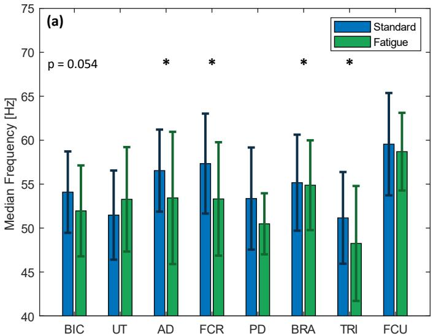
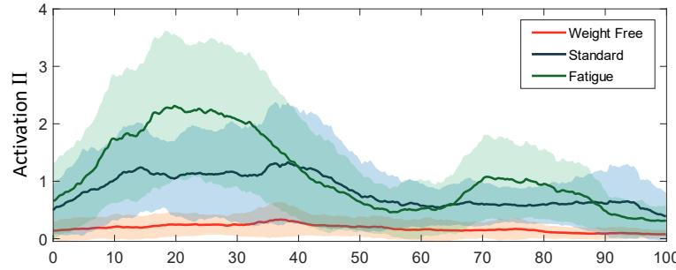
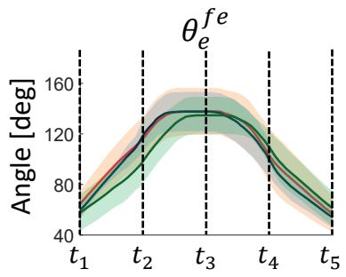

# 肱二头肌弯举中疲劳诱发代偿运动的分析：为可穿戴传感器的部署提供见解

摘要—肱二头肌弯举康复中的一个常见挑战是肌肉代偿，即当主要肌群因损伤或疲劳而无法发力时，患者会采用替代性的运动模式，这显著降低了康复的效果。随着康复模式从临床向家庭过渡的趋势日益明显，这一问题愈加突出，因为在家庭环境中无法获得物理治疗师的持续监测和纠正。开发能够检测肌肉代偿的可穿戴传感器对于应对这一挑战至关重要。本研究旨在通过对肱二头肌弯举中肌肉代偿现象的全面研究，为可穿戴传感器的最佳部署提供见解。我们在 12 名健康受试者中，分别在标准阶段和疲劳阶段下采集了其上肢关节运动学和 8 块肌肉的表面肌电信号（sEMG）。从 sEMG 信号中提取了两组肌肉协同模块，并结合关节运动学进行了综合分析。我们的研究结果显示，前臂肌肉相对于肩部肌肉的贡献比例发生了变化，同时两组协同模块的激活幅度均显著增加。此外，在疲劳状态下观察到肩关节的运动更为明显。这些结果表明，在部署可穿戴传感器以有效检测代偿动作时，应当重点关注肩部肌肉的活动和关节运动。

索引词—疲劳诱发代偿运动，肌肉协同，康复，肱二头肌弯举，可穿戴传感器

## I. 引言

肱二头肌弯举（Bicep Curl）练习常被用于上肢疾病（如肱二头肌肌腱炎 [1]）的康复治疗。肱二头肌肌腱炎是由反复的过头动作或年龄相关的磨损等原因引起的肱二头肌肌腱的炎症。其治疗通常包括高重复次数、低负重的肱二头肌弯举练习，以便在炎症缓解后强化肱二头肌（Bicep Brachii）。整个康复过程包括四个步骤：1）疼痛管理；2）增加柔韧性和关节活动度（ROM）；3）恢复肌肉力量；4）专项功能性训练 [2]。肱二头肌肌腱炎的康复可能是一个长期的治疗过程，要求患者首先在医院或诊所接受监督下的治疗（通常是在急性期），随后在家中长期坚持练习，直至完全康复。

肌肉代偿是康复治疗中一个突出的问题，常见于涉及弯举动作的上肢康复训练。这一术语描述了患者的行为模式：当由于肌肉疲劳或疼痛等原因无法使用目标肌肉完成指定动作时，他们会无意识地选择其他肌肉来执行动作。因此，康复治疗的有效性会显著降低，并可能导致进一步的损伤。如果康复治疗持续较长时间，不正确的肌肉使用甚至可能导致永久性的姿势偏差[3]。

当患者在医院或诊所接受康复治疗时，物理治疗师可以通过直接观察和指导来识别并纠正患者的肌肉代偿行为。然而，当患者在家中进行康复训练时，由于过程缺乏监督，识别肌肉代偿变得具有挑战性。随着人口老龄化带来的康复需求急剧增长，康复治疗正从临床康复向居家康复转变，这一问题愈发严重。多项研究表明，医院之外的支持连续性有限[4]。Moksnes 等人[5]也证明，患者居住地中心性的下降会增加其遭受严重损伤的可能性。

虚拟现实[6]、远程医疗[7]、可穿戴传感器[8]、机械臂[9]以及外骨骼[10]、[11]等技术的最新进展缓解了上述难题。其中，可穿戴传感器技术的进步为该问题提供了一种替代解决方案。尽管针对弯举动作中肌肉代偿识别的研究较少，但已有一些传感器被提出用于其他类似动作的检测，例如伸手取物[12]、行走[13]、坐姿[14]以及坐起动作[15]。总体而言，这些传感器可分为两大类。第一类传感器采集与人体运动相关的物理参数。这一类别的典型实例包括无标记摄像头[16]、运动捕捉系统[17]、惯性测量单元[18]–[20]、应变传感器[21]以及压力传感器[12]、[22]。第二类传感器主要基于表面肌电信号（surface electromyography，sEMG），可直接检测患者的肌肉活动[23]–[31]。

肌肉协同分析（Muscle Synergies Analysis）已被广泛用于比较不同阶段之间的肌肉协调。该方法主要通过一种数据降维算法——非负矩阵分解（Non Negative Matrix Factorization, NNMF）来提取。Dupuis 等人 [32] 利用 sEMG 传感器的肌肉协同分析，研究了疲劳后手臂够取任务中肩部运动的变化。Hajiloo 等人 [26] 研究了跑步过程中下肢肌肉协同模式在疲劳前后的变化，发现各肌肉的相对权重和激活存在显著差异。Thomas 等人 [33] 开展了类似的工作，以识别肩关节在操纵手柄过程中的肌肉协同。Matsunaga 等人 [34] 也发现，单腿落地时臀大肌（Gluteus Maximus）疲劳需要腘绳肌（Hamstring）进行代偿。上述研究表明，肌肉协同分析能够反映受试者状态的变化，包括疲劳。然而，这些研究均未涉及肱二头肌弯举（Bicep Curls）中的代偿运动。这些工作提供了肌肉贡献的重要特征，可用于区分运动过程中的不同状态。然而，关于肌肉协同模式变化与传感器开发之间关联的研究仍然有限。

虽然肱二头肌弯举主要包含肘关节的屈伸运动，但其代偿运动可能涉及肩部升降、肩部屈伸以及腕关节屈伸 [35], [36]。在此过程中，多块肌肉可能被激活，包括：

- 原动肌：肱二头肌（Biceps Brachii, BIC）；

- 协同肌：肱肌（Brachialis, BR）和肱桡肌（Brachioradialis, BRA）；

- 稳定肌：三角肌前束（Anterior Deltoid, AD）、三角肌后束（Posterior Deltoid, PD）、上斜方肌（Upper Trapezius, UT）、尺侧腕屈肌（Flexor Carpi Ulnaris, FCU）以及桡侧腕屈肌（Flexor Carpi Radialis, FCR）；以及

- 拮抗肌：肱三头肌（Triceps, TRI）。

因此，为了全面捕捉和分析肱二头肌弯举练习，需要一组机械和 sEMG 传感器来观察上述所有关节和肌肉。可以预见的是，所开发的可穿戴传感器将十分复杂且成本高昂 [37]。因此，有必要对肱二头肌弯举中的代偿运动进行系统分析，以降低标准肱二头肌弯举与疲劳状态下肱二头肌弯举之间的特征维度，从而简化传感器的设计与部署。据作者所知，现有文献中尚缺乏此类研究。

为此，在本研究中，我们使用运动捕捉系统来捕捉肩部和手臂关节的运动学数据，包括肩部上抬-下压、肩部屈曲-伸展、肘部屈曲-伸展以及腕部屈曲-伸展，分别在标准弯举和疲劳弯举条件下进行测量。虽然此处使用运动捕捉系统进行分析，但我们指出，结果同样适用于其他能够测量关节运动的机械传感器。此外，我们使用表面肌电（sEMG）传感器测量八块肌肉，包括肱二头肌（BIC）、肱肌（BRA）、斜方肌上部（UT）、肱三头肌（TRI）、尺侧腕屈肌（FCU）、桡侧腕屈肌（FCR）、拇收肌（AD）和拇短伸肌（PD）。肱桡肌（BR）被排除在外，因为它不是一块浅层肌肉，因此无法通过 sEMG 进行适当测量。选择运动捕捉系统和 sEMG 传感器的理由在于两者均具有较高精度，并被广泛应用于运动分析 [8]。考虑到本研究旨在识别标准弯举与疲劳弯举之间的真实差异，这些传感器将是最为合适的。为了比较哪些肌肉子集对代偿运动的贡献最大，我们使用 NNMF 算法从 sEMG 信号中提取肌肉协同模式。

本文的贡献主要体现在两个方面：

• 识别空手、标准以及疲劳弯举之间在肌肉协同模式和关节运动学方面的显著差异。

• 基于 sEMG 数据与关节运动学的比较，提出一种用于检测弯举中疲劳诱发代偿运动的最优指标。

本文所呈现的结果有望为指导可穿戴传感器的优化开发与部署提供参考，从而实现家庭康复中弯举动作肌肉代偿的自动检测。

## II. 数据采集

## A. 参与者

本研究招募了十二名男性受试者。受试者的年龄介于 18 至 35 岁之间，体重介于 65 千克至 90 千克之间，身高介于 165 厘米至 185 厘米之间。他们均无身体损伤、残疾或中风病史。他们的自我报告运动时长为每周一小时至超过七小时不等。表 I 列出了受试者的人口统计学信息。本实验经新南威尔士大学（UNSW）人类研究伦理委员会批准，参考编号为 HC220573。所有受试者均提供了书面知情同意书。参与本研究为自愿行为，受试者可在论文发表之前的任何时间终止其参与。

表 I：受试者人口统计学信息

<table><tr><td>Subject</td><td>Age (year)</td><td>Height (cm)</td><td>Weight (kg)</td><td>Exercise duration per week (hour)</td></tr><tr><td>1</td><td>18-23</td><td>175-180</td><td>60-70</td><td>3-5</td></tr><tr><td>2</td><td>18-23</td><td>175-180</td><td>70-80</td><td>5-7</td></tr><tr><td>3</td><td>24-29</td><td>175-180</td><td>70-80</td><td>3-5</td></tr><tr><td>4</td><td>30-35</td><td>175-180</td><td>80-90</td><td>1-3</td></tr><tr><td>5</td><td>24-29</td><td>175-180</td><td>60-70</td><td>5-7</td></tr><tr><td>6</td><td>18-23</td><td>170-175</td><td>70-80</td><td>7+</td></tr><tr><td>7</td><td>18-23</td><td>175-180</td><td>60-70</td><td>5-7</td></tr><tr><td>8</td><td>18-23</td><td>180-185</td><td>70-80</td><td>5-7</td></tr><tr><td>9</td><td>18-23</td><td>170-175</td><td>60-70</td><td>5-7</td></tr><tr><td>10</td><td>18-23</td><td>175-180</td><td>70-80</td><td>1-3</td></tr><tr><td>11</td><td>18-23</td><td>165-170</td><td>70-80</td><td>7+</td></tr><tr><td>12</td><td>24-29</td><td>170-175</td><td>70-80</td><td>5-7</td></tr></table>

## B. 实验设置

实验在澳大利亚 NeuRA 跌倒、平衡与损伤研究中心（Falls, Balance, and Injury Research Centre, FBIRC）的步态实验室（Gait Lab）进行。实验场景如图 1 所示。

实验使用了八台动作捕捉摄像机（Vantage, VICON Motion Systems, UK）以及八个 sEMG 传感器（Myon 320, zFlo Motion, USA）。依据 VICON Motion System 编著的《Upper Limb Model Product Guide》[38]，在受试者身上放置了十三个反光标记点（reflective markers），以捕捉其运动学（kinematics）数据。所采用的 VICON 右上肢模型（VICON Right Upper Limb model）用于计算肩部屈伸角（shoulder flexion-extension）$\theta _ { s } ^ { f e }$、肘部屈伸角（elbow flexion-extension）$\theta _ { e } ^ { f e }$、腕部屈伸角（wrist flexion-extension）$\theta _ { w } ^ { f e }$ 以及肩部升降角（shoulder elevation-depression）$\theta _ { s } ^ { e d }$，其定义如图 2 所示。特别是，

  

图 1：配有 VICON 动作捕捉摄像机的实验场景。

• 肩关节屈伸 $\theta _ { s } ^ { f e }$ 描述肩关节的前向与上向运动，定义为上臂与躯干在矢状面内的夹角（零度表示肩关节完全屈曲并与躯干对齐时的状态）；

• 肘关节屈伸 $\theta _ { e } ^ { f e }$ 表示肘关节的弯曲运动，定义为上臂与前臂在矢状面内的夹角（零度表示肘关节完全屈曲时的状态）；

• 腕关节屈伸 $\theta _ { w } ^ { f e }$ 表示腕关节的弯曲运动，定义为前臂与手腕在矢状面内的夹角（零度表示腕关节完全屈曲时的状态）；

• 肩关节上抬-下沉 $\theta _ { s } ^ { e d }$ 刻画肩关节的上抬运动，定义为锁骨到肩带的连线与锁骨到第七颈椎（C7）的连线在冠状面内的夹角。

数据的采样频率为 100Hz。

sEMG 传感器被放置在每位受试者右臂与右肩的八块不同肌肉上，如图 3 所示，包括肱二头肌（BIC）、肱肌（BRA）、斜方肌上部（UT）、肱三头肌（TRI）、尺侧腕屈肌（FCU）、桡侧腕屈肌（FCR）、三角肌（AD）和背阔肌（PD）。电极的放置参照 SENIAM 指南 [23]，[39]。数据的采样频率为 1000Hz。

## C. 实验方案

1) 二头肌弯举方案：本研究选取了标准二头肌弯举动作，并在实验前对受试者进行了训练，以确保他们能够正确且一致地完成同样的二头肌弯举动作。受试者被要求旋前右肘关节使手掌朝上。然后，受试者被要求弯曲肘关节，同时保持上臂贴近躯干。当腕部达到肩高时，受试者被要求伸展肘关节回到起始位置。在研究过程中，受试者需按照节拍器每分钟 30 拍的速度，使用 5kg 哑铃完成五次二头肌弯举。在本研究中，一次二头肌弯举循环定义为从受试者开始屈曲肘关节到其肘关节回到起始位置所经历的时间。

  

图 2：本研究中二头肌弯举（bicep curl）过程中的四个关节角度。（a）矢状面（sagittal）视图。（b）冠状面（coronal）视图。红色虚线表示参考线；紫色线连接锁骨（clavicle）和肩锁关节（acromioclavicular joint）；蓝色、绿色和黄色线分别表示上臂、前臂和手腕。箭头指示正方向。

2) 疲劳方案（Fatigue Protocol）：本研究在数据采集阶段使用博格 CR-10 量表（Borg CR-10 Scale）[23] 来判定疲劳程度。要求受试者在运动过程中进行自我评估。疲劳阶段定义为：当受试者的自感用力等级（Rated Perceived Exertion, PRE）达到 7 级时，即受试者无法完成一个完整的动作周期，或受试者口头表示无法继续完成该任务时。已有文献 [40] 表明，sEMG 信号能够很好地反映肌肉的疲劳程度。当肌肉发生疲劳时，sEMG 信号的幅值增大，其中位频率下降。考虑到 PRE 是一种主观的、由受试者自评的量表，数据采集结束后提取了 sEMG 信号的最大均方根（Root Mean Square, RMS）幅值和中位频率，以验证受试者关于其疲劳状态的陈述。

3) 实验流程（Experimental Procedure）：研究者在实验当天对受试者进行检查，以确保其满足所有纳入标准。随后，收集受试者的体重、身高及运动习惯等数据，并由研究者向受试者讲解二头肌弯举方案与疲劳方案。sEMG 传感器与 VICON 标记点按图 3 所示位置进行粘贴。随后，要求受试者分别在无负重条件下完成 5 次二头肌弯举、在使用 5kg 哑铃的标准条件下完成 5 次、以及在使用 5kg 哑铃的疲劳条件下完成 5 次。

## III. 方法（METHODOLOGY）

## A. 数据预处理（Data Pre-Processing）

对二头肌弯举测量数据进行分析，提取 5 个动作周期并取平均值，以减小误差。首先采用带通滤波器（30Hz–80Hz）对所采集的 sEMG 数据进行滤波以去除噪声 [40]。随后利用 MATLAB 中的 "envelope" 函数获取信号的包络。

  

**图 3**：受试者身上 sEMG 传感器与 VICON 标记点的布置。(a) sEMG 传感器 (b) VICON 标记点

1）疲劳分析：为了验证疲劳的存在，从标准状态和疲劳状态下采集的原始 sEMG 信号 $E _ { r a w }$ 中提取了 RMS 幅值 $E _ { R M S }$ 和中位频率 $E _ { f r e q } .$。信号的中位频率使用 MATLAB 中的 'medfreq' 函数计算。

$$
E _ { R M S } = \sqrt { \frac { 1 } { n } \sum _ { i } E _ { i } ^ { 2 } }\tag{1}
$$

$$
E _ { f r e q } = \mathrm { m e d f r e q } ( E _ { r a w } )\tag{2}
$$

肌肉协同（Muscle Synergy）是由单一神经指令信号募集的肌肉共同激活模式。它反映了我们的肌肉如何在涉及时间序列与肌肉贡献的运动中进行协同工作。本研究使用 MATLAB 默认的 `'nnmf'` 函数将滤波后的 sEMG 包络 $\boldsymbol { E } \in \mathbb { R } ^ { m \times t }$ 分解为协同向量 $W \in \mathbb { R } ^ { m \times n }$ 和激活系数 $C \in \mathbb { R } ^ { n \times t }$ ，如下式所示

$$
W , C = \tt n n m f ( \it E ) , \quad \operatorname* { m i n } _ { W , C } | W \times C - E |\tag{3}
$$

其中 $m$、$n$ 和 $t$ 分别表示观察到的肌肉数量、协同数量以及数据点的数量。有关该方法的更多细节，读者可参考文献 [41]。

1) 相对肌肉协同（Relative Muscle Synergy）：在提取所有受试者的肌肉协同后，采用 L2 归一化（L2 Normalization）[41] 将数据归一化至 [0 1] 区间内的值，以实现受试者间的比较。随后将归一化系数 D 的倒数整合到激活中。L2 归一化的数学模型以及相对肌肉协同 $w$ 和激活模式 $c$ 的计算由下式给出

$$
w = W \times D ^ { - 1 } , \quad c = D \times C\tag{4}
$$

其中

$$
D = \sqrt { \sum _ { i = 1 } ^ { n } \lVert W _ { i } \rVert }\tag{5}
$$

2) 方差解释率（Variance Accounted For, VAF）：肌肉协同的数量由权重协同系数、激活系数与 sEMG 包络线三者乘积之间的 VAF 值确定。协同数量定义为使 VAF ≥ 0.9 且增长率小于 3% 时的最小协同数。VAF 的数学模型如下所示。

$$
V A F = 1 - \frac { ( E - w \times c ) ^ { 2 } } { E ^ { 2 } }\tag{6}
$$

3) 余弦相似度（Cosine Similarity）：余弦相似度用于测量两个向量之间的余弦角，被用于比较和匹配协同模式（synergies）。公式如下所示。

$$
\cos ( V _ { 1 } , V _ { 2 } ) = \frac { V _ { 1 } \cdot V _ { 2 } } { \Vert V _ { 1 } \Vert \Vert V _ { 2 } \Vert }\tag{7}
$$

4) 单块肌肉疲劳识别：在计算不同条件下弯举动作的肌肉协同效应后，我们可以识别所选肌肉之间相对贡献的变化。这些变化可被解释为中枢神经系统为维持完成该动作所需的运动表现而调整的肌肉募集策略的变化。由此，我们选取了肌肉协同模型中变化最为显著的肌肉子集，并将其均方根幅值的增量列成表格。

## C. 运动学

VICON 软件根据 VICON 标记点的坐标以及 VICON 上肢模型（VICON Upper Limb Model），输出多种关节运动学参数，包括肩关节屈伸、外展-内收、上抬-下压、内旋-外旋，肘关节屈伸，以及腕关节屈伸。随后，采用滑动均值（move mean）算法对这些关节角度轨迹进行滤波处理，窗口大小设为总数据长度的 1%。

1) 时间尺度归一化：研究期间观测到的关节运动学数据 $\textbf { \textit { J } } \in \textbf { \textit { R } } ^ { j \times d }$，采用样条插值（spline interpolation）方法进行分段与归一化处理，其中 $j$ 与 $d$ 分别表示所观测的关节运动学参数数量与数据长度。根据第 II-C1 节中对弯举动作的定义，将关节运动学数据 $\textbf{J}$ 归一化为 $\ell$ 个数据点，以便进行比较。弯举动作被划分为上举阶段与下放阶段：上举阶段对应 0% 至 50%，下放阶段对应 50% 至 100%。归一化操作通过 MATLAB 中的 `interp1` 函数实现。

$$
\| J \| _ { t } : = \operatorname { i n t e r p } 1 ( J , \ell )\tag{8}
$$

2) 受试者间的相似性与差异：在对所有受试者执行的二头肌弯举的时间尺度进行归一化之后，可获得平均归一化的关节运动学 $\bar { J } \in \mathbb { R } ^ { j \times \ell }$，其获取方式为

$$
\bar { J } = \frac { 1 } { s } \sum _ { i = 1 } ^ { s } \| J _ { i } \| _ { t } .\tag{9}
$$

其中 $s$ 表示受试者的总人数。

然后，所有数据点 $\mathcal { I } \in \mathbb { R } ^ { j \times \ell }$ 在平均关节运动学 $J^{\bar{}}$ 与每位受试者的个体关节运动学 $\| J \| _ { t }$ 之间的平均差异由下式给出

$$
\mathcal { I } = \omega ( \bar { J } , \lVert J \rVert )\tag{10}
$$

其中 $\omega ( \cdot , \cdot )$ 是一个辅助函数，定义如下

$$
\omega ( x , y ) : = \frac { 1 } { n } \sum _ { i = 1 } ^ { n } ( x _ { i } - y _ { i } ) , \quad \forall x , y \in \mathbb { R } ^ { n } .\tag{11}
$$

然后，通过计算 $\mathcal{I}$ 的均值和标准差，分别对关节运动学相对于其平均关节运动学的相似性 $\overline{\mathcal{I}}$ 和差异性 $\sigma_{\mathcal{I}}$ 进行评估，具体如下：

$$
\overline { { \mathcal { T } } } = \frac { 1 } { s } \sum _ { i = 1 } ^ { s } \mathcal { T } _ { i }\tag{12}
$$

$$
\sigma _ { \mathcal { T } } = \sqrt { \frac { 1 } { s - 1 } \sum _ { i = 1 } ^ { s } ( \mathcal { T } _ { i } - \overline { { \mathcal { T } } } ) ^ { 2 } }\tag{13}
$$

## D. 统计分析

MATLAB 用于统计分析，p 值设定为 5%。数据的正态性采用 Shapiro-Wilk 检验，方差齐性采用 Levene 检验。若两个条件均满足，配对 t 检验是最适用的方法。否则，应使用 Wilcoxon 符号秩检验（Wilcoxon signed rank test）。由于本研究的样本量较小（12），低于一般准则所要求的最小样本量（30），不足以满足中心极限定理的适用条件。因此，本研究采用 Wilcoxon 符号秩检验，因为所比较的数据为配对数据，且不要求数据服从正态分布。

## IV. 结果

本研究展示了在无负重、标准以及疲劳三种条件下的二头肌弯举的肌肉协同（muscle synergy）与运动学表现。我们同时给出了这几种模式下的关节运动学。此外，我们还讨论了这几种状态下二头肌弯举的整体差异，以及用于观察和捕获这些状态之间变化所需的肌肉。

## A. EMG 的中位频率与 RMS 分析

本节概述了标准与疲劳两种二头肌弯举条件下所有肌肉信号中位频率与 RMS（均方根）幅值的变化，如图 4 所示。结果显示，AD、FCU、PD 和 TRI 肌肉的中位频率显著降低。与标准条件相比，疲劳条件下所有肌肉的中位频率下降了 0.50% 至 7.01%。使用 Wilcoxon 符号秩检验对两种条件下半数肌肉的中位频率进行比较，结果显示差异具有统计学显著性（p-value < 0.05），这支持了在所有受试者中标准与疲劳两种状态下肌肉中位频率存在可测量差异的结论。BIC 肌肉的 p 值为 0.054，较为接近显著性阈值。值得注意的是，拮抗肌 TRI 与协同肌 BRA 均报告了疲劳现象，这与 Boyas 等人 [42] 以及 Wang 等人 [43] 关于重复运动诱发疲劳过程中协同肌与拮抗肌在频域上变化的研究结果相符。因此，可以得出结论：受试者已达到疲劳状态。

结果显示，与标准条件相比，疲劳条件下所有肌肉的 sEMG 信号的 RMS 幅值显著增加了 17.2% 至 127.2%。使用 Wilcoxon 符号秩检验对该效应进行检验，结果表明所有肌肉 RMS 幅值的增加均具有统计学显著性（p-value < 0.05）。理论上，sEMG 信号的 RMS 会受到疲劳以及肌肉所施加力量的影响。考虑到运动强度、关节活动范围（ROM）以及负荷保持不变，我们可以认为 RMS 的变化既包含疲劳因素，也包含为维持运动表现而发生的肌肉募集策略的改变。

## B. 最小肌肉协同

不同肌肉协同数量和不同条件下的总体 VAF 值如图 5 所示。该值根据式 6 计算得出。结果显示，当选择两个作为所有条件下的最小肌肉协同数量时，VAF 值达到 90%，且增长率不超过 3%。这表明条件的变化并未改变肌肉协调的复杂度。因此，我们在所有受试者和条件下提取了两个肌肉协同。

## C. 肌肉协同分析

我们对所有受试者的肌肉协同模式进行了提取，结果如图 6 所示。NNMF 算法输出了协同和激活模式，但未按任何特定顺序进行排列。我们利用余弦相似度（cosine similarity）对肌肉协同进行区分和分组。我们将协同 I（Synergy I）定义为 BIC 肌相对贡献最高的协同，其余则定义为协同 II（Synergy II）。所有阶段的协同 I 均以 BIC 肌的高权重贡献为特征，占总权重的 75% 至 86%，代表了本研究中的主要运动，即肘关节屈曲。

  

图 4：疲劳指标。（a）受试者的平均中位频率。（b）受试者的平均 RMS 幅值。蓝色柱状图和误差棒表示在标准条件下采集的 sEMG 数据的平均中位频率和 RMS 幅值；相反，绿色柱状图和误差棒表示在疲劳条件下的数据。

  

图5：不同阶段下不同数量协同的平均VAF（Variance Accounted For，方差解释率）值。橙色图表示无负重条件下的平均VAF值；蓝色图表示标准条件下的平均VAF值；绿色图表示疲劳条件下的平均VAF值。

1) 无负重弯举（Weight-Free Bicep Curl）：在该组中，平均 VAF 为 94.5%，标准差为 2.38%。协同模式 II 由肩部和前臂肌肉相对均衡的贡献构成。UT、AD、FCR 和 BRA 肌肉的相对贡献相近，范围在 19.9% 到 36.2% 之间。

2) 标准弯举（Standard Bicep Curl）：在标准条件下，与无负重弯举相比，我们注意到协同模式 II 下若干肌肉贡献出现了显著变化。我们观察到肩部肌肉（如 UT 和 AD）的相对贡献分别从 19.9% 和 33.3% 下降到

11.2% 和 13.8%。我们也注意到前臂肌肉（如 FCR 和 BRA）的相对贡献分别从 36.2% 和 27.5% 增加到 46.6% 和 48.1%。然而，基于 Wilcoxon 符号秩检验（Wilcoxon signed rank test），只有 AD、PD 和 BRA 肌肉的变化具有统计学显著性。此外，协同模式 I 中肌肉的相对贡献没有可见的变化。值得注意的是，TRI 肌肉的相对贡献从 6.25% 下降到 4.56%，具有统计学显著性的降低。

3) 疲劳弯举（Fatigue Bicep Curl）：在疲劳条件下，与标准弯举相比，我们注意到协同模式 II 下若干肌肉贡献出现了显著变化。我们观察到肩部肌肉（如 UT 和 AD）的相对贡献分别从 11.2% 和 13.8% 增加到 18.2% 和 18.3%。我们也注意到前臂肌肉（如 FCR 和 FCU）的相对贡献略有下降，分别从 46.6% 和 14.3% 减少到 44.7% 和 9.06%。使用 Wilcoxon 符号秩检验，只有 UT 和 FCU 肌肉相对贡献的变化具有统计学显著性。与标准条件类似，协同模式 I 中肌肉的相对贡献没有可见的变化。值得注意的是，该条件下 PD 和 UT 肌肉与标准弯举条件相比存在显著差异。

4) 激活（Activation）：本节结果展示了受试者之间平均的激活模式。对于协同模式 I，在无负重条件下激活的 RMS 幅值约为 0.19，且在整个弯举周期内保持不变。在标准条件下，RMS 幅值增加到约 0.86，可以看到在弯举约 50% 处出现急剧下降，随后趋于稳定。最后，疲劳条件下激活的 RMS 幅值增加到约 1.3。在该条件下，曲线形状呈现正弦波形，起始较早，在弯举约 10% 处达到第一个峰值，在弯举约 50% 处到达第一个波谷，随后形成第二个曲线，其幅值约为第一个曲线的一半。

对于协同模式 II（Synergy II），我们在无负重条件下观察到了类似的激活。在标准条件下，RMS 幅值增加到约 0.88，并且从肱二头肌弯举开始呈上升趋势直至约 20% 处，之后保持稳定直至约 50% 处，随后逐渐降低。最后，在疲劳条件下，激活的 RMS 幅值增加到约 1.3。其波形呈现正弦波状，在约 30% 的肱二头肌弯举处出现第一个波峰，在约 60% 处达到第一个波谷，随后形成第二个波峰，其幅值约为第一个波峰的一半。

## D. 运动学（Kinematics）

在本研究中，我们采集了肘关节屈伸、肩关节屈伸、肩部升降以及腕关节屈伸等关节运动学数据。与此同时，受试者在不同条件下完成肱二头肌弯举练习。结果如图 7 所示，每位受试者的运动学数据与平均运动学数据之间的差异列于表 II 中。

1) 肘关节屈伸（Elbow Flexion - Extension）：我们注意到肘关节屈伸的活动范围相似，均在 50 至 150 度之间。无负重和负重条件下的运动轨迹没有明显差异。在疲劳条件下，我们注意到上举过程中出现右移现象，即达到峰值的位置从约 30% 移动到约 40% 的肱二头肌弯举处。受试者之间的准确性和相似性在无负重条件下最低，其次是疲劳条件，然后是标准条件。

2) 肩关节屈伸（Shoulder Flexion - Extension）：比较三个阶段，肩部以相似的轨迹屈曲。在无负重条件下，肩部保持稳定，几乎没有屈曲发生。在标准条件下，我们注意到起始位置下降至约 -10 度，表明由于哑铃的存在，受试者略向躯干中心后方屈曲。肩部在约 30% 处轻微屈曲约 10 度，并在约 60% 的肱二头肌弯举周期处恢复。在疲劳条件下，我们注意到肩部在约 20% 处比标准条件更剧烈地屈曲约 20 度，并在约 80% 的肱二头肌弯举周期处恢复。受试者之间的准确性和相似性在疲劳条件下最低，其次是无负重条件，然后是标准条件。

3) 肩部上提-下降（Shoulder Elevation - Depression）：在无负重（weight-free）条件下，肩部起始角度约为 15 度，在弯举（bicep curl）动作进行至约 30% 时开始上抬，于约 40% 时达到 25 度，并在约 70% 时回到约 15 度。在标准（standard）条件下，肩部在整个动作周期内保持稳定，起始角度约为 16 度，在弯举动作进行至约 25% 时达到峰值 20 度。在疲劳（fatigue）条件下，我们观察到了与无负重条件相似的模式。区别在于，肩部更为明显地上抬，在弯举动作周期进行至约 20% 时即达到 30 度，并在约 70% 时回到初始水平。就受试者间的准确性与相似度而言，无负重条件下最低，其次为标准条件，最高为疲劳条件。

4) 腕部屈曲-伸展（Wrist Flexion - Extension）：与肩关节不同，三种条件下的腕部屈曲角度在整个动作周期内均保持恒定。唯一的差异在于，三种条件下的初始角度依次递减。无负重条件、标准条件和疲劳条件下的腕部初始屈曲-伸展角度分别约为 -17 度、-21 度和 -29 度。就受试者间的准确性与相似度而言，无负重条件下最高，其次为标准条件，最低为疲劳条件。

TABLE II: 个体受试者与平均关节轨迹之间的相似性与差异性（Similarity and Discrepancy between Individual Subjects and Averaged Joint Trajectory）。

<table><tr><td rowspan="2">Joint Trajectory</td><td colspan="2">Weight Free</td><td colspan="2">Standard</td><td colspan="2">Fatigue</td></tr><tr><td>J (deg)</td><td> $\sigma _ { \mathcal { I } }$  (deg)</td><td> $\overline { { \mathcal { I } } }$  (deg)</td><td> $\sigma _ { \mathcal { I } }$  (deg)</td><td> $\overline { { \mathcal { I } } }$  (deg)</td><td> $\sigma _ { \mathcal { I } }$  (deg)</td></tr><tr><td> $\overline { { \theta _ { e } ^ { f e } } }$ </td><td>14.2</td><td>18.2</td><td>9.39</td><td>11.8</td><td>11.8</td><td>14.8</td></tr><tr><td> $\theta _ { s } ^ { f e }$ </td><td>8.60</td><td>11.7</td><td>6.38</td><td>8.71</td><td>10.7</td><td>13.4</td></tr><tr><td> $\theta _ { s } ^ { e d }$ </td><td>7.61</td><td>9.51</td><td>6.47</td><td>7.85</td><td>5.32</td><td>6.45</td></tr><tr><td> $\theta _ { w } ^ { \bar { f } e }$ </td><td>5.17</td><td>6.67</td><td>10.5</td><td>12.8</td><td>10.2</td><td>13.2</td></tr></table>

## V. 讨论（DISCUSSION）

本研究是首次考察受试者在无负重、标准及疲劳三种条件下进行肱二头肌弯举时肩部与肢体肌肉协调差异的研究。从结果中我们观察到均方根值（RMS）与中位频率与受试者的自感用力等级（RPE）量表之间呈正相关。从中位频率分析中我们注意到，在肱二头肌弯举练习中，协同肌、部分固定肌以及拮抗肌均出现了疲劳。

## A. 肌肉协同（Muscle Synergy）

所有条件下所提取到的协同模式数量均为两种，表明肌肉协调的复杂度未发生显著变化。从结果部分可见，协同模式 I（Synergy I）在不同条件下无显著差异；因此，下文将重点讨论协同模式 II（Synergy II）。在本研究中，当受试者进行肱二头肌弯举练习时，我们观察到肌肉贡献从肩部肌肉向 forearm（前臂）肌肉发生了显著的转移。负重的存在降低了腕关节的稳定性，需要更大的力量来适应逐渐增加的运动负荷。当受试者在疲劳条件下进行肱二头肌弯举练习时，我们注意到肌肉贡献从前臂肌肉向肩部肌肉发生了转移。与 Liu 等人 [23] 的结果（其显示在疲劳过程中尺侧腕屈肌（FCU）、桡侧腕屈肌（FCR）与肱桡肌（BRA）的相干性不断增强）相反，我们发现负荷是随着疲劳过程从前臂肌肉向肩部肌肉转移。然而，他们的研究未纳入肩部肌肉，这可能是导致其得出前述结论的原因。

无负重 标准 疲劳

您发送的内容似乎是乱码（"�1"），我无法识别出需要翻译的英文论文 Markdown。

请重新粘贴您的英文论文内容，我会按规则完整翻译成中文。

  

图 6：各阶段之间的肌肉协同与激活曲线。(a) 各阶段之间的肌肉协同比较。橙色柱状图表示无负重条件下的平均肌肉协同；蓝色柱状图表示标准条件下的平均肌肉协同；绿色柱状图表示疲劳条件下的平均肌肉协同。每个柱状图的误差棒表示数据的标准差。柱状图顶部的 ∗ 符号表示数据集之间的统计差异。(b) 各阶段之间的激活曲线。橙色线条表示无负重条件下的平均激活曲线；蓝色线条表示负重条件下的平均激活曲线；绿色线条表示疲劳条件下的平均激活曲线。阴影区域表示标准误差。

  

(a)

  

(b)

  

(c)

  

(d)
图 7：弯举的关节运动学。弯举动作被划分为五个阶段。图像展示了受试者在每个阶段执行弯举时的姿态。橙色线表示无负重条件下的平均关节运动学；蓝色线表示标准条件下的平均关节运动学；绿色线表示疲劳条件下的平均关节运动学。它们各自的阴影区域表示轨迹的标准误差。(a) 肘关节屈伸 (b) 肩关节屈伸 (c) 肩关节上举-下压 (d) 腕关节屈伸

## B. 激活模式（Activation Patterns）

与协同模式相比，激活模式提供了更具洞察力的信息。在所有条件下，激活曲线的振幅均有所增加。这种变化是由于在实验条件下完成肱二头肌弯举所需努力程度逐渐增大所致。对于协同模式 I（Synergy I），肌肉在肱二头肌弯举的起始阶段被激活，表明该阶段为弯举的向心收缩阶段。在等长收缩阶段（约弯举过程的 50% 左右），激活程度急剧下降，随后在离心收缩阶段保持稳定。对于协同模式 II（Synergy II），在向心收缩阶段肌肉逐渐被激活，这是由于在哑铃远离躯干时维持握持稳定性所需努力程度增加。在等长收缩阶段（约弯举过程的 50% 左右），激活程度在离心收缩阶段保持稳定。在疲劳条件下，协同模式 I 在初始阶段被高度激活，以代偿肌肉力量生成能力的下降。一旦运动启动，激活程度随之下降，并在等长收缩阶段达到第一个波谷。在离心收缩阶段，激活程度逐渐上升，以控制哑铃的下落。在协同模式 II 中，激活程度逐渐增加，并在弯举过程的约 25% 和 75% 处达到峰值——这两个时点对应于向心收缩和离心收缩阶段中哑铃与躯干距离最大的时刻，从而提供额外的握持稳定性。

## C. 运动学（Kinematics）

结果表明，肱二头肌弯举（肘关节屈曲）的运动学指标并未显著改变关节活动范围。然而，无负重条件下的平均角度差异最大，这可能是由于在进行肱二头肌弯举时难以保持稳定的节奏所致。此外，我们注意到在不同条件下肩关节存在可见的改变。结果显示，肩关节的屈伸运动和上下抬降运动发生了显著变化。中枢神经系统对肩关节进行调控以辅助肱二头肌弯举动作。有趣的是，疲劳条件下肩关节上下抬降运动的角度差异和离散度均低于其他条件，这表明受试者倾向于通过抬高肩部来代偿疲劳。另一方面，疲劳条件下肩关节屈伸运动的角度差异和离散度均高于其他条件，这表明疲劳状态下引入过度的肩关节屈曲动作是不稳定且不一致的。最后，结果显示在各种条件下腕关节的不稳定性逐渐增加。

## D. 对传感器开发的启示（Insights for Sensor Development）

根据研究结果，我们注意到在标准状态与疲劳状态之间，肩部肌肉（尤其是UT）的相对贡献存在统计学显著的增量。另一方面，我们注意到前臂肌肉（尤其是FCU）的相对贡献存在统计学显著的减量。结合图4中的RMS幅值图和中位频率图，我们可以得出结论：当受试者出现疲劳时，来自UT和FCU的sEMG信号的RMS幅值相较于标准状态将分别增加127%和17.2%。然而，两块肌肉的中位频率变化均不具有统计学显著性，因此无法得出两块肌肉均出现疲劳的结论。RMS的变化应主要反映肌力贡献的变化。然而，由于FCU的RMS变化并不显著，我们不建议将FCU作为优选指标。

同样地，我们观察到肩部存在明显的运动。肩部升降运动的范围从[16, 20]度增加到[20, 30]度，约增加6度；而肩部屈伸运动的范围从[-10, 0]度增加到[0, 20]度，约增加10度。两项数据对捕捉从标准状态到疲劳状态的转变均具有显著意义。简而言之，我们的研究发现，当疲劳发生时：

• UT肌肉的相对贡献增加了约62.5%，UT肌肉sEMG信号的RMS幅值增加了127%。

• 肩关节的运动更加剧烈，包括肩部升降运动和肩部屈伸运动的幅度均增大。

从生物力学角度来看，上斜方肌是肩部抬升运动的主要发力肌。我们可以综合这些发现得出结论：中枢神经系统募集上斜方肌来执行肱二头肌弯举（Bicep Curl）练习，从而导致肩部升降运动过度。基于上述发现，我们可以提出在肱二头肌弯举练习期间使用不同指标检测疲劳的建议。在已知受试者正在进行肱二头肌弯举、不改变负荷且保持恒定运动范围（ROM, Range of Motion）的前提下，未来研究可通过以下方式检测疲劳：

• 采集UT肌肉的sEMG信号或监测其肌力。预计疲劳发生时将出现显著增加。或

• 采集肩关节运动学的ROM。预计疲劳发生时将出现显著增加。

## E. 局限性

本研究聚焦于与弯举（Bicep Curl）直接相关的上肢肌肉和关节。直接在本研究基础上拓展的后续工作包括利用不同传感器开发可穿戴传感器，以识别患者的状态。相关传感器包括惯性测量单元（inertial measurement units）、摄像头、表面肌电（sEMG）传感器、机械肌图（mechanomyography, MMG）传感器以及弯曲传感器 [44]。在实验过程中，我们要求受试者保持站立不动，将运动限制在上肢，试图隔离其他肌肉的贡献。然而，其他肌肉（例如核心躯干肌）也可能对弯举中的代偿运动有所贡献。进一步研究这些肌肉在弯举代偿中的作用或许值得开展。此外，未来研究可利用生物力学建模软件，例如 OpenSim 和 Anybody，探究弯举（Bicep Curl）练习在不同条件（如速度、握法、负重）下的肌肉贡献。此外，肌电（EMG）传感器灵敏度极高，其在肌肉上的放置位置极为关键。考虑到我们关于可穿戴传感器开发的建议——其中包括使用 sEMG 传感器对上斜方肌（UT）进行检查——患者可能由于未经专业培训而错放传感器，而本研究未考虑传感器错放对结果的影响。未来研究可设计可穿戴传感器以减轻或考察错放的影响。

## VI. 结论（CONCLUSION）

本研究考察了无负重、标准以及疲劳条件下的肌肉协同与关节运动学。与标准阶段相比，我们的研究结果显示相对贡献从前臂肌肉向肩部肌肉发生了转移，并且两组协同的激活幅度均显著增大。此外，在疲劳状态下，肩关节的活动更为明显。本研究为在运动科学和康复中识别疲劳诱导的肌肉代偿提供了有价值的见解，并为开发能够识别疲劳阶段的可穿戴传感器建立了数值基准。基于本研究的发现，团队正在研究新型基于应变的可穿戴传感器，将其部署在肩部周围，以自动检测弯举（Bicep Curl）中疲劳诱导的代偿运动。

## VII. 致谢（ACKNOWLEDGEMENT）

我们感谢胡楠（Nan Hu）博士（新南威尔士大学临床医学院，UNSW School of Clinical Medicine）在统计分析方面的建议，以及 Mohit Shivdasani 副教授和 Luca Modenese 博士（新南威尔士大学生物医学工程研究生院，UNSW Graduate School of Biomedical Engineering）在表面肌电（sEMG）处理方面的建议。我们还要感谢新南威尔士大学机械与制造工程学院（UNSW School of Mechanical and Manufacturing Engineering）以及 NeuRA 跌倒、平衡与损伤研究中心（NeuRA Falls, Balance, and Injury Research Centre）为完成本研究提供的资源。

## REFERENCES

[1] C. A. Churgay, "肱二头肌肌腱炎与肌腱病的诊断与治疗," *American family physician*, vol. 80, no. 5, pp. 470–476, 2009.

[2] Physiopedia, "运动康复（Rehabilitation in sport physiopedia）," 2022, [在线；检索于 2024年1月17日]。[在线]。地址：https://www.physio-pedia.com/index.php?title=Rehabilitation in Sport&oldid=323414

[3] M. F. Levin, J. A. Kleim, and S. L. Wolf, "中风后患者的运动'恢复'和'代偿'意味着什么？"（What do motor "recovery" and "compensation" mean in patients following stroke?），《神经康复与神经修复》（Neurorehabilitation and neural repair），第23卷，第4期，第313–319页，2009年。

[4] C. Van Walraven, M. Mamdani, J. Fang, and P. C. Austin, "出院后的连续性护理与患者结局"（Continuity of care and patient outcomes after hospital discharge），《普通内科学杂志》（Journal of general internal medicine），第19卷，第6期，第624–631页，2004年。

[5] H. Ø. Moksnes, C. Schafer, M. S. Rasmussen, H. L. Søberg, O. Røise, A. Anke, C. Røe, P. A. Næss, C. Gaarder, E. Helseth 等, "挪威中重度创伤后急性护理出院去向的相关因素：一项前瞻性人群研究"（Factors associated with discharge destination from acute care after moderate-to-severe traumatic injuries in norway: a prospective population-based study），《伤害流行病学》（Injury epidemiology），第10卷，第1期，第20页，2023年。

[6] M. Lin, J. Huang, J. Fu, Y. Sun, and Q. Fang, "基于虚拟现实并具有肌电实时反馈的运动想象训练系统用于中风后康复"（A vr-based motor imagery training system with emg-based real-time feedback for post-stroke rehabilitation），《IEEE 神经系统和康复工程汇刊》（IEEE Transactions on Neural Systems and Rehabilitation Engineering），第31卷，第1–10页，2022年。

[7] A. Arntz, F. Weber, M. Handgraaf, K. Lallä, K. Korniloff, K.-P. Murtonen, J. Chichaeva, A. Kidritsch, M. Heller, E. Sakellari 等, "家庭数字康复中的技术：范围综述"（Technologies in home-based digital rehabilitation: Scoping review），《JMIR 康复与辅助技术》（JMIR rehabilitation and assistive technologies），第10卷，第1期，第e43615页，2023年。

[8] X. Wang, Y. Fu, B. Ye, J. Babineau, Y. Ding, and A. Mihailidis, "基于技术的中风幸存者上肢活动代偿评估与检测：系统综述"（Technology-based compensation assessment and detection of upper extremity activities of stroke survivors: Systematic review），《医学互联网研究杂志》（Journal of Medical Internet Research），第24卷，第6期，第e34307页，2022年。

[9] C. Nicholson-Smith, V. Mehrabi, S. F. Atashzar, and R. V. Patel, "多功能上下肢中风康复机器人"（A multi-functional lower-and upper-limb stroke rehabilitation robot），《IEEE 医疗机器人和仿生学汇刊》（IEEE Transactions on Medical Robotics and Bionics），第2卷，第4期，第549–552页，2020年。

[10] Y. Liu, S. Guo, Z. Yang, H. Hirata, and T. Tamiya, "具有增强治疗师-患者远程交互的家庭远程康复系统：可行性研究"（A home-based telerehabilitation system with enhanced therapist-patient remote interaction: A feasibility study），《IEEE 生物医学与健康信息学杂志》（IEEE Journal of Biomedical and Health Informatics），第26卷，第8期，第4176–4186页，2022年。

[11] M. A. Darmanian, M. X. Chua, and L. Wu, "一种完全便携、可隐藏的轻量级上肢辅助外骨骼服"（A completely portable and concealable, lightweight assistive exosuit for upper limbs），载于：2023年第45届IEEE医学与生物工程学会国际年会（2023 45th Annual International Conference of the IEEE Engineering in Medicine & Biology Society, EMBC），IEEE，2023年，第1–4页。

[12] S. Cai, G. Li, E. Su, X. Wei, S. Huang, K. Ma, H. Zheng, and L. Xie, "中风患者代偿模式的实时检测以减少机器人康复治疗中的代偿"（Real-time detection of compensatory patterns in patients with stroke to reduce compensation during robotic rehabilitation therapy），《IEEE 生物医学与健康信息学杂志》（IEEE journal of biomedical and health informatics），第24卷，第9期，第2630–2638页，2020年。

[13] G. Durandau, W. F. Rampeltshammer, H. v. d. Kooij, and M. Sartori, "基于神经力学模型的双侧踝关节外骨骼自适应控制：不同步行条件下的生物关节力矩与肌电图减少（Neuromechanical model-based adaptive control of bilateral ankle exoskeletons: Biological joint torque and electromyogram reduction across walking conditions）," *IEEE Transactions on Robotics*, 卷 38, 期 3, 页 1380–1394, 2022.

[14] M. Zaltieri, D. L. Presti, M. Bravi, M. A. Caponero, S. Sterzi, E. Schena, and C. Massaroni, "基于多传感器光纤布拉格光栅可穿戴系统的坐姿识别与办公室员工呼吸频率评估（Assessment of a multi-sensor fbg-based wearable system in sitting postures recognition and respiratory rate evaluation of office workers）," *IEEE Transactions on Biomedical Engineering*, 卷 70, 期 5, 页 1673–1682, 2022.

[15] J. He, D. Liu, M. Hou, A. Luo, S. Wang, and Y. Ma, "偏瘫脑卒中患者坐-立与立-坐任务中关节间协调性分析（Analysis of interjoint coordination during the sit-to-stand and stand-to-sit tasks in stroke patients with hemiplegia）," 2023.

[16] R. Sugai, S. Maeda, R. Shibuya, Y. Sekiguchi, S.-I. Izumi, M. Hayashibe, and D. Owaki, "基于长短时记忆网络的脑卒中患者步行地面反作用力估计——采用无标记运动捕捉系统（Lstm network-based estimation of ground reaction forces during walking in stroke patients using markerless motion capture system）," *IEEE Transactions on Medical Robotics and Bionics*, 2023.

[17] X. Zhao, S. Li 等, "不同水平羽毛球运动员后场正手高远球击球下肢运动的生物力学分析（A biomechanical analysis of lower limb movement on the backcourt forehand clear stroke among badminton players of different levels）," *Applied Bionics and Biomechanics*, 卷 2019, 2019.

[18] G. Nguyen, J. Maclean, and L. Stirling, "采用可穿戴惯性测量单元量化脑卒中后患者的代偿性躯干运动（Quantification of compensatory torso motion in post-stroke patients using wearable inertial measurement units）," *IEEE Sensors Journal*, 卷 21, 期 13, 页 15 349–15 360, 2021.

[19] H. Zhao, H. Xu, Z. Wang, L. Wang, S. Qiu, D. Peng, J. Li, and J. Jiang, "基于可穿戴传感器网络的偏瘫步态分析与评估（Analysis and evaluation of hemiplegic gait based on wearable sensor network）," *Information Fusion*, 卷 90, 页 382–391, 2023.

[20] B. Oubre, J.-F. Daneault, K. Boyer, J. H. Kim, M. Jasim, P. Bonato, and S. I. Lee, "一种用于膝关节运动学长期门诊监测的简单低成本可穿戴传感器（A simple low-cost wearable sensor for long-term ambulatory monitoring of knee joint kinematics）," *IEEE Transactions on Biomedical Engineering*, 卷 67, 期 12, 页 3483–3490, 2020.

[21] P. Eizentals, A. Katashev, A. Oks, and G. Semjonova, "用于代偿运动再训练辅助的智能衬衫系统：可行性研究（Smart shirt system for compensatory movement retraining assistance: Feasibility study）," *Health and Technology*, 卷 10, 页 861–874, 2020.

[22] S. Cai, G. Li, S. Huang, H. Zheng, and L. Xie, "采用机器学习方法通过压力分布床垫自动检测代偿运动模式：一项初步研究（Automatic detection of compensatory movement patterns by a pressure distribution mattress using machine learning methods: a pilot study）," *IEEE Access*, 卷 7, 页 80 300–80 309, 2019.

[23] X. Liu, B. Yang, T. Liang, J. Li, C. Lou, H. Wang, and X. Liu, "基于肌肉功能网络的运动中肌肉代偿分析（Muscle compensation analysis during motion based on muscle functional network）," *IEEE Sensors Journal*, 卷 22, 期 3, 页 2370–2378, 2021.

[24] T. Afzal, F. Zhu, S.-C. Tseng, J. A. Lincoln, G. E. Francisco, H. Su, and S.-H. Chang, "多发性硬化患者外骨骼辅助步行期间的肌肉协同评估（Evaluation of muscle synergy during exoskeleton-assisted walking in persons with multiple sclerosis）," *IEEE Transactions on Biomedical Engineering*, 卷 69, 期 10, 页 3265–3274, 2022.

[25] A. Asemi, K. Maghooli, F. N. Rahatabad, 和 H. Azadeh, "基于手臂和手部肌肉协同的手写签名验证", Biomedical Signal Processing and Control, 第 76 卷, 第 103697 页, 2022 年。

[26] B. Hajiloo, M. Anbarian, H. Esmaeili, 和 M. Mirzapour, "疲劳对跑步过程中选定下肢肌肉协同的影响", Journal of Biomechanics, 第 103 卷, 第 109692 页, 2020 年。

[27] M. Ghislieri, M. Knaflitz, L. Labanca, G. Barone, L. Bragonzoni, M. G. Benedetti, 和 V. Agostini, "单腿站立期间的肌肉协同评估", IEEE Transactions on Neural Systems and Rehabilitation Engineering, 第 28 卷, 第 12 期, 第 2914–2922 页, 2020 年。

[28] K. Kubota, H. Hanawa, M. Yokoyama, S. Kita, K. Hirata, T. Fujino, T. Kokubun, T. Ishibashi, 和 N. Kanemura, "肌肉协同分析在膝关节骨关节炎患者步态分析中的有用性", IEEE Transactions on Neural Systems and Rehabilitation Engineering, 第 29 卷, 第 239–248 页, 2020 年。

[29] Y.-X. Liu 和 E. M. Gutierrez-Farewik, "运动模式转换期间的关节运动学、动力学及肌肉协同模式", IEEE Transactions on Biomedical Engineering, 第 70 卷, 第 3 期, 第 1062–1071 页, 2022 年。

[30] Y. Sheng, J. Zeng, J. Liu, 和 H. Liu, "基于度量的上肢运动功能肌肉协同一致性", IEEE Transactions on Instrumentation and Measurement, 第 71 卷, 第 1–11 页, 2021 年。

[31] N. Yang, Q. An, H. Yamakawa, Y. Tamura, A. Yamashita, 和 H. Asama, "人体起立动作中采用不同策略的肌肉协同结构", Advanced Robotics, 第 31 卷, 第 1-2 期, 第 40–54 页, 2017 年。

[32] F. Dupuis, G. Sole, C. Wassinger, M. Bielmann, L. J. Bouyer, 和 J.-S. Roy, "通过重复性上肢运动任务引起的疲劳对虚拟现实环境中上肢伸手任务期间躯干和肩部运动学的影响", PloS one, 第 16 卷, 第 4 期, 第 e0249403 页, 2021 年。

[33] S. J. Thomas, G. C. Castillo, M. Topley, 和 R. W. Paul, "疲劳对棒球运动员肩部肌肉协同的影响", Sports Health, 第 15 卷, 第 2 期, 第 282–289 页, 2023 年。

[34] N. Matsunaga, Y. Okubo, S. Isagawa, J. Niitsuma, T. Otsudo, Y. Sawada, 和 K. Akasaka, "臀大肌疲劳改变单腿落地期间的肌肉协同", Journal of Bodywork and Movement Therapies, 第 27 卷, 第 493–499 页, 2021 年。

[35] T. R. Baechle 和 R. W. Earle, 《力量训练与调节基础》（Essentials of strength training and conditioning）。Human kinetics, 2008 年。

[36] C. Kennedy-Armbruster 和 M. Yoke, 《团体运动指导方法》（Methods of group exercise instruction）。Human Kinetics, 2014 年。

[37] I. Vourganas, V. Stankovic, L. Stankovic, A. Kerr 等, "影响中风自我康复技术使用的因素：综述", JMIR Biomedical Engineering, 第 4 卷, 第 1 期, 第 e13732 页, 2019 年。

[38] V. M. S. Lmt, "上肢模型"（Upper limb model）, 可访问 https://www.vicon.com/software/models-and-scripts/upper-limb-model/ (2007 年 1 月 7 日)。

[39] P. R. Merletti, "Seniam", 可访问 http://seniam.org/。

[40] P. Konard，"肌电图基础（The abc of emg）"，可访问 https://www.noraxon.com/ wp-content/uploads/2014/12/ABC-EMG-ISBN.pdf （2006 年 4 月 3 日）。

[41] N. A. Turpin、S. Uriac 和 G. Dalleau，"如何改进肌肉协同分析方法？（How to improve the muscle synergy analysis methodology?）"《欧洲应用生理学杂志》（European Journal of Applied Physiology），第 121 卷，第 4 期，第 1009–1025 页，2021 年。

[42] S. Boyas、O. Maïsetti 和 A. Guevel，"训练与未训练受试者在疲劳性双侧等长多关节任务中躯干与大腿肌肉 sEMG 参数的变化（Changes in semg parameters among trunk and thigh muscles during a fatiguing bilateral isometric multi-joint task in trained and untrained subjects）"《肌电图与运动学杂志》（Journal of Electromyography and Kinesiology），第 19 卷，第 2 期，第 259–268 页，2009 年。

[43] L. Wang、X. Song、H. Yang、C. Wang、Q. Shao、H. Tao、M. Qiao、W. Niu 和 X. Liu，"年轻成人在长时间极低力矩等长疲劳性肘屈曲过程中拮抗肌是否会发生疲劳？（Are the antagonist muscle fatigued during a prolonged isometric fatiguing elbow flexion at very low forces for young adults?）"《生理学前沿》（Frontiers in Physiology），第 13 卷，第 956639 页，2022 年。

[44] L. Guo、Z. Lu 和 L. Yao，"基于手势识别的人机交互传感技术综述（Human-machine interaction sensing technology based on hand gesture recognition: A review）"《IEEE 人机系统汇刊》（IEEE Transactions on Human-Machine Systems），第 51 卷，第 4 期，第 300–309 页，2021 年。