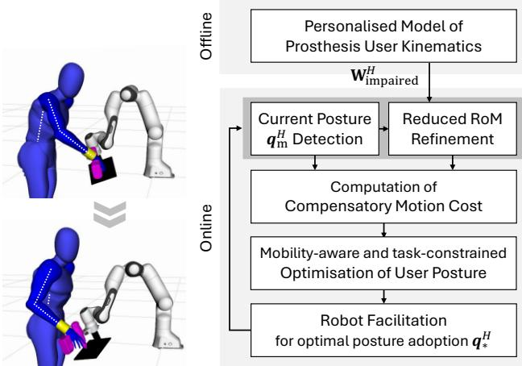

# 通过自适应协作机器人减轻假肢使用者的代偿运动

Marta Lagomarsino1, Robin Arbaud1,2, Francesco Tassi1, and Arash Ajoudani1

摘要—假肢使用者可以恢复部分肢体功能，但通常难以完全恢复自然的肢体活动能力，这往往会导致代偿运动，进而引起不适、效率低下以及长期的躯体劳损。为了解决这一问题，我们提出了一种新颖的人机协作框架，旨在通过利用假肢使用者残余的运动能力并尊重任务要求，从而减轻其上肢假肢使用中的代偿机制。我们的方法引入了一种个性化的活动能力模型，该模型可量化关节特异性的功能限制以及代偿运动的代价。该模型被集成到一个约束优化框架中，用于计算执行任务时的最佳用户姿态，在功能性与舒适性之间取得平衡。该解决方案可指导协作机器人重构任务环境，从而促进有效的交互。我们使用一种新型动力驱动（body-powered）假肢装置针对单指截肢进行了框架验证，该装置通过与手的协同闭合来增强抓握能力，但会对腕部施加约束。在让健康受试者将该假肢作为额外手指佩戴的初步实验中，结果表明：嵌入用户特定活动能力模型的机器人助手在交接任务中的表现优于人类搭档，既提高了假肢使用者抓握的效率，又减少了功能关节中的代偿运动。这些结果凸显了协作机器人在工作场所和护理场景中作为有效助手的潜力，能够促进包容性，并更好地将假肢装置融入日常任务中。

关键词—机器人辅助移动；人机界面与机器人应用

## I. 引言

肢体或手指的缺失对个体的身体能力和心理健康造成了深远的影响。假肢装置旨在通过恢复功能并帮助使用者重新获得日常生活与工作中的独立性来缓解这些问题。假肢可分为三大类：被动式（passive）、自身力源式（body-powered）以及外部动力式（externally powered）[1]。被动式装置主要侧重于恢复外观而非机械功能[2]，但它们仍可帮助恢复对向抓握能力[3]。相比之下，自身力源式装置利用另一块肌肉或肢体的运动来控制假肢，提供了一种机械上简单且功能直接的解决方案[4]、[1]。外部动力式装置则依赖执行器（通常为电动或气动）来恢复更精细的控制与灵巧性，但其代价是复杂性增加、依赖电源以及成本更高[6]。相比较而言，自身力源式装置由于其简单性和易用性，在功能性与可用性之间取得了良好的平衡。

尽管假肢具有诸多益处，它们仍远远无法复制自然肢体的完整功能[7]。它们常常对使用者的身体活动能力施加限制，导致代偿机制的出现，这可能涉及不舒适的非人体工学姿势或低效的运动模式[8]、[9]。这一点对于自身力源式系统而言尤为突出，因为该类系统在设计时就需要某些肌肉在完成其正常功能之外，额外参与假肢的控制[10]、[11]。随着时间的推移，这些代偿行为可能导致劳损、不适，甚至长期的躯体健康问题。不幸的是，此类挑战在假肢装置的设计与评估中经常被忽视。为了填补这一空白，研究人体运动学如何有效地适应残障与假肢的限制，为提升使用者舒适度、效率及整体体验提供了契机。

除了针对个人的适应性调整之外，假肢使用者所处的环境（如工作场所、护理机构和家庭）也可以被改造，以支持更符合人体工程学且更具功能性的交互。在此背景下，协作机器人（CoBots，Collaborative Robots）构成了一种有前景的解决方案 [12]。协作机器人已展现出通过在线调整交互姿态来改善身体人体工程学的能力 [13]，或在协同搬运与协同操作任务中优化共享的运动动力学（kino-dynamics）的能力 [14]、[15]。它们还已被证明能够通过调整协作机器人的接近度与响应性来促进认知人体工程学，从而平衡安全性、用户压力与生产力 [16]。尽管一些初步尝试旨在为有功能障碍的用户提供便利，但这些方法通常侧重于用机器人系统完全替代受损肢体的功能 [17]、[18]，或限制受损手臂在笛卡尔空间中的运动 [19]。然而，此类策略忽视了假肢使用者在关节层面与任务特定方面所面临的细微需求。此外，这些方法未能利用活动受限用户的残余功能，可能会强化其无能为力和挫败感。

本工作通过引入一种人机协作框架，在应对这些挑战方面迈出了崭新的一步，该框架支持上肢假肢使用者克服关节层面的局限性并利用其残余运动，同时避免有害的代偿机制。我们提出了假肢使用者关节特定功能局限性的模型，并量化了功能关节中代偿机制的成本。该模型为一项优化问题提供了依据，该问题在考虑任务约束的条件下，计算出以功能性强且舒适的方式执行协作任务的最佳用户姿态。该解决方案引导机器人重新配置任务环境，从而促进推荐姿态的采用。最后，我们展示了一种新型的用于单指截肢者的身体动力假肢装置（body-powered prosthetic device），旨在通过协同手部闭合来增强抓握能力，但对手腕运动构成约束。该装置作为验证所提方法的测试平台。

  

图1. 在遵守任务约束的前提下，评估假肢使用者活动多样性并减轻代偿性运动的流程概述。

论文的其余部分组织如下：第二节描述了上肢损伤的建模以及机器人辅助引导的优化问题构建，以最小化对活动受限关节的使用并减轻代偿机制相关的代价。第三节介绍了在交接任务中验证所提方法的实验活动。第四节讨论了结果并概述了未来工作的潜在方向。

## II. 方法

用于减轻上肢假肢使用者代偿运动的所提程序概述如图 1 所示。在离线阶段，我们首先建模使用者的活动多样性，并对数字模型进行缩放以自动匹配其特定的体测量数据。在交互阶段，我们持续监测假肢使用者的姿态，并最终根据建模的残余活动能力与假肢限制来更新关节活动范围（Range of Motion, RoM）。据此，我们计算当前的代偿运动代价，定义为功能关节偏离自然舒适姿态的程度。然后求解一个有约束的优化问题，以确定一个仍满足使用者活动约束与任务要求、更舒适且功能性的姿态。最后，规划一个机器人辅助运动，以促进使用者采用该姿态。

## A. 假肢使用者运动学模型

本研究通过为每个关节分配一个局部坐标系来建模假肢使用者的运动学，其中 $\mathrm { x - , \ y - , }$ 和 z- 轴分别定义外展/内收、屈/伸以及内/外旋的旋转轴，如文献 [20] 所述。为考虑手臂的运动学冗余，手臂被表示为一个具有七个自由度（Degrees-of-Freedom, DoF）的系统，记为 $\pmb q ^ { H } \in \mathbb { R } ^ { 7 }$，并由两个刚性连杆组成：上臂 $( l _ { \mathrm { h u m e r u s } } )$ 和前臂 $(  { l _ { \mathrm { r a d i u s } } } )$ [21]。

还在 L5 腰椎椎体上分配了一个坐标系，以通过第一个关节角 $q _ { 1 } ^ { H }$ 和连杆 $l _ { \mathrm { s p i n e } }$ 来表示脊柱屈曲。这一设置反映了文献中广泛记载的躯干运动增加作为代偿机制的作用 [11]。最终模型具有 M = 8 个自由度，其中与尺寸相关的参数可调整以适配不同的手臂和躯干尺寸。

肩部被建模为球窝关节，提供外展/内收 $( q _ { 2 } ^ { H } )$ 、屈曲/伸展 $( q _ { 3 } ^ { H } )$ 和内旋/外旋 $( q _ { 4 } ^ { \bar { H } } )$ 。肘部由铰链关节和旋转关节组成，允许前臂屈曲/伸展 $( q _ { 5 } ^ { H } )$ 和旋前/旋后 $( q _ { 6 } ^ { H } )$ )。最后，腕关节被表示为髁状关节，使手部能够屈曲/伸展 $( q _ { 7 } ^ { \overline { { { H } } } } )$ 和尺偏/桡偏 $( q _ { 8 } ^ { H } )$ 。表 I 给出了该运动学模型所使用的 Denavit-Hartenberg (DH) 参数。

表 I  
所采用的人体运动学模型的 DENAVIT-HARTENBERG 参数。

<table><tr><td>axis, i</td><td> $\pmb { \theta } _ { i }$ </td><td> $a _ { i }$ </td><td>αi</td><td> $d _ { i }$ </td></tr><tr><td>1</td><td> $q _ { 1 } ^ { H }$ </td><td> $l _ { \mathrm { s p i n e } } ^ { z }$ </td><td></td><td> $\boldsymbol { \cdot } \boldsymbol { l } _ { \mathrm { s p i n e } } ^ { y }$ </td></tr><tr><td>2</td><td> $q _ { 2 } ^ { H }$ </td><td>0</td><td></td><td>一  $\boldsymbol { l } _ { \mathrm { s p i n e } } ^ { x }$ </td></tr><tr><td>3</td><td> $q _ { 3 } ^ { H } + \frac { \pi } { 2 }$ </td><td>0</td><td>π2π|2元|2元|2元|2元|2元|20</td><td>0</td></tr><tr><td>4</td><td> $\smash { \sum _ { d = 1 } ^ { 2 } \frac { 2 } { \pi } }$   $q _ { 4 } ^ { H } \mathrm { - } \frac { \bar { \pi } } { 2 }$   $q _ { 4 } ^ { - } - \overline { { { 2 } } }$ </td><td> $- \ l _ { \mathrm { h u m e r u s } } ^ { x }$ </td><td></td><td> $- \ l _ { \mathrm { h u m e r u s } } ^ { z }$ </td></tr><tr><td>5</td><td> $q _ { 5 } ^ { H } { + } \overline { { \pi } }$ </td><td>0</td><td></td><td> $- \ l _ { \mathrm { h u m e r u s } } ^ { y }$ </td></tr><tr><td>6</td><td> $q _ { 6 } ^ { H } + \frac { \pi } { 2 }$ </td><td> $- ~ l _ { \mathrm { r a d i u s } } ^ { y }$ </td><td></td><td> $- \mathrm { \Delta } l _ { \mathrm { r a d i u s } } ^ { z }$ </td></tr><tr><td>7</td><td> $^ { 4 6 } _ { H \cdot } \ ^ { \mathrm { ~ \tiny ~ { ~ 2 ~ } ~ } }$   $q _ { 7 } ^ { \pi } + \frac { \pi } { 2 }$ </td><td>0</td><td></td><td> $- \ l _ { \mathrm { r a d i u s } } ^ { x }$ </td></tr><tr><td>hand</td><td> $q _ { 8 } ^ { H }$ </td><td>0</td><td></td><td>0</td></tr></table>

假肢通过恢复部分功能来辅助使用者，尽管它们可能无法完全复制自然肢体的活动能力，并且会对周围关节施加限制。例如，佩戴部分手部假肢可能会限制腕关节的活动，这可能导致肘部和/或肩部出现代偿性运动。为了在模型中捕捉这些约束，我们定义一个对角矩阵，$\mathbf { W } _ { \mathrm { i m p a i r e d } } ^ { H } \in \mathbb { R } ^ { M \times M }$。该矩阵通过优先保证健康或由假肢支持关节的运动，同时减少或完全限制受损或被锁定关节的活动度，来修改运动学模型。这为建模关节的部分或完全损伤提供了灵活性。对于完全丧失功能的关节，我们设 $\mathbf { W } _ { \mathrm { i m p a i r e d } } ^ { H } ( i , i ) = \mathbf { \bar { 1 } }$，而部分受损的关节则按比例进行定义，以反映除非必要否则优先减少使用的偏好。在临床实践中，标准化的损伤指数被用于评估关节炎、损伤或神经损伤等病症患者的关节功能 [22]。这些指数可应用于在 $\mathbf { W } _ { \mathrm { i m p a i r e d } } ^ { H }$ 内定义具体的关节限制，有助于将运动学模型个性化，以适应每位假肢使用者的特定需求与能力。

量化时刻 $k$ 处代偿机制影响的代价 $\Psi ( k ) \in \mathbb { R }$ 由下式计算：

$$
\boldsymbol { \Psi } [ k ] = \left. \left( \mathbf { I } - \mathbf { W } _ { \mathrm { i m p a i r e d } } ^ { H } \right) \left( \pmb { q } ^ { H } [ k ] - \pmb { q } _ { \mathrm { n } } ^ { H } \right) \right. ^ { 2 } ,\tag{1}
$$

其中 $\pmb { q } _ { \mathrm { n } } ^ { H }$ 表示自然姿势，代表用户一种中性且舒适的手臂/躯干构型。该代价衡量了功能正常的关节相对于该自然姿势的偏离程度。它与文献中已建立的度量指标（如"瞬时关节使用度"或"人因工程成本"）[23]、[13] 相一致，但在此通过引入考虑各关节期望活动度的权重（即矩阵 $\left( \mathbf { I } - \mathbf { W } _ { \mathrm { i m p a i r e d } } ^ { H } \right)$ ）对其进行了细化。这一改进提供了一种更为精确且个性化的评估方法，用于衡量与舒适和功能性姿势的对齐程度，能够针对用户的特定损伤和需求进行定制。

## B. 针对假肢用户的机器人反应式辅助

机器人反应式辅助的目标是以更有效的方式引导假肢用户完成交互任务，避免其采用非自然姿势来代偿由假肢所施加或未能完全解决的约束。为此，机器人生成旨在促进用户采纳所推荐构型的运动。该最优姿势最小化部分受损关节的使用度，完全限制锁定关节的运动，并在整个交互过程中促进健康零空间关节与舒适且功能性姿势的对齐。

机器人的反应式行为被建模为一个在线优化问题，该问题综合考虑用户的受损活动度、运动学约束、任务需求以及安全距离阈值。该优化由以下代价函数与约束构成：

$$
\begin{array} { r l r } { \underset { \boldsymbol { q } ^ { H } } { \operatorname* { m i n } } } & { \left\| \mathbf { W } _ { \mathrm { i m p a i r e d } } ^ { H } \left( \boldsymbol { q } ^ { H } - \boldsymbol { q } _ { \mathrm { m } } ^ { H } \right) \right\| ^ { 2 } + \alpha \left\| \left( \mathbf { I } - \mathbf { W } _ { \mathrm { i m p a i r e d } } ^ { H } \right) \left( \boldsymbol { q } ^ { H } - \boldsymbol { q } _ { \mathrm { n } } ^ { H } \right) \right\| } \\ { \mathrm { s . t . } } & { \boldsymbol { q } ^ { H } \in [ \boldsymbol { q } _ { \mathrm { m i n , i m p a i r e d } } ^ { H } , \boldsymbol { q } _ { \mathrm { m a x , i m p a i r e d } } ^ { H } ] , } \\ & { } & { x _ { \mathrm { o b j } } ( \boldsymbol { q } ^ { H } ) \in \chi _ { \mathrm { t a x k } } ^ { R } , } \\ & { } & { p _ { \mathrm { o b j } } ( \boldsymbol { q } ^ { H } ) = p _ { \mathrm { t a x k } } , } \\ & { } & { d _ { \mathrm { o b j } } ^ { H } \geq d _ { \mathrm { s a f e ~ t h } } , } \\ & { } & { d _ { \mathrm { e l l o w } } ^ { H } \geq d _ { \mathrm { e l b o w ~ t h } } , } \end{array}
$$

其中 $q_m^H$ 是当前测量的人体姿态，$\mathbf{q}_n^H$ 表示健康个体的自然舒适姿态。在成本函数中，第一项旨在最小化完全或部分受损关节相对于其当前构型的偏差。该目标通过矩阵 $\mathbf{W}_{\mathrm{impaired}}^H$ 实现，该矩阵根据每个关节功能受限的严重程度对平方距离进行加权，从而优先最小化受损更严重关节的位移。第二项则最小化代偿机制的成本 $\Psi$，即功能正常关节相对于名义上最舒适的手臂/躯干构型的平方距离，并按其期望的活动能力进行加权。参数 $\alpha \in \mathbb{R}$ 是一个缩放因子，用于降低第二项的重要性。这反映了在维持受损关节当前位置优先性的同时，轻微地促进健康的、无约束关节的舒适定位。

优化约束确保关节角度 $\mathbf{q}^H$ 保持在可行的受损范围内，该范围通过对标准活动范围（Range of Motion，RoM）进行缩减以考虑用户特定的损伤而得出。对于假肢使用者，这一缩减通过使用矩阵 $\mathbf{W}_{\mathrm{impaired}}^H$ 修正健康关节边界 $\mathbf{q}_{\mathrm{mir}}^H$ 和 $\mathbf{q}_{\mathrm{max}}^H$ 来建模，如下所示：

$$
\begin{array} { r l } & { \pmb { q } _ { \mathrm { m i n , i m p a i r e d } } ^ { H } = \pmb { q } _ { \mathrm { m i n } } ^ { H } + \pmb { \mathrm { \bf W } } _ { \mathrm { i m p a i r e d } } ^ { H } \big ( ( \pmb { q } _ { \mathrm { m } } ^ { H } - \zeta ) - \pmb { q } _ { \mathrm { m i n } } ^ { H } \big ) , } \\ & { \pmb { q } _ { \mathrm { m a x , i m p a i r e d } } ^ { H } = \pmb { q } _ { \mathrm { m a x } } ^ { H } - \pmb { \mathrm { \bf W } } _ { \mathrm { i m p a i r e d } } ^ { H } \big ( \pmb { q } _ { \mathrm { m a x } } ^ { H } - ( \pmb { q } _ { \mathrm { m } } ^ { H } + \zeta ) \big ) , } \end{array}\tag{3}
$$

其中参数 $\zeta \in \mathbb { R }$ 允许在关节角度上进行小幅调整，即使在严重受损的关节中也是如此。任务特定约束确保物体或工具的位置 $\pmb { x } _ { \mathrm { o b j } }$（在与环境的交互过程中将位于人的手中，即 ${ \pmb x } _ { \mathrm { 0 b j } } = { \pmb x } _ { \mathrm { 0 b j } } ( { \pmb q } ^ { H } )$）位于机器人的任务空间 $\dot { x } _ { \mathrm { t a s k } } ^ { R }$ 内，并满足任务目标。具体而言，我们考虑对特定笛卡尔坐标 $p _ { \mathrm { o b j } } =$ $\{ x _ { \mathrm { o b j } } ; y _ { \mathrm { o b j } } ; z _ { \mathrm { o b j } } \} \ \in \ \mathbb { R }$ 施加等式约束以匹配任务需求 ptask。最后，物体与用户身体之间的水平距离 $d _ { \mathrm { o b j } } ^ { H } \in \mathbb { R }$ 必须超过安全阈值 $d _ { \mathrm { s a f e \ t h } }$，并且用户肘部与骨盆之间的水平距离 $d _ { \mathrm { e l b o w } } ^ { H }$ 必须超过 $d _ { \mathrm { e l b o w \ t h } }$，以确保合适的肘部姿态。

## C. 手指假肢系统

在本工作中，我们介绍了一种新型的体动力手指假肢装置，专门设计用于增强单指截肢个体的抓握功能，其具有机械耦合机制，能够实现与手的协同闭合。该假肢具有一个欠驱动的 3 关节手指，其运动由单一肌腱控制。当肌腱未被主动拉动时，弹性元件将手指带回打开位置。如图 2 所示，我们围绕一个腕部支具构建了一个可穿戴原型，并附加了一个 3D 打印部件。该部件固定一个滑轮，肌腱通过该滑轮重新布线。肌腱的另一端连接到一个环上，用户需要将其戴在控制假肢的手指上。弯曲该手指将拉动肌腱并使假肢弯曲。此外，可以通过改变滑轮的位置来使用丝杠机制来调节肌腱的预紧力。为了测试目的，我们将所设计的假肢安装为放置在食指附近的额外手指（supernumerary finger）。这种配置允许非残障人士模拟假肢使用者的体验。

需要注意的是，虽然假肢增强了抓握功能，但它也对腕关节屈伸和尺偏/桡偏施加了限制。这些限制可以通过将 $\mathbf { W } _ { \mathrm { i m p a i r e d } } ^ { H }$ 的最后两个对角元素设置为 1 来编码，从而向优化过程告知腕部被固定的信息。

  

图 2. 用于测试所提出的体驱动假肢作为额外手指的可穿戴原型图。

## III. 实验（EXPERIMENTS）

## A. 实验设置与流程

实验由两名健康的被试参与，旨在评估所提方法在促进与假肢装置实现功能性且舒适的交互方面的有效性1。被试包括：被试 1，29 岁男性，身高 1.83 m；以及被试 2，28 岁女性，身高 1.58 m。特意选取了不同的身体特征，以验证该方法对多样化人体测量学特征的适应能力。

实验任务要求被试抓握一把热熔胶枪，该胶枪位于其骨盆的不同横向距离处，即 $y _ { \mathrm { t a s k } } = \{ 0 . 0 5 \mathrm { m } ; - 0 . 2 0 \mathrm { m } ; - 0 . 4 5 \mathrm { m } \}$ 。为模拟一个较为真实的假肢使用场景，被试在执行任务时佩戴了所提出的假肢装置，并将其配置为一只额外的（supernumerary）手指（参见图 2）。在任务开始前，被试经历了一段与假肢的熟悉阶段。实验装置包括一张位于假肢使用者前方的桌子，桌上用胶带标记出三条线，分别表示物体可能送达的潜在横向方向。健康关节活动范围（RoM）取自文献 [24]，而名义上的假肢使用者姿态 ${ \boldsymbol { q } } _ { \mathrm { n } } ^ { H }$ 则根据快速上肢评估（Rapid Upper Limb Assessment, RULA）工具 [25] 定义为最符合人体工学的姿态，其中肘部屈曲 $9 0 °$，其余所有关节角度均设为 $0 ^ { \circ }$ 。相关参数设定如下：$\alpha = 0 . 1 0$，$\zeta = 5 ^ { \circ }$，距人体骨盆的安全距离阈值 $d _ { \mathrm { s a f e t h } } = 0 . 2 0 \mathrm { m }$，以及肘部距离阈值 $d _ { \mathrm { e l b o w \ t h } } = 0 . 2 5 \mathrm { m }$

实验包含两个环节：人类传递（Human Passing, HP）和机器人传递（Robot Passing, RP）。在 HP 环节中，由一名人类被试在每个横向距离 $y _ { \mathrm { t a r k } }$（译注：原文为 $y _ { \mathrm { t a s k } }$）处将物体传递给假肢使用者一次，以模拟工业场景中人类同事或在辅助场景中照护者参与的传统交接情境。该条件下共招募了五名健康的物体传递者（四名男性和一名女性，年龄 28.2±2.4 岁）。在 RP 环节中，任务由一台 Franka Emika Panda 机械臂协作完成，其控制频率为 1 kHz，并配备 Robotiq 2-Finger Gripper 2F-85 夹爪。机器人通过求解式（2）所定义的约束优化问题在线优化物体交接姿态，优化方法采用 ALGLIB 库2 中的增广拉格朗日（Augmented Lagrangian）方法，并在 C++ 环境中实现。为保证执行过程的平稳性，通过生成一条 B 样条轨迹以到达优化后的交接姿态，并由机器人笛卡尔阻抗控制器进行跟踪，其实现方式与文献 [16] 一致。机器人在不同的 $y _ { \mathrm { t a s k } }$ 处各重复进行五次物体传递，以保证对比的一致性

在 HP 条件下进行比较。

我们使用了一套可穿戴的 MVN Biomech 套装（Xsens Tech.BV），该套装配备有惯性测量单元（IMU）传感器，用于测量身体节段长度并自动为受试者个性化运动学模型与数字人体模型网格。运动捕捉系统在实验过程中持续追踪假肢使用者的运动。事后统计分析对比了机器人辅助（RP）条件与基线人工传递（HP）条件的有效性，重点关注在机器人行为中嵌入用户损伤模型所产生的影响。首先，对所采集的数据采用 Anderson-Darling 检验进行正态性检验。若确认数据服从正态分布，则进行重复测量方差分析（ANOVA）；在正态性未获确认的情况下，则采用非参数 Friedman 检验评估组间显著差异。针对假肢使用者的运动计算了三项性能指标：

• 任务时长（Task duration，$T_f$）：假肢使用者完成接近与抓取阶段所花费的时间，从抓取主体首次产生动作时起测量，直至其完全掌控住物体为止；

• 正常关节使用率（Functioning joints usage，$\bar{\Psi}$）：在时长 $T_f$ 期间（时间采样 $k=1,\dots,K_f$）按下式计算：

$$
\bar { \Psi } = \frac { 1 } { K _ { f } } \sum _ { k = 1 } ^ { K _ { f } } \Psi [ k ] ,\tag{4}
$$

其中 $\Psi [ k ]$ 是由功能正常的关节执行的代偿机制所产生的代价，如式 (1) 所定义；

• 关节运动平滑度（J）：定义如下：

$$
J = \Delta t \sum _ { k = 1 } ^ { K _ { f } } \| \ddot { \pmb q } _ { \mathrm { m } } ^ { H } [ k ] \| ^ { 2 } ,\tag{5}
$$

where $\Delta t$ is the data sampling rate of the Xsens system and $\because \pmb { q } _ { \mathrm { ~ m ~ } } ^ { H } \in \mathbb { R } ^ { M }$ is the joint jerk vector derived numerically from joint velocity measurements.

## B. 实验结果

图 3 展示了中指与额外假指（supernumerary prosthetic finger）在运动中的连续帧，用以说明由耦合机制所实现的渐进式屈曲运动。

针对特定假肢使用者定制的移动感知优化（mobility-aware optimisation）结果如图 4 所示，揭示了其在不同身体特征与任务约束下有效配置人机交互的能力。数字模型根据运动追踪数据被自动缩放，以匹配两位使用者的人体测量学特征。机器人遵循了任务要求，即与使用者骨盆保持不同的横向距离，并遵守特定于任务的目标物体定位区域（图中以绿色平面标示）。更重要的是，机器人调整了交接物体的位姿，从而完全消除腕部运动并减轻代偿性运动。每个子图还报告了在理想情形下（即人体采取由优化所得的最优姿态）代偿性机制所对应的代价 $\Psi$。

  

图 3. 用户手指与假肢手指协调屈曲运动的示意图。

图 5 比较了由参与者 3 主导的人-假肢使用者交接场景（HP）与优化后的机器人交接（RP）。尽管人体传球者旨在促进假肢使用者的抓握，但由此产生的物体传递位姿仍因腕部阻挡而要求使用者做出显著的代偿性动作。具体而言，如图 5 左下图所示，假肢使用者表现出更大的肘部屈曲（紫色线）、明显的肩部屈曲（橙色线）以及抬高的肘部姿态，这进一步引发了更大的肩部外旋（黄色线）和前臂旋前（绿色线）。此外，假肢使用者需要约一秒钟才能在此构型下稳定假肢的抓握。同时，运动起始阶段的犹豫表明运动规划所涉及的神经机制需求略有增加，这一点也得到了假肢使用者的自述印证。相比之下，针对假肢使用者的活动受限情况而量身定制的优化机器人交接，实现了一种更易获取且更高效的抓握。机器人的辅助引导使用者采用了一种与通过考虑活动能力的优化问题所获得的优化构型 $\pmb { q } _ { * } ^ { H }$ 高度吻合的姿态（在图 5 右下图中以虚线绘出）。虽然优化后的姿态建议更多地依赖肘部屈曲并减少肩部屈曲，但使用者实际采用的构型在肘部与肩部之间具有更为均衡的屈曲分配。尽管由于使用者对冗余自由度采用了略有不同的解析方式而产生了上述细微偏差，但与 HP 条件相比，优化后的机器人辅助显著降低了在交互位姿处以及整个接近阶段中的代偿性动作代价 Ψ。

  

图 4. 在桌面上距人体骨盆不同横向距离处，针对不同人体测量数据优化的机器人向假肢用户交接配置。

  

图 5. 由参与者完成的人向假肢使用者交接（HP）与针对假肢使用者行动能力受限而优化的机器人交接（RP）的比较。

  

图 6. 人类传递（human passing，HP）与机器人传递（robotic passing，RP）条件之间的统计比较：（左）接近阶段的持续时间，表明机器人交接中效率的提升；（右）接近阶段内代偿性运动的平均代价 Ψ¯，突显出功能性关节使用的减少。显著性水平标示为 $^ { * * } p < 0 . 0 1$

对所有测试的 $y_{\mathrm{task}}$ 值在 HP 与 $RP$ 条件下进行的统计分析表明，机器人辅助交接显著提升了假肢使用者抓握的效率与舒适度。事实上，接近阶段的时长出现了显著缩短，如图 6 左侧箱线图所示。此外，在交互姿态下测得的与代偿性运动相关的代价 $\Psi(t_{\mathrm{interaction}})$，以及代表功能关节使用情况的平均代价 $\bar{\Psi}$，均出现了显著下降，如图 6 右侧箱线图所示。如预期的那样，在两种交接条件下，腕部关节位移的范数均始终接近零。然而，在 HP 条件下，腕部位移偶尔会达到 $6^{\circ}$，这表明在某些情况下假肢使用者不得不违背腕部约束以完成抓握。在关节运动平滑度方面，接近阶段内关节急动度平方的积分（J）未以箱线图形式呈现，原因在于监测系统与数值求导所引入的数值波动，但两种条件（HP 与 RP）之间的比较仍给出了一致而有意义的结论。在机器人辅助交接条件下，J 值显著下降了 52.7%（$p<0.01$），表明抓握接近过程更为平滑流畅。

## IV. 讨论与结论

在本研究中，我们提出了一种新颖的在线方法，用于减轻手臂活动受限假肢使用者的代偿运动，这是一个常被忽视却可能导致长期伤害的问题。我们的方法包括为假肢使用者建立个性化的活动能力模型，并将其集成到一个约束优化框架中。该框架综合考虑任务需求，以功能性和舒适性的方式计算出执行任务时的最佳用户姿态，并将该信息传递给机器人，机器人据此重新配置任务以促进用户采用此种姿态。在健康受试者中使用所提出的自身力源驱动手指假肢作为额外手指（supernumerary finger）的初步结果表明，嵌入了用户专属活动能力模型的机器人助手优于人类伙伴。在交接任务中，使用者健全关节的代偿运动有所减少，假肢使用者的抓握效率也得到了提升。这些发现对于将协作机器人引入工作场所和护理辅助场景、促进包容性以及推动假肢装置无缝融入使用者的日常生活具有重要意义。尽管结果令人鼓舞，我们观察到使用者解决关节冗余使用问题的方式存在一定偏差，导致表现略有差异。未来的工作将着重于为使用者配置其健全关节提供指导，可能通过在我们的仿真中开发的视觉反馈界面或振动触觉反馈系统 [26] 来实现。此外，我们计划使用处理更复杂截肢情况（如涉及肘部的截肢）的假肢装置来测试该框架，并考虑部分损伤的情况。最后，我们旨在将该框架扩展到更复杂的交互任务中，进一步评估其在多样化现实场景中提升假肢装置可用性的潜力。

## 参考文献

[1] I. Imbinto, C. Peccia, M. Controzzi, A. G. Cutti, A. Davalli, R. Sacchetti, 和 C. Cipriani，"部分手截肢的治疗：工程视角"，IEEE reviews in biomedical engineering，第 9 卷，第 32–48 页，2016 年。

[2] M. C. Goiato, D. N. Mancuso, P. M. Ferreira, 和 D. M. Dos Santos，"手指假肢：重建的艺术"，J Coll Physicians Surg Pak，第 19 卷，第 10 期，第 670–671 页，2009 年。

[3] C. M. Fraser，"单侧上肢截肢者对装饰性与功能性假肢使用情况的评估"，Prosthetics and Orthotics International，第 22 卷，第 3 期，第 216–223 页，1998 年。

[4] S. L. Carey, D. J. Lura, 和 M. J. Highsmith，"肌电与自身力源驱动上肢假肢的差异：系统性文献综述"，Journal of Rehabilitation Research & Development，第 52 卷，第 3 期，2015 年。

[5] G. Milazzo, S. Lemerle, G. Grioli, A. Bicchi, 和 M. G. Catalano，"可变刚度假肢肘关节的设计、表征与验证"，IEEE Transactions on Robotics，2024 年。

[6] A. Marinelli, N. Boccardo, F. Tessari, D. Di Domenico, G. Caserta, M. Canepa, G. Gini, G. Barresi, M. Laffranchi, and L. De Michieli, "主动式上肢假肢：当前现状与即将到来的突破综述," *Progress in Biomedical Engineering*, 卷 5, 第 1 期, 页 012001, 2023.

[7] M. Bumbaširevic, A. Lesic, T. Palibrk, D. Milovanovic, M. Zoka, ´ T. Kravic-Stevovi´ c, and S. Raspopovic, "从外科医生视角看仿生肢体的现状," *EFORT Open Reviews*, 卷 5, 第 2 期, 页 65–72, 2020.

[8] S. L. Carey, M. J. Highsmith, M. E. Maitland, and R. V. Dubey, "前臂截肢假肢使用者在日常任务中的代偿运动," *Clinical Biomechanics*, 卷 23, 第 9 期, 页 1128–1135, 2008.

[9] A. J. Metzger, A. W. Dromerick, R. J. Holley, and P. S. Lum, "假肢上肢够取任务中代偿性躯干运动的特征分析," *Archives of Physical Medicine and Rehabilitation*, 卷 93, 第 11 期, 页 2029–2034, 2012.

[10] S. M. Engdahl, C. Lee, and D. H. Gates, "日常活动中体动力假肢使用者与肌电假肢使用者代偿运动的比较," *Clinical Biomechanics*, 卷 97, 页 105713, 2022.

[11] A. M. Valevicius, Q. A. Boser, C. S. Chapman, P. M. Pilarski, A. H. Vette, and J. S. Hebert, "体动力假肢使用者的代偿策略揭示其主要依赖躯干运动并与技能水平相关," *Clinical Biomechanics*, 卷 72, 页 122–129, 2020.

[12] A. Nanavati, V. Ranganeni, and M. Cakmak, "物理辅助机器人：面向身体辅助残障人士的移动与操作机器人的系统综述," *Annual Review of Control, Robotics, and Autonomous Systems*, 卷 7, 页 123–147, 2024.

[13] A. Bestick, R. Pandya, R. Bajcsy, and A. Dragan, "学习人类在物体交接中的工效学偏好," 发表于 *IEEE International Conference on Robotics and Automation (ICRA)*, 2018, 页 3257–3264.

[14] W. Kim, M. Lorenzini, P. Balatti, P. Nguyen, U. Pattacini, V. Tikhanoff, L. Peternel, C. Fantacci, L. Natale, G. Metta, and A. Ajoudani, "人机协作的自适应工作站：改善工人工效学与生产力的可重构框架," *IEEE Robotics & Automation Magazine*, 页 14–26, 2019.

[15] F. Ferraguti, R. Villa, C. T. Landi, A. M. Zanchettin, P. Rocco, and C. Secchi, "物理与工效学人机协作的统一架构," *Robotica*, 卷 38, 第 4 期, 页 669–683, 2020.

[16] M. Lagomarsino, M. Lorenzini, E. De Momi, and A. Ajoudani, "PRO-MIND：工业场景下通过优化机器人运动的接近性与反应性来调节安全极限、人类压力与生产率," *IEEE Transactions on Robotics*, 卷 41, 页 2067–2085, 2025.

[17] D. Torielli, L. Bertoni, L. Muratore, and N. Tsagarakis, "用于向上肢残障人士提供有效机器人辅助的激光引导交互界面," *IEEE Robotics and Automation Letters*, 2024.

[18] S. Poirier, F. Routhier, and A. Campeau-Lecours, "Voice control interface prototype for assistive robots for people living with upper limb disabilities," in Proceedings of International Conference on Rehabilitation Robotics (ICORR). IEEE, 2019, pp. 46–52.

[18] S. Poirier, F. Routhier, 和 A. Campeau-Lecours，"面向上肢残障人士辅助机器人的语音控制接口原型，"载于《国际康复机器人会议论文集》（Proceedings of International Conference on Rehabilitation Robotics, ICORR）。IEEE，2019 年，第 46–52 页。

[19] P. Ardon, M. E. Cabrera, E. Pairet, R. P. A. Petrick, S. Ramamoorthy, K. S. Lohan, and M. Cakmak, "Affordance-aware handovers with human arm mobility constraints," IEEE Robotics and Automation Letters, pp. 3136–3143, 2021.

[19] P. Ardon, M. E. Cabrera, E. Pairet, R. P. A. Petrick, S. Ramamoorthy, K. S. Lohan, 和 M. Cakmak，"考虑人体手臂运动约束的可供性感知物体交接，"《IEEE 机器人与自动化快报》（IEEE Robotics and Automation Letters），2021 年，第 3136–3143 页。

[20] M. Leonori, M. Lorenzini, L. Fortini, J. M. Gandarias, and A. Ajoudani, "The bridge between xsens motion-capture and robot operating system (ros): Enabling robots with online 3d human motion tracking," arXiv preprint arXiv:2306.17738, 2023.

[20] M. Leonori, M. Lorenzini, L. Fortini, J. M. Gandarias, 和 A. Ajoudani，"Xsens 动作捕捉系统与机器人操作系统（ROS）之间的桥梁：赋予机器人在线三维人体运动跟踪能力，"arXiv 预印本 arXiv:2306.17738，2023 年。

[21] A. Bertomeu-Motos, A. Blanco, F. J. Badesa, J. A. Barios, L. Zollo, and N. Garcia-Aracil, "Human arm joints reconstruction algorithm in rehabilitation therapies assisted by end-effector robotic devices," Journal of NeuroEngineering and Rehabilitation, pp. 1–11, 2018.

[21] A. Bertomeu-Motos, A. Blanco, F. J. Badesa, J. A. Barios, L. Zollo, 和 N. Garcia-Aracil，"末端执行器式机器人在康复治疗中辅助的人体手臂关节重建算法，"《神经工程与康复杂志》（Journal of NeuroEngineering and Rehabilitation），2018 年，第 1–11 页。

[22] R. D. Rondinelli, E. Genovese, R. T. Katz, T. G. Mayer, K. L. Mueller, M. I. Ranavaya, and C. R. Brigham, "Ama guides® to the evaluation of permanent impairment, 2023," in AMA Guides® to the Evaluation of Permanent Impairment. American Medical Association, 2023.

[22] R. D. Rondinelli, E. Genovese, R. T. Katz, T. G. Mayer, K. L. Mueller, M. I. Ranavaya, 和 C. R. Brigham，"AMA 永久性损伤评估指南，2023，"载于《AMA 永久性损伤评估指南》（AMA Guides® to the Evaluation of Permanent Impairment）。美国医学会（American Medical Association），2023 年。

[23] S. Gholami, M. Lorenzini, E. De Momi, and A. Ajoudani, "Quantitative physical ergonomics assessment of teleoperation interfaces," IEEE Transactions on Human-Machine Systems, pp. 169–180, 2022.

[23] S. Gholami, M. Lorenzini, E. De Momi, 和 A. Ajoudani，"远程操作界面的定量物理人因工程学评估，"《IEEE 人机系统汇刊》（IEEE Transactions on Human-Machine Systems），2022 年，第 169–180 页。

[24] M. Whitmore, J. Boyer, and K. Holubec, "Nasa-std-3001, space flight human-system standard and the human integration design handbook," in Industrial and systems engineering research conference, 2012.

[24] M. Whitmore, J. Boyer, 和 K. Holubec，"NASA-STD-3001 航天飞行人系统标准与人集成设计手册，"载于《工业与系统工程研究会议》（Industrial and Systems Engineering Research Conference），2012 年。

[25] L. McAtamney and N. Corlett, "Rapid upper limb assessment (rula)," in Handbook of human factors and ergonomics methods. CRC Press, 2004, pp. 86–96.

[25] L. McAtamney 和 N. Corlett，"快速上肢评估（RULA），"载于《人因与人体工程学方法手册》（Handbook of Human Factors and Ergonomics Methods）。CRC 出版社，2004 年，第 86–96 页。

[26] M. Lorenzini, S. Ciotti, J. M. Gandarias, S. Fani, M. Bianchi, and A. Ajoudani, "Performance analysis of vibrotactile and slide-and-squeeze haptic feedback devices for limbs postural adjustment," in Proceedings of International Symposium on Robot and Human Interactive Communication (RO-MAN). IEEE, 2022, pp. 707–713.

[26] M. Lorenzini, S. Ciotti, J. M. Gandarias, S. Fani, M. Bianchi, 和 A. Ajoudani，"用于肢体姿态调整的振动触觉与滑动按压式触觉反馈装置性能分析，"载于《机器人与人际交互通信国际研讨会论文集》（Proceedings of International Symposium on Robot and Human Interactive Communication, RO-MAN）。IEEE，2022 年，第 707–713 页。