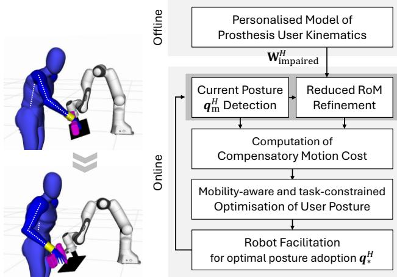
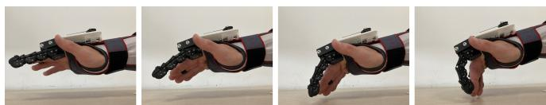
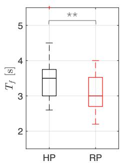
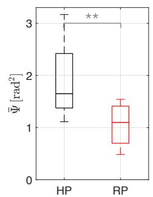

# 通过自适应协作机器人减轻假肢使用者的代偿运动

Marta Lagomarsino1, Robin Arbaud1,2, Francesco Tassi1, and Arash Ajoudani1

摘要— 假肢使用者可以恢复部分肢体功能，然而，完全自然的肢体活动度却极少能够恢复，往往导致代偿性运动，进而引发不适、低效和长期的身体劳损。为了解决这一问题，我们提出了一种新颖的人机协作框架，通过在满足任务需求的同时利用上肢假肢使用者的残余运动能力，来减轻其代偿机制。我们的方法引入了个性化活动度模型，用于量化特定关节的功能受限程度以及代偿运动的代价。该模型被集成到一个约束优化框架中，用于计算执行任务时的最优用户姿态，从而兼顾功能性与舒适度。该求解方案引导协作机器人重构任务环境，以促进高效的交互。我们利用一种用于单指截肢的新型体控假肢装置验证了该框架，该装置通过与手部的协同闭合增强了抓握能力，但对腕部造成了约束。在健康受试者佩戴该假肢作为额外手指（supernumerary finger）进行的初步实验表明，嵌入用户特定活动度模型的机器人助手在物品交接任务中的表现优于人类搭档，不仅提高了假肢使用者的抓握效率，还减少了正常功能关节的代偿运动。这些结果突显了协作机器人作为高效的工作场所和护理助手的潜力，促进了包容性以及假肢装置在日常任务中更好的融合。

索引词— 机器人辅助运动能力；人机界面与机器人应用

## I. 引言

肢体或指（趾）的缺失会严重影响个人的身体功能与心理健康。假肢装置旨在通过恢复功能来减轻这些问题，使使用者能够在日常生活和工作相关活动中重新获得独立性。假肢可分为三类：被动型（passive）、自身动力型（body-powered）和外部动力型（externally powered）[1]。被动型假肢主要注重恢复外观而非机械功能 [2]，然而，它们仍有助于恢复对指抓握能力 [3]。相比之下，自身动力型假肢利用另一肌肉或肢体的运动来控制假肢，提供了一种机械和功能上较为简单的解决方案 [4], [1]。外部动力型假肢依靠执行器（通常为电动或气动）来恢复更精细的控制和灵巧度，但其代价是复杂度增加、对电源产生依赖以及费用更高 [5], [6]。相比之下，自身动力型假肢因其简单性和直观的使用方式，在功能性与可用性之间取得了良好的平衡。

尽管假肢具有诸多优势，但仍远未完全复现天然肢体的全部功能 [7]。它们通常会对使用者的身体活动能力造成限制，从而引发代偿机制，其中可能涉及不舒适的非人机工程学姿势或低效的运动模式 [8], [9]。对于自身动力型系统而言尤其如此，因为其设计要求某些肌肉在其正常用途之外还要用于控制假肢 [10], [11]。随着时间的推移，这些代偿可能会导致劳损、不适甚至长期的身体问题。遗憾的是，此类挑战在假肢装置的设计和评估中常常被忽视。为了弥补这一差距，研究人体运动学如何有效适应残余功能损伤和假肢局限性，为提高使用者的舒适度、效率及整体体验提供了契机。

除了个体层面的适应之外，假肢使用者所处的环境（如工作场所、护理机构和家庭）也可以进行改造，以支持更符合人体工学且更具功能性的交互。在这种背景下，协作机器人（CoBots）构成了一种极具前景的解决方案 [12]。协作机器人已展示出通过在线自适应交互姿态 [13] 或在共同搬运和共同操作任务中优化共享运动-动力学 [14], [15] 来改善身体人体工学特性的能力。它们还被证明可以通过调整机器人的接近程度和反应能力来平衡安全性、用户压力和生产力，从而提升认知人体工学特性 [16]。尽管一些初步尝试旨在帮助有身体功能障碍的用户完成任务，但这些方法通常侧重于使用机器人系统完全替代受损肢体的功能 [17], [18]，或在笛卡尔空间中限制受损手臂的运动 [19]。然而，这些策略忽略了面临关节层面和特定任务约束的假肢使用者的细微需求。此外，这些方法未能充分利用行动受限用户的残余功能，可能加剧用户的无能感和挫败感。

为了应对这些挑战，本研究迈出了创新的一步，引入了一种人机协作框架，该框架支持上肢假肢使用者克服关节层面的局限性并利用其残余运动能力，同时避免有害的代偿机制。我们提出了一个假肢使用者特定关节功能局限性的模型，并量化了功能正常关节中代偿机制的代价。该模型为优化问题提供了依据，该优化问题在考虑任务约束的前提下，计算出以具功能性且舒适的方式执行协作任务的最优用户姿态。该优化解引导机器人重新配置任务环境，从而促使用户采用推荐的姿态。最后，我们展示了一种针对单指截肢者的新型身体动力假肢装置，该装置旨在通过协同手部闭合来增强抓握能力，但会对腕部运动造成限制。该装置作为一个测试平台用于验证所提出的方法。

  
Fig. 1. 评估假肢使用者行动多样性并在遵循任务约束的同时减轻代偿动作的流程概述。

本文其余部分的组织结构如下：第 II 节描述了上半身功能障碍的建模，以及用于机器人辅助赋能的优化问题的构建，旨在最大限度地减少行动受限关节的使用并减轻与代偿机制相关的代价。第 III 节介绍了在递交任务中验证所提方法的实验。第 IV 节讨论了结果并概述了未来工作的潜在方向。

## II. 方法

所提出的用于减轻上肢假肢使用者代偿运动的流程如图 1（Fig. 1）所示。在离线阶段，我们首先对使用者的活动能力多样性进行建模，并对数字模型进行缩放以自动匹配其特定的身体尺寸。在交互阶段，我们持续监测假肢使用者的姿态，并最终根据建模的残存活动能力和假肢限制来修正关节活动度（Range of Motion, RoM）。随后，我们计算当前代偿运动的代价，该代价被定义为功能正常关节偏离自然、舒适姿态的程度。接着，通过求解约束优化问题来确定一个在满足使用者活动能力约束和任务要求的前提下更为舒适且具有功能性的姿态。最后，规划机器人辅助运动以促进该姿态的采用。

## A. 假肢使用者运动学模型

本研究通过为每个关节分配局部坐标系来对假肢使用者的运动学进行建模，其中 $\mathrm { x - , \ y - , }$ 和 z 轴分别定义了外展/内收、屈曲/伸展以及内旋/外旋的旋转轴，如 [20] 所述。为了考虑手臂运动学的冗余性，手臂被表示为一个七自由度（Degrees-of-Freedom, DoF）系统，记为 $\pmb q ^ { H } \in \mathbb { R } ^ { 7 }$，由两个刚性连杆组成：上臂 $( l _ { \mathrm { h u m e r u s } } )$ 和前臂 $(  { l _ { \mathrm { r a d i u s } } } )$ [21]。

还为 L5 腰椎分配了一个坐标系，通过第一个关节角 $q _ { 1 } ^ { H }$ 和连杆 $l _ { \mathrm { s p i n e } }$ 来表示脊柱屈曲。这一引入反映了文献中关于躯干运动增加作为代偿机制的充分记载 [11]。最终模型具有 M = 8 个自由度，其中与尺寸相关的参数可以根据不同的手臂和躯干尺寸进行调整。

肩部被建模为球关节，提供外展/内收 $( q _ { 2 } ^ { H } )$、屈曲/伸展 $( q _ { 3 } ^ { H } )$ 和内旋/外旋 $( q _ { 4 } ^ { \bar { H } } )$。肘部由铰链关节和枢轴关节组成，允许前臂屈曲/伸展 $( q _ { 5 } ^ { H } )$ 以及旋前/旋后 $( q _ { 6 } ^ { H } )$。最后，腕关节被表示为髁状关节，可实现手部的屈曲/伸展 $( q _ { 7 } ^ { \overline { { { H } } } } )$ 和尺偏/桡偏 $( q _ { 8 } ^ { H } )$。表 I（Table I）给出了用于该运动学模型的 Denavit-Hartenberg (DH) 参数。

TABLE I  
所采用人体运动学模型的  
DENAVIT-HARTENBERG 参数。

<table><tr><td>轴, i</td><td> $\boldsymbol{\theta}_{i}$ </td><td> $a_{i}$ </td><td> $\alpha_{i}$ </td><td> $d_{i}$ </td></tr><tr><td>1</td><td> $q_{1}^{H}$ </td><td> $l_{\text{spine}}^{z}$ </td><td> $-\frac{\pi}{2}$ </td><td> $-l_{\text{spine}}^{y}$ </td></tr><tr><td>2</td><td> $q_{2}^{H}$ </td><td>0</td><td> $\frac{\pi}{2}$ </td><td> $-l_{\text{spine}}^{x}$ </td></tr><tr><td>3</td><td> $q_{3}^{H}+\frac{\pi}{2}$ </td><td>0</td><td> $\frac{\pi}{2}$ </td><td>0</td></tr><tr><td>4</td><td> $q_{4}^{H}-\frac{\pi}{2}$ </td><td> $-l_{\text{humerus}}^{x}$ </td><td> $\frac{\pi}{2}$ </td><td> $-l_{\text{humerus}}^{z}$ </td></tr><tr><td>5</td><td> $q_{5}^{H}+\pi$ </td><td>0</td><td> $\frac{\pi}{2}$ </td><td> $-l_{\text{humerus}}^{y}$ </td></tr><tr><td>6</td><td> $q_{6}^{H}+\frac{\pi}{2}$ </td><td> $-l_{\text{radius}}^{y}$ </td><td> $\frac{\pi}{2}$ </td><td> $-l_{\text{radius}}^{z}$ </td></tr><tr><td>7</td><td> $q_{7}^{H}+\frac{\pi}{2}$ </td><td>0</td><td> $\frac{\pi}{2}$ </td><td> $-l_{\text{radius}}^{x}$ </td></tr><tr><td>手</td><td> $q_{8}^{H}$ </td><td>0</td><td>0</td><td>0</td></tr></table>

假肢通过恢复部分功能来辅助用户，尽管它们可能无法完全复现自然肢体的活动能力，并可能对周围关节施加限制。例如，佩戴部分手部假肢可能会对腕部运动造成限制，从而导致肘部和/或肩部的代偿运动。为了在模型中捕捉这些约束，我们定义了一个对角矩阵 $\mathbf { W } _ { \mathrm { i m p a i r e d } } ^ { H } \in \mathbb { R } ^ { M \times M }$。该矩阵通过优先考虑健康或假肢支撑关节的运动，并减少或完全限制受损或闭锁关节的活动度，从而对运动学模型进行修正。这为各关节部分或完全损伤的建模提供了灵活性。对于功能完全丧失的关节，我们将 $\mathbf { W } _ { \mathrm { i m p a i r e d } } ^ { H } ( i , i ) = \mathbf { \bar { 1 } }$，而对于部分受损的关节，则按比例设定，以体现除非必要否则尽量减少使用的倾向。在临床实践中，标准化的损伤指数被用于评估患有关节炎、创伤或神经损伤等疾病患者的关节功能 [22]。这些指数可用于定义 $\mathbf { W } _ { \mathrm { i m p a i r e d } } ^ { H }$ 内的特定关节限制，有助于根据每位假肢用户的具体需求和能力对运动学模型进行个性化定制。

在时刻 $k$ 量化代偿机制影响的代价 $\Psi ( k ) \in \mathbb { R }$ 计算如下：

$$
\Psi [ k ] = \left\| \left(\mathbf {I} - \mathbf {W} _ {\text {impaired}} ^ {H}\right) \left(\boldsymbol {q} ^ {H} [ k ] - \boldsymbol {q} _ {\mathrm{n}} ^ {H}\right) \right\| ^ {2},\tag{1}
$$

其中 $\pmb { q } _ { \mathrm { n } } ^ { H }$ 表示自然姿态，代表使用者中立且舒适的手臂/躯干构型。该代价度量了功能正常关节相对于该自然姿态的偏差。它与文献中已有的指标一致，例如“瞬时关节使用量”（instantaneous joints usage）或“人体工学代价”（ergonomic cost）[23], [13]，但在此通过引入矩阵 $\left( \mathbf { I } - \mathbf { W } _ { \mathrm { i m p a i r e d } } ^ { H } \right)$ 所定义的考量每个关节期望活动度的权重进行了改进。这种改进针对使用者的具体损伤情况和需求，提供了与舒适且实用姿态对齐程度的更精确和个性化的评估。

## B. 针对假肢使用者的机器人反应式辅助

机器人反应式辅助的目标是引导假肢使用者以更有效的方式执行交互任务，避免为了补偿假肢所施加或未能完全解决的约束而采取不自然姿态。为此，机器人生成旨在促使人类采用该推荐构型的运动。最优姿态在整个交互过程中最大限度地减少部分受损关节的使用，完全限制受阻关节的运动，并促进健康零空间关节与舒适且实用的姿态保持一致。

机器人的反应式行为被构建为一个在线优化问题，该问题综合考虑了使用者的受损活动能力、运动学约束、任务要求以及安全距离阈值。该优化由以下代价函数和约束条件定义：

$$
\begin{array}{l} \min _ {\boldsymbol {q} ^ {H}} \left\| \mathbf {W} _ {\text {impaired}} ^ {H} \left(\boldsymbol {q} ^ {H} - \boldsymbol {q} _ {\mathrm{m}} ^ {H}\right) \right\| ^ {2} + \alpha \left\| \left(\mathbf {I} - \mathbf {W} _ {\text {impaired}} ^ {H}\right) \left(\boldsymbol {q} ^ {H} - \boldsymbol {q} _ {\mathrm{n}} ^ {H}\right) \right\| \\ \text {s.t.} \quad \boldsymbol {q} ^ {H} \in \left[ \boldsymbol {q} _ {\text {min,impaired}} ^ {H}, \boldsymbol {q} _ {\text {max,impaired}} ^ {H} \right], \\ \boldsymbol {x} _ {\text {obj}} (\boldsymbol {q} ^ {H}) \in \boldsymbol {\chi} _ {\text {task}} ^ {R}, \\ p _ {\text {obj}} (\boldsymbol {q} ^ {H}) = p _ {\text {task}}, \\ d _ {\text {obj}} ^ {H} \geq d _ {\text {safe th}}, \\ d _ {\text {elbow}} ^ {H} \geq d _ {\text {elbow th}}, \end{array} \tag {2}
$$

其中 $q _ { \mathrm { m } } ^ { H }$ 是当前测得的人体姿态，$\pmb { q } _ { \mathrm { n } } ^ { H }$ 表示健康个体的自然舒适姿态。在代价函数中，第一项旨在最小化完全或部分受损关节与其当前构型之间的偏差。这是通过矩阵 $\mathbf { W } _ { \mathrm { i m p a i r e d } } ^ { H }$ 实现的，该矩阵根据每个关节功能受限的严重程度对距离平方进行加权，从而有效地优先最小化受损更严重关节的位移。相反，第二项最小化代偿机制的代价 $\Psi$，即功能正常关节与标称最舒适手臂/躯干构型之间的距离平方，并通过其期望的活动度进行加权。参数 α ∈ R 是一个缩放因子，用于降低第二项的重要性。这反映了优先保持受损关节当前位置的原则，同时适度促进健康、不受限关节处于舒适位置。

优化约束确保关节角度 $\pmb q ^ { H }$ 保持在可行的受损范围内，该范围是通过缩减标准关节活动度（RoM）以考虑用户特有的损伤而得出的。对于假肢使用者，该缩减通过利用矩阵 $\mathbf { W } _ { \mathrm { i m p a i r e d } } ^ { H }$ 修改健康关节边界 $\pmb { q } _ { \mathrm { m i r } } ^ { H }$ 和 $\pmb { q } _ { \mathrm { m a x } } ^ { H }$ 来建模，如下所示：

$$
\begin{array}{l} \boldsymbol {q} _ {\text {min,impaired}} ^ {H} = \boldsymbol {q} _ {\text {min}} ^ {H} + \mathbf {W} _ {\text {impaired}} ^ {H} \big ((\boldsymbol {q} _ {\text {m}} ^ {H} - \zeta) - \boldsymbol {q} _ {\text {min}} ^ {H} \big), \\ \boldsymbol {q} _ {\text {max,impaired}} ^ {H} = \boldsymbol {q} _ {\text {max}} ^ {H} - \mathbf {W} _ {\text {impaired}} ^ {H} \big (\boldsymbol {q} _ {\text {max}} ^ {H} - (\boldsymbol {q} _ {\text {m}} ^ {H} + \zeta) \big), \end{array}\tag{3}
$$

其中参数 $\zeta \in \mathbb { R }$ 允许对关节角度进行微调，即使在严重受损的关节中也是如此。任务特定约束确保在与环境交互期间位于人手之中的物体或工具的位置 $\pmb { x } _ { \mathrm { o b j } }$ $( { \pmb x } _ { \mathrm { 0 b j } } = { \pmb x } _ { \mathrm { 0 b j } } ( { \pmb q } ^ { H } ) )$ 位于机器人的任务空间 $\dot { x } _ { \mathrm { t a s k } } ^ { R }$ 之内，并满足任务目标。特别是，我们考虑对特定笛卡尔坐标 $p _ { \mathrm { o b j } } =$ $\{ x _ { \mathrm { o b j } } ; y _ { \mathrm { o b j } } ; z _ { \mathrm { o b j } } \} \ \in \ \mathbb { R }$ 施加等式约束以匹配任务要求 ptask 的可能性。最后，物体与使用者身体之间的水平距离 $d _ { \mathrm { o b j } } ^ { H } \in \mathbb { R }$ 必须超过安全阈值 $d _ { \mathrm { s a f e \ t h } }$，且使用者的肘部与骨盆之间的水平距离 $d _ { \mathrm { e l b o w } } ^ { H }$ 需要超过 $d _ { \mathrm { e l b o w \ t h } }$ 以确保合适的肘部姿态。

## C. 手指假肢系统

在这项工作中，我们介绍了一种新型体能驱动（body-powered）手指假肢装置，专为增强单指截肢者的抓握能力而设计，具有能够实现与手部协同闭合的机械耦合机构。该假肢具有一个欠驱动的 3 关节手指，其运动由单根肌腱控制。当肌腱未被主动拉动时，弹性元件会使手指恢复到张开位置。如图 Fig. 2 所示，我们围绕一个附有 3D 打印部件的护腕构建了一个可穿戴原型。后者固定有一个滑轮，肌腱通过该滑轮改变路径。肌腱的另一端连接到一个指环上，使用者需要将其佩戴在控制假肢的手指上。弯曲该手指便会拉动肌腱并使假肢弯曲。此外，可以使用丝杠机构通过改变滑轮的位置来调节肌腱的预紧力。出于测试目的，我们将设计的假肢作为额外手指（supernumerary finger）安装在食指附近。这种配置允许非残障个体模拟假肢使用者的体验。

需要注意的是，尽管假肢增强了抓握功能，但它也对手腕的屈曲/伸展（flexion/extension）以及尺偏/桡偏（ulnar/radial deviation）施加了限制。这些限制可以通过将最后两个对角元素设置为 1 编码在 $\mathbf { W } _ { \mathrm { i m p a i r e d } } ^ { H }$ 中，从而告知优化过程手腕已被固定。

  
Fig. 2. 用于测试所提出的作为额外手指（supernumerary finger）的身体动力假肢的可穿戴原型照片。

## III. 实验

## A. 实验设置与方案

两名健康人类受试者参与了实验，以评估所提出方法在促进与假肢设备进行功能性且舒适的交互方面的有效性1。受试者包括受试者 1（一名 29 岁男性，身高 1.83 m）和受试者 2（一名 28 岁女性，身高 1.58 m）。特意选择不同的人体测量特征，以验证该方法适应多样化人体测量特征的能力。

实验任务要求受试者抓取放置在距其骨盆不同横向距离的热熔胶枪，即 $y _ { \mathrm { t a s k } } = \{ 0 . 0 5 \mathrm { m } ; - 0 . 2 0 \mathrm { m } ; - 0 . 4 5 \mathrm { m } \}$。为了模拟高度逼真的假肢使用者场景，参与者在佩戴配置为额外手指（supernumerary finger）的所提假肢设备的同时执行该任务（见 Fig. 2）。在任务开始前，参与者经历了一个假肢熟悉阶段。实验设置包括位于假肢使用者前方的一张桌子，桌上标有三条胶带线，用以指示物体可能被递送的潜在横向方向。健康关节活动度（RoM）取自文献 [24]，而假肢使用者的标称姿态 ${ \boldsymbol { q } } _ { \mathrm { n } } ^ { H }$ 基于快速上肢评估（Rapid Upper Limb Assessment, RULA）工具 [25] 被定义为最符合人体工程学的姿态，其中肘部屈曲 $9 0 °$，所有其他关节角度设置为 $0 ^ { \circ }$。参数设置如下：$\alpha = 0 . 1 0 , \zeta = 5 ^ { \circ }$，距人体骨盆 $d _ { \mathrm { s a f e t h } } = 0 . 2 0 \mathrm { m }$，以及 $d _ { \mathrm { e l b o w \ t h } } = 0 . 2 5 \mathrm { m }$。

实验包含两个阶段：人类传递（HP）和机器人传递（RP）。在 HP 阶段中，人类参与者针对每个横向距离 $y _ { \mathrm { t a s k } }$ 向假肢使用者传递一次物体，模拟工业环境中涉及人类协作者或辅助场景中涉及护理人员的传统交接情况。招募了五名健康参与者（四男一女，28.2±2.4 岁）在此条件下担任物体传递者。在 RP 阶段中，任务由一台以 1 kHz 进行控制、配备 Robotiq 2-Finger Gripper 2F-85 的 Franka Emika Panda 机械臂协同执行。机器人通过求解公式 (2) 中定义的约束优化问题来在线优化物体转移姿态，该优化是在 C++ 环境中通过 ALGLIB 库2的增广拉格朗日方法（Augmented Lagrangian method）实现的。为确保平滑执行，生成了 B 样条轨迹以实现优化后的交接姿态，并如 [16] 中所述由机器人笛卡尔阻抗控制器进行跟踪。机器人在不同的 $y _ { \mathrm { t a s k } }$ 下重复进行五次物体传递，以确保与 HP 条件进行一致的比较。

我们使用了配备惯性测量单元传感器的穿戴式 MVN Biomech 套装（Xsens Tech.BV）来测量身体各节段长度，并自动为受试者个性化定制运动学模型和数字人体模型网格。在整个实验过程中，动作捕捉系统持续跟踪假肢使用者的运动。事后统计分析比较了机器人辅助（RP）条件与基线人类传递（HP）条件的有效性，重点关注在机器人行为中嵌入用户损伤模型的影响。最初，使用 Anderson-Darling 检验对收集的数据进行正态性检验。如果正态性得到确认，则进行重复测量方差分析（repeated measures ANOVA）。在正态性未得到确认的情况下，采用非参数 Friedman 检验来评估显著性差异。计算了关于假肢使用者运动的三个性能指标：

• 任务持续时间 $( T _ { f } ) \colon$ 假肢使用者完成接近和抓取阶段所需的时间，从抓取受试者产生第一次动作开始测量，直到其完全控制物体为止；

• 健全关节使用度 (Ψ¯ )：在持续时间 $T _ { f }$ 内（时间采样点为 $k = 1 , \dots , K _ { f } )$ 计算如下：

$$
\bar {\Psi} = \frac {1}{K _ {f}} \sum_ {k = 1} ^ {K _ {f}} \Psi [ k ],\tag{4}
$$

其中 $\Psi [ k ]$ 是与健全关节执行的代偿机制相关的代价，如公式 (1) 所定义；

• 关节运动平滑度 (J)：定义为：

$$
J = \Delta t \sum_ {k = 1} ^ {K _ {f}} \| \ddot {\boldsymbol {q}} _ {\mathrm{m}} ^ {H} [ k ] \| ^ {2},\tag{5}
$$

其中 $\Delta t$ 是 Xsens 系统的数据采样率，$\because \pmb { q } _ { \mathrm { ~ m ~ } } ^ { H } \in \mathbb { R } ^ { M }$ 是通过关节速度测量数值计算得到的关节加加速度（jerk）向量。

## B. 实验结果

图 3 展示了运动中的中指与额外假肢手指的连续画面，以说明由耦合机构实现的渐进屈曲运动。

图 4（Fig. 4）展示了针对特定假肢用户量身定制的活动度感知优化的结果，表明其能够在不同的身体特征和任务约束下有效配置人机交互。基于运动追踪数据，数字模型会自动进行缩放以匹配两位用户的人体测量学特征。机器人满足了各项任务要求，即与用户的骨盆保持不同的侧向距离，并遵循特定于任务的物体放置区域（图中用绿色平面表示）。更重要的是，机器人调整了交接物体的位置和姿态，从而完全消除了手腕运动并减轻了代偿性运动。每个子图还给出了在人处于由优化算法得出的最佳姿态这一理想情况下，与代偿机制相关的代价 $\Psi$。

  
Fig. 3. 用户手指与假肢手指协调屈曲运动示意图。

图 5 对比了由参与者 3 进行的人与假肢使用者交互（HP）和优化后的机器人交接（RP）之间的交接场景。尽管人类传递者的目的是便于假肢使用者抓取，但由于手腕锁定，最终的物体传递姿态迫使使用者产生明显的代偿运动。具体而言，如图 5 左下方的图所示，假肢使用者表现出更大的肘关节屈曲（紫色线）、显著的肩关节屈曲（橙色线）以及抬高的肘部姿态，这导致了更大的肩关节外旋（黄色线）和前臂旋前（绿色线）。此外，假肢使用者在这种构型下需要大约一秒钟来稳定假肢抓握。另外，运动开始时的迟疑表明运动规划的神经机制负担略有增加，假肢使用者也反映了这一点。相比之下，针对假肢使用者的活动能力限制量身定制的优化机器人交接实现了更易触及且更高效的抓取。机器人的辅助引导使用者采取与通过活动能力感知优化问题获得的优化构型 $\pmb { q } _ { * } ^ { H }$ 紧密一致的姿态（在图 5 右下图中使用虚线描绘）。尽管优化姿态建议更多地依赖肘关节屈曲并减少肩关节屈曲，但使用者采取了一种肘关节和肩关节屈曲更为平衡的构型。尽管由于使用者对冗余度的求解略有不同而产生了这些微小偏差，但与 HP 条件相比，优化的机器人辅助在交互姿态和整个接近阶段均显著降低了代偿运动成本 Ψ。

  
Fig. 4. 桌面上距离人体骨盆不同侧向距离处经过优化的机器人向假肢使用者交接构型，针对不同的人体测量数据量身定制。

  
Fig. 5. 参与者执行的人向假肢使用者交接（HP）与适应假肢使用者活动能力限制的优化机器人交接（RP）之间的对比。

  
Fig. 6. 人类传递（HP）与机器人传递（RP）条件之间的统计对比：（左）接近阶段的持续时间，表明机器人交接效率的提升；（右）接近阶段代偿运动的平均成本 Ψ¯，凸显了功能性关节使用量的减少。显著性水平标注为 $^ { * * } p < 0 . 0 1$

对比所有测试的 $y _ { \mathrm { t a s k } }$ 值下 HP 与 $R P$ 条件的统计分析表明，机器人递送显著提高了假肢用户抓握的效率与舒适度。确实，如图 6 左侧箱线图所示，接近阶段的持续时间显著缩短。此外，如图 6 右侧箱线图所示，在交互姿态下与代偿运动相关的测量代价 $\Psi ( t _ { \mathrm { i n t e r a c t i o n } } )$ 以及代表功能性关节使用情况的平均代价 Ψ¯ 均表现出显著下降。正如预期的那样，在两种递送条件下，手腕处的关节位移范数始终保持接近于零。然而，在 HP 条件下，手腕位移偶尔会达到最高 $6 ^ { \circ }$，这表明在某些情况下，假肢用户被迫打破手腕约束以完成抓握。关于关节运动平滑度，由于监测系统和数值微分引入的数值变化，接近阶段关节加加速度平方的积分（J）未以箱线图形式呈现，但两种条件（HP 与 RP）之间的对比提供了连贯且有意义的见解。在机器人递送条件下，J 显著降低了 52.7%（$( p <$ 0.01)），表明抓握接近过程更加平滑与流畅。

## IV. 讨论与结论

在这项工作中，我们提出了一种新颖的在线方法，用于减轻手臂活动受限的假肢使用者的代偿运动，这是一个常常被忽视却可能导致长期伤害的问题。我们的方法包括为假肢使用者建立个性化的活动度模型，并将其集成到一个约束优化框架中。该框架在考虑任务需求的同时，计算出以兼顾功能性与舒适性的方式执行任务的最佳用户姿态，并将信息传递给机器人，机器人据此重构任务以促使用户采取该姿态。健康受试者将所提出的身体动力手指假肢作为额外手指（supernumerary finger）进行佩戴的初步实验结果表明，嵌入了用户特异性活动度模型的机器人助手的表现优于人类搭档。在递送任务中，既观察到了功能健全关节代偿运动的减少，也观察到了假肢使用者抓握效率的提升。这些发现对于将协作机器人作为工作场所和护理助手引入、促进包容性以及推动假肢设备无缝融入用户日常生活具有广阔的前景。尽管取得了这些令人鼓舞的结果，我们仍然观察到用户在解决关节使用冗余方面存在一些偏差，从而导致性能上的细微差异。未来的工作将侧重于为用户配置其功能健全关节提供指导，可能通过我们在仿真中开发的视觉反馈界面或振动触觉反馈系统 [26] 来实现。此外，我们计划在应对更复杂截肢（例如涉及肘部的截肢）的假肢设备上测试该框架，并考虑部分损伤的情况。最后，我们旨在将该框架扩展到更复杂的交互任务中，进一步评估其在多样化现实场景下提升假肢设备可用性的潜力。

## 参考文献

[1] I. Imbinto, C. Peccia, M. Controzzi, A. G. Cutti, A. Davalli, R. Sacchetti, and C. Cipriani, “Treatment of the partial hand amputation: an engineering perspective,” IEEE reviews in biomedical engineering, vol. 9, pp. 32–48, 2016.

[2] M. C. Goiato, D. N. Mancuso, P. M. Ferreira, and D. M. Dos Santos, “Finger prosthesis: the art of reconstruction,” J Coll Physicians Surg Pak, vol. 19, no. 10, pp. 670–671, 2009.

[3] C. M. Fraser, “An evaluation of the use made of cosmetic and functional prostheses by unilateral upper limb amputees,” Prosthetics and Orthotics International, vol. 22, no. 3, pp. 216–223, 1998.

[4] S. L. Carey, D. J. Lura, and M. J. Highsmith, “Differences in myoelectric and body-powered upper-limb prostheses: Systematic literature review.” Journal of Rehabilitation Research & Development, vol. 52, no. 3, 2015.

[5] G. Milazzo, S. Lemerle, G. Grioli, A. Bicchi, and M. G. Catalano, “Design, characterization, and validation of a variable stiffness prosthetic elbow,” IEEE Transactions on Robotics, 2024.

[6] A. Marinelli, N. Boccardo, F. Tessari, D. Di Domenico, G. Caserta, M. Canepa, G. Gini, G. Barresi, M. Laffranchi, and L. De Michieli, “Active upper limb prostheses: A review on current state and upcoming breakthroughs,” Progress in Biomedical Engineering, vol. 5, no. 1, p. 012001, 2023.

[7] M. Bumbaširevic, A. Lesic, T. Palibrk, D. Milovanovic, M. Zoka,´ T. Kravic-Stevovi´ c, and S. Raspopovic, “The current state of bionic´ limbs from the surgeon’s viewpoint,” EFORT open reviews, vol. 5, no. 2, pp. 65–72, 2020.

[8] S. L. Carey, M. J. Highsmith, M. E. Maitland, and R. V. Dubey, “Compensatory movements of transradial prosthesis users during common tasks,” Clinical Biomechanics, vol. 23, no. 9, pp. 1128–1135, 2008.

[9] A. J. Metzger, A. W. Dromerick, R. J. Holley, and P. S. Lum, “Characterization of compensatory trunk movements during prosthetic upper limb reaching tasks,” Archives of physical medicine and rehabilitation, vol. 93, no. 11, pp. 2029–2034, 2012.

[10] S. M. Engdahl, C. Lee, and D. H. Gates, “A comparison of compensatory movements between body-powered and myoelectric prosthesis users during activities of daily living,” Clinical Biomechanics, vol. 97, p. 105713, 2022.

[11] A. M. Valevicius, Q. A. Boser, C. S. Chapman, P. M. Pilarski, A. H. Vette, and J. S. Hebert, “Compensatory strategies of body-powered prosthesis users reveal primary reliance on trunk motion and relation to skill level,” Clinical Biomechanics, vol. 72, pp. 122–129, 2020.

[12] A. Nanavati, V. Ranganeni, and M. Cakmak, “Physically assistive robots: A systematic review of mobile and manipulator robots that physically assist people with disabilities,” Annual Review of Control, Robotics, and Autonomous Systems, vol. 7, pp. 123–147, 2024.

[13] A. Bestick, R. Pandya, R. Bajcsy, and A. Dragan, “Learning human ergonomic preferences for handovers,” in Proceedings of International Conference on Robotics and Automation (ICRA), 2018, pp. 3257–64.

[14] W. Kim, M. Lorenzini, P. Balatti, P. Nguyen, U. Pattacini, V. Tikhanoff, L. Peternel, C. Fantacci, L. Natale, G. Metta, and A. Ajoudani, “Adaptable workstations for human-robot collaboration: A reconfigurable framework for improving worker ergonomics and productivity,” IEEE Robotics & Automation Magazine, pp. 14–26, 2019.

[15] F. Ferraguti, R. Villa, C. T. Landi, A. M. Zanchettin, P. Rocco, and C. Secchi, “A unified architecture for physical and ergonomic human– robot collaboration,” Robotica, vol. 38, no. 4, pp. 669–683, 2020.

[16] M. Lagomarsino, M. Lorenzini, E. De Momi, and A. Ajoudani, “PRO-MIND: Proximity and reactivity optimisation of robot motion to tune safety limits, human stress, and productivity in industrial settings,” IEEE Transactions on Robotics, vol. 41, pp. 2067–2085, 2025.

[17] D. Torielli, L. Bertoni, L. Muratore, and N. Tsagarakis, “A laserguided interaction interface for providing effective robot assistance to people with upper limbs impairments,” IEEE Robotics and Automation Letters, 2024.

[18] S. Poirier, F. Routhier, and A. Campeau-Lecours, “面向患有上肢残疾人群的辅助机器人语音控制接口原型（Voice control interface prototype for assistive robots for people living with upper limb disabilities）,” in Proceedings of International Conference on Rehabilitation Robotics (ICORR). IEEE, 2019, pp. 46–52.

[19] P. Ardon, M. E. Cabrera, E. Pairet, R. P. A. Petrick, S. Ramamoorthy, K. S. Lohan, and M. Cakmak, “考虑人类手臂运动受限的可行性感知递送（Affordance-aware handovers with human arm mobility constraints）,” IEEE Robotics and Automation Letters, pp. 3136–3143, 2021.

[20] M. Leonori, M. Lorenzini, L. Fortini, J. M. Gandarias, and A. Ajoudani, “连接 Xsens 动作捕捉与机器人操作系统（ROS）的桥梁：赋予机器人在线三维人体运动追踪能力（The bridge between xsens motion-capture and robot operating system (ros): Enabling robots with online 3d human motion tracking）,” arXiv preprint arXiv:2306.17738, 2023.

[21] A. Bertomeu-Motos, A. Blanco, F. J. Badesa, J. A. Barios, L. Zollo, and N. Garcia-Aracil, “末端执行器机器人设备辅助康复治疗中的人体手臂关节重建算法（Human arm joints reconstruction algorithm in rehabilitation therapies assisted by end-effector robotic devices）,” Journal of NeuroEngineering and Rehabilitation, pp. 1–11, 2018.

[22] R. D. Rondinelli, E. Genovese, R. T. Katz, T. G. Mayer, K. L. Mueller, M. I. Ranavaya, and C. R. Brigham, “AMA 永久性损伤评估指南®，2023（Ama guides® to the evaluation of permanent impairment, 2023）,” in AMA Guides® to the Evaluation of Permanent Impairment. American Medical Association, 2023.

[23] S. Gholami, M. Lorenzini, E. De Momi, and A. Ajoudani, “遥操作接口的定量物理人机工程学评估（Quantitative physical ergonomics assessment of teleoperation interfaces）,” IEEE Transactions on Human-Machine Systems, pp. 169–180, 2022.

[24] M. Whitmore, J. Boyer, and K. Holubec, “NASA-STD-3001，航天飞行人-系统标准与人类整合设计手册（Nasa-std-3001, space flight human-system standard and the human integration design handbook）,” in Industrial and systems engineering research conference, 2012.

[25] L. McAtamney and N. Corlett, “快速上肢评估（RULA）（Rapid upper limb assessment (rula)）,” in Handbook of human factors and ergonomics methods. CRC Press, 2004, pp. 86–96.

[26] M. Lorenzini, S. Ciotti, J. M. Gandarias, S. Fani, M. Bianchi, and A. Ajoudani, “用于肢体姿态调整的振动触觉及滑动挤压触觉反馈设备的性能分析（Performance analysis of vibrotactile and slide-andsqueeze haptic feedback devices for limbs postural adjustment）,” in Proceedings of International Symposium on Robot and Human Interactive Communication (RO-MAN). IEEE, 2022, pp. 707–713.