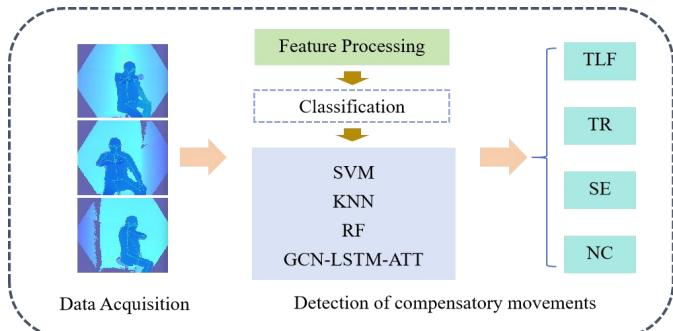
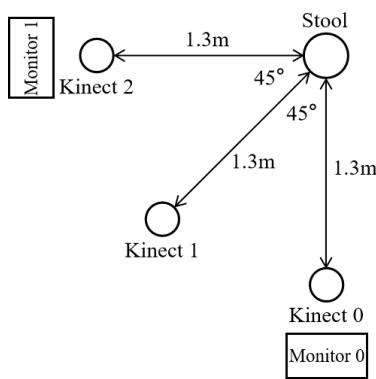
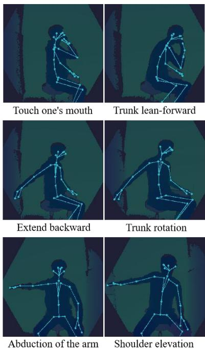
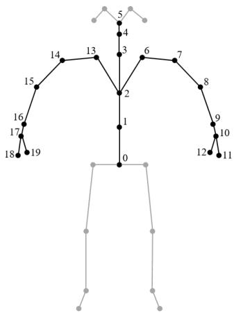
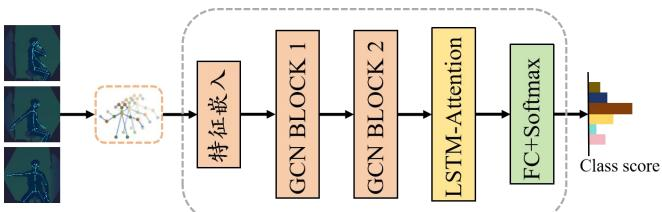

# 基于骨骼数据的图卷积长短期记忆注意力网络用于脑卒中后代偿动作检测

Jiaxing Fan 山东大学控制科学与工程学院 中国济南 202334915@mail.sdu.edu.cn

Yang Zhang\* 山东中医药大学附属医院康复评定与物理治疗科 中国济南 zhangyang982003@163.com

Jiaojiao Liu 山东中医药大学附属医院康复评定与物理治疗科 中国济南 1142365430@qq.com

Xin Ma\* 山东大学控制科学与工程学院 中国济南 maxin@sdu.edu.cn

Wenkong Wang 山东大学控制科学与工程学院 中国济南 202320760@mail.sdu.edu.cn

Jichen Zhang\* 山东浪潮科学研究院有限公司 中国济南 zhangjichen@inspur.com

摘要—大多数脑卒中（stroke）患者会出现上肢运动功能障碍。代偿动作在康复训练过程中普遍存在，这对患者的长期康复是不利的。因此，检测代偿动作具有重要意义。在本研究中，提出了一种基于骨骼数据的图卷积长短期记忆注意力网络（GCN-LSTM-ATT），用于脑卒中后代偿动作的检测。研究选取了16名脑卒中患者，使用 Kinect 深度相机采集了患者执行特定康复动作时的骨骼数据。经过数据处理后，分别使用 GCN-LSTM-ATT 模型、支持向量机（SVM）、K近邻算法（KNN）以及随机森林（RF）构建了检测模型。结果表明，GCN-LSTM-ATT 模型的检测准确率达到了 0.8580，显著高于传统机器学习算法。消融实验表明，该模型的各个组成部分都对性能提升做出了显著贡献。这些发现为脑卒中后代偿动作的检测提供了一种更为精确且强大的工具，并有望促进脑卒中患者康复训练策略的优化。

关键词—脑卒中（Stroke），骨骼数据，代偿动作检测，GCN-LSTM-ATT。

## I. 引言

脑卒中是死亡率最高的疾病之一。高达 80% 的脑卒中患者伴有不同程度的上肢运动功能障碍，这严重影响了他们的日常生活活动[1]。脑卒中后的康复训练对于患者恢复上肢运动功能至关重要。在康复过程中，为了完成预期的动作，患者往往会改变其运动模式，利用其他关节或身体部位来代偿肢体运动功能的丧失，这是产生代偿运动的重要原因[2][3]。上肢的运动极其复杂。代偿运动主要包括躯干前倾（trunk leanforward, TLF）、躯干旋转（trunk rotation, TR）和耸肩（shoulder elevation, SE）[4]。随着康复的推进，这些代偿运动并不利于患侧进行正确且有效的康复。在日常生活中，代偿运动有助于改善患者的短期表现。然而，长期的代偿运动会阻碍患侧恢复到脑卒中前的运动状态，甚至可能引发其他疾病[5]。因此，在患者康复过程中检测这些代偿运动，并提供指导和提醒以减少此类代偿运动，具有重要意义。

目前，临床上减少代偿运动的方法在很大程度上依赖于专业康复医生的监督、指导和纠正，这既耗时又费力[6]。从医生的角度来看，他们承担着繁重的工作负荷，时间和精力都十分有限。康复过程中迫切需要对代偿运动进行自动检测，从而摆脱对医生一对一人工协助的依赖。从患者的角度来看，康复过程中同样迫切需要自动检测代偿运动，特别是对于那些正在接受居家康复治疗的患者。此类信息可以协助医生和患者制定更具针对性的康复策略。

在当前的研究中，利用先进的设备和算法已成为上肢代偿运动检测领域的一个关键方向。目前，该领域的主流检测方法依赖于惯性测量单元（Inertial Measurement Units, IMUs）[5][7]、压力垫传感器[8]、表面肌电（surface electromyography, sEMG）传感器[9][10]、深度相机[11]以及 Vicon 光学跟踪系统[12]等设备。其中，基于压力的检测方法易受外部环境干扰，导致压力采集不稳定[8]。基于可穿戴设备的检测方案则存在佩戴繁琐和稳定性较差等问题[4]。此外，基于 Vicon 光学跟踪系统的检测方法面临着成本高昂、需要粘贴标记点以及操作流程复杂等挑战[12]。

相比之下，Kinect 深度相机传感器凭借其独特的优势脱颖而出。作为一个非侵入式、非穿戴式且更具成本效益的平台，Kinect 传感器在人体运动检测领域受到了广泛关注[13]。它能够实现实时三维人体骨骼跟踪，有效降低人体外观差异和光照变化对检测结果的影响。同时，深度学习算法可以准确分析 Kinect 采集到的骨骼数据，并精确识别相应的人体运动，为上肢代偿运动的检测提供了高效可靠的技术途径[14]。因此，基于骨骼数据检测代偿运动的方法已成为一种可行的解决方案。本文的主要贡献如下：

1 、 提出了一种基于非接触式骨骼数据的代偿运动检测方法，即图卷积长短期记忆注意力网络（Graph Convolutional Long Short-Term Memory Attention Network）。

2、通过对比实验验证了在代偿运动检测任务中，本文提出的深度学习算法相比现有的三种常用机器学习方法取得了更高的准确率，有力地证明了所提方法的有效性。

## II. 方法

在本研究中，提出了一种基于骨骼数据检测代偿动作的方法，该方法的具体流程结构如图 1 所示。首先，要求受试者在 Kinect 深度相机的监测下完成康复训练动作，从而采集受试者的原始运动数据。随后，采集到的数据依次经过预处理、骨骼点提取以及特征提取等操作。最后，分别采用本研究提出的深度学习算法和三种现有的机器学习算法构建代偿动作检测模型，实现对代偿动作的准确识别与分析。在图 1 中，NC=Noncompensation（无代偿），TLF=Trunk lean-forward（躯干前倾），TR=Trunk rotation（躯干旋转），SE=Shoulder elevation（肩部抬高）。

  
Figure 1. 工作流程结构

## A. 受试者

受试者包括从山东中医药大学附属医院（Affiliated Hospital of Shandong University of Traditional Chinese Medicine）招募的 15 名中风患者。

受试者在实验前均签署了书面知情同意书，相关程序和实验方案已获得山东中医药大学附属医院机构伦理委员会的批准。

中风患者的纳入标准如下：1）符合中风诊断标准且经 CT 或 MRI 确诊；2）年龄在 20 至 80 岁之间；3）初次发病时间在 15 天以上且在 6 个月以内的患者；4）处于 Brunnstrom 分期 Ⅱ 期或以上；5）对研究方案有清晰的理解并能够配合执行（MMSE>24 分）；6）自愿参加并签署知情同意书。

排除标准如下：1）存在严重认知障碍，妨碍完成 Fugl-Meyer 评定量表（FMA）测试；2）其他身体损伤，如骨折、严重关节炎等；3）严重的心、肝、肾功能不全；4）研究人员认为不适合参加本实验的其他情况。

## B. 实验系统与流程

在数据集采集系统中，使用放置在不同位置的三个 Kinect 相机来捕获受试者的 3D 骨骼点数据。Kinect 记录分辨率为 320 × 288 像素、工作频率为 30Hz 的深度视频。Kinect 相机的工作范围为 0.5-5.46m。3D 骨骼数据通过相应的软件开发工具包（SDK）从深度视频中获取传输。数据采集设备的布置俯视图如图 2 所示。

  
Figure 2. 数据采集设备布置俯视图

采用多视角数据采集策略更符合代偿运动检测的实际需求。这种部署方法能够全面捕获受试者的运动信息，有效避免单视角下可能出现的信息丢失潜在问题。此外，实验要求每位脑卒中受试者在进行康复训练时达到其最大可能的运动范围，从而充分暴露潜在的代偿运动行为。关于受试者是否表现出代偿运动，本研究采用了双专家独立评估机制。两位具有丰富临床经验的专家依据专业标准进行评估。最终判断通过交叉核对和讨论达成，从而确保评估结果的准确性和可靠性。

(1)实验任务设计：基于临床康复医生的建议和相关研究工作，本研究精心挑选了脑卒中患者日常康复训练中容易引发代偿运动的三个标准康复动作。同时确定了与之对应的三种常见代偿运动。这些动作的具体细节和图解分别展示在 Table 1 和 Figure 3 中，以清晰呈现实验设计内容。所有动作均源自临床康复医生为脑卒中患者制定的常规康复训练方案。选择这些动作的原因在于它们在临床实践中具有相对较高的代偿运动发生率。

Table 1. 标准康复动作及对应代偿运动

<table><tr><td></td><td>康复动作</td><td>对应代偿运动</td></tr><tr><td>1</td><td>触摸嘴部</td><td>躯干前倾</td></tr><tr><td>2</td><td>向后伸展</td><td>躯干旋转</td></tr><tr><td>3</td><td>手臂外展</td><td>耸肩</td></tr></table>

  
Figure 3. 标准康复动作及对应代偿运动

(2) 实验设置：在本次实验中，受试者被要求坐在一个固定的圆凳上，由三台 Kinect 深度相机从不同视角同步采集运动数据。受试者需要以舒适的运动速度并在其能达到的最大运动范围内，依次完成三个康复动作，即触摸嘴部、上肢外展 90 度以及向后伸展 45 度。在实验开始前，受试者将在专业医生的指导下充分熟悉实验流程和动作规范。

在实验过程中，每位受试者需重复每个康复动作六次。每次单个动作之间间隔 8 秒，相邻动作之间设置 1 分钟的休息时间，以避免疲劳因素对实验数据真实性的干扰。在整个实验过程中，两位经验丰富的临床康复医生密切观察受试者，并实时记录三种常见代偿动作（躯干前倾、躯干旋转和肩胛骨上提）的发生情况。

实验结束后，两位资深医生使用 Fugl-Meyer 评定量表上肢部分（FMA-UE）独立评估每位受试者的上肢运动功能。最后，取两位医生评分的平均值作为受试者上肢运动功能的量化评分。

## C. 骨骼数据与预处理

(1)骨骼数据：在本研究中，使用 Azure Kinect Body Tracking SDK 从深度视频中提取 32 个骨骼关节点的空间三维运动数据（X, Y, Z）。在基于骨骼的上肢动作分析中，许多方法仅使用上肢关节的坐标作为输入。采用该策略是为了防止引入额外节点的冗余信息[15][16]。在本文工作中，骨骼数据由上肢的 20 个关节坐标组成。在空间维度层面，每帧内的关节按照人体解剖学结构有序连接，从而形成完整的上肢骨骼拓扑结构。具体连接方式如图 4 所示。

  
Figure 4. 空间骨骼示意图

(2)数据预处理：首先，截取原始动作序列的关键帧。计算相邻帧之间骨骼点位置变化的欧氏距离，并保留距离超过设定阈值的帧。随后，使用滑动窗口算法进行进一步处理。设置窗口大小和步长，剔除窗口内的相似及冗余帧，从而保留完整有效的动作片段。为了解决动作序列持续时间差异的问题，本研究提出了一种基于最长序列的时间轴归一化策略，并结合三次样条插值技术实现不同样本的精确时间对齐，确保所有数据在时间维度上的一致性。同时，通过对三维坐标进行 Z-score 归一化处理，进一步提高了数据的可靠性。

## D. 图卷积长短期记忆注意力网络（GCN-LSTM-ATT）

本研究提出的图卷积长短期记忆注意力网络（Graph Convolutional Long Short-Term Memory Attention Network）方法是一种深度学习模型，它有机地融合了图卷积网络（Graph Convolutional Network, GCN）、长短期记忆网络（Long Short-Term Memory, LSTM）和注意力机制（Attention mechanism, ATT）的优势特征。该模型的总体架构如图 5 所示。

  
Figure 5. 图卷积长短期记忆注意力网络

从结构原理来看，该模型将人体骨骼视为一种独特的图结构，并充分利用了图卷积网络（GCN）强大的图数据处理能力。在人体骨骼关节点建模中，GCN 能够有效捕捉并分析各个关节点之间复杂的空间依赖关系。通过对图结构中节点和边的操作，GCN 能够提取关节点之间的空间相关性特征，从而精确刻画人体动作在空间维度上的特征分布[17]。

长短期记忆网络（LSTM）在该模型处理时间序列数据中扮演着重要角色。在人体动作分析场景下，动作序列呈现出显著的时间动态变化特征。通过其独特的门控机制，LSTM 可以有效学习并记忆动作序列在不同时间步上的依赖关系[18]。无论是在动作的起始、进行还是结束阶段，LSTM 都能精准捕捉时间序列中的关键信息，避免了传统循环神经网络（Recurrent Neural Networks, RNNs）中常见的梯度消失和梯度爆炸问题，从而实现了对动作时间动态特性的稳定建模。

注意力机制（ATT）的引入进一步提升了模型的性能。在处理动作序列时，各个时间步的信息并不具有同等的重要性。ATT 能够根据输入数据的特征，自适应地调整对不同时间步的关注程度。具体而言，它可以智能地识别动作序列中的关键帧，并为这些关键帧赋予更高的权重，从而突出关键信息的重要性。同时，对于可能包含噪声或相对次要信息的时间步，ATT 会抑制其权重，以降低噪声干扰的影响。通过这种方式，注意力机制显著提高了模型的判别能力，使其能够更准确地对动作进行分类与识别。

综上所述，通过融合 GCN、LSTM 和 ATT，图卷积长短期记忆注意力网络（Graph Convolutional Long Short-Term Memory Attention Network，GCN-LSTM-ATT）不仅能够精确建模人体骨骼关节点之间的空间依赖关系，还能有效捕获动作序列的时间动态变化。此外，它能够自适应地增加关键帧的权重并抑制噪声干扰。该网络在人体动作分析领域展现出了强大的性能和潜力。

## E. 机器学习算法

综上所述，通过融合 GCN、LSTM 和 ATT，图卷积长短期记忆注意力网络（Graph Convolutional Long Short-Term Memory Attention Network，GCN-LSTM-ATT）不仅能够精确建模人体骨骼关节点之间的空间依赖关系，还能有效捕获动作序列的时间动态变化。此外，它能够自适应地增加关键帧的权重并抑制噪声干扰。该网络在人体动作分析领域展现出了强大的性能和潜力。

## 1）SVM

支持向量机（Support Vector Machine, SVM）是一种经典的监督机器学习算法。其核心在于寻找能够最大化类别间隔的最优超平面以进行数据分类[19]。当数据线性可分时，可直接求解该超平面。当数据线性不可分时，则利用核函数将数据映射到高维空间进行处理。其优点包括小样本学习能力强、对高维数据适应性好以及优秀的泛化性能。然而，其局限性如下：在处理大规模数据时计算复杂度较高；最初设计用于二分类，扩展到多分类较为繁琐；且对数据分布较为敏感。

## 2）KNN

K近邻算法（K-Nearest Neighbors, KNN）是一种简单直观的监督机器学习方法。其核心逻辑如下：通过计算待分类数据点与训练集中每个点之间的距离（通常使用欧氏距离等度量），找出最近的 K 个邻居，并将这 K 个邻居中出现频率最高的类别作为待分类数据点的类别。KNN 的优点在于不需要复杂的训练过程，且能适应各种数据分布。然而，其缺点在于计算时需要遍历训练集，导致在数据量庞大的场景下效率较低。此外，它对 K 值的选择极具依赖性，不恰当的 K 值会显著影响分类准确率[20]。

## 3）RF

随机森林（Random Forest, RF）是一种基于决策树构建的集成学习算法。它通过对训练集进行自助重采样（bootstrap sampling）生成子数据集，为每个子数据集构建一棵决策树，并在构建过程中随机选择一部分特征来确定分裂点。在分类任务中，其结果通过投票决定，而在回归任务中则取均值。其优势包括高准确率、强鲁棒性、处理高维数据的能力以及一定的可解释性。然而，其缺点在于计算复杂度高且理解难度较大[21]。

## III. 实验结果

在本节中，基于从真实受试者采集的数据，首先将本研究所提出的代偿运动检测方法与现有的代表性算法进行性能对比。通过多指标定量评估，揭示了所提方法在脑卒中后代偿运动检测中的优势。此外，采用控制变量法对模型进行了消融实验，分析了各模块对性能的贡献，并验证了架构设计的科学性。

## A. 评估指标

在本研究中，15 名脑卒中患者的实验数据按 8:2 的比例划分为训练集和测试集。为了评估分类模型的性能，选取了四个关键指标进行定量分析：准确率（Accuracy）、精确率（Precision）、召回率（Recall）和 F1 分数（F1-score）。这些指标直观地揭示了模型分类器的预测结果与真实标签之间的对应关系，从而能够对模型性能进行全面而精确的评估。具体计算公式如下：

$$
A c c u r a c y = \frac {T P + T N}{T P + T N + F P + F N}
$$

$$
P r e c i s i o n = \frac {T P}{T P + F P}
$$

$$
\text { Recall } = \frac {T P}{T P + F N}
$$

$$
F 1 = \frac {2 * \text { Precision } * \text { Recall }}{\text { Precision } + \text { Recall }}
$$

其中，TP、TN、FP 和 FN 分别代表分类标签的真正例（True Positive）、真负例（True Negative）、假正例（False Positive）和假负例（False Negative）。

## B. 对比实验

本研究所设计的三个康复动作任务中，各模型在检测代偿动作方面的性能详见 Table 2。实验数据表明，基于传统机器学习方法的检测准确率处于 0.6481 至 0.7901 之间。其中，支持向量机（Support Vector Machine, SVM）凭借其在非线性分类方面的优势取得了最佳性能。然而，本研究所提出的 GCN-LSTM-ATT 融合模型展现出了显著的性能优势，其检测准确率高达 0.858。该结果充分验证了图卷积网络（Graph Convolutional Network, GCN）对关节空间拓扑结构的建模能力、长短期记忆网络（Long Short-Term Memory network, LSTM）对时间特征的捕捉能力，以及注意力机制（Attention mechanism, ATT）对关键时间序列特征的聚焦能力三者协同作用的有效性。它能够精确捕捉标准康复动作及其相应代偿动作中关节之间的动态拓扑关系，显著提升了模型对复杂代偿动作模式的识别准确率。

Table 2 各模型的性能

<table><tr><td>模型</td><td>准确率</td><td>精确率</td><td>召回率</td><td>F1分数</td></tr><tr><td>SVM</td><td>0.7901</td><td>0.8267</td><td>0.7901</td><td>0.7887</td></tr><tr><td>KNN</td><td>0.6481</td><td>0.6562</td><td>0.6481</td><td>0.6459</td></tr><tr><td>RF</td><td>0.6852</td><td>0.7599</td><td>0.6852</td><td>0.6903</td></tr><tr><td>GCN-LATM-ATT</td><td>0.8580</td><td>0.8695</td><td>0.8580</td><td>0.8603</td></tr></table>

## C. 消融实验

利用实际采集的数据对所提出的 GCN-LSTM-ATT 的各个模块进行了消融实验，以评估 GCN（作为基线）、LSTM 和 ATT 这三个核心组件对模型性能的影响。首先，对 GCN 的输出特征进行时空平均操作，并将结果输入分类器，以此作为基线。相关实验结果如 Table 3 所示。

如 Table 3 所示，与基线 GCN 相比，GCN-LSTM-ATT 在准确率上取得了显著提升，验证了所提出的模型在脑卒中后代偿动作检测任务中，在建模关节空间拓扑结构、捕获时序特征以及聚焦关键时序特征方面的巨大价值。此外，与基线 GCN 相比，GCN-LSTM 模型在准确率上也取得了较大幅度的提升，这验证了结合时空特征研究对提高代偿动作检测准确率的重要性。

Table 3 消融实验结果

<table><tr><td>模型</td><td>准确率</td><td>精确率</td><td>召回率</td><td>F1分数</td></tr><tr><td>GCN</td><td>0.5679</td><td>0.6841</td><td>0.5679</td><td>0.5607</td></tr><tr><td>GCN-LSTM</td><td>0.8457</td><td>0.8592</td><td>0.8457</td><td>0.8462</td></tr><tr><td>GCN-LATM-ATT</td><td>0.8580</td><td>0.8695</td><td>0.8580</td><td>0.8603</td></tr></table>

## IV. 结论

在本研究中，构建了一种基于骨骼数据的新型深度学习模型，用于脑卒中（中风，stroke）后代偿运动的检测。首先，设计了三种创新的康复运动任务，并采集了脑卒中患者在执行这些任务过程中的骨骼数据，为后续研究提供了基础数据支持。随后，将本研究提出的深度学习模型与三种现有的机器学习算法进行了对比实验。建立了代偿运动检测模型，以实现对代偿运动的高精度识别。

实验结果表明，在基于骨骼数据的脑卒中后代偿运动检测任务中，GCN-LSTM-ATT 模型显著优于其他对比模型。尽管当前研究的数据集规模相对有限，但该成果为后续研究提供了重要的理论依据和技术参考。同时，它增强了模型在临床应用中的可解释性。

未来的研究将重点关注扩大数据集规模、优化模型架构，并进一步探索脑卒中患者各类代偿运动模式的检测。其目标在于开发出更高效、更智能的辅助诊断工具，有效减轻临床医生的工作负担，推动脑卒中康复诊疗领域的智能化发展。

## 参考文献

[1] Beilei L ,Zhenxiang Z ,Yongxia M , et al.Cumulative risk of stroke recurrence over the last 10 years: a systematic review and metaanalysis.[J].Neurological Sciences : Official Journal of the Italian Neurological Society and of the Italian Society of Clinical Neurophysiology,2020,42(1):61-71.

[2] A B V ,N M S G ,Machiel F H L D V .Trunk Compensation During Bimanual Reaching at Different Heights by Healthy and Hemiparetic Adults.[J].Journal of Motor Behavior,2017,49(5):580-592.

[3] Levin F M ,Liebermann G D ,Parmet Y , et al.Compensatory Versus Noncompensatory Shoulder Movements Used for Reaching in Stroke[J].Neurorehabilitation and Neural Repair,2016,30(7):635-646.

[4] Xu P, Xia D, Zheng B, et al. A novel compensatory motion detection method using multiple signals and machine learning[J]. IEEE Sensors Journal, 2022, 22(17): 17162-17172.

[5] Ding K, Wang J, Wang X, et al. 基于可穿戴传感器和机器学习算法的脑卒中后患者代偿运动检测与定量评估系统 (System for Detection and Quantitative Evaluation of Compensatory Movement in Post-stroke Patients Based on Wearable Sensor and Machine Learning Algorithm)[J]. IEEE Sensors Journal, 2024.

[6] Cai S, Li G, Su E, et al. 脑卒中患者代偿模式的实时检测以减少机器人康复治疗中的代偿 (Real-time detection of compensatory patterns in patients with stroke to reduce compensation during robotic rehabilitation therapy)[J]. IEEE Journal of Biomedical and Health Informatics, 2020, 24(9): 2630-2638.

[7] Ranganathan R, Wang R, Dong B, et al. 基于可穿戴传感器系统识别上肢代偿运动模式 (Identifying compensatory movement patterns in the upper extremity using a wearable sensor system)[J]. Physiological Measurement, 2017, 38(12): 2222.

[8] Cai S, Li G, Zhang X, et al. 利用压力分布数据和机器学习算法检测脑卒中幸存者的代偿运动 (Detecting compensatory movements of stroke survivors using pressure distribution data and machine learning algorithms)[J]. Journal of Neuroengineering and Rehabilitation, 2019, 16: 1-11.

[9] Chen Y, Ma K, Yang L, et al. 基于生成对抗网络的躯干代偿肌电特征提纯与分类模型 (Trunk compensation electromyography features purification and classification model using generative adversarial network)[J]. Biomedical Signal Processing and Control, 2021, 65: 102345.

[10] Ma K, Chen Y, Zhang X, et al. 康复训练中基于 sEMG 的躯干代偿检测 (sEMG-based trunk compensation detection in rehabilitation training)[J]. Frontiers in Neuroscience, 2019, 13: 1250.

[11] Luo Z, Lim A E P, Durairaj P, et al. 针对社区脑卒中老年人上肢康复的代偿感知虚拟康复系统开发 (Development of a compensationaware virtual rehabilitation system for upper extremity rehabilitation in community-dwelling older adults with stroke)[J]. Journal of NeuroEngineering and Rehabilitation, 2023, 20(1): 56.

[12] Van Remoortel H, Giavedoni S, Raste Y, et al. 活动监测仪在健康与慢性疾病中的有效性：系统评价 (Validity of activity monitors in health and chronic disease: a systematic review)[J]. International Journal of Behavioral Nutrition and Physical Activity, 2012, 9: 1-23.

[13] Tian H, Li H, Jiang W, et al. 用于基于骨骼的帕金森病步态 MDS-UPDRS 评分评估的跨时空图卷积网络 (Cross-spatiotemporal graph convolution networks for skeleton-based parkinsonian gait MDS-UPDRS score estimation)[J]. IEEE Transactions on Neural Systems and Rehabilitation Engineering, 2024, 32: 412-421.

[14] Moon S, Park Y, Ko D W, et al. 基于卡尔曼滤波的人体骨骼跟踪多 Kinect 传感器融合 (Multiple kinect sensor fusion for human skeleton tracking using Kalman filtering)[J]. International Journal of Advanced Robotic Systems, 2016, 13(2): 65.

[15] Yan S, Xiong Y, Lin D. 基于骨骼动作识别的时空图卷积网络 (Spatial temporal graph convolutional networks for skeleton-based action recognition)[C]. Proceedings of the AAAI Conference on Artificial Intelligence. 2018, 32(1).

[16] Zhou J, Cui G, Hu S, et al. 图神经网络：方法与应用综述 (Graph neural networks: A review of methods and applications)[J]. AI Open, 2020, 1: 57-81.

[17] Wu Z, Pan S, Chen F, et al. 图神经网络全面综述 (A comprehensive survey on graph neural networks)[J]. IEEE Transactions on Neural Networks and Learning Systems, 2020, 32(1): 4-24.

[18] Liu J, Shahroudy A, Xu D, et al. 基于带信任门时空 LSTM 网络的骨骼动作识别 (Skeleton-based action recognition using spatio-temporal LSTM network with trust gates)[J]. IEEE Transactions on Pattern Analysis and Machine Intelligence, 2017, 40(12): 3007-3021.

[19] Sunnetci K M, Alkan A. 基于双相多数投票的胸部 X 射线图像 COVID-19 对比诊断[J]. Expert Systems with Applications, 2023, 216: 119430.

[20] Cunningham P, Delany S J. K-近邻分类器教程[J]. ACM Computing Surveys (CSUR), 2021, 54(6): 1-25.

[21] Biau G, Scornet E. 随机森林导览[J]. Test, 2016, 25(2): 197-227.