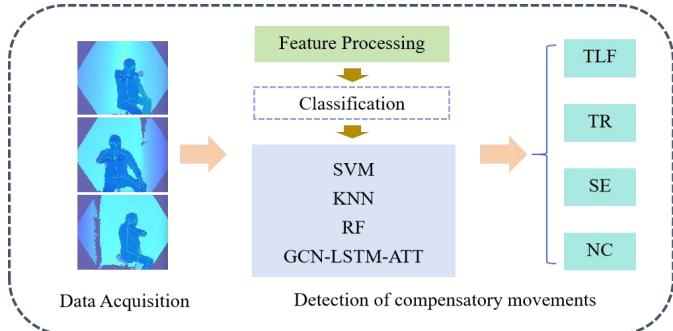
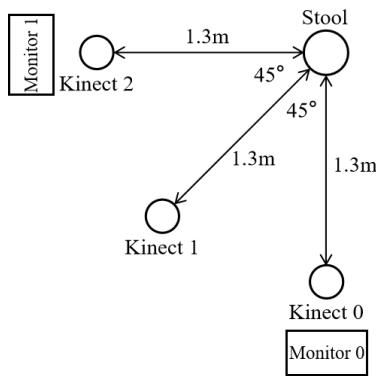
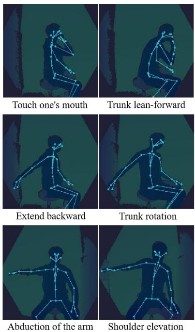
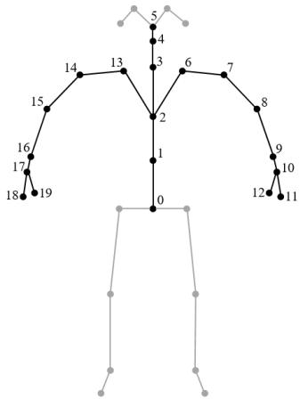
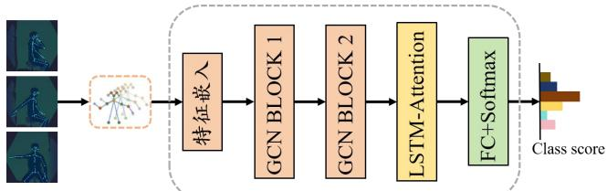

# 基于骨骼数据的脑卒中后代偿运动检测的图卷积长短时记忆注意力网络

Jiaxing Fan  
控制科学与工程学院  
山东大学  
济南，中国  
202334915@mail.sdu.edu.cn  

Yang Zhang\*  
康复物理治疗科  
山东中医药大学附属医院  
济南，中国  
zhangyang982003@163.com  

Jiaojiao Liu  
康复物理治疗科  
山东中医药大学附属医院  
济南，中国  
1142365430@qq.com  

Xin Ma\*  
控制科学与工程学院  
山东大学  
济南，中国  
maxin@sdu.edu.cn  

Wenkong Wang  
控制科学与工程学院  
山东大学  
济南，中国  
202320760@mail.sdu.edu.cn  

Jichen Zhang\*  
山东浪潮科学研究院有限公司  
济南，中国  
zhangjichen@inspur.com

摘要——大多数脑卒中患者存在上肢运动功能障碍。在康复训练过程中，代偿运动普遍存在，这对患者的长期康复不利。因此，检测代偿运动具有重要意义。本研究提出了一种基于骨骼数据的图卷积长短时记忆注意力网络（Graph Convolutional Long Short-Term Memory Attention Network，GCN-LSTM-ATT），用于检测脑卒中后的代偿运动。研究中选取了十六名脑卒中患者。使用 Kinect 深度相机采集患者执行特定康复运动的骨骼数据。经过数据处理后，分别使用 GCN-LSTM-ATT 模型、支持向量机（Support Vector Machine，SVM）、K 近邻算法（K-Nearest Neighbor algorithm，KNN）和随机森林（Random Forest，RF）构建检测模型。结果表明，GCN-LSTM-ATT 模型的检测准确率达到 0.8580，显著高于传统机器学习算法。消融实验表明，模型的每个组件对性能提升均有显著贡献。这些发现为脑卒中后代偿运动的检测提供了更精确、更强大的工具，有望促进脑卒中患者康复训练策略的优化。

关键词——脑卒中、骨骼数据、代偿运动检测、GCN-LSTM-ATT

## I. 引言

中风是死亡率最高的疾病之一。高达 80% 的中风患者存在不同程度的肢体运动功能障碍，严重影响其日常活动[1]。中风后的康复训练对于患者恢复上肢运动功能至关重要。在康复过程中，为了完成预期的动作，患者常常会改变运动模式，借助其他关节或身体部位来代偿患侧肢体运动功能的丧失，这是产生代偿运动的重要原因[2][3]。上肢的运动极其复杂。代偿运动主要包括躯干前倾（Trunk Lean Forward, TLF）、躯干旋转（Trunk Rotation, TR）和肩部上抬（Shoulder Elevation, SE）[4]。随着康复的推进，这些代偿运动不利于患侧正确、有效地康复。在日常生活中，代偿运动有助于改善患者的近期疗效。然而，长期的代偿运动会阻碍患侧恢复到中风前的运动状态，甚至可能导致其他疾病的发生[5]。因此，在患者康复过程中检测这些代偿运动并提供指导和提醒以减少此类代偿运动具有重要意义。

目前，临床上减少代偿运动的方法在很大程度上依赖于专业康复医生的监督、指导和纠正，这既耗时又费力[6]。从医生的角度来看，他们工作负担沉重，时间和精力有限。迫切需要在康复过程中自动检测代偿运动，消除医生一对一人工辅助的必要性。从患者的角度来看，也迫切需要在康复过程中自动检测代偿运动，特别是对于那些正在接受居家康复治疗的患者。此类信息可以帮助医生和患者制定更具策略性的康复方案。

在当前的研究中，先进设备和算法的利用已成为上肢代偿运动检测领域的一个重要方向。目前，该领域的主流检测方法依赖于惯性测量单元（Inertial Measurement Units, IMUs）[5][7]、压力垫传感器（pressure pad sensors）[8]、表面肌电图（surface electromyography, sEMG）传感器[9][10]、深度摄像头（depth cameras）[11]以及Vicon光学跟踪系统（Vicon optical tracking system）[12]等设备。其中，基于压力的检测方法容易受到外部环境干扰，导致压力采集不稳定[8]。基于可穿戴设备的检测方案则存在安装繁琐和稳定性差等问题[4]。此外，基于Vicon光学跟踪系统的检测方法还面临成本高昂、需要标记工件以及操作流程复杂等挑战[12]。

相比之下，Kinect深度摄像头传感器因其独特的优势而脱颖而出。作为一种非侵入性、非穿戴性且更具成本效益的平台，Kinect传感器在人体运动检测领域受到了广泛关注[13]。它能够实现实时三维人体骨架跟踪，有效减少人体外观差异和光照变化对检测结果的影响。同时，深度学习算法可以准确地分析Kinect所采集的骨架数据，并精确识别相应的人体运动，为上肢代偿运动的检测提供了一种高效且可靠的技术途径[14]。因此，基于骨架数据检测代偿运动的方法已成为一种可行的解决方案。本文的主要贡献如下：

1、提出了一种基于非接触式骨架数据的代偿运动检测方法，即图卷积长短期记忆注意力网络（Graph Convolutional Long Short-Term Memory Attention Network）。

2、通过对比实验验证了在代偿运动检测任务中，本文所提出的深度学习算法相较于现有的三种常用机器学习方法具有更高的准确率，有效证明了所提方法的有效性。

## II. 方法（METHODS）

本研究提出了一种基于骨骼数据的代偿运动检测方法，该方法的具体流程结构如图 1 所示。首先，要求受试者在 Kinect 深度相机的监测下完成康复训练动作，从而采集受试者的原始运动数据。随后，所采集的数据依次经过预处理、骨骼点提取和特征提取等操作。最后，分别采用本研究提出的深度学习算法和三种已有的机器学习算法构建代偿运动检测模型，实现对代偿运动的准确识别与分析。图 1 中，NC＝非代偿（Noncompensation），TLF＝躯干前倾（Trunk lean-forward），TR＝躯干旋转（Trunk rotation），SE＝肩部上抬（Shoulder elevation）。

  

图1. 工作流程的结构

## A. 受试者

本研究的受试者为15名从山东中医药大学附属医院（Affiliated Hospital of Shandong University of Traditional Chinese Medicine）招募的脑卒中患者。所有受试者在实验前均签署了书面知情同意书，相关流程与实验方案经山东中医药大学附属医院机构伦理委员会（Institutional Ethics Committee）批准。

脑卒中患者的纳入标准如下：1）符合脑卒中的诊断标准，并经CT或MRI确诊；2）年龄在20至80岁之间；3）首次发病距今超过15天且不超过6个月；4）处于Brunnstrom分期Ⅱ期及以上；5）对研究方案具有清晰的理解，并能够遵照执行（MMSE评分>24分）；6）自愿参加本研究并签署知情同意书。

排除标准如下：1）存在严重认知障碍，无法完成Fugl-Meyer评估量表（FMA）测试；2）合并其他身体损伤，例如骨折、严重关节炎等；3）心、肝、肾功能严重不全；4）研究者认为不宜参加本实验的其他情况。

## B. 实验系统与流程

在数据集采集系统中，使用三台放置于不同位置的Kinect相机采集受试者的三维骨骼点数据。Kinect以320×288像素的分辨率记录深度视频，工作频率为30 Hz。Kinect相机的有效工作范围为0.5–5.46 m。三维骨骼数据由相应的软件开发工具包（SDK）从深度视频中提取获得。数据采集设备的俯视布置图如图2所示。

  

图 2. 数据采集设备布置的俯视图

多视图数据采集策略的采用更符合代偿运动检测的实际需求。这种部署方式能够全面捕捉受试者的运动信息，有效避免单视图中可能出现的信息丢失问题。此外，实验要求每位脑卒中受试者在进行康复训练时达到其最大可能的活动范围，以充分暴露潜在的代偿运动行为。关于受试者是否表现出代偿运动，本研究采用双重专家独立评估机制。两位具有丰富临床经验的专家按照专业标准进行评估。最终判断通过交叉核对和讨论达成，从而确保评估结果的准确性和可靠性。

（1）实验任务设计：基于临床康复医生的建议和相关研究工作，本研究精心选取了三种在脑卒中患者日常康复训练过程中容易诱发代偿运动的标准康复动作。同时，确定了与之对应的三种常见代偿运动。这些动作的具体细节和插图分别在表1和图3中展示，以清晰呈现实验设计的内容。所有动作均来源于临床康复医生为脑卒中患者制定的常规康复训练方案。选择这些动作的原因是它们在临床实践中具有较高的代偿运动发生率。

表1. 标准康复动作与对应的代偿动作

<table><tr><td></td><td>Rehabilitation actions</td><td>Corresponding compensatory movements</td></tr><tr><td>1</td><td>Touch one&#x27;s mouth</td><td>Trunk lean-forward</td></tr><tr><td>2</td><td>Extend backward</td><td>Trunk rotation</td></tr><tr><td>3</td><td>Abduction of the arm</td><td>Shoulder elevation</td></tr></table>

  

图 3. 标准康复动作与对应的代偿动作

(2) 实验设置：实验中，受试者被要求坐在一张固定的圆凳上，由三台 Kinect 深度相机从不同视角同步采集运动数据。受试者需要依次完成三个康复动作，即触嘴、上肢外展 90 度以及向后伸展 45 度，以舒适的运动速度并在能够达到的最大活动范围内完成。实验开始前，受试者将在专业医生的指导下充分熟悉实验流程和动作规范。

实验过程中，每位受试者被要求重复每个康复动作六次。每个单一动作之间间隔 8 秒，相邻动作之间设置 1 分钟的休息时间，以避免疲劳因素干扰实验数据的真实性。整个实验期间，两名经验丰富的临床康复医生密切观察受试者，并实时记录三种常见代偿运动的发生情况：躯干前倾、躯干旋转和肩胛骨上提。

实验结束后，两名资深医生使用 Fugl-Meyer 评定量表上肢部分（Fugl-Meyer Assessment Scale, FMA-UE）独立评估每位受试者的上肢运动功能。最后，取两位医生所给分数的平均值作为受试者上肢运动功能的定量评分。

## C. 骨骼数据与预处理

(1) 骨骼数据：本研究使用 Azure Kinect Body Tracking SDK 从深度视频中提取 32 个骨骼关节点的三维运动数据（X, Y, Z）。在基于骨骼的上肢动作分析中，许多方法仅使用上肢关节点的坐标作为输入。这一策略的实施是为了防止来自额外节点的冗余信息的引入[15][16]。本研究中，骨骼数据由上肢 20 个关节点的坐标组成。在空间维度层面上，每一帧内的关节点按照人体解剖结构有序连接，从而形成完整的上肢骨骼拓扑结构。具体的连接方式如图 4 所示。

  

图 4. 空间骨架图（Spatial Skeleton Diagram）

(2) 数据预处理：首先，截取原始动作序列的关键帧。计算相邻帧之间骨骼点位置变化的欧几里得距离，保留距离超过设定阈值的帧。随后，采用滑动窗口算法进行进一步处理，设置窗口大小与步长，去除窗口内相似及冗余的帧，从而保留完整且有效的动作片段。针对动作序列时长存在差异的问题，本研究提出一种基于最长序列的时间轴归一化策略，并结合三次样条插值技术实现不同样本的精确时间对齐，确保所有数据在时间维度上的一致性。同时，对三维坐标进行 Z-score 标准化处理，进一步增强数据可靠性。

## D. 图卷积长短期记忆注意力网络（GCN-LSTM-ATT）

本研究提出的图卷积长短期记忆注意力网络方法是一种深度学习模型，有机融合了图卷积网络（Graph Convolutional Network, GCN）、长短期记忆网络（Long Short-Term Memory, LSTM）与注意力机制（Attention Mechanism, ATT）的优势特性。该模型的整体概览如图 5 所示。

  

图 5. 图卷积长短期记忆注意力网络（Graph Convolutional Long Short-Term Memory Attention Network）

在结构原理方面，该模型将人体骨骼视为一种独特的图结构，并充分利用图卷积网络（Graph Convolutional Network, GCN）强大的图数据处理能力。在人体骨骼关节点的建模过程中，GCN 能够有效捕捉和分析各个关节点之间复杂的空间依赖关系。通过对图结构中节点和边的运算操作，GCN 可以提取关节点之间的空间关联特征，从而准确刻画人体动作在空间维度上的特征分布[17]。

长短期记忆网络（Long Short-Term Memory network, LSTM）在该模型处理时序数据的过程中发挥着重要作用。在人体动作分析场景中，动作序列呈现出明显的时序动态变化特征。LSTM 通过其独特的门控机制，能够有效学习并记忆不同时间步上动作序列的依赖关系[18]。无论是动作的起始、持续还是结束阶段，LSTM 都能准确捕捉时序中的关键信息，避免了传统循环神经网络（Recurrent Neural Networks, RNNs）中常见的梯度消失和梯度爆炸问题，从而能够稳定地对动作的时序动态进行建模。

注意力机制（Attention mechanism, ATT）的引入进一步增强了模型的性能。在处理动作序列时，每个时间步的信息具有不同的重要程度。ATT 能够根据输入数据的特征自适应地调整对不同时间步的关注程度。具体而言，它可以智能地识别动作序列中的关键帧，并为这些关键帧赋予更高的权重，从而突出关键信息的意义。同时，对于可能包含噪声或相对不重要信息的时间步，ATT 会抑制其权重，以降低噪声干扰的影响。通过这种方式，注意力机制显著提升了模型的判别能力，使其能够更加准确地对动作进行分类与识别。

综上所述，通过融合 GCN、LSTM 和 ATT，图卷积长短期记忆注意力网络（Graph Convolutional Long Short-Term Memory Attention Network, GCN-LSTM-ATT）不仅能够准确建模人体骨骼关节点之间的空间依赖关系，还能有效捕捉动作序列的时序动态变化，并且能够自适应地增加关键帧的权重、抑制噪声干扰。它在人体动作分析领域展现出了强大的性能与潜力。

## E. 机器学习算法

综上所述，通过整合 GCN、LSTM 和 ATT，图卷积长短期记忆注意力网络（Graph Convolutional Long Short-Term Memory Attention Network, GCN-LSTM-ATT）不仅能够精确建模人体骨骼关节点之间的空间依赖关系，还能有效捕捉动作序列的时间动态变化，并且能够自适应地增大关键帧的权重、抑制噪声干扰。该方法在人体动作分析领域展现出了强大的性能与潜力。

## 1）SVM

支持向量机（Support Vector Machine, SVM）是一种经典的监督式机器学习算法，其核心在于寻找能够最大化类别间隔的最优超平面以实现数据分类[19]。当数据线性可分时，可直接求解该超平面；当数据线性不可分时，则借助核函数将数据映射到高维空间进行处理。其优势在于：对小样本具有较强的学习能力，对高维数据具有良好的适应性，且泛化性能优异。然而，其局限性同样明显：在处理大规模数据时计算复杂度较高；该算法最初是为二分类任务设计的，扩展到多分类任务较为繁琐；并且对数据分布较为敏感。

## 2）KNN

K近邻算法（K-Nearest Neighbors, KNN）是一种简洁直观的监督式机器学习方法。其核心逻辑如下：通过计算待分类数据点与训练集中各点之间的距离（常用欧氏距离等度量方式），找出其中距离最小的 K 个邻居，并以这 K 个邻居中出现频次最高的类别作为待分类数据点的类别。KNN 的优势在于无需复杂的训练过程，且能够适应各种数据分布。然而，其缺点也较为突出：在计算过程中需要遍历整个训练集，在数据量较大的场景下效率较低；此外，该算法极度依赖 K 值的选择，不合适的 K 值会显著影响分类准确率[20]。

## 3）RF

随机森林（Random Forest, RF）是一种基于决策树构建的集成学习算法。它通过对训练集进行自助采样（bootstrap sampling）生成子数据集，为每个子数据集构建一棵决策树，并在构建过程中随机选取一部分特征来确定分裂节点。在分类任务中，最终结果通过投票决定；在回归任务中，则取均值作为输出。其优势包括准确率高、鲁棒性强、能够处理高维数据，并且具有一定的可解释性。然而，其缺点在于计算复杂度较高，且难以理解[21]。

## III. 实验结果（EXPERIMENTAL RESULTS）

在本节中，基于真实受试者所采集的数据，首先将本研究提出的代偿运动检测方法在性能上与现有的代表性算法进行比较，通过多指标量化评估，揭示所提方法在脑卒中后代偿运动检测方面的优势。此外，采用控制变量法对模型进行消融实验，分析各模块对性能的贡献，验证架构设计的科学性。

## A. 评价指标

本研究将 15 名脑卒中患者的实验数据按照 8:2 的比例划分为训练集和测试集。为评估分类模型的性能，选用了准确率（Accuracy）、精确率（Precision）、召回率（Recall）和 F1 分数（F1-score）四项关键指标进行量化分析。这些指标能够直观反映模型分类器的预测结果与真实标签之间的对应情况，从而对模型性能进行全面而精确的评估。具体计算公式如下：

$$
A c c u r a c y = { \frac { T P + T N } { T P + T N + F P + F N } }
$$

$$
P r e c i s i o n = \frac { T P } { T P + F P }
$$

$$
R e c a l l = \frac { T P } { T P + F N }
$$

$$
F 1 = \frac { 2 * P r e c i s i o n * R e c a l l } { P r e c i s i o n + R e c a l l }
$$

其中，TP、TN、FP、FN 分别代表分类标签中的真正例（True Positive）、真负例（True Negative）、假正例（False Positive）和假负例（False Negative）。

## B. 对比实验（Comparison Experiment）

本研究设计的三项康复运动任务中各模型检测代偿运动的性能详见表 2。实验数据显示，基于传统机器学习（traditional machine learning）方法的检测准确率范围为 0.6481 至 0.7901。其中，支持向量机（Support Vector Machine，SVM）凭借其在非线性分类方面的优势取得了最佳性能。然而，本研究提出的 GCN-LSTM-ATT 融合模型展现出显著的性能优势，其检测准确率高达 0.858。该结果充分验证了图卷积网络（Graph Convolutional Network，GCN）对关节空间拓扑结构的建模能力、长短期记忆网络（Long Short-Term Memory network，LSTM）对时间特征的捕捉能力，以及注意力机制（Attention mechanism，ATT）对关键时序特征的关注能力三者协同作用的有效性。该模型能够精准捕捉标准康复动作及其对应代偿动作中关节间的动态拓扑关系，显著提升了模型对复杂代偿动作模式的识别准确率。

表 2 各模型的性能（Performance of Each Model）

<table><tr><td>Model</td><td>Accuracy</td><td>Precision</td><td>Recall</td><td>F1-score</td></tr><tr><td>SVM</td><td>0.7901</td><td>0.8267</td><td>0.7901</td><td>0.7887</td></tr><tr><td>KNN</td><td>0.6481</td><td>0.6562</td><td>0.6481</td><td>0.6459</td></tr><tr><td>RF</td><td>0.6852</td><td>0.7599</td><td>0.6852</td><td>0.6903</td></tr><tr><td>GCN-LATM-ATT</td><td>0.8580</td><td>0.8695</td><td>0.8580</td><td>0.8603</td></tr></table>

## C. 消融实验

为了评估三个核心组件（即 GCN（作为基线）、LSTM 和 ATT）对模型性能的影响，使用实际采集的数据对所提出的 GCN-LSTM-ATT 的每个模块进行了消融研究。首先，对 GCN 的输出特征执行时空平均操作，然后将结果输入分类器，将其视为基线。相关实验结果如表 3 所示。

如表 3 所示，与基线 GCN 相比，GCN-LSTM-ATT 在准确率方面取得了显著提升，验证了所提出的模型在建模关节空间拓扑结构、捕捉时间特征以及聚焦关键时间特征方面在脑卒中后代偿运动检测任务中的重要价值。此外，与基线 GCN 相比，GCN-LSTM 模型在准确率方面也取得了相当可观的提升，这验证了将空间和时间研究相结合对于提高代偿运动检测准确性的重要性。

Table 3 消融实验结果

<table><tr><td>Model</td><td>Accuracy</td><td>Precision</td><td>Recall</td><td>F1-score</td></tr><tr><td>GCN</td><td>0.5679</td><td>0.6841</td><td>0.5679</td><td>0.5607</td></tr><tr><td>GCN-LSTM</td><td>0.8457</td><td>0.8592</td><td>0.8457</td><td>0.8462</td></tr><tr><td>GCN-LATM-ATT</td><td>0.8580</td><td>0.8695</td><td>0.8580</td><td>0.8603</td></tr></table>

## IV. 结论（CONCLUSION）

在本研究中，基于骨骼数据构建了一种新颖的深度学习模型，用于检测脑卒中后的代偿运动。首先，设计了三项创新性的康复运动任务，并采集了脑卒中患者在执行这些任务时的骨骼数据，为后续研究提供了基础数据支持。随后，将本研究提出的深度学习模型与三种已有的机器学习算法进行了对比实验，建立了代偿运动检测模型，实现了对代偿运动的高精度识别。

实验结果表明，GCN-LSTM-ATT 模型在基于骨骼数据的脑卒中后代偿运动检测任务中显著优于其他对比模型。尽管目前研究的数据集规模相对有限，但该成果为后续研究提供了重要的理论依据与技术参考，同时也增强了模型在临床应用中的可解释性。

未来研究将着重于扩大数据集规模、优化模型架构，并进一步探索脑卒中患者多种代偿运动模式的识别。旨在开发更加高效、智能的辅助诊断工具，切实减轻临床医师的工作负担，推动脑卒中康复诊疗领域的智能化发展。

## 参考文献（REFERENCES）

[1] Beilei L, Zhenxiang Z, Yongxia M, 等. 过去十年脑卒中复发的累积风险：系统综述与荟萃分析（"Cumulative risk of stroke recurrence over the last 10 years: a systematic review and metaanalysis"）[J]. *Neurological Sciences : Official Journal of the Italian Neurological Society and of the Italian Society of Clinical Neurophysiology*, 2020, 42(1):61-71.

[2] A B V, N M S G, Machiel F H L D V. 健康成人与偏瘫成人在不同高度双手够物时的躯干代偿（"Trunk Compensation During Bimanual Reaching at Different Heights by Healthy and Hemiparetic Adults"）[J]. *Journal of Motor Behavior*, 2017, 49(5):580-592.

[3] Levin F M, Liebermann G D, Parmet Y, 等. 脑卒中患者够物时使用的代偿性肩关节运动与非代偿性肩关节运动的对比（"Compensatory Versus Noncompensatory Shoulder Movements Used for Reaching in Stroke"）[J]. *Neurorehabilitation and Neural Repair*, 2016, 30(7):635-646.

[4] Xu P, Xia D, Zheng B, 等. 一种利用多信号与机器学习的新型代偿运动检测方法（"A novel compensatory motion detection method using multiple signals and machine learning"）[J]. *IEEE Sensors Journal*, 2022, 22(17): 17162-17172.

[5] Ding K, Wang J, Wang X, 等. 基于可穿戴传感器与机器学习算法的脑卒中后患者代偿运动检测与定量评估系统（"System for Detection and Quantitative Evaluation of Compensatory Movement in Post-stroke Patients Based on Wearable Sensor and Machine Learning Algorithm"）[J]. *IEEE Sensors Journal*, 2024.

[6] Cai S, Li G, Su E, 等. 实时检测脑卒中患者的代偿模式以减少机器人康复治疗中的代偿（"Real-time detection of compensatory patterns in patients with stroke to reduce compensation during robotic rehabilitation therapy"）[J]. *IEEE Journal of Biomedical and Health Informatics*, 2020, 24(9): 2630-2638.

[7] Ranganathan R, Wang R, Dong B, et al. 使用可穿戴传感器系统识别上肢代偿运动模式[J]. Physiological Measurement, 2017, 38(12): 2222.

[8] Cai S, Li G, Zhang X, et al. 使用压力分布数据与机器学习算法检测脑卒中患者的代偿运动[J]. Journal of Neuroengineering and Rehabilitation, 2019, 16: 1-11.

[9] Chen Y, Ma K, Yang L, et al. 基于生成对抗网络的躯干代偿肌电特征提纯与分类模型[J]. Biomedical Signal Processing and Control, 2021, 65: 102345.

[10] Ma K, Chen Y, Zhang X, et al. 基于表面肌电信号的康复训练中躯干代偿检测[J]. Frontiers in Neuroscience, 2019, 13: 1250.

[11] Luo Z, Lim A E P, Durairaj P, et al. 面向社区居住脑卒中老年人上肢康复的代偿感知虚拟康复系统开发[J]. Journal of NeuroEngineering and Rehabilitation, 2023, 20(1): 56.

[12] Van Remoortel H, Giavedoni S, Raste Y, et al. 健康与慢性疾病中活动监测仪的有效性：系统综述[J]. International Journal of Behavioral Nutrition and Physical Activity, 2012, 9: 1-23.

[13] Tian H, Li H, Jiang W, et al. 基于骨架的帕金森步态 MDS-UPDRS 评分估计的跨时空图卷积网络[J]. IEEE Transactions on Neural Systems and Rehabilitation Engineering, 2024, 32: 412-421.

[14] Moon S, Park Y, Ko D W, et al. 基于卡尔曼滤波的多 Kinect 传感器融合用于人体骨架跟踪[J]. International Journal of Advanced Robotic Systems, 2016, 13(2): 65.

[15] Yan S, Xiong Y, Lin D. 基于骨架动作识别的时空图卷积网络[C]//AAAI 人工智能会议论文集. 2018, 32(1).

[16] Zhou J, Cui G, Hu S, et al. 图神经网络：方法与应用综述[J]. AI Open, 2020, 1: 57-81.

[17] Wu Z, Pan S, Chen F, et al. 图神经网络综合综述[J]. IEEE Transactions on Neural Networks and Learning Systems, 2020, 32(1): 4-24.

[18] Liu J, Shahroudy A, Xu D, et al. 使用带信任门的时空 LSTM 网络进行基于骨架的动作识别[J]. IEEE Transactions on Pattern Analysis and Machine Intelligence, 2017, 40(12): 3007-3021.

[19] Sunnetci K M, Alkan A. 基于两阶段多数投票的胸部 X 射线图像 COVID-19 比较诊断[J]. Expert Systems with Applications, 2023, 216: 119430.

[20] Cunningham P, Delany S J. K 近邻分类器——教程[J]. ACM Computing Surveys (CSUR), 2021, 54(6): 1-25.

[21] Biau G, Scornet E. 随机森林导览[J]. Test, 2016, 25(2): 197-227.