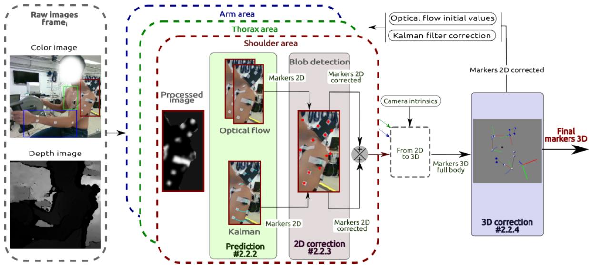
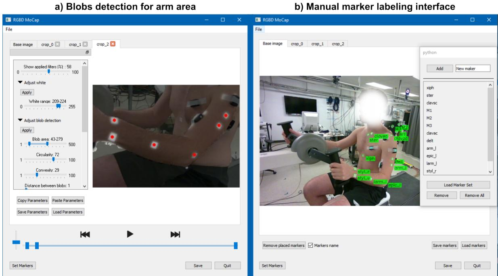
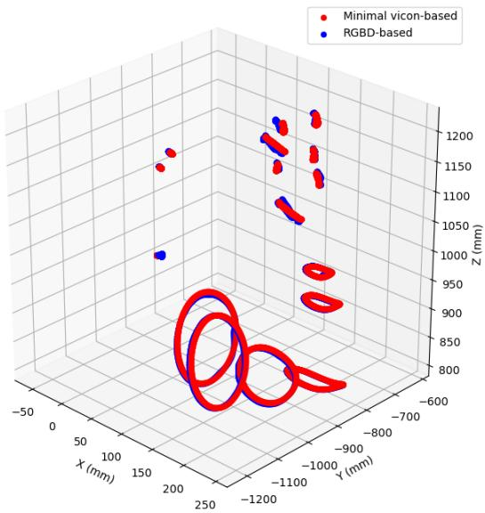
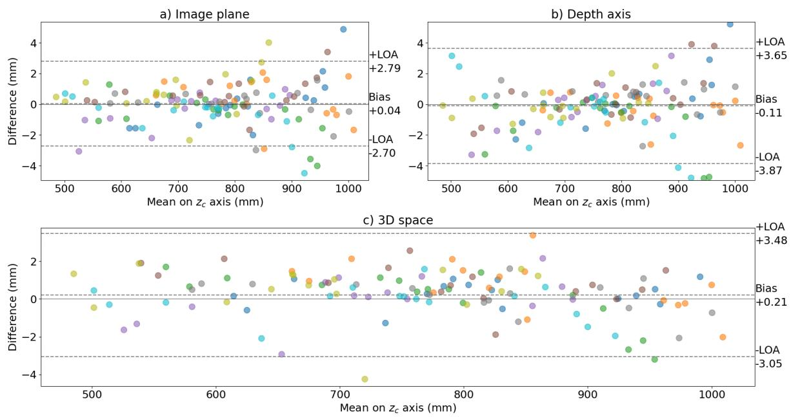
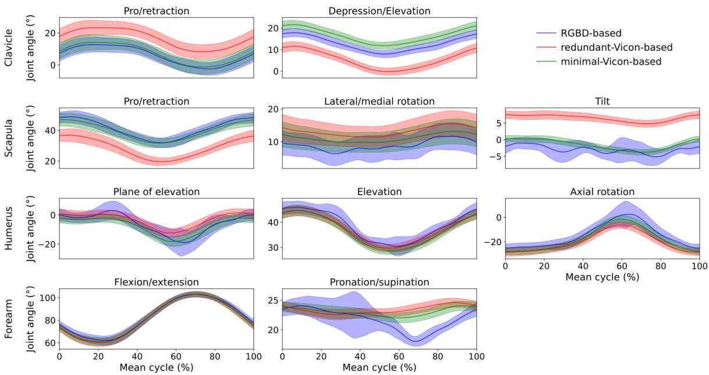

# 实时、准确、开源的单 RGBD 相机上肢肌肉骨骼分析

Amedeo Ceglia1,\*，Kael Facon2，Mickael Begon1,3，Lama Seoud4

1蒙特利尔大学生物医学工程研究所，加拿大魁北克省蒙特利尔

2巴黎信息工程师学院，法国 Le Kremlin-Bicêtre

3蒙特利尔大学运动机能学与人体动力学学院，加拿大魁北克省蒙特利尔

4蒙特利尔理工学院计算机工程与软件工程系，加拿大魁北克省蒙特利尔

通讯作者：Amedeo Ceglia，amedeo.ceglia@umontreal.ca

## 摘要

生物力学反馈（Biomechanical biofeedback）有助于改善康复效果，并为临床医生提供更客观的任务评估手段。这类反馈通常依赖于昂贵的运动捕捉系统，限制了其广泛应用，从而推动了基于计算机视觉的方法的发展。这些方法在上肢分析中存在较大的关节角度误差，并且未将肩胛骨和锁骨的运动纳入分析。我们的开源方法提供了一种用户友好的解决方案，可通过单个低成本 RGBD 相机（RGBD Camera）获得高保真度的上肢运动学数据，并包含半自动的体表标记点标注功能。为展示该方法在上肢分析中的适用性，我们对八名受试者在执行手摇车运动时开展了从运动学到肌肉力估计的实时生物力学分析。标记点分别通过 RGBD 相机和一套光电运动捕捉系统（作为参考）进行采集。肌肉活动通过八通道肌电图（Electromyography, EMG）采集，外加载荷则通过仪器化的手摇踏板采集。Bland-Altman 分析显示两种运动捕捉方法在三维标记点位置上具有显著一致性，误差平均为 $3.3\pm3.9$ mm。在生物力学分析方面，一致性水平对是否使用相同的标记点集较为敏感。例如，使用相同标记点集时关节角度差异平均为 $2.3\pm2.8$°，否则为 $4.5\pm2.9$°。RGBD 相机的反馈以 63 Hz 的频率实时提供。我们的研究提出了一种利用 RGBD 相机作为低成本运动捕捉方案的新方法，强调了其在精确运动学重建和全面的上肢生物力学研究方面的潜力。

关键词——运动捕捉、计算机视觉、RGBD 相机、上肢生物力学

## 1 引言

实时生物力学反馈对于改善或指导康复过程具有重要意义 [GPC13]。反馈内容可包括关节运动学 [BBC+16]、关节动力学 [FMH+04] 或肌肉活动 [Bol03]。关节运动学通常是后续生物力学分析所需的基础，其依赖于基于运动捕捉数据的快速且直接的算法（例如逆运动学）。

动作捕捉通常基于光电摄像系统，用于追踪放置在骨性标志点上的反射或主动标记物。该技术精度高，标记位置误差小于一毫米 [TR20]，因而在临床应用中具有较强的鲁棒性，并被作为评估新兴动作捕捉技术的参考基准。然而，由于成本高昂且搭建复杂，在临床或体育环境中使用光电系统仍具挑战性。因此，研究者开发了多种经济替代系统以应对这些局限。其中三种技术作为最常用的替代方案尤为突出。

第一种技术基于放置于身体节段预定位置的惯性测量单元（Inertial Measurement Units，IMUs）[NWK20]。IMU 的优势在于几乎可以与任何衣物兼容使用，且适合在受限环境中应用。然而，陀螺仪在长时间任务中可能出现漂移，且磁力计易受电磁场干扰，与基于标记的系统相比，下肢关节角度估计误差约为 10° [SDLC22]，上肢误差则可达 30° [HKWE22]。另一局限在于上肢模型的过度简化——仅采用单一的肱胸关节，而未对胸锁关节、肩锁关节及盂肱关节分别建模。因此，承担上肢康复中重要作用的肩胛骨 [VT00] 被忽略。

第二种技术采用一组经过同步与标定的 RGB 摄像头，结合深度学习算法，实现无标记的三维人体姿态识别。该算法通过从各已标定摄像头提供的二维姿态中推断三维姿态，从而检测出一系列代表关节中心的关键点 $[ \mathrm { L M D } ^ { + } 2 2 ]$。随后利用这些关键点的三维位置计算关节角度。这类无标记系统可缩短实验时间，且因可在穿着衣物的条件下使用，故侵入性较低。然而，与基于标记的系统类似，基于摄像头的系统实施成本较高、需要较大空间，且难以实现精确的搭建。所有摄像头必须同步并联合标定，因为最终三维姿态的精度依赖多视角几何。此外，姿态估计对计算资源需求较高，需要高性能 GPU 硬件，因此不适合实时生物反馈或嵌入式部署场景。该方法前景可观，但依赖于用户难以访问的标注图像以评估标注的可靠性。依据具体应用场景，其精度可能不足，尤其是对于手臂的内/外旋，误差可达 $2 3 ^ { \circ } \ [ \mathrm { L M D } ^ { + } 2 2 ]$。此外，与基于 IMU 的技术类似，该类模型同样仅包含简化的肱胸关节（不包括锁骨与肩胛骨）。

最后一种技术基于单个相机（无论是否带有深度测量功能）并结合机器学习，利用预训练数据来定位关节中心并计算关节角度，如文献 [BDMM+24] 所示。由于仅使用一台相机，无需外部相机标定或同步，使其成为一种成本效益高且用户友好的方法。该技术与前一种方法存在类似的缺点，包括标注图像的不准确性以及关节中心定位的误差，可能导致上肢运动的角度误差高达 $2 5 ^ { \circ }$ $[ \mathrm { S B S ^ { + } } 1 9 ]$。此外，当无法获得深度测量时，输入信息（二维图像）较为有限，算法需要做出大量假设以推断三维姿态估计。与后两种技术一样，该模型也对肩关节进行了简化。鉴于此，一些方法（例如使用光学深度相机（RGBD）的方法）已经在提供低成本、实时的基于标记的运动捕捉系统方面展现出有前景的结果。值得注意的是，据我们所知，这些方法尚未被应用于上肢的生物力学分析。在 $[ \mathrm { Y } \mathrm { Y } \mathrm { S } ^ { + } 1 6 ]$ 中，观察到使用红外图像和反射标记会降低标记周围深度信息的准确性；而在 [TCF+18] 中，算法的鲁棒性要求使用大半径的球形标记，限制了其在上肢运动捕捉中的适用性。在本研究中，我们引入了一种使用单个低成本 RGBD 相机和 13 个扁平白色皮肤标记来记录上肢运动学（upper limb kinematics）的开源且用户友好的方法。我们的主要目标是开发一种用于临床环境中捕捉运动学数据的简单、快速且成本效益高的系统。我们实现了一种半自动标记标注算法，并建立了基于肌肉骨骼模型（musculoskeletal model）的生物力学框架。我们将所提出的方法与基于标记的方法（被视为参考方法）进行了比较。我们的评估涵盖了标记的三维位置、生物力学结果以及时间性能。目标是提供一种全面的上肢运动捕捉解决方案，在准确性与生态可用性之间取得平衡。

## 2 方法

## 2.1 数据采集

八名健康受试者（3 名女性；年龄：$2 5 . 9 \pm 1 2 . 2$ 岁；身高：$1 7 5 . 8 \pm 8 . 5$ cm；体重：$7 0 . 2 \pm 8 . 4 \mathrm { k g }$）在签署知情同意书后参与了本研究。本实验获得蒙特利尔大学（Universite de Montréal）伦理委员会批准（#2023-4743）。使用一台立体视觉 RGBD 相机（RealSense D455，Intel，USA）以 60 Hz、848×480 像素分辨率同步记录彩色（RGB）与深度图像帧。相机置于距胸部约一米处，大致与受试者的颈部对齐。在躯干和左上肢的预定解剖位置粘贴十三个白色方形标记（$\sim 2 \times 2$ cm），以检测关键骨性标志并降低软组织伪影 [BDLB17]（图 1）。使用一套 14 相机动作捕捉系统（T40s，Vicon，Oxford, UK）以 120 Hz 记录 13 个半球形（1 mm）反光标记（粘贴于白色标记的中心），以及另外 5 个 10 mm 的反光标记（粘贴于躯干背面和上臂内侧）（图 1）。为公平比较两种方法，我们放置了更多的反光标记以进一步评估标记冗余度的影响，因为光电系统可以轻松采集大量标记。其中「minimal-Vicon-based」一词指使用与 RGBD 方法相同的标记集，而「redundant-Vicon based」则表示使用额外标记。由于精简标记集中背部标记缺失，使用人体测量卡尺手动测量第 7 颈椎（C7）与胸骨柄之间的距离，以用于后续的模型缩放。受试者佩戴经验证（[CMB24]）的自制肩峰标记集群（custom-made acromion marker cluster），从而可在不进行光学标定的情况下，从前视图估计肩胛骨的骨性标志（肩峰角、肩胛冈三角区和肩胛下角）。在对皮肤进行剃毛和清洁处理后，使用八个表面肌电传感器（Trigno EMG Wireless System，Delsys，USA）以 2160 Hz 记录以下肌肉的活动：胸大肌（Pectoralis major）、肱二头肌（长头，Biceps brachii long head）、肱三头肌（长头，Triceps brachii long heads）、上斜方肌（Upper Trapezius）、三角肌（前束、中束、后束，Deltoid anterior, medial, posterior heads）以及背阔肌（Latissimus Dorsi）。手摇车配备了仪器化的手部踏板（Sensix，France），以 100 Hz 记录三维力和力矩。实验装置如图 2 所示。肌电（EMG）信号和反光标记数据通过 Nexus 2.11（Vicon，Oxford, UK）进行同步。在 Vicon 上记录一个触发信号，并与 Biosiglive [CVB23] 同时使用，以同步启动 RGBD 和手部踏板的记录。要求受试者以最大努力完成两次 5 秒的手摇车骑行试验，保持 60 RPM 的节奏，两次之间间隔 2 分钟休息。所采集的信号用于对后续肌力估计中的 EMG 信号进行归一化处理。最后，受试者完成一次解剖姿势（用于肌肉骨骼模型的缩放……

aling），以及功率为 15、20、30 和 40 W 的各 2 分钟手动踏板试验，所有试验均在 60 RPM 下完成。

  

图 1：受试者左臂上装配有白色标记、反光标记（位于方形中心）以及 EMG 传感器。右侧展示了肩峰标志簇 [CMB24] 的人工校准过程。设备上的刻度尺可通过附带的 Python 代码，从三维标志簇的标记位置中提取解剖学骨性标志点。

## 2.2 从 RGBD 相机提取标记点轨迹

开发了 RGBDMocap Python 包 [CFBS24] 用于在 RGB 图像中检测和标记标记点（xc 和 yc 标记位置），然后获取其对应的深度（z）位置。彩色和深度图像使用预实现的 RealSense® 算法进行对齐，以为每个彩色像素建立对应的深度值。标记点的标记是通过一个四步工作流程实现的，以确保在每一帧中进行检测（图 3），具体描述如下：1）初始化（在第一帧进行一次）；2）标记点二维预测；3）标记点二维校正；4）标记点三维校正。

## 2.2.1 初始化

为了提供鲁棒、快速且资源高效的检测，图像被分割成三个不同的区域：胸部、肩部和手臂。我们使用 Python 多进程包 [Hun19] 并行处理这三个区域。所有后续的初始化过程都单独应用于每个区域。开发了一个图形用户界面（GUI）以方便该过程（图 4）。对图像应用了滤波器以改善身体上白色标记点的检测，反映了每个光电摄像机的初始参数调整。具体来说，首先使用对齐的深度图像去除背景。然后应用模糊滤波器以通过平滑边缘来增强图像。然后使用 OpenCV 函数 [How13] 应用对比度受限的自适应直方图均衡化（对比度限制的阈值以及行和列中瓦片的大小是针对每个区域根据经验选择的）。最后，应用二值化阈值以增加白色标记点的可见性。使用 OpenCV 库中的斑点（blob，即图像中某些属性近似恒定的区域）检测器自动检测白色方形标记点。该检测器使用白色范围颜色、面积、圆度和凸度等标准来识别相连的像素组。这些标准在 GUI（图 4-a））中针对每个区域和参与者进行了手动调整，以提供最佳的斑点检测。一旦摄像机定位完成并为第一位参与者确定了参数，它们对后续参与者产生了相当好的结果。尽管如此，仍建议对每个参与者进行微调。之后，用户对每个白色标记点进行一次标记，形成后续预测步骤的初始值（图 4-b））。一旦初始化完成，三步方法用于每一帧。

## 2.2.2 标记点二维预测

由于图像中运动引起的噪声和光照变化，斑点检测器可能会检测出误检斑点，或漏检图像中的一些白色标记。因此，仅通过检测斑点并寻找最近邻来跟踪轨迹是不够的。研究中使用了一个预测步骤，利用标记点的先前位置来估计其后续位置。为了提高算法的鲁棒性，独立采用了两种预测方法：

- 一个光流检测器通过分析先前图像与当前图像之间的差异，跟踪每个之前标记过的标记点。一种在金字塔中实现的 Lucas-Kanade 稀疏迭代方法 [B+01] 被用于

  

图 2：实验装置示意，展示了 RGBD 相机的摆放位置以及部分 Vicon 摄像机，此时一名参与者正在进行手摇车运动。

  

图 3：基于 RGBD 相机的标记点追踪软件架构。

  

图 4：图形用户界面，包括 a) 用于手臂区域的斑点检测（blob detection），以及 b) 手动标记点标注（manual markers labeling）。

OpenCV 被使用。该算法通过跟踪像素强度随时间的变化来估计特定像素的位置。初始标记位置被用作初始位置。

• 卡尔曼滤波器预测标记的二维位置，利用它们之前的位置和速度。该方法仅依赖于检测到的斑点的位置。通过使用协方差矩阵，滤波器预测当前位置。卡尔曼滤波器的实现通过 OpenCV 完成，使用标记位置和速度作为状态。标记的初始位置作为滤波器的初始状态。

## 2.2.3 标记二维校正

将估计的标记位置与图像中检测到的斑点位置进行比较。如果预测位置与检测到的斑点之间的距离小于 10 像素，则标记被归类为可见，其位置被替换为斑点的位置。否则，估计位置保持不变，标记被归类为不可见。在距离相机 1 米处，标记的平均大小约为 10×10 像素。两种跟踪方法生成的标记位置通过对可见标记的位置取平均值进行合并。在两种方法都未检测到可见标记的情况下，其最后已知位置被保留用于下一步。虽然当标记可见时该方法表现良好，但当斑点未被持续检测时会遇到问题，导致不确定性。因此，在三维空间中实施了一个使用所有标记的额外校正步骤，以缓解这些问题。

## 2.2.4 标记三维校正

前述流程（第 2.2.2、2.2.3 节）仅通过二维彩色图像实现标记点追踪。然而，本节通过在三维相机空间内进行操作，充分利用了 RGBD 相机的完整能力。为实现这一目标，根据初始的标记点三维位置构建了一个三维铰接模型，该模型由四个刚体段（胸廓、肩部、上臂和前臂）通过球窝关节连接而成，胸廓除外，其在空间中自由浮动。将前述步骤（第 2.2.2–2.2.3 节）得到的标记点二维位置与深度图像相结合，利用 RGBD 相机的默认内参，在相机坐标系中恢复标记点的三维位置。随后，使用 Biorbd 库 [MB21]，将一种基于扩展卡尔曼滤波器（Extended Kalman Filter, EKF）[FCBL10] 的逆运动学算法应用于标记点三维位置，以估计模型的关节角度。EKF 是一种常见的传感器融合方法，旨在通过最小化误差协方差矩阵的迹，在含噪测量（即标记点）条件下估计非线性系统的状态（此处为关节角度与速度）。这些关节角度提供了模型与各刚体段在相机三维空间中位置的估计。接着，通过正向运动学从关节角度恢复标记点位置。这些三维位置通过 RealSense® 重投影函数及相机内参被重投影至图像坐标系。最后，执行第 2.2.3 节所述的相同二维校正步骤，基于斑点检测从正向运动学结果中得到校正后的二维标记点。随后，这些最终的二维标记点位置被用于卡尔曼校正以及作为光流输入位置，为下一帧标记点预测提供校正后的初始值。

## 2.3 RGBD 与 Vicon 的配准

第 2.2 节允许我们在相机坐标系 $( x _ { c } , y _ { c } , z _ { c } )$ 中获取标记点位置。为了能够对通过 RGBD 获得的 3D 位置与基于 Vicon 的动捕系统所提供的 3D 位置进行有意义的比较，有必要将两个系统的 3D 位置表示在同一坐标系中。由于彩色图像 $( x _ { c } ,$ yc) 和深度图像 $( z _ { c } )$ 来自不同的传感器，因此标记点 3D 位置的评估在相机坐标系 $( x _ { c } , y _ { c } , z _ { c } )$ 内进行，以评估沿每个相机轴的误差。在生物力学分析中，位置在 Vicon 坐标系 $( x _ { \nu } , y _ { \nu } , z _ { \nu } )$ 中定义，该坐标系由垂直方向的 z 轴定义。坐标系之间的变换通过一个最优变换矩阵完成，该矩阵旨在最小化初始同步帧对上的标记点误差。随后，将 RGBD 到 Vicon 的旋转-平移矩阵应用于变换所有帧中 RGBD 标记点的 3D 位置。类似地，使用该矩阵的逆矩阵将每个 Vicon 标记点变换到 RGBD 坐标系中。此外，如相机所提供的不连续相机帧号所示，RGBD 记录可能无法始终保持 60 Hz 的帧率。这些帧号间隙被用于以 60 Hz 插值数据以填补缺失的帧。然后，使用线性插值以匹配 Vicon 系统的帧率（120 Hz）。这种方法便于在 RGBD 和 Vicon 系统之间进行时间序列数据的比较。后续章节（第 2.4 节）采用以 Vicon 坐标系表示的修正后的 RGBD 标记点位置。

## 2.4 实时生物力学框架（Real-time biomechanical framework）

开发了一个实时生物力学框架，并将其应用于通过两种运动捕捉系统所收集的数据，同时考虑了两组标记点集（即 RGBD、最小 Vicon（minimal-Vicon）和冗余 Vicon（redundant-Vicon））。该框架包括：从标记点位置计算关节角度的逆运动学（Inverse Kinematics）、计算关节力矩的逆动力学（Inverse Dynamics），以及估计肌肉力量的静态优化（Static Optimization）。

## 2.4.1 肌肉骨骼模型（Musculoskeletal model）

该肌肉骨骼模型基于 Wu 等人 $[ \mathrm { W L B ^ { + } } 1 6 ]$ 的上肢模型构建而成，包含五个环节（胸廓、锁骨、肩胛骨、上臂和前臂），具有 10 个自由度（两个胸锁关节旋转、三个肩锁关节旋转、三个盂肱关节旋转，以及肘关节屈曲与旋前/旋后）。针对每种运动捕捉方法，采用一次静态试验对模型进行缩放，从而得到三个独立的缩放模型。胸廓宽度（前后径）根据胸骨柄与第七颈椎（C7）之间的测量值进行缩放。该模型由 31 块 Hill 型肌肉驱动，包含并联的收缩元件与被动元件。为了加快计算速度，肌腱被视为刚体 [MUSD13]。此外，由于所关注的运动较为缓慢（60 RPM），肌肉直接由其激活水平进行控制（忽略了具有机电延迟特性的神经激励动力学 [NK01]）。对于肌肉 $m$，由激活水平（a）和肌肉运动学（归一化肌纤维长度 $\tilde { l } _ { m }$ 与速度 $\widetilde { \nu } _ { m }$）计算得到的力 $( f ^ { m } )$ 表示为：

$$
f ^ { m } = f _ { o } ^ { m } ( a f ^ { a c t } ( \tilde { l } _ { m } ) f ^ { \nu } ( \tilde { \nu } _ { m } ) + f ^ { p a s } ( \tilde { l } _ { m } ) ) \cos \alpha ,\tag{1}
$$

其中 $f_{o}^{m}$ 为肌肉最大等长力（muscle maximal isometric force），$f^{act}(\tilde{l}_{m})$、$f^{v}(\tilde{v}_{m})$ 和 $f^{pas}(\tilde{l}_{m})$ 分别为肌肉主动力–长度关系（active force-length）、力–速度关系（force-velocity）以及被动力–长度关系（passive force-length）；α 为肌肉羽状角（pennation angle）[DGKRF16]。

## 2.4.2 逆向运动学（Inverse Kinematics）

首先，采用跨度为 14 帧（延迟 7 帧）的滑动平均窗口对标记点轨迹进行平滑处理。然后，利用在 Biorbd 软件中实现的扩展卡尔曼滤波（EKF）[FCBL10] 进行逆向运动学求解，状态变量为关节角度 $q$、角速度 $\dot{q}$ 与角加速度 $\ddot{q}$。有关基于 EKF 的逆向运动学的更多细节，读者可参考文献 [JLWK20]。

## 2.4.3 逆向动力学（Inverse Dynamics）

关节力矩（τ）由关节运动学 $(q, \dot{q}, \ddot{q})$（来自 EKF 的输出）、踏板力传感器测量的外力 $(F_{ext})$ 以及模型所包含的环节惯性参数计算得到：

$$
\tau = M ( q ) \ddot { q } + N ( q , \dot { q } ) + G ( q ) + C ^ { T } ( q ) F _ { e x t }\tag{2}
$$

其中 $M(q)$、$N(q, \dot{q})$、$G(q)$ 和 $C(q)$ 分别为质量矩阵、科里奥利力和离心力矢量、重力效应矢量，以及手部力作用点的雅可比矩阵。

## 2.4.4 基于肌电的静态优化

用于估计肌肉力量的静态优化对应一个最小二乘问题，其目标是根据通过逆动力学得到的关节力矩以及实验性肌电信号（EMG），寻找最优的肌肉激活（a）。在离线阶段，于手摇车（hand cycling）试验之前，对最大手摇车试验中的肌电信号进行带通滤波（10–425 Hz）、整流处理，并使用四阶巴特沃斯（Butterworth）滤波器进行低通滤波（5 Hz）。然后，通过计算 1 秒内最高值的平均值，获得最大用力试验中每块记录肌肉的激活值。静态优化定义如下：

$$
\begin{array} { r } { \displaystyle \operatorname* { m i n } _ { a , \tau ^ { r e s } } \sum _ { k = 1 } ^ { n _ { e m g } } \omega _ { e m g } \| e m g _ { k } - a _ { k } ^ { i n f } \| ^ { 2 } + \sum _ { i = 1 } ^ { n _ { m u s c l e s } - n _ { e m g } } \omega _ { a } \| a _ { i } ^ { n i n f } \| ^ { 2 } } \\ { + \sum _ { j = 1 } ^ { n _ { \mathrm { j o i n t s } } } \omega _ { \tau } \| \tau _ { j } - ( \tau _ { j } ^ { m } + \tau _ { j } ^ { r e s } ) \| ^ { 2 } + \omega _ { r e s } \| \tau _ { j } ^ { r e s } \| ^ { 2 } } \end{array}\tag{3a}
$$

$$
\forall t , \pmb { a } \in \mathcal { A } , \pmb { \tau } ^ { r e s } \in \mathcal { T }\tag{3b}
$$

其中 $a ^ { i n f }$ 和 $a ^ { n i n f }$ 分别为有信息（informed）和无信息（non-informed）的肌肉激活。τ 对应于通过逆向动力学 $\operatorname { E q . } 2 , \ \tau ^ { r e s }$ 获得的关节力矩，$\tau ^ { r e s }$ 为模拟关节内部刚度的残余关节力矩，$\tau ^ { m }$ 为通过式 4 计算得到的肌肉力矩。emg 代表所记录的八个 EMG 信号。$\omega _ { a } , \omega _ { e m g } , \omega _ { \tau }$ 和 $\omega _ { r e s }$ 分别表示用于最小化肌肉激活、跟踪实验 EMG、跟踪逆向动力学力矩以及最小化残余力矩所分配的权重。式 3b 确保肌肉激活在 0 到 1 之间的生理边界，并将残余力矩约束在 -5 N.m 到 5 N.m 之间。跨越关节 j 的肌肉 m 所产生的关节力矩为：

$$
\tau _ { j } ^ { m } = \sum _ { i = 1 } ^ { n _ { \mathrm { m u s c l e s } } } \Gamma _ { i } \cdot f _ { i } ^ { m }\tag{4}
$$

其中 $\Gamma _ { i }$ 是肌肉 i 的力臂，由肌肉长度的雅可比矩阵计算得出。尽管存在已有的边界条件，但优化过程中并未加入额外的约束以确保求解成功。然而，关节力矩跟踪的权重必须设置得足够高，以保证准确的跟踪效果。该优化使用 Acados [VFK+22] 执行，借助线性求解器 Blasfeo 的高效实现以及 QP 求解器 OSQP [SBG+20]，从而实现快速求解。

## 2.5 数据分析（Data analysis）

对 RGBDmocap 系统的评估聚焦于两个关键方面：1）标记位置的精度以及误差在生物力学分析结果中的传播，与 Vicon 系统进行比较；2）整体生物反馈延迟（biofeedback latency）。首先，两套系统之间的对比分析通过三种不同的方法进行：1）计算 RGBD 标记位置与基于 Vicon 的方法所得到位置之间的绝对误差；2）检查误差在生物力学研究结果中的传播情况；3）研究 RGBD 方法中标记冗余（marker redundancy）对生物力学结果的影响。在 RGBD 相机坐标系内，通过 Bland–Altman 分析 [BA07] 评估两种不同方法（即 Vicon 和 RGBD）所获得的 3D 标记位置之间的一致性。具体而言，采用偏差（bias）和一致性界限（limits of agreement, LoA）来评估一致性。在该分析中，Bland-Altman 差值沿 $x _ { c }$ 和 $y _ { c }$ 轴的平均值进行计算，对应于彩色图像平面内的误差；沿 $z _ { c }$ 轴的差值对应于由深度值引起的误差。Bland-Altman 均值沿 $z _ { c }$ 轴计算，旨在探讨标记到相机距离的影响。相同的分析被应用于生物力学研究结果，包括关节角度（joint angles）、关节力矩（joint torques）和肌肉力（muscle forces）。在此，通过将基于 RGBD 的方法和基于最少 Vicon 标记的方法与基于冗余 Vicon 标记的方法（我们的参考方法）进行比较，并比较基于 RGBD 的方法与基于最少 Vicon 标记的方法来评估一致性。这种方法产生了三种不同的分析，旨在评估方法间的一致性以及评估结果对所采集标记数量的依赖性。为便于阅读，使用以下符号标记：RGBD 对比冗余 Vicon（RGBDvRED）、最少 Vicon 对比冗余 Vicon（MINvRED）以及 RGBD 对比最少 Vicon（RGBDvMIN）。

要在临床场景中应用，反馈必须实时且具有低延迟。为评估基于 RGBD 的方法的实时性能，对运动与结果之间的延迟进行了评估。该延迟包含检索标注位置以及为每一帧计算生物力学结果所需的时间。还考虑了由标记点滤波（Sec. 2.4.2）引入的延迟。跟踪算法与生物力学分析在一台运行 Ubuntu 20.04 LTS 的笔记本电脑（Intel®CoreTM i7-6700HQ CPU @ 2.60 GHz）上执行。

## 3 结果

## 3.1 三维标记点位置

两种运动捕捉系统下，标记点的三维轨迹呈现出高度一致的形态（图 Figure 5）。这一观察结果通过所有试次与所有受试者的标记点轨迹 RMSE（均方根误差）得到了进一步支持，平均值为 3.32 ± 3.94 mm。Bland-Altman 分析（图 Figure 6）显示数据点在图中呈均匀分布，表明标记点深度对两个系统之间的一致性影响较小。图像平面（Fig 6-a，由 $x$ 与 $y _ { c }$ 轴构成）内的一致性优于沿深度轴 $z$ 方向的一致性（Fig. 6-b），其一致性界限更窄（分别为 (-2.70 mm, 2.79 mm) 与 (-3.87 mm, 3.65 mm)）。两种情况下，偏差均接近于零。

  

图 5：一名参与者 120 个周期的 3D 标记轨迹均值，分别针对 minimal-Vicon（红色）和基于 RGBD 的（蓝色）动作捕捉方法。

  

图6：标记点（markers）在 RGBD 相机坐标系下位置的 Bland-Altman 图，每个标记点用一个点表示，并以参与者专属的颜色加以区分。差异分别在（a）图像平面、（b）深度轴以及（c）所有轴的平均值上计算得出。

  

图 7：单个受试者基于 RGBD（蓝色）、带冗余的 Vicon（红色）以及最小化（绿色）三种方法的 120 个周期关节角度平均值（实线）± 一个标准差（阴影区域）。

表 1：三种方法各分段的缩放因子（所有参与者所有轴的平均值）

<table><tr><td>Segment</td><td>RGBD</td><td colspan="2">Vicon</td></tr><tr><td>Thorax</td><td> $\overline { { 1 . 0 6 \pm 0 . 0 4 } }$ </td><td>redundant  $\overline { { 1 . 0 6 \pm 0 . 0 5 } }$ </td><td>minimal  $\overline { { 1 . 0 7 \pm 0 . 0 4 } }$ </td></tr><tr><td>Clavicle</td><td> $1 . 1 0 \pm 0 . 0 9$ </td><td> $1 . 0 8 \pm 0 . 0 8$ </td><td> $1 . 0 9 \pm 0 . 0 8$ </td></tr><tr><td>Scapula</td><td> $1 . 2 1 \pm 0 . 0 4$ </td><td> $1 . 2 1 \pm 0 . 0 5$ </td><td> $1 . 2 1 \pm 0 . 0 5$ </td></tr><tr><td>Humerus</td><td> $0 . 9 8 \pm 0 . 0 8$ </td><td> $0 . 9 8 \pm 0 . 0 7$ </td><td> $0 . 9 7 \pm 0 . 0 7$ </td></tr><tr><td>Forearm</td><td> $0 . 9 9 \pm 0 . 0 6$ </td><td> $1 . 0 1 \pm 0 . 0 7$ </td><td> $0 . 9 9 \pm 0 . 0 5$ </td></tr><tr><td></td><td></td><td></td><td></td></tr></table>

## 3.2 生物力学结果

三种方法生成的个性化模型在所有受试者之间具有可比的身体缩放因子（表 1）。RGBDvMIN 的关节角度 RMSD 为 $2 . 3 4 \pm 2 . 7 9 ^ { \circ }$，平均差异约为 RGBDvRED 和 MINvRED 的两倍。关节力矩也观察到类似的趋势，RGBDvMIN 的 RMSD 达到 0.88±1.86 N·m（表 2）。此外，RGBDvMIN 的肌力 RMSD 平均差异为 3.55±13.68 N，约为 RGBDvRED 或 MINvRED 的三倍（表 2）。这些结果得到了 Bland-Altman 分析的支持，其中 RGBDvMIN 在关节角度（-4.53° 至 5.01°）和关节力矩（-1.70 N·m，1.40 N·m）上的一致性界限约为 RGBDvRED 和 MINvRED 的两倍。同样，RGBDvMIN 的肌力一致性界限（-19.96 N，16.79 N）比其他两组比较窄两倍以上。在所有情况下，各组比较的偏差都接近于零，其中 RGBDvRED 比较中肌力的偏差最大（但仍然较低），为 -2.12 N。对于每个结果，将基于 RGBD 的方法和最小 Vicon 方法与冗余 Vicon 方法进行比较时，分析显示出一致性水平相似。图 7-9 综合展示了某受试者在 40 W 阻力下平均周期内的关节角度、力矩和肌力。所有方法的关节角度表现出相同的模式，尽管在冗余 Vicon 与其他方法之间可以注意到一些偏移，尤其是在胸锁关节和肩锁关节上。两种标记较少的方法之间几乎没有任何偏移。基于 RGBD 的方法提供了更嘈杂的运动轨迹，尤其是肩胛骨旋转与倾斜以及前臂旋前/旋后。三种方法提供的关节力矩（图 8）几乎完全重叠，尽管基于 RGBD 的方法因关节角度噪声较大而显示出更高的标准差区域。肌力在周期内表现出几乎相同的起始时刻，但与另外两种方法相比，冗余 Vicon 方法在幅度上存在可见偏移（图 9）。

  

图 8：单个受试者在基于 RGBD 的方案（蓝色）、带冗余的 Vicon（红色）以及最小标记点集（绿色）三种条件下，120 个周期的关节力矩平均值（实线）及其加减一倍标准差（阴影区域）。

  

图 9：单个受试者在基于 RGBD 的方法（蓝色）、带冗余的 Vicon（红色）和最小标记集（绿色）三种条件下，九块肌肉力 120 个步态周期的平均值（实线）及 ± 一个标准差（阴影区域）。

表 2：关节角度与力矩以及肌肉力的均方根偏差（Root Mean Square Deviation, RMSD）及一个标准差（Standard Deviation, SD），以及 Bland-Altman 一致性界限（Limit of Agreement, LOA）与偏倚。分别给出了基于 RGBD 的方法与极简 Vicon 方法相对于冗余 Vicon 方法的结果，以及基于 RGBD 的方法与极简 Vicon 方法之间相互比较的结果。

<table><tr><td rowspan="2"></td><td rowspan="2"></td><td rowspan="2">RMSD</td><td rowspan="2">SD</td><td colspan="2">LOA</td><td rowspan="2">Bias</td></tr><tr><td>lower</td><td>upper</td></tr><tr><td rowspan="3">Joint angles (°)</td><td>RGBD vs redundant</td><td>4.50</td><td>2.85</td><td>-12.13</td><td>11.22</td><td>-0.46</td></tr><tr><td>minimal vs redundant</td><td>4.46</td><td>0.84</td><td>-13.28</td><td>11.89</td><td>-0.70</td></tr><tr><td>RGBD vs minimal</td><td>2.34</td><td>2.79</td><td>-4.53</td><td>5.01</td><td>0.24</td></tr><tr><td></td><td>RGBD vs redundant</td><td>2.26</td><td>2.49</td><td>-3.83</td><td>5.07</td><td>0.62</td></tr><tr><td rowspan="2">Joint torques (N.m)</td><td>minimal vs redundant</td><td>2.25</td><td>1.56</td><td>-4.19</td><td>5.73</td><td>0.77</td></tr><tr><td>RGBD vs minimal</td><td>0.88</td><td>1.86</td><td>-1.70</td><td>1.40</td><td>-0.15</td></tr><tr><td rowspan="3">Muscle forces (N)</td><td>RGBD vs redundant</td><td>10.70</td><td>20.89</td><td>-51.64</td><td>47.40</td><td>-2.12</td></tr><tr><td>minimal vs redundant</td><td>10.60</td><td>17.55</td><td>-51.65</td><td>50.58</td><td>-0.53</td></tr><tr><td>RGBD vs minimal</td><td>3.55</td><td>13.68</td><td>-19.96</td><td>16.79</td><td>-1.58</td></tr></table>

表 3：每帧各引入延迟的均值和标准差（SD）

<table><tr><td colspan="2"></td><td colspan="2">Delay (ms)</td></tr><tr><td rowspan="2">Tracking</td><td>2D tracking and correction</td><td>mean 7.64</td><td>SD 1.83</td></tr><tr><td></td><td>2.71</td><td></td></tr><tr><td></td><td>3D correction</td><td>0.47</td><td>0.58</td></tr><tr><td rowspan="2">Biomechanical analysis</td><td>Inverse kinematics</td><td></td><td>0.042</td></tr><tr><td>Inverse dynamics</td><td>0.31</td><td>0.051</td></tr><tr><td>Total</td><td>Static optimization and muscle force computation</td><td>3.94 15.07</td><td>1.54 4.04</td></tr></table>

## 3.3 时间性能

Table 3 概述了从 RGBD 跟踪到生物力学分析各任务所产生的延迟。由于三个区域采用并行处理，所有被试者的 RGBD 跟踪总延迟为 10.35±2.41 ms，对应的跟踪频率为 94 Hz，超过了相机的帧率（60 Hz）。获取标记轨迹后，生物力学分析所引入的延迟约为 4.72±1.63 ms，对应的求解速率为 211 Hz，远超相机的帧率。反馈延迟同样受到标记在线移动平均方法滤波的影响，该方法引入了近七个帧的延迟。由于系统速率固定为 120 Hz，由此每帧产生的总延迟为 58 ms。然而，该延迟并不影响算法的运行频率，其平均约为 63 Hz（15.07±4.04 ms，Tab.3）。综合考虑跟踪延迟、生物力学分析延迟以及标记滤波延迟，基于录制数据的估计总延迟约为 73.07±4.04 ms。

## 4 讨论

我们的目标是评估使用单台 RGBD 相机进行上肢生物力学分析的可行性。我们提出了一种半自动标注算法和一种高效的肌电信号驱动（EMG-informed）生物力学流程，以基于单台 RGBD 相机提供实时反馈。我们的结果表明，我们的方法能够产生准确的实时三维标记轨迹，从而支持全面的上肢生物力学评估。所提供的用户友好图形界面简化了跟踪算法的使用，而其单相机配置使其易于部署，适用于临床环境。此外，我们的方法支持从正面进行记录，能够捕捉包括肩胛骨和锁骨在内的绝大部分上肢结构。

## 4.1 标记精度

如 Bland-Altman 分析所示，基于 RGBD 的动捕所提供的三维标记位置与基于 Vicon 的动捕之间表现出一致性良好至较强的水平。偏差接近零（-0.21 mm），一致性界限位于（-3.05 mm, 3.48 mm）范围内，低于标记放置误差（最高可达 9 mm [SJC+09]）或软组织伪影（最高可达 18 mm [AADS21]）所带来的误差。尽管标记到相机的距离对一致性水平影响不大，但在深度轴上观察到比图像平面更宽的一致性界限。这表明，由于深度图像分辨率或其与 RGB 图像之间的错位，可能在三维空间中引入了更高的误差。通过提高相机分辨率或进行单相机深度重新标定 [DTLC17]，此类误差有望得到缓解。

## 4.2 低传播误差

已知增加标记点的数量可以提高运动学估计的准确性。除了增加标记点之外，评估还可以通过数值技术进行，例如使用运动链的方法 [BWY08]。然而，即使临床医生在标记点放置方面具有专业知识，过多的标记点放置也可能非常耗时。我们使用 RGBD 相机的标记点数量与其他临床上肢标记点集一致，例如使用 7 个 [VRD15]、8 个 [BSK+23] 或 $1 2 \left[ \mathrm { N F B ^ { + } 1 8 } \right]$ 个标记点。

我们的评估表明，对于每个生物力学结果，当使用相同的标记点集时，由偏差和一致性界限所表示的一致性水平相似。在比较两种最小方法时，一致性水平是观察到的最小方法与冗余方法之间一致性水平的两倍，这强调了标记点集对生物力学结果的影响大于使用两种不同运动捕捉方法的影响。在胸廓上实施标记点簇，正如 Noble 等人 $[ \mathrm { N F B ^ { + } } 1 8 ]$ 所做的那样，有潜力缓解初始胸廓方向不正确的问题，从而提高所连接节段的关节角度精度。

尽管如此，RGBD 与 minimal-Vicon 方法之间的比较显示出了强一致性，关节角度的一致性界限范围为 $- 4 . 5 3 ^ { \circ } \mathrm { t o } 5 . 0 1 ^ { \circ }$ 。RGBD 与 redundant-Vicon 方法之间在关节角度估计上的误差（∼5°）低于文献中报道的使用 IMU 系统 $( \sim 3 0 ^ { \circ } \ [ \mathrm { H K W E } 2 2 ] )$ 或无标记系统 $( \sim 2 3 ^ { \circ } \lbrack \mathrm { L M D } ^ { + } 2 2 \rbrack )$ 时的上肢误差。这些数值落在使用运动学重建方法时通常观察到的变异性范围内，在脑瘫儿童的上肢分析中，该方法在不同次测量之间可能产生高达 10° 的误差 $[ \mathrm { J } \mathrm { F B } ^ { + } 1 1 ]$ 。

同样地，Uchida 等人 [US22] 报告了关节力矩估计中高达 26.6 N.m 的误差（峰值的 17%），而在我们研究中，关节力矩的一致性界限从 -1.70 N.m 到 1.40 N.m 不等（约为关节力矩最高值的 7%，即 ±25 N.m）。

我们观察到关节力矩计算的一致性高于肌肉力估计的一致性。这可归因于关节运动学的差异，关节运动学通过力臂或肌肉长度的变化影响肌肉力的估计。Blache 和 Begon [BB17] 证明了这一点。然而，尽管存在这些差异，所有方法产生了相似的肌肉力模式，所得的起始时间根据使用的阈值可能相同。

## 4.3 延迟

Waltermate 及同事 [WSH+16] 表明，运动表现和感知会受到 75 毫秒以上延迟的影响。本工作的最终目标是促进实时生物反馈以引导康复动作，因此我们系统所引入的延迟成为一个关键因素。我们基于 Python 多进程（multiprocessing）开发了一套高效的标记点标记流水线，能够以 10.6 毫秒（94 Hz）的延迟获取已标记的标记点，显著超过了相机的帧率。这确保了我们的算法即使在使用更高帧率的相机时也能及时提供已标记的标记点。对于生物力学流水线，我们采用了基于 C++ 的库进行肌肉骨骼建模（biorbd）和静态优化（acados），能够在 4.7 毫秒（213 Hz）的延迟内给出结果，同样显著超过了相机的帧率。然而，由于需要对标记点轨迹进行滤波，每帧会产生 58 毫秒的显著延迟。因此，反馈的总体延迟为 73.07 毫秒，与 75 毫秒的目标处于同一量级。该频率有望通过并行执行标记点检索和生物力学分析而得到进一步提升。此外，可以使用卡尔曼滤波器（Kalman filter）进行标记点滤波，这应能将延迟大幅降低到接近 0 毫秒 [SNPW08]。

## 4.4 临床意义

针对我们这款新颖的低成本动作捕捉系统，我们设计了一套图形界面，以简化其在从研究到临床等各种场景下的使用。追踪算法为半自动的，便于设置流程的开展；不过，对于初始帧仍需进行手动标记。为了提升效率，可以集成迭代最近点（Iterative Closest Point, ICP）方法，利用预先构建好的模型自动标记初始帧 [YPDQ09]。此外，我们还可以引入一个校准环节，借助相机直接建立一个 z 轴垂直方向的坐标系。这可以通过使用带有白色标记点的三维形状（例如 Vicon 系统所使用的五标记点校准棒），或利用相机内置的惯性传感器来实现。本研究下一步的工作是在临床环境中、在临床医生的参与下对该系统进行评估。

本研究存在一些局限性。首先，所选相机以非保守的 60 Hz 帧率运行，这可能会对时间相关分析产生影响。然而，由于相机会输出图像计数，因此可以通过插值方法检测并处理任何不连续性，从而有效应对该局限性。此外，由于所选相机并非面向科研用途，将其与肌电图（EMG）设备或测力台等其他设备进行同步可能具有挑战性。biosiglive [CVB23] 等外部工具有助于从多种来源获取数据，但仍需进一步开发。我们低成本运动捕捉系统的一个未来目标可能是开发一个嵌入式系统，以便更可靠地进行数据传输。未来的工作将利用我们提出的自动标注算法提供带标注的深度图像，这些图像可用于训练一个基于骨性解剖标志点的无标记（markerless）姿态估计新机器学习模型。

## 5 结论

我们证明，使用单一低成本 RGBD（彩色加深度，RGBD）相机与白色皮肤标记点，可以实现与光电运动捕捉系统相媲美的上肢生物力学分析。通过开发半自动标注算法以及基于肌电图信息驱动的生物力学流程，我们基于单一 RGBD 相机提供了实时反馈。我们的方法可提供精确的实时三维标记点轨迹，从而便于开展全面的上肢生物力学评估。凭借友好的用户界面与单相机配置，本系统非常适合临床场景使用。在考虑相同数量的已记录标记点时，我们观察到 RGBD 与 Vicon 方法之间具有很强的一致性。然而，我们强调了标记点冗余缺失对逆运动学的影响——与使用冗余设置的 Vicon 系统相比，使用 RGBD 系统与 minimal-Vicon 系统均出现了显著差异。

总体而言，我们的研究结果强调了 RGBD 相机作为上肢生物力学分析中一种经济可行替代方案的潜力，同时也为未来研究中的进一步改进与提升提供了机会。

## 6 利益冲突声明

作者声明，他们不存在任何已知的可能影响本论文所报告工作的竞争性经济利益或个人关系。

## 7 作者贡献

AC、MB 与 LS：研究构思（conceptualization）。AC 与 KF：数据管理（data curation）。AC、MB 与 LS：方法学（methodology）。AC 与 KF：软件开发（software）。MB 与 LS：指导与监管（supervision）。AC：撰写初稿（writing-original draft）。MB 与 LS：审阅与编辑（writing-review & editing）。AC 与 MB：经费获取（Funding acquisition）。所有作者均已阅读并同意投稿稿件的最终发表版本。

## 8 资助

本工作得到加拿大自然科学与工程研究理事会（Natural Sciences and Engineering Research Council of Canada，NSERC）通过 CREATE OPSIDIAN 计划、探索类项目经费（discovery grant）RGPIN/04978-2019，以及魁北克自然与技术研究基金（Fonds de recherche du Québec – Nature et technologies，FRQNT）的资助。

## 参考文献

[AADS21] Andrea Ancillao, Erwin Aertbelien, 和 Joris De Schutter. 软组织伪影对步态周期中膝关节标记点测量及螺旋轴计算的影响：基于 CAMS-Knee 数据集的研究. Human Movement Science, 80:102866, 2021.

[B⁺01] Jean-Yves Bouguet 等. 仿射 Lucas-Kanade 特征追踪器的金字塔实现算法描述. Intel corporation, 5(1-10):4, 2001.

[BA07] J Martin Bland 和 Douglas G Altman. 含多个个体观测的不同测量方法之间的一致性. Journal of biopharmaceutical statistics, 17(4):571–582, 2007.

[BB17] Yoann Blache 和 Mickael Begon. 肩部运动学估计对肌骨模型预测关节及肌肉力学的影响. IEEE Transactions on Biomedical Engineering, 65(4):715–722, 2017.

[BBC⁺16] Matteo Bigoni, Silvia Baudo, Veronica Cimolin, Nicola Cau, Manuela Galli, Lucia Pianta, Elena Tacchini, Paolo Capodaglio, 和 Alessandro Mauro. 运动学评估能否为卒中后上肢康复的临床评估提供有意义的信息？一例病例报告. Journal of physical therapy science, 28(8):2408–2413, 2016.

[BDLB17] Yoann Blache, Raphael Dumas, Arian Lundberg, 和 Mickael Begon. 上肢在不同功能、日常活动和体育运动中的软组织伪影主成分分析. J. Biomech., 62:39–46, 2017.

[BDMM⁺24] Michele Boldo, Roberto Di Marco, Enrico Martini, Mauro Nardon, Matteo Bertucco, 和 Nicola Bombieri. 论单摄像头无标记系统在地面步态监测中的可靠性. Computers in biology and medicine, page 108101, 2024.

[Bol03] Jeffrey E Bolek. 利用表面肌电信号实时调整步态的初步研究. Applied psychophysiology and biofeedback, 28:129–138, 2003.

[BSK⁺23] Monika Błaszczyszyn, Agnieszka Szczesna, Mariusz Konieczny, Paweł Pakosz, Stefan Balko, 和 Zbigniew Borysiuk. 卒中后成年人上肢运动的定量评估——以识别取物和抬举活动中的敏感指标. Journal of Clinical Medicine, 12(9):3333, 2023.

[BWY08] Mickael Begon, Pierre-Brice Wieber, 和 Maurice Raymond Yeadon. 利用链模型从有限数量皮肤标记点估计高杠上分腿动作的运动学. Journal of biomechanics, 41(3):581–586, 2008.

[CFBS24] Amedeo Ceglia, Kael Facon, Mickael Begon, 和 Lama Seoud. RGBD Mocap, 2024. https://github.com/aceglia/rgbd_mocap.

[CMB24] Amedeo Ceglia, Lucas Mulhaupt, 和 Mickael Begon. 用于重建肩胛骨运动学的创新装置. 载于：第 22 届法语国家儿童与成人运动分析学会大会论文集，2024.

[CVB23] Amedeo Ceglia, Felipe Verdugo, and Mickael Begon. Biosiglive：一个用于实时生物信号处理的开源 Python 包。Journal of Open Source Software, 8(83):5091, 2023.

[DGKRF16] Friedl De Groote, Allison L Kinney, Anil V Rao, and Benjamin J Fregly. 评估用于求解肌肉冗余问题的直接配点最优控制问题公式。Annals of biomedical engineering, 44(10):2922–2936, 2016.

[DTLC17] Walid Darwish, Shenjun Tang, Wenbin Li, and Wu Chen. 商用 RGB-D 传感器的一种新标定方法。Sensors, 17(6):1204, 2017.

[FCBL10] V Fohanno, F Colloud, M Begon, and P Lacouture. 使用扩展卡尔曼滤波算法估计皮划艇三维运动学：一项初步研究。Computer Methods in Biomechanics and Biomedical Engineering, 13(S1):55–56, 2010.

[FMH+04] Virginie G Femery, Pierre G Moretto, Jean-Michel G Hespel, Andre Thévenon, and Ghislaine Lensel. 用于足部卸载的实时足底压力反馈装置。Archives of physical medicine and rehabilitation, 85(10):1724–1728, 2004.

[GPC13] Oonagh M Giggins, Ulrik McCarthy Persson, and Brian Caulfield. 康复中的生物反馈。Journal of neuroengineering and rehabilitation, 10(1):1–11, 2013.

[HKWE22] Jakob Henschke, Hannes Kaplick, Monique Wochatz, and Tilman Engel. 使用商用传感器-软件系统评估惯性测量单元在肩部运动学中的有效性：一项验证研究。Health Science Reports, 5(5):e772, 2022.

[How13] Joseph Howse. OpenCV 计算机视觉与 Python，第 27 卷。Packt Publishing Birmingham, UK, 2013.

[Hun19] John Hunt. 多处理。收录于：Python 3 编程高级指南，第 363–376 页。Springer, 2019.

[JFB+11] Ellen Jaspers, Hilde Feys, Herman Bruyninckx, Andrea Cutti, Jaap Harlaar, Guy Molenaers, and Kaat Desloovere. 偏瘫型脑性瘫痪患儿上肢运动学的可靠性。Gait & posture, 33(4):568–575, 2011.

[JLWK20] Vladimir Joukov, Jonathan FS Lin, Kevin Westermann, and Dana Kulic. 基于约束扩展卡尔曼滤波的实时无标记点位姿估计。收录于：2018 年实验机器人国际研讨会论文集，第 762–771 页。Springer, 2020.

[LMD+22] Bhrigu K Lahkar, Antoine Muller, Raphael Dumas, Lionel Reveret, and Thomas Robert. 无标记运动捕捉系统在估计拳击上肢运动学方面的准确性。Frontiers in Sports and Active Living, 4:939980, 2022.

[MB21] Benjamin Michaud and Mickael Begon. biorbd：一个用于分析和模拟人体生物力学的 C++、Python 和 MATLAB 库。Journal of Open Source Software, 6(57):2562, 2021.

[MUSD13] Matthew Millard, Thomas Uchida, Ajay Seth, and Scott L Delp. 柔性计算肌肉：肌腱动力学的建模与仿真。Journal of biomechanical engineering, 135(2), 2013.

[NFB+18] Jonathan J Noble, Nicola RD Fry, Carly R Bingham, Rebecca H East, and Adam P Shortland. 一种实用的上肢临床运动学模型. Proceedings of the Institution of Mechanical Engineers, Part H: Journal of Engineering in Medicine, 232(2):207–212, 2018.

[NK01] RR Neptune and SA Kautz. 肌肉激活与去激活动力学：快速周期性人体运动表现中的支配性特性？ Exercise and sport sciences reviews, 29(2):76–81, 2001.

[NWK20] Wesley Niswander, Wei Wang, and Kimberly Kontson. 用于下肢关节运动学测量的IMU传感器放置优化. Sensors, 20(21):5993, 2020.

[SBG+20] Bartolomeo Stellato, Goran Banjac, Paul Goulart, Alberto Bemporad, and Stephen Boyd. OSQP：一种用于二次规划的算子分裂求解器. Math. Program. Comput., 12(4):637–672, 2020.

[SBS+19] Joe Sarsfield, David Brown, Nasser Sherkat, Caroline Langensiepen, James Lewis, Mohammad Taheri, Christopher McCollin, Cleveland Barnett, Louise Selwood, Penny Standen, et al. 基于深度传感器的姿态估计算法在技术监督康复应用中的临床评估. International journal of medical informatics, 121:30–38, 2019.

[SDLC22] Zhenyu Shuai, Anqi Dong, Haoyang Liu, and Yixiong Cui. 一种用于量化功能性运动中下肢关节角度的惯性测量系统的信度与效度. Sensors, 22(3):863, 2022.

[SJC+09] Patrick Salvia, S Van Sint Jan, A Crouan, L Vanderkerken, Fedor Moiseev, Victor Sholukha, Celine Mahieu, Olivier Snoeck, and Marcel Rooze. 两种方法标定肩部解剖标志的精度：一种类石膏方案与一种新型解剖触诊方法. Gait & posture, 29(4):587–591, 2009.

[SNPW08] Pascal Spincemaille, Thanh D Nguyen, Martin R Prince, and Yi Wang. 用于实时导航处理的卡尔曼滤波. Magnetic Resonance in Medicine: An Official Journal of the International Society for Magnetic Resonance in Medicine, 60(1):158–168, 2008.

[TCF+18] Alessandro Timmi, Gino Coates, Karine Fortin, David Ackland, Adam L Bryant, Ian Gordon, and Peter Pivonka. 基于低成本Microsoft Kinect v2传感器的新型标记追踪方法的精度. Medical engineering & physics, 59:63–69, 2018.

[TR20] Matt Topley and James G Richards. 当前可用的光电运动捕捉系统的比较. Journal of biomechanics, 106:109820, 2020.

[US22] Thomas K Uchida and Ajay Seth. 结论还是幻象：由于标记注册与模型缩放误差导致的基于标记运动捕捉的反分析中不确定性的量化. Frontiers in Bioengineering and Biotechnology, 10:874725, 2022.

[VFK+22] Robin Verschueren, Gianluca Frison, Dimitris Kouzoupis, Jonathan Frey, Niels van Duijkeren, Andrea Zanelli, Branimir Novoselnik, Thivaharan Albin, Rien Quirynen, and Moritz Diehl. acados——一个用于快速嵌入式最优控制的模块化开源框架. Math. Prog. Computation, 14(1):147–183, 2022.

[VRD15] Athanasios Vanezis, Mark A Robinson, and Nikolaos Darras. elepap 临床方案用于上肢功能三维运动学评估的可靠性. Gait & Posture, 41(2):431–439, 2015.

[VT00] Michael L Voight and Brian C Thomson. 肩胛骨在肩部损伤康复中的作用. Journal of athletic training, 35(3):364, 2000.

[WLB+16] Wen Wu, Peter VS Lee, Adam L Bryant, Mary Galea, and David C Ackland. 在肩部肌肉与关节功能评估中的受试者特异性肌肉骨骼建模. J. Biomech., 49(15):3626–3634, 2016.

[WSH+16] Thomas Waltemate, Irene Senna, Felix Hulsmann, Marieke Rohde, Stefan Kopp, Marc Ernst, and Mario Botsch. 延迟对虚拟现实中闭环交互的感知判断和运动表现的影响. 载于：第22届ACM虚拟现实软件与技术会议论文集，第27–35页，2016.

[YPDQ09] Shihui Ying, Jigen Peng, Shaoyi Du, and Hong Qiao. 基于ICP的三维数据配准尺度拉伸方法. IEEE Transactions on automation science and engineering, 6(3):559–565, 2009.

[YYS+16] Minxiang Ye, Cheng Yang, Vladimir Stankovic, Lina Stankovic, and Andrew Kerr. 用于远程康复的深度相机运动分析框架：运动捕捉与以人为中心的运动学分析. IEEE Journal of Selected Topics in Signal Processing, 10(5):877–887, 2016.