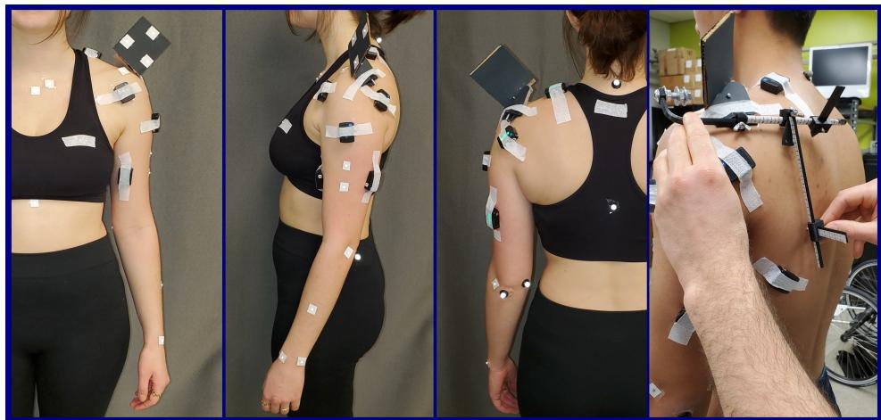
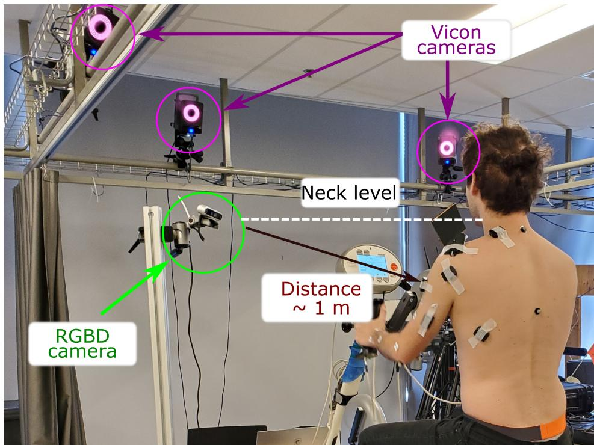
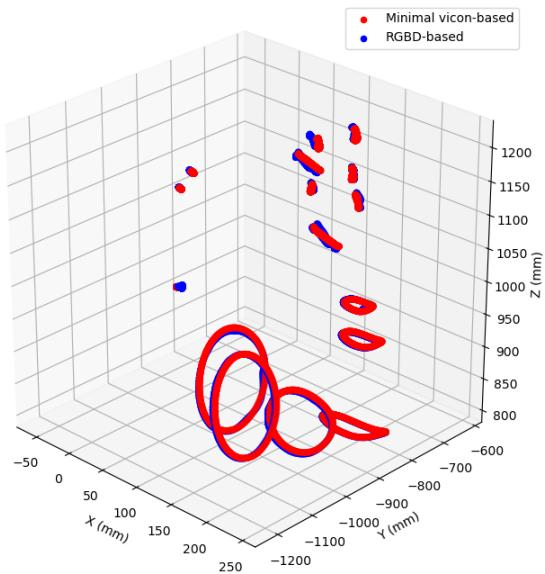
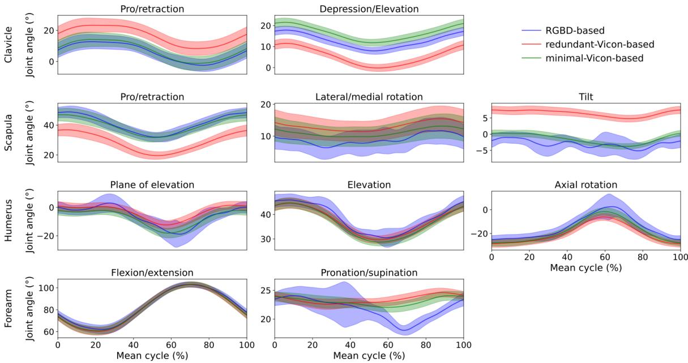
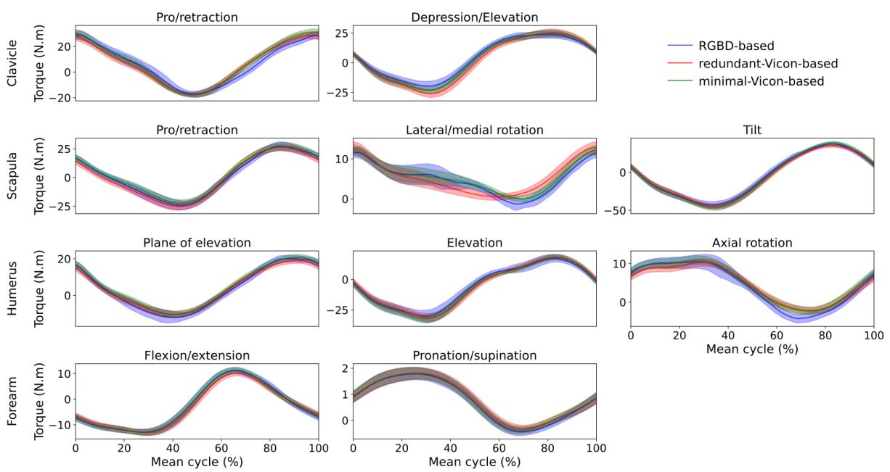

# 基于单台 RGBD 相机的实时、精准且开源的上肢肌肉骨骼分析

Amedeo Ceglia1,\*, Kael Facon2, Mickael Begon¨ 1,3, 以及 Lama Seoud4

1Institute of Biomedical Engineering, University of Montreal, Montreal, QC Canada

2Ecole d’ingenieurs informatique Paris, Le Kremlin-Bic ´ etre, France ˆ

3School of Kinesiology and Human Kinetics, University of Montreal, Montreal, QC Canada

4Department of Computer Engineering and Software Engineering, Polytechnique Montreal,

Montreal, QC, Canada

通讯作者：Amedeo Ceglia, amedeo.ceglia@umontreal.ca

## 摘要

生物力学生物反馈可以促进康复并为临床医生提供更客观的任务评估。这些反馈通常依赖昂贵的动作捕捉系统，从而限制了其广泛应用，进而促进了基于计算机视觉方法的发展。在针对上肢时，这些方法往往存在较大的关节角度误差，并在分析中排除了肩胛骨和锁骨的运动。我们的开源方法使用单台低成本 RGBD 相机，为高保真上肢运动学提供了一种用户友好的解决方案，并包含半自动皮肤标记点标注功能。为了展示我们的方法在上肢的应用潜力，我们对 8 名进行手摇自行车运动的参与者进行了从运动学到肌肉力量估计的实时生物力学分析。标记点由 RGBD 相机和作为参考的光电动作捕捉系统同时记录。分别使用 8 通道 EMG（肌电图）和仪器化手脚踏板记录肌肉活动和外部载荷。Bland-Altman 分析显示，两种动作捕捉方法在 3D 标记点位置上具有高度一致性，平均误差为 3.3±3.9 mm。对于生物力学分析，一致性水平对是否使用相同的标记点集较为敏感。例如，在使用相同标记点集时，关节角度差异平均为 2.3±2.8°，反之则为 4.5 pm 2.9°。RGBD 相机提供的生物反馈频率为 63 Hz。我们的研究提出了一种将 RGBD 相机用作低成本动作捕捉解决方案的新方法，突出了其在精确运动学重建和全面上肢生物力学研究中的潜力。

关键词— 动作捕捉, 计算机视觉, RGBD 相机, 上肢生物力学

## 1 引言

实时生物力学反馈对于改善或指导康复具有高度相关性 [GPC13]。反馈内容可包括关节运动学 [BBC+16]、关节动力学 [FMH+04] 或肌肉活动 [Bol03]。关节运动学通常是后续生物力学分析所必需的，并依赖于基于动作捕捉数据的快速且直接的算法（例如逆运动学）。

动作捕捉通常基于光电相机系统，通过追踪放置在骨性标志上的反光或主动标记点来实现。该技术精度高，标记点位置误差小于一毫米 [TR20]，使其在临床应用中具有稳健性，并成为评估新兴动作捕捉技术的参考基准。然而，由于成本高昂且安装设置复杂，在临床或运动环境中使用光电系统仍然充满挑战。因此，研究人员开发了经济实惠的替代系统来解决这些局限性。其中三项技术成为最常用的替代方案。

第一项技术基于放置在身体各部位预定位置的惯性测量单元（inertial measurement units, IMUs）[NWK20]。IMU 的优势在于几乎在任何情况下都能与衣物兼容，且适用于狭窄受限的环境。然而，陀螺仪在长时间任务中可能会发生漂移，磁力计的磁场也可能受到干扰，与基于标记点的系统相比，导致下肢关节角度估计误差约为 10° [SDLC22]，上肢误差高达 30° [HKWE22]。另一个局限性是上肢模型被过度简化，仅采用单一的肱胸关节，而未对胸锁关节、肩锁关节和盂肱关节进行建模。因此，肩胛骨的作用被忽略了，而它在上肢康复中具有重要意义 [VT00]。

第二项技术采用一组同步且经过标定的 RGB 相机，结合深度学习算法来识别无标记的三维人体姿态。该算法通过从每个标定相机提供的 2D 姿态中推断 3D 姿态，从而检测代表关节中心的一系列关键点 $[ \mathrm { L M D } ^ { + } 2 2 ]$ 。这些关键点的 3D 位置随后被用于计算关节角度。此类无标记系统缩短了实验时间，且侵入性较低，因为受试者可以在着衣状态下进行测试。然而，与基于标记点的系统类似，部署基于相机的系统成本较高、需要较大的空间，且实现精确的搭建与调试较为困难。所有相机必须进行联合同步和标定，因为最终的 3D 姿态精度取决于多视角几何。此外，姿态估计十分消耗资源，需要高性能 GPU 硬件，因而不适用于实时生物反馈或嵌入式系统。这种方法很有前景，但依赖于标注图像，而用户对标注可靠性的掌控程度有限。取决于具体的应用场景，其精度可能有所不足，尤其是手臂内旋/外旋的误差可高达 $2 3 ^ { \circ } \ [ \mathrm { L M D } ^ { + } 2 2 ]$ 。此外，与基于 IMU 的技术类似，这些模型仅包含简化的肱胸关节（未包含锁骨和肩胛骨）。

最后一种技术基于单相机（带或不带深度测量）并结合机器学习，利用预训练数据来定位关节中心并计算关节角度，如 [BDMM+24] 所述。由于仅使用单个相机，因此无需进行外部相机标定或同步，这使其成为一种具有成本效益且用户友好的方法。该技术与前一种方法具有相似的缺点，包括标注图像的不准确性以及关节中心定位的误差，这可能导致上肢运动中产生高达 $2 5 ^ { \circ }$ 的误差 $[ \mathrm { S B S ^ { + } } 1 9 ]$。此外，在没有深度测量的情况下，输入信息（2D 图像）有限，算法需要做出大量假设以推断 3D 姿态估计。与前两种技术一样，其肩关节模型也进行了简化。鉴于此，一些方法（例如使用光学深度相机（RGBD）的方法）在提供低成本且实时的基于标记点的动作捕捉系统方面展现出了良好的前景。值得注意的是，据我们所知，这些方法尚未应用于上肢的生物力学分析。在 $[ \mathrm { Y } \mathrm { Y } \mathrm { S } ^ { + } 1 6 ]$ 中，观察到红外图像和反光标记点的使用会降低标记点周围深度信息的准确性；而在 [TCF+18] 中，算法的鲁棒性需要大半径的球形标记点，这限制了其在上肢动作捕捉中的适用性。在本研究中，我们介绍了一种开源且用户友好的方法，该方法使用单个低成本 RGBD 相机和 13 个平面白色皮肤标记点来记录上肢运动学。我们的主要目标是开发一个简单、快速且具有成本效益的系统，用于在临床环境中采集运动学数据。我们实现了一种半自动标记点标注算法，并建立了基于肌骨模型的生物力学框架。我们将我们的方法与作为参考基准的基于标记点的方法进行了对比。我们的评估涵盖了标记点的 3D 位置、生物力学结果以及时间性能。本研究的目的在于为上肢动作捕捉提供一种综合解决方案，在准确性与生态可用性之间取得平衡。

## 2 方法

## 2.1 数据采集

八名健康受试者（3名女性；年龄：$2 5 . 9 \pm 1 2 . 2$ 岁；身高：$1 7 5 . 8 \pm 8 . 5$ cm；体重：$7 0 . 2 \pm 8 . 4 \mathrm { k g } )$ 在签署知情同意书后参与了本研究。本实验已获得蒙特利尔大学（Université de Montréal）伦理委员会的批准（#2023-4743）。使用单台双目立体视觉 RGBD 相机（RealSense D455, Intel, USA）以 60 Hz 的频率和 848x480 像素的分辨率同时记录彩色（RGB）和深度图像帧。相机放置在距胸部约一米处，大致与受试者的颈部平齐。在躯干和左上肢的预定义位置放置了 13 个正方形白色标记块 $( \sim 2 \times 2$ cm），以检测关键骨骼标志点并减少软组织伪影 [BDLB17]（Fig. 1）。使用一套 14 台相机的动作捕捉系统（T40s, Vicon, Oxford, UK）记录（120 Hz）放置在白色标记块中心的 13 个半球形（1 mm）逆反射标记点，以及放置在躯干背部和手臂内侧的另外 5 个 10 mm 反射标记点（Fig. 1）。为公平比较这两种方法，由于光电系统易于采集大量标记点，我们放置了更多反射标记点以进一步评估标记点冗余的影响。术语“minimal-Vicon-based”（基于最少 Vicon 标记点）指使用与基于 RGBD 的方法相同的标记点集，而“redundant-Viconbased”（基于冗余 Vicon 标记点）则表示使用了额外的标记点。由于精简标记点集中没有背部标记点，因此使用人体测量卡尺在第 7 颈椎（C7）与胸骨柄之间进行了手动测量，以便后续进行模型缩放。受试者佩戴了经过验证的定制肩峰标记点簇（acromion marker cluster）[CMB24]，从而无需光学标定即可从正视图估计肩胛骨的骨骼标志点（肩峰角、肩胛冈三角和下角）。在刮毛并清洁皮肤后，使用八个表面 EMG 传感器（Trigno EMG Wireless System, Delsys, USA）以 2160 Hz 的频率记录胸大肌（Pectoralis major）、肱二头肌（长头）、肱三头肌（长头）、上斜方肌、三角肌（前束、中束、后束）和背阔肌的肌肉活动。手摇自行车配备了仪器化手踏板（Sensix, France），以 100 Hz 的频率记录三维力和力矩。实验装置如图 Fig. 2 所示。EMG 与反射标记点数据使用 Nexus 2.11（Vicon, Oxford, UK）进行同步。在 Vicon 上记录一个触发信号，并与 Biosiglive [CVB23] 并发使用，以同时启动 RGBD 和手踏板的记录。受试者被要求在保持 60 RPM 踏频的情况下，完成两次 5 秒的最大努力手摇自行车测试，两次测试之间间隔休息 2 分钟。所得信号用于归一化 EMG，以便后续估计肌肉力。最后，受试者完成了一个解剖姿势（用于肌肉骨骼模型缩放），并在 15、20、30 和 40 W 功率下各完成了 2 分钟的手踏板测试，均在 60 RPM 下进行。

  
Figure 1: 受试者左臂佩戴白色标记点、反光标记点（方形中心）和 EMG（肌电）传感器。右侧展示了肩峰标靶群（acromion cluster）[CMB24] 的手动校准。该设备上的刻度便于通过附带的 Python 代码从 3D 标靶群的标记点位置提取解剖骨学标志点。

## 2.2 从 RGBD 相机提取标记点轨迹

开发了 RGBDMocap Python 软件包 [CFBS24]，用于在 RGB 图像中检测并标注标记点（xc 和 yc 标记点位置），进而检索其对应的深度（z ）位置。使用预先实现的 RealSense® 算法对齐彩色图像与深度图像，以建立每个彩色像素对应的深度值。标记点标注通过四步工作流实现，以确保在每一帧中均能完成检测（图 3），具体描述如下：1）初始化（仅在第一帧执行一次）；2）标记点 2D 预测；3）标记点 2D 校正；4）标记点 3D 校正。

## 2.2.1 初始化

为了提供稳健、快速且资源高效的检测，图像被分割为三个不同的区域：胸部、肩部和手臂。我们使用 Python 的 multiprocessing 包 [Hun19] 并行处理这三个区域。随后的所有初始化过程都分别应用于每个区域。开发了一个图形用户界面（GUI）以简化该过程（Fig. 4）。对图像应用了滤波器以改善身体上白色标记点的检测，这体现了对每个光电相机一组参数的初始调校。具体而言，首先利用对齐的深度图像去除背景。然后应用模糊滤波器通过平滑边缘来增强图像。随后使用 OpenCV 函数 [How13] 应用对比度受限的自适应直方图均衡化（contrast-limited adaptive histogram equalization）（对比度限制阈值以及行和列中的网格大小均根据经验针对每个区域进行选取）。最后，应用二值化阈值来提高白色标记点的可见度。采用 OpenCV 库中的斑点（blob，即图像中某些属性近似恒定的区域）检测器自动检测白色方形标记点。该检测器使用白色范围颜色、面积、圆度和凸度等标准来识别连通像素组。在 GUI 中针对每个区域和参与者手动调整了这些标准（Fig. 4-a)），以提供最佳的斑点检测效果。一旦相机完成定位并为第一位参与者确定了参数，这些参数对后续参与者也表现出相当不错的结果。尽管如此，仍建议针对每位参与者进行微调。之后，用户对每个白色标记点标注一次，构成后续预测步骤的初始值（Fig. 4-b)）。初始化完成后，对每一帧使用三步法。

## 2.2.2 标记点 2D 预测

由于运动在图像中引起了噪声和光照变化，斑点检测器可能会检测到假阳性斑点或遗漏图像中的某些白色标记点。因此，仅靠检测斑点并通过寻找最近邻来跟踪轨迹是不够的。执行了一个利用标记点先前位置的预测步骤，以估计标记点的后续位置。独立使用了两种预测方法来提高我们算法的稳健性：

• 光流检测器通过分析先前图像与当前图像之间的差异来跟踪每个先前标注的标记点。金字塔中 Lucas-Kanade 方法的稀疏迭代版本 [B+01] 实现在

  
Figure 2: 实验设置，展示了参与者进行手摇自行车骑行时 RGBD 相机的摆放位置和部分 Vicon 相机。

  
Figure 3: 来自 RGBD 相机的标记物追踪软件架构。

  
Figure 4: 图形用户界面：a) 手臂区域的斑点检测与 b) 手动标记物标注。

使用了 OpenCV。该算法通过追踪像素强度随时间的变化来估计特定像素的位置。初始标注的标记物位置被用作初始位置。

• 卡尔曼滤波器（Kalman filter）利用标记物先前的位姿和速度来预测其 2D 位置。该方法完全依赖于检测到的斑点位置。通过使用协方差矩阵，滤波器预测当前位置。卡尔曼滤波器的实现通过 OpenCV 完成，采用标记物位置和速度作为状态。标注标记物的初始位置用作滤波器的初始状态。

## 2.2.3 标记物 2D 校正

将估计的标记物位置与图像中检测到的斑点位置进行比较。如果预测位置与检测到的斑点之间的距离小于 10 像素，则将该标记物分类为可见，并将其位置替换为斑点的位置。否则，估计位置保持不变，标记物被分类为不可见。平均而言，在距离相机 1 m 处，标记物大小约为 10×10 像素。通过对可见标记物的位置取平均，将两种追踪方法生成的标记物位置进行融合。在两种方法均未检测到可见标记物的情况下，保留其最后已知位置用于下一步。尽管该方法在标记物可见时表现良好，但在斑点未能持续被检测到时会出现问题，从而导致不确定性。因此，在 3D 空间中结合所有标记物实施了额外的校正步骤，以缓解这些问题。

## 2.2.4 标记物 3D 校正

前述步骤（第 2.2.2、2.2.3 节）仅通过 2D 彩色图像实现了标记点跟踪。然而，本节通过在 3D 相机空间中进行操作，充分利用了 RGBD 相机的全部功能。为此，根据初始标记点的 3D 位置构建了一个 3D 关节模型，该模型由四个体段（胸部、肩部、上臂和前臂）组成，各体段之间通过球窝关节连接，胸部在空间中则处于自由状态。前述步骤（第 2.2.2–2.2.3 节）获得的标记点 2D 位置结合深度图像，利用默认的 RGBD 相机内参来获取相机坐标系下的标记点 3D 位置。随后，使用 Biorbd 库 [MB21]，将基于扩展卡尔曼滤波（Extended Kalman Filter，EKF）[FCBL10] 的逆运动学算法应用于 3D 标记点位置，以估计模型的关节角度。EKF 是一种常见的传感器融合方法，旨在通过最小化误差协方差矩阵的迹，在给定含噪声测量值（此处为标记点）的情况下估计非线性系统的状态（此处为关节角度和角速度）。这些关节角度提供了模型和体段在相机 3D 空间中位置的估计。接着，利用正向运动学从关节角度中计算出标记点位置。这些 3D 位置利用 RealSense® 重投影函数结合内参被重新投影到图像坐标中。最后，执行第 2.2.3 节中描述的相同 2D 校正步骤，基于斑点检测从正向运动学结果中获取校正后的 2D 标记点。随后，这些最终的 2D 标记点位置被用于卡尔曼校正以及光流输入位置，从而为下一帧的标记点预测提供校正后的初始值。

## 2.3 RGBD - Vicon 配准

第 2.2 节使我们能够获取相机坐标系 $( x _ { c } , y _ { c } , z _ { c } )$ 下的标记点位置。为了对通过 RGBD 获取的三维位置与基于 Vicon 的动作捕捉系统提供的三维位置进行有意义的比较，有必要将两个系统的三维位置表示在同一坐标系中。标记点三维位置的评估是在相机坐标系 $( x _ { c } , y _ { c } , z _ { c } )$ 内进行的，以评估沿各个相机轴向的误差，因为彩色图像 $( x _ { c } ,$ yc) 和深度图像 $( z _ { c } )$ 来自不同的传感器。对于生物力学分析，位置则定义在由垂直方向的 z 轴所确定的 Vicon 坐标系 $( x _ { \nu } , y _ { \nu } , z _ { \nu } ) .$ 中。坐标系变换是通过最优变换矩阵实现的，该矩阵旨在最小化初始同步帧对上的标记点误差。随后，应用 RGBD 到 Vicon 的旋转平移矩阵来变换所有帧中所有 RGBD 标记点的三维位置。类似地，该矩阵的逆矩阵用于将每个 Vicon 标记点变换到 RGBD 坐标系中。此外，相机提供的不连续相机帧号表明，RGBD 记录可能无法始终保持 60 Hz 的速率。这些帧号中的空缺用于在 60 Hz 下插值数据以填补缺失帧。然后，使用线性插值来匹配 Vicon 系统的帧率（120 Hz）。该方法有助于对 RGBD 和 Vicon 系统之间的时间序列数据进行比较。接下来的章节（第 2.4 节）采用了表示在 Vicon 坐标系中的修正后 RGBD 标记点位置。

## 2.4 实时生物力学框架

开发了一个实时生物力学框架，并将其应用于考虑了标记集（即 RGBD、minimal-Vicon 和 redundant-Vicon）的使用两个动作捕捉系统采集的数据。该框架包括用于从标记点位置计算关节角度的逆向运动学、用于计算关节力矩的逆向动力学，以及用于估计肌肉力的静态优化。

## 2.4.1 肌肉骨骼模型

基于 Wu 等人的上肢模型 $[ \mathrm { W L B ^ { + } } 1 6 ]$，该肌肉骨骼模型包含五个环节（胸部、锁骨、肩胛骨、上臂和前臂）以及 10 个自由度（两个胸锁关节旋转、三个肩锁关节旋转和三个盂肱关节旋转，以及肘关节屈曲和旋前/旋后）。使用静态试验对每种动作捕捉方法的模型进行缩放（缩放），从而生成三个独立的缩放后模型。胸部宽度（前后向）使用胸骨柄与 C7 之间测得的尺寸进行缩放。该模型由 31 块 Hill 型肌肉驱动，包括并联的收缩元件和被动元件。为了加快计算速度，肌腱被视为刚性 $[ \mathrm { M U S D 1 3 } ]$。此外，由于所关注的运动较慢（60 RPM），肌肉由其激活度直接控制（忽略包含机电延迟的神经兴奋动力学 $[ \mathrm { N K 0 1 } ]$）。对于肌肉 $m$，由激活度 $(a)$ 和肌肉运动学（归一化肌纤维长度 $\tilde { l } _ { m }$ 及速度 $\widetilde { \nu } _ { m })$ 计算得到的肌力 $( f ^ { m } )$ 表示为：

$$
f ^ {m} = f _ {o} ^ {m} (a f ^ {a c t} (\tilde {l} _ {m}) f ^ {v} (\tilde {v} _ {m}) + f ^ {p a s} (\tilde {l} _ {m})) \cos \alpha ,\tag{1}
$$

其中 $f _ { o } ^ { m }$ 为肌肉最大等长肌力，$f ^ { a c t } ( \tilde { l } _ { m } ) , f ^ { \nu } ( \tilde { \nu } _ { m } )$ 和 $f ^ { p a s } ( \widetilde { l } _ { m } )$ 分别为主动力-长度关系、力-速度关系和被动力-长度关系；$\alpha$ 为肌肉羽状角 [DGKRF16]。

## 2.4.2 逆运动学

首先，通过应用跨越 14 帧（7 帧延迟）的移动平均窗口对标记点的轨迹进行平滑处理。然后，使用在 Biorbd 软件中实现的扩展卡尔曼滤波（EKF）[FCBL10] 进行逆运动学计算，其中关节角度 $q$、速度 $\dot{q}$ 和加速度 $\ddot { q }$ 作为状态变量。读者可参考 [JLWK20] 获取有关使用 EKF 进行逆运动学的更多信息。

## 2.4.3 逆动力学

关节力矩 $(\tau)$ 是根据关节运动学（由 EKF 输出的 $q , \dot { q } , \ddot { q }$）、通过脚踏力传感器测得的外力 $( F _ { e x t } )$ 以及环节惯性参数（包含在模型中）计算得出的：

$$
\boldsymbol {\tau} = M (q) \ddot {q} + N (q, \dot {q}) + G (q) + C ^ {T} (q) F _ {e x t}\tag{2}
$$

其中 $M ( q ) , N ( q , \dot { q } ) , G ( q )$ 和 $C ( q )$ 分别为质量矩阵、科里奥利力与离心力向量、重力效应向量以及手部作用力施力点的雅可比矩阵。

## 2.4.4 基于 EMG 的静态优化

用于估计肌肉力的静态优化对应于一个最小二乘问题，旨在根据通过逆向动力学提供的关节力矩以及实验肌电图（EMG）来寻找最优肌肉激活度（a）。在离线状态下，在手摇自行车试验之前，使用四阶巴特沃斯滤波器对最大手摇自行车试验的 EMG 信号进行带通滤波（10-425 Hz）、整流和低通滤波（5 Hz）。然后，通过计算 1 秒内最高值的平均值，获得最大努力试验期间每个记录肌肉的激活度。静态优化定义为：

$$
\begin{array}{l} \min _ {a, \tau^ {r e s}} \sum_ {k = 1} ^ {n _ {e m g}} \omega_ {e m g} \| e m g _ {k} - a _ {k} ^ {i n f} \| ^ {2} + \sum_ {i = 1} ^ {n _ {\text { muscles }} - n _ {e m g}} \omega_ {a} \| a _ {i} ^ {n i n f} \| ^ {2} \\ \qquad + \sum_ {j = 1} ^ {n _ {\text { joints }}} \omega_ {\tau} \| \tau_ {j} - (\tau_ {j} ^ {m} + \tau_ {j} ^ {r e s}) \| ^ {2} + \omega_ {r e s} \| \tau_ {j} ^ {r e s} \| ^ {2} \end{array}\tag{3a}
$$

$$
\forall t, \boldsymbol {a} \in \mathscr {A}, \boldsymbol {\tau} ^ {r e s} \in \mathscr {T}\tag{3b}
$$

其中 $a ^ { i n f }$ 和 $a ^ { n i n f }$ 分别为已知（informed）和未知（non-informed）的肌肉激活度。τ 对应于通过逆向动力学公式 2（$\operatorname { E q . } 2$）获得的关节力矩，$\tau ^ { r e s }$ 是用于对关节内部刚度建模的残差关节力矩，$\tau ^ { m }$ 是通过公式 4 计算的肌肉力矩。emg 代表记录的 8 个 EMG 信号。$\omega _ { a } , \omega _ { e m g } , \omega _ { \tau }$ 和 $\omega _ { r e s }$ 分别表示分配用于最小化肌肉激活度、追踪实验 EMG、追踪逆向动力学力矩以及最小化残差力矩的权重。公式 3b 确保肌肉激活度的生理边界在 0 到 1 之间，并将残差力矩限制在 -5 N.m 到 5 N.m 之间。跨越关节 j 的肌肉 m 所产生的关节力矩为：

$$
\tau_ {j} ^ {m} = \sum_ {i = 1} ^ {n _ {\mathrm{muscles}}} \Gamma_ {i} \cdot f _ {i} ^ {m}\tag{4}
$$

其中 $\Gamma _ { i }$ 是肌肉 i 的力臂，计算为肌肉长度的雅可比矩阵（Jacobian matrix）。尽管存在上述边界，但为了确保成功求解，优化过程中未引入额外的约束。然而，关节力矩追踪的权重必须设置得足够高，以保证精确的追踪。该优化是使用 Acados [VFK+22] 进行的，利用了线性求解器 Blasfeo 和 QP（二次规划）求解器 OSQP [SBG+20] 的高效实现，从而实现了快速求解。

## 2.5 数据分析

对 RGBDmocap 系统的评估侧重于两个关键方面：1）与 Vicon 系统相比，标记点位置的准确性以及误差在生物力学分析结果中的传播，以及 2）整体生物反馈延迟。首先，两个系统之间的对比分析通过三种不同的方法进行：1）计算基于 RGBD 的标记点位置与源自基于 Vicon 方法的位置之间的绝对误差；2）检验误差在生物力学研究结果中的传播；3）探究基于 RGBD 的方法中标记点冗余对生物力学结果的影响。通过 Bland–Altman 分析 [BA07] 在 RGBD 相机坐标系内评估了从 Vicon 和 RGBD 两种不同方法获得的 3D 标记点位置之间的一致性。具体而言，使用偏差和一致性界限（limits of agreement, LoA）来评估一致性。在分析中，沿对应于彩色图像平面误差的 $x _ { c }$ 和 $y _ { c }$ 轴均值计算 Bland-Altman 差值，并沿对应于深度值误差的 $z _ { c }$ 轴计算差值。Bland-Altman 均值沿 $z _ { c }$ 轴计算，旨在探究标记点到相机的距离所产生的影响。相同的分析也应用于生物力学研究结果，包括关节角度、关节力矩和肌肉力。在此，通过将基于 RGBD 的方法和基于最小标记点 Vicon（minimal-Vicon）的方法与基于冗余标记点 Vicon（redundancy-Vicon）的方法（我们的参考基准）进行比较，以及将基于 RGBD 的方法与基于最小标记点 Vicon 的方法进行比较，来评估一致性。该方法产生了三项不同的分析，旨在评估各方法之间的一致性，并评估结果对采集标记点数量的依赖性。为了便于阅读，使用了以下符号标记：RGBD 对比冗余 Vicon（RGBDvRED）、最小 Vicon 对比冗余 Vicon（MINvRED），以及 RGBD 对比最小 Vicon（RGBDvMIN）。

为了适用于临床环境，反馈必须实时且低延迟地提供。为了评估基于 RGBD 方法的实时能力，评估了运动与结果之间的延迟。该延迟包含检索标记位置以及为每帧计算生物力学结果所需的时间。标记点滤波（Sec. 2.4.2）引起的延迟也被考虑在内。追踪算法和生物力学分析在运行 Ubuntu 20.04 LTS 的笔记本电脑（Intel®CoreTM i7-6700HQ CPU @ 2.60 GHz）上执行。

## 3 结果

## 3.1 3D 标记点位置

标记点的 3D 轨迹在两种动作捕捉系统之间表现出一致的模式（Figure 5）。这一观察结果得到了所有试验和参与者的标记点轨迹 RMSE 的进一步支持，其平均值为 3.32 ± 3.94 mm。Bland-Altman 分析（Figure 6）显示数据点在图中分布均匀，表明标记点深度对两个系统之间一致性的影响极小。由 x 和 $y _ { c }$ 轴构成的图像平面内的一致性（Fig 6-a）优于沿深度轴 z 的一致性（Fig. 6-b），其一致性界限更窄（分别为 (-2.70 mm, 2.79 mm) 与 (-3.87 mm, 3.65 mm)）。在这两种情况下，偏倚均保持接近于零。

  
Figure 5: 单个参与者采用极简 Vicon（红色）和基于 RGBD（蓝色）动捕方法的 120 个周期 3D 标记点轨迹平均值。

  
Figure 6: 在 RGBD 相机坐标系中表示的标记点位置的 Bland-Altman 图，每个标记点由单点表示，并通过各参与者的专属颜色进行区分。差异沿图像平面 (a)、深度轴 (b) 以及所有轴的平均值 (c) 进行计算。

  
Figure 7: 单个参与者采用基于 RGBD（蓝色）、含冗余 Vicon（红色）和极简 Vicon（绿色）方法的 120 个周期关节角度均值（实线）及 ±1 个标准差（阴影区域）。

Table 1: 三种方法按体段划分的缩放因子（所有参与者在所有轴上的均值）

<table><tr><td rowspan="2">体段</td><td rowspan="2">RGBD</td><td colspan="2">Vicon</td></tr><tr><td>冗余</td><td>极简</td></tr><tr><td>胸廓</td><td>1.06 ± 0.04</td><td>1.06 ± 0.05</td><td>1.07 ± 0.04</td></tr><tr><td>锁骨</td><td>1.10 ± 0.09</td><td>1.08 ± 0.08</td><td>1.09 ± 0.08</td></tr><tr><td>肩胛骨</td><td>1.21 ± 0.04</td><td>1.21 ± 0.05</td><td>1.21± 0.05</td></tr><tr><td>肱骨</td><td>0.98 ± 0.08</td><td>0.98 ± 0.07</td><td>0.97 ± 0.07</td></tr><tr><td>前臂</td><td>0.99 ± 0.06</td><td>1.01 ± 0.07</td><td>0.99 ± 0.05</td></tr></table>

## 3.2 生物力学结果

所有三种方法在所有受试者中均生成了具有可比身体缩放因子的个性化模型（Table 1）。对于关节角度，RGBDvMIN 的 RMSD 显示平均差异为 $2 . 3 4 \pm 2 . 7 9 ^ { \circ }$，比 RGBDvRED 和 MINvRED 约低两倍。在关节力矩方面也观察到了类似的趋势，RGBDvMIN 的 RMSD 达到 0.88±1.86 N.m（Table 2）。此外，对于肌肉力，RGBDvMIN 的 RMSD 平均差异为 3.55±13.68 N，比 RGBDvRED 或 MINvRED 约低三倍（Table 2）。Bland-Altman 分析支持了这些结果，其中 RGBDvMIN 在关节角度（-4.53° 至 5.01°）和关节力矩（-1.70 N.m，1.40 N.m）上的一致性界值比 RGBDvRED 和 MINvRED 窄约两倍。同样，RGBDvMIN 在肌肉力上的一致性界值（-19.96 N，16.79 N）比其他两组比较窄两倍以上。在所有情况下，所有比较的偏倚均接近于零，其中最高（但仍处于较低水平）的值出现在 RGBDvRED 比较中的肌肉力（-2.12 N）。对于各项结果，当将基于 RGBD 的方法和 minimal-Vicon 方法与 redundant-Vicon 方法进行比较时，分析均显示出相似程度的一致性。Figure 7-9 全面展示了一名受试者在承受 40 W 阻力时的平均周期内的关节角度、力矩和肌肉力。所有方法的关节角度均表现出相同的模式，尽管在 redundant-Vicon 与其他方法之间可以注意到一些偏移，尤其是在胸锁关节和肩锁关节上。两种标记点较少的方法之间几乎没有偏移。基于 RGBD 的方法提供了噪点更多的轨迹，尤其是在肩胛骨旋转与倾斜以及前臂旋前/旋后方面。所有三种方法提供的关节力矩（Fig. 8）几乎重叠，不过噪点较多的关节角度所带来的影响在基于 RGBD 的方法中表现为具有更大的标准差区域。肌肉力在整个周期内显示出几乎相同的起始点，但与其他两种方法相比，redundant-Vicon 方法在幅值上存在明显的偏移（Fig. 9）。

  
Figure 8: 单名受试者在基于 RGBD（蓝色）、冗余 Vicon（红色）和极简 Vicon（绿色）下 120 个周期的关节力矩平均值（实线）及 ±1 个标准差（阴影区域）。

  
Figure 9: 单名受试者在基于 RGBD（蓝色）、冗余 Vicon（红色）和极简 Vicon（绿色）下 120 个周期的九种肌肉力平均值（实线）及 ±1 个标准差（阴影区域）。

Table 2：关节角度、关节力矩和肌肉力量的均方根偏差（RMSD）及一倍标准差（SD），以及 Bland-Altman 一致性界限（LOA）和偏差（bias）。展示了基于 RGBD 的方法和极简 Vicon（minimal-Vicon）方法分别与冗余 Vicon（redundant-Vicon）方法对比的结果，以及基于 RGBD 的方法与极简 Vicon 方法之间对比的结果

<table><tr><td rowspan="2" colspan="2"></td><td rowspan="2">RMSD</td><td rowspan="2">SD</td><td colspan="2">LOA</td><td rowspan="2">Bias</td></tr><tr><td>下限</td><td>上限</td></tr><tr><td rowspan="3">关节角度 (°)</td><td>RGBD 对比冗余</td><td>4.50</td><td>2.85</td><td>-12.13</td><td>11.22</td><td>-0.46</td></tr><tr><td>极简对比冗余</td><td>4.46</td><td>0.84</td><td>-13.28</td><td>11.89</td><td>-0.70</td></tr><tr><td>RGBD 对比极简</td><td>2.34</td><td>2.79</td><td>-4.53</td><td>5.01</td><td>0.24</td></tr><tr><td rowspan="3">关节力矩 (N.m)</td><td>RGBD 对比冗余</td><td>2.26</td><td>2.49</td><td>-3.83</td><td>5.07</td><td>0.62</td></tr><tr><td>极简对比冗余</td><td>2.25</td><td>1.56</td><td>-4.19</td><td>5.73</td><td>0.77</td></tr><tr><td>RGBD 对比极简</td><td>0.88</td><td>1.86</td><td>-1.70</td><td>1.40</td><td>-0.15</td></tr><tr><td rowspan="3">肌肉力量 (N)</td><td>RGBD 对比冗余</td><td>10.70</td><td>20.89</td><td>-51.64</td><td>47.40</td><td>-2.12</td></tr><tr><td>极简对比冗余</td><td>10.60</td><td>17.55</td><td>-51.65</td><td>50.58</td><td>-0.53</td></tr><tr><td>RGBD 对比极简</td><td>3.55</td><td>13.68</td><td>-19.96</td><td>16.79</td><td>-1.58</td></tr></table>

Table 3：每帧引入的各项延迟的均值与标准差（SD）

<table><tr><td rowspan="2" colspan="2"></td><td colspan="2">延迟 (ms)</td></tr><tr><td>均值</td><td>SD</td></tr><tr><td rowspan="2">追踪</td><td>2D 追踪与校正</td><td>7.64</td><td>1.83</td></tr><tr><td>3D 校正</td><td>2.71</td><td>0.58</td></tr><tr><td rowspan="3">生物力学分析</td><td>逆运动学</td><td>0.47</td><td>0.042</td></tr><tr><td>逆动力学</td><td>0.31</td><td>0.051</td></tr><tr><td>静态优化与肌肉力量计算</td><td>3.94</td><td>1.54</td></tr><tr><td colspan="2">总计</td><td>15.07</td><td>4.04</td></tr></table>

## 3.3 时间性能

Table 3 概述了从 RGBD 追踪到生物力学分析各项任务所产生的延迟。由于对三个区域进行了多进程并行处理，所有参与者的 RGBD 追踪总延迟为 10.35±2.41 ms，对应 94 Hz 的追踪频率，超过了相机的 FPS（60 Hz）。检索到标记点轨迹后，生物力学分析引入的延迟约为 4.72±1.63 ms，对应 211 Hz 的求解速率，显著超过了相机的 FPS。反馈延迟还受到使用实时移动平均法进行标记点滤波的影响，该方法引入了近 7 帧的延迟。鉴于系统速率固定为 120 Hz，这导致每帧产生 58 ms 的总延迟。然而，这种延迟并不影响算法的运行频率，平均可达约 63 Hz（15.07±4.04 ms，Tab. 3）。考虑到追踪、生物力学分析所引入的延迟以及标记点滤波延迟，基于记录数据估计的总延迟约为 73.07±4.04 ms。

## 4 讨论

我们的目标是评估使用单台 RGBD 相机进行上肢生物力学分析的可行性。我们提出了一种半自动标注算法以及高效的肌电（EMG）驱动生物力学流程，以基于单台 RGBD 相机提供实时反馈。我们的结果表明，该方法能够生成准确的实时 3D 标记点轨迹，从而实现全面的上肢生物力学评估。所提供的用户友好型图形界面简化了追踪算法的使用，而其单相机配置使其易于安装，非常适合临床环境。此外，我们的方法支持从正前方进行记录，能够捕获包括肩胛骨和锁骨在内的大多数上肢刚体部位。

## 4.1 标记点精度

如 Bland-Altman 分析所示，基于 RGBD 的动作捕捉（mocap）所提供的 3D 标记点位置与基于 Vicon 的动作捕捉结果呈现出良好至高度的一致性。接近于零的偏差（-0.21 mm）以及处于（-3.05 mm, 3.48 mm）范围内的一致性界限，均低于标记点放置引起的误差（最高可达 9 mm [SJC+09]）或软组织伪影误差（最高可达 18 mm [AADS21]）。尽管标记点到相机的距离对一致性水平影响不大，但与图像平面相比，在深度轴上观察到了更宽的一致性界限。这表明，由于深度图像分辨率或其与 RGB 图像的未对准，在 3D 空间中可能引入了更大比例的误差。此类误差可能通过提高相机分辨率或通过单相机深度重标定来减轻 [DTLC17]。

## 4.2 低传播误差

众所周知，增加标记点数量可以提高运动学估计精度；除增加标记点外，还可以通过数值技术（例如使用运动学链 [BWY08]）进行评估。然而，即使临床医生具备专业的标记点放置技术，过多的标记点放置也可能过于耗时。我们使用 RGBD 相机所用的标记点数量与其他临床上肢标记集一致，例如使用 7 个 [VRD15]、8 个 [BSK+23] 或 $1 2 \left[ \mathrm { N F B ^ { + } 1 8 } \right]$ 个标记点。我们的评估表明，对于每项生物力学结果，当使用相同的标记集时，由偏差和一致性界限所示的一致性水平是相似的。当对比两种极简方法时，其一致性水平是极简方法与冗余方法之间一致性水平的两倍，这强调了与使用两种不同的动作捕捉方法相比，标记集对生物力学结果的影响更大。如 Noble 等人 $[ \mathrm { N F B ^ { + } } 1 8 ]$ 所做的那样，在胸部布置标记群（marker cluster）有可能减轻初始胸部朝向不准确的问题，从而提高相连体节的关节角度精度。话虽如此，RGBD 与 minimal-Vicon 方法之间的对比显示出高度的一致性，关节角度的一致性界限介于 - $4 . 5 3 ^ { \circ } \mathrm { t o } 5 . 0 1 ^ { \circ }$ 之间。RGBD 与 redundant-Vicon 方法之间在关节角度估计上的误差（∼5°）低于文献中使用 IMU 系统 $( \sim 3 0 ^ { \circ } \ [ \mathrm { H K W E } 2 2 ] )$ 或无标记系统 $( \sim 2 3 ^ { \circ } \lbrack \mathrm { L M D } ^ { + } 2 2 \rbrack )$ 进行上肢分析所得到的误差。这些数值处于使用运动学重建方法时通常观察到的变异范围内，在对脑瘫儿童进行上肢分析时，不同测试期之间的误差可高达 10° $[ \mathrm { J } \mathrm { F B } ^ { + } 1 1 ] .$。类似地，Uchida 等人 [US22] 报道的关节力矩估计误差高达 26.6 N.m（峰值的 17%），而在我们的研究中，关节力矩的一致性界限在 -1.70 N.m 到 1.40 N.m 之间（约为关节力矩最大值（即 ±25 N.m）的 7%）。与肌肉力量估计相比，我们在关节力矩计算中观察到了更高的一致性。这可归因于关节运动学的差异，它通过力臂或肌肉长度的变化影响肌肉力量的估计。Blache 和 Begon [BB17] 证实了这一点。然而，尽管存在这些差异，所有方法都产生了相似的肌肉力量模式，根据所使用的阈值，所得的发力起始时间可能相同。

## 4.3 延迟

Waltermate 等人 [WSH+16] 的研究表明，超过 75 ms 的延迟会影响运动表现和感知。本工作的终极目标是实现用于指导康复运动的实时生物反馈，因此系统引入的延迟成为了一个关键因素。我们基于 Python multiprocessing 开发了高效的标记点标注流程，能够以 10.6 ms（94 Hz）的延迟获取已标注的标记点，显著超过了相机的帧率。这确保了即使在使用更高帧率相机的情况下，我们的算法也能及时提供已标注的标记点。在生物力学流程方面，我们使用了基于 C++ 的肌骨建模库（biorbd）和静态优化库（acados），其输出结果的延迟为 4.7 ms（213 Hz），同样显著超过了相机的帧率。然而，对标记点轨迹进行滤波的需求导致了每帧 58 ms 的显著延迟。因此，最终反馈的传输延迟为 73.07 ms，这与 75 ms 的目标处于同一数量级。通过并行执行标记点获取与生物力学分析，该频率未来有望得到进一步提升。此外，标记点滤波可以采用卡尔曼滤波（Kalman filter）进行，这有望将延迟大幅降低至接近 0 ms [SNPW08]。

## 4.4 临床意义

针对我们新型的低成本动作捕捉系统，我们设计了一个图形界面，以简化其在从科研到临床应用等各种场景中的使用。该追踪算法为半自动模式，有助于简化设置流程；尽管如此，初始帧仍然需要手动标注。为了提高效率，可以结合迭代最近点方法（iterative closest point），利用预先构建的模型对初始帧进行自动标注 [YPDQ09]。此外，我们可以引入标定步骤，直接基于相机建立一个 z 轴垂直向上的坐标系。这既可以通过采用带有白色标记点的 3D 标定物（如 Vicon 系统使用的 5 标记点标定棒）来实现，也可以通过使用集成在相机中的惯性传感器来实现。这项工作的下一步是在临床医生的参与下，在临床环境中对该系统进行评估。

本研究存在一些局限性。首先，相机的运行帧率为非保守的 60 Hz，这可能会对时间依赖性分析产生潜在影响。然而，由于相机提供了图像计数，能够利用插值方法检测并处理任何不连续性，因此这一局限性可以得到有效控制。此外，由于所选相机的非科研级特性，将相机与其他设备（如 EMG 或测力台）进行同步可能具有挑战性。像 biosiglive [CVB23] 这样的外部工具可以协助从各种数据源获取数据，但仍需进一步开发。我们低成本动作捕捉系统的一个未来目标可能涉及开发一个嵌入式系统，以更可靠地促进数据分发。未来的工作将利用我们的自动标注算法来提供带注释的深度图像，这些图像可用于训练一种基于骨骼标志点的新型无标记姿态估计机器学习模型。

## 5 结论

我们表明，使用单个低成本 RGBD 相机和白色皮肤标记点能够实现与光电系统相媲美的上肢生物力学分析。通过开发半自动标注算法和结合 EMG 信息的生物力学流程，我们提供了基于单个 RGBD 相机的实时反馈。我们的方法提供了精确的实时 3D 标记点轨迹，促进了全面的上肢生物力学评估。凭借其用户友好的界面和单相机设置，我们的系统非常适合临床环境。在考虑相同数量的记录标记点时，我们观察到 RGBD 与 Vicon 方法之间具有高度一致性。然而，我们强调了标记点冗余缺失对逆运动学的影响，导致使用 RGBD 和极简 Vicon（minimal-Vicon）系统与冗余 Vicon 系统相比存在显著差异。总体而言，我们的研究结果突显了 RGBD 相机作为上肢生物力学分析高性价比替代方案的潜力，并在未来的研究中具有进一步完善和增强的空间。

## 6 利益冲突声明

作者声明，不存在任何已知可能影响本文报道工作的竞争性经济利益或人际关系。

## 7 作者贡献

AC、MB 和 LS：概念构思（conceptualization）。AC 和 KF：数据整理（data curation）。AC、MB 和 LS：方法学（methodology）。AC 和 KF：软件开发（software）。MB 和 LS：监督指导（supervision）。AC：初稿撰写（writing-original draft）。MB 和 LS：审阅与编辑（writing-review & editing）。AC 和 MB：资金获取（Funding acquisition）。所有作者均已阅读并同意手稿的发表版本。

## 8 资助信息

本研究得到了加拿大自然科学与工程研究委员会（Natural Sciences and Engineering Research Council of Canada, NSERC）通过 CREATE OPSIDIAN 项目、发现基金（discovery grant）RGPIN/04978-2019 以及魁北克自然与技术研究基金（Fonds de recherche du Quebec – Nature et technologies, FRQNT）的资助。

## 参考文献

[AADS21] Andrea Ancillao, Erwin Aertbelien, and Joris De Schutter. Effect of the soft tissue artifact on marker mea-¨ surements and on the calculation of the helical axis of the knee during a gait cycle: A study on the cams-knee data set. Human Movement Science, 80:102866, 2021.

[B+01] Jean-Yves Bouguet et al. Pyramidal implementation of the affine lucas kanade feature tracker description of the algorithm. Intel corporation, 5(1-10):4, 2001.

[BA07] J Martin Bland and Douglas G Altman. Agreement between methods of measurement with multiple observations per individual. Journal ofbiopharmaceutical statistics, 17(4):571–582, 2007.

[BB17] Yoann Blache and Mickael Begon. Influence of shoulder kinematic estimate on joint and muscle mechanics¨ predicted by musculoskeletal model. IEEE Transactions on Biomedical Engineering, 65(4):715–722, 2017.

[BBC+16] Matteo Bigoni, Silvia Baudo, Veronica Cimolin, Nicola Cau, Manuela Galli, Lucia Pianta, Elena Tacchini, Paolo Capodaglio, and Alessandro Mauro. Does kinematics add meaningful information to clinical assessment in post-stroke upper limb rehabilitation? a case report. Journal ofphysical therapy science, 28(8):2408– 2413, 2016.

[BDLB17] Yoann Blache, Raphael Dumas, Arian Lundberg, and Mickael Begon. Main component of soft tissue artifact¨ of the upper-limbs with respect to different functional, daily life and sports movements. J. Biomech., 62:39– 46, 2017.

[BDMM+24] Michele Boldo, Roberto Di Marco, Enrico Martini, Mauro Nardon, Matteo Bertucco, and Nicola Bombieri. On the reliability of single-camera markerless systems for overground gait monitoring. Computers in biology and medicine, page 108101, 2024.

[Bol03] Jeffrey E Bolek. A preliminary study of modification of gait in real-time using surface electromyography. Applied psychophysiology and biofeedback, 28:129–138, 2003.

[BSK+23] Monika Błaszczyszyn, Agnieszka Szczesna, Mariusz Konieczny, Paweł Pakosz, Stefan Balko, and Zbigniew Borysiuk. Quantitative assessment of upper limb movement in post-stroke adults for identification of sensitive measures in reaching and lifting activities. Journal ofClinical Medicine, 12(9):3333, 2023.

[BWY08] Mickael Begon, Pierre-Brice Wieber, and Maurice Raymond Yeadon. Kinematics estimation of straddled movements on high bar from a limited number of skin markers using a chain model. Journal ofbiomechanics, 41(3):581–586, 2008.

[CFBS24] Amedeo Ceglia, Kael Facon, Mickael Begon, and Lama Seoud. Rgbd mocap, 2024. https://github. com/aceglia/rgbd\_mocap.

[CMB24] Amedeo Ceglia, Lucas Mulhaupt, and Mickael Begon. Dispositif innovant pour reconstruire la cinematique de la scapula. In Proceedings of the XXII congres de la Soci\` et´ e Francophone d’analyse du mouvement chez´ l’enfant et l’adulte, 2024.

[CVB23] Amedeo Ceglia, Felipe Verdugo, and Mickael Begon. Biosiglive: An open-source python package for realtime biosignal processing. Journal ofOpen Source Software, 8(83):5091, 2023.

[DGKRF16] Friedl De Groote, Allison L Kinney, Anil V Rao, and Benjamin J Fregly. Evaluation of direct collocation optimal control problem formulations for solving the muscle redundancy problem. Annals of biomedical engineering, 44(10):2922–2936, 2016.

[DTLC17] Walid Darwish, Shenjun Tang, Wenbin Li, and Wu Chen. A new calibration method for commercial rgb-d sensors. Sensors, 17(6):1204, 2017.

[FCBL10] V Fohanno, F Colloud, M Begon, and P Lacouture. Estimation of the 3d kinematics in kayak using an extended kalman filter algorithm: A pilot study. Computer Methods in Biomechanics and Biomedical Engineering, 13(S1):55–56, 2010.

[FMH+04] Virginie G Femery, Pierre G Moretto, Jean-Michel G Hespel, Andre Th´ evenon, and Ghislaine Lensel. A real-´ time plantar pressure feedback device for foot unloading. Archives ofphysical medicine and rehabilitation, 85(10):1724–1728, 2004.

[GPC13] Oonagh M Giggins, Ulrik McCarthy Persson, and Brian Caulfield. Biofeedback in rehabilitation. Journal of neuroengineering and rehabilitation, 10(1):1–11, 2013.

[HKWE22] Jakob Henschke, Hannes Kaplick, Monique Wochatz, and Tilman Engel. Assessing the validity of inertial measurement units for shoulder kinematics using a commercial sensor-software system: A validation study. Health Science Reports, 5(5):e772, 2022.

[How13] Joseph Howse. OpenCV computer vision with python, volume 27. Packt Publishing Birmingham, UK, 2013.

[Hun19] John Hunt. Multiprocessing. In Advanced Guide to Python 3 Programming, pages 363–376. Springer, 2019.

[JFB+11] Ellen Jaspers, Hilde Feys, Herman Bruyninckx, Andrea Cutti, Jaap Harlaar, Guy Molenaers, and Kaat Desloovere. The reliability of upper limb kinematics in children with hemiplegic cerebral palsy. Gait & posture, 33(4):568–575, 2011.

[JLWK20] Vladimir Joukov, Jonathan FS Lin, Kevin Westermann, and Dana Kulic. Real-time unlabeled marker pose ´ estimation via constrained extended kalman filter. In Proceedings of the 2018 International Symposium on Experimental Robotics, pages 762–771. Springer, 2020

[LMD+22] Bhrigu K Lahkar, Antoine Muller, Raphael Dumas, Lionel Reveret, and Thomas Robert. Accuracy of a¨ markerless motion capture system in estimating upper extremity kinematics during boxing. Frontiers in Sports and Active Living, 4:939980, 2022.

[MB21] Benjamin Michaud and Mickael Begon. biorbd: a c++, python and matlab library to analyze and simulate¨ the human body biomechanics. Journal ofOpen Source Software, 6(57):2562, 2021.

[MUSD13] Matthew Millard, Thomas Uchida, Ajay Seth, and Scott L Delp. Flexing computational muscle: modeling and simulation of musculotendon dynamics. Journal ofbiomechanical engineering, 135(2), 2013.

[NFB+18] Jonathan J Noble, Nicola RD Fry, Carly R Bingham, Rebecca H East, and Adam P Shortland. A practical clinical kinematic model for the upper limbs（一种实用的上肢临床运动学模型）. Proceedings of the Institution of Mechanical Engineers, Part H: Journal ofEngineering in Medicine, 232(2):207–212, 2018.

[NK01] RR Neptune and SA Kautz. Muscle activation and deactivation dynamics: the governing properties in fast cyclical human movement performance?（肌肉激活与去激活力学：快速周期性人体运动表现的支配特性？）. Exercise and sport sciences reviews, 29(2):76–81, 2001.

[NWK20] Wesley Niswander, Wei Wang, and Kimberly Kontson. Optimization of imu sensor placement for the measurement of lower limb joint kinematics（用于测量下肢关节运动学的 IMU 传感器放置优化）. Sensors, 20(21):5993, 2020.

[SBG+20] Bartolomeo Stellato, Goran Banjac, Paul Goulart, Alberto Bemporad, and Stephen Boyd. OSQP: An operator splitting solver for quadratic programs（OSQP：用于二次规划的算子分裂求解器）. Math. Program. Comput., 12(4):637–672, 2020.

[SBS+19] Joe Sarsfield, David Brown, Nasser Sherkat, Caroline Langensiepen, James Lewis, Mohammad Taheri, Christopher McCollin, Cleveland Barnett, Louise Selwood, Penny Standen, et al. Clinical assessment of depth sensor based pose estimation algorithms for technology supervised rehabilitation applications（基于深度传感器的姿态估计算法在技术监督康复应用中的临床评估）. International journal ofmedical informatics, 121:30–38, 2019.

[SDLC22] Zhenyu Shuai, Anqi Dong, Haoyang Liu, and Yixiong Cui. Reliability and validity of an inertial measurement system to quantify lower extremity joint angle in functional movements（惯性测量系统量化功能性动作中下肢关节角度的信度与效度）. Sensors, 22(3):863, 2022.

[SJC+09] Patrick Salvia, S Van Sint Jan, A Crouan, L Vanderkerken, Fedor Moiseev, Victor Sholukha, Celine Mahieu,´ Olivier Snoeck, and Marcel Rooze. Precision of shoulder anatomical landmark calibration by two approaches: a cast-like protocol and a new anatomical palpator method（两种方法校准肩部解剖标志的精度：类石膏方案与新型解剖触诊器方法）. Gait & posture, 29(4):587–591, 2009.

[SNPW08] Pascal Spincemaille, Thanh D Nguyen, Martin R Prince, and Yi Wang. Kalman filtering for real-time navigator processing（用于实时导航器处理的卡尔曼滤波）. Magnetic Resonance in Medicine: An Official Journal of the International Society for Magnetic Resonance in Medicine, 60(1):158–168, 2008.

[TCF+18] Alessandro Timmi, Gino Coates, Karine Fortin, David Ackland, Adam L Bryant, Ian Gordon, and Peter Pivonka. Accuracy of a novel marker tracking approach based on the low-cost microsoft kinect v2 sensor（基于低成本 Microsoft Kinect v2 传感器的新型标记追踪方法的精度）. Medical engineering & physics, 59:63–69, 2018.

[TR20] Matt Topley and James G Richards. A comparison of currently available optoelectronic motion capture systems（当前可用光电动作捕捉系统的比较）. Journal ofbiomechanics, 106:109820, 2020.

[US22] Thomas K Uchida and Ajay Seth. Conclusion or illusion: Quantifying uncertainty in inverse analyses from marker-based motion capture due to errors in marker registration and model scaling（结论还是错觉：量化基于标记的动作捕捉逆向分析中由于标记配准和模型缩放误差引起的不确定性）. Frontiers in Bioengineering and Biotechnology, 10:874725, 2022.

[VFK+22] Robin Verschueren, Gianluca Frison, Dimitris Kouzoupis, Jonathan Frey, Niels van Duijkeren, Andrea Zanelli, Branimir Novoselnik, Thivaharan Albin, Rien Quirynen, and Moritz Diehl. acados——用于快速嵌入式最优控制的模块化开源框架. Math. Prog. Computation, 14(1):147–183, 2022.

[VRD15] Athanasios Vanezis, Mark A Robinson, and Nikolaos Darras. 用于上肢功能三维运动学评估的 elepap 临床方案的可靠性. Gait & Posture, 41(2):431–439, 2015.

[VT00] Michael L Voight and Brian C Thomson. 肩胛骨在肩部损伤康复中的作用. Journal ofathletic training, 35(3):364, 2000.

[WLB+16] Wen Wu, Peter VS Lee, Adam L Bryant, Mary Galea, and David C Ackland. 肩部肌肉和关节功能评估中的个体特异性肌肉骨骼建模. J. Biomech., 49(15):3626–3634, 2016.

[WSH+16] Thomas Waltemate, Irene Senna, Felix Hulsmann, Marieke Rohde, Stefan Kopp, Marc Ernst, and Mario¨ Botsch. 虚拟现实闭环交互中延迟对知觉判断和运动表现的影响. In Proceedings of the 22nd ACM conference on virtual reality software and technology, pages 27–35, 2016.

[YPDQ09] Shihui Ying, Jigen Peng, Shaoyi Du, and Hong Qiao. 一种基于 ICP 的三维数据配准尺度拉伸方法. IEEE Transactions on automation science and engineering, 6(3):559–565, 2009.

[YYS+16] Minxiang Ye, Cheng Yang, Vladimir Stankovic, Lina Stankovic, and Andrew Kerr. 用于远程康复的深度相机运动分析框架：动作捕捉与以人为中心的运动学分析. IEEE Journal ofSelected Topics in Signal Processing, 10(5):877–887, 2016.