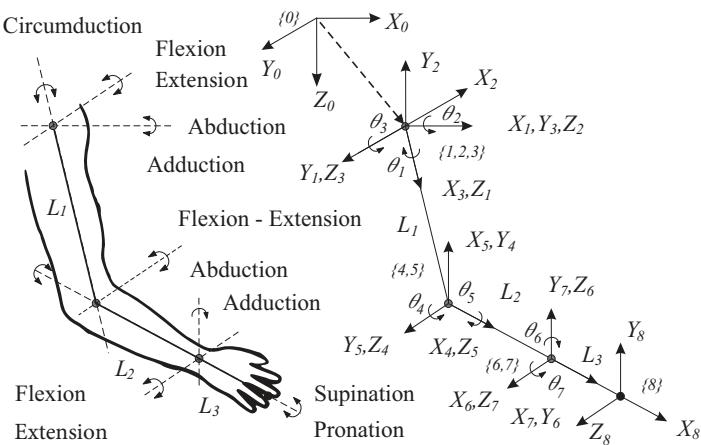
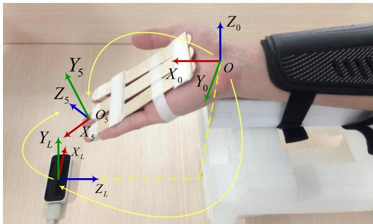
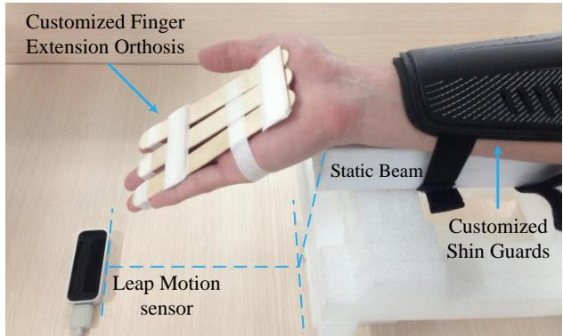
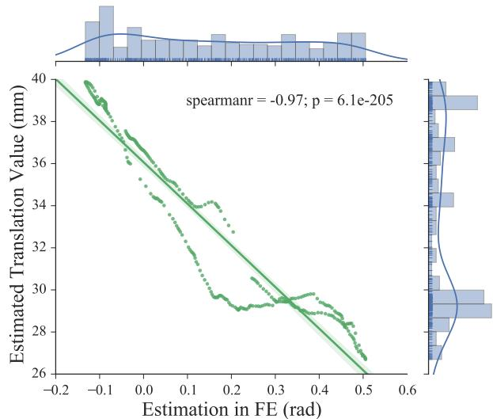
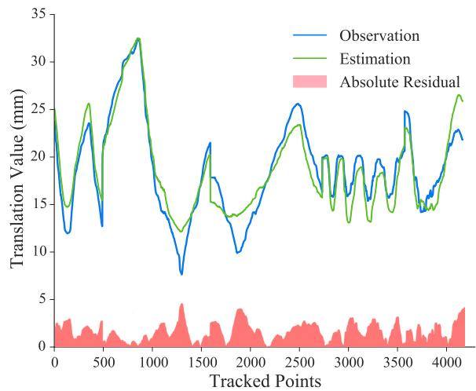
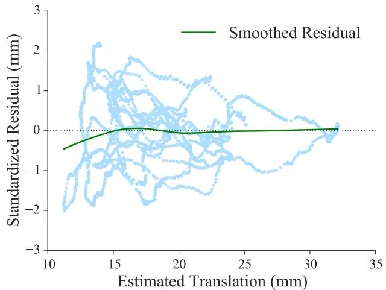
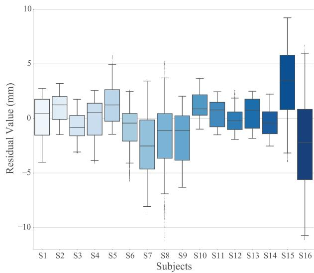

# 一种用于人机交互的改进手腕运动学模型

Ningbo Yu1 and Chang Xu2

摘要— 人体运动学对于与人体产生物理交互的康复和辅助机器人系统至关重要。手腕对于灵巧的人机交互起着关键作用，但其传统运动学模型过于简化，存在固有的不准确性，而其生物力学模型对于机器人应用而言又过于复杂。在这项工作中，我们建立了一个改进的手腕运动学模型。通过无创无标记光学追踪对手腕的体内运动学行为进行了研究。数据分析表明腕骨旋转中存在可测量的动态轴，证实了若采用传统手腕模型，手腕与机器人表达之间必然存在对准偏差。随后提出了一种新型手腕运动学模型，该模型将刚体变换与指示动态轴位置的可变移动项相融合。通过耦合手腕角度及非线性回归，实现了对该项精确且实时的估计。所提出的模型不仅精确，而且便于将解剖学行为转化为机器人实现和功能评估，从而实现精确且灵巧的人机交互。

## I. 引言

神经康复治疗促进了中枢或外周神经系统损伤后上肢功能的部分或完全恢复 [1], [2]。与传统的强制性诱导治疗方法相比，机器人辅助治疗在自适应参与、康复过程的定量评估以及临床评估方面展现出了潜在优势 [3], [4], [5]。此外，对于康复和辅助应用中的物理人机交互而言，人体运动学具有根本的重要性。

运动追踪与运动学分析贯穿于机器人神经康复治疗和人机交互的始终 [6], [7]。在笛卡尔空间和关节空间中对上肢运动学的评估，以及机器人外骨骼的人机工程学设计，从根本上依赖于精确的骨骼建模 [8], [9]。具体而言，由于八块腕骨的关节连接以及腕部内部的解剖变异性，腕部运动学的建模与量化极具挑战性。传统模型将骨骼结构近似为连接上肢刚性节段的万向节 [3], [10]。然而，由于假设腕关节仅存在旋转运动且上肢被解耦为独立的节段，机器人设备与人体关节之间不可避免地会出现非预期的未对准现象，在解析参数化运动学时也会产生偏差 [7]。上肢复杂的耦合机制和灵巧运动无法通过过度简化的传统运动学模型得到充分的研究与解释。因此，腕部的功能评估和康复设备的机械实现将在运动学分析和生物力学评估方面存在不足。

与传统运动学模型不同，一些研究对耦合肢体生物力学进行了定量研究。基于惯性、阻尼和刚度等动态特性测量的手臂耦合阻抗已在肌肉共收缩条件下被提出并进行了估计 [11]。手臂远端的柔性运动对于灵巧操作至关重要，这些耦合关节的被动刚度也得到了定量估计 [12]。

除机器人康复研究外，针对手腕和前臂的生物力学研究提供了详细的描述性数据以及对关节运动学的合理估计。有研究提出了一种改进的前臂弹性运动学模型，该模型证实了近端桡尺关节中的相对运动（前臂骨骼之间的位移），而不是将桡尺关节描述为万向节 [13]。针对腕部运动过程中腕骨运动学的体外（in vitro）和体内（in vivo）研究均表明，腕部旋转不存在固定的瞬时螺旋轴，且由于腕骨之间存在明显的平移，复杂的腕骨关节不能被简化为万向节 [14], [15]。为了评估腕关节的运动学和动力学，主要腕骨的旋转行为已被定量描述，并定义了更符合实际的坐标系 [16], [17]。

然而，生物力学研究中呈现的解剖学特征和运动学行为主要针对单个腕骨，其专用的坐标系并不适用于机器人神经康复的功能评估。人机交互涉及末端执行器和远端关节的整体运动。那些生物力学坐标系过于复杂，以至于用于机器人评估的运动学分析无法从各种腕骨的不同个体行为中得出有效结论。

为解决前述的过度简化及不适用情况，本研究基于解剖学调查和手臂远端耦合关节的生物力学行为，旨在建立一个更精确的手腕运动学模型，该模型更适用于将解剖学行为转化为机器人应用，以及基于精确灵巧人机交互的功能评估。通过无创无标记光学追踪方法研究了手腕屈伸（flexion-extension, FE）过程中腕关节的体内（in vivo）运动学行为。对 25 名未受损伤的健康受试者进行的实验验证了该改进运动学模型的可行性和精确度，并通过非线性回归定量证明了平移旋转轴的合理性。

## II. 方法

## A. 上肢传统模型

基于人体骨骼由无摩擦万向节连接的刚性骨段组成的假设，引入了上肢传统运动学模型，以运动范围（ranges of motion, ROMs）和自由度（degrees of freedom, DOFs）来近似人体运动。

上肢包括三个刚性节段，在解剖学上分别描述为上臂、前臂和手（视为单个节段）。三个万向关节连接着这些节段，即肩关节、肘关节和腕关节 [10]。在假设这些关节中仅发生旋转运动的前提下，可以建立力学平衡方程，并提出了共有 7 个自由度的上肢传统运动学模型，如图 1 所示。传统坐标系的基底 {0} 位于双肩中点处，三个坐标系位于复杂肩关节的中心。人类腕关节被视为具有 2 个自由度的万向节：外展-内收（桡尺偏，radioulnar deviation, RUD）$( X _ { 6 } Y _ { 6 } Z _ { 6 } )$ 和屈伸（FE）$( X _ { 7 } Y _ { 7 } Z _ { 7 } )$。末端执行器坐标系 {8} 位于伸展的指尖处，如图 1 所示。因此，末端执行器（人手）的位置和姿态可以通过正向运动学计算得出，关节空间中的角度运动可以通过逆向运动学近似得出。

  
Fig. 1. 上肢传统模型 [10]。右上肢被建模为由三个万向节（分别为肩关节、肘关节和腕关节，分别表示为 {1}、{4} 和 {6}）连接的三个刚体节段。末端执行器的位置和姿态在坐标系 {8} 中相对于基坐标系 {0} 进行描述。上肢的 7 自由度运动通过相邻坐标系之间的旋转角度 $\theta _ { i }$ 来描述。

  
Fig. 2. 处于功能中立腕位时左手腕骨和掌骨的掌侧视图 [18]。在受腕骨排排列约束的一致运动学行为下，腕部运动表现为桡腕关节和腕中关节的复合运动，其非固定旋转轴位于头状骨内。

## B. 腕关节运动中的腕骨运动学行为

腕部区域由八块灵巧且形状复杂的腕骨组成，它们彼此之间形成复杂的关节连接，并与掌骨及远端桡尺关节相互作用。从左腕的掌侧视图来看（如图 2 所示），这些腕骨排列为近侧列和远侧列。从近侧列的前视图来看，舟骨、月骨、三角骨和豌豆骨自外侧向内侧排列。大多角骨、小多角骨、头状骨和钩骨则相应地自外侧向内侧构成远侧列 [19]。

在腕韧带的约束以及独特的关节几何形态的共同作用下，每块腕骨都具有六个自由度（DOFs），这使得腕部能够实现近乎半球形的运动范围，同时也造就了腕骨运动学的复杂性。因此，基于单块腕骨的运动学行为来精确描述完整的腕部运动是十分困难的 [17]。根据临床实践的解剖学基础，桡腕关节、腕骨间关节（包括近侧列关节、腕中关节和远侧列关节）以及腕掌关节共同构成了整体腕关节 [18]。先前的研究基于将近侧和远侧腕骨列视为刚性且紧密的结构分段，阐释了将腕部运动简化为桡腕关节和腕中关节运动的合理性 [19], [20]。桡腕关节是近侧列与桡骨远端之间形成的典型双轴椭圆关节，允许屈伸（FE）、外展-内收以及环转的双轴运动。同一腕骨列内的腕骨由韧带加固并表现出一致的运动学行为，导致近侧和远侧关节处几乎没有相对运动 [20]。因此，腕骨间关节的运动与桡腕关节一起由同一组肌肉驱动，且主要局限在腕中关节。基于腕骨的解剖学特征和合理简化的分段，复杂的腕部运动可描述为额状面内的屈伸（FE）、矢状面内的桡尺偏（RUD）以及环转运动，这些运动主要发生在桡腕关节和腕中关节的复合运动中。

TABLE I  
改进模型的 D-H 参数

<table><tr><td>i</td><td> $\alpha_{i-1}$ </td><td> $a_{i-1}$ </td><td> $d_i$ </td><td> $\theta_i$ </td><td> $\beta_i$ </td></tr><tr><td>1</td><td>0</td><td>0</td><td>0</td><td>90°</td><td></td></tr><tr><td>2</td><td>90°</td><td>0</td><td> $d_2$ </td><td>0</td><td></td></tr><tr><td>3</td><td>-90°</td><td>0</td><td>0</td><td> $\theta_3$ </td><td> $\beta_3-90^\circ$ </td></tr><tr><td>4</td><td>90°</td><td>0</td><td>0</td><td> $\theta_4$ </td><td> $\beta_4$ </td></tr><tr><td>5</td><td>0</td><td> $a_4$ </td><td>0</td><td>0</td><td></td></tr></table>

此外，头状骨被称为远侧列腕骨的核心（keystone），头状骨与其远端的第三掌骨之间的相对运动极小。头状骨在其近端还与舟骨和月骨形成关节啮合 [20]。从临床功能和生物力学的角度来看，头状骨因其显著的位置而能够表征腕部运动，因此在腕部屈伸（FE）和桡尺偏（RUD）过程中将旋转轴定位于头状骨内部是合理的。

根据传统模型，坐标系被建模为具有 2 个自由度（2 DOFs）的万向节。传统运动学模型仅能描述绕枢轴点的旋转运动，而排除了沿轴线的线性位移。然而，关于手腕运动过程中腕骨运动学的体外（in vitro）和体内（in vivo）研究均表明，腕骨旋转中心并非固定在头状骨近端。已有文献报道了枢轴点位置的变化以及腕骨中明显可测量的平移现象 [14], [15]。人类手腕的屈伸（FE）和桡/尺偏（RUD）运动学要复杂得多，并表现出独特的腕骨机制，而非如传统上肢模型所示的那样可被建模为简化的固定铰链或简单关节。

## C. 手腕运动的改进运动学模型

传统上肢模型（见 Fig. 1）认为腕骨旋转围绕单一枢轴点发生且腕关节表现类似于万向节；与此相比，本文提出的改进模型（见 Fig. 3）引入了一个移动副（prismatic joint）以结合 2 个自由度的转动副，能够确定旋转中心并以更精确的方式描述轴线的平移行为。该模型对腕骨行为给出了符合生物力学合理性的描述，并针对手腕运动学和上肢运动中末端执行器（指尖）的位置与姿态提供了更精确的估计。

根据 Denavit-Hartenberg (D-H) 规则 [21]，改进坐标系的原点位于桡腕关节内，处于桡骨月骨关节面的近端（如图 3 所示）。$X _ { 0 }$ 轴正方向平行于桡骨长轴并指向远端。$Y _ { 0 }$ 轴正方向穿过桡骨茎突指向尺侧，且垂直于 $X _ { 0 }$ 轴。坐标系 {1} 与 {0} 共享相同原点，并根据右手定则绕 $Z _ { 1 }$ 轴相对于 $\{ 0 \}$ 旋转 $9 0 °$。坐标系 {2}、{3} 和 {4} 的原点在初始构型下（FE 或 RUD 无运动）重合且均位于头状骨内，作为整体腕部运动中心的指示。由于第三掌骨与头状骨之间的相对运动在临床上可忽略不计，且固定夹具将中指与手掌刚性约束在一起（如图 1 所示），$X _ { 3 , 4 , 5 }$ 轴和 $Z _ { 2 }$ 轴在远端均与从 $O _ { 2 }$ 到中指指尖 $O _ { 5 }$ 的直线重合。沿 $Z _ { 2 }$ 轴的平移表示为 $d _ { 2 }$，代表整体腕部运动旋转中心位置的变化。初始状态下，$X _ { 2 }$ 轴和 $Y _ { 3 }$ 轴正方向与 $Y _ { 0 }$ 重合。$Z _ { 3 }$ 轴正方向代表指向掌侧的 RUD 旋转轴。RUD 角度 $\beta _ { 3 }$（尺偏为正）由绕 $Z _ { 3 }$ 轴的旋转 $\theta _ { 3 }$ 导出（如表 I 所示）。坐标系 {4} 相对于 {3} 绕 $X _ { 3 }$ 轴旋转 $9 0 °$。$Z _ { 4 }$ 轴正方向指示指向桡侧的 FE 旋转轴，且角度 $\theta _ { 4 }$ 等于 $\beta _ { 4 }$（屈曲为正）。坐标系 {5} 位于由食指、中指和无名指指尖所确定的平面内，由于约束夹具的作用，该平面与掌侧面重合。它表示末端执行器的位置与姿态。

  
Fig. 3. 右手腕掌侧视图所示的改进腕部运动学模型。相对于基坐标系 {0}，末端执行器的位置和姿态在位于三个指尖所定义平面内的坐标系 {5} 中进行描述。腕部的 2 自由度（DOF）运动通过坐标系 {3} 和 {4} 中的旋转角度进行描述，分别指示 RUD 和 FE 的角度。平移参数 $d _ { 2 }$ 指示整体腕部运动旋转中心的可变位置。

## D. 改进模型的运动学分析

1) 正运动学：改进的运动学模型引入了一个移动关节（如 Fig. 3 中的关节 2）以结合旋转关节（如 Fig. 3 中的关节 3、4），并基于生物力学原理描述手腕运动过程中的腕骨行为。坐标系 {i} 相对于 $\{ i - 1 \}$ 的通用变换矩阵由下式给出

(di)

$$
\begin{array}{c} _ {i} ^ {i - 1} T = R o t _ {X} \left(\alpha_ {i - 1}\right) T r a n s _ {X} \left(a _ {i - 1}\right) R o t _ {Z} \left(\theta_ {i}\right) T r a n s _ {Z} \\ = \left[ \begin{array}{c c c c} c \theta_ {i} & - s \theta_ {i} & 0 & a _ {i - 1} \\ s \theta_ {i} c \alpha_ {i - 1} & c \theta_ {i} c \alpha_ {i - 1} & - s \alpha_ {i - 1} & - s \alpha_ {i - 1} d _ {i} \\ s \theta_ {i} s \alpha_ {i - 1} & c \theta_ {i} s \alpha_ {i - 1} & c \alpha_ {i - 1} & c \alpha_ {i - 1} d _ {i} \\ 0 & 0 & 0 & 1 \end{array} \right] \end{array}\tag{1}
$$

其中 $c \theta _ { i }$ 和 $s \theta _ { i }$ 分别表示 cos $\theta _ { i }$ 和 sin $\theta _ { i }$，$R o t _ { Z } \left( \Theta \right)$ 与 $T r a n s _ { Q } \left( q \right)$ 分别表示旋转算子与平移算子。改进模型的正运动学源自通用齐次变换和 D-H 参数。两个连续关节之间的变换矩阵计算如下：

$$
{ } _ { 1 } ^ { 0 } T = \left[ \begin{array} { c c c c } 0 & - 1 & 0 & 0 \\ 1 & 0 & 0 & 0 \\ 0 & 0 & 1 & 0 \\ 0 & 0 & 0 & 1 \end{array} \right] \qquad { } _ { 2 } ^ { 1 } T = \left[ \begin{array} { c c c c } 1 & 0 & 0 & 0 \\ 0 & 0 & - 1 & - d _ { 2 } \\ 0 & 1 & 0 & 0 \\ 0 & 0 & 0 & 1 \end{array} \right]
$$

$$
{ } _ { 3 } ^ { 2 } T = \left[ \begin{array} { c c c c } c _ { 3 } & - s _ { 3 } & 0 & 0 \\ 0 & 0 & 1 & 0 \\ - s _ { 3 } & - c _ { 3 } & 0 & 0 \\ 0 & 0 & 0 & 1 \end{array} \right] { } _ { 4 } ^ { 3 } T = \left[ \begin{array} { c c c c } c _ { 4 } & - s _ { 4 } & 0 & 0 \\ 0 & 0 & - 1 & 0 \\ s _ { 4 } & c _ { 4 } & 0 & 0 \\ 0 & 0 & 0 & 1 \end{array} \right]
$$

$$
{ } _ { 5 } ^ { 4 } T = \left[ \begin{array} { c c c c } 1 & 0 & 0 & a _ { 4 } \\ 0 & 1 & 0 & 0 \\ 0 & 0 & 1 & 0 \\ 0 & 0 & 0 & 1 \end{array} \right]\tag{2}
$$

为了确定改进模型中末端执行器的位姿，相对于原点坐标系 {0} 的正运动学计算如下：

$$
\begin{array}{r l} _ {5} ^ {0} T & = _ {1} ^ {0} T _ {2} ^ {1} T _ {3} ^ {2} T _ {4} ^ {3} T _ {5} ^ {4} T \\ & = \left[ \begin{array}{c c c c} - s _ {3} c _ {4} & s _ {3} s _ {4} & c _ {3} & d _ {2} - a _ {4} s _ {3} c _ {4} \\ c _ {3} c _ {4} & - c _ {3} s _ {4} & s _ {3} & a _ {4} c _ {3} c _ {4} \\ s _ {4} & c _ {4} & 0 & a _ {4} s _ {4} \\ 0 & 0 & 0 & 1 \end{array} \right]. \end{array}\tag{3}
$$

2) 逆运动学：根据光学传感器在笛卡尔空间中检测到的末端执行器位姿，逆运动学确定腕骨运动期间关节空间中的旋转角度和轴位置。如图 4 所示，传感器在坐标系 $\{ L \}$ 中检测中指指尖的离散位置和姿态。$X _ { L }$ 轴呈水平放置，并平行于设备边缘以及手腕中的 $Y _ { 0 }$ 轴。$Y _ { L }$ 轴的正方向垂直于平面 $X _ { 0 } Y _ { 0 }$ 且朝向掌侧。

  
Fig. 4. 通过 Leap Motion 记录坐标系 {5} 相对于 {L} 的位置和姿态。连接 {L} 与 {0} 的齐次变换矩阵由实验配置推导得出。

末端执行器的位姿数据应转换至改进模型中以进行逆运动学计算。给定光学传感器坐标系、原点坐标系以及旋转矩阵，分别记为 $\{ L \}$、{0} 和 $R \left( \theta \right)$，连接这两个坐标系的齐次变换矩阵描述如下：

$$
{ } _ { L } ^ { 0 } T = \left[ \begin{array} { c c } { } _ { L } ^ { 0 } R ( \theta ) & { } ^ { 0 } P _ { L O R G } \\ 0 & 1 \end{array} \right] { } _ { L } ^ { 0 } R ( \theta ) = \left[ \begin{array} { c c c } 0 & 0 & - 1 \\ - 1 & 0 & 0 \\ 0 & 1 & 0 \end{array} \right]\tag{4}
$$

其中 ${ } ^ { 0 } P _ { L O R G }$ 表示根据实验配置测得的原点 $O _ { L }$ 相对于坐标系 {0} 的位置。由光学传感器跟踪的末端执行器 {5} 的离散位置和姿态相对于坐标系 {L} 进行描述，并记为 $_ 5 ^ { L } T$。对检测到的位姿相对于原点坐标系 {0} 进行齐次变换：

$$
\begin{array}{c} _ {5} ^ {0} T = _ {L} ^ {0} T _ {5} ^ {L} T \\ = \left[ \begin{array}{c c c c} n _ {x} & o _ {x} & a _ {x} & p _ {x} \\ n _ {y} & o _ {y} & a _ {y} & p _ {y} \\ n _ {z} & o _ {z} & a _ {z} & p _ {z} \\ 0 & 0 & 0 & 1 \end{array} \right] \end{array}\tag{5}
$$

根据 (3) 中描述的正运动学推导结果，FE 中的角度 $\theta _ { 4 }$、RUD 中的角度 $\theta _ { 3 } , \beta _ { 3 }$ 以及平移量 $d _ { 2 }$ 可通过跟踪数据计算得出：

$$
\theta_ {4} = \beta_ {4} = \arcsin (p _ {z} / a _ {4})\tag{6}
$$

$$
\theta_ {3} = \arcsin (a _ {y}), \beta_ {3} = \theta_ {3} + \frac {\pi}{2}\tag{7}
$$

$$
d _ {2} = p _ {x} - a _ {4} n _ {x}\tag{8}
$$

因此，可以根据上肢姿态估计手腕在屈伸（FE）和尺偏/桡偏（RUD）方向上相对于中立位的旋转角度。平移参数 $d _ { 2 }$ 表明了腕骨轴线的变化，并证明了由于存在不可忽略的线性平移，腕关节不能被建模为简化的万向节。

3) 耦合关节拟合：沿腕骨轴线的明显平移与耦合的腕骨旋转密切相关。先前的研究表明，在不同受试者中可以发现统计学上一致的腕骨运动学行为 [20]。因此，采用模型参数拟合过程来寻找腕部旋转中心（由移动副中的 $d _ { 2 }$ 描述）与耦合腕骨角运动（RUD 中的 $\beta _ { 3 }$ 和 FE 中的 $\beta _ { 4 }$）之间的精确数值方程。建立非线性回归模型，将观测数据集点 $( x _ { i } , y _ { \mathrm { i } } , z _ { i } )$ ——其中 $( x , y , z )$ 代表 $( \beta _ { 3 } , \beta _ { 4 } , d _ { 2 } )$ 且 $i = 1 , 2 , \dots , N$ ——拟合为一个二元二次分式非线性函数，描述如下：

$$
\hat {z} = \frac {a _ {1} + a _ {3} x + a _ {5} y + a _ {7} x ^ {2} + a _ {9} y ^ {2} + a _ {1 1} x y}{1 + a _ {2} x + a _ {4} y + a _ {6} x ^ {2} + a _ {8} y ^ {2} + a _ {1 0} x y}\tag{9}
$$

其中未知参数 $a _ { j } \ ( j = 1 , \ldots , 1 0 )$ 通过简单遗传算法（SGA）进行优化，以最小化观测数据集与估计数据集之间的误差平方和（SSE）

$$
S S E = \sum_ {i = 1} ^ {N} \varepsilon_ {i} ^ {2} = \sum_ {i = 1} ^ {N} \left[ w _ {i} (z _ {i} - \hat {z} _ {i}) ^ {2} \right]\tag{10}
$$

其中 $\varepsilon _ { i }$ 为残差项，$w _ { i }$ 为权重，设为 1。$a _ { j }$ 的可能解通过实数编码向量编码到染色体中，经验上初始种群大小设为 20。父代染色体通过随机选择进行配对，交叉算子采用均匀交叉法，经验上交叉概率设为 0.85。考虑到算法整体性能的收敛速度和计算成本，变异率通常设为较低的 0.005。

采用拟合优度度量来描述估计参数 $a _ { j }$ 与观测值的拟合程度。标准化残差 $r _ { i }$ 由 $\varepsilon _ { i }$ 和平均残差 $\bar{\varepsilon}$ 导出

$$
r _ {i} = \frac {\varepsilon_ {i}}{\sqrt {\frac {1}{N - 1} \sum_ {i = 1} ^ {N} \left(\varepsilon_ {i} - \bar {\varepsilon}\right) ^ {2}}}\tag{11}
$$

均方根误差（RMSE）表示估计值与观测值之间的偏差，通常被视为与尺度相关的残差度量指标

$$
\begin{array}{c} R M S E = \sqrt {M S E} = \sqrt {S S E / N} \\ = \sqrt {\frac {1}{N} \sum_ {i = 1} ^ {N} \left[ w _ {i} (z _ {i} - \hat {z} _ {i}) ^ {2} \right]} \end{array}\tag{12}
$$

决定系数（记为 $R ^ { 2 }$）表示估计值反映观测值变异程度的拟合优度，计算为估计值与观测值之间相关系数的平方

  
Fig. 5. 实验设备与配置，包括用于限制手部和前臂非预期运动的定制手指伸展矫形器和护胫。

$$
\begin{array}{l} R ^ {2} = \frac {S S R}{S S T} = 1 - \frac {S S E}{S S T} \\ = \frac {\sum_ {i = 1} ^ {N} \left[ w _ {i} (\hat {z} _ {i} - \bar {z} _ {i}) ^ {2} \right]}{\sum_ {i = 1} ^ {N} \left[ w _ {i} (z _ {i} - \bar {z} _ {i}) ^ {2} \right]} = 1 - \frac {\sum_ {i = 1} ^ {N} \left[ w _ {i} (z _ {i} - \hat {z} _ {i}) ^ {2} \right]}{\sum_ {i = 1} ^ {N} \left[ w _ {i} (z _ {i} - \bar {z} _ {i}) ^ {2} \right]} \end{array}\tag{13}
$$

SSR 代表回归平方和。SST 代表总平方和，与数据的方差成正比。在统计学上，$R ^ { 2 }$ 的取值范围为 0 到 1，$R ^ { 2 }$ 为 1 表示估计值与观测值完全拟合。

## E. 参与者与实验流程

本研究设计并开展了相关实验，以追踪人体上肢运动并验证所提出的改进运动学模型。在获得知情同意后，招募了 25 名年龄在 21 至 27 岁之间的健康年轻受试者（4 名女性，年龄 $2 2 . 8 \pm 1 . 3$；21 名男性，年龄 $2 4 . 6 \pm 1 . 2 )$ 参与实验。所有受试者均无可能影响手臂远端运动的上肢病理或慢性疾病的影像学或病史证据。本研究通过光学传感器追踪并研究了每位受试者的右手腕运动。根据爱丁堡利手量表（Edinburgh-handedness inventory）[22]，所有受试者均为右利手。本研究无需伦理审批。

在腕部屈伸（FE）运动期间，通过 Leap Motion 传感器记录每位受试者远端手臂的运动。Leap Motion 传感器提供了一种新颖的解决方案，可在紧邻的操作空间内追踪人手和手指的运动，并记录远端手臂的离散位置和姿态 [23], [24], [25]。针对该光学设备追踪精度和鲁棒性的研究表明，在静态和动态测量中实现了 0.7 mm 的总体平均精度。在实验条件下，期望位置与测量位置之间的偏差小于 0.2 mm，且与坐标轴无关 [26]。另一项研究显示，所得标准差在 0.0081 mm 至 0.49 mm 之间 [27]。这表明 Leap Motion 传感器是一个相当精确且可靠的追踪系统，专门用于检测人手的运动。

如图 Fig. 5 所示，所有志愿者均坐在实验台旁，将前臂放置在轴向静止梁上，与梁的长轴平行，肘关节屈曲约 $9 0 °$，肩关节外展约 $4 5 ^ { \circ }$。前臂由定制的护具约束并持续固定在静止梁上，从而使前臂不产生旋前-旋后（PS）运动。受试者手掌上固定有定制的手指伸展矫形器，约束了示指、中指和环指的指间关节、掌指关节和腕掌关节的相对运动，这些手指保持伸展并与手掌侧平面重合。中指特别沿桡骨长轴远端固定，确保中指与根据 ISB（国际生物力学学会）建议 [28] 定义的头状骨 $Y$ 轴共线。腕部相对于桡骨的功能性中立位根据 ISB 建议定义，前臂的中立位定义为处于中立 PS 位置。除了中立位外，受试者还被指导在屈曲 $3 0 ^ { \circ }$ 至伸展 $1 0 ^ { \circ }$ 的范围内平稳地转动腕部。追踪到的手部轨迹由可视化应用程序同步显示。受试者被要求在 40 秒内缓慢完成 10 个 FE 运动周期，以确保精确追踪。一个典型的周期运动包括从中立位移动到伸展位，然后移动到屈曲位，最后回到中立位。

## III. 结果

提取并展示了实验数据，以验证改进模型的可行性和准确性。如图 6 所示，平移参数 $d _ { 2 }$ 表明腕关节旋转轴的位置并非固定在单一点上。在一次 FE（屈曲/伸展）运动周期中，$d _ { 2 }$ 的值发生了明显变化。与 FE 中的角度相比，腕部伸展过程中旋转轴的位置（由较大的 $d _ { 2 }$ 表明）比腕部屈曲过程中更偏向远端。对 FE 中的 $d _ { 2 }$ 与 $\beta _ { 4 }$ 进行了线性回归。Spearman 秩相关系数为 $- 0 . 9 7 \ ( p = 6 . 1 e ^ { - \bar { 2 } 0 5 } )$，表明 $d _ { 2 }$ 与 $\beta _ { 4 }$ 之间存在统计学上的高度相关性，且负相关表明当 $\beta _ { 4 }$ 增大时 $d _ { 2 }$ 趋于减小。由此可以得出结论：腕骨关节不能被建模为简单关节，且腕骨旋转轴在腕部伸展过程中向远端移动，在腕部屈曲过程中向近端移动。这些结果与先前的生物力学研究 [20] 一致。

  
Fig. 6. 一个周期 FE 运动中可测平移参数 $d _ { 2 }$ 的计算。

  
Fig. 7. 基于 9 名受试者的跟踪数据得出的平移参数 d2 与估计腕关节角度 $\beta _ { 3 , 4 }$ 之间的非线性回归结果。

随机选取了 9 名受试者（2 名女性，年龄 $2 2 . 0 \pm 1 . 4$；7 名男性，年龄 $2 5 . 0 \pm 1 . 4$）的跟踪数据用于模型参数拟合过程。将逆运动学推导出的 $\beta _ { 3 , 4 }$ 数据组合在一起，以拟合如 (7) 所述的非线性函数，从而准确估计 $d _ { 2 }$。未知参数 $a _ { j } \ ( j = 1 , \ldots , 1 0 )$ 通过 SGA（简单遗传算法）进行优化，拟合结果如图 7 所示

  
Fig. 8. 使用平滑标准化残差对回归性能的解释。

  
Fig. 9. 16 名受试者中由计算所得 $d _ { 2 }$ 与估计所得 $\hat { d } _ { 2 }$ 之间残差的箱线图。

并描述为

$$
\begin{array}{l} \hat {d} _ {2} = \\ \frac {1 8 . 0 0 - 2 9 0 . 9 3 \beta_ {3} - 2 9 . 4 6 \beta_ {4} + 2 5 6 3 . 0 9 \beta_ {3} ^ {2} + 3 7 . 0 1 \beta_ {4} ^ {2} - 6 0 6 . 5 3 \beta_ {3} \beta_ {4}}{1 - 1 0 . 6 0 \beta_ {3} - 2 . 2 3 \beta_ {4} + 9 4 . 6 2 \beta_ {3} ^ {2} + 2 . 1 2 \beta_ {4} ^ {2} - 2 5 . 7 5 \beta_ {3} \beta_ {4}} \end{array}\tag{14}
$$

计算了标准化残差 $r _ { i }$，并通过局部加权散点平滑法（locally weighted scatterplot smoothing, LOWESS）进行了分析。如图 8 所示，残差图呈现出近似对称的分布，且散点紧密聚集在 $r _ { i } = 0$ 的直线周围。除 $r _ { i }$ 之外，SSE、RMSE、相关系数 (R) 以及 $R ^ { 2 }$ 的值分别确定为 7565.68、1.35、0.96 和 0.93。所有上述统计结果均证实了拟合过程的准确性，并阐明了旋转轴与腕关节耦合角之间的定量关系。

准备了其余十六名受试者（2 名女性，年龄 $2 3 . 5 \pm 0 . 7$ 岁；14 名男性，年龄 $2 4 . 8 \pm 1 . 5$ 岁）的追踪数据，以验证拟合出的公式 (14)。通过改进模型的逆运动学计算出每位受试者的腕关节角 $\beta _ { 3 , 4 }$，并用于通过公式 (14) 估计 $d _ { 2 }$。将估计值 $\hat { d } _ { 2 }$ 与公式 (8) 导出的 $d _ { 2 }$ 计算值进行对比，以说明改进模型在十六名受试者中的准确性。如图 9 所示，受试者之间的整体残差值落在 -12 mm 至 10 mm 的范围内。所有受试者的 $\hat { d } _ { 2 }$ 与 $d _ { 2 }$ 之间的总体平均偏差为 $- 0 . 3 9 \pm 3 . 1 4$ mm，所有受试者的平均百分比误差为 $8 . 0 0 \pm 3 . 2 7 \%$。由此可以得出结论，所提出的公式准确地估计了非固定旋转轴的位置，且该结果在统计学上于二十名受试者中保持一致。

## IV. 讨论

## A. 腕部生物力学的一致性

实验招募了 25 名无前臂远端病变（distal arm pathology）的健康年轻受试者，其中包括 4 名女性和 21 名男性。先前的研究表明，未受伤受试者的腕骨运动学之间具有高度一致性。受试者之间体内（in vivo）腕骨行为和前臂远端生物力学机制的差异在统计学上可忽略不计，且左右手腕之间的差异并不显著 [20]。此外，男女之间表现出的旋转轴位置差异与受试者的解剖尺寸相关 [17]。这表明腕部运动参数与性别无关，而浮动轴的位置与腕骨体积和中立位质心位置相关 [15], [20]。因此，基于以往证明个体腕骨运动学一致性的证据，根据规定的参与者招募标准进行验证性实验是合理的。

## B. 腕骨运动学测量

以往的生物力学研究报道了体内（in vivo）和体外（in vitro）实验技术之间存在显著差异。对于体外研究，反光针和标记物会被植入腕骨中 [14], [29]。这种侵入性植入技术可能会改变覆盖其上的肌腱和周围软组织的运动学特性。运动学标记物施加的外部约束会干扰单个腕骨的运动以及腕部内部的力学相互作用。正常的肌肉收缩和肌腱负荷是通过附加机构模拟的，这不可避免地会与体内模拟产生不确定的偏差，而肌肉动力学的微小变化可能会对手腕运动产生显著影响 [14]。计算机断层扫描（CT）常用于体内研究，然而安全辐射暴露问题可能会限制扫描方案的持续时间以及实验样本的数量 [17], [30]。与植入式测量和扫描技术相比，本文提出的无创无标记方法为人机交互提供了一种更具实用性的前臂远端光学追踪解决方案，并真实还原了自然的腕部运动。此外，文献报道静态与动态手腕运动之间在统计学上的差异可忽略不计，且来自静态扫描过程的追踪数据与动态被动腕骨运动学高度接近。由此可以得出结论：腕骨运动学既可以通过静态方式测量，也可以通过动态方式测量 [16]。因此，在相对较慢的运动节奏下执行所提出的光学追踪过程是合理的。

## C. 机器人神经康复的实施原理

神经康复的功能评估和康复机器人设备的机械实施，从根本上基于具有生物力学合理性的人体运动学模型 [6], [7]。在解耦腕关节中仅存在旋转运动的假设下，传统的上肢运动学模型无法精确估计末端执行器和手腕关节的姿态。这一不可避免的局限性以及关节运动学与机器人评估之间不良的对准偏差，会为关节空间的康复评估带来不可靠的参数。所提出的手腕运动改进运动学模型证实了腕部旋转中存在可测量的非固定轴，并基于耦合手腕角度提供了对轴位置的精确估计。因此，基于该精确模型在关节空间对前臂远端进行运动学评估是可行且有效的，为神经康复提供了客观定量的测量手段。此外，D-H 参数法是一种通用且标准化的机器人表示法 [8]。所提出的手腕运动运动学模型可直接应用于机器人领域，并且对外骨骼的机器人实施以及机器人神经康复评估至关重要。

## V. 结论

对上肢运动学的精准评估是深入理解物理人机交互以提供机器人神经康复与辅助的关键。具体而言，人体手腕的逼真生物力学建模对于辅助外骨骼的人机工程学设计及人机协作至关重要。在本研究中，所提出的改进运动学模型证实了腕骨旋转中存在可测量的非固定轴，这支持了先前研究所指出的机器人表征与人体关节之间必然会出现不对准与过度简化的结论。通过耦合手腕角度并结合非线性回归，实现了对转轴位置的精准估计。针对健康受试者的实验，通过光学跟踪方法以及基于机器人建模的数值优化，验证了该改进模型的有效性。因此，基于该模型在关节空间中对远端手臂进行运动学评估是可行且有效的，能够为物理人机交互和机器人神经康复提供定量化实施方案。

## 参考文献

[1] V. Klamroth-Marganska, J. Blanco, K. Campen, A. Curt, V. Dietz, T. Ettlin, M. Felder, B. Fellinghauer, M. Guidali, A. Kollmar, et al., “Three-dimensional, task-specific robot therapy of the arm after stroke: a multicentre, parallel-group randomised trial,” Lancet. Neurol., vol. 13, no. 2, pp. 159–166, 2014.

[2] J.-C. Metzger, O. Lambercy, A. Califfi, D. Dinacci, C. Petrillo, P. Rossi, F. M. Conti, and R. Gassert, “Assessment-driven selection and adaptation of exercise difficulty in robot-assisted therapy: a pilot study with a hand rehabilitation robot,” J. Neuroeng. Rehabil., vol. 11, no. 1, p. 1, 2014.

[3] P. Maciejasz, J. Eschweiler, K. Gerlach-Hahn, A. Jansen-Troy, and S. Leonhardt, “A survey on robotic devices for upper limb rehabilitation,” J. Neuroeng. Rehabil., vol. 11, no. 1, p. 1, 2014.

[4] S. F. Atashzar, M. Shahbazi, O. Samotus, M. Tavakoli, M. S. Jog, and R. V. Patel, “Characterization of upper-limb pathological tremors: application to design of an augmented haptic rehabilitation system,” IEEE Journal of Selected Topics in Signal Processing, vol. 10, no. 5, pp. 888–903, 2016.

[5] C. Xu, S. Li, K. Wang, Z. Hou, and N. Yu, “Quantitative assessment of paretic limb dexterity and interlimb coordination during bilateral arm rehabilitation training,” in 2017 International Conference on Rehabilitation Robotics (ICORR). IEEE, 2017, pp. 634–639.

[6] M. D. Rinderknecht, O. Lambercy, V. Raible, I. Busching, A. Sehle,¨ J. Liepert, and R. Gassert, “Reliability, validity, and clinical feasibility of a rapid and objective assessment of post-stroke deficits in hand proprioception,” Journal of neuroengineering and rehabilitation, vol. 15, no. 1, p. 47, 2018.

[7] T. Nef, M. Guidali, and R. Riener, “ARMin III–arm therapy exoskeleton with an ergonomic shoulder actuation,” Appl. Bionics. Biomech., vol. 6, no. 2, pp. 127–142, 2009.

[8] V. J. Santos and F. J. Valero-Cuevas, “所报道的解剖变异性自然导致人体拇指 Denavit-Hartenberg 参数的多峰分布,” IEEE Trans. Biomed. Eng., vol. 53, no. 2, pp. 155–163, 2006.

[9] K. Wang, S. Li, C. Xu, and N. Yu, “用于手臂康复训练和评估的扩展运动学模型,” in 2016 International Conference on Advanced Robotics and Mechatronics (ICARM). IEEE, 2016, pp. 117–121.

[10] M. Babaiasl, S. H. Mahdioun, P. Jaryani, and M. Yazdani, “脑卒中后上肢机器人辅助康复的技术与临床综述,” Disabil. Rehabil. Assist. Technol., vol. 11, no. 4, pp. 263–280, 2016.

[11] H. Patel, G. O’Neill, and P. Artemiadis, “肌肉协同收缩对人体手臂三维阻抗的影响,” IEEE Trans. Biomed. Eng., vol. 61, no. 10, pp. 2602–2608, 2014.

[12] D. Formica, S. K. Charles, L. Zollo, E. Guglielmelli, N. Hogan, and H. I. Krebs, “腕部与前臂的被动刚度,” J. Neurophysiol., vol. 108, no. 4, pp. 1158–1166, 2012.

[13] A. Kecskemethy and A. Weinberg, “用于生物仿真医疗诊断的人体前臂改进弹性运动学模型,” Multibody. Syst. Dyn., vol. 14, no. 1, pp. 1–21, 2005.

[14] R. M. Patterson, C. L. Nicodemus, S. F. Viegas, K. W. Elder, and J. Rosenblatt, “正常腕部的高速三维运动学分析,” J. Hand. Surg., vol. 23, no. 3, pp. 446–453, 1998.

[15] C. Neu, J. Crisco, and S. Wolfe, “腕部屈伸及桡尺偏期间桡头关节的体内运动学特性,” J. Biomech., vol. 34, no. 11, pp. 1429–1438, 2001.

[16] M. Foumani, S. Strackee, R. Jonges, L. Blankevoort, A. Zwinderman, B. Carelsen, and G. Streekstra, “腕部屈伸与桡尺偏期间腕骨的体内三维运动学：动态运动与逐步静态腕部姿态的对比,” J. Biomech., vol. 42, no. 16, pp. 2664–2671, 2009.

[17] J. C. Coburn, M. A. Upal, and J. J. Crisco, “腕部腕骨的坐标系,” J. Biomech., vol. 40, no. 1, pp. 203–209, 2007.

[18] S. Standring, Gray’s anatomy e-book: the anatomical basis of clinical practice（《格雷氏解剖学电子书：临床实践的解剖学基础》）. Elsevier Health Sciences, 2015.

[19] R. Drake, A. W. Vogl, and A. W. Mitchell, Gray’s anatomy for students（《格雷氏学生解剖学》）. Elsevier Health Sciences, 2014.

[20] S. W. Wolfe, C. Neu, and J. J. Crisco, “屈曲与伸展时舟骨、月骨和头状骨的体内运动学,” J. Hand. Surg., vol. 25, no. 5, pp. 860–869, 2000.

[21] J. Denavit and R. S. Hartenberg, “基于矩阵的低副机构运动学表示法.” J. Appl. Mech., vol. 22, pp. 215–221, 1955.

[22] R. C. Oldfield, “利手性的评估与分析：爱丁堡利手量表（edinburgh inventory）,” Neuropsychologia, vol. 9, no. 1, pp. 97–113, 1971.

[23] M. Iosa, G. Morone, A. Fusco, M. Castagnoli, F. R. Fusco, L. Pratesi, and S. Paolucci, “基于 Leap Motion 控制的电子游戏疗法用于亚急性期脑卒中老年患者的康复：一项可行性预试验研究,” Top. Stroke Rehabil., vol. 22, no. 4, pp. 306–316, 2015.

[24] N. Yu, C. Xu, H. Li, K. Wang, L. Wang, and J. Liu, “用于双手机能协调与灵巧操作康复的触觉与手势传感器融合,” Sensors, vol. 16, no. 3, p. 395, 2016.

[25] C. Xu, H. Li, K. Wang, J. Liu, and N. Yu, “一种结合手势与触觉界面的手臂协调及操作功能双侧康复方法,” in Proc. IEEE Int. Conf. on Robotics and Biomimetics (ROBIO), Zhuhai, China, Dec 2015, pp. 309–313.

[26] F. Weichert, D. Bachmann, B. Rudak, and D. Fisseler, “Leap Motion 控制器的精度与鲁棒性分析,” Sensors, vol. 13, no. 5, pp. 6380–6393, 2013.

[27] J. Guna, G. Jakus, M. Pogacnik, S. Tomaˇ ziˇ c, and J. Sodnik, “Leap Motion 传感器的精度与可靠性及其用于静态和动态跟踪适用性的分析,” Sensors, vol. 14, no. 2, pp. 3702–3720, 2014.

[28] G. Wu, F. C. Van der Helm, H. D. Veeger, M. Makhsous, P. Van Roy, C. Anglin, J. Nagels, A. R. Karduna, K. McQuade, X. Wang, et al., “国际生物力学学会（ISB）关于人体关节运动报告中各类关节坐标系定义的建议 第二部分：肩、肘、腕和手,” J. Biomech., vol. 38, no. 5, pp. 981–992, 2005.

[29] C. Neu, R. McGovern, and J. Crisco, “三维腕骨研究中三种表面配准方法的运动学精度,” J. Biomech. Eng., vol. 122, no. 5, pp. 528–533, 2000.

[30] N. Yu, N. Estevez, M.-C. Hepp-Reymond, S. S. Kollias, and R. Riener, “利用 MRI 兼容操作手柄评估上肢相关大脑激活的 fMRI 研究,” Int. J. Comput. Assist. Radiol. Surg., vol. 6, no. 3, pp. 447–455, 2011.