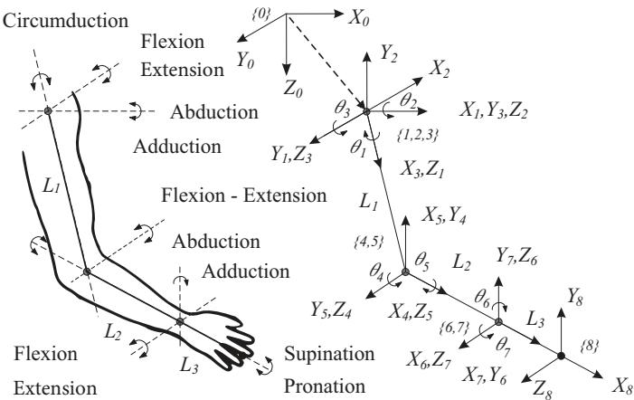

# 一种用于人机交互的改进腕部运动学模型

Ningbo Yu1 and Chang Xu2

Abstract— 人体运动学对于与人体发生物理交互的康复及辅助机器人系统具有根本性的重要意义。腕部在灵巧的人机交互中扮演着不可或缺的角色，然而其传统的运动学模型过度简化，存在固有的不准确性，而其生物力学模型又过于复杂，难以应用于机器人领域。本研究建立了一种改进的腕部运动学模型。通过无创的无标记光学追踪技术，我们对腕部在体内的运动学行为进行了研究。数据分析表明，在腕骨旋转过程中存在可测量的动态轴线，从而证实了若使用传统腕部模型，腕部表征与机器人表征之间必然存在偏差。在此基础上，我们提出了一种新颖的腕部运动学模型，将刚体变换与一个可变的移动项相融合，以表示动态轴线的位置。该可变项的精确实时估计已通过将耦合的腕部角度进行非线性回归来实现。所提出的模型不仅精度高，而且便于应用，能够将解剖学行为转化为机器人实现与功能评估，从而实现精确且灵巧的人机交互。

## I. 引言

神经康复疗法旨在在中枢或外周神经系统损伤后部分或完全恢复上肢功能 [1]、[2]。与传统的限制性诱导治疗方法相比，机器人辅助疗法在适应性参与、康复过程的定量评估以及临床评估等方面已显示出潜在优势 [3]、[4]、[5]。此外，对于康复及辅助应用中的人体物理交互而言，人体运动学具有根本性的重要意义。

运动追踪与运动学分析贯穿于机器人神经康复治疗与人机交互的整个过程 [6], [7]。上肢在笛卡尔空间与关节空间中的运动学评估，以及机器人外骨骼的人因工程学设计，根本上都依赖于精确的骨骼建模 [8], [9]。具体而言，由于八块腕骨之间的关节运动以及腕部内部的解剖学变异性，腕部运动学的建模与量化极具挑战性。传统模型将上肢的骨骼结构近似为由刚性连杆通过万向节连接而成的系统 [3], [10]。然而，由于假设腕关节仅存在旋转运动、且上肢被解耦为彼此独立的连杆，这不可避免地导致了机器人设备与人体关节之间产生不良的轴线偏差，以及在求解参数化运动学时出现偏差 [7]。上肢复杂的耦合机制与灵巧运动无法通过过度简化的传统运动学模型得到充分的研究与解释。因此，腕部的功能评估以及康复设备的机械实现，将不可避免地在运动学分析与生物力学评估方面存在缺陷。

不同于传统的运动学模型，一些研究已经对耦合肢体生物力学进行了定量研究。通过惯性、阻尼与刚度等动态特性所测得的耦合手臂阻抗被提出，并在肌肉共收缩条件下进行了估计 [11]。远端手臂的柔性运动对于灵巧操作至关重要，这些耦合关节的被动刚度也被定量估计 [12]。

除了机器人康复研究之外，针对腕部与前臂的生物力学研究提供了详细的描述性数据与合理的关节运动学估计。一种改进的前臂弹性运动学模型被提出，该模型将桡尺关节之间的相对运动（前臂骨之间的位移）视为近端桡尺关节的运动，而不是将桡尺关节描述为万向节 [13]。关于腕部运动过程中腕骨运动学的体外与体内研究均表明，腕部旋转并不存在固定的瞬时螺旋轴，且由于腕骨之间存在显著的相对位移，复杂的腕关节不能简化为万向节 [14], [15]。为评估腕关节的运动学与动力学特性，主要腕骨的旋转行为已被定量描述，并定义了更为真实的坐标系 [16], [17]。

然而，生物力学研究中提出的解剖学特征和运动学行为是针对各个腕骨专门设定的，而特殊的坐标系并不适用于机器人神经康复的功能评估。人机交互涉及末端执行器和远端关节的全局运动。这些生物力学坐标系过于复杂，以至于针对机器人评估的运动学分析难以从各个腕骨的不同个体行为中得出结论。

为了解决上述过度简化以及不适用的情况，基于对远端手臂关节耦合运动的解剖学研究和生物力学行为，本研究的目的是建立一个更精确的手腕运动学模型，该模型更适用于将解剖学行为转化为机器人实现，并通过对精确灵巧的人机交互进行功能评估。通过无创无标记光学追踪方法，探究了手腕屈伸（flexion-extension, FE）过程中腕关节的体内运动学行为。通过 25 名健康未受伤受试者的实验，验证了该改进运动学模型的可行性和精度，并通过非线性回归定量证明了平移旋转轴的合理性。

## II. 方法

## A. 上肢的传统模型

基于人体骨骼由刚性骨段组成，并通过无摩擦的万向关节连接的假设，传统的上肢运动学模型被引入，用于以运动范围（ranges of motion, ROMs）和自由度（degrees of freedom, DOFs）来近似描述人体的运动。

上肢包括三个刚体段，解剖学上分别描述为上臂、前臂和手（视为单个段）。三个万向关节连接这些段，即肩关节、肘关节和腕关节 [10]。假设这些关节只发生旋转运动，可以建立力学平衡方程，并提出具有总共 7 个自由度的上肢常规运动学模型，如图 1 所示。常规坐标系 {0} 的基座位于两肩之间的中点，三个参考系位于复合肩关节横关节的中心。人体手腕被视为具有 2 个自由度的万向关节：外展-内收（桡尺偏，radioulnar deviation, RUD）$( X _ { 6 } Y _ { 6 } Z _ { 6 } )$ 和屈伸（FE）$( X _ { 7 } Y _ { 7 } Z _ { 7 } )$ 。末端执行器坐标系 {8} 位于伸展的指尖，如图 1 所示。因此，末端执行器（人手）的位置和姿态可以通过正向运动学计算得出，关节空间中的角运动可以通过逆向运动学近似得到。

  

图 1. 上肢的传统模型 [10]。右上肢被建模为三个刚体段，由三个万向节（即肩关节、肘关节和腕关节）相互连接，分别用 {1}、{4} 和 {6} 表示。末端执行器（end-effector）的位置和姿态在坐标系 {8} 中相对于基础坐标系 {0} 进行描述。上肢的 7 个自由度运动通过相邻坐标系之间的旋转角 $\theta _ { i }$ 来描述。

  

图 2. 左手腕骨与掌骨在功能性中立位腕关节姿势下的掌侧视图 [18]。腕关节运动表现为桡腕关节与腕中关节的组合运动，受腕骨列排列约束而呈现一致的运动学行为，其旋转轴在头状骨内并不固定。

## B. 腕部运动中的腕骨运动学行为

腕骨区域由八块灵巧且形状复杂的腕骨组成，它们彼此之间形成复杂的关节，并同掌骨以及远端桡尺关节相互影响。从左腕的掌侧观察，如图 2 所示，这些腕骨排列成近侧列和远侧列。从近侧列的前面观察，舟骨（scaphoid）、月骨（lunate）、三角骨（triquetrum）和豌豆骨（pisiform）从外侧到内侧依次排列。大多角骨（trapezium）、小多角骨（trapezoid）、头状骨（capitate）和钩骨（hamate）从外侧到内侧依次构成远侧列 [19]。

受腕部韧带的约束并结合独特的几何关节结构，每块腕骨具有六个自由度（DOF），使腕部运动几乎可以覆盖半球范围，并导致腕骨运动学的复杂性。因此，难以基于单块腕骨的运动学行为来精确刻画腕部的完整运动 [17]。根据临床实践的解剖学基础，桡腕关节（radiocarpal joint）、腕骨间关节（intercarpal joint，包括近侧列间关节、中腕关节和远侧列间关节）以及腕掌关节（carpometacarpal joint）共同构成腕部的整体关节 [18]。先前的研究已经阐明了将腕部运动简化为桡腕关节和中腕关节运动的原理，其依据是将近侧列和远侧列腕骨视作刚性和紧密的结构 [19]、[20]。桡腕关节是一个典型的髁状关节，在近侧列与桡骨远端之间形成两根轴，允许屈伸（FE）、外展-内收（abduction-adduction）以及环转（circumduction）的双轴运动。同一腕骨列内的腕骨通过韧带加固，表现出协调一致的运动学行为，因此在近侧列间关节和远侧列间关节内实际上几乎不存在相对运动 [20]。因此，腕骨间关节的运动同桡腕关节一起由同一肌肉驱动，并局限于中腕关节内。基于解剖学特征和腕部合理的简化分段，复杂的腕部运动可以描述为在额状面内的屈伸（FE）、在矢状面内的桡尺偏斜（RUD）以及环转运动（circumduction），这些运动主要发生在桡腕关节与中腕关节的联合运动中。

TABLE I  
改进模型的 D-H 参数

<table><tr><td>2</td><td> $\alpha _ { i - 1 }$ </td><td> $a _ { i - 1 }$ </td><td> $d _ { i }$ </td><td> $\theta _ { i }$ </td><td> $\beta _ { i }$ </td></tr><tr><td>1</td><td>0</td><td>0</td><td>0</td><td> $9 0 ^ { \circ }$ </td><td></td></tr><tr><td>2</td><td> $9 0 ^ { \circ }$ </td><td>0</td><td> $d _ { 2 }$ </td><td> $_ 0$ </td><td></td></tr><tr><td>3</td><td> $- 9 0 ^ { \circ }$ </td><td>0</td><td>0</td><td> $\theta _ { 3 }$ </td><td> $\beta _ { 3 } - 9 0 ^ { \circ }$ </td></tr><tr><td>4</td><td> $9 0 ^ { \circ }$ </td><td>0</td><td>0</td><td> $\theta _ { 4 }$ </td><td> $\beta _ { 4 }$ </td></tr><tr><td>5</td><td>0</td><td>a4</td><td>0</td><td>0</td><td></td></tr></table>

此外，头状骨（capitate）被称为远排腕骨中的关键基石，头状骨与第三掌骨（third metacarpal）远端之间的运动相对较少。头状骨近端还与舟骨（scaphoid）和月骨（lunate）形成关节连接 [20]。从临床功能与生物力学两方面来看，由于头状骨在腕部所处的显著位置，其可反映腕部运动，因此在腕部屈伸（FE）和桡尺偏（RUD）过程中将旋转轴定位于头状骨内部是合理的。

按照传统模型，腕部坐标系被建模为具有 2 个自由度（DOFs）的万向节（universal joint）。传统运动学模型仅能描述绕枢轴点的旋转运动，而将沿各轴的平移排除在外。然而，关于腕部运动过程中腕骨运动学的体外（in vitro）与体内（in vivo）研究表明，腕部旋转中心并非固定于头状骨的近端极（proximal pole）。研究报道了枢轴点位置的变化以及腕骨中可测得的明显平移 [14]，[15]。人体腕部屈伸与桡尺偏的运动学远比传统上肢模型所示的简化固定铰链或单一关节更复杂，并呈现出独特的腕骨机制。

## C. 腕部运动的改进运动学模型

与上肢传统模型（见图 1）相比——传统模型显示腕骨绕单一枢轴点旋转，且腕关节类似于万向节——所提出的改进模型（见图 3）引入了移动副（prismatic joint），将 2 个自由度的旋转副（revolute joints）纳入其中，更为精确地定位旋转中心并描述各轴的平移行为。该模型对腕骨行为给出了生物力学上合理的描述，并能更准确地估计腕部运动学及上肢运动中末端执行器（指尖，fingertip）的位置与姿态。

根据 Denavit-Hartenberg（D-H）约定 [21]，改进坐标系的原点位于桡腕关节内、桡骨近端月状关节面处（如图 3 所示）。正 $X _ { 0 }$ 轴平行于桡骨长轴并指向远端。正 $Y _ { 0 }$ 轴通过桡骨茎突指向尺侧，并与 $X _ { 0 }$ 轴垂直。坐标系 {1} 与 {0} 共享同一原点，并依据右手定则相对于 {0} 绕 $Z _ { 1 }$ 轴旋转 $9 0 °$。坐标系 {2}、{3} 和 {4} 的共同原点位于初始构型下（无屈伸（FE）或桡尺偏（RUD）运动）的头状骨内，作为全局腕关节运动中心的指示标志。由于第三掌骨与头状骨之间的相对运动在临床上可忽略不计，且安装夹具将中指与手掌刚性约束在一起（如图 1 所示），因此 $X _ { 3 , 4 , 5 }$ 和 $Z _ { 2 }$ 轴与从 $O _ { 2 }$ 沿远端方向至中指尖端 $O _ { 5 }$ 的直线重合。沿 $Z _ { 2 }$ 轴的平移记为 $d _ { 2 }$，表示全局腕关节运动旋转中心位置的变化。正 $X _ { 2 }$ 和 $Y _ { 3 }$ 轴在初始时与 $Y _ { 0 }$ 重合。正 $Z _ { 3 }$ 轴表示桡尺偏（RUD）的旋转轴，方向指向掌侧。桡尺偏的角度 $\beta _ { 3 }$（尺偏时为正）来自绕 $Z _ { 3 }$ 轴的旋转 $\theta _ { 3 }$（如表 I 所示）。坐标系 {4} 相对于 {3} 绕 $X _ { 3 }$ 轴旋转 $9 0 °$。正 $Z _ { 4 }$ 轴表示屈伸（FE）的旋转轴，方向指向桡侧，且角度 $\theta _ { 4 }$ 等于 $\beta _ { 4 }$，屈曲时为正。坐标系 {5} 位于由食指、中指和无名指尖端所定义的平面内，由于约束夹具的作用，该平面与掌侧平面重合。它表示末端执行器的位置和姿态。

  

图 3. 改进的手腕运动学模型以右手腕的掌侧视图展示。相对于基坐标系 $\{0\}$，末端执行器的位置和姿态在坐标系 $\{5\}$ 中进行描述，该坐标系位于由三个指尖所定义的平面内。手腕的 2 自由度运动通过坐标系 $\{3\}$ 和 $\{4\}$ 中的旋转角度来描述，分别表示桡尺偏（Radial-Ulnar Deviation, RUD）和屈伸（Flexion-Extension, FE）的角度。平移参数 $d _ { 2 }$ 表示全局手腕运动中旋转中心的可变位置。

## D. 改进模型的运动学分析

1) 正向运动学：改进的运动学模型引入了一个移动副（即图3中的关节2），以结合转动副（即图3中的关节3、4），并依据生物力学原理描述腕部运动过程中腕骨的行为。坐标系{i}相对于$\{i-1\}$的一般变换矩阵由下式给出

(di)

$$
\begin{array} { r l r } & { \mathbf { \zeta } _ { i } ^ { i - 1 } T = R o t _ { X } \left( \alpha _ { i - 1 } \right) T r a n s _ { X } \left( a _ { i - 1 } \right) R o t _ { Z } \left( \theta _ { i } \right) T r a n s _ { Z } } & \\ & { \mathbf { \zeta } } & { = \left[ \begin{array} { c c c c } { c \theta _ { i } } & { - s \theta _ { i } } & { 0 } & { a _ { i - 1 } } \\ { s \theta _ { i } c \alpha _ { i - 1 } } & { c \theta _ { i } c \alpha _ { i - 1 } } & { - s \alpha _ { i - 1 } } & { - s \alpha _ { i - 1 } d _ { i } } \\ { s \theta _ { i } s \alpha _ { i - 1 } } & { c \theta _ { i } s \alpha _ { i - 1 } } & { c \alpha _ { i - 1 } } & { c \alpha _ { i - 1 } d _ { i } } \\ { 0 } & { 0 } & { 0 } & { 1 } \end{array} \right] } \end{array}\tag{1}
$$

其中 $c \theta _ { i }$ 和 $s \theta _ { i }$ 分别表示 cos $\theta _ { i }$ 和 sin $\theta _ { i }$，$R o t _ { Z } \left( \Theta \right)$ 和 $T r a n s _ { Q } \left( q \right)$ 分别表示旋转算子和平移算子。改进模型的正向运动学由一般齐次变换和 D-H 参数推导而来。两个相邻关节之间的变换矩阵计算如下：

$$
{ \mathrm { ~  ~ { ~ \sigma ~ } ~ } _ { 1 } ^ { 0 } T = \left[ \begin{array} { c c c c } { { 0 } } & { { - 1 } } & { { 0 } } & { { 0 } } \\ { { 1 } } & { { 0 } } & { { 0 } } & { { 0 } } \\ { { 0 } } & { { 0 } } & { { 1 } } & { { 0 } } \\ { { 0 } } & { { 0 } } & { { 0 } } & { { 1 } } \end{array} \right] \qquad { \mathrm { ~  ~ { ~ \sigma ~ } ~ } _ { 2 } ^ { 1 } T = \left[ \begin{array} { c c c c } { { 1 } } & { { 0 } } & { { 0 } } & { { 0 } } \\ { { 0 } } & { { 0 } } & { { - 1 } } & { { - d _ { 2 } } } \\ { { 0 } } & { { 1 } } & { { 0 } } & { { 0 } } \\ { { 0 } } & { { 0 } } & { { 0 } } & { { 1 } } \end{array} \right] } }
$$

$$
{ } _ { 3 } ^ { 2 } T = \left[ { \begin{array} { c c c c } { c _ { 3 } } & { - s _ { 3 } } & { 0 } & { 0 } \\ { 0 } & { 0 } & { 1 } & { 0 } \\ { - s _ { 3 } } & { - c _ { 3 } } & { 0 } & { 0 } \\ { 0 } & { 0 } & { 0 } & { 1 } \end{array} } \right] { \mathrm { ~ } } { \mathrm { ~ } } _ { 4 } ^ { 3 } T = \left[ { \begin{array} { c c c c } { c _ { 4 } } & { - s _ { 4 } } & { 0 } & { 0 } \\ { 0 } & { 0 } & { - 1 } & { 0 } \\ { s _ { 4 } } & { c _ { 4 } } & { 0 } & { 0 } \\ { 0 } & { 0 } & { 0 } & { 1 } \end{array} } \right]
$$

$$
{ \begin{array} { l } { { \frac { 4 } { 5 } } T = { \left[ \begin{array} { l l l l } { 1 } & { 0 } & { 0 } & { a _ { 4 } } \\ { 0 } & { 1 } & { 0 } & { 0 } \\ { 0 } & { 0 } & { 1 } & { 0 } \\ { 0 } & { 0 } & { 0 } & { 1 } \end{array} \right] } } \end{array} }\tag{2}
$$

为了确定改进模型中末端执行器的位姿，相对于原点坐标系 {0} 的正运动学计算如下：

$$
\begin{array} { r l } & { \frac { 0 } { 5 } T = \phantom { \frac { 1 } { 1 } } T _ { 2 } ^ { 1 } T _ { 3 } ^ { 2 } T _ { 4 } ^ { 3 } T _ { 5 } ^ { 4 } T } \\ & { \phantom { \frac { 0 } { 5 } } = \left[ \begin{array} { c c c c } { - s _ { 3 } c _ { 4 } } & { s _ { 3 } s _ { 4 } } & { c _ { 3 } } & { d _ { 2 } - a _ { 4 } s _ { 3 } c _ { 4 } } \\ { c _ { 3 } c _ { 4 } } & { - c _ { 3 } s _ { 4 } } & { s _ { 3 } } & { a _ { 4 } c _ { 3 } c _ { 4 } } \\ { s _ { 4 } } & { c _ { 4 } } & { 0 } & { a _ { 4 } s _ { 4 } } \\ { 0 } & { 0 } & { 0 } & { 1 } \end{array} \right] . } \end{array}\tag{3}
$$

2) 逆运动学（Inverse Kinematics）：根据光学传感器在笛卡尔空间（Cartesian Space）中检测到的末端执行器（End-Effector）姿态，逆运动学确定腕部运动过程中关节空间中的旋转角度和轴位置。如图 4 所示，传感器在坐标系 $\{ L \}$ 中检测中指指尖的离散位置与姿态。$X _ { L }$ 轴水平放置并平行于设备边缘，以及腕部的 $Y _ { 0 }$ 轴。$Y _ { L }$ 轴的正方向垂直于平面 $X _ { 0 } Y _ { 0 }$，并朝向掌侧（volar）。

  

图 4. 坐标系 {5} 相对于 {L} 的位置与姿态通过 Leap Motion 记录。联系 {L} 与 {0} 的齐次变换矩阵由实验配置推导得出。

末端执行器的位姿数据需转换至改进模型中以进行逆运动学计算。给定光学传感器坐标系、原点坐标系和旋转矩阵，分别记为 $\{ L \}$ {0} 和 $R \left( \theta \right)$，连接这两个坐标系的齐次变换矩阵描述为：

$$
{ \bf \Phi } _ { L } ^ { 0 } T = \left[ \begin{array} { c c } { { \bf \Phi } _ { L } ^ { 0 } R \left( \theta \right) } & { { } ^ { 0 } P _ { L O R G } } \\ { { } ^ { 0 } { \bf \Phi } } & { { } ^ { 1 } } \end{array} \right] { \bf \Phi } _ { L } ^ { 0 } R \left( \theta \right) = \left[ \begin{array} { c c c } { { \bf \Phi } _ { 0 } } & { { } ^ { 0 } } & { { - 1 } } \\ { { - 1 } } & { { 0 } } & { { 0 } } \\ { { 0 } } & { { 1 } } & { { 0 } } \end{array} \right]\tag{4}
$$

其中 ${ } ^ { 0 } P _ { L O R G }$ 表示原点 $O _ { L }$ 相对于坐标系 {0} 的位置，该位置是根据实验配置测得的。由光学传感器追踪的末端执行器 {5} 的离散位置和姿态是相对于坐标系 {L} 进行描述的，记为 $_ 5 ^ { L } T$。对所检测到的姿态相对于原始坐标系 {0} 应用齐次变换：

$$
\begin{array} { c } { { \begin{array} { c c c c } { { \mathrm { \ S } } } & { { T = \mathrm { { } } _ { L } ^ { 0 } T _ { 5 } ^ { L } T } } & { { } } & { { } } \\ { { } } & { { } } & { { } } \\ { { \mathrm { \ S } } } & { { { } o _ { x } } } & { { a _ { x } } } & { { p _ { x } } } \\ { { \mathrm { \ S } } } & { { \scriptstyle { \mathcal { O } } } } & { { a _ { y } } } & { { p _ { y } } } \\ { { \scriptstyle n _ { z } } } & { { \scriptstyle o _ { z } } } & { { a _ { z } } } & { { p _ { z } } } \\ { { 0 } } & { { \scriptstyle 0 } } & { { 0 } } & { { 1 } } \end{array} } } \end{array}\tag{5}
$$

根据(3)式中描述的正向运动学所得结果，FE 中的角度 $\theta_4$、RUD 中的角度 $\theta_3$ 与 $\beta_3$，以及平移量 $d_2$ 均可由跟踪数据计算得到。

$$
\theta _ { 4 } = \beta _ { 4 } = \arcsin \left( p _ { z } / a _ { 4 } \right)\tag{6}
$$

$$
\theta _ { 3 } = \arcsin \left( a _ { y } \right) , \beta _ { 3 } = \theta _ { 3 } + \frac { \pi } { 2 }\tag{7}
$$

$$
d _ { 2 } = p _ { x } - a _ { 4 } n _ { x }\tag{8}
$$

因此，基于上肢姿态，可以估算出腕关节相对于中立位的屈伸（FE）和桡尺偏（RUD）旋转角度。平移参数 $d _ { 2 }$ 反映了腕骨轴线的变化，表明由于存在不可忽略的线性平移，腕关节不能被简化为一个简化的万向铰模型。

3) 耦合关节拟合：沿腕骨轴的明显平移与腕骨耦合旋转密切相关。先前的研究已经表明，不同受试者之间在统计学上存在一致的腕骨运动学行为 [20]。因此，本研究采用模型参数拟合过程，以建立腕关节旋转中心（由移动副中的 $d _ { 2 }$ 描述）与腕骨耦合角运动（$\beta _ { 3 }$ 表示 RUD 方向，$\beta _ { 4 }$ 表示 FE 方向）之间精确的数值方程。建立了一个非线性回归模型，将观测数据点 $( x _ { i } , y _ { \mathrm { i } } , z _ { i } )$ （其中 $( x , y , z )$ 分别代表 $( \beta _ { 3 } , \beta _ { 4 } , d _ { 2 } )$，$i = 1 , 2 , \dots , N$）拟合成一个非线性函数，该函数为如下所示的二元二次多项式：

$$
{ \hat { z } } = { \frac { a _ { 1 } + a _ { 3 } x + a _ { 5 } y + a _ { 7 } x ^ { 2 } + a _ { 9 } y ^ { 2 } + a _ { 1 1 } x y } { 1 + a _ { 2 } x + a _ { 4 } y + a _ { 6 } x ^ { 2 } + a _ { 8 } y ^ { 2 } + a _ { 1 0 } x y } }\tag{9}
$$

其中未知参数 $a _ { j } \ ( j = 1 , \ldots , 1 0 )$ 通过简单遗传算法（Simple Genetic Algorithm, SGA）进行优化，以最小化观测数据集与估计数据集之间的平方误差和（Sum of Square Error, SSE）。

$$
S S E = \sum _ { i = 1 } ^ { N } \varepsilon _ { i } ^ { 2 } = \sum _ { i = 1 } ^ { N } \left[ w _ { i } ( z _ { i } - \hat { z } _ { i } ) ^ { 2 } \right]\tag{10}
$$

其中 $\varepsilon _ { i }$ 为残差项，$w _ { i }$ 为权重，设为 1。$a _ { j }$ 的可能解通过实数编码向量编码到染色体中，初始种群规模根据经验设为 20。父代染色体通过随机选择进行配对，交叉算子采用均匀交叉方法，交叉概率根据经验设为 0.85。变异率一般设为 0.005，鉴于整体算法性能的收敛速度与计算成本，这一取值相对较低。

采用拟合优度度量来描述估计参数 $a _ { j }$ 与观测值之间的拟合程度。标准化残差 $r _ { i }$ 由 $\varepsilon _ { i }$ 和平均残差 ε¯ 导出

$$
r _ { i } = \frac { \varepsilon _ { i } } { \sqrt { \frac { 1 } { N - 1 } \displaystyle \sum _ { i = 1 } ^ { N } \left( \varepsilon _ { i } - \bar { \varepsilon } \right) ^ { 2 } } }\tag{11}
$$

均方根误差（RMSE, Root Mean Square Error）表示估计值与观测值之间的偏差，通常被认为是一种尺度依赖的残差度量指标。

$$
\begin{array} { r } { \displaystyle R M S E = \sqrt { M S E } = \sqrt { S S E / N } } \\ { = \sqrt { \frac { 1 } { N } \displaystyle \sum _ { i = 1 } ^ { N } \left[ w _ { i } ( z _ { i } - \hat { z } _ { i } ) ^ { 2 } \right] } } \end{array}\tag{12}
$$

决定系数，记为 $R ^ { 2 }$，表示估计对观测值变异的拟合程度，其计算方法为相关系数的平方

  

图 5. 实验装置与配置，包括定制的手指伸展矫形器（customized finger extension orthosis）和小腿护具，用于约束手部和前臂的非预期运动。

在估计与观测之间

$$
\begin{array} { r l r } { R ^ { 2 } = \frac { S S R } { S S T } = 1 - \frac { S S E } { S S T } } \\ { \underset { = } { \overset { N } { \sum } } \left[ w _ { i } ( \hat { z } _ { i } - \bar { z } _ { i } ) ^ { 2 } \right] } & { = 1 - \frac { \underset { i = 1 } { \overset { N } { \sum } } \left[ w _ { i } ( z _ { i } - \hat { z } _ { i } ) ^ { 2 } \right] } { \underset { i = 1 } { \overset { N } { \sum } } \left[ w _ { i } ( z _ { i } - \bar { z } _ { i } ) ^ { 2 } \right] } } \end{array}\tag{13}
$$

SSR 表示回归平方和。SST 表示总平方和，它与数据的方差成正比。统计上 $R^{2}$ 的取值范围为 0 到 1，$R^{2}$ 等于 1 表示估计完全拟合观测值。

## E. 受试者与实验流程

实验设计与实施旨在追踪人体上肢运动并验证所提出的改进运动学模型。在获得知情同意后，招募了 25 名年龄在 21 至 27 岁之间的健康年轻受试者（4 名女性，年龄 $2 2 . 8 \pm 1 . 3$ 岁；21 名男性，年龄 $2 4 . 6 \pm 1 . 2$ 岁）参与实验。所有受试者均无影响远端手臂运动的上肢病理或慢性疾病的影像学或病史证据。本研究使用光学传感器追踪并考察每名受试者右手腕的运动。根据爱丁堡利手量表（Edinburgh-handedness inventory）[22]，所有受试者均为右利手。本研究无需伦理审批。

在腕关节屈伸（FE）运动过程中，通过 Leap Motion 传感器记录每名受试者远端手臂的运动。Leap Motion 传感器为追踪人体手部与手指运动、记录近距离操作空间内远端手臂的离散位置与手势提供了创新方案 [23]、[24]、[25]。针对该光学设备追踪精度与鲁棒性的研究报告称，在静态与动态测量中达到了 0.7 mm 的总体平均精度。在实验条件下，期望位置与测量位置之间的偏差小于 0.2 mm，且与坐标轴无关 [26]。另一项研究显示，所得标准差介于 0.0081 mm 至 0.49 mm 之间 [27]。上述结果表明，Leap Motion 传感器是一个相当精确且可靠的、专门用于检测人体手部运动的追踪系统。

如图 5 所示，所有志愿者均坐在实验台旁，将前臂放置在轴向静止的横梁上，前臂与横梁长轴平行，肘关节屈曲约 $90°$，肩关节外展约 $45°$。前臂由定制的护腿板约束，并始终固定在静止横梁上，从而前臂不产生旋前-旋后（pronation-supination, PS）运动。定制的手指伸展矫形器固定于受试者手掌上，用于约束食指、中指和无名指的指间关节、掌指关节和腕掌关节的相对运动，这些手指伸展并与手掌的掌侧平面重合。中指沿桡骨长轴方向被专门向远端固定，确保中指与头状骨的 $Y$ 轴共线，该轴依据国际生物力学学会（International Society of Biomechanics, ISB）的建议 [28] 定义。腕关节相对于桡骨的功能中立位依据 ISB 建议定义，前臂的中立位定义为旋前-旋后中立位。除中立位外，指示受试者在屈曲 $30°$ 到背伸 $10°$ 的范围内平滑旋转腕关节。跟踪的手部轨迹由可视化应用程序同步显示。指示受试者在 40 秒内缓慢完成 10 个屈伸（flexion-extension, FE）运动循环，以确保准确跟踪。一个典型的运动循环包括从中立位移动到背伸位，再到屈曲位，最后回到中立位。

## III. 结果

提取实验数据并进行了展示，以验证改进模型的可行性和准确性。如图 6 所示，平移参数 $d_2$ 表明腕关节旋转轴的位置并非固定于单一点。在一次屈伸运动循环中，$d_2$ 的值发生明显变化。与腕关节屈曲时的位置相比，腕关节背伸时旋转轴的位置更偏向远端，表现为更大的 $d_2$。在屈伸运动中对 $d_2$ 和 $\beta_4$ 进行了线性回归分析。Spearman 等级相关系数为 $-0.97\ (p = 6.1e^{-205})$，表明 $d_2$ 和 $\beta_4$ 之间存在统计学上的高度相关性，且负相关表明当 $\beta_4$ 增大时 $d_2$ 趋于减小。可以得出结论：腕骨关节不能简单地建模为简单关节，腕骨旋转轴在腕关节背伸时向远端移动，在腕关节屈曲时向近端移动。这些结果与之前的生物力学研究 [20] 一致。

  

图 6. 在一个屈伸（FE）运动周期内可测量平移参数 $d _ { 2 }$ 的计算。

  

图7. 基于九名受试者追踪数据，对平移参数 $d_{2}$ 与估计腕关节角度 $\beta_{3,4}$ 之间的非线性回归结果。

九名受试者（两名女性，年龄 $22.0 \pm 1.4$ 岁；七名男性，年龄 $25.0 \pm 1.4$ 岁）的追踪数据被随机选取用于模型参数拟合过程。由逆运动学得出的 $\beta_{3,4}$ 数据被归并在一起，以拟合非线性函数，从而精确估计 $d_2$，如式（7）所述。未知参数 $a_j \ (j = 1, \ldots, 10)$ 通过 SGA 进行优化，拟合结果如图 7 所示。

  

图 8. 基于平滑标准化残差的回归性能解读。

  

图 9. 16 名受试者中由计算所得 $d_2$ 与估计所得 $\hat{d}_2$ 得到的残差，以箱线图形式呈现。

并被描述为

$$
\begin{array} { r l } & { \hat { d } _ { 2 } = } \\ & { \frac { 1 8 . 0 0 - 2 9 0 . 9 3 \beta _ { 3 } - 2 9 . 4 6 \beta _ { 4 } + 2 5 6 3 . 0 9 \beta _ { 3 } ^ { 2 } + 3 7 . 0 1 \beta _ { 4 } ^ { 2 } - 6 0 6 . 5 3 \beta _ { 3 } \beta _ { 4 } } { 1 - 1 0 . 6 0 \beta _ { 3 } - 2 . 2 3 \beta _ { 4 } + 9 4 . 6 2 \beta _ { 3 } ^ { 2 } + 2 . 1 2 \beta _ { 4 } ^ { 2 } - 2 5 . 7 5 \beta _ { 3 } \beta _ { 4 } } } \end{array}\tag{14}
$$

标准化残差 $r _ { i }$ 通过局部加权散点图平滑（LOWESS）方法计算并分析。如图 8 所示，残差图近似对称分布，散点聚集在 $r _ { i } = 0$ 的直线附近。除了 $r _ { i }$ 之外，SSE、RMSE、相关系数（R）和 $R ^ { 2 }$ 的值分别为 7565.68、1.35、0.96 和 0.93。上述所有统计结果均证实了拟合过程的准确性，并阐明了旋转轴与耦合腕关节角度之间的定量联系。

为验证拟合方程 (14)，准备了其余十六名受试者（左腕）的跟踪数据（2 名女性，年龄 $2 3 . 5 \pm 0 . 7$ 岁；14 名男性，年龄 $2 4 . 8 \pm 1 . 5$ 岁）。根据改进模型的逆运动学计算每名受试者的腕关节角度 $\beta _ { 3 , 4 }$，并通过方程 (14) 估算 $d _ { 2 }$。将估算值 $\hat { d } _ { 2 }$ 与由方程 (8) 导出的 $d _ { 2 }$ 计算值进行比较，以说明改进模型在十六名受试者中的准确性。如图 9 所示，所有受试者的总体残差值落在 −12 mm 至 10 mm 的范围内。全部受试者 $\hat { d } _ { 2 }$ 与 $d _ { 2 }$ 之间的总体平均偏差为 $- 0 . 3 9 \pm 3 . 1 4$ mm，全部受试者的平均百分比误差为 $8 . 0 0 \pm 3 . 2 7 \%$。由此可以得出结论，所提出的方程能够准确估算非固定旋转轴的位置，且结果在二十名受试者之间具有统计学上的一致性。

## IV. 讨论（DISCUSSION）

## A. 腕部生物力学的一致性

实验招募了 25 名无远端上肢病变的健康年轻受试者，其中包括 4 名女性和 21 名男性。此前的研究已表明未受伤受试者的腕骨运动学具有高度一致性。受试者之间体内腕骨行为和远端上肢生物力学的差异可忽略不计，且左右手腕之间的差异也不显著 [20]。此外，男性与女性之间旋转轴位置的差异与受试者的解剖学尺寸相关 [17]。研究表明腕关节运动参数与性别无关，而浮动轴的位置与腕骨体积及中性质心位置相关 [15]，[20]。因此，基于先前关于个体腕骨运动学一致性的证据，按照所述的受试者招募标准开展验证实验是合理的。

## B. 腕骨运动学的测量

先前的生物力学研究报告了体内（in vivo）与体外（in vitro）实验技术之间存在的明显差异。在体外研究中，反光钉和标记点被植入腕骨内 [14], [29]。这种侵入性植入技术可能会改变覆盖肌腱和周围软组织的运动学特征。运动学标记施加的外部约束会干扰单个腕骨的运动以及腕部内部的机械交互作用。正常的肌肉收缩和肌腱载荷通过附加机构进行模拟，由此不可避免地会产生与体内仿真的不确定偏差，并且肌肉动力学的细微变化可能会显著影响腕部运动 [14]。

计算机断层扫描（Computed Tomography, CT）通常被体内研究所采用，而涉及安全辐射暴露的问题可能会限制扫描方案的持续时间和实验样本的数量 [17], [30]。与植入式测量和扫描技术相比，所提出的非侵入式无标记方法为远端手臂提供了更适用的光学追踪方案以实现人机交互，并真实地还原了自然的腕部运动。此外，静态和动态腕部运动之间被报告存在统计学上可忽略的差异，并且从静态扫描程序获得的追踪数据近似于动态被动腕骨运动学。由此可以得出结论：腕骨运动学既可以通过静态方式测量，也可以通过动态方式测量 [16]。因此，在相对较慢的运动节奏下执行所提出的光学追踪程序是合理的。

## C. 机器人神经康复的实现原理（Implementation Rationale for Robotic Neurorehabilitation）

神经康复功能评估和机器人康复器械的机械实现根本上基于人体生物力学上合理的运动学模型 [6], [7]。在解耦腕部关节中仅存在旋转运动的假设下，传统的上肢运动学模型无法精确估计末端执行器和腕关节的位姿。这种不可避免的局限性以及关节运动学与机器人评估之间的不良错位，会为关节空间中的康复评估带来不可靠的参数。所提出的改进腕部运动运动学模型已证明腕部旋转中存在可测量的非固定轴，并基于耦合腕部角度提供了轴位置的精确估计。因此，基于该精确模型在关节空间中对远端手臂进行运动学评估是可行且有效的，为神经康复提供了客观且定量的测量。此外，D-H 参数表示法是一种通用且标准化的机器人表示法 [8]。所提出的腕部运动运动学模型可直接应用于机器人领域，对于外骨骼的机器人实现和机器人神经康复评估至关重要。

## V. 结论（CONCLUSIONS）

对上肢运动学的准确评估是深入理解物理人机交互、进而实现机器人神经康复与辅助的关键。具体而言，对人体腕关节进行真实的生物力学建模，对于辅助外骨骼的工效学设计以及人机协作至关重要。在本研究中，所提出的改进运动学模型证明了腕骨旋转中存在可测量的非固定轴，这一结果支持了先前研究所指出的机器人表示与人体关节之间不可避免的错位与过度简化现象。通过非线性回归方法对耦合腕关节角度进行拟合，实现了对轴位置的精确估计。基于健康受试者的实验，采用光学追踪方法与基于机器人建模的数值优化，验证了该改进模型的有效性。因此，基于所提出的模型，在关节空间内对远端上肢进行运动学评估是可行且有效的，为物理人机交互与机器人神经康复的量化实现提供了支撑。

## 参考文献

[1] V. Klamroth-Marganska, J. Blanco, K. Campen, A. Curt, V. Dietz, T. Ettlin, M. Felder, B. Fellinghauer, M. Guidali, A. Kollmar, 等, "卒中后手臂的三维、任务特异性机器人治疗：一项多中心、平行分组随机试验," *Lancet. Neurol.*, 卷 13, 第 2 期, 页 159–166, 2014。

[2] J.-C. Metzger, O. Lambercy, A. Califfi, D. Dinacci, C. Petrillo, P. Rossi, F. M. Conti 和 R. Gassert, "机器人辅助治疗中评估驱动的运动难度选择与适应：一项使用手部康复机器人的初步研究," *J. Neuroeng. Rehabil.*, 卷 11, 第 1 期, 页 1, 2014。

[3] P. Maciejasz, J. Eschweiler, K. Gerlach-Hahn, A. Jansen-Troy 和 S. Leonhardt, "上肢康复机器人装置综述," *J. Neuroeng. Rehabil.*, 卷 11, 第 1 期, 页 1, 2014。

[4] S. F. Atashzar, M. Shahbazi, O. Samotus, M. Tavakoli, M. S. Jog 和 R. V. Patel, "上肢病理性震颤的特征分析：在增强型触觉康复系统设计中的应用," *IEEE Journal of Selected Topics in Signal Processing*, 卷 10, 第 5 期, 页 888–903, 2016。

[5] C. Xu, S. Li, K. Wang, Z. Hou 和 N. Yu, "双侧上肢康复训练中瘫痪肢体灵巧度与双侧协调性的定量评估," 发表于 *2017 International Conference on Rehabilitation Robotics (ICORR)*, IEEE, 2017, 页 634–639。

[6] M. D. Rinderknecht, O. Lambercy, V. Raible, I. Busching, A. Sehle, J. Liepert 和 R. Gassert, "卒中后手部本体感觉缺陷快速客观评估的可靠性、有效性及临床可行性," *Journal of Neuroengineering and Rehabilitation*, 卷 15, 第 1 期, 页 47, 2018。

[7] T. Nef, M. Guidali 和 R. Riener, "ARMin III——具有工效学肩部驱动的上肢治疗外骨骼," *Appl. Bionics. Biomech.*, 卷 6, 第 2 期, 页 127–142, 2009。

[8] V. J. Santos 和 F. J. Valero-Cuevas，"已报告的解剖变异性自然导致人类拇指 Denavit-Hartenberg 参数的多模态分布"，*IEEE Trans. Biomed. Eng.*，第 53 卷，第 2 期，第 155–163 页，2006 年。

[9] K. Wang、S. Li、C. Xu 和 N. Yu，"用于手臂康复训练与评估的扩展运动学模型"，发表于 *2016 International Conference on Advanced Robotics and Mechatronics (ICARM)*，IEEE，2016 年，第 117–121 页。

[10] M. Babaiasl、S. H. Mahdioun、P. Jaryani 和 M. Yazdani，"脑卒中后上肢机器人辅助康复的技术与临床方面综述"，*Disabil. Rehabil. Assist. Technol.*，第 11 卷，第 4 期，第 263–280 页，2016 年。

[11] H. Patel、G. O'Neill 和 P. Artemiadis，"肌肉共同收缩对三维人体手臂阻抗的影响"，*IEEE Trans. Biomed. Eng.*，第 61 卷，第 10 期，第 2602–2608 页，2014 年。

[12] D. Formica、S. K. Charles、L. Zollo、E. Guglielmelli、N. Hogan 和 H. I. Krebs，"腕关节与前臂的被动刚度"，*J. Neurophysiol.*，第 108 卷，第 4 期，第 1158–1166 页，2012 年。

[13] A. Kecskemethy 和 A. Weinberg，"用于生物保真医学诊断的改进型人体前臂弹性运动学模型"，*Multibody. Syst. Dyn.*，第 14 卷，第 1 期，第 1–21 页，2005 年。

[14] R. M. Patterson、C. L. Nicodemus、S. F. Viegas、K. W. Elder 和 J. Rosenblatt，"正常腕关节的高速三维运动学分析"，*J. Hand. Surg.*，第 23 卷，第 3 期，第 446–453 页，1998 年。

[15] C. Neu、J. Crisco 和 S. Wolfe，"腕关节屈伸与桡尺偏活动中桡头关节的体内运动学行为"，*J. Biomech.*，第 34 卷，第 11 期，第 1429–1438 页，2001 年。

[16] M. Foumani、S. Strackee、R. Jonges、L. Blankevoort、A. Zwinderman、B. Carelsen 和 G. Streekstra，"腕关节屈伸与桡尺偏活动期间腕骨的三维体内运动学：动态运动与阶梯式静态腕位比较"，*J. Biomech.*，第 42 卷，第 16 期，第 2664–2671 页，2009 年。

[17] J. C. Coburn、M. A. Upal 和 J. J. Crisco，"腕关节腕骨的坐标系"，*J. Biomech.*，第 40 卷，第 1 期，第 203–209 页，2007 年。

[18] S. Standring，*格雷解剖学电子书：临床实践的解剖学基础*，Elsevier Health Sciences，2015 年。

[19] R. Drake、A. W. Vogl 和 A. W. Mitchell，*学生版格雷解剖学*，Elsevier Health Sciences，2014 年。

[20] S. W. Wolfe、C. Neu 和 J. J. Crisco，"屈曲与伸展过程中舟骨、月骨和头骨的体内运动学"，*J. Hand. Surg.*，第 25 卷，第 5 期，第 860–869 页，2000 年。

[21] J. Denavit 和 R. S. Hartenberg，"基于矩阵的低副机构运动学符号表示法"，*J. Appl. Mech.*，第 22 卷，第 215–221 页，1955 年。

[22] R. C. Oldfield，"利手性的评估与分析：爱丁堡量表"，*Neuropsychologia*，第 9 卷，第 1 期，第 97–113 页，1971 年。

[23] M. Iosa, G. Morone, A. Fusco, M. Castagnoli, F. R. Fusco, L. Pratesi, and S. Paolucci, "基于 Leap Motion 控制的电子游戏疗法用于亚急性期老年卒中患者的康复：一项可行性初步研究," *Top. Stroke Rehabil.*（卒中康复专题），第 22 卷，第 4 期，第 306–316 页，2015 年。

[24] N. Yu, C. Xu, H. Li, K. Wang, L. Wang, and J. Liu, "融合触觉传感器与手势传感器用于双手协调与精细操作能力的康复," *Sensors*（传感器），第 16 卷，第 3 期，第 395 页，2016 年。

[25] C. Xu, H. Li, K. Wang, J. Liu, and N. Yu, "一种结合手势与触觉界面用于手臂协调与操作功能训练的双侧康复方法," 发表于 *IEEE 国际机器人与仿生学会议论文集（ROBIO）*，中国珠海，2015 年 12 月，第 309–313 页。

[26] F. Weichert, D. Bachmann, B. Rudak, and D. Fisseler, "Leap Motion 控制器精度与鲁棒性分析," *Sensors*（传感器），第 13 卷，第 5 期，第 6380–6393 页，2013 年。

[27] J. Guna, G. Jakus, M. Pogacnik, S. Tomažič, and J. Sodnik, "Leap Motion 传感器精度与可靠性评估及其在静态与动态追踪中的适用性分析," *Sensors*（传感器），第 14 卷，第 2 期，第 3702–3720 页，2014 年。

[28] G. Wu, F. C. Van der Helm, H. D. Veeger, M. Makhsous, P. Van Roy, C. Anglin, J. Nagels, A. R. Karduna, K. McQuade, X. Wang, 等, "ISB 关于人体各关节坐标系统定义的建议——用于人体关节运动报告的第二部分：肩、肘、腕与手," *J. Biomech.*（生物力学杂志），第 38 卷，第 5 期，第 981–992 页，2005 年。

[29] C. Neu, R. McGovern, and J. Crisco, "三维腕骨研究中三种表面配准方法的运动学精度," *J. Biomech. Eng.*（生物力学工程杂志），第 122 卷，第 5 期，第 528–533 页，2000 年。

[30] N. Yu, N. Estevez, M.-C. Hepp-Reymond, S. S. Kollias, and R. Riener, "利用磁共振兼容操作器对上肢相关脑激活的 fMRI 评估," *Int. J. Comput. Assist. Radiol. Surg.*（国际计算机辅助放射学与外科杂志），第 6 卷，第 3 期，第 447–455 页，2011 年。