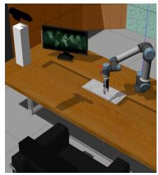
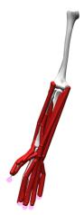
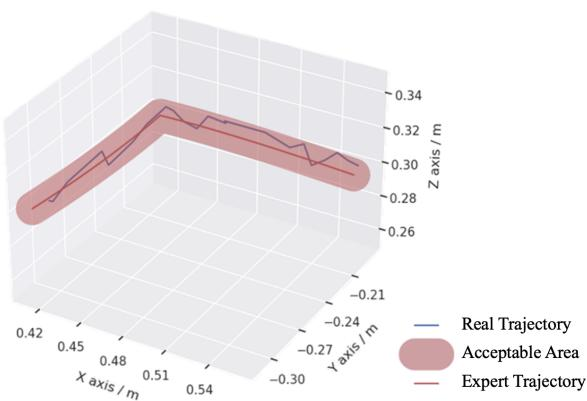
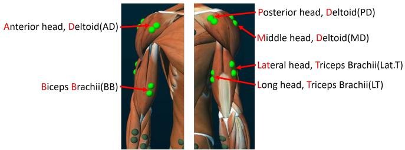
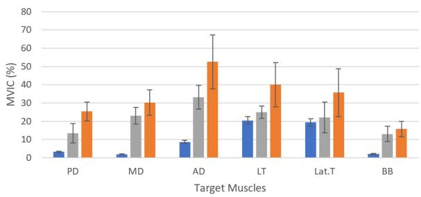

# 基于自适应学习的协作机器人上肢康复训练系统

Jun Hong Lim, Kaibo He, Zeji Yi, Chen Hou, Chen Zhang, Yanan Sui, Luming Li

摘要— 针对运动障碍患者的康复训练通常需要在康复中心使用专业设备。居家多用途训练将显著提高治疗的可及性并降低医疗成本。尽管在家庭中配备一套专用的康复机器人并不现实，我们研究了使用通用协作机器人进行康复治疗的可行性。在本研究中，我们结合人体运动反馈和偏好，利用通用机械臂开发了一种用于多用途上肢康复训练的新系统。我们将表面肌电图（surface electromyography, sEMG）、力/力矩传感器、RGB-D 相机以及机器人控制器与机器人操作系统（Robot Operating System, ROS）集成，实现了系统的感知、通信和控制。采用模仿学习方法来模仿专家提供的训练轨迹，该轨迹可根据受试者的能力进行自适应调整，从而促进居家训练。我们的康复系统能够借助基于夹爪的末端执行器进行粗大运动功能和精细运动技能训练。我们在 Gazebo 中模拟了系统控制，在 Open-Sim 中模拟了训练效果（肌肉激活水平），并在人类受试者身上评估了其实际性能。对于所有参与的受试者，在相同条件下，我们的系统与专家辅助康复相比取得了更好的训练效果。我们的工作展示了利用协作机器人进行居家运动康复训练的潜力。

临床相关性— 协作机器人系统能够提供与专用康复机器人相媲美的安全有效的训练，为便捷的居家康复训练提供了可能性。

## I. 引言

康复训练对于运动障碍患者的康复至关重要。患者需要在专门的康复中心由经验丰富的治疗师指导，使用专业设备进行高强度和重复性的训练，以建立肌肉力量和神经可塑性。这是他们恢复运动功能并回归正常生活的主要途径。对于患有中风等神经系统疾病和损伤的患者，上肢运动障碍是常见的后遗症。一旦患者病情稳定并确立了康复目标，训练应立即开始。训练有助于增强虚弱的肌肉以防止肌肉萎缩并恢复运动功能，避免因缺乏运动而导致手部水肿或肩关节半脱位。

机器人系统（包括专用机器人和通用机器人）广泛应用于康复领域，因为它们能够始终如一地执行重复性任务。专用机器人通常设计用于针对特定任务的训练，而通用机器人可应用于多种场景，与专用系统相比具有更高的自由度，且更具成本效益。

  
Fig. 1: 适应受试者能力的训练

在过去的几十年中，针对上肢康复开发了几种专用机器人康复设备和控制系统 [2], [11], [12]。这些康复机器人和辅助控制系统可以在有或没有治疗师监督的情况下引导患者完成训练过程。它们还可以帮助收集训练数据，以供治疗师评估患者当前的状况。

关于通用协作机器人在康复任务中应用的研究尝试还很有限。协作机器人（Cobots）能够与人类协同工作，且通常符合安全标准，显示出应用于康复过程的潜力。Kyrkjebø 等人 [3] 尝试通过在内置安全机制的基础上约束工作空间来提高协作机器人的安全性。他们的研究结果表明了使用协作机器人辅助康复训练的可行性。Nielsen 等人将动态运动基元与力反馈相结合，预先记录并学习康复任务，以适应不同的手臂长度 [4]。另一项来自 [5] 的研究使用了一款 7-DOF（7 自由度）的 KUKA 机械臂。该机械臂结合了“按需辅助”原则，通过不同程度的辅助来激励患者。所有这些方法都提出了一种实现重复性任务的主要途径，表明患者能够在较少监督的情况下相当独立地练习日常活动。

前往康复中心既耗时又昂贵，而且资源匮乏地区的人力短缺可能会延误患者的康复阶段。解决该问题的一个可行途径是使用能够提供相当训练效果的远程训练系统。在这项工作中，我们提出了一种基于协作机器人的远程自适应上肢训练系统。该系统将协作机器人、摄像机、运动传感器、治疗师和受试者整合在一个平台上。它能够执行不同类型的训练，并取得与常见康复机器人相似的训练效果，证明了部署通用协作机器人在家中促进个性化康复训练、免去频繁前往康复中心的可行性。

(c)  
  
Fig. 2: 所提出的远程系统概述

## II. 方法

我们提出了一种用于辅助康复训练的新型远程系统，并与 ROS 平台集成以实现一组硬件之间的通信（如图 2 所示）。基于夹爪的末端执行器被用于引导更精细的运动任务，而这是以往的末端执行器方法所无法完成的。受试者可能因身体过于虚弱而无法握持夹爪，因此我们在医生和治疗师的协助下开发了该康复任务，这对于脑卒中早期的康复训练至关重要。所提出的系统通过 Gazebo 和 OpenSim 中的仿真得到了验证。我们通过表面肌电（sEMG）信号检验了锻炼效果，并通过实验与经验丰富的训练者进行了对比，以揭示其在多用途康复中的可行性。

受试者由协作机器人（Cobot）的末端执行器引导以完成训练。运动、手势和康复时长均根据针对急性期患者的脑卒中指南 [1], [16] 设计，并结合了经验丰富的医生和治疗师的指导、修正与建议。本文提出了两项任务：一项用于粗大动作层面的手臂康复，另一项用于精细动作层面的手部康复。对于手臂康复，我们选择了在日常生活中必不可少的基础日常生活活动（ADL）任务。对于手部康复，我们选择了手指训练任务以提升手指的灵活性。在拳头的张开与闭合过程中，它驱动了整个手部和前臂肌肉。因此，它为急性期患者提供了更高的训练效率，帮助他们建立肌肉力量。受试者的前臂佩戴有一件辅助设备（如图 7(e) 和 (f) 所示），其抓握位置将通过计算机视觉方法 [8] 利用 Kinect 相机进行实时识别。

  
(a)

  
(b)

  
Fig. 3: (a) 在 Gazebo 中具有视觉和运动反馈的训练系统仿真。(b) 在 OpenSim 中进行的粗大动作运动训练仿真。(c) 在 OpenSim 中进行的精细动作运动训练仿真。

构建了如图 3(a) 所示的 Gazebo 仿真环境。相机的设置确保了对工作空间的清晰视野，RGB-D 图像被传输到我们的系统中进行识别，并确定了受试者辅助设备的抓握位置。由于身体局限性（如关节活动度）导致的阻力由力/力矩传感器（Force/Torque sensor）进行跟踪，并同时报告给控制器进行分析。我们设定了用于紧急情况的阻力阈值，若 $\begin{array} { r } { \textbf { \textit { F } } \ge \ \boldsymbol { F _ { s a f \epsilon } } } \end{array}$ e (45N)，Cobot 将触发急停，因为进一步的动作可能会导致额外伤害。我们根据视觉识别确定了每个受试者的起始点。仿真用于验证任务的可行性，模仿学习智能体也利用该环境通过通用专家数据学习自适应控制策略。在 Gazebo 和 OpenSim 仿真器中对专家轨迹和模仿轨迹进行了仿真，以确保其安全性并评估相应的肌肉激活率，从而如第 II 节所述对任务进行优化。

安全性是我们对高度人机交互任务的主要关切。在出厂默认安全配置的基础上，Cobot 的安全性被配置为三个阶段，由受试者的身体能力、康复手臂的关节活动度（ROM）及其康复阶段决定。它们在工作空间的确定、训练期间施加的加速度和速度方面各不相同。

OpenSim[6] 是一款开源的基于模型的生物力学仿真软件。它被广泛用于人体运动学和动力学分析。我们在 OpenSim 中构建了两个肌肉骨骼模型，以验证目标肌肉能够被有效激活。如图 3 所示，对于手臂康复（Arm Rehabilitation），我们基于 [7] 构建了一个上半身模型。它主要包括手部、手臂和肩部的骨骼与肌肉。对于手部康复（Hand Rehabilitation），我们构建了一个上肢模型，其中包括手部和前臂详细且精确的骨骼与肌肉。

在仿真中，我们从 Gazebo 仿真中获取了 Cobot 末端执行器的初始轨迹（初始夹爪轨迹）。随后，我们利用该轨迹驱动肌肉骨骼模型并计算肌肉激活情况。根据肌肉激活结果，我们与临床专家进行讨论以调整任务，生成新的轨迹并再次驱动模型计算肌肉激活结果。经过多次调整后，我们获得了合适的任务并验证了其有效性。

模仿学习（Imitation Learning）使智能体能够从专家演示中学习策略/轨迹。它在康复机器人领域具有巨大的应用潜力。对于远程训练，治疗师无需亲临现场指导协作机器人（Cobot）执行康复任务。相反，他们可以提供大致适合受试者的轨迹。这充当了专家标记的参考。学习智能体通过模仿学习在受试者端执行该轨迹，并根据身体状况和个人偏好进行调整。

与自动驾驶车辆不同，康复训练中没有轨道边界来限制智能体。每位受试者都有由其生理条件决定的不同边界。在我们的方法中，如图 Figure 1 所示，当轨迹对受试者来说过于困难时，他们可以按下“停止”。这类似于自动驾驶中偏离轨道边界的情况。基于这一原理，我们采用了受 HG-DAgger [17] 启发的模仿方法，并进行了修改以适应我们的问题。

在我们的系统中，提供的专家轨迹一直部署执行，直到受试者标记了负反馈，随后训练任务由专家进行调整。停止状态将被标记为不良状态。此前的状态被视为可接受状态。然后，专家将提供一条调整后的后续轨迹，并从该状态开始使用调整后的轨迹恢复训练。该过程将重复进行，直到受试者接受整条轨迹。最终的轨迹将被训练并输出针对该受试者的个性化策略。

从训练好的模型中针对新的专家数据测试集执行的实际轨迹如图 Figure 4 所示。该模型通过预测轨迹 $( x _ { g } , y _ { g } , z _ { g } )$ 与原始专家轨迹 $( x _ { i } , y _ { i } , z _ { i } )$ 之间距离的 RMSE（均方根误差）来进行评估。

受试者视角的反馈同样非常有价值，因为它直接反映了训练期间与协作机械臂交互的感受。为了收集和研究这些反馈，我们设计了一份问卷，以获取他们在使用我们的康复系统训练后对臂部和手部运动程度、所采取的安全措施的看法，以及对整个任务的综合评分。

  
Fig. 4: 根据训练模型针对另一条新专家轨迹（红线）执行的实际轨迹（蓝色）。红色区域为专家可接受的区域。RMSE 约为 1e − 2m。

## III. 实验与结果

我们招募了五名健康受试者，以评估我们的康复系统所提供训练的安全性与可行性。两项任务的初始专家轨迹均由专家使用仿真器进行模拟以确定合适轨迹，并通过 OpenSim 和 Gazebo 仿真器进行了验证，以确保在人体受试者上执行的安全性。所有受试者均已知情同意，并被要求在训练过程中放松且保持被动。他们还被告知需要

(a) 手臂康复肌肉  
  
(b) 手部康复肌肉  
Fig. 5: 用于评估训练效果的目标肌肉（选自 Noraxon MR3 程序中图示的肌肉）

  
静息 / 经受训人员辅助 / 协作机器人 (Cobot)

(a) 粗大动作级训练中的肌肉激活  
  
(b) 精细动作级训练中的肌肉激活

Fig. 6: 每位受试者进行康复训练时基于原始 sEMG 数据的肌肉激活情况，以每位受试者最大等长自主收缩（Maximum voluntary isometric contraction, MVIC）的百分比表示。（肌肉缩写如图 5 所示。）

提供阻力以模拟运动障碍，从而评估基于力/力矩（F/T）传感器的自适应系统，并基于模仿学习（imitation learning）生成个性化训练方案。

为了定量测量肌肉激活程度，我们选取了与日常生活活动（ADL）任务上肢运动相关的六块目标肌肉，以及与手指训练任务相关的五块目标肌肉，如图 5 (a) 和 (b) 所示。对每位受试者测量并分析了 11 个通道的表面肌电（sEMG）数据，以验证是否达到了特定的肌肉激活率。随后，由一名经过培训的专业人员握持与协作机器人（Cobot）相同的连接点执行相同的训练任务来重复实验。测量肌肉激活率并用于对比。

实验中进行了两种不同情况的训练，包括手臂康复任务和手部康复任务（如图 7 所示）。按照临床医生的建议，训练以 5 分钟为一个间隔进行。提供了一个按钮，当受试者认为处于不良状态（BAD STATE）时，可停止协作机器人的执行。如果发生这种情况，专家将按第 II 节所述接管控制。在每个训练间隔之间还设有 20 秒的休息时间。

使用无线肌电传感器（Noraxon Inc.）并根据指南规范放置以测量肌肉激活情况。记录了受试者在静息状态和训练期间的 sEMG，并在图 6 中进行了对比展示。

数据经过平滑处理（100ms 窗口的均方根 RMS）、时间归一化、多次重复平均、放大，并去除了心电（ECG）伪迹。

我们将协作机器人（Cobot）引导的肌肉激活率与专业人员辅助训练进行了比较（两者的连接点、运动轨迹以及给予受试者的指令均相同）。为了归一化表面肌电（sEMG）值以进行对比，我们在相同姿势和条件下记录了每位受试者的最大自主等长收缩（Maximum Voluntarily Isometric Contraction, MVIC），并用测得的 sEMG 值除以该基准值。MVIC 是一种测量人体肌肉力量的常用标准化方法 [13], [14], [15]。如图 Figure 6 所示，我们计算了所有受试者的平均值。实验结果清楚地表明，与专业人员辅助训练相比，在我们的系统上进行训练所诱发的 MVIC 百分比显著更高。

与专业人员辅助康复中的肌肉激活率相比，协作机器人辅助康复任务中的各目标肌肉均表现出更高的激活量。粗大运动训练中的目标肌肉平均增加了 11.6(±5.9)%，精细运动训练中的目标肌肉平均增加了 14.6(±5.3)%。

实验结果反映了在设计的训练动作中存在明显的肌肉激活，且握拳任务在训练过程中能够有效激活整个前臂肌肉。在两项任务中，协作机器人带动受试者达到的激活程度均显著高于治疗师。以下几点可能是关键原因：1. 受试者的运动幅度更充分，使协作机器人能够在每个训练周期中完全拉伸前臂，因此运动表现更加稳定。2. 协作机器人施加的力量大于治疗师。面对新受试者时，由于身体特性未知，治疗师可能会有所保留；而协作机器人配备了自适应方法，可以主动调节施加的力度，使受试者发挥出最大极限。3. 末端执行器使训练过程更加高效。末端执行器提供了更好的支撑和约束，因此受力更加均匀，并能施加更大的合力。

除上述各点外，在实际应用中还有其他因素可能影响治疗师的训练效果。在我们的实验设置中，我们在每个任务之间给予了治疗师充足的休息时间，且训练时间固定为 10-min。然而，现实中治疗师的工作负荷要高得多，因此疲劳不可避免。交替甚至结合使用本文提出的任务将有效帮助训练整个手臂的肌肉。因此，我们提出的系统是可行的，并提供了一种高效的途径来增强肌肉力量，并在康复早期阶段预防手臂挛缩和畸变，而处于该阶段的受试者通常较为虚弱，难以自主进行标准训练。

此外，我们在实验后对受试者的锻炼效果进行了问卷调查。结果以 1 到 10 分的等级呈现在图 8 中，分值越大代表效果越好。我们可以得出结论，从受试者的角度来看，这进一步证实了所设计的任务在肌肉激活方面的训练效果。受试者在任务结束后对安全性以及手臂和手部的训练效果均给予了高度评价。所有人都在有需求的前提下，推荐采用我们设计的构型和任务进行训练。

  
Fig. 7: 受试者接受包含日常生活任务（图 8(a)(b)(c) 粗大动作级手臂康复训练）和精细手指训练（图 8(d)(e) 精细动作级手部康复训练）的自动化训练 (a) 后向收缩 (b) 前向伸展 (c) 手臂旋转拉伸 (d) 引导抓取 (e) 张开手掌 (f) 握拳保持

  
Fig. 8: 受试者对协同训练的主观感受

## IV. 结论

我们提出了一种新型的协作机器人（Cobot）辅助康复训练自适应系统，该系统集成了相机、力传感器和机器人控制器。我们测试了两项代表性任务：粗大动作训练任务和精细动作训练任务。在每项任务中，智能体从专家示范中学习策略，并能根据受试者的身体能力进行调整。我们的工作提供了一个一体化平台，并展示了利用通用机器人为运动障碍人士开发居家个性化远程上肢训练系统的可行性。

## 致谢

本研究得到了国家重点研发计划（2021YFE0111800）、北京市科技计划（Z211100003521006）、科技创新 2030 —“脑科学与类脑研究”重大项目（2022ZD0209400）以及清华大学水木学者计划（2019SM133）的资助。本文所描述的涉及人类受试者的实验已获得清华大学机构审查委员会（IRB）的批准。作者谨向 Dr. Lim Soon Bock 及其团队所提供的医疗建议表示感谢。

## 参考文献

[1] Hebert Debbie et al. Canadian stroke best practice recommendations: stroke rehabilitation practice guidelines, update 2015 International Journal of Stroke. ;11.

[2] Chen et al. Assistive control system for upper limb rehabilitation robot IEEE Transactions on Neural Systems and Rehabilitation Engineering. ;24.

[3] Kyrkjebø Erik et al. Feasibility of the UR5 Industrial Robot for Robotic Rehabilitation of the Upper Limbs After Stroke in 2018 IEEE/RSJ international conference on intelligent robots and systems (IROS):1–6IEEE 2018.

[4] Nielsen Jacob et al. Individualised and adaptive upper limb rehabilitation with industrial robot using dynamic movement primitives（基于动态运动原语的工业机器人个性化与自适应上肢康复）in ICRA 2017 Workshop on Advances and challenges on the development, testing and assessment of assistive and rehabilitation robots: Experiences from engineering and human science research;1:40 2017.

[5] Becker Sebastian et al. Controlling of a ROS-based robotic system in accordance to the assist-as-needed principle in end-effector based rehabilitation systems（在基于末端执行器的康复系统中根据按需辅助原则控制基于 ROS 的机器人系统）Current Directions in Biomedical Engineering.

[6] Delp Scott L et al. OpenSim: open-source software to create and analyze dynamic simulations of movement（OpenSim：用于创建和分析运动动态仿真的开源软件）IEEE transactions on biomedical engineering. ;54.

[7] Raabe Margaret E et al. An investigation of jogging biomechanics using the full-body lumbar spine model: Model development and validation（使用全身腰椎模型对慢跑生物力学的研究：模型开发与验证）Journal of biomechanics.

[8] Bradski Gary, Kaehler Adrian. OpenCV. Dr. Dobb’s journal of software tools. 2000;3.

[9] Sui Yanan, Gotovos Alkis, Burdick Joel, Krause Andreas. Safe exploration for optimization with Gaussian processes（基于高斯过程优化的安全探索）in International Conference on Machine Learning:997–1005PMLR 2015.

[10] Sui Yanan, Zhuang Vincent, Burdick Joel W, Yue Yisong. Multidueling bandits with dependent arms（具有依赖臂的多重决斗老虎机）in Proceedings of the Conference on Uncertainty in Artificial Intelligence 2017.

[11] Aprile Irene et al. Upper limb robotic rehabilitation after stroke: a multicenter, randomized clinical trial（脑卒中后上肢机器人康复：一项多中心随机临床试验）Journal of Neurologic Physical Therapy.

[12] Mazzoleni Stefano et al. Combining upper limb robotic rehabilitation with other therapeutic approaches after stroke: current status, rationale, and challenges（脑卒中后上肢机器人康复与其他治疗方法的结合：现状、理论依据与挑战）BioMed research international. 2017.

[13] Meldrum Dara et al. Maximum voluntary isometric contraction: Reference values and clinical application（最大自主等长收缩：参考值与临床应用）Amyotrophic lateral sclerosis : official publication of the World Federation of Neurology Research Group on Motor Neuron Diseases. 2007;8:47-55

[14] Lee et al. Comparison of maximum voluntary isometric contraction of the biceps on various posture and respiration conditions for normalization of electromyography data（用于肌电图数据归一化的不同姿势和呼吸条件下肱二头肌最大自主等长收缩的比较）Journal of Physical Therapy Science. 2016;28:3007-3010.

[15] Visser et al. Comparison of maximal voluntary isometric contraction and hand-held dynamometry in measuring muscle strength of patients with progressive lower motor neuron syndrome（测量进行性下运动神经元综合征患者肌力时最大自主等长收缩与手持肌力测定法的比较）Neuromuscul Disord. 2003;9.

[16] Powers et al. American Heart Association Stroke Council（美国心脏协会卒中委员会）. 2018 guidelines for the early management of patients with acute ischemic stroke: a guideline for healthcare professionals from the American Heart Association/American Stroke Association（2018年急性缺血性脑卒中患者早期管理指南：美国心脏协会/美国卒中协会面向医疗专业人员的指南）Stroke. 2018;49:e46- 99.

[17] Kelly et al. HG-DAgger: Interactive Imitation Learning with Human Experts（HG-DAgger：与人类专家的交互式模仿学习）2019:8077-8083.

[18] Abbeel Pieter et al. Apprenticeship Learning via Inverse Reinforcement Learning（通过逆强化学习实现学徒学习）in Proceedings of the Twenty-First International Conference on Machine Learning ICML ’04:1 2004.