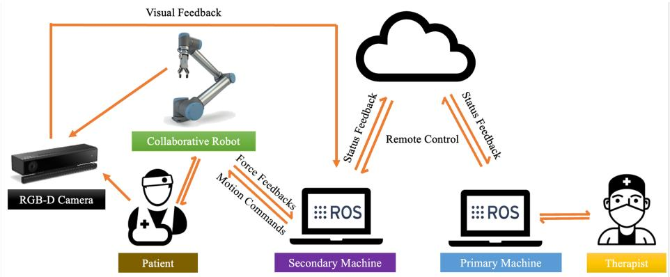
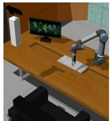
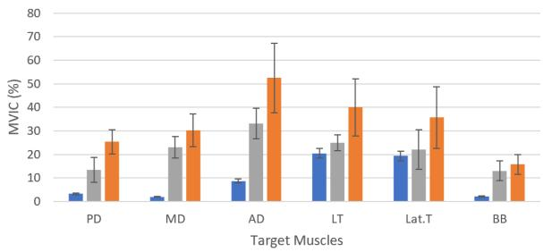

# 基于自适应学习的协作机器人上肢康复训练系统

Jun Hong Lim、Kaibo He、Zeji Yi、Chen Hou、Chen Zhang、Yanan Sui、Luming Li

摘要——运动功能障碍患者的康复训练通常需要在康复中心使用专门的设备。基于家庭的多用途训练将显著提高治疗的可及性并降低医疗成本。虽然在家中配备一套康复机器人并不现实，但我们研究了使用通用协作机器人进行康复治疗的可行性。在本工作中，我们开发了一个新系统，使用通用机器人手臂结合人体运动反馈和偏好，进行多用途上肢康复训练。我们将表面肌电信号、力/力矩传感器、RGB-D 摄像头以及机器人控制器与机器人操作系统（Robot Operating System）相集成，以实现系统的感知、通信和控制。该系统采用了模仿学习方法，能够模仿专家提供的训练轨迹，并可根据受试者能力进行调整，从而促进家庭训练。我们的康复系统能够使用基于夹爪的末端执行器进行粗大运动功能和精细运动技能训练。我们在 Gazebo 中仿真了系统控制，在 OpenSim 中仿真了训练效果（肌肉激活水平），并通过人体受试者评估了实际性能。对于所有入组的受试者，在相同条件下，我们的系统相比由专科医师辅助的康复训练取得了更好的训练效果。我们的工作展示了利用协作机器人进行家庭运动康复训练的潜力。

临床相关性——该协作机器人系统能够提供与专业康复机器人相当的安全、有效的训练，为在家庭中进行便捷的康复训练提供了可能。

## I. 引言

康复训练对于运动功能障碍患者的恢复至关重要。患者需要在专用康复中心使用专门设备，由经验丰富的治疗师进行密集而重复的训练，以增强肌肉力量和神经可塑性。这是他们恢复运动功能、重返正常生活的主要途径。对于患有中风等神经性疾病和损伤的患者而言，上肢运动障碍是常见的后遗症。一旦患者病情稳定且稳定，并能够确立康复目标，就应立即开始训练。这有助于增强无力的肌肉以防止肌肉萎缩并恢复运动功能，避免因缺乏运动而引起的手部水肿或肩关节半脱位。

机器人系统（包括专用机器人（dedicated robots）和通用机器人（general-purpose robots））已被广泛用于康复领域，因为它们能够始终如一地完成重复性任务。专用机器人通常专为训练某项特定任务而设计，而通用机器人可用于多种场景，相比专用系统具有更高的自由度，且更具成本效益。

  

图 1：适应受试者能力的训练

过去几十年间，研究者们已经开发出多种用于上肢康复的专用机器人康复设备与控制系统 [2]、[11]、[12]。这些康复机器人和辅助控制系统能够在治疗师监督或不监督的情况下引导患者完成训练过程。它们还可以帮助收集训练数据，供治疗师评估患者的当前状况。

关于将通用协作机器人应用于康复任务的研究尝试仍然有限。协作机器人（Collaborative Robots, Cobots）能够与人类协同工作，并且通常符合安全标准，展现出在康复流程中部署应用的潜力。Kyrkjebø 等人 [3] 尝试通过对工作空间加以约束来补充机器人内置的安全机制，从而提升协作机器人的安全性。他们的结果表明了将协作机器人用于辅助康复训练的可行性。Nielsen 等人将动态运动基元与力反馈相结合，预记录并学习康复任务，使其能够适应不同的手臂长度 [4]。文献 [5] 中的另一项工作使用了具有 7 自由度（7-DOF）的 KUKA 机械臂。该机械臂结合了按需辅助（assist-as-needed）原则，可针对不同患者提供不同等级的辅助激励。上述所有方法都提出了一种使重复性任务成为可行的初步方案，表明患者能够在较少监督的情况下较为独立地练习日常活动。

前往康复中心就诊的过程既耗时又费用高昂，加之在资源有限地区人手短缺，都可能延误患者的康复阶段。解决该问题的一种可行方法是使用远程训练系统，以提供与康复中心相当的训练效果。在本工作中，我们提出了一种基于协作机器人的远程自适应上肢训练系统。该系统在一个平台中集成了协作机器人、摄像头、运动传感器、治疗师与受试者。它能够执行多种类型的训练，并达到与常见康复机器人相当的训练效果，证明了在家中部署通用协作机器人以辅助个性化康复训练的可行性，从而免去频繁往返康复中心的需要。

  

(c) 图 2：所提出的远程系统概述

## II. 方法（METHODS）

我们提出了一种用于辅助康复训练的新型远程系统，并与 ROS 平台集成，以实现一组硬件之间的通信（如图 2 所示）。该系统采用基于夹爪的末端执行器（end-effector），用于引导以往的末端执行器方法无法完成的更精细的运动任务。患者可能过于虚弱而无法握住夹爪，因此我们在医生和治疗师的协助下开发了这一康复任务，这对于脑卒中早期康复训练而言非常重要。所提出的系统通过 Gazebo 和 OpenSim 中的仿真进行了验证。我们通过表面肌电图（surface electromyography, sEMG）信号，并与经验丰富的训练师的训练效果进行比较，对运动效果进行了检验，从而揭示了其在多用途康复中的可行性。

受试者由协作机器人（Cobot）的末端执行器引导完成训练。运动、手势和康复时长的设计均依据脑卒中临床指南 [1]、[16]，并结合经验丰富的医师和治疗师给出的指导、修订与建议。本文提出了两项任务：一项用于大肢体水平的（gross level）手臂康复，另一项用于精细水平的（fine level）手部康复。对于手臂康复，我们选择了基本的日常生活活动（ADL, Activities of Daily Living）任务，这是日常生活所必需的。对于手部康复，我们选择了手指训练任务，以促进手指的灵活性。在握拳和张拳过程中，它会激活整只手和前臂的肌肉。因此，它为急性期患者提供了更好的训练效率，帮助他们逐步建立肌肉力量。一件辅助设备（如图 7(e) 和 (f) 所示）佩戴在受试者的前臂上，其握持位点（grip-site）将由 Kinect 相机通过计算机视觉方法 [8] 进行实时识别。

  

(a)

  

(b)

  

图 3：（a）在 Gazebo 中对具有视觉和运动反馈的训练系统进行仿真。（b）使用 OpenSim 进行粗略水平运动训练仿真。（c）使用 OpenSim 进行精细水平运动训练仿真。

如图 3(a) 所示，构建了一个 Gazebo 仿真环境。摄像头的设置使其能够清晰观察工作空间，RGB-D 图像被传输到我们的系统中进行识别，并识别出受试者辅助设备的抓取点。由于身体限制（例如活动范围）所产生的阻力由力/扭矩（Force/Torque）传感器进行跟踪，并同时上报给控制器进行分析。我们设定了一个用于紧急情况的阻力阈值：当 $\begin{array} { r } { \textbf { \textit { F } } \ge \ \boldsymbol { F _ { s a f \epsilon } } } \end{array}$（45N）时，协作机器人（Cobot）触发紧急停止，因为进一步的动作可能导致额外的伤害。我们根据视觉识别为每个受试者确定了起始点。该仿真用于验证任务可行性，模仿学习智能体也利用该环境基于通用专家数据学习自适应控制策略。专家轨迹和模仿轨迹在 Gazebo 和 OpenSim 仿真器中进行仿真，以确保其安全性并评估相应的肌肉激活率，从而如第二节所述对任务进行优化。

安全是我们对丰富人机交互任务的首要关注。除出厂默认的安全配置外，协作机器人的安全被配置为三个阶段，根据受试者的身体能力、康复机械臂的活动范围（ROM）以及他们所处的康复阶段确定。这些阶段在工作空间确定以及训练过程中施加的加速度和速度方面有所不同。

OpenSim[6] 是一款开源的基于模型的生物力学仿真软件。它被广泛用于人体运动学和动力学分析。我们在 OpenSim 中构建了两个肌肉骨骼模型，以验证目标肌肉能否被有效激活。如图 3 所示，对于手臂康复，我们基于文献 [7] 构建了一个上半身模型。它主要包括手、手臂和肩部的骨骼和肌肉。对于手部康复，我们构建了一个上肢模型，其中包括手和前臂详细而精确的骨骼和肌肉。

在仿真中，我们从 Gazebo 仿真中获取了协作机器人末端执行器的初始轨迹（即初始夹爪轨迹）。然后我们使用该轨迹驱动肌肉骨骼模型并计算肌肉激活率。根据肌肉激活结果，我们与临床专家讨论以调整任务，生成新轨迹并再次驱动模型以计算肌肉激活结果。经过多次调整后，我们获得了合适的任务并验证了其有效性。

模仿学习使智能体能够从专家示范中学习策略或轨迹。它在康复机器人领域具有巨大的应用潜力。对于远程训练，治疗师不在现场引导协作机器人完成康复任务。相反，他们可以提供通常适合受试者的轨迹。这充当了专家标注的参考。学习智能体通过模仿学习在受试者一侧执行该轨迹，并根据身体状况和个人偏好进行调整。

与自动驾驶汽车不同，康复训练中没有轨道边界来约束智能体。每位受试者都有由其生理条件决定的不同边界。在我们的方法中，如图 1 所示，当轨迹对受试者而言过于困难时，他们可以按下"停止"按钮。这类似于自动驾驶中违反轨道边界。基于此原则，我们采用了受 HG-DAgger [17] 启发的模仿方法，并进行了修改以适应我们的问题。

在我们的系统中，提供的专家轨迹会一直被部署，直到受试者标记出负面反馈，然后由专家调整训练任务。停止状态将被标记为不良状态。在此之前的状态被视为可接受状态。然后，专家将提供一条调整后的后续轨迹，训练从该状态开始以调整后的轨迹继续。该过程将重复进行，直到受试者接受整个轨迹。最终轨迹将被训练并导出一个为该受试者个性化的策略。

从训练模型在新的专家数据测试集上执行的实际轨迹如图 4 所示。该模型通过 RMSE 进行评估，其计算的是预测轨迹 $( x _ { g } , y _ { g } , z _ { g } )$ 与原始专家轨迹 $( x _ { i } , y _ { i } , z _ { i } )$ 之间的距离。

从受试者角度获得的反馈也很有价值，因为它直接反映了训练中与协作臂交互的感受。为了接收和研究反馈，我们设计了一份调查问卷，在使用我们的康复系统训练后收集他们的看法，包括手臂和手部锻炼的程度、采取的安全措施，以及对整个任务的综合评分。

  

图 4: 由训练模型针对另一条新的专家轨迹（Expert Trajectory，红色线条）执行的实际轨迹（Real Trajectory，蓝色）。红色区域为专家可接受的区域。RMSE 约为 1e − 2 m。

## III. 实验与结果

我们招募了五名健康受试者来评估我们康复系统所提供的训练的安全性和可行性。两个任务的初始专家轨迹由专家使用模拟器来确定，以仿真出合适的轨迹，并使用 OpenSim 和 Gazebo 模拟器进行验证，以确保在人体受试者上能够安全执行。所有受试者均被充分告知，并被要求在训练期间保持放松且处于被动状态。他们还被告知要

  

(a) 手臂康复肌群（Arm Rehabilitation Muscle）

(b) 手部康复肌群（Hand Rehabilitation Muscle）

图 5：用于评估训练效果的目标肌群（肌肉插图取自 Noraxon MR3 程序）

  

由受训人员辅助休息的协作机器人

  

(a) 粗粒度训练中的肌肉激活  
(b) 细粒度训练中的肌肉激活

图 6：每位受试者在进行康复训练时基于原始 sEMG 数据的肌肉激活情况，以每位受试者最大随意等长收缩（Maximum Voluntary Isometric Contraction, MVIC）的百分比表示。（肌肉缩写见图 5。）

提供阻力以模拟运动障碍，从而评估基于 F/T 传感器的自适应系统，并基于模仿学习生成个性化的训练计划。

为了量化测量肌肉激活，我们针对日常生活活动（ADL）任务选择了六块与上肢运动相关的目标肌肉，针对手指训练任务选择了五块目标肌肉，如图 5 (a) 和 (b) 所示。每位受试者测量并分析了 11 通道的 sEMG 数据，以验证是否达到了特定的肌肉激活率。随后，由一名训练有素的专业人员重复该实验，在执行相同训练任务时握在与协作机器人（Cobot）相同的附着点。测量肌肉激活率以用于比较。

实验中进行了两种不同的训练情形，包括手臂康复任务和手部康复任务（如图 7 所示）。按照临床医生的建议，训练以 5 分钟为间隔进行。当受试者认为系统处于不良状态（BAD STATE）时，提供了一个按钮以停止协作机器人的执行。若发生此情况，专家将按第二节所述接管控制。每次训练间隔之间还有 20 秒的休息时间。

使用无线 EMG 传感器（Noraxon Inc.），并按照指南正确放置以测量肌肉激活。受试者在静息和训练期间的 sEMG 被记录下来，并在图 6 中以比较形式展示。

数据进行了平滑处理（100 ms 窗口的均方根（RMS））、时间归一化、跨重复次数平均、放大，并去除了心电（ECG）伪迹。

我们将协作机器人引导的肌肉激活率与专家辅助训练进行了比较（附着点、轨迹和给予受试者的指令均相同）。为了归一化 sEMG 值以进行比较，我们以相同的姿势和条件记录了每位受试者的最大随意等长收缩（MVIC），并将测得的 sEMG 值除以该值。MVIC 是测量人体肌肉力量的常用标准化方法 [13]、[14]、[15]。我们对所有受试者的数据进行了平均，结果如图 6 所示。实验结果清楚地表明，与由专家进行的训练相比，使用我们的系统进行训练诱导了显著更高的 MVIC。

与辅助康复中专家的肌肉激活率相比，协作机器人辅助康复任务的每个目标肌肉都显示出更高的激活量。粗大动作训练的目标肌肉平均增加了 11.6(±5.9)%，精细动作训练的目标肌肉平均增加了 14.6(±5.3)%。

实验结果表明，在所设计的训练动作过程中肌肉激活清晰可见，而握拳任务在训练中能够有效激活整个前臂肌群。在两项任务中，由协作机器人（Cobot）辅助时被试的肌肉激活程度均显著高于由治疗师辅助时的激活程度。以下原因可能是关键所在：1. 被试的运动幅度更大，因此协作机器人在每个训练周期中能够充分拉伸前臂，使得运动表现更加稳定。2. 协作机器人施加的力大于治疗师。由于治疗师对新被试的身体特性并不熟悉，因此会保留一定的施力；而协作机器人配备了自适应方法，能够主动调整所施加的力，使被试充分达到其极限。3. 末端执行器（end-effector）使整个过程更加有效。末端执行器提供了更好的支撑与包裹性，因此力的施加更加均匀，能够施加更大的合力。

除上述要点外，在实际临床中还有其他因素会影响治疗师的训练表现。在本实验中，我们在每个任务之间为治疗师提供了充足的休息时间，并将训练时长固定为 10 分钟。然而，实际治疗师的工作负荷要大得多，因此疲劳不可避免。将所提出的任务交替进行甚至组合进行，将有效帮助训练整个手臂的肌肉群。因此，我们所提出的系统是可行的，为增强肌力以及在康复早期（被试可能无力自主完成标准动作时）预防手臂挛缩与畸形提供了一种高效的方法。

此外，我们在实验后对被试就训练效果进行了问卷调查，结果如图 8 所示，采用 1 至 10 的评分量表，数值越大表示评价越高。从被试的角度来看，这一结果进一步佐证了所设计的任务对肌肉激活的训练效果。被试在安全性以及任务后手臂与手部的训练效果方面均给出了较高的评分。在需要时，所有被试都推荐采用我们所设计的构型与任务进行训练。

  

图 7：受试者接受日常生活任务的自动训练（图 8（a）（b）（c）大臂康复训练）与精细手指训练（图 8（d）（e）精细手部康复训练）。（a）后缩；（b）前伸；（c）手臂旋转伸展；（d）引导抓取；（e）张开手掌；（f）握拳保持

  

图 8：受试者对协作训练的感知

## IV. 结论（CONCLUSION）

我们提出了一种用于协作机器人辅助康复训练的创新自适应系统，该系统集成了相机、力传感器和机器人控制器。我们考察了两项具有代表性的任务：一项粗大运动训练任务和一项精细运动训练任务。在每项任务中，智能体都从专家示范中学习策略，并可根据受试者的身体能力进行调整。我们的工作提供了一个一体化平台，并验证了利用通用机器人为运动障碍患者开发居家个性化远程上肢训练系统的可行性。

## 致谢（ACKNOWLEDGMENT）

本工作得到了国家重点研发计划（2021YFE0111800）、北京市科技计划（Z211100003521006）、"科技创新的2030—重大项目"（2022ZD0209400）以及水木清华学者计划（2019SM133）的资助。本文涉及人体受试者的实验已获得清华大学伦理审查委员会（IRB）的批准。作者衷心感谢 Lim Soon Bock 博士及其团队所提供的医学建议。

## 参考文献（REFERENCES）

[1] Hebert Debbie 等. 加拿大卒中最佳实践建议：卒中康复实践指南，2015 年更新. *International Journal of Stroke*. ；11.

[2] Chen 等. 用于上肢康复机器人的辅助控制系统. *IEEE Transactions on Neural Systems and Rehabilitation Engineering*. ；24.

[3] Kyrkjebø Erik 等. UR5 工业机器人在脑卒中后上肢机器人康复中的可行性研究. 载于：*2018 IEEE/RSJ International Conference on Intelligent Robots and Systems (IROS)*：1–6，IEEE，2018.

[4] Nielsen Jacob 等. 基于动态运动原语、利用工业机器人实现的个性化与自适应上肢康复. 载于：*ICRA 2017 Workshop on Advances and Challenges on the Development, Testing and Assessment of Assistive and Rehabilitation Robots: Experiences from Engineering and Human Science Research*；1：40，2017.

[5] Becker Sebastian 等. 基于 ROS 的机器人系统按"按需辅助"原则进行控制：末端执行器式康复系统中的应用. *Current Directions in Biomedical Engineering*.

[6] Delp Scott L 等. OpenSim：用于创建和分析运动动态模拟的开源软件. *IEEE Transactions on Biomedical Engineering*. ；54.

[7] Raabe Margaret E 等. 利用全身体腰椎模型对慢跑生物力学的研究：模型开发与验证. *Journal of Biomechanics*.

[8] Bradski Gary, Kaehler Adrian. OpenCV. *Dr. Dobb's Journal of Software Tools*. 2000；3.

[9] Sui Yanan, Gotovos Alkis, Burdick Joel, Krause Andreas. 基于高斯过程的安全探索优化方法. 载于：*International Conference on Machine Learning*：997–1005，PMLR，2015.

[10] Sui Yanan, Zhuang Vincent, Burdick Joel W, Yue Yisong. 具有依赖臂的多对决赌博机问题. 载于：*Proceedings of the Conference on Uncertainty in Artificial Intelligence*，2017.

[11] Aprile Irene 等. 卒中后上肢机器人康复：一项多中心随机临床试验. Journal of Neurologic Physical Therapy.

[12] Mazzoleni Stefano 等. 卒中后将上肢机器人康复与其他治疗方法相结合：现状、原理与挑战. BioMed research international. 2017.

[13] Meldrum Dara 等. 最大自主等长收缩：参考值与临床应用. Amyotrophic lateral sclerosis : official publication of the World Federation of Neurology Research Group on Motor Neuron Diseases. 2007;8:47-55

[14] Lee 等. 不同姿势与呼吸条件下肱二头肌最大自主等长收缩用于肌电数据标准化. Journal of Physical Therapy Science. 2016;28:3007-3010.

[15] Visser 等. 最大自主等长收缩与手持式测力计在评估进行性下运动神经元综合征患者肌力中的比较. Neuromuscul Disord. 2003;9.

[16] Powers 等. 美国心脏协会卒中委员会. 急性缺血性卒中患者早期管理 2018 指南：来自美国心脏协会/美国卒中协会的医疗专业人员指南. Stroke. 2018;49:e46-99.

[17] Kelly 等. HG-DAgger：与人类专家的交互式模仿学习. 2019:8077-8083.

[18] Abbeel Pieter 等. 通过逆向强化学习进行的学徒学习. 见：第21届国际机器学习大会论文集 ICML '04:1 2004.