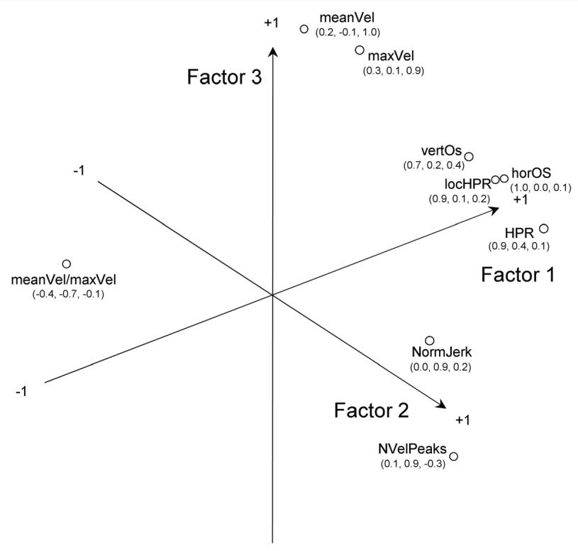
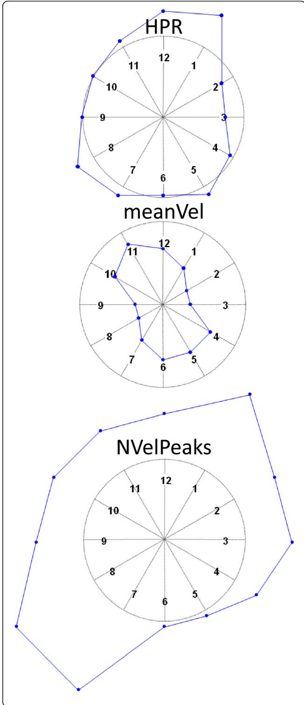

研究

开放获取

# 脑卒中患者上肢功能评估的器械化测量指标：一项验证研究

Maria Longhi1, Andrea Merlo1,2\*, Paolo Prati1, Meris Giacobbi1 and Davide Mazzoli1

## 摘要

背景：机器人外骨骼越来越多地被用于上肢（Upper Limb, UL）运动的客观、定量评估。在使用 Armeo®Spring 进行机器人辅助伸手任务过程中计算得到的一套仪器化指标，已被证明可评估上肢功能。本研究旨在检验该基于指标的评估方法在用于脑卒中患者时的构念效度。

方法：本研究纳入了 44 名 45 至 79 岁的脑卒中患者，其 Wolf 运动功能测试能力评分（WMFT-FAS）为 10 至 75 分，肩部和肘部的运动指数（Motricity Index, MI）为 14 至 33 分，从而涵盖了广泛的损伤程度范围。残余上肢功能分别通过 WMFT-FAS、WMFT-TIME 以及一套 9 个数值指标进行评估，该套指标评估 Armeo®Spring 设备的"垂直捕获"（Vertical Capture）任务中获得的 3D 末端轨迹所反映的运动准确性、速度和平滑度。为探究哪些变量能更好地表征运动控制缺陷，采用 Mann-Whitney U 检验将患者的各项指标与 25 名健康个体所得指标进行比较。为探究指标之间的内在关系以及在评估准确性、速度和平滑度方面的构念效度，进行了因子分析。为验证指标的同期效度，采用 Spearman 相关系数将其与 WMFT-FAS 和 WMFT-TIME 进行比较。

结果：脑卒中受试者的 7 项指标与健康对照组存在显著差异，效应量范围为 0.35–0.74。因子分析证实特定的指标子集分别属于准确性、速度和平滑度三个领域（区分效度）。一项准确性指标、两项速度指标和两项平滑度指标与 WMFT-FAS 和 WMFT-TIME 显著相关（|rho| = 0.31–0.50）（同期效度）。在所评估的各运动领域中，每个领域各有 1 项指标被证实具有构念效度（区分效度和同期效度），并被予以选定。此外，这些指标能够在 WMFT 评分水平相同的患者中检测出准确性、速度和/或平滑度的差异。

结论：所提出的基于指标的上肢评估方法可用于补充和支持脑卒中患者上肢功能的临床评估。

关键词：上肢，机器人指标，效度，脑卒中，康复

## 背景

上肢功能损伤是脑卒中幸存者中最显著且持续存在的身体残疾，约 70% 的患者在脑卒中入院时即有此表现[1]。这可能导致执行日常活动所需的够取能力大幅下降，进而影响其独立性[2]。量化评估脑卒中患者的够取能力对于确定运动和功能的初始丧失至关重要，也是康复过程中追踪运动功能恢复的必要手段，目前依赖于临床量表进行评估。该领域最常用的评分系统包括：用于评估运动损伤的 Fugl-Meyer 运动功能评定量表（FMA）[3–6]，以及用于评估上肢功能的 Wolf 运动功能测试（WMFT）[7–9]。根据《国际功能、残疾和健康分类》（ICF）[10]，FMA 仅涉及身体功能维度，而 WMFT 在 ICF 类别中被归类为活动量表，因为它测量的是功能性活动中的变化[11]。这些测试在评估脑卒中患者上肢功能时已证明其可靠性[12]和有效性[13–15]，尽管存在一些轻微的局限性[16–18]，例如设备需求、执行时间、培训要求以及对康复过程中运动表现细微变化的敏感性不足等。

上肢运动的恢复（如果有的话）通常在中风后的亚急性期开始，并得到个体化康复方案的支持；众所周知，这些方案的积极效果取决于重复、强度和任务导向性 [19]。因此，作为旨在恢复上肢功能的整体治疗的一部分，能够在执行重复性任务过程中支撑上肢的机器人设备和外骨骼被引入 [20–22]。除了在康复实践中的应用外，嵌入式传感器的可用性还可使其进一步用作评估设备。事实上，上肢机器人康复设备最近被用作客观而准确的评估工具，以监测进展 [23] 并收集可概括个体表现的定量数据 [24]。据相关文献报道，基于机器人的测试持续时间通常不少于 30–40 分钟 [25–27]；从机器人辅助的上肢运动轨迹中提取的参数数量在不同研究之间差异很大，从 Roher 及其同事 [28] 研究中的 5 个平滑度参数，到 Einav 等人 [25] 论文中多达 22 个用于创建单一综合得分的指标。总的来说，正如 Nordin 等人 [29] 的综述所总结的，文献中已经提出了若干指标来描述中风患者的上肢损伤，涉及运动规划、准确性、协调性、效率、速度、加速度、急动度（jerk）以及运动子单元的数量。然而，对这些指标的度量学特性及其与临床量表的同时效度的完整分析仍然缺失 [29]。

我们最近开发了一款定制化的独立软件，通过提供一组用于评估上肢（UL）运动准确性、速度和流畅性的指标及相关参考值，增强了商用外骨骼（Armeo®Spring，Hocoma AG，Switzerland）的实用性 [30]。在用于卒中患者时，根据患者损伤程度的不同，该评估可在 5 至 15 分钟内完成。所衍生的指标易于与临床专业人员共享，因为它们直接针对运动的准确性、速度和流畅性缺失（ jerkiness，即 jerk-based 不流畅性），而这些都是上肢损伤的临床方面。事实上，准确性的丧失可能与躯体感觉减退有关，速度的下降可能由轻瘫引起，而流畅性的丧失则可能源于肌张力异常 [31]。这些指标在用于临床评估之前，必须通过与临床量表的比较加以验证 [27]。基于此，我们通过量化本工具区分卒中患者与健康受试者的能力，识别评估上肢运动不同维度的指标，并验证其与临床参考标准的相关性，对本上肢功能评估中器械化指标的有效性进行了测试。本研究旨在为临床医生提供一种客观、定量且易于使用的评估工具，以改善神经系统疾病中的上肢功能评估。

## 方法

## 受试者

四十四名卒中患者于两年期间（2012–2013）入住我院的康复科，由其主治医生筛选接受机器人治疗，并纳入本研究。纳入标准为：（1）首次单侧缺血性或出血性卒中导致的上肢偏瘫；（2）无严重认知缺陷；（3）能够坐立（躯干控制测试——TCT——中"坐位平衡"项得分 ≥12），且在椅子上活动一小时无心脏、呼吸和/或疼痛方面的不适主诉；（4）在减负重条件下能够主动活动肩关节和肘关节（肩关节和肘关节的肌力 MI 均 ≥14 [32]）。排除标准为：（1）严重的认知知觉缺陷（共济失调、失用症、单侧忽略、感觉性失语）；（2）肩痛或肩关节半脱位，或其他影响够及能力的神经/神经肌肉或骨科疾病；（3）严重的视力减退（ipovisus）。

本研究基于对2012–2013年临床常规中可获得数据的回顾性分析。所有患者均签署了知情同意书，同意本研究中对数据的处理以及匿名数据和结果的发表。本回顾性研究的开展未以任何方式影响患者的治疗。研究按照标准伦理原则开展，并经我院内部科学委员会批准，该委员会已获得地方伦理委员会（Comitato Etico IRST IRCCS e Area Vasta Romagna, CEIIAV）的临床研究正式批准。

本研究中使用的正常参考数据来自25名健康的右利手个体样本，年龄在21至74岁之间（平均年龄 = 46 ± 20 岁），相关数据可见参考文献[30]。在该正常受试者样本中，各项指标不受年龄影响。

## 临床评估

对每位受试者的残余上肢（Upper Limb, UL）功能均进行了临床和仪器评估。上肢运动能力通过Wolf运动功能测试（WMFT）进行临床评估，该测试对应国际功能、残疾和健康分类（ICF）的活动领域[11]，因其能够通过广泛的functional任务对运动能力进行定量测量，并评估执行时间、运动质量和力量。WMFT包含17个项目：其中两项与受试者力量相关，其余15项与受试者功能能力相关。平均执行时间（WMFT-TIME），以秒为单位，由每项任务的执行时间之和（每项任务上限为120秒）除以任务数得出。总分，也称为功能能力评分（WMFT-FAS），是15个项目得分之和（采用0至5的6点顺序量表评分）。总分最高为75分，分数越低表示功能水平越低。

此外，本研究还报告了躯干控制测试（TCT）中"坐位平衡"项目的评分，以及肩部和肘部的运动指数（MI）评分，以从临床角度描述患者的功能水平。受试者特征见表1。

表1 样本的人口统计学和临床特征

<table><tr><td>Characteristic</td><td>N = 44</td></tr><tr><td>Age, mean ± st.dev. (range)</td><td>62 ± 9 (45–79)</td></tr><tr><td>Sex, M/F</td><td>32/12</td></tr><tr><td>Type of disease</td><td></td></tr><tr><td>Cerebral ischemia</td><td>27</td></tr><tr><td>Cerebral hemorrhage</td><td>17</td></tr><tr><td>Affected side, Left/Right</td><td>24/20</td></tr><tr><td>Months from lesion, mean ± st.dev. (range)</td><td>2.7 ± 3.6 (0.4–19)</td></tr><tr><td>WMFT-FAS, mean ± st.dev. (range)</td><td>48 ± 16 (10–75)</td></tr><tr><td>WMFT-TIME, s, mean ± st.dev. (range)</td><td>18.5 ± 24.5 (2.1–81.5)</td></tr><tr><td>MI at the shoulder, mean ± st.dev. (range)</td><td>21 ± 6 (14–33)</td></tr><tr><td>MI at the elbow, mean ± st.dev. (range)</td><td>23 ± 5 (14–33)</td></tr></table>

## 机器人化评估

如参考文献 [30] 所述，上肢（Upper Limb, UL）运动能力通过基于 Armeo®Spring "Vertical Capture"（垂直捕捉）任务中三维末端轨迹的一组数值化指标进行器械化评估。Armeo®Spring 装置是一种上肢外骨骼，配备七个测角仪和一个压力传感器，可允许三维自由的手臂运动并提供可调节的手臂负重支撑（分五个级别）。位于机械臂末端的把手内置一个压力传感器，用于测量手部握力。屏幕上实时显示受试者手部位置的视觉反馈，并将其用于一系列康复游戏和测试任务。在本研究中，通过设置特定的软件注册表项进行原始传感器数据和末端轨迹的采集与存储，具体方法详见设备手册。

在任何采集开始之前，物理治疗师调整外骨骼以使其舒适地贴合受试者的手臂，并将负重支撑调至最低级别——在该级别下患者能够将其前臂保持于水平位置，并能在 45 度的屈曲范围内活动其上肢。佩戴设备时，患者先练习进行几次自由辅助运动，然后被要求在不担心结果的情况下，连续完成两次最简单级别的 "Vertical Capture"（垂直捕捉）任务，以达到熟悉设备的目的。

"Vertical Capture"（垂直捕捉）任务的目的是评估患者的功能水平。在该任务中，显示器上出现一个目标（瓢虫），受试者必须将由末端位置控制的光标置于该目标上。当目标被击中时即消失，并在屏幕上出现新的目标。目标的数目及覆盖范围都随任务难度级别而增大，难度范围为 1 至 4 级。

经过约五分钟的练习后，每位受试者根据自身能力在最高难度级别下执行三次 "Vertical Capture"（垂直捕捉）任务，该级别为四级难度中患者达到最多目标数量（通常为 100%）的最高级别。由于这一选择，数据始终代表每位受试者在其残余能力下的最佳表现，并可被分组与 WMFT 评估的表现进行比较。基于三维末端轨迹计算了一组指标。这些指标汇总于表 2，并在参考文献 [30] 中进行了完整描述。

## 统计分析

为探索具有区分脑卒中患者与健康受试者潜力的指标值，采用非参数 Mann-Whitney U 检验将患者指标与健康、右利手参照个体所得指标进行比较。如参考文献 [27] 所述，效应量（Effect Size, ES）通过将 Z 分数除以参与者总数的平方根进行计算：$E S = Z / \sqrt { N }$

Table 2 基于三维末端轨迹计算的用于评估上肢运动准确性、速度与平滑度的指标

<table><tr><td>Index, units</td><td>Description</td></tr><tr><td colspan="2">Indices of accuracy</td></tr><tr><td>HPR, %</td><td>Global Hand Path Ratio, defined as the ratio between the length of the endpoint trajectory during the reaching movement and the minimum distance between the starting point and target, expressed as a percentage. HPR equals 100 % for straight movements and increases with the trajectory curvature and presence of abnormal movements.</td></tr><tr><td>locHPR, %</td><td>Local Hand Path Ratio, defined as the ratio between the length of the endpoint trajectory and the shortest trajectory within a circle with a 2.5 cm radius centered in the target, expressed as a percentage. The locHPR equals 100 % for straight movements towards the target and increases if the individual reaches the target with multiple adjustments.</td></tr><tr><td>vertOS and horOS, cm</td><td>Vertical and horizontal overshoot, defined as the excess, if any, in both a vertical and horizontal direction beyond the region delineated by the starting point and target.</td></tr><tr><td colspan="2">Indices of velocity</td></tr><tr><td>maxVel, cm/s</td><td>Maximum velocity of the velocity profile of the 3D endpoint trajectory during each single reaching movement.</td></tr><tr><td>meanVel, cm/s</td><td>Mean velocity of the velocity profile of the 3D endpoint trajectory during each single reaching movement.</td></tr><tr><td>meanVel/maxVel, %</td><td>Ratio between mean and maximum velocity, expressed as a percentage. This ratio outlines the presence of a movement characterized by brisk movements with stops and starts.</td></tr><tr><td colspan="2">Indices of smoothness</td></tr><tr><td>NVelPeaks, adim</td><td>Number of local peaks in the velocity profile. This index counts the number of partial movements used to complete a single reaching movement. Also referred to as number of movement units.</td></tr><tr><td>NormJerk, adim</td><td>The normalized jerk is a measurement of the trajectory smoothness. NormJerk was computed through numerical differentiation of the 3D endpoint trajectory and a zero phase lag low-pass Butterworth filtering with a cut-off frequency of 10 Hertz. NormJerk tends to be 1 for purely sinusoidal traces and greatly increases in the presence of acceleration variations.</td></tr></table>

为验证各指标在评估脑卒中患者上肢运动时的准确度、速度与平滑度方面的判别效度，进行了因子分析。采用主成分分析（Principal Component Analysis, PCA）对完整数据集进行处理，以在表征上肢运动的指标集合中筛选最具代表性的特征。采用 Kaiser 准则确定被视为显著的最小主成分（Principal Components, PCs）数目，即仅保留特征值大于 1 的主成分。随后进行方差最大化正交旋转（Varimax rotation），以获得每一主成分下同质且显著的变量群[33]。采用抽样适度测量值（Kaiser-Meyer-Olkin, KMO）评估分析的适宜性[34]。

随后，采用相关分析以检验各指标与公认临床参考标准之间的同时效度。通过 Spearman 等级相关系数分析所考察参数与 WMFT-FAS 及 WMFT-TIME 之间的相关性。相关系数强度依据 Guilford 标准[35]进行解读：0.0–0.2 为几乎无相关；0.2–0.4 为弱相关；0.4–0.7 为中等相关；0.7–1.0 为强相关。基于 44 例样本量，在中等效应量（即 |rho| = 0.3）条件下正确拒绝无线性相关零假设的检验功效为 66 %，在大效应量（即 |rho| ≥ 0.5）条件下检验功效至少为 98 %。检验功效分析在 G-POWER 中完成，设定 α 为 0.05，样本量为 44。

上述分析使我们能够在上肢运动可用指标集合中，依据其对病理状态的敏感性、对上肢运动特定维度的评估能力，以及与临床参考标准之间的同时效度，筛选出最适合用于脑卒中患者上肢运动分析的指标。

统计分析采用 SPSS 统计软件（版本 21.0，SPSS Inc., Chicago, IL, USA）完成。所有分析的统计学显著性水平设定为 5 %。

## 结果

## 指标区分脑卒中患者与健康受试者的能力

样本中各指标的均值及其对应的正常参考值列于表 3。如预期所示，患者实测值与正常参考值之间存在统计学显著差异。

ES 在 0.35 到 0.74 之间，且在评估运动轨迹平滑度不足（lack of smoothness in movement trajectory）的指标中数值更高。两个特定指标——速度曲线峰值数（number of peaks in the velocity profiles，NVelPeaks）和归一化急动度（Normalized Jerk，NormJerk）——在区分正常人与病理受试者方面表现出最佳的能力。总体而言，根据 Cohen 的 ES 解释规则，在所考察的三个领域中，至少有一个指标达到了从中等到大等的病理状况判别能力。基于 ES，应选取全局手路径比（global Hand Path Ratio，HPR）来评估准确性，选取平均速度（mean velocity，meanVel）来评估速度，选取 NVelPeaks 来评估轨迹平滑度的不足。

表 3 卒中患者与健康受试者的指标值。标注了第 $1 0 ^ { \mathrm { t h } } \ – 9 0 ^ { \mathrm { t h } }$ 百分位数范围。

<table><tr><td>Indices</td><td>Healthy subjects</td><td>Stroke subjects</td><td>|Effect size|</td></tr><tr><td>HPR, %</td><td>121–154</td><td> $136–273 ^{\dagger}$ </td><td>0.58</td></tr><tr><td>horOS, cm</td><td>0.8–2.2</td><td> $1.1–3.6 ^{\dagger}$ </td><td>0.35</td></tr><tr><td>vertOS, cm</td><td>0.6–1.7</td><td>0.3–1.8</td><td>-</td></tr><tr><td>locHPR, %</td><td>129–231</td><td>132–371</td><td>-</td></tr><tr><td>meanVel, cm/s</td><td>1.8–3.5</td><td> $1.0–2.8^{**}$ </td><td>0.55</td></tr><tr><td>maxVel, cm/s</td><td>5.1–10.0</td><td> $3.1–10.1 ^{*}$ </td><td>0.42</td></tr><tr><td>meanVel/maxVel, %</td><td>34.4–40.1</td><td> $27.6–37.2^{**}$ </td><td>0.52</td></tr><tr><td>NVelPeaks, adim</td><td>1.3–1.8</td><td> $1.4–4.7 ^{\dagger}$ </td><td>0.74</td></tr><tr><td>NormJerk, adim</td><td>72–356</td><td> $227–24\ 823 ^{\dagger}$ </td><td>0.63</td></tr></table>

用于评估上肢够取动作的器械性指标在健康受试者（N = 25）和本研究所纳入的脑卒中患者样本（N = 44）中的数值（第 10–90 百分位数范围）。统计学比较采用非参数 Mann-Whitney U 检验进行评估，对显著差异报告效应量。图例：\*p < 0.05；\*\*p < 0.01；†p < 0.00

## 指标的区分效度

因子分析识别出三个显著因子，它们解释了所有参数总方差的 87%。KMO 值为 0.707，从而确认因子分析效果良好。图 1 展示了旋转程序的结果。所有预期用于评估运动准确性的指标（见表 2）在因子 1 中归为一组，评估运动平滑度的两个指标在因子 2 中归为一组，而评估速度的两个指标——平均速度（meanVel）和最大速度（maxVel）——在因子 3 中归为一组。对于这些指标而言，它们在评估特定上肢（UL）运动领域（例如平滑度）方面的区分能力得到了确认。平均速度与最大速度的比值（meanVel/maxVel）这一变量并未明确归属于单一领域，因此被排除在进一步分析之外。

## 指标的同步效度

采用相关分析，将所提出的指标与作为参照标准的临床量表 WMFT 进行比较，以验证其同步效度。在一部分指标中发现了弱至中等强度的显著相关，如表 4 所示。

  

图1 因子分析结果的图形化展示。除 meanVel/maxVel 外，所有指标均被归入某一特定因子中。因子1 涉及运动轨迹的准确性，因子2 涉及轨迹的平滑度，因子3 涉及速度。

表4 斯皮尔曼秩相关系数及统计学显著性（P 值）：WMFT 功能能力评分（WMFT-FAS）和平均执行时间（WMFT-TIME）分别与九个用于评估 Armeo®Spring 辅助的上肢够取任务执行过程中轨迹准确性、速度与平滑度的仪器化指标之间的相关性。

<table><tr><td rowspan="2">Indices</td><td colspan="2">WMFT-FAS</td><td colspan="2">WMFT-TIME</td></tr><tr><td>rho</td><td>P value</td><td>rho</td><td>P value</td></tr><tr><td>HPR, %</td><td>-0.36</td><td>0.018</td><td>0.44</td><td>0.003</td></tr><tr><td>horOs, cm</td><td>-0.10</td><td>0.524</td><td>0.10</td><td>0.501</td></tr><tr><td>verOs, cm</td><td>0.036</td><td>0.815</td><td>0.07</td><td>0.659</td></tr><tr><td>locHPR, %</td><td>-0.22</td><td>0.145</td><td>0.23</td><td>0.132</td></tr><tr><td>meanVel, cm/s</td><td>0.31</td><td>0.039</td><td>-0.26</td><td>0.082</td></tr><tr><td>maxVel, cm/s</td><td>0.15</td><td>0.328</td><td>-0.10</td><td>0.514</td></tr><tr><td>meanVel/maxVel, %</td><td>0.45</td><td>0.002</td><td>-0.44</td><td>0.003</td></tr><tr><td>NVelPeaks, adim</td><td>-0.50</td><td>0.001</td><td>0.56</td><td>&lt;0.001</td></tr><tr><td>NormJerk, adim</td><td>-0.50</td><td>0.001</td><td>0.55</td><td>&lt;0.001</td></tr></table>

加粗字体用于突出显示具有统计显著性的相关性 (P < 0.05)。在这些结果中，WMFT 与局部准确性指标 locHPR 之间缺乏相关性可能受到第二类错误的影响。

各指标与 WMFT-FAS 和 WMFT-TIME 之间的相关系数具有相似的绝对值和相反的符号。这一结果的原因是 WMFT-TIME 随着患者病情改善而降低，而 WMFT-FAS 随着患者病情改善而升高。WMFT-FAS 越低，运动的准确性、和/或速度、和/或平滑度就越低。类似地，WMFT-TIME 越长，准确性、速度和/或平滑度就越低。

在描述运动准确性的指标中，与手势期间整体准确性相关的 HPR 与 WMFT-FAS 和 WMFT-TIME 均具有相关性，而局部准确性指标和过冲指标（表 2）则不具有相关性。因此，HPR 可用于提供个体上肢（UL）运动准确性的定量评估。在基于终点速度的指标中，meanVel 与 WMFT-FAS 具有相关性，并几乎与 WMFT-TIME 显著相关 (p = 0.082)。因此，在脑卒中患者中，meanVel 可用于提供个体整体上肢速度的定量评估。评估轨迹平滑度的指标与 WMFT-FAS 和 WMFT-TIME 均呈现出强显著相关性 (p < 0.001)，可用于提供个体上肢运动平滑度的定量评估。

## 指标的构念效度

表 5 总结了各指标在脑卒中患者与健康受试者比较中的效应量（ES）表现、判别效度和同时效度。根据表 5，我们为每个评估的运动域选择一个指标，其中准确性选择 HPR，速度选择 meanVel，平滑度选择 NVelPeaks。我们认为速度曲线中的峰值数量（即单个伸手任务中的运动单元数量）优于 NormJerk 变量，因为其易于计算并便于与临床医生共享。

## 指标对临床常规的附加价值

指标对临床评估的附加价值可见于图 2 和图 3。图 2 显示了 HPR 与 WMFT-FAS 的散点图。可以观察到大致呈线性趋势。有趣的是，部分患者数据明显偏离这一趋势；即 WMFT-FAS 相同的患者可能具有显著不同的 HPR 值。

图 3 中展示了其中一位样本患者各指标（indices）的图形化表示。在该图中，针对每一次够取运动分别计算各指标，并按运动方向进行分组，随后相对于正常参考值进行归一化处理。因此，正常值位于圆周之上，低于正常值者位于圆周内部，高于正常值者位于圆周外部。图 3 可用于识别上肢（UL）运动受损所对应的方向。该患者在方向 1–7 与 2–8 上的指标最差。

## 讨论

本研究考察了一组仪器化指标（instrumental indices）的效度，该组指标基于 Armeo®Spring 设备的末端轨迹计算所得，并在既往文献 [30] 中已有报道，旨在用于评估亚急性期（sub-acute）脑卒中患者的上肢运动表现。具体而言，我们从以下三个方面展开分析：指标在区分脑卒中患者与健康受试者方面的能力；指标在评估不同运动领域（movement domains）方面的区分效度（discriminant validity）；以及指标与 WMFT 之间的同时效度（concurrent validity），其中 WMFT 是用于评估残余上肢功能的临床参考量表。上述三项特征若同时成立，则可认定这些指标具备构念效度（construct validity）。本研究的主要成果是遴选并验证了三个指标，分别从准确性（accuracy）、速度（velocity）和平滑度（smoothness）三个维度评估亚急性期脑卒中患者残余的上肢运动能力。

我们的结果证实了 Hand Path Ratio（手部路径比，HPR）在评估运动执行与控制整体难度方面的效度 [29]。本研究中，患侧的 HPR 较健康受试者高出近 40 %（p < 0.001），并在区分脑卒中患者与正常（norma

表 5 支撑本研究上肢评估构念效度界定的结果汇总

<table><tr><td>Index, units</td><td>Effect size ≥ 0.5 stroke patients vs. normal subjects</td><td>Discriminant validity of movement domains</td><td>Concurrent validity with the WMFT</td><td>Construct validity</td></tr><tr><td colspan="5">Indices of accuracy</td></tr><tr><td>HPR, %</td><td>Yes</td><td>Yes</td><td>Yes</td><td>Yes</td></tr><tr><td>locHPR, %</td><td>No</td><td>Yes</td><td>No</td><td></td></tr><tr><td>vertOS and horOS, cm</td><td>No</td><td>Yes</td><td>No</td><td></td></tr><tr><td colspan="5">Indices of velocity</td></tr><tr><td>meanVel, cm/s</td><td>Yes</td><td>Yes</td><td>Yes</td><td>Yes</td></tr><tr><td>maxVel, cm/s</td><td>No</td><td>Yes</td><td>No</td><td></td></tr><tr><td>meanVel/maxVel, %</td><td>Yes</td><td>No</td><td>Yes</td><td></td></tr><tr><td colspan="5">Indices of smoothness</td></tr><tr><td>NVelPeaks, adim</td><td>Yes</td><td>Yes</td><td>Yes</td><td>Yes</td></tr><tr><td>NormJerk, adim</td><td>Yes</td><td>Yes</td><td>Yes</td><td>Yes</td></tr></table>

对于每个运动域（movement domain），至少有一个指标（index）满足了构念效度（construct validity）的所有要求，受试者的效应量为（|ES = 0.58|），与 Coderre 等人 [36] 和 Otaka 等人 [27] 的先前研究一致。HPR 与 WMFT-FAS 和 WMFT-TIME 呈中等程度相关（rho ~ 0.4），并且从因子分析（factor analysis）的结果来看，它归属于准确性域（accuracy domain），并受到缺乏平滑性域（lack of smoothness domain）的轻微影响。这一结果与现有文献相似，在这些文献中，基于末端轨迹（endpoint trajectory）的运动准确性测量与脑卒中患者的临床症状严重程度相关，正如 Nordin 等人 [29] 的系统综述所总结的那样。

除了这些相似之处，本研究中用于评估脑卒中患者残余上肢（UL）能力的方法相对于文献具有两处改进。首先，使用可调节的重量支撑（adjustable weight support）能够从疾病的早期、亚急性期开始就对受损患者进行评估。其次，所选任务能够识别最受影响的运动方向，如图 3 所示，这也是 Nordin 等人 [29] 综述结论中所建议的目标，并与 Colombo、Micera 等人 [37] 的先前结论相一致。

  

图 2 HPR 与 WMFT-FAS 的散点图。一般来说，当 WMFT-FAS 增加时，HPR 会下降。然而，对于少数受试者（如图中高亮显示），WMFT-FAS 的临床评估并未反映出其运动精度控制能力的不足。由于有减重支持，即便样本中病情最严重的患者也能在最容易的难度级别下完成任务，成功率介于 80% 到 100% 之间。

评估局部准确性的指标未得到效度验证。仅少数受试者在将光标保持在由起点和终点所界定的矩形内时存在困难，这通过水平过冲（horOS）和垂直过冲（verOS）进行评估。由于设备提供的重力支撑，可合理假设其过冲程度与正常受试者相当。同样，通过局部HPR（locHPR）所评估的靶区域控制缺失未能区分脑卒中患者与健康受试者，且与临床参考标准无显著相关性。最后，与WMFT-FAS和WMFT-TIME均缺乏同时效度（表4），因此这些处理局部准确性的指标不宜再用于脑卒中患者的评估。

本样本的平均速度相较于正常参考值显著降低，按Cohen分类标准属于中等效应量（ES）。该指标与WMFT-FAS和WMFT-TIME呈中等相关；因子分析结果显示，其明显归属于速度域，其他域的贡献可忽略不计。上述结果证明了meanVel在评估脑卒中患者上肢（UL）运动损伤方面的效度，这与文献中的发现相一致：既往研究表明，伸手运动中的末端平均速度能够区分急性与慢性脑卒中患者[29]，且与急性患者的FMA评分相关[28, 37]。

图 3 基于 Armeo®Spring 设备的"Vertical Capture（垂直捕获）"任务连续重复三次，对样本中一名患者计算所得指标的图形化表示。与时钟类似，数字表示特定方向的运动（例如 1–7 或 3–9）。指标按运动方向分组，并针对该方向的正常参考值进行归一化处理。随后计算中位数并绘出。由于采用了归一化方法，接近正常参考值的数值靠近圆周；高于正常值的数值位于圆周之外（如 HPR 所示），低于正常值的数值位于圆周之内（如 meanVel 所示）。该表示方法可一窥该患者上肢（Upper Limb, UL）运动损伤的情况。该受试者表现出运动速度降低的急动性（jerky）运动，但对运动轨迹的控制尚可。方向 1–7 和 2–8 受影响最为显著。尽管存在急动性（NVelPeaks）并导致较低的速度（meanVel），但在水平方向运动（方向 3–9）中实现了更高的整体准确度（HPR），这可能源于更强的控制能力。

在我们的研究中，最大速度并未与上肢（upper limb, UL）能力的临床指标相关。这一结果可通过以下事实来解释：WMFT 评估的是患者的整体表现，因此与平均速度相关，而非与尽快完成任务的能力相关。在涉及外骨骼和机器设备的文献中，有几项关于 MIT-Manus [28, 38] 的研究发现峰值速度与临床评分相关。然而，该设备需要的是手部的平面运动，这与 Armeo®Spring 设备的"Vertical Capture"（垂直捕捉）任务所需的三维运动不同。在我们的研究中，平均速度（meanVel）比峰值速度更能区分卒中患者与健康受试者。这一区分类似于我们在 HPR 与 locHPR 之间所发现的区分。事实上，meanVel 是一个依赖整个伸手运动过程执行的全局指标，而峰值速度则是一个局部指标，并未考虑伸手运动的任何其他特征。一个有趣的对比可以与 Edwards 等人 [14] 的研究进行。他们通过评估 WMFT 和一组从运动捕捉数据计算得出的运动学变量，研究了一组上肢运动表现与我们样本相似的亚急性卒中患者（于病变后 42 ± 40 天招募）。有趣的是，在伸手任务中测得的手腕峰值速度（62 ± 35 cm/s）远高于我们样本中所获得的速度。相比之下，在抓取小圆柱的"reach to grasp"（伸手抓取）任务中，峰值速度较低（11 ± 9 cm/s），与我们在本研究中获得的速度相近。前者的差异可解释为：在我们的研究中，由于上肢已固定在外骨骼中，受试者无法在辅助任务中将躯干向目标方向前倾。躯干前倾是肘关节伸展受损的卒中患者伸手触及目标时的主要代偿机制，并导致更高的末端点速度 [39]。后者的相似性可归因于伸手运动末端需要类似的控制。这可能导致任务期间出现相近且较低的峰值速度。本研究中使用的外骨骼能够控制躯干代偿机制，这是上肢功能仪器评估的一项进一步改进，正如 Nordin 及其同事 [29] 在综述中所建议的那样。

本研究中使用的两个平滑度指标（NVelPeak 和 NormJerk）均评估了急动样运动的存在。伸手动作过程中速度峰值的数量反映了"子运动"（sub-movements）[28, 38]或"运动单元"（movement units）[40, 41]的存在，并且当平滑度改善时趋于减少 [42]。在我们关于上肢（upper limb, UL）三维运动的研究中，这两个指标在区分患者与健康个体方面表现出较高的能力（|ES| = 0.74 和 |ES| = 0.63），并且与临床参考标准之间存在统计学显著（p < 0.001）的中到大相关性（rho = 0.50–0.56），在整个指标集中描述脑卒中患者能力方面表现最佳。因子分析证实 NVelPeak 和 NormJerk 属于缺乏平滑度这一特定维度，与运动准确性和速度明显不同。这些结果似乎与脑卒中后受试者运动损伤的病理生理学相一致，其特征为募集与去募集受损、对快速拉伸的过度反射（痉挛）、肌肉缩短伴随刚度增加、异常肌肉模式和共同收缩，从而导致运动片段化 [43]。在文献中，速度曲线中的峰值数量已被用于量化脑卒中患者在二维（2D）[28] 和三维空间（3D-Space）[14, 44] 中执行的伸手任务的轨迹平滑度，并被发现与运动恢复的临床阶段相关，这与我们的结果一致。类似地，Colombo 等人 [45] 和 Otaka 等人 [27] 所得的手部速度曲线中的峰值数量与包括 WMFT-FAS 在内的临床量表显著相关。有趣的是，这些结果是使用各种机器人设备及外骨骼获得的，因而提示在伸手任务过程中端点速度曲线中的峰值数量可用作平滑度损伤的评估工具，且与所用机器人设备的类型无关。

虽然大多数已发表的研究结果都针对慢性脑卒中患者，但本研究中描述的机器人评估基于在疾病亚急性期的患者样本中进行的指数验证，因为这一时期是大多数康复治疗开展的阶段，也是对上肢（Upper Limb, UL）功能评估需求最为迫切的阶段。本研究聚焦于早期脑卒中患者，超越了当前文献的范围，而现有文献中的临床指数验证通常在慢性患者中进行 [27, 38, 46]。慢性患者通常病情稳定且易于招募，但其潜在恢复程度较低。所选设备对上肢的减重支持使评估亚急性住院患者成为可能，即使是非常虚弱的患者也能在康复开始时接受测试。纳入高度受损的住院患者也超越了当前文献的范围。正如运动指数（Motricity Index, MI）所测量的（见表1），轻瘫程度从中度到正常（即肘部和/或肩部 MI 分别为 14 和 33），从而涵盖了非常广泛的运动损伤范围，使我们的结果具有外部效度。在这种方法中，除了识别最受影响的方向性运动外，还可以通过在整个康复期间重复仪器测量来追踪脑卒中患者运动恢复的纵向变化。

在本研究中选择 WMFT（Wolf运动功能测试）作为参考标准（如文献 [14] 中所述）符合本研究的验证目的。事实上，WMFT 量表根据 ICF（国际功能、残疾和健康分类）活动域评估整体上肢功能限制 [10, 11]。相比之下，其他用于机器人指数研究的上肢评估临床量表，如 FMA（Fugl-Meyer运动功能评定量表）和 Brunnstrom 恢复分期（Brunnstrom Recovery Stage），仅关注与 ICF 身体功能和结构域相关的运动损伤。此外，本研究选择的"Vertical Capture"任务允许评估三维（3D）触及运动，这对许多日常活动至关重要 [27]，因此优于平面机器人所要求的二维（2D）运动，并且更接近 WMFT 临床功能评估的环境。由于这些指数是根据使用 Armeo®Spring 设备执行"Vertical Capture"任务时所采集数据计算得出的，因此必须确保该特定任务仅用于评估上肢功能，而非作为整个康复期间的训练任务。

我们认为这些指标能为卒中患者的上肢（UL）康复提供快速且有效的支持，因为它们可在康复治疗开始前由同一操作人员在同一地点获取，且无需任何特殊准备。此外，仪器化指标可以重复多次以获得平均值，这可能比临床量表获得的单一评分更为稳健[26]。最后，这些指标能够检测出 WMFT-FAS 和 WMFT-TIME 评分相同的患者之间在准确性、速度或平滑度方面的差异，表明在测量卒中患者的运动恢复方面比临床量表更为敏感，这与文献[26]一致。因此，这些指标既可用于改善上肢康复中的临床决策，又可用于评估所提供治疗的有效性。

本研究存在一些局限性。我们未控制屏幕上靶标出现的位置；这些位置由设备软件随机生成。因此，如果患者只能完成最简单的任务（等级 1），且随机生成的靶标不超过 12 个，则识别最受影响的方向性运动可能不够准确。按照患者个体能力在最高难度水平下连续采集三次试验本应可最大限度地降低这一可能的误差。

从方法论的角度，应在两个测量会话之间开展可重复性研究，以确定相同纳入/排除标准患者所选指标的最小显著性变化[30]。还应开展纵向研究以评估所选指标相对于卒中患者上肢运动能力临床改善的反应度和预期变化。最后，未来研究可在其他神经系统疾病中验证该指标集的使用。

## 结论

已证明所研究指标中三项的结构效度：手部路径比（hand path ratio）、平均速度（mean velocity）和速度曲线中的峰值数（number of peaks in the velocity profile），分别评估运动的准确性、速度和平滑度，可作为从亚急性恢复期开始整合卒中患者上肢功能临床评估的工具。

## 缩写

ADL，日常生活活动（activities of daily life）；ES，效应量（effect size）；FMA，Fugl-Meyer 运动表现评估（Fugl-Meyer Motor Performance Assessment）；horOS，水平过冲（horizontal overshooting）；HPR，全局手部路径比（global Hand Path Ratio）；ICF，国际功能、残疾和健康分类（International Classification of Function, Disability and Health）；KMO，Kaiser-Meyer-Olkin；locHPR，局部手部路径比（local HPR）；maxVel，最大速度（maximum velocity）；meanVel/maxVel，平均速度与最大速度之比（ratio between mean and maximum velocity）；meanVel，平均速度（mean velocity）；MI，运动指数（Motricity Index）；NormJerk，归一化急动度（Normalized Jerk）；NVelPeaks，速度曲线中的峰值数（number of peaks in the velocity profiles）；PCA，主成分分析（Principal Component Analysis）；PCs，主成分（Principal Components）；TCT，躯干控制测试（trunk control test）；UL，上肢（upper limb）；verOS，垂直过冲（vertical overshooting）；WMFT，Wolf 运动功能测试（Wolf Motor Function Test）

## 致谢

作者感谢 Emilia Ruscelli 在数据收集过程中提供的协助。

## 资助

本研究及其发表相关的所有费用均由本机构资助：Sol et Salus - Ospedale Privato Accreditato - Via S.Salvador, 204–47922 Rimini - Torre Pedrera, Italy。

## 数据和材料的可用性

在此阶段数据将不予共享。针对这些数据的进一步研究正在进行中。

## 作者贡献

ML：研究构思与设计，数据解读，稿件撰写。AM：研究构思与设计，数据分析与解读，稿件撰写。PP：数据采集，数据解读。MG：数据采集，结果讨论。DM：研究构思与设计，数据解读，研究协调。所有作者均参与了稿件的批判性审订，并已对即将发表的版本给予最终认可。

## 作者信息

作者列表中 Maria Longhi、Andrea Merlo 和 Davide Mazzoli 是本项目的高级研究员。Maria Longhi，邮箱：m.longhi@soletsalus.com。Andrea Merlo，邮箱：andrea.merlo@ausl.re.it。Paolo Prati，邮箱：p.prati@soletsalus.com。Meris Giacobbi，邮箱：m.giacobbi@soletsalus.com。Davide Mazzoli，邮箱：lamb@soletsalus.com。

## 竞争利益

作者声明不存在任何竞争利益。

## 出版同意

所有患者均已就本研究中的数据处理以及匿名数据和结果的发表给予知情同意。

## 伦理批准与参与同意

关于本研究伦理批准与参与同意的声明见方法部分 – 受试者小节。

收稿日期：2015 年 12 月 11 日 接受日期：2016 年 6 月 3 日 在线发表日期：2016 年 6 月 8 日

## 参考文献

7. Wolf SL, Lecraw DE, Barton LA, Jann BB. 强迫使用偏瘫上肢以逆转慢性脑卒中和头部损伤患者习得性失用的效果. Exp Neurol. 1989;104(2):125–32.

8. Wolf SL, Catlin PA, Ellis M, Archer AL, Morgan B, Piacentino A. 将 Wolf 运动功能测试作为脑卒中后患者研究结局指标的评估. Stroke. 2001;32(7):1635–9.

9. Shaw SE, Morris DM, Uswatte G, McKay S, Meythaler JM, Taub E. 强制性运动疗法用于创伤性脑损伤后上肢功能的恢复. JRRD. 2005;42(6):769–78.

10. 国际功能、残疾和健康分类（International Classification of Functioning, Disability and Health, ICF）；第十版（ICD-10），2010 年版，© 世界卫生组织 2011。http://www.who.int/classifications/icf/en/.

11. Sivan M, O'Connor RJ, Makower S. 用于评估脑卒中机器人辅助上肢训练的结局指标的系统综述. J Rehabil Med. 2011;43:181–9.

12. Morris DM, Uswatte G, Crago JE, Cook EW, Taub E. Wolf 运动功能测试评估脑卒中后上肢功能的信度. Arch Phys Med Rehabil. 2001;82(6):750–5.

13. Nijland R, van Wegen E, Verbunt J, van Wij R, van Kordelaar J, Kwakkel G. 脑卒中后上肢功能两种验证测试的比较：Wolf 运动功能测试与上肢动作研究测试. J Rehabi Med. 2010;42:694–6.

14. Edwards DF, Lang CE, Wagner JM, Birkenmeier R, Dromerick AW. Wolf 运动功能测试在脑卒中早期运动试验中的评价. Arch Phys Med Rehabil. 2012;93(4):660–8.

15. Gladstone DJ, Danells CJ, Black SE. 脑卒中后 Fugl-Meyer 运动功能恢复评估：其测量特性的批判性综述. Neurorehabil Neural Repair. 2002;16(3):232–40.

16. Subramanian SK, Yamanaka J, Chilingaryan G, Levin MF. 运动模式运动学作为脑卒中后手臂运动损伤测量指标的效度. Stroke. 2010;41(10):2303–8.

17. Alt Murphy M, Willén C, Sunnerhagen KS. 饮水任务中的运动学与脑卒中后的活动能力水平相关. Neurorehabil Neural Repair. 2012;26(9):1106–15.

18. Wu CY, Liing RJ, Chen HC, Chen CL, Lin KC. 脑卒中患者坐位够物（臂长范围内和超过臂长）期间的手臂与躯干运动学：一项效度研究. Phys Ther. 2014;94(6):845–56.

19. Oujamaa L, Relave I, Froger J, Mottet D, Pelissier JY. 脑卒中后手臂功能康复。文献综述. Ann Phys Rehabil Med. 2009;52:269–93.

20. Norouzi-Gheidari N, Archambault PS, Fung J. 机器人辅助治疗对脑卒中上肢康复的效果：文献的系统综述与 meta 分析. J Rehabil Res Dev. 2012;49(4):479–96.

21. Prange GB, Jannink MJ, Groothuis-Oudshoorn CG, Hermens HJ, Ijzerman MJ. 机器人辅助治疗对脑卒中后偏瘫手臂恢复效果的系统综述. J Rehabil Res Dev. 2006;43(2):171–84.

22. Maciejasz P, Eschweiler J, Gerlach-Hahn K, Jansen-Troy A, Leonhardt S. 上肢康复机器人设备综述. J Neuroeng Rehabil. 2014;11:13.

23. Kwakkel G, Kollen BJ, Krebs HI. 机器人辅助治疗对脑卒中后上肢恢复的影响：系统综述. Neurorehabil Neural Repair. 2008;22(2):111–21.

24. Bosecker C, Dipietro L, Volpe B, Krebs HI. 基于运动学机器人的评估量表及其临床对应量表用于测量慢性脑卒中患者上肢运动功能. Neurorehabil Neural Repair. 2010;24(1):62–9

25. Einav O, Geva D, Yoeli D, Kerzhner M, Mauritz KH. 首个用于脑卒中患者上肢运动损伤临床评估的机器人量表的开发与验证. Top Stroke Rehabil. 2011;18 Suppl 1:587–98.

26. Krebs HI, Krams M, Agrafiotis DK, DiBernardo A, Chavez JC, Littman GS, 等. 脑卒中后手臂运动的机器人测量建立运动恢复的生物标志物. Stroke. 2014;45:200–4.

27. Otaka E, Otaka Y, Kasuga S, Nishimoto A, Yamazaki K, Kawakami MJ, 等. 偏瘫脑卒中患者够取运动机器人测量的临床效用和效度. J Neuroeng Rehabil. 2015;12:66

28. Rohrer B, Fasoli S, Krebs HI, Hughes R, Volpe B, Frontera WR, 等. 脑卒中恢复过程中运动平滑度的变化. J Neurosci. 2002; 22(18):8297–304.

29. Nordin N, Xie SQ, Wünsche B. 脑卒中后机器人辅助上肢康复中运动质量的评估：综述. J Neuroeng Rehabil. 2014;11:137.

30. Merlo A, Longhi M, Giannotti E, Prati P, Giacobbi M, Ruscelli E, 等. 使用机器人外骨骼进行上肢评估：准确性、速度和平滑度指标的参考值. NeuroRehabilitation. 2013;33(4):523–30.

31. Lang CE, Bland MD. 脑卒中后上肢损伤、功能和活动的评估：临床决策的基础. J Hand Ther. 2013;26(2):104–15.

32. Zackowski KM, Dromerick AW, Sahrmann SA, Thach WT, Bastian AJ. 力量、感觉、痉挛和关节个体化与慢性偏瘫患者够取缺陷有何关系？Brain. 2004;127(5):1035–46.

33. Statistical BA, Analysis F, Methods R. 理论与应用. 纽约: Wiley; 1994.

34. Cerny CA, Kaiser HF. 因子分析相关矩阵抽样充分性度量研究, Multivariate Behay Res 1977:12(1):43-7

35. Guilford JP. 心理学与教育学基础统计学. 纽约: McGraw Hill; 1956.

36. Coderre A, Zeid AA, Dukelow SP, Demmer MJ, Moore KD, Bretzke H, 等. 使用视觉引导够取评估亚急性脑卒中患者上肢感觉运动功能. Neurorehabil Neural Repair. 2010;24:528–41.

37. Panarese A, Colombo R, Sterpi I, Pisano F, Micera S. 在脑卒中患者机器人辅助神经康复过程中跟踪子任务层面的运动改善. Neurorehabil Neural Repair. 2012;26(7):822–33.

38. Bosecker C, Dipietro L, Krebs HI, Volpe B. 测量慢性脑卒中患者上肢运动表现的运动学机器人评估量表及其临床对应版本. J Neurorehabil Neural Repair. 2010;24(1):62–9.

39. Levin MF, Kleim JA, Wolf SL. 脑卒中后患者的运动"恢复"与"代偿"究竟意味着什么？Neurorehabil Neural Repair. 2008;23(4): 313–9.

40. Archambault P, Pigeon P, Feldman AG, Levin MF. 健康受试者与偏瘫受试者在涉及躯干的指向运动中不同自由度的募集与时序 Exp Brain Res. 1999;126:55–67

41. Wu CY, Chuang LL, Lin KC, Chen HC, Tsay PK. 脑卒中后上肢运动控制与功能康复中分布式强制性使用疗法对比双侧手臂训练的随机试验. Neurorehabil Neural Repair. 2011;25:130–9.

42. Michaelsen SM, Dannenbaum R, Levin MF. 脑卒中后限制躯干的任务特异性训练对上肢恢复的影响：随机对照试验. Stroke. 2006;37: 186–92.

43. Gracies JM. 痉挛性瘫痪的病理生理学. II：肌肉过度活动的出现. Muscle Nerve. 2005;31(5):552–71.

44. Kahn LE, Zygman ML, Rymer WZ, Reinkensmeyer DJ. 机器人辅助够取训练促进慢性偏瘫型脑卒中患者手臂运动恢复：一项随机对照初步研究. J Neuroeng Rehabil. 2006;3:12.

45. Colombo R, Pisano F, Micera S, Mazzone A, Delconte C, Carrozza MC, et al. 评估机器人辅助神经康复中上肢恢复的机制. J Neurorehabil Neural Repair. 2008;22:50–63.

46. Colombo R, Pisano F, Micera S, Mazzone A, Delconte C, Carrozza MC, et al. 脑卒中患者上肢评估与康复的机器人技术. IEEE Trans Neural Syst Rehabil Eng. 2005;13(3):311–24.

## 将您的下一篇稿件投稿至 BioMed Central，我们将在每一步为您提供帮助：

- 我们接受投稿前的咨询
- 我们的选刊工具可帮助您找到最相关的期刊
- 我们提供全天候客户支持
- 便捷的在线投稿
- 严格的同行评审
- 被 PubMed 及所有主要索引服务收录
- 让您的研究获得最大程度的曝光