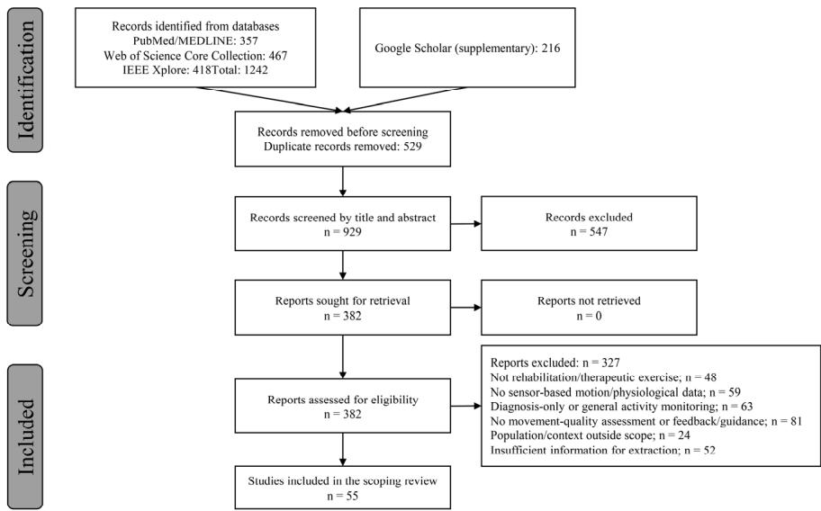
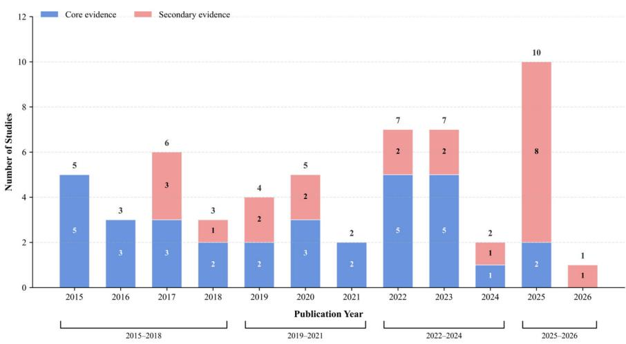
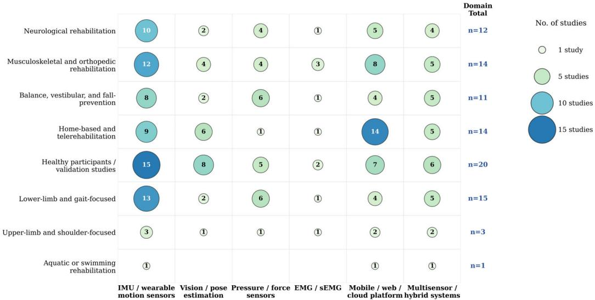
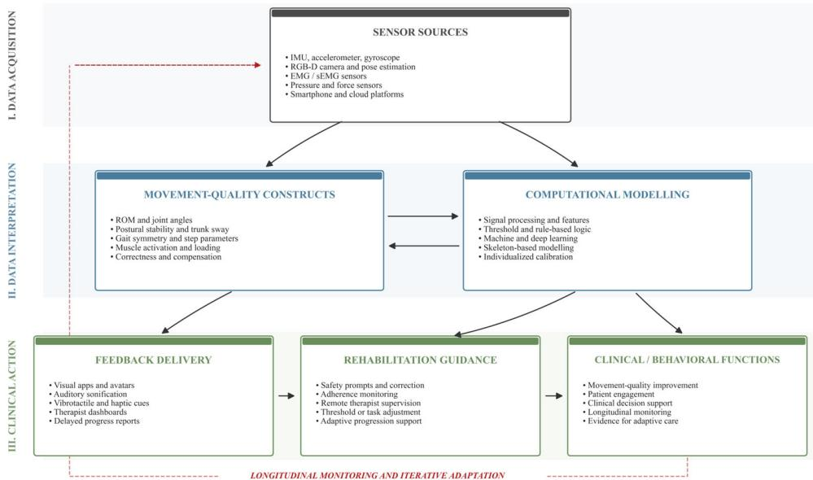

Review

# 基于传感器的康复训练动作质量评估与生物反馈：面向居家与远程康复的范围综述

Tao Mei 1,2,3, Yulong Wang 4, Wenze Xu 1,2,3, Xueke Liu 1,2,3 and Liang Li 5,6,\*

1 北京体育大学中国运动与健康科学研究院（China Institute of Sport and Health Science, Beijing Sport University），北京 100084，中国；meitao@bsu.edu.cn (T.M.); 2024241023@bsu.edu.cn (W.X.); 2024241013@bsu.edu.cn (X.L.)

2 北京体育大学运动表现与技能评定北京市重点实验室（Beijing Key Laboratory of Sports Performance and Skill Assessment, Beijing Sport University），北京 100084，中国

3 国家体育总局运动训练与恢复重点实验室（Key Laboratory for Performance Training and Recovery of the General Administration of Sport of China），北京体育大学，北京 100084，中国

4 广西医科大学体育部（Department of Physical Education, Guangxi Medical University），南宁 530021，中国；wangyulong@sr.gxmu.edu.cn

5 临沂市职业学院公共体育部（Public Physical Education Department, Linyi City Vocational College），临沂 276000，中国

6 苏丹依德里斯教育大学体育科学与教练学系（Faculty of Sports Science and Coaching, Sultan Idris Education University），丹绒马林 35900，马来西亚 通讯作者：liliang.bsu.edu@gmail.com

## 亮点

## 主要发现是什么？

基于传感器的康复训练研究已从简单的动作记录转向动作质量评估、反馈生成与康复指导。

纳入的 55 项研究广泛使用了惯性传感器、视觉/深度相机、表面肌电、压力/力学传感器以及移动或远程平台，但在指标、算法、反馈策略与验证场景方面仍存在显著的异质性。

## 主要发现的意义是什么？

由传感器衍生的动作质量指标有望在规定的康复训练动作与实际的训练执行之间架起桥梁，尤其当康复训练动作在缺乏治疗师直接监督的环境下进行时。

未来的系统应从单纯的技术精度验证，转向真实世界的临床验证、标准化的任务特异性的动作质量指标，以及可支持个体化康复进展的反馈机制。

## Check for updates

## 摘要

Academic Editor: Philippe Gorce

Received: 24 June 2026 Revised: 3 August 2026 Accepted: 6 August 2026 Published: 7 August 2026

Copyright: © 2026 by the authors. Licensee MDPI, Basel, Switzerland. 本文为开放获取文章，依据 Creative Commons Attribution (CC BY) 许可条款发布。

**背景/目标**：基于传感器的运动评估越来越多地被用于量化运动执行质量，并支持反馈引导的康复训练，尤其在居家和远程康复情境中。然而，训练依从性、运动执行质量和康复进展仍难以在脱离治疗师直接监督的情况下持续、客观地监测。本范围综述旨在梳理基于传感器的生物反馈与运动质量评估系统在康复训练中的当前应用，并识别证据缺口。**方法**：本综述遵循已确立的范围综述方法学与 PRISMA-ScR 指南。检索数据库包括 PubMed/MEDLINE、Web of Science Core Collection 和 IEEE Xplore，并以 Google Scholar 作为补充检索。纳入 2014 年 1 月至 2026 年 5 月发表的英文文献，研究内容涉及康复相关人群、基于传感器的运动评估、生物反馈或训练指导。依据康复情境、传感器技术、运动质量指标、计算方法、反馈策略、实时或远程功能以及报告结果进行数据提取并以叙述方式综合。**结果**：共纳入 2015 至 2026 年间发表的 55 项研究。证据涵盖神经性、肌肉骨骼与骨科、平衡与前庭、跌倒预防、居家及远程康复等应用。所用技术包括惯性传感器、智能手机、视觉/深度相机、表面肌电图、压力/力传感器以及多传感器系统。运动质量指标包括关节活动度、姿势稳定性、步态特征、负荷、肌肉激活、运动正确性、重复次数和任务完成质量。反馈形式包括视觉、听觉、振动触觉、应用程序、虚拟化身、面向治疗师或基于远程平台。现有证据大多来自可行性研究、技术验证、算法验证以及小样本临床研究。**结论**：基于传感器的系统有助于将康复训练表现转化为可量化且支持反馈的信息。未来研究应加强真实场景验证，标准化任务特定的运动质量指标，并明确反馈机制如何支持个体化康复进展。

**关键词**：生物反馈；康复训练；运动质量；可穿戴传感器；远程康复

## 1. 引言

康复是医疗保健系统的关键组成部分，尤其是对于患有神经、肌肉骨骼、术后、平衡相关及年龄相关功能受限的个体而言。世界卫生组织（World Health Organization）强调康复是全民健康覆盖的关键组成部分，全球估计约有 24 亿人患有可受益于康复的健康状况[1,2]。随着康复需求的增加，许多患者需要在家庭、社区或远程环境中进行康复训练，而直接的治疗师监督则十分有限[3,4]。在这些情境下，关键的挑战不仅在于患者是否完成所开具的康复训练，更在于他们是否以足够的质量、安全性与一致性执行这些训练。

康复训练通常通过运动类型、频率、强度、持续时间和进阶方案等参数进行处方开具。然而，这些处方要素并不能完整地反映运动执行的质量。患者可能在完成规定重复次数的同时，仍表现出关节活动度（range of motion, ROM）不足、姿势控制不良、步态不对称、肢体负荷不足、代偿性躯干运动或肌肉激活不当。此类与执行相关的问题在非监督康复期间尤其难以监测，并可能削弱预期的训练刺激、延缓功能恢复，或增加疼痛、跌倒或再损伤的风险[3,4]。因此，康复评估日益需要从单纯的依从性与训练量，转向对运动质量与任务完成质量的客观评估。

基于传感器的运动评估为这一缺口提供了一种潜在的解决方案。可穿戴惯性测量单元（inertial measurement units, IMUs）、加速度计、陀螺仪、智能手表、表面肌电（surface electromyography, sEMG）、压力或力传感器、基于智能手机的传感器、RGB-D 相机以及无标记姿态估计系统可在康复训练过程中采集运动学、动力学、生理与肌电信息[5–10]。智能手机、低成本可穿戴设备、移动应用以及云平台日益普及，也使得由传感器支持的家庭与远程康复更具可行性[5,9,10]。近期的研究进一步应用了无标记动作捕捉、深度学习、实时姿态估计以及端侧人工智能（artificial intelligence, AI）技术，以支持康复训练识别、运动错误检测与远程监测[11]。当由传感器所获取的数据被转化为视觉、听觉、振动触觉、基于虚拟形象、移动应用、面向治疗师或远程平台等形式的反馈时，这些系统可支持运动矫正、运动学习、依从性监测以及个体化康复指导[7,10]。

尽管取得了这些进展，但现有证据仍呈现出明显的异质性。各研究在康复人群、运动任务、传感器配置、传感器放置位置、参考标准、运动质量指标、计算模型、反馈模态、实时能力、远程功能以及临床结局指标等方面存在显著差异[5–11]。部分研究针对患者开展临床干预，另一些则聚焦于可行性测试、可用性评价、技术验证、算法开发，或健康受试者的康复导向验证。这种异质性使得难以在整个领域内回答单一的汇总有效性问题。相反，它提示需要开展一项范围综述（scoping review），以系统梳理基于传感器的运动质量评估与生物反馈在康复训练中的概念边界、技术路径、应用情境以及证据缺口。

此前的综述已在康复生物反馈、可穿戴运动传感器、基于惯性传感器的下肢运动评估、数字化居家康复以及远程康复等方面提供了重要洞见[5–9]。然而，许多现有综述局限于特定疾病、特定传感器、特定反馈、特定任务或特定场景。它们未能完整地描绘出从传感器运动数据到运动质量构念、计算方法、反馈策略以及康复指导的完整转化路径。这种路径层面的综合对于居家与远程康复尤为重要，因为治疗师需要的是关于处方运动在缺乏直接监督下实际执行情况的、具有临床可解释性的信息，而不仅仅是运动训练是否完成。

因此，本范围综述旨在系统梳理基于传感器的运动质量评估与生物反馈系统在康复训练中的当前应用。具体而言，本综述考查了康复人群与场景、运动任务、传感器技术、运动质量指标、计算方法、反馈策略、实时与远程功能、个体化或自适应特性、所报告的结局以及证据缺口。通过沿"从传感器数据采集到运动质量评估、反馈传递，再到康复指导"的路径组织证据，本综述力求阐明该领域的研究现状，并明确未来在真实世界验证、任务特异性指标标准化以及支持个体化康复进展的反馈赋能方面的优先研究方向。

## 2. 方法

## 2.1. 综述设计

本研究采用范围综述（scoping review）方法学，旨在梳理传感器生物反馈系统在康复锻炼评估与指导方面的研究分布、技术特征、应用情境与证据空白。本综述的设计与报告参考了 Arksey 与 O'Malley 提出的范围研究方法学框架、Levac 等人建议的方法学改进、JBI 范围综述指南，以及 PRISMA-ScR 报告规范 [12–15]。

选择范围综述设计被认为是合适的，因为现有证据涵盖了多样化的康复人群、传感器技术、锻炼任务、反馈模态、计算方法、实施场景和结局指标。因此，本综述旨在绘制证据全景图并识别研究空白，而非估计单一干预的合并效果。纳入研究在人群、干预、对照、结局或研究设计方面未提供充分同质的证据，因而无法进行荟萃分析（meta-analysis）。

在开展综述之前，研究团队制定了内部综述计划，明确了综述问题、纳入与排除标准、检索策略、研究筛选流程、数据提取（data-charting）字段以及证据综合方法。研究方案未进行前瞻性注册。为提高透明度，研究方案于 2026 年 6 月 27 日在开放科学框架（Open Science Framework, OSF）上进行了回顾性注册（OSF Registries；OSF Preregistration；注册编号：w382t；OSF 项目/注册链接：https://osf.io/w382t（访问日期：2026 年 8 月 3 日））。相较于计划的纳入与排除标准、检索策略、数据提取（data-charting）领域以及综合方法，未发生实质性偏离。完整的 PRISMA-ScR 核查清单见补充表 S6。

## 2.2. 研究问题

本综述围绕从传感器数据采集到动作质量评估、反馈生成和康复指导的证据路径进行组织。综述问题聚焦于：传感器生物反馈系统已应用的康复人群与情境、其所支持的康复锻炼任务、所采用的传感器技术、动作质量指标、计算方法与反馈策略；这些系统是否提供实时反馈、远程监督、个体化功能或自适应功能；以及在临床验证、真实世界应用、长期有效性评价和指标标准化方面仍存在哪些证据空白。

## 2.3. 纳入与排除标准

纳入标准采用人群–概念–情境（Population–Concept–Context，PCC）框架[15]进行定义。人群包括需要康复运动、功能恢复或康复相关运动指导的个体，包括但不限于神经、肌肉骨骼或骨科、前庭或平衡相关、术后、慢性疼痛、跌倒风险以及其他康复人群。当任务设计或预期应用明确与康复运动评估、运动质量评价、生物反馈、远程康复、治疗性运动指导或康复系统开发相关时，涉及健康受试者的研究也符合纳入条件。

在本综述中，运动质量被操作性地定义为传感器衍生的信息，用于描述康复运动或康复相关运动任务的执行方式，而不仅仅是任务是否完成。其中在适用情况下包括关节活动度、关节角度、姿势稳定性、躯干摆动、步态对称性、步宽、足部推进角、负荷或重量分布、肌肉激活、代偿运动、运动正确性、重复有效性以及任务完成质量。因此，运动质量被视为一个多维度且任务依赖的构念，而非单一通用的临床结局。

概念部分包括基于传感器的康复运动评估、运动质量监测、生物反馈、远程监测、反馈生成以及康复指导。符合纳入标准的基于传感器的技术被定义为可穿戴、移动、基于视觉、压力/力、肌电、运动捕捉或多传感器系统，这些系统在康复运动或康复相关运动任务期间收集人体运动学、动力学、生理或肌电数据。符合纳入标准的技术包括惯性测量单元、加速度计、陀螺仪、磁力计、表面肌电图、压力或力传感器、视觉或深度摄像头、基于标记或无标记的动作捕捉、智能手机传感器以及多传感器系统。仅基于问卷、自我报告运动日志、传统临床量表或治疗师观察（无传感器数据采集）的系统被排除在外。

当评估专用、算法验证、模型开发及远程监测类研究被明确设计为支持康复运动评估或未来反馈生成时，也予以纳入。这些研究作为次级证据被纳入，以表征技术路径和转化潜力，但不被视为等同于临床验证的生物反馈干预。

研究背景涵盖临床康复、门诊物理治疗、社区康复、家庭康复、远程康复、实验室模拟康复以及真实世界的康复相关场景。符合条件的研究任务包括平衡训练、姿势控制、步态训练、坐-起任务、下肢或上肢功能训练、关节活动度练习、水疗或游泳康复、跌倒预防练习以及家庭治疗性锻炼。

在以下情况下研究被排除：仅关注运动表现、一般健身训练、消费者运动追踪、每日活动监测、疾病诊断、风险预测、跌倒检测、计步或不包含康复锻炼评估、运动质量评价、反馈指导或治疗性锻炼执行的通用体力活动监测。综述、系统综述、范围综述、荟萃分析、研究方案、社论、评论、书籍章节、专利、动物研究、体外研究、纯模拟研究、非同行评议材料以及无可提取信息的研究也被排除在外。

本综述纳入了原创研究，包括随机对照试验、非随机对照研究、交叉研究、单组干预研究、可行性研究、可用性研究、混合方法研究、系统开发与验证研究、传感器精度验证研究、算法或模型验证研究，以及含可提取信息的会议摘要。检索涵盖了 2014 年 1 月至 2026 年 5 月发表的研究，且限定为英文文献。选择 2014 年作为起点旨在提供一个当代综述时间窗口，覆盖低成本惯性传感器、基于智能手机的感知、无标记姿态估计技术、移动健康系统以及远程康复平台在康复锻炼评估与反馈方面的快速发展和广泛应用。尽管检索期始于 2014 年，但筛选后识别出的最早符合条件的研究发表于 2015 年。

## 2.4. 信息来源与检索策略

开展了全面的文献检索以确定关于基于传感器的康复锻炼评估、运动质量监测和生物反馈指导的研究。检索了 PubMed/MEDLINE、Web of Science 核心合集（Web of Science Core Collection）和 IEEE Xplore。使用 Google Scholar 进行补充检索。检索时间为 2014 年 1 月至 2026 年 5 月，且仅纳入英文发表物。

对于 PubMed/MEDLINE 和 Web of Science Core Collection，使用了两种互补的检索策略。第一种策略主要涵盖康复运动评估与动作质量评价。第二种策略主要涵盖康复运动反馈、生物反馈、远程监督与康复指导。由于 IEEE Xplore 对长且复杂的布尔检索字符串支持有限，且传感器系统、姿态估计、动作识别、移动健康与远程反馈相关研究常发表于工程与技术类文献中，因此对 IEEE Xplore 采用分组检索策略。这些分组检索涵盖惯性传感器、可穿戴传感器、表面肌电、姿态估计、移动应用与远程康复反馈。

Google Scholar 作为补充来源，用于识别可能未被结构化数据库检索充分覆盖的工程、数字健康、人机交互及会议文献。共使用了八个高度相关的关键词组合。对每个关键词组合，按相关性排序筛检前 50 条记录。该方法作为务实的补充检索策略加以应用，因为 Google Scholar 返回按相关性排序的结果，其用途在于识别额外的高度相关记录，而非取代结构化数据库检索。共保留 216 条 Google Scholar 记录与数据库记录进行去重处理。完整的检索策略见补充表 S2。

## 2.5. 研究筛选与资格评估

所有检索得到的记录首先导入 EndNote 进行去重处理。去重后，由两名评审者独立筛选标题与摘要，以排除明显不相关的研究。随后获取潜在合格记录的全篇文本，并根据预先设定的纳入与排除标准进行评估。筛选过程中的分歧通过讨论解决；若仍无法达成共识，则由第三名评审者作出最终决定。

在全篇文本筛选阶段，特别关注以下方面：研究是否涉及康复或康复相关运动任务；是否使用传感器采集人体运动或生理信号；是否对动作质量、动作表现或训练完成度进行分析；是否提供反馈、指导、监测或远程管理功能；以及研究报告的内容是否与本综述问题相关。研究筛选流程采用 PRISMA-Sccr 流程图呈现。

## 2.6. 数据提取流程

采用预定义的数据提取表进行资料提取，并在预提取阶段根据纳入文献的特征进行迭代完善。提取的信息包括文献信息、研究设计、康复人群与场景、样本特征、运动任务、干预时长、传感器类型与放置位置、输入信号、参考标准、运动质量评价指标、算法或模型、反馈模态、实时能力、远程功能、个体化特征、临床或功能结局、依从性、可用性、安全性、主要发现、研究局限性以及证据类别。完整的逐研究提取信息见补充表 S1。

资料最初由一名评价者提取，再由另外两名评价者进行交叉核对。对于信息不完整或不明确的研究，优先依据全文方法、结果、图表以及补充材料进行判断。若仍无法确认，则标记为"未报告"或"不明确"，不进行推断性填补。

## 2.7. 证据分级与资料综合

鉴于该领域在研究设计和应用成熟度方面存在较大差异，在数据提取后按证据类型对纳入研究进行分类。根据研究人群、研究目标和应用阶段，将研究分为临床干预研究、可行性或可用性研究、技术系统验证研究、算法或模型验证研究、健康受试者模拟康复研究，以及会议摘要或早期概念验证研究。研究还被标注为核心证据或次要证据，划分依据包括是否直接涉及真实康复或疾病人群、是否包含康复运动任务、是否提供运动质量评估或反馈指导，以及是否报告了临床、功能、依从性或可用性结局。该分类不用于排除研究，而是用于帮助解读证据成熟度及转化价值。

综合运用描述性统计与主题综合（thematic synthesis）。首先，对发表年份、国家或地区、研究设计、康复人群、康复场景、传感器类型、反馈模态、实时性能力以及证据类别等变量进行频次与比例的汇总。其次，围绕康复应用路径开展主题综合，涵盖传感器数据采集、运动质量评估、基于计算或规则的建模、反馈生成、康复训练指导以及与处方相关的功能。第三，为强化基于传感器类别的综合分析，按照主要传感器技术类别对研究进行归类综述，包括可穿戴惯性传感器与基于智能手机的运动传感器、视觉/深度及无标记点姿态估计系统、压力/力/载荷传感器、基于肌电图的系统，以及多传感器或移动端/云端支持的系统。由于纳入研究在人群、康复任务、传感器配置、反馈策略、计算方法及结局指标方面存在高度异质性，本研究未实施 meta 分析，也未对干预效果进行合并估计。

## 2.8 批判性评价（Critical Appraisal）

根据 JBI 指南与 PRISMA-ScR 对范围综述（scoping review）的推荐，方法学质量评价并非范围综述的强制性组成部分，尤其是在研究目的为界定证据范围、梳理研究格局并识别研究空白时尤为如此 [14,15]。因此，本研究未使用标准化评价工具进行正式的风险偏倚评估，亦未以方法学质量作为排除研究的标准。然而，在综合分析与讨论部分，本研究结合研究设计、样本量、是否纳入真实患者、临床验证、随访时长以及真实世界应用程度，对当前证据的成熟度与局限性进行了阐释。

## 3. 结果（Results）

## 3.1 研究筛选（Study Selection）

数据库检索共识别出 1242 条记录，其中 PubMed/MEDLINE 357 条，Web of Science Core Collection 467 条，IEEE Xplore 418 条。通过在 Google Scholar 中进行补充检索，另识别出 216 条记录。去除重复后，929 条记录进入标题和摘要筛选阶段。在该阶段共排除 547 条记录，原因是它们明显不符合纳入标准，余下 382 篇报告进入全文评估。在全文评估阶段，因以下原因排除 327 篇报告：未涉及康复训练或治疗性运动任务（n = 48）；未使用传感器采集人体运动或生理信号（n = 59）；仅关注一般性体力活动监测或仅用于诊断的监测（n = 63）；未提供与运动质量评估或反馈指导相关的信息（n = 81）；涉及本综述范围之外的人群或应用情境（n = 24）；或提供的信息不足以进行数据提取（n = 52）。最终，55 项研究被纳入本范围综述。研究筛选过程如图 1 所示。

  

图 1. PRISMA-ScR 研究筛选流程图。该流程图展示了本范围综述（scoping review）所纳入研究的识别、筛选、资格评估及纳入过程。

## 3.2. 纳入研究的一般特征

55 项纳入研究的发表年份介于 2015 年至 2026 年之间。其中，38 项研究发表于 2019 年及以后，27 项研究发表于 2022 年及以后，这表明近年来关于基于传感器的康复训练评估与反馈的研究有所增加。各年度的发表趋势如图 2 所示。

  

图2. 2015至2026年纳入研究的年度分布与证据类别。堆叠柱状图展示了各年份纳入研究的数量，并按证据类别分层。核心证据（Core evidence）指直接涉及康复患者、疾病人群或具有明确康复背景的研究；二级证据（Secondary evidence）则包括健康受试者验证、技术或系统验证、算法或模型验证、会议摘要或间接的康复支持证据。

总样本量 n = 55。核心证据：康复特定背景；二级证据：技术/算法验证或间接证据

所纳入的研究在多个地区开展，包括欧洲、亚洲、北美洲和大洋洲。研究类型包括随机或对照干预研究；非随机或交叉临床研究；可行性与可用性研究；系统或设备验证研究；以及算法、模型或数据集验证研究。根据研究人群、研究目标和应用成熟度，33 项研究被归类为核心证据。这些研究主要涉及真实的康复患者、疾病人群、术后康复患者，或明确定义的康复情境。其余 22 项研究被归类为次要证据，包括健康参与者验证、技术原型评估、算法验证、数据集研究和会议摘要。所纳入研究的一般特征见表 1，完整的研究级别信息见补充表 S1。

表 1. 所纳入研究的一般特征（n = 55）。

<table><tr><td>Characteristic</td><td>Category</td><td>n (%)</td></tr><tr><td rowspan="4">Publication period</td><td>2015–2018</td><td>17 (30.9)</td></tr><tr><td>2019–2021</td><td>11 (20.0)</td></tr><tr><td>2022–2024</td><td>16 (29.1)</td></tr><tr><td>2025–2026</td><td>11 (20.0)</td></tr><tr><td rowspan="4">Geographical region</td><td>Europe</td><td>23 (41.8)</td></tr><tr><td>Asia</td><td>17 (30.9)</td></tr><tr><td>North America</td><td>12 (21.8)</td></tr><tr><td>Oceania</td><td>3 (5.5)</td></tr><tr><td rowspan="5">Primary study design or application type</td><td>Randomized or controlled intervention study</td><td>9 (16.4)</td></tr><tr><td>Non-randomized, single-arm, crossover, or comparative clinical intervention study</td><td>10 (18.2)</td></tr><tr><td>Feasibility, usability, qualitative, or user-centred evaluation study</td><td>5 (9.1)</td></tr><tr><td>Technical, device, or system validation study</td><td>18 (32.7)</td></tr><tr><td>Algorithm, model, or dataset validation study</td><td>13 (23.6)</td></tr><tr><td rowspan="2">Evidence category</td><td>Core evidence</td><td>33 (60.0)</td></tr><tr><td>Secondary evidence</td><td>22 (40.0)</td></tr><tr><td rowspan="4">Research or application setting</td><td>Laboratory or simulated validation setting</td><td>33 (60.0)</td></tr><tr><td>Home-based, remote, or telerehabilitation setting</td><td>30 (54.5)</td></tr><tr><td>Clinical, hospital, rehabilitation, or physiotherapy setting</td><td>17 (30.9)</td></tr><tr><td>Community or real-world setting</td><td>4 (7.3)</td></tr><tr><td rowspan="3">Real-time capability</td><td>Real-time or near-real-time feedback, processing, or display</td><td>37 (67.3)</td></tr><tr><td>Partly real-time or semi-online implementation</td><td>4 (7.3)</td></tr><tr><td>Offline analysis, post-processing, or real-time capability not reported</td><td>14 (25.5)</td></tr></table>

## 3.3. 康复人群、应用场景与运动任务

纳入的研究涵盖了多个康复领域，主要包括神经康复、肌骨骼与骨科康复、平衡与前庭康复、老年人跌倒预防、家庭康复以及远程康复。与神经康复相关的研究涉及脑卒中（stroke）、帕金森病（Parkinson's disease）、多发性硬化症（multiple sclerosis）、脑瘫（cerebral palsy）、小脑性共济失调（cerebellar ataxia）、轻度认知障碍（mild cognitive impairment）以及偏瘫步态（hemiparetic gait）等人群 [16–27]。肌骨骼与骨科康复研究主要涉及全膝关节置换术后康复、膝关节骨关节炎、肩关节粘连性囊炎、慢性踝关节不稳、下腰痛、脊柱姿势控制以及膝关节伸展康复 [10,28–40]。关于平衡、前庭康复与跌倒预防的研究则主要聚焦于多发性硬化症、持续性姿势–知觉性头晕（persistent postural-perceptual dizziness）、化疗诱导的周围神经病变（chemotherapy-induced peripheral neuropathy）、轻度认知障碍、有跌倒风险的老年人，以及执行模拟平衡任务的健康受试者 [17,19,25,27,41–47]。

康复任务主要集中在下肢与步态训练、平衡与姿势控制、上肢与肩–手功能训练、关节活动度训练、坐起任务（sit-to-stand）、负重训练以及家庭治疗性训练。部分研究招募了健康受试者；然而，其任务设计或系统目标明确针对康复运动评估、生物反馈、远程康复或康复系统的开发。因此，这些研究被纳入作为辅助证据 [11,30,31,39,41,46,48–61]。康复人群与应用场景之间的证据分布如图 3 所示，康复领域、运动任务及代表性研究汇总于表 2。

  

图 3. 关联康复领域与传感器技术的证据图谱。气泡图将康复/应用领域与传感器或技术类别进行映射。气泡的大小与颜色深浅表示映射到各领域–技术组合的研究数量。由于单个研究可能涉及不止一个康复领域和多类技术，因此各类别之间并非互斥。

表 2. 纳入研究中所涉及的康复人群、应用场景与运动任务

<table><tr><td>Rehabilitation/Application Domain</td><td>Conditions or Populations</td><td>Typical Settings</td><td>Representative Exercise Tasks</td><td>No. of Studies</td><td>Representative Studies</td></tr><tr><td>Neurological rehabilitation</td><td>Stroke, Parkinson&#x27;s disease, multiple sclerosis, cerebral palsy, hereditary cerebellar ataxia, mild cognitive impairment, hemiparetic gait</td><td>Clinical rehabilitation gym, laboratory, home-based rehabilitation, remote monitoring</td><td>Balance training, gait training, weight shifting, postural control, upper-limb functional training, grasp monitoring, smartwatch-supported home exercise, gait sonification</td><td>12</td><td>[16-27]</td></tr><tr><td>Musculoskeletal and orthopedic rehabilitation</td><td>Total knee replacement, knee osteoarthritis, shoulder adhesive capsulitis, low back pain, chronic ankle instability, knee extension rehabilitation, spinal posture control</td><td>Hospital or outpatient rehabilitation, home-based exercise, laboratory validation, physiotherapy clinic</td><td>Knee flexion/extension, short arc quadriceps exercise, sit-to-stand, shoulder ROM exercise, wall-walking stretch, cane stretch, squat, lunge, gait retraining, lumbar posture correction</td><td>14</td><td>[10,28-40]</td></tr></table>

表 2. （续）

<table><tr><td>Rehabilitation/Application Domain</td><td>Conditions or Populations</td><td>Typical Settings</td><td>Representative Exercise Tasks</td><td>No. of Studies</td><td>Representative Studies</td></tr><tr><td>Balance, vestibular, and fall-prevention rehabilitation</td><td>Older adults, fall-risk populations, multiple sclerosis, persistent postural-perceptual dizziness, chemotherapy-induced peripheral neuropathy, mild cognitive impairment, healthy participants in simulated balance tasks</td><td>Clinical physiotherapy, laboratory balance testing, community or older-adult settings, home or semi-supervised training</td><td>Static and dynamic balance tasks, upright stance, foam-surface standing, tandem stance, trunk sway control, weight shifting, obstacle walking, fall-prevention exercises</td><td>11</td><td>[17,19,25,27,41-47]</td></tr><tr><td>Home-based and telerehabilitation applications</td><td>Stroke, shoulder adhesive capsulitis, orthopedic rehabilitation, knee rehabilitation, general home exercise users, older adults, remote rehabilitation users</td><td>Home, remote rehabilitation platforms, mobile applications, cloud-based systems, therapist portals</td><td>Home exercise monitoring, remote therapist supervision, exercise completion tracking, ROM monitoring, mobile-app-guided exercise, virtual avatar feedback, asynchronous feedback</td><td>14</td><td>[10,11,22,25,35, 36,39,40,50,53, 54,62-64]</td></tr><tr><td>Healthy participants in rehabilitation-oriented validation studies</td><td>Healthy adults, healthy older adults, or healthy volunteers recruited for system, algorithm, or feasibility validation with explicit rehabilitation relevance</td><td>Laboratory, simulated rehabilitation setting, controlled home-like environment, motion analysis laboratory</td><td>Rehabilitation exercise recognition, movement-quality classification, squat/lunge assessment, knee-extension testing, gait retraining, posture feedback, sensor accuracy validation</td><td>20</td><td>[11,30,31,39,41, 46,48-61]</td></tr><tr><td>Aquatic or swimming rehabilitation</td><td>Swimming rehabilitation users or simulated rehabilitation swimmers; primarily technical/case-study evidence</td><td>Swimming pool, aquatic rehabilitation or sport-therapy setting</td><td>Stroke-style recognition, stroke count, stroke period, trunk rotation symmetry, swimming intensity and fatigue-related parameters</td><td>1</td><td>[61]</td></tr><tr><td>Upper-limb and shoulder-focused rehabilitation</td><td>Stroke upper-limb impairment, shoulder adhesive capsulitis, hand/grasp dysfunction, upper-limb rehabilitation users</td><td>Home-based rehabilitation, clinical rehabilitation, mobile-app or wearable-sensor setting</td><td>Shoulder flexion, abduction, extension, internal/external rotation, wall-walking exercise, cane-assisted stretching, grasp monitoring, upper-limb home exercise</td><td>3</td><td>[22,24,40]</td></tr><tr><td>Lower-limb and gait-focused rehabilitation</td><td>Knee rehabilitation, knee osteoarthritis, knee replacement, chronic ankle instability, stroke gait impairment, Parkinson&#x27;s disease, healthy gait-retraining participants</td><td>Clinical rehabilitation, laboratory gait analysis, treadmill setting, home-based knee rehabilitation</td><td>Knee ROM training, sit-to-stand, short arc quadriceps exercise, partial weight-bearing gait, step width and foot progression angle retraining, gait speed and symmetry training</td><td>15</td><td>[16,18,20,21,23, 26,30,32,34- 37,39,52,57]</td></tr></table>

注释。各类别之间并非互斥，因为单一研究可能涉及多个应用场景或任务类别，例如神经康复结合平衡训练，或家庭骨科康复结合移动应用反馈。因此"研究数量（No. of studies）"列反映的是映射到各领域的研究数量，而非互斥的总数。代表性研究标识符与结果部分及补充表 S1 中所使用的研究编号相对应。ROM 即关节活动度（range of motion）。

## 3.4. 传感器技术类别与数据采集路径

可穿戴惯性传感器与基于智能手机的运动传感器是主流的数据采集路径。共有 43 项研究使用或涉及惯性测量单元（IMU）、加速度计、陀螺仪、磁力计、智能手表、基于智能手机的惯性传感器或类似的可穿戴运动捕捉设备 [10,17–23,25–28,30–41,43–48,54,56–67]。这些系统通常用于估计关节角度、活动度（ROM）、躯干摆动、步态参数、运动节律、重复次数以及训练完成情况。它们的高频使用反映了其便携性、相对低廉的成本、实时处理的适用性，以及与家庭和远程康复场景的良好兼容性。

视觉/深度与无标记姿态估计系统构成了第二大技术类别。共有 18 项研究使用或涉及 RGB 摄像头、深度摄像头、无标记运动捕捉、骨骼关键点、姿态估计模型或视频数据集 [11,26,29,31,37,49–51,53–56,58,61,63–65,68]。这些系统主要用于非接触式运动评估、康复动作识别、关节角度估计、运动错误分类以及远程监测。与可穿戴传感器相比，基于视觉的系统能够在无需多个身体佩戴设备的情况下捕捉多关节或全身运动，但其性能可能受到摄像头放置、遮挡、光照条件、隐私顾虑以及实验室与家庭环境差异的影响。

压力、力和负载相关的传感器出现在 15 项研究中 [16,18,20,21,24,26,30, 32,37,41,42,44,47,52,58]。这些技术主要用于量化足底压力（plantar pressure）、肢体负载、胫骨负载、重量分布、与压力中心（center-of-pressure）相关的平衡指标，或触觉反馈参数。它们与步态再训练、平衡康复、部分负重训练、跌倒预防练习以及下肢康复任务特别相关。五项研究涉及肌电图（electromyography, EMG）或表面肌电图（surface EMG, sEMG）信号 [28,30,34,62,68]，主要用于评估肌肉激活、运动执行或抓握相关功能。此外，31 项研究纳入了智能手机、移动应用程序、基于网络的系统、云平台或远程数据同步功能，表明传感器系统与移动健康（mobile health, mHealth）和远程康复平台的集成日益增加 [10,11,18,22,23,25,30,31,33,35,36,39–42,48–54,58–62,64,65,67,68]。

表 3 总结了所纳入研究中识别出的主要传感器技术类别、运动质量目标、反馈或应用功能以及关键的转化考虑因素。由于一项研究可能涉及多种传感器类型、反馈模态或实施平台，因此各类别之间并不互斥。

表 3. 传感器技术类别、运动质量目标、反馈功能及转化考虑因素

<table><tr><td>Sensor or Technology Category</td><td>Typical Rehabilitation Tasks</td><td>Main Movement-Quality Targets</td><td>Feedback or Application Functions</td><td>Key Translational Considerations</td></tr><tr><td>Wearable inertial and smartphone-based motion sensors (n = 43)</td><td>Gait training, balance training, ROM exercises, sit-to-stand, squats, lunges, home exercise monitoring</td><td>Joint angles, ROM, trunk sway, gait parameters, movement rhythm, repetition count, task completion</td><td>Real-time or near-real-time feedback, mobile-app feedback, movement correction, repetition validation, remote monitoring</td><td>Portable and low-cost, but affected by sensor placement, calibration, signal drift, device adherence, and patient usability</td></tr><tr><td>Vision/depth cameras and markerless pose-estimation systems (n = 18)</td><td>Exercise recognition, posture assessment, low back or lower-limb exercise assessment, remote physiotherapy, home-based monitoring</td><td>Skeletal key points, joint angles, movement trajectory, movement correctness, error classification, task quality</td><td>Non-contact movement assessment, visual feedback, skeleton overlays, AI-supported exercise assessment, remote supervision</td><td>Reduces device-wearing burden, but may be affected by camera position, lighting, occlusion, privacy, and generalizability to patients with abnormal movement patterns</td></tr><tr><td>Pressure, force, load, and plantar-pressure sensors (n = 15)</td><td>Partial weight-bearing gait, balance rehabilitation, fall-prevention training, gait retraining, lower-limb loading tasks</td><td>Limb loading, plantar pressure, tibial load, weight distribution, center-of-pressure-related indicators</td><td>Loading feedback, haptic feedback, balance feedback, gait-parameter retraining, therapist monitoring</td><td>Clinically relevant for load management, but may require specialized hardware, calibration, and controlled measurement conditions</td></tr></table>

表 3. 续

<table><tr><td>Sensor or Technology Category</td><td>Typical Rehabilitation Tasks</td><td>Main Movement-Quality Targets</td><td>Feedback or Application Functions</td><td>Key Translational Considerations</td></tr><tr><td>EMG/sEMG and muscle-activation sensing (n = 5)</td><td>Knee-extension rehabilitation, posture-related tasks, grasp monitoring, therapeutic exercise assessment</td><td>Muscle activation, quadriceps activation, grasp-related signals, movement effort</td><td>Muscle-activation feedback, exercise validation, therapist-facing monitoring</td><td>Provides physiological information not captured by kinematics alone, but is sensitive to electrode placement, signal noise, skin preparation, and interpretation burden</td></tr><tr><td>Multisensor, mobile, web-based, cloud, or remote-platform systems (n = 31)</td><td>Home-based rehabilitation, telerehabilitation, remote therapist supervision, adherence monitoring, multimodal rehabilitation assessment</td><td>Training completion, movement performance, adherence, ROM change, symptom records, task quality</td><td>Remote monitoring, asynchronous therapist review, app-guided feedback, cloud synchronization, rehabilitation management</td><td>Supports service continuity, but requires workflow integration, data prioritization, privacy protection, and clinically interpretable summaries</td></tr></table>

## 3.5. 动作质量构念与计算方法

动作质量并未由单一的通用指标来表征，而是通过多种与康复目标相关的运动学、生物力学、生理与行为学指标进行操作化定义。最常见的构念包括动作正确性、动作错误分类、重复有效性、任务完成度与训练完成度 [10,11,22,29,35,36,39,40,48–51,53–55,59,60,63–65,67,68]。关节活动度（ROM）与关节角度指标被频繁用于涉及肩关节粘连性关节囊炎、膝关节康复、膝关节伸展训练、坐起任务、脊柱姿势控制以及上肢功能训练的研究中 [26,30,31,34–36,38–40,50,54,56,64,68]。

平衡、躯干摆动与姿势稳定性指标主要见于平衡、前庭及跌倒预防康复研究 [17,19,20,25,27,41–47,58]。步态质量指标包括步宽、足部进展角、步速、步态周期、步态对称性、足底压力、胫骨负荷与体重分布 [16,18,20,21,23,26,32,37,52,57]。肌肉激活与力相关指标的报道相对较少，主要涉及表面肌电（sEMG）、力肌图（force myography）、局部负荷、足底力或股四头肌激活 [24,30,34,62]。总体而言，动作质量评估已从关节活动度、重复次数或步速等单一参数，拓展为涉及动作正确性、代偿模式、姿势策略、负荷控制、任务完成质量与训练依从性的多维构念。

计算方法可分为三大类。第一类包括基于规则、基于阈值与传统的信号处理方法，常用于实时反馈、重复动作识别、目标角度检测、姿势偏差检测与负荷反馈 [19,20,25,26,32,34–36,38–43,45–47,52,57,61,62,64]。第二类包括机器学习与深度学习方法，主要用于动作识别、动作分割、错误分类、基于姿态的评估以及动作质量评分 [11,22,29,48–51,53–55,59,60,63,65,67,68]。第三类包括个体化标定与生物力学建模方法，其根据基线表现、目标关节角度、个体化步态参数、患者特异性阈值或治疗师确认的正确动作生成反馈规则 [17–20,25,32,35–37,40,45,64]。这些计算方法提示了从简单信号检测向自动化与个体化动作质量解读的逐步过渡，尽管许多算法研究仍停留在技术验证阶段。

## 3.6. 反馈策略、实时/远程特性与报告结局

视觉、移动应用和虚拟界面反馈是最常见的反馈形式。34 项研究涉及通过屏幕、移动应用、虚拟化身、游戏化界面、骨骼叠加、颜色提示、运动轨迹或进度图传递的反馈[10,11,18,20,22,23,25,27–31,33–37,39,40,43,49,51,52,54,55,58–60,62–65,67,68]。这些反馈格式主要用于呈现目标达成情况、运动正确性、关节活动度（ROM）、姿势偏差、运动完成情况或进度信息。

听觉或声音化反馈出现在 12 项研究中，主要用于步态、平衡、躯干控制或动态运动任务[20,21,27,28,30,32,37,38,43,46,57,65]。

振动触觉或触觉反馈出现在 9 项研究中，主要用于平衡控制、躯干摆动、步态参数调整、姿势纠正或感觉增强[16,17,19,25,28,41,42,45,52]。

面向治疗师和远程管理的功能也很常见。36 项研究涉及治疗师审查、临床医生监测、远程平台、Web 门户、云同步、面向临床医生的应用或康复管理界面[11,18,20–26,28,29,31–36,39,40,44,47–51,53,54,56,58–61,63,64,66,68]。这些系统用于记录训练完成情况、运动表现、ROM 变化、依从性、症状记录或康复进展，从而支持异步监督和治疗师主导的决策。然而，大多数系统仍然依赖预定义阈值、治疗师设定的目标或人工解读。很少有研究展示了能够根据患者纵向表现自动调整康复目标、反馈阈值、运动难度或处方参数的完全自适应系统。

关于实时能力，37 项研究明确支持实时或近实时的反馈、处理或显示 [10,16–22,25–28,32–47,51–53,57,61,62,64–66]。4 项研究涉及部分实时、半在线或实时实施情况不明确 [11,23,30,58]。14 项研究主要采用离线分析、后处理，或未验证实时反馈的部署 [24,29,31,48–50,54–56,59,60,63,67,68]。以患者为基础的研究所报告的临床和功能结局包括平衡能力、步态表现、关节活动度（ROM）、疼痛、功能问卷、生活质量、跌倒相关指标、运动依从性、可用性以及患者体验。一些随机对照或干预研究报告了平衡、步态、关节活动度、运动依从性或患者体验方面的改善 [17–20,27,28,35–37,40,43,45]。然而，由于纳入的研究在人群、干预时长、反馈模式、实施场景以及结局指标方面差异较大，本综述未对效应量进行合并，也未就任何特定干预的有效性得出确定性结论。反馈策略、实施特征以及报告的结局指标总结于补充表 S5 中。从传感器采集数据到运动质量反馈与康复指导的整体路径总结于图 4 中。

  

图 4. 用于动作质量反馈与康复处方支持的概念框架。该框架阐释了如何将传感器采集的数据转化为生物力学构念、计算模型、反馈传递、康复指导以及预期的临床或行为功能。实线箭头表示当前的评估与反馈路径，而虚线环路则代表纵向监测以及向适应性康复处方支持的新兴过渡。

## 4. 讨论

## 4.1. 主要发现

本范围综述梳理了 2015 年至 2026 年间发表的 55 项关于基于传感器的运动质量评估与生物反馈在康复训练中应用的研究。综述结果显示，该领域正从单纯的运动记录迈向能够量化训练执行质量、提供反馈、支持治疗师监测，并有望指导个体化康复进程的系统 [10,16–27,35–40,43,45]。然而，现有证据仍分散于不同成熟阶段，包括临床干预研究、可行性与可用性研究、技术验证、算法开发以及面向健康受试者的康复导向验证 [10,11,22,29–31,39,48–61,63–68]。

本综述的核心启示在于：基于传感器的系统有助于弥合康复训练中长期存在的一道鸿沟——即处方训练与实际执行之间的差距。在居家和远程康复场景中，治疗师通常清楚处方了哪些训练，却缺乏关于患者实际完成情况的客观信息 [4,5,9]。传感器所衍生的指标能够通过量化关节活动度（range of motion, ROM）、姿势稳定性、步态特征、负荷分布、肌肉激活、代偿性运动、重复有效性以及任务完成质量，使这一过程更加可见 [16–21,26,32,34–47,52,57,62]。这一转变具有重要的临床意义，因为康复结局不仅取决于依从性和训练量，还取决于患者能否安全、准确、循序渐进地完成动作 [3,4,7]。

与此同时，本综述无法就基于传感器的生物反馈作为一项统一干预措施的有效性得出单一结论。纳入研究在人群、传感器配置、训练任务、反馈模态、干预时长、实施场景以及结局指标等方面存在显著差异 [10,17–20,35–37,40,43,45]。因此，该领域目前更适合被理解为一个异质且快速发展的证据图景，而非一个适合采用单一合并效应估计的成熟干预领域。这一解读与范围综述的方法论相一致——范围综述旨在对证据类型进行梳理、澄清概念，并在方法学和概念多样性显著的领域中识别研究空白 [12–15]。

## 4.2. 传感器技术路径与转化挑战

可穿戴惯性传感器和基于智能手机的运动传感器是最常见的技术路径。其占主导地位的原因可以理解，因为惯性测量单元（inertial measurement units, IMUs）、加速度计、陀螺仪、智能手表和智能手机传感器具有便携性、相对低廉的成本、适合重复或持续测量，并且与居家康复（home-based rehabilitation）兼容 [6,8,10,18,20,25,32,35,36,39–41,56,62,64]。这些系统已被用于监测关节角度、活动度（ROM）、躯干摆动、步态参数、运动节奏、重复次数以及动作完成情况 [10,17–23,25–28,30–41,43–48,54,56,57]。然而，临床转化仍依赖于可靠的传感器放置、校准、患者依从性、信号质量、电池续航，以及以临床可解读形式呈现数据的能力 [6,8,10,33,64]。

视觉/深度相机与无标记点姿态估计系统代表了另一条主要路径。其优势在于能够在不要求患者佩戴多个设备的情况下捕捉多关节或全身运动，这对于远程物理治疗、居家运动评估以及运动错误的自动分类尤为相关 [11,29,31,49–51,53–55,63,65,68]。近期研究使用了骨骼关键点、无标记点动作捕捉、深度学习、姿态估计以及设备端人工智能（on-device AI）来支持康复运动评估与远程监测 [11,48–51,53,55,65,68]。然而，在受控实验室环境中的性能可能无法直接迁移到康复患者或家庭场景中，因为光照、相机角度、遮挡、辅助设备、缓慢的运动速度、代偿策略、隐私顾虑以及有限的空间都可能影响系统的准确性与可用性 [31,50,51,53,58,63,68]。

压力、力学、负荷以及足底压力传感器提供了仅靠运动学传感器难以获得的信息。这些系统对于步态再训练、部分负重训练、平衡康复以及跌倒预防练习尤为相关，因为它们能够量化负重、体重分布、足底压力、胫骨负荷或与压力中心（center of pressure）相关的指标 [16,18,20,21,24,26,32,37,41,42,44,47,52,58]。表面肌电图（surface electromyography, sEMG）以及相关的肌肉激活传感通过捕捉神经肌肉用力而非单纯的运动，进一步拓展了评估维度 [28,30,34,62,68]。然而，这些系统通常需要更精细的设置、校准与解读，这可能限制其在有监督的临床或实验室环境之外的可扩展性 [24,30,34,62]。

在这些技术路径中，主要的转化挑战并不仅仅在于传感器能否精确测量动作。一个技术上精确的系统仍须提供患者能够理解、治疗师能够解读、康复工作流程能够使用的信息[10,22,33,35,36,40,64]。在临床落地方面，最有用的系统可能并非传感器最多或算法最复杂的那个，而是能够为康复决策提供可靠、可解读、可操作且负担低的信息的系统[6,8,10,33]。

## 4.3. 动作质量构念与反馈机制

本综述的一个关键发现是，动作质量被视为一个多维度且任务依赖性的构念。在某些情境下，动作质量主要指关节活动度（Range of Motion, ROM）或关节角度达成；在另一些情境下，它反映了步态对称性、躯干摆动、负荷分布、姿势稳定性、肌肉激活、动作正确性或重复有效性[16–21,26,30,32,34–47,52,57,62,68]。这种变异性反映了康复目标的多样性，但也限制了研究之间的可比性。因此，未来研究应根据具体的康复任务和临床目标来定义动作质量指标，而不是仅依据特定传感器能够测量的内容。

例如，在肩关节粘连性关节囊炎（shoulder adhesive capsulitis）的康复中，动作质量可能优先考虑关节活动度、疼痛受限动作以及代偿控制[40]。在全膝关节置换术后或膝骨关节炎康复中，可能强调膝关节屈伸角度、股四头肌激活、训练完成情况以及安全进阶[35,36]。平衡与前庭康复可能聚焦于躯干摆动、与压力中心（center-of-pressure, COP）相关的指标、姿势稳定性以及特定感觉条件下的控制[17,19,25,27,41–47,58]。步态康复可能需要步宽、足部进展角、步速、对称性、足底压力与负重等指标[16,18,20,21,26,32,37,52,57]。这些任务特异性差异表明，在传感器衍生数据能被一致地用于临床决策之前，需要建立标准化的动作质量框架。

反馈是传感器系统从测量迈向康复指导的机制。视觉、应用软件、虚拟形象、听觉、振动触觉、力触觉、面向治疗师的以及远程平台的反馈都能帮助患者识别动作错误、调整表现并理解康复进展 [10,16–22,25,27,28,30,32,35–37,39–43,45,46,52,54,57,62,65]。然而，反馈并非越多越好。运动学习研究表明，反馈的频率、时机、内容以及注意力聚焦方式会影响学习效果、动作保持和迁移能力 [69–71]。在所纳入的研究中，仅有少数系统采用了个体化阈值、渐退式反馈或治疗师可调的反馈策略 [18,20,25,35,36,40,64]。未来研究应进一步明确：应提供何种反馈、何时提供、以何种频次提供，以及随着时间推移反馈应如何渐退或个体化。

## 4.4. 居家康复、远程监督与适应性进阶

居家和远程康复是基于传感器的动作质量评估尤为重要的应用场景。随着康复需求的增长，许多患者必须在医院或康复中心之外进行康复训练 [1,2,5,9,72]。传统的居家训练项目通常依赖纸质指导、视频或自我报告日志，这些方式所能提供的依从性、动作执行质量、症状反应以及进阶准备情况等信息十分有限 [3,4]。基于传感器的系统能够将居家训练表现转化为客观信息，从而同时支持患者的自我调节和治疗师主导的远程监督 [10,11,22,25,35,36,39,40,50,53,54,62–64]。

在患者端，实时或近实时反馈能够支持目标达成、错误纠正、动作感知和参与积极性 [10,18,20,25,35,36,39,40,62,65]。在治疗师端，远程平台能够汇总训练完成情况、ROM 变化、动作质量指标、依从模式及症状记录 [22,33,35,36,40,53,63,64]。这些信息可支持异步评估并更及时地调整康复方案。然而，远程监督不应等同于自动化康复。现有大多数系统仍然依赖于治疗师设定的目标、预定义阈值、人工解读或周期性处方调整 [10,22,33,35,36,40,64]。

因此，下一阶段的发展应聚焦于适应性进阶。一个具有临床实用性的系统不仅应能检测某项练习是否完成，还应能判断动作是否以足够的质量完成，患者是否准备好进阶，反馈阈值是否应当调整，以及是否需要治疗师介入。这需要将传感器衍生的动作质量指标与症状变化、患者报告结局、依从性记录以及治疗师定义的临床规则相结合 [10,22,35,36,40,53,63,64]。这种整合有助于将基于传感器的系统从练习监测工具发展为个体化康复处方支持平台。

## 4.5. 人工智能赋能的未来方向（AI-Enabled Future Directions）

人工智能（artificial intelligence, AI）的最新进展可能进一步拓展基于传感器的康复评估与反馈的作用范围。在纳入的证据中，机器学习、深度学习、基于骨骼的模型、姿态估计以及设备端 AI 已被应用于康复练习识别、动作分割、错误分类、动作质量评分以及远程监测 [21,28,47–51,53–55,59,60,63,65,67,68]。这些方法有望提升动作表现的自动化检测水平，但其临床价值取决于模型的输出能否转化为患者和治疗师可理解、可执行的反馈。

视觉 Transformer、基础模型以及大语言模型（large language models, LLMs）可能通过改善动作表征学习、多模态数据整合、面向患者的解释、面向治疗师的摘要、依从性支持以及决策支持，而在未来的康复系统中发挥作用。然而，在纳入的文献中，这仍是一个新兴方向，而非成熟的临床应用。因此，未来研究应保持审慎，不应将 AI 模型性能等同于临床有效性。算法层面的性能指标，如准确率、F1 分数或角度误差，本身并不足以说明问题 [11,29,48–51,53–55,59,60,63,65,67,68]。未来的研究应评估 AI 生成输出是否具有临床意义、可解释性、安全性，并对患者和治疗师具有实用价值。

应特别关注在不同设备、康复人群、家庭环境以及异常动作模式下的外部验证。AI 系统还应被设计为支持治疗师主导的照护，而非取代临床判断。对于康复应用而言，核心问题不仅在于 AI 能否正确分类动作，而在于其能否生成能够改善动作质量、依从性、安全性以及康复进程的反馈与摘要 [6,8,10,22,33,35,36,40,64]。

## 4.6. 研究空白与未来优先方向（Research Gaps and Future Priorities）

本综述提出了若干优先研究方向。第一，需要在真实康复患者以及真实家庭或社区环境中开展更多研究。健康受试者参与的实验室验证研究虽有助于早期开发，但并不能完全代表康复人群中存在的疼痛、疲劳、认知限制、代偿动作、辅助器具使用以及环境变异性 [11,29–31,39,41,46–61,66,67]。第二，任务特异性的动作质量指标需要进一步标准化。若缺乏关于特定康复任务中何为可接受或高质量动作的更明确界定，将难以比较不同系统、解读反馈，或将传感器衍生指标与临床结局相联系 [16–21,26,30,70,32,34–47,52,57,62,68]。第三，反馈机制需要更系统的评估。未来研究应比较反馈模态、时机、频率、复杂度与渐进减少策略，并探讨这些特征是否有助于改善运动学习、依从性、信心、安全性与功能恢复 [7,69–71]。第四，算法验证应更紧密地与临床验证相联系。未来研究应超越技术性能层面，考察传感器衍生及人工智能衍生输出是否对患者可理解、对治疗师有用、能在临床工作流中可行，并与有意义的康复结局相关 [11,22,29,48–51,53–55,59,60,63,65,67,68]。第五，自适应康复处方仍处于早期阶段。目前能基于纵向表现实现闭环进展的系统极少。未来系统应整合动作质量指标、依从性、症状、患者报告结局与治疗师定义的规则，以支持可解释且受临床监督的进展决策 [10,22,35,36,40,53,63,64]。

## 4.7. 局限性

本综述同样存在若干局限性。第一，仅纳入了以英文发表的文献，这可能导致遗漏其他语言发表的相关研究。第二，主要检索的数据库为 PubMed/MEDLINE、Web of Science Core Collection 和 IEEE Xplore；尽管将 Google Scholar 作为补充来源，仍可能遗漏部分工程领域的会议论文、商业系统的评估报告、灰色文献或被其他数据库收录的研究。此外，对每个关键词组合仅筛选了 Google Scholar 中按相关度排序的前 50 条记录，可能漏检排序靠后的记录。第三，由于本范围综述（scoping review）的目的在于证据图谱的绘制，而非效应合成，因此未开展正式的偏倚风险评估或荟萃分析，也无法就任何特定基于传感器（sensor-based）的反馈干预的有效性得出确定性结论。第四，所纳入的研究在研究人群、任务类型、传感器、算法、反馈模态、实施场景和结局指标方面存在高度异质性，因此部分分类需要由研究团队根据研究目的和系统功能进行解读。第五，部分纳入的研究为会议摘要、技术原型或信息完整性有限的早期验证研究，其结论应作为次要证据谨慎解读。

## 5. 结论

本范围综述（scoping review）梳理了当前关于康复运动中基于传感器（sensor-based）的运动质量评估与生物反馈（biofeedback）系统的研究证据，重点关注居家与远程康复场景。在纳入的 55 项研究中，基于传感器的系统越来越多地被用于量化康复运动的表现，涵盖关节活动度、关节角度、姿势稳定性、步态特征、负荷、肌肉激活、代偿运动、运动正确性、重复有效性以及任务完成质量等方面。这些系统有助于使康复训练更加客观、可视化并具备即时反馈能力，尤其当患者脱离治疗师的直接监督进行训练时。

然而，当前证据在质量和成熟度方面仍参差不齐、异质性较高。现有研究多为可行性研究、技术验证研究、算法研究、健康受试者验证研究或小样本临床研究。运动质量指标尚未标准化，反馈机制仍未被充分理解，针对真实患者、真实家庭环境以及常规康复工作流程中的长期验证仍然有限。因此，本综述无法确定任何特定基于传感器的反馈干预的有效性。未来研究应开发任务特异性且具有临床可解释性的运动质量指标，加强真实世界验证，比较不同的反馈策略，并将传感器或人工智能衍生的输出与有意义的临床结局相关联。当针对特定人群、传感器技术、反馈模态和结局的证据充分同质化时，应进行更具针对性的系统综述或荟萃分析。

Supplementary Materials: The following supporting information can be downloaded at https://www.mdpi.com/article/10.3390/healthcare14162450/s1, Table S1: Characteristics of all included studies; Table S2: Search strategies used for the scoping review; Table S3: Sensor technologies, placements, input signals, and reference standards used in the included studies; Table S4: Movement quality constructs and computational approaches used in the included studies; Table S5: Feedback strategies, implementation features, and reported outcomes in the included studies; Table S6: PRISMA-ScR checklist.

补充材料：以下补充信息可从 https://www.mdpi.com/article/10.3390/healthcare14162450/s1 下载，表 S1：所有纳入研究的特征；表 S2：本范围综述所使用的检索策略；表 S3：纳入研究中所使用的传感器技术、放置位置、输入信号及参考标准；表 S4：纳入研究中所使用的运动质量构念及计算方法；表 S5：纳入研究中的反馈策略、实施特征及报告结局；表 S6：PRISMA-ScR 检查清单。

作者贡献：T.M.：构思、方法学、形式分析、数据管理、撰写——原稿及基金获取。Y.W.：调查、数据管理及撰写——审阅与编辑。W.X.：调查、数据管理及可视化。X.L.：调查、数据管理及验证。L.L.：构思、监督、方法学、形式分析、撰写——审阅与编辑、项目管理及基金获取。所有作者均已阅读并同意稿件的发表版本。

资助：本工作受教育部人文社会科学研究项目（项目编号：25YJCZH186）资助，项目题为《人口老龄化背景下老年人运动健康的多模态适应及社区协同支持》，以及浙江省"先锋"和"领雁"研发计划（项目编号：2025C02044）资助。

Institutional Review Board Statement: Not applicable.

机构伦理审查委员会声明：不适用。

Informed Consent Statement: Not applicable.

知情同意声明：不适用。

数据可获得性声明：本研究未创建或分析任何新数据。数据共享不适用于本文。

Conflicts of Interest: The authors declare no conflicts of interest.

利益冲突：作者声明不存在利益冲突。

## References

## 参考文献

1. World Health Organization. 《康复2030：会议报告》（Rehabilitation 2030: Meeting Report），瑞士日内瓦，2023年7月10–11日；World Health Organization：瑞士日内瓦，2024年。

2. Cieza, A.; Causey, K.; Kamenov, K.; Hanson, S.W.; Chatterji, S.; Vos, T. 基于2019年全球疾病负担研究的康复需求全球估计：2019年全球疾病负担研究的系统分析。Lancet 2020, 396, 2006–2017. [CrossRef] [PubMed]

3. Jack, K.; McLean, S.M.; Moffett, J.K.; Gardiner, E. 物理治疗门诊患者治疗依从性的障碍：一项系统综述。Man. Ther. 2010, 15, 220–228. [CrossRef] [PubMed]

4. Lang, S.; McLelland, C.; MacDonald, D.; Hamilton, D.F. 数字干预能否提高家庭运动康复的依从性？一项随机对照试验的系统综述。Arch. Physiother. 2022, 12, 24. [PubMed]

5. Brennan, D.M.; Mawson, S.; Brownsell, S. 远程康复：实现医疗、康复与自我管理的远程交付。Stud. Health Technol. Inf. 2009, 145, 48.

6. Porciuncula, F.; Roto, A.V.; Kumar, D.; Davis, I.; Roy, S.; Walsh, C.J.; Awad, L.N. 用于康复的可穿戴运动传感器：技术与临床进展的重点综述。Pmr 2018, 10, S220–S232. [CrossRef] [PubMed]

7. Giggins, O.M.; Persson, U.M.; Caulfield, B. 康复中的生物反馈。J. NeuroEng. Rehabil. 2013, 10, 60. [CrossRef] [PubMed]

8. O'Reilly, M.; Caulfield, B.; Ward, T.; Johnston, W.; Doherty, C. 用于下肢运动检测与评估的可穿戴惯性传感器系统：一项系统综述。Sports Med. 2018, 48, 1221–1246. [CrossRef] [PubMed]

9. Arntz, A.; Weber, F.; Handgraaf, M.; Lällä, K.; Korniloff, K.; Murtonen, K.-P.; Chichaeva, J.; Kidritsch, A.; Heller, M.; Sakellari, E. 家庭数字康复中的技术：范围综述。JMIR Rehabil. Assist. Technol. 2023, 10, e43615. [CrossRef] [PubMed]

10. Argent, R.; Slevin, P.; Bevilacqua, A.; Neligan, M.; Daly, A.; Caulfield, B. 用于骨科康复的基于可穿戴传感器的运动生物反馈：原型系统的混合方法用户评估。Sensors 2019, 19, 432. [CrossRef] [PubMed]

11. AbouGrad, H.; Yegamati, M.; Mather, M. 用于实时人体姿态估计与远程患者监测以支持全膝关节置换术物理治疗的混合深度学习医疗人工智能框架。发表于《第14届国际人机交互与新兴技术会议：人工智能与未来应用论文集》（IHIET-FS 2025），英国伦敦，2025年6月10–12日，第134–144页。

12. Arksey, H.; O'malley, L. 范围研究：迈向方法学框架。Int. J. Soc. Res. Methodol. 2005, 8, 19–32. [CrossRef]

13. Levac, D.; Colquhoun, H.; O'brien, K.K. 范围研究：推进方法学。Implement. Sci. 2010, 5, 69. [CrossRef] [PubMed]

14. Tricco, A.C.; Lillie, E.; Zarin, W.; O'Brien, K.K.; Colquhoun, H.; Levac, D.; Moher, D.; Peters, M.D.; Horsley, T.; Weeks, L. 范围审查的PRISMA扩展（PRISMA-ScR）：清单与说明. *Ann. Intern. Med.* 2018, 169, 467–473. [CrossRef] [PubMed]

15. Peters, M.D.; Marnie, C.; Tricco, A.C.; Pollock, D.; Munn, Z.; Alexander, L.; McInerney, P.; Godfrey, C.M.; Khalil, H. 范围审查实施的方法学指南更新. *JBI Evid. Synth.* 2020, 18, 2119–2126. [CrossRef] [PubMed]

16. Ma, C.Z.H.; Zheng, Y.P.; Lee, W.C.C. 脑卒中患者使用振动触觉可穿戴生物反馈系统后步态与足底负荷的变化. *Top. Stroke Rehabil.* 2018, 25, 20–27. [CrossRef] [PubMed]

17. Allum, J.H.J.; Rust, H.M.; Lutz, N.; Schouenborg, C.; Fischer-Barnicol, B.; Haller, V.; Derfuss, T.; Kuhle, J.; Yaldizli, Ö. 多发性硬化患者使用躯干摆动振动触觉生物反馈改善平衡控制的特点. *J. Neurol. Sci.* 2021, 425, 117432. [CrossRef] [PubMed]

18. Byl, N.; Zhang, W.L.; Coo, S.; Tomizuka, M. 视觉运动学生物反馈增强步态训练的临床影响：帕金森病患者与脑卒中后稳定期患者. *Neuropsychologia* 2015, 79, 332–343. [CrossRef] [PubMed]

19. van der Logt, R.P.; Findling, O.; Rust, H.; Yaldizli, O.; Allum, J.H.J. 躯干摆动振动触觉生物反馈对多发性硬化平衡控制的影响. *Mult. Scler. Relat. Disord.* 2016, 8, 58–63. [CrossRef] [PubMed]

20. Carpinella, I.; Cattaneo, D.; Bonora, G.; Bowman, T.; Martina, L.; Montesano, A.; Ferrarin, M. 帕金森病平衡与步态的可穿戴传感器生物反馈训练：一项初步随机对照试验. *Arch. Phys. Med. Rehabil.* 2016, 98, 622–630.e3. [CrossRef] [PubMed]

21. Kantan, P.R.; Dahl, S.; Jorgensen, H.R.; Khadye, C.; Spaich, E.G. 偏瘫步态训练下肢运动学的生态听觉反馈设计. *Sensors* 2023, 23, 3964. [CrossRef] [PubMed]

22. Chae, S.H.; Kim, Y.; Lee, K.S.; Park, H.S. 慢性脑卒中幸存者使用智能手表与机器学习模型的网页端上肢家庭康复系统的开发与临床评估：前瞻性比较研究. *JMIR Mhealth Uhealth* 2020, 8, 13. [CrossRef] [PubMed]

23. Sharan, D.; Rajkumar, J.S.; Balakrishnan, R. 活动监测器作为脑瘫生物反馈装置的疗效. *J. Rehabil. Assist. Technol. Eng.* 2016, 3, 2055668316676032. [CrossRef] [PubMed]

24. Sadarangani, G.P.; Jiang, X.; Simpson, L.A.; Eng, J.J.; Menon, C. 力肌图用于监测轻中度上肢损伤的脑卒中个体抓握动作：受控环境下的初步研究. *Front. Bioeng. Biotechnol.* 2017, 5, 42. [CrossRef] [PubMed]

25. Jabri, S.; Bushart, D.D.; Kinnaird, C.; Bao, T.; Bu, A.; Shakkottai, V.G.; Sienko, K.H. 小脑性共济失调患者家庭平衡与协调训练中振动触觉反馈的初步研究. *Sensors* 2022, 22, 3512. [CrossRef] [PubMed]

26. Arens, P.; Siviy, C.; Bae, J.; Choe, D.K.; Karavas, N.; Baker, T.; Ellis, T.D.; Awad, L.N.; Walsh, C.J. 脑卒中后患者日常步态训练中可穿戴设备的实时步态指标估计. *Wearable Technol.* 2021, 2, e2. [CrossRef] [PubMed]

27. Schwenk, M.; Sabbagh, M.; Lin, I.; Morgan, P.; Grewal, G.S.; Mohler, J.; Coon, D.W.; Najafi, B. 轻度认知障碍患者基于传感器的运动反馈平衡训练. *J. Rehabil. Res. Dev.* 2016, 53, 945–958. [CrossRef] [PubMed]

28. Kent, P.; Laird, R.; Haines, T. 使用运动传感器生物反馈改变动作与姿势对比基于指南的护理对亚急性或慢性腰痛患者临床疗效的影响——一项多中心、整群随机、安慰剂对照的初步试验. *BMC Musculoskelet. Disord.* 2015, 16, 19. [CrossRef] [PubMed]

29. Marusic, A.; Nguyen, S.M.; Tapus, A. 用于腰痛物理康复运动错误分类与更佳反馈的基于骨架的 Transformer. 发表于 2025 年国际康复机器人会议 (ICORR) 论文集，美国伊利诺伊州芝加哥，2025 年 5 月 12–16 日，第 1274–1280 页.

30. Liu, Z.; Mumuni, I.; Tehrany, R.; Player, D.; Carlson, T. 用于支持膝关节伸展运动的可穿戴低成本 EMG 原型设备的验证. 发表于 2025 年第 47 届 IEEE 医学与生物工程学会年会 (EMBC) 论文集，丹麦哥本哈根，2025 年 7 月 14–18 日，第 1–7 页.

31. Caviedes, J.; Li, B.; Swan, P.; Chen, J. 一种用于治疗性运动中三维脊柱模型可视化的新型可穿戴拉伸传感器阵列. *Med. Eng. Phys.* 2022, 99, 9. [CrossRef] [PubMed]

32. Ma, T.; Xu, X.; Chai, Z.W.; Wang, T.; Shen, X.T.; Sun, T. 一种用于监测部分负重行走期间胫骨负荷的可穿戴生物反馈装置. *IEEE Trans. Neural Syst. Rehabil. Eng.* 2023, 31, 3428–3436. [CrossRef] [PubMed]

33. Argent, R.; Slevin, P.; Bevilacqua, A.; Neligan, M.; Daly, A.; Caulfield, B. 临床医生对骨科康复用原型可穿戴运动生物反馈系统的感知：一项定性探索. *BMJ Open* 2018, 8, e026326. [CrossRef] [PubMed]

34. Sengchuai, K.; Kanjanaroat, C.; Jaruenpunyasak, J.; Limsakul, C.; Tayati, W.; Booranawong, A.; Jindapetch, N. 实时膝关节伸展监测与康复系统的开发：关节活动度与表面 EMG 测量及评估. *Healthcare* 2022, 10, 2544. [CrossRef] [PubMed]

35. Jarungvittayakon, C.; Sa-ngasoongsong, P.; Chockchaisakul, D.; Bamrungchaowkasem, J.; Wongsak, S. Effectiveness of Mobile Exergaming with Sensor-Based Visual Feedback as an Adjunct Therapy for Home-Based Quadriceps Exercise Training in Knee Osteoarthritis: A Prospective Randomized Controlled Trial. Life 2025, 15, 1738. [CrossRef] [PubMed]
    — 译：Jarungvittayakon, C.; Sa-ngasoongsong, P.; Chockchaisakul, D.; Bamrungchaowkasem, J.; Wongsak, S.《基于传感器视觉反馈的移动端运动游戏作为膝骨关节炎家庭股四头肌训练辅助治疗的效果：一项前瞻性随机对照试验》。*Life* 2025, 15, 1738. [CrossRef] [PubMed]

36. Chen, Y.P.; Lin, C.Y.; Kuo, Y.J.; Lee, O.K.S. Feasibility and Effect of a Wearable Motion Sensor Device in Facilitating In-Home Rehabilitation Program in Patients after Total Knee Arthroplasty: A Preliminary Study. Appl. Sci. 2022, 12, 2433. [CrossRef]
    — 译：Chen, Y.P.; Lin, C.Y.; Kuo, Y.J.; Lee, O.K.S.《可穿戴运动传感器设备在全膝关节置换术后患者居家康复方案中的可行性与效果：一项初步研究》。*Appl. Sci.* 2022, 12, 2433. [CrossRef]

37. Kim, B.H.; Kang, T.K.; Lee, S.Y. Integrating Biofeedback in Dynamic Biomechanical Gait Training for Chronic Ankle Instability. Appl. Sci. 2025, 15, 1688. [CrossRef]
    — 译：Kim, B.H.; Kang, T.K.; Lee, S.Y.《将生物反馈整合到慢性踝关节不稳的动态生物力学步态训练中》。*Appl. Sci.* 2025, 15, 1688. [CrossRef]

38. Owlia, M.; Kamachi, M.; Dutta, T. Reducing lumbar spine flexion using real-time biofeedback during patient handling tasks. Work 2020, 66, 41–51. [CrossRef] [PubMed]
    — 译：Owlia, M.; Kamachi, M.; Dutta, T.《在患者搬移任务中使用实时生物反馈减少腰椎屈曲》。*Work* 2020, 66, 41–51. [CrossRef] [PubMed]

40. Chen, Y.P.; Lin, C.Y.; Tsai, M.J.; Chuang, T.Y.; Lee, O.K.S. Wearable Motion Sensor Device to Facilitate Rehabilitation in Patients with Shoulder Adhesive Capsulitis: Pilot Study to Assess Feasibility. J. Med. Internet Res. 2020, 22, 15. [CrossRef] [PubMed]
    — 译：Chen, Y.P.; Lin, C.Y.; Tsai, M.J.; Chuang, T.Y.; Lee, O.K.S.《可穿戴运动传感器设备促进肩关节粘连性关节囊炎患者康复的可行性评估：可行性试点研究》。*J. Med. Internet Res.* 2020, 22, 15. [CrossRef] [PubMed]

42. Ma, C.Z.H.; Wan, A.H.P.; Wong, D.W.C.; Zheng, Y.P.; Lee, W.C.C. A Vibrotactile and Plantar Force Measurement-Based Biofeedback System: Paving the Way towards Wearable Balance-Improving Devices. Sensors 2015, 15, 31709–31722. [CrossRef] [PubMed]
    — 译：Ma, C.Z.H.; Wan, A.H.P.; Wong, D.W.C.; Zheng, Y.P.; Lee, W.C.C.《一种基于振动触觉和足底力测量的生物反馈系统：迈向可穿戴平衡改善设备的道路》。*Sensors* 2015, 15, 31709–31722. [CrossRef] [PubMed]

43. Schwenk, M.; Grewal, G.S.; Holloway, D.; Muchna, A.; Garland, L.; Najafi, B. Interactive Sensor-Based Balance Training in Older Cancer Patients with Chemotherapy-Induced Peripheral Neuropathy: A Randomized Controlled Trial. Gerontology 2016, 62, 553–563. [CrossRef] [PubMed]
    — 译：Schwenk, M.; Grewal, G.S.; Holloway, D.; Muchna, A.; Garland, L.; Najafi, B.《化疗诱导性周围神经病变的老年癌症患者的交互式传感器平衡训练：一项随机对照试验》。*Gerontology* 2016, 62, 553–563. [CrossRef] [PubMed]

44. Martins, A.C.; Francisco, D.; Guia, D. Effect of wearable sensor-based Otago Exercise Program biofeedback in older adults with moderate to high risk of falling. Eur. J. Public Health 2020, 30, 1. [CrossRef]
    — 译：Martins, A.C.; Francisco, D.; Guia, D.《基于可穿戴传感器的 Otago 运动方案生物反馈对中高跌倒风险老年人的影响》。*Eur. J. Public Health* 2020, 30, 1. [CrossRef]

45. Candreia, C.; Rust, H.M.; Honegger, F.; Allum, J.H.J. The Effects of Vibro-Tactile Biofeedback Balance Training on Balance Control and Dizziness in Patients with Persistent Postural-Perceptual Dizziness (PPPD). Brain Sci. 2023, 13, 782. [CrossRef] [PubMed]
    — 译：Candreia, C.; Rust, H.M.; Honegger, F.; Allum, J.H.J.《振动触觉生物反馈平衡训练对持续性姿势-知觉性头晕（PPPD）患者平衡控制与眩晕的影响》。*Brain Sci.* 2023, 13, 782. [CrossRef] [PubMed]

46. Costantini, G.; Casali, D.; Paolizzo, F.; Alessandrini, M.; Micarelli, A.; Viziano, A.; Saggio, G. 面向通过无线音频生物反馈系统增强身体站立平衡恢复的研究 (Towards the enhancement of body standing balance recovery by means of a wireless audio-biofeedback system) [J]. *Med. Eng. Phys.*, 2018, 54: 74–81. [CrossRef] [PubMed]

47. Martins, A.C.; Guia, D. 用于支持物理治疗跌倒预防的可穿戴传感器运动生物反馈 (Wearable Sensor-Based Exercise Biofeedback for Supporting Fall Prevention at Physiotherapy) [J]. *Eur. J. Public Health*, 2020, 30: 2. [CrossRef]

48. Naseer, A.; Raza, A.; Afzal, H.; Smerat, A.; Fitriyani, N.L.; Gu, Y.; Syafrudin, M. 基于新型迁移学习方法的物理治疗健身运动纠正中人体姿态估计 (Human pose estimation in physiotherapy fitness exercise correction using novel transfer learning approach) [J]. *PeerJ Comput. Sci.*, 2025, 11: e2854. [CrossRef] [PubMed]

49. Raza, A.; Qadri, A.M.; Akhtar, I.; Samee, N.A.; Alabdulhafith, M. LogRF：基于骨骼关键点的物理治疗健身运动纠正人体姿态估计方法 (LogRF: An approach to human pose estimation using skeleton landmarks for physiotherapy fitness exercise correction) [J]. *IEEE Access*, 2023, 11: 107930–107939. [CrossRef]

50. Cunha, B.; Maçães, J.; Amorim, I. 基于智能手机的无标记运动捕捉用于可及性康复：一项计算机视觉研究 (Smartphone-Based Markerless Motion Capture for Accessible Rehabilitation: A Computer Vision Study) [J]. *Sensors*, 2025, 25: 5428. [CrossRef] [PubMed]

51. Zhang, K.; Zhang, P.C.; Tu, X.T.; Liu, Z.C.; Xu, P.X.; Wu, C.G.; Crookes, D.; Hua, L. SR-POSE：基于轻量级技术的新型非接触式实时康复评估方法 (SR-POSE: A Novel Non-Contact Real-Time Rehabilitation Evaluation Method Using Lightweight Technology) [J]. *IEEE Trans. Neural Syst. Rehabil. Eng.*, 2023, 31: 4179–4188. [CrossRef] [PubMed]

52. Chen, D.K.Y.; Haller, M.; Besier, T.F. 用于重新训练足部前进角和步宽的可穿戴下肢触觉反馈装置 (Wearable lower limb haptic feedback device for retraining Foot Progression Angle and Step Width) [J]. *Gait Posture*, 2017, 55: 177–183. [CrossRef] [PubMed]

53. Mennella, C.; Maniscalco, U.; Pietro, G.; Esposito, M. 用于在家庭远程无监督条件下监测和评估康复运动的深度学习系统 (A deep learning system to monitor and assess rehabilitation exercises in home-based remote and unsupervised conditions) [J]. *Comput. Biol. Med.*, 2023, 166: 107485. [CrossRef] [PubMed]

54. Burns, D.M.; Leung, N.; Hardisty, M.; Whyne, C.M.; Henry, P.; McLachlin, S. 肩部物理治疗运动识别：基于智能手表惯性信号的机器学习方法 (Shoulder physiotherapy exercise recognition: Machine learning the inertial signals from a smartwatch) [J]. *Physiol. Meas.*, 2018, 39: 9. [CrossRef] [PubMed]

55. Zheng, K.; Wu, J.; Zhang, J.; Guo, C. 具有旋转不变性的基于骨骼的康复运动评估系统 (A Skeleton-Based Rehabilitation Exercise Assessment System with Rotation Invariance) [J]. *IEEE Trans. Neural Syst. Rehabil. Eng.*, 2023, 31: 2612–2621. [CrossRef] [PubMed]

56. Mitternacht, J.; Hermann, A.; Carqueville, P. 使用单个惯性测量单元获取下肢运动特征——在物理治疗中的验证研究 (Acquisition of Lower-Limb Motion Characteristics with a Single Inertial Measurement Unit-Validation for Use in Physiotherapy) [J]. *Diagnostics*, 2022, 12: 1640. [CrossRef] [PubMed]

57. Pang, T.Y.; Cheng, C.T.; Feltham, F.; Rahman, A.; McCarney, L.; Rodriguez, C.Q. 基于可穿戴IMU的声音化可行性研究：迈向个性化实时步态监测与康复 (Feasibility of IMU-Based Wearable Sonification: Toward Personalized, Real-Time Gait Monitoring and Rehabilitation) [J]. *Biosensors*, 2025, 15: 698. [CrossRef] [PubMed]

58. Lim, D.; Pei, W.L.; Lee, J.W.; Musselman, K.E.; Masani, K. 使用深度相机或压力垫配合功能性电刺激进行视觉反馈平衡训练的可行性研究 (Feasibility of using a depth camera or pressure mat for visual feedback balance training with functional electrical stimulation) [J]. *Biomed. Eng. Online*, 2024, 23: 17. [CrossRef] [PubMed]

59. Whelan, D.F.; O'Reilly, M.A.; Ward, T.E.; Delahunt, E.; Caulfield, B. 康复中的技术：使用可穿戴惯性测量单元评估深蹲练习中个性化与全局分类方法的比较. *Methods Inf. Med.* 2017, 56, 361–369. [CrossRef] [PubMed]

60. Whelan, D.F.; O'Reilly, M.A.; Ward, T.E.; Delahunt, E.; Caulfield, B. 康复中的技术：使用可穿戴惯性测量单元评估单腿深蹲练习. *Methods Inf. Med.* 2016, 56, 88–94. [CrossRef] [PubMed]

61. Kos, A.; Umek, A. 医疗保健中用于预防和康复的可穿戴传感器设备：具有治疗师实时反馈的游泳练习. *IEEE Internet Things J.* 2019, 6, 1331–1341. [CrossRef]

62. Gamecho, B.; Silva, H.; Guerreiro, J.; Gardeazabal, L.; Abascal, J. 一种通过仿生生物反馈提高老年用户在家中坚持进行身体康复锻炼的情境感知应用. *J. Med. Syst.* 2015, 39, 11. [CrossRef] [PubMed]

63. Jatesiktat, P.; Lim, G.M.; Kuah, C.W.K.; Anopas, D.; Ang, W.T. 用于康复锻炼监测的重复动作自主建模. *BMC Med. Inform. Decis. Mak.* 2022, 22, 19. [CrossRef] [PubMed]

64. Rawashdeh, S.A.; Reimann, E.; Uhl, T.L. 使用可穿戴惯性传感器在临床之外提供高度个性化的物理治疗指导. *IEEE Access* 2022, 10, 14564–14574. [CrossRef]

65. Heo, S.; Choi, T.; Choi, W. 一种设备端 AI 驱动的实时人体姿态估计与锻炼处方程序的临床验证；前瞻性单臂准实验研究. *Healthcare* 2026, 14, 482. [CrossRef] [PubMed]

66. Kos, A.; Burmen, A.; Hribernik, M.; Tomazic, S.; Umek, A.; Fajfar, I.; Puhan, J. 可穿戴设备中用于运动和身体康复实时生物反馈系统的轻量级周期性调度器. *Appl. Sci.* 2025, 15, 6405. [CrossRef]

67. Bevilacqua, A.; Brennan, L.; Argent, R.; Caulfield, B.; Kechadi, T. 使用 ConvFSM 的自主生物反馈系统康复锻炼分割. 发表于 2019 年 7 月 23–27 日在德国柏林举行的 2019 年第 41 届 IEEE 医学与生物工程学会国际年会 (EMBC) 论文集中；第 574–579 页。

68. Qi, T.; Iwamoto, M.; Choi, D.; Kida, N.; Kuwahara, N. 聚焦衰弱的运动监测：一种使用关节角度评估椅式锻炼质量的单摄像头系统. *Sensors* 2025, 25, 3907. [CrossRef] [PubMed]

69. Winstein, C.J.; Schmidt, R.A. 降低结果反馈频率可增强运动技能学习. *J. Exp. Psychol. Learn. Mem. Cogn.* 1990, 16, 677. [CrossRef]

70. Van Vliet, P.M.; Wulf, G. 中风后运动学习的外在反馈：证据是什么？*Disabil. Rehabil.* 2006, 28, 831–840. [CrossRef] [PubMed]

71. Wulf, G.; Lewthwaite, R. 通过内在动机和学习注意力优化表现：运动学习的 OPTIMAL 理论. *Psychon. Bull. Rev.* 2016, 23, 1382–1414. [CrossRef] [PubMed]

72. Kairy, D.; Lehoux, P.; Vincent, C.; Visintin, M. 与远程康复相关的临床结局、临床流程、医疗资源利用和成本：一项系统综述. *Disabil. Rehabil.* 2009, 31, 427–447. [CrossRef] [PubMed]

免责声明/出版商说明：所有出版物中所陈述的观点、意见和数据均为各作者和贡献者的个人意见，不代表 MDPI 和/或其编辑的观点。MDPI 和/或其编辑不对因内容中提及的任何想法、方法、说明或产品而对人或财产造成的任何损害承担责任。