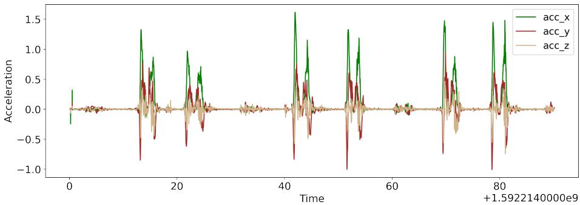
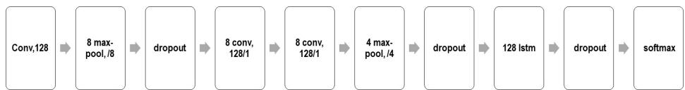
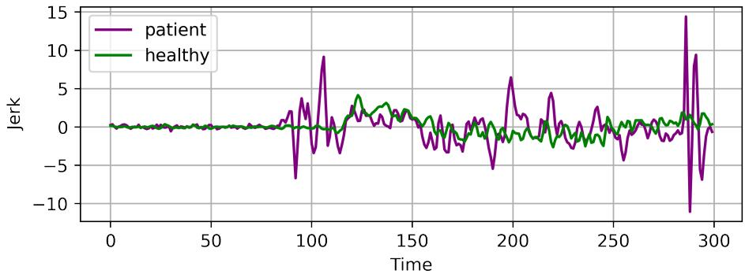
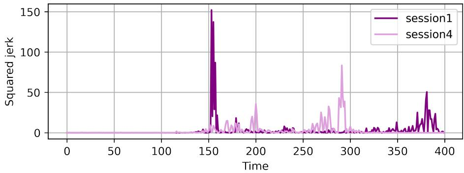

# 基于分类与平滑度分析促进自动化神经康复

Asma Bensalah1[0000−0002−2405−9811], Alicia Forn´es1[0000−0002−9692−5336], Cristina Carmona-Duarte2[0000−0002−4441−6652], 以及 Josep Llad´os1[0000−0002−4533−4739]

Computer Vision Center, Computer Science Department, Universitat Aut\`onoma de Barcelona, Spain {abensalah, afornes, josep}@cvc.uab.es 2 Universidad de Las Palmas de Gran Canaria, Spain {cristina.carmona}@ulpgc.es

摘要. 鉴于不存在适用于所有患者的标准化脑卒中康复方案，在康复阶段评估脑卒中后患者的动作质量至关重要。事实上，康复方案主要取决于患者的功能独立性及其在康复训练过程中的进展。为了应对这一挑战并使神经康复更加灵活高效，我们提出了一种自动评估流程：首先利用浅层深度学习架构识别患者的动作，随后使用加加速度（jerk）测量及相关指标评估动作质量。本研究的一个特色在于所使用的数据集具有临床相关性，因为其中的动作灵感来源于 Fugl-Meyer（福格-迈尔评估量表）——一种常用于脑卒中患者的上肢临床评估量表。我们表明，在平滑度方面不仅可以检测出健康人群与患者动作之间的差异，还能得出关于患者在康复训练过程中进展的结论，且这些结论与临床医生对各病例的诊断结果高度吻合。

关键词：神经康复 · 上肢 · 动作分类 · 动作平滑度 · 深度学习 · 加加速度（jerk）。

## 1 引言

神经系统疾病会导致认知和运动障碍。中风幸存者尤其可能面临身体一侧运动功能缺陷的问题。这些功能缺陷通过康复训练来解决，以部分或完全恢复患者的功能独立性 [1]。在这一阶段，核心挑战之一是对患者病情演变的评估。从本质上讲，中风后患者显著的康复进展通常发生在最初几周，即神经可塑性增强的关键窗口期 [2]。此后，非线性康复函数逐渐达到渐近水平。基于上述所有原因，必须优化这一关键时期的干预时机和治疗强度。因此，为了在关键窗口期结束前最大程度地促进患者康复，持续且准确地监测患者的进展是必不可少的。多年来，常用的方法一直是使用特定的临床量表 [3]。在实际操作中，患者的运动功能每十天仅评估一次或两次。因此，该方法的缺点在于，只要患者离开康复室，其病情演变就无法得到评估。事实上，最能反映患者功能独立性的是其在日常生活活动中的表现。

应对这一局限性的一种方法是实现评估的自动化，以帮助临床医生高效地评估患者。在实现自动化时会出现许多问题：首先，在长达数小时的连续记录中确定动作的性质；其次，找出能够最准确描述动作质量的度量指标。

为了解决上述问题，我们提出了一个用于自动评估患者动作的框架。该框架包含两个部分：

– 第一部分通过浅层深度学习架构将动作分类为四个关键动作类别；

第二部分是基于加加速度（jerk）度量的评估模块，用于确定患者与健康个体信号之间的差异，并评估患者在不同训练阶段中的演变情况。与现有其他因运动学参数数量较多而需要更多内存空间和计算资源的运动学算法不同 [4]，jerk 更容易在嵌入式设备中实现。

在本文的其余部分中，我们在第 2 节概述相关工作，然后在第 3 节描述我们的分类深度学习架构。在第 4 节中，我们概述动作平滑度度量。接下来，在第 5 节中描述实验设置。随后，我们在第 6 节中展示实验结果与发现。

## 2 相关工作

在信号中检测序列旨在检索与给定查询相关的信号或其部分。根据查询性质的不同，会产生多种序列检测任务 [5] [6] [7]。如果信号是由一个或多个不同模态组成的序列，而查询是一个动作、活动、运动或姿势，那么我们所处理的就是人体活动识别（Human Activity Recognition, HAR）任务。

HAR 极大受益于深度学习的蓬勃发展。目前已有多项研究利用不同模态开展 HAR：RGB 图像 [8]、骨骼数据 [9]、加速度 [10]、Wi-Fi [11] 等。

加速度是动作识别中被广泛应用的一种模态，因为这是一种非侵入式传感方法，不存在隐私限制问题。通过加速度进行 HAR 之所以可行，是因为人类通常以相同的定性方式执行动作 [12]。HAR 的实现既可以采用传统学习算法（例如支持向量机 [13]、k-近邻 [14]），也可以采用深度学习模型，如卷积神经网络（CNN）[15]、循环神经网络（RNNs）[16] 或长短期记忆网络（LSTM）[17]。根据 [18] 的统计，22% 的 HAR 研究致力于健康医疗应用。

另一方面，为了评估识别出的运动（特别是针对中风患者），目前对于如何获取运动平滑度指标或何种度量能最好地描述平滑度尚未达成普遍共识 [19]。其原因之一在于人们对运动质量背后的神经生理学理解尚不清晰，上肢运动的情况便是如此 [20]。根据 [21] 的研究，关于中风患者平滑度度量的研究主要分为五类：与轨迹相关的指标 [22]、与速度相关的指标 [23] [24]、与加速度相关的指标 [25] [26]、与加加速度（jerk）相关的指标 [27] 以及其他指标 [28]。如上所述，HAR 任务以及运动质量评估问题已通过多种方式得到研究。在我们的工作中，鉴于可用数据较少，我们选择了一种用于 HAR 的浅层深度学习架构；此外，我们探索了使用加加速度（jerk）度量来评估患者的运动质量。

## 3 动作分类

我们的灵感来自于 Supratak 的模型 [29]，该模型旨在解决多导睡眠监测（Polysomnography）的挑战，而多导睡眠监测是评估睡眠质量的方法之一 [30]。传统上，多导睡眠监测由一组专家使用睡眠分期评分对记录的数据进行标注。

为了缓解先前的局限性，该架构在流程中实现了数据增强模块，并减少了信号处理步骤。

## 3.1 架构

该模型输入为我们原始加速度信号的分段（epoch）（参见图 1）。我们将运动分类为四种关键运动类别之一：M1、M2、M3、M4。该模型的第一部分由四个 CNN 层组成，旨在从原始信号中提取时不变特征。如图 2 所示，在第一个 CNN 层和最后一个 CNN 层之后分别引入了最大池化（max-pool）层和 dropout 层。第二部分旨在学习时间

  
Fig. 1: 健康个体的原始加速度信号。

  
Fig. 2: 模型架构。

原始信号的依赖关系（序列学习）。这是通过一个后接 dropout 层的 LSTM 层来实现的，它们共同构成了一个单向 RNN。该单向 RNN 旨在学习时间转换规则。LSTM 的单向性省去了反向传递，从而减少了超参数的数量和计算资源。

由于我们的数据集是均衡的，所有类别的加权交叉熵损失权重均设置为 1。此外，为了解决数据稀缺问题，在每个训练轮次（epoch）都会对原始数据进行数据增强。数据增强是通过沿时间轴平移信号来进行的，平移跨度取自信号分段时长的特定范围。该模型使用 Sleep-EDF 数据集 [31] 进行了预训练。

## 4 运动平滑度

在介绍了分类架构之后，接下来我们介绍运动平滑度的测量方法。量化运动质量可以通过多种方式进行，测量位置随时间的变化便是其中之一。速度 $\overrightarrow { v }$（公式 1）、加速度 $\scriptstyle { \overrightarrow { a } }$（公式 2）、加加速度 $\vec { j }$（jerk，公式 3）以及加加加速度 $\vec { s }$（snap，公式 $^ { 4 ) }$ 分别是轨迹 $\vec { x }$ 对时间的一阶、二阶、三阶和四阶导数，它们是最广泛使用的测量物理量 [32]。人体也是利用这些相同的测量量来维持自身平衡的。更具体地说，这是由前庭系统的感官功能处理的，该系统提供诸如身体位置以及重力方向等信息 [33]。当物体处于运动状态时，它具有速度。当速度不恒定时，该物体具有不为零的加速度。如果加速度随时间变化，运动就会产生颠簸感（jerkiness）。自文献 [34] 重新引起人们对加加速度（jerk）的关注以来，它在科学和技术领域得到了广泛的应用 [35] [36] [37]。当发生振动时，以及每当发生突兀的过渡转变时，都应始终考虑加加速度 [35]。例如，在设计铁轨时会考虑加加速度，以确保列车从直线轨道转入弯道时保持平稳运动；同样，在防止工业工具因快速的加速度变化而过早失效时也会加以考虑。

通过观察加速度来分析人体运动时，测量结果取决于轴的方向。在记录数据时，手腕的微小旋转都可能导致某一轴向加速度产生大量噪声。因此，在本研究中，我们将加加速度作为运动质量的度量指标，特别是作为平滑度的指标。归根结底，与其他由于运动学参数过多而需要更多存储空间的现有运动学算法相比，加加速度更容易在嵌入式设备中实现。

$$
\overrightarrow {v} (t) = \frac {\mathrm{d} \overrightarrow {x} (t)}{\mathrm{d} t}\tag{1}
$$

$$
\overrightarrow {a} (t) = \frac {\mathrm{d} \overrightarrow {v} (t)}{\mathrm{d} t}\tag{2}
$$

$$
\overrightarrow {j} (t) = \frac {\mathrm{d} \overrightarrow {a} (t)}{\mathrm{d} t}\tag{3}
$$

$$
\overrightarrow {s} (t) = \frac {\mathrm{d} \overrightarrow {j} (t)}{\mathrm{d} t}\tag{4}
$$

## 5 实验设置

## 5.1 数据集

所使用的数据集是在用于远程患者监测的三维运动学（3D kinematics for remote patient monitoring，RPM3D）项目3中采集的，该项目旨在为中风患者构建自动化处理流程。文献 [38] 公布了一个包含中风患者和健康受试者的数据集以及分类基线。患者和健康个体双手各佩戴一只智能手表。健康个体仅采集一次，而患者则在四个不同的会话（session）中进行采集。患者各会话之间的时间间隔为一到两周。通常，为了评估中风患者的上肢运动功能，评估每周或每十天进行一次。评估中风患者感觉运动功能障碍最著名的量表是 Fugl-Meyer 评估（Fugl-Meyer Assessment）[39]。因此，作者受到 Fugl-Meyer 动作的启发，设计了关键动作集 $\mathcal { M } _ { i } , i \in [ 1 , 4 ]$，具体如下：

– 动作 $\mathcal { M } _ { 1 }$：肩部伸展/屈曲。

动作 $\mathcal { M } _ { 2 } \colon$ 肩部外展。

– 动作 $\mathcal { M } _ { 3 } \colon$ 肩部外旋/内旋。

– 动作 $\mathcal { M } _ { 4 } \colon$ 肘部屈曲/伸展

场景 实验在两种不同的设置下进行：受限场景 L1 和非受限场景 L2。具体描述如下：

场景 L1：代表受限场景，受试者执行四种关键动作 $\mathcal { M } _ { i } \colon$ 首先使用利手进行一次，其次使用非利手，最后双手同时进行。

– 场景 L2：代表非受限场景，由一系列关键动作 $\mathcal { M } _ { i }$ 以及一组其他非目标动作 $\mathcal { R } _ { j } ,$ $j \in [ 1 , 1 9 ]$ 组成。$\mathcal { R } _ { i }$ 动作为一系列日常活动，例如：喝水、坐在椅子上……这些动作以随机顺序执行。

## 5.2 处理流程

我们首先将动作分类为四个主要类别：M1、M2、M3、M4（肩部伸展/屈曲、肩部外展、肩部外旋/内旋、肘部屈曲/伸展）。然后，我们计算代表多次执行某一动作的信号的加加速度（jerk）值，如图 3 所示，以检查动作的全局加速度模式。

  
Fig. 3: 重复动作的加速度和加加速度 - 健康个体。

之后，我们计算前述信号中较小片段（单个良好分割的动作）的加加速度，以实现更精确的平滑度估计。

## 6 结果

以下结果与 L1 动作的分类及其平滑度分析相关。

## 6.1 分类

在实验中，数据被划分为 80% 用于训练，20% 用于测试。测试准确率平均达到 77,01%。我们在某些轮次（epochs）中遇到了准确率下降的情况，我们认为这是由于训练数据集规模较小所致。

## 6.2 平滑度（Smoothness）

在 Table 1 中，我们给出了健康个体和患者个体在沿 x 轴良好分割动作中的加加速度（jerk）值信息。理论上，与患者相比，健康个体的 jerk 值应该更低，因为他们以更平滑的方式移动和执行动作的能力更强，因此他们的动作颠簸程度更低（参见 Figure 4）[21]。

  
Fig. 4: 执行相同动作的患者与健康个体的 Jerk 值。

如 Table 1 所示，M2、M3、M4 的情况确实如此。例如，对于动作 M3，患者的 jerk 均值绝对值是健康受试者 jerk 均值绝对值的 0.7 倍。同时，Table 1 中的趋势表明，对于所有四种动作 M1、M2、M3 和 M4，健康人群中的 jerk 最大值都大于患者。Jerk 表示加速度的变化。从这个意义上讲，为了进一步了解动作的平滑度，我们采用了与 jerk 相关的度量，这些度量是基于 jerk 的绝对值计算的。在这项工作中，我们重点关注平方 jerk（squared jerk）度量。Table 2 显示了平方 jerk 度量的均值、最大值和最小值。请注意，Table 1 中的趋势是健康个体的平均 jerk 较低，这符合理论前提，即动作越颠簸、越不平滑，jerk 值就越高。因此，患者应该具有更高的 jerk 值。然而，平方平均 jerk 的情况并非如此。Table 2 中的总体规律是健康人群的平方 jerk 均值高于患者。我们认为这可能与以下事实有关：由于患者动作较慢，患者的信号比健康个体的信号噪声更大，因此患者的信号具有更多峰值和更多累积噪声（参见 Figure 5）。

Table 1: 患者与健康个体沿 x 轴的 Jerk 度量。

<table><tr><td rowspan="2"></td><td colspan="6">加加速度度量</td></tr><tr><td colspan="2">均值</td><td colspan="2">最大值</td><td colspan="2">最小值</td></tr><tr><td>x轴</td><td>健康人</td><td>患者</td><td>健康人</td><td>患者</td><td>健康人</td><td>患者</td></tr><tr><td>M1</td><td>0,00500712</td><td>-0,006998</td><td>497,99</td><td>145,54</td><td>-1,96E+02</td><td>-138,99182</td></tr><tr><td>M2</td><td>-0,0004051</td><td>-0,001621</td><td>157,56</td><td>69,46</td><td>-186,062127</td><td>-152,652</td></tr><tr><td>M3</td><td>-0,0023341</td><td>0,0016529</td><td>102,74</td><td>84,58</td><td>-1,27E+02</td><td>-62,973556</td></tr><tr><td>M4</td><td>0,00031141</td><td>0,0006176</td><td>161,04</td><td>107,14</td><td>-1,50E+02</td><td>-114,20477</td></tr></table>

  
Fig. 5: 健康人与患者信号对比。

Table 2: 患者与健康个体沿 x 轴的加加速度平方度量。

<table><tr><td rowspan="2"></td><td colspan="6">加加速度平方度量</td></tr><tr><td colspan="2">均值</td><td colspan="2">最大值</td><td colspan="2">最小值</td></tr><tr><td>x轴</td><td>健康人</td><td>患者</td><td>健康人</td><td>患者</td><td>健康人</td><td>患者</td></tr><tr><td>M1</td><td>19,96</td><td>7,65</td><td>247993,61</td><td>21182,96</td><td>8,93E-12</td><td>2,22E-12</td></tr><tr><td>M2</td><td>18,11</td><td>5,76</td><td>34619,12</td><td>23302,63</td><td>0</td><td>8,42E-10</td></tr><tr><td>M3</td><td>14,40</td><td>3,75</td><td>16056,08</td><td>7153,85</td><td>3,55E-11</td><td>0</td></tr><tr><td>M4</td><td>26,19</td><td>4,48</td><td>25934,96</td><td>13042,73</td><td>8,93E-12</td><td>0</td></tr></table>

表 3、4、5、6 提供了四位患者（即：100、101、102、103）的加加速度平方度量信息。它显示了四位患者在四个疗程中沿 x 轴的进展情况。表 3 给出了患者 100 的加加速度平方度量信息：均值、最大值和最小值。患者在动作 M1 上的表现于第 3 和第 4 疗程中更好。Figure 6 显示，与第一疗程相比，第 3 疗程中的 M1 动作抖动程度更低。同时，患者 100 在第三疗程中对 M3 和 M4 取得了最显著的改善。然而，动作 M2 的加加速度平方均值在四个疗程中未表现出改善。

  
Fig. 6: 患者 100 在第 1 和第 3 疗程中动作 M1 的加加速度平方值。

Table 3: 患者 100 在四个疗程中沿 x 轴的加加速度平方度量。

<table><tr><td rowspan="2"></td><td colspan="12">患者 100</td></tr><tr><td colspan="4">均值</td><td colspan="4">最大值</td><td colspan="4">最小值</td></tr><tr><td>x 轴</td><td>阶段 1</td><td>阶段 2</td><td>阶段 3</td><td>阶段 4</td><td>阶段 1</td><td>阶段 2</td><td>阶段 3</td><td>阶段 4</td><td>阶段 1</td><td>阶段 2</td><td>阶段 3</td><td>阶段 4</td></tr><tr><td>M1</td><td>12,88</td><td>13,04</td><td>5,09</td><td>10,16</td><td>18882,36</td><td>12129,74</td><td>4166,80</td><td>21182,96</td><td>8,38E-09</td><td>1,67E-08</td><td>1,75E-07</td><td>2,30E-09</td></tr><tr><td>M2</td><td>4,17</td><td>9,07</td><td>12,74</td><td>19,92</td><td>715,66</td><td>1246,53</td><td>23302,63</td><td>7364,52</td><td>9,35E-08</td><td>4,49E-08</td><td>8,42E-10</td><td>1,88E-08</td></tr><tr><td>M3</td><td>9,16</td><td>6,25</td><td>4,65</td><td>8,28</td><td>3738,07</td><td>2385,56</td><td>976,07</td><td>7153,85</td><td>8,53E-10</td><td>2,05E-10</td><td>5,18E-09</td><td>3,94E-08</td></tr><tr><td>M4</td><td>6,28</td><td>30,45</td><td>4,80</td><td>7,14</td><td>1804,63</td><td>13042,73</td><td>1246,78</td><td>670,45</td><td>1,98E-08</td><td>1,28E-08</td><td>1,20E-08</td><td>0</td></tr></table>

对于患者 101（见 Table 4），如图 Figure 7 所示，其均方加加速度值在四个康复训练阶段中有所增加。该图显示，动作 M4 在最后一个阶段平滑度较低；但动作 M1 除外，其均方加加速度值与第一阶段相比有所下降。

Table 5 描述了患者 102 的数据，其中动作 M1、M2、M3 的均方加加速度逐渐下降，直至最后一个康复训练阶段。相反，M1 的均方加加速度在第二阶段后停止减少。

Table 4：患者 101 在四个阶段中沿 x 轴的加加速度平方度量。

<table><tr><td rowspan="2"></td><td colspan="12">患者 101（Patient 101）</td></tr><tr><td colspan="4">均值</td><td colspan="4">最大值</td><td colspan="4">最小值</td></tr><tr><td>x 轴</td><td>Session 1</td><td>Session2</td><td>Session3</td><td>Session4</td><td>Session 1</td><td>Session2</td><td>Session3</td><td>Session4</td><td>Session 1</td><td>Session2</td><td>Session3</td><td>Session4</td></tr><tr><td>M1</td><td>7,61</td><td>2,62</td><td>4,63</td><td>5,23</td><td>1357,01</td><td>445,53</td><td>581,59</td><td>968,97</td><td>1,64E-07</td><td>2,22E-12</td><td>4,59E-08</td><td>3,55E-11</td></tr><tr><td>M2</td><td>2,03</td><td>2,16</td><td>7,52</td><td>5,20</td><td>267,21</td><td>484,64</td><td>3781,94</td><td>1086,66</td><td>1,04E-07</td><td>1,05E-08</td><td>2,22E-08</td><td>2,82E-09</td></tr><tr><td>M3</td><td>2,14</td><td>4,05</td><td>3,21</td><td>8,03</td><td>406,89</td><td>2257,01</td><td>604,45</td><td>3965,67</td><td>6,13E-08</td><td>8,39E-09</td><td>4,69E-09</td><td>3,60E-08</td></tr><tr><td>M4</td><td>0,58</td><td>0,73</td><td>2,88</td><td>2,49</td><td>44,56</td><td>163,14</td><td>1068,82</td><td>1034,61</td><td>2,24E-09</td><td>1,52E-08</td><td>8,85E-10</td><td>5,00E-10</td></tr></table>

  
Fig. 7: 患者 101 在 Session 1 和 4 中动作 M4 的加加速度平方值（Squared jerk values）。

很明显，患者 100、102、103 在至少三个动作中的加加速度平方均值均低于其首次 Session 的值。

加加速度作为平滑度指标的效果如何？总体而言，由于患者执行动作的方式，将健康个体的加加速度值与患者的加加速度值进行比较并非易事。特别是，当患者难以以一致的方式执行动作时，这意味着简单比较健康人群动作与患者动作的加加速度值并不总是具有决定性的。例如，在动作 M1 的情况下，健康样本中的加加速度均值高于患者样本。尽管如此，加加速度平方均值仍为患者在四个 Session 中的演变过程提供了有价值的见解。我们的结论确实与临床医生的评估结论相符：与首次 Session 相比，大多数患者的动作平滑度有所改善。此外，对于在各 Session 中表现出更多运动功能问题的患者 101，我们观察到其在加加速度平方均值方面的改善幅度最小。

Table 5: 患者 102 在四个 Session 中沿 x 轴的加加速度平方测量值。

<table><tr><td rowspan="2"></td><td colspan="12">患者 102</td></tr><tr><td colspan="4">均值</td><td colspan="4">最大值</td><td colspan="4">最小值</td></tr><tr><td>x 轴</td><td>Session 1</td><td>Session2</td><td>Session3</td><td>Session4</td><td>Session 1</td><td>Session2</td><td>Session3</td><td>Session4</td><td>Session 1</td><td>Session2</td><td>Session3</td><td>Session4</td></tr><tr><td>M1</td><td>4,27</td><td>1,18</td><td>4,82</td><td>7,09</td><td>5256,19</td><td>49,80</td><td>3829,05</td><td>7841,56</td><td>1,61E-08</td><td>2,90E-09</td><td>1,50E-08</td><td>8,84E-12</td></tr><tr><td>M2</td><td>2,89</td><td>4,61</td><td>2,21</td><td>1,78</td><td>473,36</td><td>2788,06</td><td>353,56</td><td>739,78</td><td>5,98E-09</td><td>4,09E-08</td><td>8,61E-10</td><td>3,77E-08</td></tr><tr><td>M3</td><td>1,03</td><td>1,56</td><td>1,03</td><td>0,58</td><td>88,71</td><td>405,24</td><td>117,23</td><td>81,77</td><td>1,26E-09</td><td>0</td><td>3,21E-08</td><td>6,56E-09</td></tr><tr><td>M4</td><td>1,90</td><td>1,25</td><td>1,67</td><td>0,84</td><td>306,19</td><td>165,53</td><td>184,44</td><td>125,36</td><td>1,22E-08</td><td>1,77E-09</td><td>3,01E-08</td><td>2,59E-09</td></tr></table>

Table 6: 患者 103 在四个会话中沿 x 轴的加加速度平方（squared jerk）测量值。

<table><tr><td rowspan="2"></td><td colspan="12">患者 103</td></tr><tr><td colspan="4">均值</td><td colspan="4">最大值</td><td colspan="4">最小值</td></tr><tr><td>x 轴</td><td>Session 1</td><td>Session2</td><td>Session3</td><td>Session4</td><td>Session 1</td><td>Session2</td><td>Session3</td><td>Session4</td><td>Session 1</td><td>Session2</td><td>Session3</td><td>Session4</td></tr><tr><td>M1</td><td>8,57</td><td>16,17</td><td>9,97</td><td>9,47</td><td>2570,08</td><td>19318,73</td><td>2733,30</td><td>1991,19</td><td>2,35E-08</td><td>2,79E-08</td><td>5,36E-11</td><td>7,71E-08</td></tr><tr><td>M2</td><td>2,80</td><td>4,34</td><td>1,88</td><td>3,79</td><td>500,42</td><td>2143,84</td><td>222,50</td><td>1488,18</td><td>2,18E-07</td><td>1,73E-09</td><td>1,29E-09</td><td>4,98E-08</td></tr><tr><td>M3</td><td>1,66</td><td>2,14</td><td>1,86</td><td>1,34</td><td>1039,28</td><td>707,50</td><td>297,98</td><td>331,72</td><td>8,53E-09</td><td>2,33E-10</td><td>2,86E-08</td><td>3,82E-08</td></tr><tr><td>M4</td><td>3,18</td><td>4,12</td><td>2,11</td><td>2,52</td><td>4304,22</td><td>2560,54</td><td>1628,78</td><td>713,06</td><td>4,45E-10</td><td>8,66E-09</td><td>3,60E-08</td><td>4,36E-01</td></tr></table>

## 7 结论

在本文中，我们提出了一种全自动中风患者评估流水线（pipeline），它结合了深度学习模型与基于加加速度（jerk）度量的平滑度质量评估模块，该度量是在受有效的临床功能性 Fugl-Meyer 量表启发的动作上计算得出的。尽管数据集规模较小，动作分类仍达到了良好的准确率，这可能归功于对原始信号进行的数据增强。与健康受试者相比，jerk 已被证明是评估中风患者的一种很有前景的度量指标，而平方加加速度（squared jerk）则为患者跨会话（intersession）表现的变异性提供了良好的指示。

与所有非图像或自然语言处理（NLP）相关的视觉及机器学习任务类似，可用于我们任务的数据较少。因此，未来的工作将致力于扩充可用数据并探索更具鲁棒性的平滑度度量方法。

## 致谢

本研究得到了西班牙项目 RTI2018-095645-B-C21、CERCA Program / Generalitat de Catalunya 以及 FI 奖学金 AGAUR 2020 FI-SDUR 00497（在 Secretaria d’Universitats i Recerca of the Generalitat de Catalunya 和 Fons Social Europeu 的支持下）的部分资助。

## 参考文献

1. Bruce H. Dobkin. 60 - rehabilitation and recovery of the patient with stroke. In James C. Grotta, Gregory W. Albers, Joseph P. Broderick, Arthur L. Day, Scott E. Kasner, Eng H. Lo, Ralph L. Sacco, and Lawrence K.S. Wong, editors, Stroke (Seventh Edition), pages 879–887.e2. Elsevier, Philadelphia, seventh edition edition, 2022.

2. Bel´en Ballester, Martina Maier, Armin Duf, M´onica Cameir˜ao, Sergi Berm´udez i Badia, Esther Duarte, Ampar Cuxart, Susana Rodriguez, Rosa San Segundo, and Paul Verschure. A critical time window for recovery extends beyond one-year post-stroke. Journal of Neurophysiology, 122, 05 2019.

3. Jackie Bosch, Lesly A. Pearce, Mike Sharma, Robert Mikul´ık, William N. Whiteley, Michelle Canavan, Robert G. Hart, and Martin J. O’Donnell. Functional abilities of an international post-stroke population: Standard assessment of global everyday activities (sagea) scale. Journal of Stroke and Cerebrovascular Diseases, 31(4):106329, 2022.

4. Jan Stenum, Cristina Rossi, and Ryan T. Roemmich. Two-dimensional videobased analysis of human gait using pose estimation. PLOS Computational Biology, 17(4):1–26, 04 2021.

5. Ewald van der Westhuizen, Herman Kamper, Raghav Menon, John Quinn, and Thomas Niesler. Feature learning for eficient asr-free keyword spotting in lowresource languages. Computer Speech & Language, 71:101275–101275, 2022. Query date: 2022-03-07 13:17:34.

6. Angelos Giotis. Keyword spotting in handwritten document images using supervised and unsupervised representations. National Documentation Centre (EKT), 2021. Query date: 2022-03-07 13:23:13.

7. Hang Pan, Lun Xie, and Zhiliang Wang. 用于检测宏表情与微表情区间的时空卷积注意力网络（Spatio-temporal convolutional attention network for spotting macro- and micro-expression intervals）. Proceedings of the 1st Workshop on Facial Micro-Expression: Advanced Techniques for Facial Expressions Generation and Spotting, 2021. 查询日期：2022-03-15 13:24:42.

8. Elias Dritsas and Maria Trigka. 一种提取节能且对比度增强的 RGB 图像的方法（A methodology for extracting power-eficient and contrast enhanced rgb images）. Sensors, 22(4), 2022.

9. Raphael Memmesheimer, Simon H¨aring, Nick Theisen, and Dietrich Paulus. Skeleton-dml：基于骨架的单样本动作识别深度度量学习（Skeleton-dml: Deep metric learning for skeleton-based one-shot action recognition）. In 2022 IEEE/CVF Winter Conference on Applications of Computer Vision (WACV), 第 837–845 页, 2022.

10. Congcong Zhou, Lilin Yang, Heng Liao, Bo Liang, and Xuesong Ye. 基于无线可穿戴 sEMG 和加速度传感器的智能 AFO 踝足运动识别（Ankle foot motion recognition based on wireless wearable semg and acceleration sensors for smart afo）. Sensors and Actuators A: Physical, 331:113025, 2021.

11. Chenning Li, Manni Liu, and Zhichao Cao. Wihf：利用 Wi-Fi 进行手势和用户识别（Wihf: Gesture and user recognition with wifi）. IEEE Transactions on Mobile Computing, 21(2):757–768, 2022.

12. Hossein Rahmani, Mohammed Bennamoun, and Qiuhong Ke. 基于多种数据模态的人体动作识别综述（Human action recognition from various data modalities: A review）, 2021年2月.

13. Slim Ben Chaabane, Mohammad Hijji, Rafika Harrabi, and Hassene Seddik. 基于统计特征和 SVM 分类器的人脸识别（Face recognition based on statistical features and svm classifier）. Multimedia Tools and Applications, 2022. 查询日期：2022-02-22 13:16:18.

14. Najeeb Ur Rehman Malik, Syed Abdul Rahman Abu Bakar, and Usman Ullah Sheikh. 基于 OpenPose 和 KNN 分类器的多视角人体动作识别系统（Multiview human action recognition system based on openpose and knn classifier）. Lecture Notes in Electrical Engineering, 第 890–895 页, 2022. 查询日期：2022-02-22 13:21:25.

15. Habib-Ur-Rehman Khalid, Ali Gorji, Andre Bourdoux, Sofie Pollin, and Hichem Sahli. 用于基于雷达的人体活动识别的多视角 CNN-LSTM 架构（Multi-view cnn-lstm architecture for radar-based human activity recognition）. IEEE Access, 第 1–1 页, 2022. 查询日期：2022-02-23 12:56:18.

16. Qingchang Zhu, Zhenghua Chen, and Yeng Chai Soh. 一种用于人体活动识别的新型半监督深度学习方法（A novel semisupervised deep learning method for human activity recognition）. IEEE Transactions on Industrial Informatics, 15(7):3821–3830, 2019.

17. Jun-Yan He, Xiao Wu, Zhi-Qi Cheng, Zhaoquan Yuan, and Yu-Gang Jiang. Dblstm：用于人体动作识别的密集连接双向 LSTM（Dblstm: Densely-connected bi-directional lstm for human action recognition）. Neurocomputing, 444:319–331, 2021.

18. Neha Gupta. 人工智能框架下的人体活动识别：叙述性综述（Human activity recognition in artificial intelligence framework: a narrative review）. Artificial Intelligence Review, 2022年1月.

19. Mohamed Irfan Mohamed Refai. 继续前行：中风后远程运动测量（Moving On: Measuring Movement Remotely after Stroke）. 博士学位论文, University of Twente（特温特大学）, Netherlands, 2021.

20. Floor Buma, Joost Kordelaar, Mathijs Raemaekers, Erwin van Wegen, Nick Ramsey, and Gert Kwakkel. 脑激活与中风后上肢运动平滑度相关（Brain activation is related to smoothness of upper limb movements after stroke）. Experimental brain research, 234, 2016年7月.

21. B.L. Scheltinga. 中风康复期间上肢运动平滑度的合适指标（Suitable metrics for upper limb movement smoothness during stroke recovery）, 2019年8月.

22. Matteo Bigoni, Silvia Baudo, Veronica Cimolin, Nicola Cau, Manuela Galli, Lucia Pianta, Elena Tacchini, Paolo Capodaglio, and Alessandro Mauro. Does kinematics add meaningful information to clinical assessment in post-stroke upper limb rehabilitation? a case report. Journal of Physical Therapy Science, 28:2408–2413, 08 2016.

23. Brandon Rohrer, Susan Fasoli, Hermano Krebs, Richard Hughes, Bruce Volpe, Walter Frontera, Joel Stein, and Neville Hogan. Movement smoothness changes during stroke recovery. The Journal of neuroscience : the oficial journal of the Society for Neuroscience, 22:8297–304, 10 2002.

24. Dario G Liebermann, Mindy F Levin, Joseph McIntyre, Patrice L Weiss, and Sigal Berman. Arm path fragmentation and spatiotemporal features of hand reaching in healthy subjects and stroke patients. In Engineering in Medicine and Biology Society (EMBC), 2010 Annual International Conference of the IEEE, pages 5242– 5245. IEEE, 2010.

25. Oph´elie Pila, Christophe Duret, F.-X Laborne, Jean-Michel Gracies, N. Bayle, and Emilie Hutin. Pattern of improvement in upper limb pointing task kinematics after a 3-month training program with robotic assistance in stroke. Journal of NeuroEngineering and Rehabilitation, 14, 10 2017.

26. Hisyam Abdul Rahman, Kang Khor, Yeong Fai, Eileen Su, and Leela Narayanan. The potential of irest in measuring the hand function performance of stroke patients. Bio-Medical Materials and Engineering, 28:105–116, 03 2017.

27. Jozsef Laczko, Robert Scheidt, Lucia Simo, and D. Piovesan. Inter-joint coordination deficits revealed in the decomposition of endpoint jerk during goal-directed arm movement after stroke. IEEE Transactions on Neural Systems and Rehabilitation Engineering, PP:1–1, 01 2017.

28. Mohamed Irfan, Mique Saes, Bouke Scheltinga, Joost Kordelaar, Johannes Bussmann, Peter Veltink, Jaap Buurke, Carel Meskers, Erwin van Wegen, Gert Kwakkel, and Bert-Jan BEIJNUM. Smoothness metrics for reaching performance after stroke. part 1: which one to choose? Journal of NeuroEngineering and Rehabilitation, 18, 10 2021.

29. Akara Supratak and Yike Guo. Tinysleepnet: An eficient deep learning mode for sleep stage scoring based on raw single-channel eeg. In 2020 42nd Annual

International Conference of the IEEE Engineering in Medicine Biology Society (EMBC), pages 641–644, 2020.

30. Xuefei Wang, Yichao Zhou, and Chunxia Zhao. Heart-rate analysis of healthy and insomnia groups with detrended fractal dimension feature in edge. Tsinghua Science and Technology, 27(2):325–332, 2022.

31. B. Kemp, A.H. Zwinderman, B. Tuk, H.A.C. Kamphuisen, and J.J.L. Oberye. Analysis of a sleep-dependent neuronal feedback loop: the slow-wave microcontinuity of the eeg. IEEE Transactions on Biomedical Engineering, 47(9):1185–1194, 2000.

32. Jared Van Dam, Kyle Tanous, Matt Werner, and Joseph L. Gabbard. Calculating and analyzing angular head jerk in augmented and virtual reality: Efect of ar cue design on angular jerk. Applied Sciences, 11(21), 2021.

33. Silvia Maria Sobral Oliveira, Allan Mateus da Silva Limai, Carolina Veiga Pereira, Emily Macedo Mainardi, Gabrielle Woan Hua Seifert Wu, Isis Pinheiro Damasceno, Luciane Lobato Sobral Santos, Rodrigo Santiago Barbosa Rocha, Maryana Therumy Kabuki, and Larissa Salgado de Oliveira Rocha. The balance concept on unilateral vestibular hypofunction patients changes the balance and quality of life. Health Science Journal, 15(5):1–5, 2021.

34. Steven H. Schot. Jerk: The time rate of change of acceleration. American Journal of Physics, 46:1090–1094, 1978.

35. Hasti Hayati, David Eager, Ann-Marie Pendrill, and Hans Alberg. Jerk within the context of science and engineering—a systematic review. Vibration, 3(4):371–409, 2020.

36. David Hostler, Jacqueline Schwob, Zachary J. Schlader, and Lora Cavuoto. Heat stress increases movement jerk during physical exertion. Frontiers in Physiology, 12, 2021.

37. Burkhard Alpers. On fast jerk–, acceleration– and velocity–restricted motion functions for online trajectory generation. Robotics, 10(1), 2021.

38. Asma Bensalah, Jialuo Chen, Alicia Forn´es, Cristina Carmona-Duarte, Josep Llad´os, and Miguel Angel Ferrer. Towards stroke patients’ upper-limb automatic´ motor assessment using smartwatches. In Alberto Del Bimbo, Rita Cucchiara, Stan Sclarof, Giovanni Maria Farinella, Tao Mei, Marco Bertini, Hugo Jair Escalante, and Roberto Vezzani, editors, Pattern Recognition. ICPR International Workshops and Challenges, pages 476–489, Cham, 2021. Springer International Publishing.

39. Tetsuharu Nakazono, Kayoko Takahashi, Yoshikazu Suzuki, Kosuke Mizuno, Yuko Nomura, Yoshimi Hiraga, Shuji Matsumoto, Kazutoshi Nishiyama, and Michinari Fukuda. Reliability and validity of japanese version of fugl-meyer assessment for the lower extremities. Topics in Stroke Rehabilitation, 0(0):1–8, 2021. PMID: 33724162.