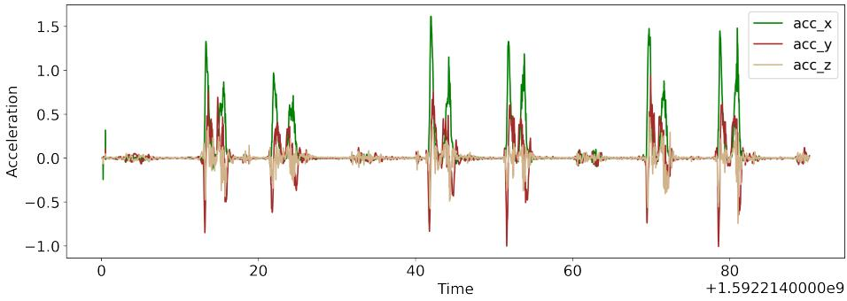

# 通过分类与平滑度分析简化自动神经康复

Asma Bensalah1[0000−0002−2405−9811]、Alicia Fornés1[0000−0002−9692−5336]、Cristina Carmona-Duarte2[0000−0002−4441−6652]、Josep Lladós1[0000−0002−4533−4739]

1 Computer Vision Center，计算机科学系，巴塞罗那自治大学，西班牙 {abensalah, afornes, josep}@cvc.uab.es 2 拉斯帕尔马斯大学，西班牙 {cristina.carmona}@ulpgc.es

摘要. 在卒中后患者的康复阶段评估其动作质量至关重要，因为目前并不存在适用于所有患者的标准化卒中康复方案。事实上，康复计划基本上取决于患者的功能独立性以及其在多次康复疗程中的进展情况。为了应对这一挑战并使神经康复更加高效，我们提出了一套自动化评估流程：首先通过一种浅层深度学习架构识别患者的动作，然后使用急动度（jerk）度量及相关指标来评估动作质量。本研究的一个特别之处在于，所使用的数据集具有临床相关性，因为它所呈现的动作灵感源自 Fugl-Meyer 量表——一种常用的卒中患者上肢临床评估量表。我们证明，从平滑度的角度检测健康人与患者动作之间的差异是可行的，此外还能针对患者在多次康复疗程中的进展情况得出结论，这些结论与临床医师对每个病例的观察发现相一致。

关键词：神经康复 · 上肢 · 动作分类 · 动作平滑度 · 深度学习 · 急动度（jerk）

## 1 引言

神经系统疾病会导致认知和运动障碍。尤其是脑卒中（中风）幸存者，其身体一侧可能出现运动功能缺陷。这些功能缺陷通过康复训练得到部分或完全的恢复，以恢复患者的功能独立性 [1]。该阶段的核心挑战之一在于评估患者的康复进展。事实上，脑卒中后患者的显著恢复主要发生在最初几周，即神经可塑性（neuroplasticity）增强的关键窗口期 [2]。此后，非线性恢复曲线将趋于渐近水平。基于以上原因，在这一关键时期应当优化治疗时机和治疗强度。因此，持续且准确地监测患者的康复进展，对于在关键窗口期结束前最大化患者的恢复效果至关重要。多年来，主流做法是使用特定的临床量表（clinical scales）[3]。在实践中，患者的运动功能每十天评估一次或两次。因此，这种方法的不足在于：一旦患者离开康复训练室，其康复进展便无法得到评估。事实上，最能反映患者功能独立性的恰恰是其在日常生活活动中的表现。

应对这一局限性的一种方法是将评估流程自动化，以帮助临床医生高效地评估患者。自动化过程中会出现诸多难题：首先，需要在长达数小时的连续记录中确定运动性质；其次，需要找出能够最佳描述运动质量的度量指标。

为应对上述问题，我们提出一个用于自动评估患者运动的框架。该框架包含两部分：

– 第一部分基于浅层深度学习架构将运动分类为四类关键运动类别；

第二部分是基于急动度（jerk）度量的评估模块，用于揭示患者与健康个体信号之间的差异，并估计患者在不同训练阶段的康复进展。与其他因运动学参数较多而需要更大内存和计算资源的现有运动学算法 [4] 相比，jerk 更易于在嵌入式设备中实现。

在本文余下部分中，我们将在第 2 节概述相关工作，在第 3 节描述我们用于分类的深度学习架构。在第 4 节中，我们将概述运动平滑度测量方法。接着，我们在第 5 节描述实验设置。然后，我们在第 6 节展示结果与发现。

## 2 相关工作

在信号中定位（spotting）序列旨在检索与给定查询相关的信号或其部分。根据查询的性质，会产生许多序列定位任务 [5] [6] [7]。如果信号是一种或多种不同模态的序列，而查询是动作、活动、运动或手势，那么我们处理的就是人类活动识别（Human Activity Recognition, HAR）任务。

HAR 从深度学习的蓬勃发展中受益匪浅。HAR 已通过不同模态实现：RGB 图像 [8]、骨架 [9]、加速度 [10]、Wi-Fi [11]……

加速度是一种被广泛利用的动作识别模态，因为它是一种非侵入式的感知方法，因此不存在隐私限制方面的难题。通过加速度进行 HAR 是可行的，因为人类通常以相同的方式完成某个动作 [12]。HAR 既可以使用传统学习算法完成，例如支持向量机（Support Vector Machines, SVM）[13]、k 近邻（k-Nearest Neighbors, KNN）[14]，也可以使用深度学习模型，例如卷积神经网络（Convolutional Neural Networks, CNN）[15]、循环神经网络（Recurrent Neural Networks, RNN）[16] 或长短期记忆网络（Long Short-Term Memory, LSTM）[17]。根据文献 [18]，22% 的 HAR 研究致力于医疗健康应用。

另一方面，对识别出的动作（尤其是中风患者的动作）进行评估时，对于如何获取动作平滑度指标以及何种度量能最佳地对其进行刻画，尚无统一共识 [19]。其原因之一在于对动作质量背后神经生理学的理解仍不清晰，上肢动作的情况也是如此 [20]。根据文献 [21]，针对中风患者的平滑度度量研究主要分为五类：与轨迹相关的度量 [22]、与速度相关的度量 [23] [24]、与加速度相关的度量 [25] [26]、与急动度（jerk）相关的度量 [27] 和其他度量 [28]。如上所述，HAR 任务已通过多种方式加以解决，动作质量评估问题也同样如此。在我们的工作中，鉴于可用的数据较少，我们选择了浅层深度学习架构用于 HAR；此外，我们探索了使用急动度度量来评估患者的动作质量。

## 3 动作分类

我们的灵感来自 Supratak 等人的模型 [29]，该模型旨在应对多导睡眠图（Polysomnography）相关的挑战，而多导睡眠图是评估睡眠质量的方法之一 [30]。传统上，多导睡眠图由一组专家完成，他们使用睡眠分期评分对记录数据进行标注。

为缓解前述局限性，该架构实现了数据增强模块，并在流水线中减少了信号处理步骤。

## 3.1 架构

模型输入的是我们原始加速度信号的若干时段（epoch）（见图 1）。我们将这些动作分类为四种关键动作类别之一：M1、M2、M3、M4。模型的第一个组件由四个 CNN 层组成，旨在从原始信号中提取时间不变特征。如图 2 所示，在第一个 CNN 层之后引入了最大池化（max-pool）层，在最后一个 CNN 层之后引入了 dropout 层。第二个组件旨在学习时序

  

图 1：健康个体的原始加速度信号。

  

图 2：模型架构。

原始信号的依赖关系（序列学习）。这是通过一个 LSTM 层后接 dropout 结构来实现的，它们共同构成一个单向 RNN。该单向 RNN 用于学习时间转移规则。LSTM 的单向性消除了前向传递过程，从而减少了超参数数量并节省了计算资源。

由于我们的数据集是平衡的，所有类别的加权交叉熵损失均设为 1。此外，为应对数据稀缺问题，在每个训练 epoch 中对原始数据进行数据增强。数据增强通过沿时间轴平移信号来实现，平移范围为 epoch 时长的某一区间。该模型使用 Sleep-EDF 数据集 [31] 进行预训练。

## 4 运动平滑度

在介绍完分类架构之后，接下来我们介绍运动的平滑度测量方法。量化运动质量的方式有很多种，测量位置相对于时间的变化就是其中之一。

速度 $\overrightarrow { v }$（equation 1）、加速度 $\scriptstyle { \overrightarrow { a } }$（equation 2）、急动度（jerk） $\vec { j }$（equation 3）和加加速度（snap） $\vec { s }$（equation $^ { 4 ) }$）分别为轨迹 $\vec { x }$ 对时间的一阶、二阶、三阶和四阶导数，是应用最为广泛的测量量 [32]。

人体维持平衡所用的也是这些相同的测量量。更具体而言，这由前庭系统的感觉功能负责处理，该系统提供身体位置及重力方向等信息 [33]。

当物体处于运动状态时，它便具有速度。当速度不是常量时，则称该物体具有非零的加速度。当加速度随时间变化时，运动中便会产生急动（jerkiness）的感觉。

自 [34] 重新唤起对急动度的关注以来，急动度已在科学与技术领域得到广泛应用 [35][36][37]。当发生振动或出现突变时，必须始终将急动度纳入考量 [35]。例如，铁路设计中需要考虑急动度，以保证列车由直线过渡到曲线时运动平稳；同样，也要确保工业工具不会因加速度的急剧变化而过早失效。

通过加速度对人体运动进行分析时，结果依赖于坐标轴的朝向。在数据采集过程中，手腕的微小转动都会在某一坐标轴的加速度信号中引入大量噪声。因此，在本工作中，我们将急动度作为运动质量的度量，特别是作为平滑度指标。

最后，急动度更易于在嵌入式设备中实现；与之不同的是，现有的一些运动学算法由于运动学参数较多，需要占用更多的存储空间。

$$
{ \vec { v } } ( t ) = { \frac { \mathrm { d } { \vec { x } } ( t ) } { \mathrm { d } t } }\tag{1}
$$

$$
{ \vec { \alpha } } ( t ) = { \frac { \mathrm { d } { \vec { v } } ( t ) } { \mathrm { d } t } }\tag{2}
$$

$$
{ \vec { j } } ^ { } ( t ) = { \frac { \mathrm { d } { \vec { a } } ( t ) } { \mathrm { d } t } }\tag{3}
$$

$$
{ \vec { s } } ( t ) = { \frac { \mathrm { d } { \vec { j } } ( t ) } { \mathrm { d } t } }\tag{4}
$$

## 5 实验设置

## 5.1 数据集

所使用的数据集是作为远程患者监护三维运动学（3D kinematics for remote patient monitoring, RPM3D）项目3的一部分所采集的，该项目旨在为脑卒中患者构建一条自动化的处理流水线。该项目已发布了一份面向脑卒中患者与健康受试者的数据集以及相应的分类基线[38]。每位患者与健康受试者均被发放一只戴在每只手上的智能手表。健康受试者仅进行一次记录，而脑卒中患者则在四个不同的会话中进行记录。患者各次会话之间的时间间隔为一到两周。最初，为了评估脑卒中患者的上肢运动功能，评估工作每周或每十天进行一次。用于评估脑卒中患者感觉运动障碍的最著名量表为 Fugl-Meyer 评估量表（Fugl-Meyer Assessment）[39]。基于此，作者们从 Fugl-Meyer 动作中得到启发，设计了其关键动作集合 $\mathcal { M } _ { i } , i \in [ 1 , 4 ]$，具体如下：

– 动作 $\mathcal { M } _ { 1 }$：肩关节伸展/屈曲。

– 动作 $\mathcal { M } _ { 2 }$：肩关节外展。

– 动作 $\mathcal { M } _ { 3 }$：肩关节外旋/内旋。

– 动作 $\mathcal { M } _ { 4 }$：肘关节屈曲/伸展。

场景  实验在两种不同的设置下进行：受限场景 L1 与非受限场景 L2。具体描述如下：

– 场景 L1：表示一种受限场景，其中受试者依次完成四项关键动作 $\mathcal { M } _ { i }$：首先用优势手完成一次，其次用非优势手完成，最后用双手完成。

– 场景 L2：表示非受限场景，由一系列关键动作 $\mathcal { M } _ { i }$ 以及一组其他非目标动作 $\mathcal { R } _ { j } ,$ $j \in [ 1 , 1 9 ]$ 组成。$\mathcal { R } _ { i }$ 动作为一组常见的日常活动，例如：喝水、坐到椅子上等。这些动作以随机顺序执行。

## 5.2 流水线

我们首先将动作分类为四个主要类别：M1、M2、M3、M4（肩关节伸展/屈曲、肩关节外展、肩关节外旋/内旋、肘关节屈曲/伸展）。然后，我们针对表示一次完成某个动作的信号（该动作重复执行多次，如图 3 所示）计算其急动度（jerk）值，以考察一个动作的整体加速度模式。

  

图 3：重复运动过程中的加速度与急动度（jerk）——健康个体。

此后，我们对前一个信号的较小片段（一个分段良好的运动）计算急动度（jerk），以获得更精确的平滑度估计。

## 6 结果

以下结果与 L1 运动的分类及其平滑度分析相关。

## 6.1 分类

在实验中，数据按 80% 用于训练、20% 用于测试进行划分。测试准确率平均达到 77.01%。在某些训练轮次（epoch）中准确率出现下降，我们认为这是由于训练数据集规模较小所致。

## 6.2 平滑度

在表 1 中，我们给出了健康个体与患者沿 x 轴的分段良好运动的急动度值信息。从理论上讲，健康个体的急动度值应低于患者，因为健康个体能够以更平滑的方式运动并完成动作，其运动不那么急促（参见图 4）[21]。

  

图 4：患者与健康个体执行相同动作时的急动度（Jerk）值。

如表 1 所示，M2、M3、M4 都属于这种情况。例如，对于动作 M3，患者的 jerk 均值绝对值是健康受试者 jerk 均值绝对值的 0.7 倍。同时，表 1 中呈现的趋势是：对于全部四个动作 M1、M2、M3 和 M4，健康人群的 jerk 最大值均高于患者的 jerk 最大值。jerk 表示加速度的变化量。基于此，为了更深入地理解动作的平滑性，我们采用了基于 jerk 绝对值计算的 jerk 相关度量。在本工作中，我们重点关注平方 jerk 度量。表 2 给出了平方 jerk 度量的均值、最大值与最小值。请注意，表 1 中的趋势是健康个体的 jerk 均值更低，这对应于理论前提——动作越急动、越不平稳，jerk 值就越大。因此，患者的 jerk 值理应更高。然而，对于平方 jerk 均值而言，情况并非如此。表 2 的总体趋势是健康人群的平方 jerk 均值高于患者。我们认为这可能与以下事实相关：患者的信号比健康个体的信号更嘈杂，因为患者的动作更慢，因此患者的信号具有更多的峰值和更多的累积噪声（见图 5）。

表 1：患者与健康个体沿 x 轴的 jerk 度量。

<table><tr><td rowspan=2 colspan=1></td><td rowspan=1 colspan=6>Jerk Measure</td></tr><tr><td rowspan=1 colspan=2>Mean</td><td rowspan=1 colspan=2>Max</td><td rowspan=1 colspan=2>Min</td></tr><tr><td rowspan=1 colspan=1>axis x</td><td rowspan=1 colspan=1>Healthy</td><td rowspan=1 colspan=1>Patient</td><td rowspan=1 colspan=1>Healthy</td><td rowspan=1 colspan=1>Patient</td><td rowspan=1 colspan=1>Healthy</td><td rowspan=1 colspan=1>Patient</td></tr><tr><td rowspan=1 colspan=1>M1</td><td rowspan=1 colspan=1>0,00500712</td><td rowspan=1 colspan=1>-0,006998</td><td rowspan=1 colspan=1>497,99</td><td rowspan=1 colspan=1>145,54</td><td rowspan=1 colspan=1>-1,96E+02</td><td rowspan=1 colspan=1>-138,99182</td></tr><tr><td rowspan=1 colspan=1>M2</td><td rowspan=1 colspan=1>-0,0004051</td><td rowspan=1 colspan=1>-0,001621</td><td rowspan=1 colspan=1>157,56</td><td rowspan=1 colspan=1>69,46</td><td rowspan=1 colspan=1>-186,062127</td><td rowspan=1 colspan=1>-152,652</td></tr><tr><td rowspan=1 colspan=1>M3</td><td rowspan=1 colspan=1>-0,0023341</td><td rowspan=1 colspan=1>0,0016529</td><td rowspan=1 colspan=1>102,74</td><td rowspan=1 colspan=1>84,58</td><td rowspan=1 colspan=1>-1,27E+02</td><td rowspan=1 colspan=1>-62,973556</td></tr><tr><td rowspan=1 colspan=1>M40,</td><td rowspan=1 colspan=1>000311410,000</td><td rowspan=1 colspan=1>6176</td><td rowspan=1 colspan=1>161,04</td><td rowspan=1 colspan=1>107,14</td><td rowspan=1 colspan=1>-1,50E+02</td><td rowspan=1 colspan=1>-114,20477</td></tr></table>

  

图 5：健康人与患者的信号对比。

表2：患者与健康个体沿 x 轴的平方急动度（squared jerk）测量值。

<table><tr><td rowspan=2 colspan=1></td><td rowspan=1 colspan=6>Suquared Jerk Measure</td></tr><tr><td rowspan=1 colspan=2>Mean</td><td rowspan=1 colspan=2>Max</td><td rowspan=1 colspan=2>Min</td></tr><tr><td rowspan=1 colspan=1>axis</td><td rowspan=1 colspan=1>xHealthy</td><td rowspan=1 colspan=1>Patient</td><td rowspan=1 colspan=1>Healthy</td><td rowspan=1 colspan=1>Patient</td><td rowspan=1 colspan=1>Healthy</td><td rowspan=1 colspan=1>Patient</td></tr><tr><td rowspan=1 colspan=1>M1</td><td rowspan=1 colspan=1>19,96</td><td rowspan=1 colspan=1>7,65</td><td rowspan=1 colspan=1>247993,61</td><td rowspan=1 colspan=1>21182,96</td><td rowspan=1 colspan=1>8,93E-12</td><td rowspan=1 colspan=1>2,22E-12</td></tr><tr><td rowspan=1 colspan=1>M2</td><td rowspan=1 colspan=1>18,11</td><td rowspan=1 colspan=1>5,76</td><td rowspan=1 colspan=1>34619,12</td><td rowspan=1 colspan=1>23302,63</td><td rowspan=1 colspan=1>08</td><td rowspan=1 colspan=1>,42E-10</td></tr><tr><td rowspan=1 colspan=1>M3</td><td rowspan=1 colspan=1>14,40</td><td rowspan=1 colspan=1>3,75</td><td rowspan=1 colspan=1>16056,08</td><td rowspan=1 colspan=1>7153,85</td><td rowspan=1 colspan=1>3,55E-11</td><td rowspan=1 colspan=1>0</td></tr><tr><td rowspan=1 colspan=1>M4</td><td rowspan=1 colspan=1>26,19</td><td rowspan=1 colspan=1>4,48</td><td rowspan=1 colspan=1>25934,96</td><td rowspan=1 colspan=1>13042,73</td><td rowspan=1 colspan=1>8,93E-12</td><td rowspan=1 colspan=1>0</td></tr></table>

表 3、表 4、表 5、表 6 给出了四名患者（即 100、101、102、103）沿 x 轴的平方急动度（squared jerk）指标信息。这些表格展示了四名患者在四个治疗阶段中的变化情况。表 3 列出了患者 100 的平方急动度指标的均值、最大值与最小值。该患者在第 3 阶段和第 4 阶段中运动 M1 的表现更佳。图 6 显示，与第一阶段相比，患者在第 3 阶段中 M1 的急动度更低。同时，患者 100 在第三阶段中对 M3 和 M4 的改善最为显著。然而，运动 M2 的平方急动度均值在四个阶段中未呈现任何改善。

  

图6：患者100在第1次和第3次测试中运动M1的加加速度平方值。

表 3：患者 100 在四次会话中沿 x 轴的平方急动度测量值。

<table><tr><td rowspan=2 colspan=1></td><td rowspan=1 colspan=12>Patient 100</td></tr><tr><td rowspan=1 colspan=4>Mean</td><td rowspan=1 colspan=4>Max</td><td rowspan=1 colspan=4>Min</td></tr><tr><td rowspan=1 colspan=1>axis x</td><td rowspan=1 colspan=1>Session 1 S</td><td rowspan=1 colspan=1>ession2 S</td><td rowspan=1 colspan=1>ession3</td><td rowspan=1 colspan=1>Session4</td><td rowspan=1 colspan=1>Session 1</td><td rowspan=1 colspan=1>Session2</td><td rowspan=1 colspan=1>Session3</td><td rowspan=1 colspan=1>Session4</td><td rowspan=1 colspan=1>Session 1 S</td><td rowspan=1 colspan=1>ession2</td><td rowspan=1 colspan=1>Session3</td><td rowspan=1 colspan=1>Session4</td></tr><tr><td rowspan=1 colspan=1>M1</td><td rowspan=1 colspan=1>12,88</td><td rowspan=1 colspan=1>13,04</td><td rowspan=1 colspan=1>5,09</td><td rowspan=1 colspan=1>10,16</td><td rowspan=1 colspan=1>18882,36</td><td rowspan=1 colspan=1>12129,74</td><td rowspan=1 colspan=1>4166,802</td><td rowspan=1 colspan=1>1182,96</td><td rowspan=1 colspan=1>8,38E-091</td><td rowspan=1 colspan=1>,67E-08</td><td rowspan=1 colspan=1>1,75E-07</td><td rowspan=1 colspan=1>2,30E-09</td></tr><tr><td rowspan=1 colspan=1>M2</td><td rowspan=1 colspan=1>4,17</td><td rowspan=1 colspan=1>9,07</td><td rowspan=1 colspan=1>12,74</td><td rowspan=1 colspan=1>19,92</td><td rowspan=1 colspan=1>715,66</td><td rowspan=1 colspan=1>1246,53</td><td rowspan=1 colspan=1>23302,632</td><td rowspan=1 colspan=1>7364,52</td><td rowspan=1 colspan=1>9,35E-084</td><td rowspan=1 colspan=1>4,49E-088</td><td rowspan=1 colspan=1>,42E-10</td><td rowspan=1 colspan=1>1,88E-08</td></tr><tr><td rowspan=1 colspan=1>M3</td><td rowspan=1 colspan=1>9,16</td><td rowspan=1 colspan=1>6,25</td><td rowspan=1 colspan=1>4,65</td><td rowspan=1 colspan=1>8,28</td><td rowspan=1 colspan=1>3738,07</td><td rowspan=1 colspan=1>2385,56</td><td rowspan=1 colspan=1>976,07</td><td rowspan=1 colspan=1>7153,85</td><td rowspan=1 colspan=1>8,53E-102</td><td rowspan=1 colspan=1>,05E-105</td><td rowspan=1 colspan=1>,18E-09</td><td rowspan=1 colspan=1>3,94E-08</td></tr><tr><td rowspan=1 colspan=1>M4</td><td rowspan=1 colspan=1>6,28</td><td rowspan=1 colspan=1>30,45</td><td rowspan=1 colspan=1>4,80</td><td rowspan=1 colspan=1>7,14</td><td rowspan=1 colspan=1>1804,63</td><td rowspan=1 colspan=1>13042,73</td><td rowspan=1 colspan=1>1246,78</td><td rowspan=1 colspan=1>670,45</td><td rowspan=1 colspan=1>1,98E-081</td><td rowspan=1 colspan=1>,28E-081</td><td rowspan=1 colspan=1>,20E-08</td><td rowspan=1 colspan=1>0</td></tr></table>

至于患者 101（见表 4），如图 7 所示，在四次康复疗程中其平均平方急动度（mean squared jerk）值有所升高。图中显示在最后一次疗程中 M4 动作的平滑度降低，但 M1 动作除外，与第一次疗程相比，M1 的平均平方急动度值有所下降。

表 5 列出了患者 102 的数据，其中 M1、M2、M3 动作的平均平方急动度逐渐下降，直至最后一次康复疗程；相反，M1 的平均平方急动度在第二次疗程之后便不再继续下降。

表 4：患者 101 在四次疗程中沿 x 轴的平方急动度测量值。

<table><tr><td rowspan=2 colspan=1></td><td rowspan=1 colspan=12>Patient 101</td></tr><tr><td rowspan=1 colspan=4>Mean</td><td rowspan=1 colspan=4>Max</td><td rowspan=1 colspan=4>Min</td></tr><tr><td rowspan=1 colspan=1>axis x</td><td rowspan=1 colspan=1>Session 1</td><td rowspan=1 colspan=1>Session2 S</td><td rowspan=1 colspan=1>ession3</td><td rowspan=1 colspan=1>Session4</td><td rowspan=1 colspan=1>Session 1</td><td rowspan=1 colspan=1>Session2</td><td rowspan=1 colspan=1>Session3</td><td rowspan=1 colspan=1>Session4 S</td><td rowspan=1 colspan=1>ession 1</td><td rowspan=1 colspan=1>Session2</td><td rowspan=1 colspan=1>Session3</td><td rowspan=1 colspan=1>Session4</td></tr><tr><td rowspan=1 colspan=1>M1</td><td rowspan=1 colspan=1>7,61</td><td rowspan=1 colspan=1>2,62</td><td rowspan=1 colspan=1>4,63</td><td rowspan=1 colspan=1>5,23</td><td rowspan=1 colspan=1>1357,01</td><td rowspan=1 colspan=1>445,53</td><td rowspan=1 colspan=1>581,59</td><td rowspan=1 colspan=1>968,97</td><td rowspan=1 colspan=1>1,64E-07</td><td rowspan=1 colspan=1>2,22E-12</td><td rowspan=1 colspan=1>4,59E-08</td><td rowspan=1 colspan=1>3,55E-11</td></tr><tr><td rowspan=1 colspan=1>M2</td><td rowspan=1 colspan=1>2,03</td><td rowspan=1 colspan=1>2,16</td><td rowspan=1 colspan=1>7,52</td><td rowspan=1 colspan=1>5,20</td><td rowspan=1 colspan=1>267,21</td><td rowspan=1 colspan=1>484,64</td><td rowspan=1 colspan=1>3781,94</td><td rowspan=1 colspan=1>1086,66</td><td rowspan=1 colspan=1>1,04E-07</td><td rowspan=1 colspan=1>1,05E-08</td><td rowspan=1 colspan=1>22,22E-08</td><td rowspan=1 colspan=1>2,82E-092</td></tr><tr><td rowspan=1 colspan=1>M3</td><td rowspan=1 colspan=1>2,14</td><td rowspan=1 colspan=1>4,05</td><td rowspan=1 colspan=1>3,21</td><td rowspan=1 colspan=1>8,03</td><td rowspan=1 colspan=1>406,89</td><td rowspan=1 colspan=1>2257,01</td><td rowspan=1 colspan=1>604,45</td><td rowspan=1 colspan=1>3965,67</td><td rowspan=1 colspan=1>6,13E-08</td><td rowspan=1 colspan=1>8,39E-09</td><td rowspan=1 colspan=1>4,69E-09</td><td rowspan=1 colspan=1>3,60E-08</td></tr><tr><td rowspan=1 colspan=1>M4</td><td rowspan=1 colspan=1>0,58</td><td rowspan=1 colspan=1>0,73</td><td rowspan=1 colspan=1>2,88</td><td rowspan=1 colspan=1>2,49</td><td rowspan=1 colspan=1>44,56</td><td rowspan=1 colspan=1>163,14</td><td rowspan=1 colspan=1>1068,82</td><td rowspan=1 colspan=1>1034,61</td><td rowspan=1 colspan=1>2,24E-09</td><td rowspan=1 colspan=1>1,52E-08|</td><td rowspan=1 colspan=1>8,85E-105</td><td rowspan=1 colspan=1>5,00E-10</td></tr></table>

  

图 7：患者 101（Patient 101）在第 1 节和第 4 节中执行动作 M4 时的急动度平方值（Squared jerk values）。

显然，三位患者 100、102、103 在至少三个动作中，其平均平方 jerk 值已低于他们第一次训练时的水平。

jerk 作为平滑性指标的效果如何？总体而言，由于患者执行动作的方式不同，将健康人的 jerk 值与患者的 jerk 值进行比较并非易事。特别地，当患者难以以一致的方式执行动作时，这意味着简单地将健康人动作的 jerk 值与患者的 jerk 值进行比较并不总是能得出明确结论。例如，对于动作 M1 而言，健康样本中的 jerk 平均值高于患者样本。尽管如此，平均平方 jerk 值仍能为患者在四次训练过程中的演变提供有价值的参考。我们的结论确实与临床医生的判定一致：与第一次训练相比，大多数患者的平滑性有所改善。此外，对于患者 101——这位在训练过程中表现出较多运动功能问题的患者——我们观察到其平均平方 jerk 值的改善程度最小。

表 5：患者 102 在四次训练中沿 x 轴的平方 jerk 测量值。

<table><tr><td rowspan=2 colspan=1></td><td rowspan=1 colspan=12>Patient 102</td></tr><tr><td rowspan=1 colspan=4>Mean</td><td rowspan=1 colspan=4>Max</td><td rowspan=1 colspan=4>Min</td></tr><tr><td rowspan=1 colspan=1>axis x</td><td rowspan=1 colspan=1>Session 1</td><td rowspan=1 colspan=1>Session2|</td><td rowspan=1 colspan=1>Session3</td><td rowspan=1 colspan=1>Session4</td><td rowspan=1 colspan=1>Session 1 S</td><td rowspan=1 colspan=1>ession2S</td><td rowspan=1 colspan=1>Session3</td><td rowspan=1 colspan=1>Session4</td><td rowspan=1 colspan=1>Session</td><td rowspan=1 colspan=1>Session21</td><td rowspan=1 colspan=1>Session3</td><td rowspan=1 colspan=1>Session4</td></tr><tr><td rowspan=1 colspan=1>M1</td><td rowspan=1 colspan=1>4,27</td><td rowspan=1 colspan=1>1,18</td><td rowspan=1 colspan=1>4,82</td><td rowspan=1 colspan=1>7,09</td><td rowspan=1 colspan=1>5256,19</td><td rowspan=1 colspan=1>49,80</td><td rowspan=1 colspan=1>3829,05</td><td rowspan=1 colspan=1>7841,56</td><td rowspan=1 colspan=1>1,61E-08</td><td rowspan=1 colspan=1>2,90E-09</td><td rowspan=1 colspan=1>1,50E-08</td><td rowspan=1 colspan=1>8,84E-12</td></tr><tr><td rowspan=1 colspan=1>M2</td><td rowspan=1 colspan=1>2,89</td><td rowspan=1 colspan=1>4,61</td><td rowspan=1 colspan=1>2,21</td><td rowspan=1 colspan=1>1,78</td><td rowspan=1 colspan=1>473,36</td><td rowspan=1 colspan=1>2788,06</td><td rowspan=1 colspan=1>353,56</td><td rowspan=1 colspan=1>739,78</td><td rowspan=1 colspan=1>5,98E-09</td><td rowspan=1 colspan=1>4,09E-08</td><td rowspan=1 colspan=1>8,61E-108</td><td rowspan=1 colspan=1>3,77E-08</td></tr><tr><td rowspan=1 colspan=1>M3</td><td rowspan=1 colspan=1>1,03</td><td rowspan=1 colspan=1>1,56</td><td rowspan=1 colspan=1>1,03</td><td rowspan=1 colspan=1>0,58</td><td rowspan=1 colspan=1>88,71</td><td rowspan=1 colspan=1>405,24</td><td rowspan=1 colspan=1>117,23</td><td rowspan=1 colspan=1>81,77</td><td rowspan=1 colspan=1>1,26E-09</td><td rowspan=1 colspan=1>03</td><td rowspan=1 colspan=1>,21E-08</td><td rowspan=1 colspan=1>6,56E-096</td></tr><tr><td rowspan=1 colspan=1>M4</td><td rowspan=1 colspan=1>1,90</td><td rowspan=1 colspan=1>1,25</td><td rowspan=1 colspan=1>1,67</td><td rowspan=1 colspan=1>0,84</td><td rowspan=1 colspan=1>306,19</td><td rowspan=1 colspan=1>165,53</td><td rowspan=1 colspan=1>184,44</td><td rowspan=1 colspan=1>125,36</td><td rowspan=1 colspan=1>1,22E-08</td><td rowspan=1 colspan=1>1,77E-09</td><td rowspan=1 colspan=1>3,01E-08</td><td rowspan=1 colspan=1>2,59E-09</td></tr></table>

表 6：患者 103 在四次会话中沿 x 轴的平方急动度（squared jerk）度量。

<table><tr><td rowspan=2 colspan=1></td><td rowspan=1 colspan=12>Patient 103</td></tr><tr><td rowspan=1 colspan=4>Mean</td><td rowspan=1 colspan=4>Max</td><td rowspan=1 colspan=4>Min</td></tr><tr><td rowspan=1 colspan=1>axis x</td><td rowspan=1 colspan=1>Session 1</td><td rowspan=1 colspan=1>Session2</td><td rowspan=1 colspan=1>Session3</td><td rowspan=1 colspan=1>Session4</td><td rowspan=1 colspan=1>Session 1S</td><td rowspan=1 colspan=1>ession2</td><td rowspan=1 colspan=1>Session3</td><td rowspan=1 colspan=1>Session4 S</td><td rowspan=1 colspan=1>ession 1</td><td rowspan=1 colspan=1>Session2</td><td rowspan=1 colspan=1>Session3</td><td rowspan=1 colspan=1>Session4</td></tr><tr><td rowspan=1 colspan=1>M1</td><td rowspan=1 colspan=1>8,57</td><td rowspan=1 colspan=1>16,17</td><td rowspan=1 colspan=1>9,97</td><td rowspan=1 colspan=1>9,47</td><td rowspan=1 colspan=1>2570,08</td><td rowspan=1 colspan=1>19318,73</td><td rowspan=1 colspan=1>2733,30</td><td rowspan=1 colspan=1>1991,19</td><td rowspan=1 colspan=1>2,35E-08</td><td rowspan=1 colspan=1>2,79E-08</td><td rowspan=1 colspan=1>5,36E-11</td><td rowspan=1 colspan=1>7,71E-08</td></tr><tr><td rowspan=1 colspan=1>M2</td><td rowspan=1 colspan=1>2,80</td><td rowspan=1 colspan=1>4,34</td><td rowspan=1 colspan=1>1,88</td><td rowspan=1 colspan=1>3,79</td><td rowspan=1 colspan=1>500,42</td><td rowspan=1 colspan=1>2143,84</td><td rowspan=1 colspan=1>222,50</td><td rowspan=1 colspan=1>1488,18</td><td rowspan=1 colspan=1>2,18E-07</td><td rowspan=1 colspan=1>1,73E-09</td><td rowspan=1 colspan=1>1,29E-09</td><td rowspan=1 colspan=1>4,98E-08</td></tr><tr><td rowspan=1 colspan=1>M3</td><td rowspan=1 colspan=1>1,66</td><td rowspan=1 colspan=1>2,14</td><td rowspan=1 colspan=1>1,86</td><td rowspan=1 colspan=1>1,34</td><td rowspan=1 colspan=1>1039,28</td><td rowspan=1 colspan=1>707,50</td><td rowspan=1 colspan=1>297,98</td><td rowspan=1 colspan=1>331,72</td><td rowspan=1 colspan=1>8,53E-09</td><td rowspan=1 colspan=1>2,33E-10</td><td rowspan=1 colspan=1>2,86E-08</td><td rowspan=1 colspan=1>3,82E-08</td></tr><tr><td rowspan=1 colspan=1>M4</td><td rowspan=1 colspan=1>3,18</td><td rowspan=1 colspan=1>4,12</td><td rowspan=1 colspan=1>2,11</td><td rowspan=1 colspan=1>2,52</td><td rowspan=1 colspan=1>4304,22</td><td rowspan=1 colspan=1>2560,54</td><td rowspan=1 colspan=1>1628,78</td><td rowspan=1 colspan=1>713,06</td><td rowspan=1 colspan=1>4,45E-108</td><td rowspan=1 colspan=1>,66E-09</td><td rowspan=1 colspan=1>3,60E-08</td><td rowspan=1 colspan=1>4,36E-01</td></tr></table>

## 7 结论

在本文中，我们提出了一条面向卒中患者评估的全自动流程，它将深度学习模型与一个基于急动度（jerk）度量的平滑度质量模块相结合，该模块在受有效临床功能量表福格-梅耶量表（Fugl-Meyer scale）启发所设计的运动上进行计算。尽管数据集规模较小，但运动分类仍取得了较高的准确率，这很可能得益于对原始信号所进行的数据增强。与健康受试者相比，急动度已被证明是评估卒中患者的一项颇具前景的指标，而急动度的平方则能够良好地反映同一患者在不同评估会话之间表现的变异性。

与所有非图像或非自然语言处理相关的视觉与机器学习任务一样，本任务可用的数据仍然十分有限。因此，未来的工作将着眼于扩充现有数据，并探索更为稳健的平滑度度量。

## 致谢

本工作部分得到了西班牙项目 RTI2018-095645-B-C21、CERCA 项目 / 加泰罗尼亚自治区政府（Generalitat de Catalunya）以及 FI 奖学金 AGAUR 2020 FI-SDUR 00497（由加泰罗尼亚自治区政府的大学与研究秘书处（Secretaria d'Universitats i Recerca）以及欧洲社会基金（Fons Social Europeu）资助）的支持。

## 参考文献

1. Bruce H. Dobkin. 60 - 卒中患者的康复与恢复. 收录于 James C. Grotta, Gregory W. Albers, Joseph P. Broderick, Arthur L. Day, Scott E. Kasner, Eng H. Lo, Ralph L. Sacco 与 Lawrence K.S. Wong 主编的《Stroke》（第七版），第 879–887.e2 页。Elsevier，Philadelphia，第七版，2022。

2. Belén Ballester, Martina Maier, Armin Duf, Mónica Cameirão, Sergi Bermúdez i Badia, Esther Duarte, Ampar Cuxart, Susana Rodriguez, Rosa San Segundo 与 Paul Verschure. 一个关键的时间窗口对恢复的促进作用可延伸至卒中后一年以上. Journal of Neurophysiology，122，2019 年 5 月。

3. Jackie Bosch, Lesly A. Pearce, Mike Sharma, Robert Mikulík, William N. Whiteley, Michelle Canavan, Robert G. Hart 与 Martin J. O'Donnell. 国际卒中后人群的功能能力：全球日常活动标准评估（SAGEA）量表. Journal of Stroke and Cerebrovascular Diseases，31(4):106329，2022。

4. Jan Stenum, Cristina Rossi 与 Ryan T. Roemmich. 基于二维视频与姿态估计的人体步态分析. PLOS Computational Biology，17(4):1–26，2021 年 4 月。

5. Ewald van der Westhuizen, Herman Kamper, Raghav Menon, John Quinn 与 Thomas Niesler. 低资源语言中面向无 ASR 的高效关键词检测的特征学习. Computer Speech & Language，71:101275–101275，2022。检索日期：2022-03-07 13:17:34。

6. Angelos Giotis. 基于监督与无监督表征的手写文档图像关键词检测. National Documentation Centre (EKT)，2021。检索日期：2022-03-07 13:23:13。

7. Hang Pan, Lun Xie, and Zhiliang Wang. Spatio-temporal convolutional attention network for spotting macro- and micro-expression intervals. Proceedings of the 1st Workshop on Facial Micro-Expression: Advanced Techniques for Facial Expressions Generation and Spotting, 2021. Query date: 2022-03-15 13:24:42.
   Hang Pan、Lun Xie 和 Zhiliang Wang. 用于定位宏观与微表情区间的时空卷积注意力网络. 发表于 第一届面部微表情研讨会：面部表情生成与定位先进技术论文集, 2021. 查询日期：2022-03-15 13:24:42.

8. Elias Dritsas and Maria Trigka. A methodology for extracting power-eficient and contrast enhanced rgb images. Sensors, 22(4), 2022.
   Elias Dritsas 和 Maria Trigka. 一种用于提取节能且对比度增强的 RGB 图像的方法. Sensors, 22(4), 2022.

9. Raphael Memmesheimer, Simon H¨aring, Nick Theisen, and Dietrich Paulus. Skeleton-dml: Deep metric learning for skeleton-based one-shot action recognition. In 2022 IEEE/CVF Winter Conference on Applications of Computer Vision (WACV), pages 837–845, 2022.
   Raphael Memmesheimer、Simon H¨aring、Nick Theisen 和 Dietrich Paulus. Skeleton-DML：基于骨架的少样本动作识别深度度量学习. 发表于 2022 年 IEEE/CVF 冬季计算机视觉应用会议（WACV）, 第 837–845 页, 2022.

10. Congcong Zhou, Lilin Yang, Heng Liao, Bo Liang, and Xuesong Ye. Ankle foot motion recognition based on wireless wearable semg and acceleration sensors for smart afo. Sensors and Actuators A: Physical, 331:113025, 2021.
    Congcong Zhou、Lilin Yang、Heng Liao、Bo Liang 和 Xuesong Ye. 基于无线可穿戴 sEMG 与加速度传感器的智能踝足矫形器踝足运动识别. Sensors and Actuators A: Physical, 331:113025, 2021.

12. Hossein Rahmani, Mohammed Bennamoun, and Qiuhong Ke. Human action recognition from various data modalities: A review, Feb 2021.
    Hossein Rahmani、Mohammed Bennamoun 和 Qiuhong Ke. 来自多种数据模态的人体动作识别：综述, 2021 年 2 月.

18. Neha Gupta. Human activity recognition in artificial intelligence framework: a narrative review. Artificial Intelligence Review, 01 2022.
    Neha Gupta. 人工智能框架下的人体活动识别：叙述性综述. Artificial Intelligence Review, 2022 年 1 月.

19. Mohamed Irfan Mohamed Refai. Moving On: Measuring Movement Remotely after Stroke. PhD thesis, University of Twente, Netherlands, 2021.
    Mohamed Irfan Mohamed Refai. 继续前行：中风后运动的远程测量. 博士论文, 荷兰屯特大学, 2021.

21. B.L. Scheltinga. Suitable metrics for upper limb movement smoothness during stroke recovery, August 2019.
    B.L. Scheltinga. 中风恢复期间上肢运动平滑度的适宜度量指标, 2019 年 8 月.

22. Matteo Bigoni, Silvia Baudo, Veronica Cimolin, Nicola Cau, Manuela Galli, Lucia Pianta, Elena Tacchini, Paolo Capodaglio, and Alessandro Mauro. 运动学是否为脑卒中后上肢康复的临床评估提供有意义的信息？一例病例报告。Journal of Physical Therapy Science, 28:2408–2413, 08 2016.

24. Dario G Liebermann, Mindy F Levin, Joseph McIntyre, Patrice L Weiss, and Sigal Berman. 健康受试者和脑卒中患者手臂路径碎片化及手部够物的时空特征。发表于 2010 年 IEEE 医学与生物工程学会（EMBC）年度国际会议论文集，第 5242–5245 页。IEEE, 2010。

25. Oph´elie Pila, Christophe Duret, F.-X Laborne, Jean-Michel Gracies, N. Bayle, and Emilie Hutin. 脑卒中患者在机器人辅助下进行 3 个月训练后上肢指向任务运动学的改善模式。Journal of NeuroEngineering and Rehabilitation, 14, 10 2017.

26. Hisyam Abdul Rahman, Kang Khor, Yeong Fai, Eileen Su, and Leela Narayanan. iRest 在测量脑卒中患者手部功能表现中的潜力。Bio-Medical Materials and Engineering, 28:105–116, 03 2017.

27. Jozsef Laczko, Robert Scheidt, Lucia Simo, and D. Piovesan. 脑卒中后目标导向手臂运动中末端加加速度分解所揭示的关节间协调缺陷。IEEE Transactions on Neural Systems and Rehabilitation Engineering, PP:1–1, 01 2017.

28. Mohamed Irfan, Mique Saes, Bouke Scheltinga, Joost Kordelaar, Johannes Bussmann, Peter Veltink, Jaap Buurke, Carel Meskers, Erwin van Wegen, Gert Kwakkel, and Bert-Jan BEIJNUM. 脑卒中后够物表现的平滑度指标。第一部分：应选择哪一个？Journal of NeuroEngineering and Rehabilitation, 18, 10 2021.

29. Akara Supratak and Yike Guo. TinySleepNet：一种基于原始单通道脑电的高效睡眠分期深度学习模型。发表于 2020 年第 42 届 IEEE 医学与生物工程学会（EMBC）年度国际会议，第 641–644 页，2020。

30. Xuefei Wang, Yichao Zhou, and Chunxia Zhao. 边缘端基于去趋势分形维数特征的健康组与失眠组心率分析。Tsinghua Science and Technology, 27(2):325–332, 2022.

31. B. Kemp, A.H. Zwinderman, B. Tuk, H.A.C. Kamphuisen, and J.J.L. Oberye. 一种睡眠依赖性神经元反馈环路的分析：脑电图的慢波微连续性。IEEE Transactions on Biomedical Engineering, 47(9):1185–1194, 2000.

32. Jared Van Dam, Kyle Tanous, Matt Werner, and Joseph L. Gabbard. 在增强现实与虚拟现实中计算与分析头部角加加速度：AR 提示设计对角加加速度的影响. *Applied Sciences*, 11(21), 2021.

34. Steven H. Schot. 加加速度：加速度的时间变化率. *American Journal of Physics*, 46:1090–1094, 1978.

35. Hasti Hayati, David Eager, Ann-Marie Pendrill, and Hans Alberg. 科学与工程背景下的加加速度——一项系统性综述. *Vibration*, 3(4):371–409, 2020.

36. David Hostler, Jacqueline Schwob, Zachary J. Schlader, and Lora Cavuoto. 热应激增加体力活动中的运动加加速度. *Frontiers in Physiology*, 12, 2021.

37. Burkhard Alpers. 关于在线轨迹生成的快速加加速度、加速度与速度受限运动函数. *Robotics*, 10(1), 2021.

38. Asma Bensalah, Jialuo Chen, Alicia Fornés, Cristina Carmona-Duarte, Josep Lladós, and Miguel Angel Ferrer. 基于智能手表的脑卒中患者上肢自动´运动评估方法. 收录于：Alberto Del Bimbo, Rita Cucchiara, Stan Sclarof, Giovanni Maria Farinella, Tao Mei, Marco Bertini, Hugo Jair Escalante, Roberto Vezzani 主编，《模式识别。ICPR 国际研讨会与挑战》，第 476–489 页，Cham，2021。Springer International Publishing。