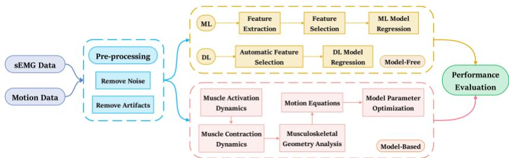
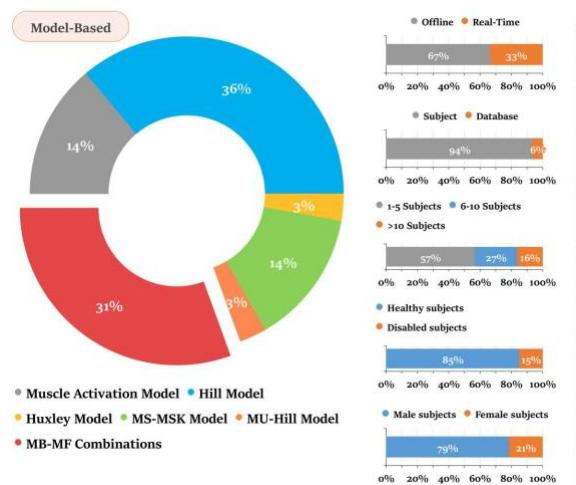
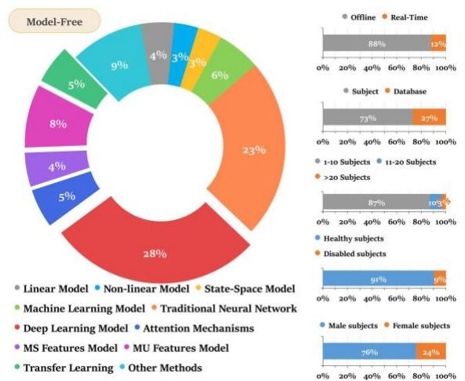

# 基于表面肌电的上肢康复连续运动意图预测：基于模型与无模型方法的系统综述

摘要—脑卒中后持续存在的上肢功能性损伤显著影响患者的生活质量。基于患者运动意图并利用表面肌电（surface electromyography, sEMG）信号对机器人辅助水平进行精确调节，对于主动康复至关重要。本文系统综述了过去十年间关于使用基于模型（Model-Based, MB）和无模型（Model-Free, MF）方法对上肢单关节及多关节组合运动意图进行连续预测的研究，基于从六个主要电子数据库中筛选出的 186 项相关研究。综述结果表明，在受试者构成、算法鲁棒性与泛化能力、以及实际应用可行性等方面存在持续挑战。此外，本文建议整合 MB 与 MF 方法的优势以改进现有算法。因此，未来研究应进一步探索融合注意力机制、肌肉协同特征、运动单元特征以及闭环反馈的个性化 MB-MF 组合方法，以实现对多关节复杂运动的精确、实时、长时间预测，并进一步优化跨日、跨受试者的快速算法部署的迁移学习策略。总之，本文综述了当前研究的现状与挑战，旨在为未来基于 sEMG 的上肢运动意图预测研究提供启示。

索引词—表面肌电（surface electromyography, sEMG）、上肢康复、肌骨模型、深度学习、肌肉协同、运动单元、连续关节运动学与动力学估计方法、系统综述。

（Manuscript received 14 December 2023;）

Zijun Wei、Zhi-Qiang Zhang 和 Sheng Quan Xie 就职于英国利兹 LS2 9JT 利兹大学电气与电子工程学院机器人、自动化系统与传感研究所（Institute of Robotics, Autonomous System and Sensing, School of Electrical and Electronic Engineering, University of Leeds）。电子邮箱：elzw@leeds.ac.uk；z.zhang3@leeds.ac.uk；s.q.xie@leeds.ac.uk。

## I. 引言

中风（Stroke）是全球第二大死亡和残疾原因，且每年的发病率和死亡率都在不断上升。正如文献 [1] 所报道的，全球约 60% 的患者在中风康复后仍存在上肢功能性障碍，这严重阻碍了他们执行基本日常生活活动（Activities of Daily Living, ADL）的能力，并显著影响其生活质量。因此，加快上肢康复至关重要。关于康复机器人辅助治疗的研究 [2] 表明，仅由康复机器人辅助的被动运动并不能改善患者的运动功能；相反，训练强度和患者的主动参与才是改善康复效果的关键因素，而非仅仅使用机器人本身。这与神经可塑性理论相符，在该理论中，患者的主动参与对于诱发神经可塑性和提高康复效率至关重要。此外，研究 [3] 也指出，当前康复机器人所提供的运动功能改善有限，凸显了对更有效的按需辅助（Assist-as-Needed, AAN）控制策略的需求——超越传统的阻抗控制和导纳控制——旨在最大化训练强度，同时确保患者的主动参与。因此，根据患者的运动意图精确调整机器人的辅助水平对于实现主动康复至关重要。

文献 [4]、[5] 和 [6] 将患者的运动意图分为生物信号和非生物信号两类。生物信号包括脑电图（Electroencephalography, EEG）、肌电图（Electromyography, EMG）、力肌图（Force Myography, FMG）和机械肌图（Mechanomyography, MMG），而非生物信号则包括视频、惯性测量单元（Inertial Measurement Units, IMU）以及力传感器。然而，非生物信号存在固有的时间延迟，并且当患者肢体处于静止状态时无法预测运动意图，这对中风患者和截肢患者并不友好。相比之下，EMG 除了具有 50–100 毫秒的机电延迟（Electromechanical Delay, EMD）从而降低预测延迟外，在实际应用中比 EEG 更加稳定且不易受到干扰。此外，EMG 传感器比 EEG 更便携、更易于佩戴。因此，使用表面肌电图（surface EMG, sEMG）来预测患者的运动意图是一种极具前景的方法。

当前基于表面肌电（surface electromyography, sEMG）的运动意图预测研究可分为离散分类与连续回归两大类。然而，正如综述[6]所讨论的，1996年至2017年间仅有11.6%的研究聚焦于连续回归，并且直到2019年才发表了第一篇关于基于sEMG的连续运动意图估计的综述[4]。此外，根据以往研究所采用的预测方法，基于sEMG的连续回归可进一步分为基于模型的方法（Model-Based, MB）和无模型方法（Model-Free, MF）。因此，鉴于当前的研究现状以及康复机器人采用连续控制这一事实，本综述将聚焦于采用MB和MF方法进行上肢连续运动意图预测（即关节运动学与动力学）的研究。

如图1所示，MF方法主要涵盖机器学习（Machine Learning, ML）和深度学习（Deep Learning, DL）方法。ML与DL的区别在于：ML需要从预处理后的sEMG信号中进行人工特征提取与选择；而DL能够自动从sEMG中提取高级特征，并利用神经网络强大的拟合能力来逼近特征与运动意图之间的高度非线性关系，从而避免像ML那样依赖基于经验的最优特征集[5]。尽管端到端的MF方法训练便捷、部署迅速，但其固有的"黑箱"特性可能忽略输入与输出数据之间潜在的因果关系，从而难以泛化至训练数据之外，并存在过拟合的风险[6]、[7]、[8]。相比之下，MB方法具有内在的生理因果性，能够根据肌肉激活与收缩动力学的神经生理机制将sEMG信号转换为肌腱力，再利用肌肉骨骼（musculoskeletal, MSK）几何关系和牛顿运动方程从关节力矩预测关节运动学与动力学[6]。此外，大多数MB研究采用了包含串联弹性（series elastic, SE）、收缩（contractile, CE）、并联弹性（parallel elastic, PE）和黏弹性（viscoelastic, VE）组分的Hill型MSK模型。然而，由于患者之间存在生理差异，基于大量尸体标本推导出的通用比例Hill模型可能导致显著的预测误差。因此，在MB方法的最后阶段对受试者特异性的MSK模型进行参数优化对于实现精确预测是必要的[9]、[10]。

综上所述，本综述对实现更有效的主动康复的主要贡献体现在以下三个方面：

1）系统地收集并筛选过去十年间来自六个主要数据库的所有MB和MF研究，并展示当前的研究现状。

2）基于不同的单关节与多关节组合，综述并识别MB和MF研究的研究结果及相应的局限性。

3) 总结并分析 MB 与 MF 研究中的关键发现、挑战与机遇，以确定未来的研究方向。

本文其余部分的结构如下：第二节介绍文献收集方法与筛选标准，并总结筛选结果；第三节基于不同的单关节与多关节组合目录，对 MB 与 MF 研究进行全面综述；第四节讨论多年来从 MB 与 MF 研究中识别出的关键发现、挑战与未来研究方向；最后，第五节对本综述进行总结。

  

图 1. 无模型（Model-Free）与基于模型（Model-Based）方法的连续运动意图预测过程。

## II. 方法

## A. 检索策略

为对基于 MB 和 MF 方法的研究进行全面系统的综述，本综述首先使用检索关键词在六个主要电子数据库中进行查询，分别为 PubMed、Web of Science、Scopus、IEEE Xplore、ScienceDirect 和 SpringerLink。观察到相关研究的数量自 2012 年起开始增长。因此，本综述的检索时间跨度设定为覆盖过去十年，按照 PRISMA 指南，在这些数据库中收集自 2013 年 1 月至 2023 年 6 月发表的所有相关论文。此外，还选择性纳入了来自 Google Scholar 的相关文献，以确保系统且详尽的检索结果。文献检索使用了以下关键词：

((EMG OR sEMG) AND (Continuous) AND (Prediction OR Estimation) AND (Shoulder OR Elbow OR Wrist OR Hand OR Finger OR Upper-Limb))

## B. 纳入与排除标准

首先，由于本综述专门聚焦于涉及连续回归而非离散分类的研究，因此将模式识别、分类以及分段离散化相关研究排除在外。此外，仅考虑纳入以英文发表且作者可获取的文献。

随后，本综述仅聚焦于由 sEMG 或 EMG 信号驱动的 MB 和 MF 研究，从而排除了那些在不涉及 sEMG 或 EMG 信号的情况下仅使用其他运动意图信号进行预测的研究。排除的信号来源包括非生物信号，例如 IMU、Kinect 相机、Electrical Impedance Tomography（EIT，电阻抗断层成像）、超声波传感器和 Force-Sensitive Resistors（FSR，力敏电阻），以及其他生物信号，如 EEG、functional Magnetic Resonance Imaging（fMRI，功能性磁共振成像）和 Near-Infrared Spectroscopy（NIRS，近红外光谱）。

最后，本综述专注于上肢关节，因此排除了所有其他关节，例如下肢关节。此外，所综述研究中讨论的 MSK 模型仅限于肌肉、肌腱和骨骼的宏观生理模型，例如排除了基于肌肉组织间应力-应变关系的有限元模型。并且，MSK 模型的综述仅限于人体模型，不涉及其他生物物种。

## C. 研究筛选结果

如图 2(a) 所示，使用指定检索关键词在所选数据库中识别出 674 篇相关出版物，其中包括来自 Google Scholar 的 33 篇补充出版物。在应用纳入与排除标准后，最终有 186 篇出版物被纳入本综述，其中分别有 36 篇和 150 篇研究基于 MB 和 MF 方法。

图 2(b) 和图 2(c) 展示了对所筛选的 186 篇出版物的综合分析与分类。图 2(b) 显示，关于上肢运动意图连续预测的研究论文数量从 2013 年到 2020 年呈现稳步增长趋势，并于 2021 年开始呈指数级上升。这一趋势表明，与模式识别中的离散分类不同，上肢运动意图的连续预测是一个新兴的研究领域，在过去三年中受到了广泛关注。图 2(c) 对上肢各单关节及多关节组合的当前研究现状进行了对比，结果显示大多数研究聚焦于肘关节、腕关节和手关节，以及手-腕与肘-肩关节的组合。相比之下，针对其余肩关节、腕-肘关节组合以及整个上肢的研究中，基于 MF 方法的仅有少数，而基于 MB 方法的研究则尚属空白。

  

图 2. （a）基于 PRISMA 策略的文献筛选流程图。（b）过去十年间 MB 与 MF 方法每年发表文献的具体数量。（c）针对单一关节与多关节组合的 MB 与 MF 研究详细数量。

## III. 结果（Results）

在对基于单一关节及多关节组合的基于模型（MB）和无模型（MF）研究进行全面综述之前，下面的图 3 展示了 MB 与 MF 研究中所采用方法的分布情况，以及这些研究中离线/在线预测、受试者/数据库、以及不同受试者属性的占比比例。可以观察到，MB 研究中的方法可分为六大类，除希尔模型（Hill model）外，将 MB 与 MF 相结合的综合方法也尤其值得关注。在涵盖十一类方法的 MF 研究中，除备受重视的传统神经网络和深度学习（DL）模型外，基于注意力机制（attention mechanisms）、肌肉协同（muscle synergy, MS）特征以及运动单元（motor unit, MU）神经特征的方法也展现出了可观的研究潜力，值得进一步深入探讨。

鉴于传统神经网络与深度学习模型在 MF 研究中所占比例较大，有必要对这两类主导类别作进一步的细分，以便对采用 MF 方法的研究进行全面综述。所收集的 37 项基于传统神经网络的研究可进一步划分为三类：前馈神经网络（Feedforward Neural Networks, FNNs：25 项研究）、传统循环神经网络（Traditional Recurrent Neural Networks, T-RNNs：11 项研究）以及脉冲神经网络（Spiking Neural Network, SNN：1 项研究）。其中，前馈神经网络包括人工神经网络（Artificial Neural Network, ANN）、多层感知机（Multilayer Perceptron, MLP）、反向传播神经网络（Backpropagation Neural Network, BPNN）、极限学习机（Extreme Learning Machine, ELM）、径向基函数神经网络（Radial Basis Function Neural Network, RBFNN）、小波神经网络（Wavelet Neural Network, WNN）以及广义回归神经网络（Generalized Regression Neural Network, GRNN）。传统循环神经网络包括 Elman 网络（ElmanNN）、带外部输入的非线性自回归（Nonlinear AutoRegressive with eXogenous inputs, NARX）模型、时延神经网络（Time Delay Neural Network, TDNN）以及循环模糊神经网络（Recurrent Fuzzy Neural Network, RFNN）。在 44 项以深度学习为重点的研究中，则可进一步细分为四个不同的类别：卷积神经网络（Convolutional Neural Networks, CNNs：12 项研究）、高级循环神经网络（Advanced Recurrent Neural Networks, A-RNNs：20 项研究）、卷积-循环混合网络（10 项研究）以及自编码器（Autoencoders, AEs：2 项研究），其中高级循环神经网络类别包括长短期记忆网络（Long Short-Term Memory, LSTM）、双向长短期记忆网络（Bidirectional LSTM, Bi-LSTM）以及门控循环单元（Gated Recurrent Unit, GRU）。

关于所收集研究的预测内容，针对不同角度和力的范围、速度、负载以及持续时间，对每个上肢关节的以下运动进行了预测：肩关节的内旋/外旋，以及垂直面和水平面内的内收/外展和屈曲/伸展；肘关节在垂直面和水平面内的屈曲/伸展；腕关节的屈曲/伸展、尺偏/桡偏以及旋前/旋后；掌指关节（Metacarpophalangeal, MCP）、近端指间关节（Proximal Interphalangeal, PIP）和远端指间关节（Distal Interphalangeal, DIP）的独立和同时屈曲/伸展，涵盖单指和多指运动，以及基于不同抓握力、不同物体大小和形状的抓握任务。此外，该研究还基于不同强度下的静态等长收缩、复合协同运动和镜像运动进行了实验，并同时预测了关节运动学和动力学。此外，超过三分之一的研究使用了公开的 NinaPro 数据集，以及其他公开数据集（例如 putEMG-Force [11]、Biopatrec [12] 和 KIN-MUS UJI [13]）来开发预测算法。

  

图3. 在MB和MF研究中，不同方法类型、离线/在线预测、受试者/数据库以及受试者属性的百分比分布。

## A. 基于肌肉骨骼模型（MB）的方法

## 1) 肩关节

与其他上肢关节相比，肩关节由于其解剖结构复杂、多自由度（DoF）运动模式多样以及 sEMG（表面肌电）信号采集所面临的挑战，研究相对较少。研究 [14] 将肌肉激活模型与经验模态分解（EMD）和极限学习机（ELM）相结合，在随机运动速度下实现了 32 毫秒低延迟的实时预测。

## 2) 肘关节

研究 [15] 和 [16] 均采用了仅包含 CE（收缩元件）的简化 Hill 模型。具体而言，[16] 将 Hill 模型与状态切换模型相结合以实现实时预测。然而，状态切换模型存在时间延迟，且简化模型在关节角度发生微小变化时鲁棒性较差。

除研究 [17] 使用了包含 CE、PE（并联弹性元件）和 SE（串联弹性元件）的完整 Hill 模型外，研究 [18]–[23] 采用了仅包含 CE 和 PE 的刚体肌腱 Hill 模型。然而，刚体肌腱 Hill 模型忽略了肌肉刚度的变化，导致较大的力矩预测误差。作为改进，[20] 采用通过遗传算法（Genetic Algorithm, GA）优化的 Hill 模型和基于力矩平衡方程的短程刚度（Short-Range Stiffness, SRS）模型，以同时预测关节角度和时变刚度。[21] 采用遗传算法对增加了更多生理参数的 Hill 模型进行优化，使其在不同运动负载下均具备鲁棒性。在其他优化算法方面，[23] 使用非线性最小二乘法对 Hill 模型进行了优化。

研究 [15]、[17]、[18]、[22] 将 MB 方法和 MF（肌肉力/数据驱动）方法相结合。具体而言，[15] 采用多项式来近似肌腱力与肘关节角度之间的关系，从而替代了 MB 方法中的 MSK（肌骨）几何分析和运动方程。此外，[18] 将 Hill 模型与时域（Time-Domain, TD）特征相融合，开发了使用扩展卡尔曼滤波（Extended Kalman Filter, EKF）优化的状态空间（State Space, SS）模型，以实现实时闭环估计。此外，[17] 比较了 Hill 模型和反向传播神经网络（BPNN）在预测肘关节等长收缩力方面的能力，得出结论：

BPNN 由于关节力与 sEMG 之间存在线性关系而表现出更优的预测性能，但其模型可解释性较差。因此，将 MB 和 MF 方法相结合能够发挥互补优势。例如，[22] 使用径向基函数神经网络（RBFNN）训练肌肉激活优化因子，减少了 sEMG 与肌肉激活之间的转换偏差，从而适应个体差异。结果表明，这种混合 MB-MF 方法优于独立的 MB 或 MF 方法，进一步提高了关节力矩预测的准确性。

## 3) 腕关节

研究 [24]–[27] 采用了刚性肌腱 Hill 模型。具体而言，[24] 和 [25] 通过敏感性分析和遗传算法（Genetic Algorithm, GA）优化，在 Hill 模型的预测精度与计算复杂度之间取得平衡，针对的是该简化模型倾向于高估参数从而忽略受试者特异性的问题。此外，基于镜像双侧运动实验，[25] 证明该方法在同侧和对侧的表现性能不存在统计学差异。另外，由于旋后肌是深部肌肉，难以通过表面肌电图（surface Electromyography, sEMG）直接测量，研究 [26] 和 [27] 采用基于非负矩阵分解（Non-negative Matrix Factorization, NMF）的虚拟肌肉协同（muscle synergy, MS）协同激活来替代旋前肌和旋后肌的肌肉激活，然后将其输入 Hill 模型进行预测。结果表明，该方法优于基于时域（Time Domain, TD）和 MS 特征的人工神经网络（Artificial Neural Network, ANN）与线性回归（Linear Regression, LR），并在不同上肢姿势下表现出稳健性。

研究 [28]–[30] 整合了基于肌肉骨骼（musculoskeletal, MSK）模型驱动（MB）与无模型（Model-Free, MF）的方法。具体而言，[28] 利用反向传播神经网络（Back Propagation Neural Network, BPNN）基于肌肉激活识别不同的运动阶段，随后采用由贝叶斯线性回归（Bayesian LR）优化的 MSK 进行低延迟实时关节力预测。结果突出了贝叶斯 LR 在简洁性和效率方面优于 GA。此外，[29] 将物理 MSK 知识作为软约束加入到卷积神经网络（Convolutional Neural Network, CNN）模型的损失函数中。该方法的预测性能不仅优于支持向量回归（Support Vector Regression, SVR）、极限学习机（Extreme Learning Machine, ELM）、多层极限学习机（ML-ELM）和 CNN，而且相比传统 CNN 具有更简单的架构，所需的训练数据更少且收敛速度更快。此外，[30] 在 [29] 的工作基础上，通过共享预训练 CNN 参数并仅更新全连接层来实现迁移学习。结果表明，这种共享 CNN 高级 sEMG 特征提取知识的方法不仅具有优异的收敛速度和泛化能力，而且仅需极少的个体数据即可实现快速迁移学习。

## 4) 手部关节

类似于研究 [17]，研究 [31] 采用滤波 sEMG 的均方根（Root Mean Square, RMS）信号作为输入，并使用相同的完整 Hill 模型进行预测。而研究 [32]–[34] 分别比较了肌肉激活模型与 TD 特征结合前馈神经网络（Feedforward Neural Network, FNN）、单输出高斯过程回归（Gaussian Process Regression, GPR）以及多输出 GPR 的性能。结果表明，使用结合经验模态分解（Empirical Mode Decomposition, EMD）的肌肉激活模型性能优于 TD 特征。此外，由于能够有效建模关节之间的内在相关性，多输出 GPR 优于 FNN 和单输出 GPR，凸显了考虑肌肉协同（MS）的重要性。

与多数采用 Hill 模型的研究不同，文献 [35] 是唯一一项利用 Huxley 模型进行实时预测的研究。该研究采用谱方法、Galerkin 方法以及平衡截断方法降低了高维 Huxley 模型的计算复杂度，并进一步使用粒子群优化算法（Particle Swarm Optimization, PSO）进行参数优化。最终，该方法在保持 Huxley 模型预测性能与计算时间平衡的同时，还具备出色的跨日泛化能力。

## 5) 手腕关节（Wrist Joints）

文献 [36]–[40] 采用基于全局搜索优化（GlobalSearch optimization, GO）的刚性肌腱 Hill 模型。研究结果表明，基于所有受试者 Hill 模型参数平均值的通用受试者模型（subject-generic models）性能优于针对单个受试者定制的模型（subject-specific models）、LR 以及 ANN。

关于基于肌电（MS）特征与运动单元（MU）神经特征的 MSK 模型，文献 [41] 指出，基于分层交替最小二乘法（Hierarchical Alternating Least Squares, HALS）与 LR 的协同线性回归模型（Synergistic Linear Regression Model, SLRM）略优于传统的 MSK 方法。文献 [42]、[43] 将 MS 特征与 MSK 模型相结合，其中文献 [42] 将通过带 L2 正则化约束的 NMF-HP（NMF-HP-L2）提取的运动协同（MSs）建模到经 GO 优化的 Hill 模型中，相较于 Hill 模型和 NMF-Hill 模型取得了更优的预测性能与稳定性。文献 [43] 使用自适应混合独立成分分析（Adaptive Mixture Independent Component Analysis, AMICA）结合 NMF 提取独立成分并据此构建 MSK 模型，其预测性能优于传统 MSK 模型、LR 和 SVR。此外，与文献 [44]–[49] 的结论相呼应，文献 [50] 将从高密度表面肌电（HD-sEMG）和 FastICA 中提取的 MU 放电频率输入到经 GO 优化的 Hill 模型中。研究结果表明，相较于基于时域（TD）特征的 Hill 模型，MU-Hill 模型在精度和鲁棒性上均有显著提升。

关于基于强化学习（RL）的 MSK 模型，文献 [51]–[53] 在 Actor-Critic 框架下采用深度确定性策略梯度算法（DDPG）以及近端策略优化算法（PPO），使多个智能体能够基于预测的关节力矩，利用 MSK 的前向动力学模型计算关节角度。最终得到的 RL-MSK 模型精度与 Hill 模型相当，但优于 MLP 和 NARX，并且对运动速度变化具有很强的鲁棒性。然而，该方法的训练时间约为 8 小时，并且缺乏对未训练新数据的泛化能力。

## 6) 肘肩关节（Elbow-Shoulder Joints）

研究 [54] 和 [55] 构建了基于 Hill 模型（Hill Model）与前向动力学（Forward Dynamics）的闭环 SS 模型（State-Space Model，状态空间模型）。具体而言，[54] 将完整的 Hill 模型与 NARX 状态方程及 BPNN 测量方程相融合，然后采用无迹卡尔曼滤波器（Unscented Kalman Filter, UKF）进行实时预测与闭环估计，取得了优于仅采用 NARX 与 BPNN 进行开环估计的效果。[55] 将刚体肌腱 Hill 模型（Rigid-Tendon Hill Model）与 sEMG 和 MMG 的融合时域（TD）特征相结合，构建了由无迹粒子滤波器（Unscented Particle Filter, UPF）优化的 SS 模型，性能优于 BPNN、SVR 与 GRNN，并显著降低了对训练数据量的需求。

## B. MF 方法

## 1) 肩关节

a) 传统神经网络：研究 [56] 将提取的 TD 特征与频域（Frequency-Domain, FD）特征输入具有短期记忆能力的 TDNN 中进行预测。

b) 其他方法：研究 [57] 利用快速正交搜索（Fast Orthogonal Search, FOS）在非线性模型的快速拟合与系统辨识方面的能力。此外，该研究还考虑了肩关节活动中输出力与关节角度之间的耦合效应，以提高预测精度。这种耦合效应与 Hill 模型中肌纤维与肌肉力之间的力-速度（force-velocity）和力-长度（force-length）关系相吻合，提示将 MF 方法与 Hill 模型相融合可进一步提升预测性能。

## 2) 肘关节

a) 线性模型：研究 [58] 将自适应加权的峰值 sEMG 信号与线性最小二乘法相结合，用于预测镜像的肘关节运动。研究 [59] 证明，在不同运动负载条件下，带外部输入的自回归（Autoregressive with Exogenous Input, ARX）模型的预测性能优于带外部输入的自回归滑动平均（Autoregressive Moving-Average with Exogenous Input, ARMAX）、带外部输入的自回归积分滑动平均（Autoregressive Integrated Moving-Average with Exogenous Input, ARIMAX）以及 SS 模型。

b) 机器学习：研究 [60] 采用基于树的层级投影回归（Hierarchical Projection Regression, HPR）算法与增量学习，对不同负载下的肘关节角度进行实时预测。研究 [61] 采用随机森林（Random Forests, RF）进行预测并自动筛选显著的时间延迟特征。类似地，[62] 采用灰色特征加权支持向量机（Gray Feature Weighted Support Vector Machines, GFWSVM），根据 sEMG 特征的显著性对其赋予权重。

c) 传统神经网络：研究 [63]–[66] 利用提取的 TD 特征，分别采用 ANN、WNN 与 GRNN 预测关节角度，结果表明 WNN 性能优于支持向量机（Support Vector Machines, SVM）和 RBFNN。此外，[63] 指出 RBFNN 在关节角度与角速度预测方面均优于 MLP。诸多研究，包括 [67]–[71]，均采用了 BPNN

用于预测。具体而言，[67] 通过比较通用模型和个性化模型，证明了个体间变异性会显著影响预测性能。类似地，[71] 通过比较时域（TD）特征和采用最大独立域适应（Maximum Independent Domain Adaptation, MIDA）提取的受试者不变特征，证实了个体间变异性大于个体内变异性。在此基础上，[68] 引入了遗传算法（GA）特征选择方法，以剔除个体间冗余和低相关度的特征，从而增强了个体间的泛化能力。最后，[72] 提出了脉冲神经网络（Spiking Neural Network, SNN），该网络模拟了生物神经元的脉冲发放机制和膜电位变化，实现了与长短期记忆网络（Long Short-Term Memory, LSTM）相当的预测精度。

在时序神经网络方面，研究 [73] 和 [74] 采用时延神经网络（Time-Delay Neural Network, TDNN）基于 TD 特征进行预测。另一方面，研究 [75] 和 [76] 将非线性自回归外生（Nonlinear AutoRegressive with eXogenous inputs, NARX）模型与多层感知机（Multi-Layer Perceptron, MLP）、Elman 神经网络（ElmanNN）以及 [77] 中提出的自适应神经模糊推理系统（Adaptive Neuro-Fuzzy Inference System, ANFIS）相结合，基于 TD 特征进行预测，最终证明了 ANFIS-NARX 模型具有更优的预测性能。

d) 深度学习：研究 [78] 和 [79] 采用基于 TD 特征的 LSTM 进行精确的关节角度预测。研究 [80] 表明卷积神经网络-长短期记忆网络（CNN-LSTM）优于单独的 CNN 和 LSTM 模型，强调了在对所提取的高阶特征建立长期上下文依赖关系的重要性。

e) 肌肉协同特征：研究 [81] 将通过多元曲线分辨-交替最小二乘法（Multivariate Curve Resolution-Alternating Least Squares, MCR-ALS）提取的肌肉协同（Muscle Synergy, MS）特征输入双向长短期记忆网络（Bi-LSTM）进行预测。结果表明，与传统的 TD 特征相比，MS 特征对 sEMG 变化表现出更强的鲁棒性。此外，由 MCR-ALS 提取的 MS 特征在为期五天的实验周期内，无论是个体内还是个体间，都比采用主成分分析（Principal Component Analysis, PCA）和非负矩阵分解（Non-negative Matrix Factorization, NMF）提取的特征保持了更高的相关性。

f) 其他方法：研究 [82] 和 [83] 采用卡尔曼滤波器（Kalman Filter, KF）实现了在不同负载和运动速度下关节角度与力矩的实时预测。研究 [84] 和 [85] 采用了非线性系统辨识方法。具体而言，[84] 验证了并联级联辨识（Parallel Cascade Identification, PCI）模型相对于 [57] 中 FOS 算法的优越性；而 [85] 则展示了 Hammerstein-Wiener 模型与小波神经网络（Wavelet Neural Network, WNN）相结合的跨日预测鲁棒性，尽管该方法仍需进行个体标定，且其预测性能会受到运动负载的影响。

## 3) 腕关节

a) 线性模型：研究 [86] 采用基于 TD 特征的岭回归进行预测，并证明最小绝对收缩与选择算子（Least Absolute Shrinkage and Selection Operator, LASSO）是一种有效的高密度 sEMG（HD-sEMG）通道选择方法。此外，研究 [87] 指出，尽管在离线实验中人工神经网络（Artificial Neural Network, ANN）的性能优于线性回归（Linear Regression, LR）和 NMF，但它们在在线性能方面并无显著差异。

b) 机器学习 (Machine Learning): 研究 [88] 和 [89] 分别将时延的时域 (Time Domain, TD) 特征输入到最小二乘支持向量机 (Least Squares Support Vector Machine, LSSVM) 和随机森林 (Random Forest, RF) 中进行预测，性能优于支持向量机 (Support Vector Machine, SVM) 和反向传播神经网络 (Back Propagation Neural Network, BPNN)。这再次凸显了考虑经验模态分解 (Empirical Mode Decomposition, EMD) 的重要性。

c) 传统神经网络 (Traditional Neural Networks): 在研究 [90] 中，TD 和频域 (Frequency Domain, FD) 特征被输入到由遗传算法 (Genetic Algorithm, GA) 优化的极限学习机 (Extreme Learning Machine, ELM) 中进行预测，取得了优于广义回归神经网络 (General Regression Neural Network, GRNN) 的结果。然而，ELM 仍存在一定的不稳定性。研究 [91] 和 [92] 分别利用了基于 TD 特征的人工神经网络 (Artificial Neural Network, ANN) 和 BPNN。值得注意的是，[91] 发现基于大面积肌肉活动叠加的表面肌电 (surface Electromyography, sEMG) 信号优于针对局部肌肉信息的非定向肌内肌电 (intramuscular Electromyography, iEMG) 信号，这提示应使用高密度表面肌电 (High Density surface Electromyography, HD-sEMG) 传感器来采集更全面的肌肉活动数据。此外，研究 [93] 也采用了 BPNN，但同时将 FD 和时频域 (Time-Frequency Domain, TFD) 特征作为输入，并进一步应用卡尔曼滤波 (Kalman Filter, KF) 进行后处理。

d) 深度学习 (Deep Learning): 与主成分分析 (Principal Component Analysis, PCA) 相比，研究 [94] 和 [95] 证明了基于堆叠自编码器的深度神经网络 (Stacked Autoencoder Deep Neural Network, SAE-DNN) 能够提取更具表达力的 sEMG 特征，因此比线性回归 (Linear Regression, LR) 和支持向量回归 (Support Vector Regression, SVR) 取得了更好的预测效果。

研究 [96] 和 [97] 都采用了卷积神经网络 (Convolutional Neural Network, CNN)。其中，[96] 使用基于原始 TD 的 sEMG 图像和基于快速傅里叶变换 (Fast Fourier Transform, FFT) 的 FD 图像，相比六种手工特征工程的机器学习模型（即 LR、SVR、RF、高斯过程回归 (Gaussian Process Regression, GPR) 和多层感知机 (Multi-Layer Perceptron, MLP)）实现了更优的预测性能。同时，[97] 表明基于 TD 图像的 CNN 优于基于方向梯度直方图 (Histogram of Oriented Gradients, HOG) 特征的 ANN。此外，该研究还采用 PCA 来证明 CNN 提取的空间特征与实际关节力矩的相关性，高于关注像素变化的 HOG 特征和基于经验的人工特征。

研究 [98] 和 [99] 采用长短期记忆网络 (Long Short-Term Memory, LSTM) 模型进行预测。其中，[98] 展示了 LSTM 在不同负载下的卓越预测性能；[99] 则利用 CNN-LSTM 从基于 FFT 的 sEMG 频谱图中提取时空数据，性能优于 CNN、LSTM 和机器学习 (Machine Learning, ML) 模型。

然而，CNN-LSTM 在跨日和跨被试上的泛化能力仍有待提升。[100] 进一步验证了这一点，该研究利用 LSTM 自编码器 (LSTM-AE) 基于 CNN 特征的重构误差，评估和量化 CNN-LSTM 在跨日任务中的领域偏移 (domain shift)，从而实现模型性能退化的监测和及时的模型再校准。为进一步提升跨被试泛化能力，[101] 提出一种迁移学习方法，采用双流 CNN 从源域和目标域数据中提取领域不变 (domain invariant) 特征，随后通过回归损失、最大均值差异 (Maximum Mean Discrepancy, MMD) 损失和回归对比损失调整 CNN 权重。

e) 运动单元神经特征（Motor Unit Neural Features）：研究 [102] 将卷积盲源分离（Convolutional Blind Source Separation）应用于输入的高密度表面肌电图（HD-sEMG）的分解脉冲计数（Decomposed Spike Count, DSC）特征与残差 sEMG 时域（TD）特征，输入到线性回归（LR）中进行预测。结果表明，与 TD 特征相比，MU 特征能为截肢患者带来更大的性能提升。然而，DSC 特征忽略了空间信息以及 MU 之间的交互作用。因此，[103] 首先将由卷积核补偿（CKC）分解得到的运动单元脉冲序列（Motor Unit Spike Train, MUST）和运动单元动作电位（Motor Unit Action Potential, MUAP）进行卷积以重建 MU 图像，再将其送入 CNN 进行预测，性能显著优于基于 DSC 特征的 LR、SVR 和 ANN。研究 [104] 和 [105] 同样采用 CKC 进行 MU 分解，并以 LR 进行预测，其中 [104] 进一步精简 MU 池以识别主导 MU。研究结果表明，[105] 提出的 MU 抽搐力模型优于基于累积脉冲序列（Cumulative Spike Train, CST）的 DSC 模型、基于 MUST 的 MU 发放频率模型以及 PCA。

本文已被 IEEE Transactions on Neural Systems and Rehabilitation Engineering 接收发表。此为作者版本，尚未经过完整编辑，内容可能在最终发表前有所变更。引用信息：DOI 10.1109/TNSRE.2024.3383857

WEI 等：基于 sEMG 信号的上肢康复连续运动意图预测：基于模型与无模型方法的系统综述。

MUST 和 PCA。

f) 其他方法（Other Methods）：研究 [106] 将高斯混合回归（Gaussian Mixture Regression, GMR）统计模型应用于对称正定矩阵流形，其预测性能优于欧氏空间中的 GMR。研究 [107] 将时延 TD 特征输入核递归最小二乘跟踪器（Kernel Recursive Least Squares Tracker, KRLS-T），作为在线非线性自适应滤波器进行预测，凭借其融合了非线性核回归与在线自适应估计的优势以及较低的计算成本，性能显著优于 ANN 和核岭回归（Kernel Ridge Regression, KRR）。

## 4) 手部关节（Hand Joints）

a) 状态空间模型（State Space Model）：研究 [108] 和 [109] 应用基于 N4SID 参数辨识方法的 SS 模型，在镜像双侧运动过程中不同的静态腕部姿态下预测手指关节角度。此外，研究 [110] 采用递推最小二乘（Recursive Least Squares, RLS）进行 SS 模型参数估计，并使用 KF 进行后处理，最终性能优于 MLP、NARX 和 LDA 模型。

b) 线性与非线性模型：研究 [111] 基于空间滤波特征实现了 LR（线性回归）用于预测，研究 [112] 将岭回归（Ridge Regression，LR 的扩展）与增量学习相结合，以实现跨天抓取任务的实时预测。然而，研究 [113] 发现，非线性 KRR（核岭回归）在各项任务上均优于 LR，强调了考虑 sEMG（表面肌电信号）与运动意图之间非线性关系的重要性。研究 [114] 和 [115] 进一步比较了线性与非线性方法，具体是将含外生输入的线性向量自回归滑动平均模型（VARMAX）与非线性高斯过程（GP）进行对比。虽然两者性能相当，但 GP 的非线性能够建模更复杂的运动意图。然而，随着训练数据规模的增大，GP 的计算成本也随之上升。因此，可以通过研究 [116] 中的稀疏伪输入高斯过程（SPGP）回归模型获得启发，也可以通过研究 [117] 中采用高斯过程潜变量模型（GPLVM）提取 MS（肌肉协同）特征来获得改进。

c) 传统神经网络：研究中使用的网络包括：对握力变化具有鲁棒性的、采用 Mel 频谱特征的 ANN（人工神经网络）[118]、BPNN（反向传播神经网络）[119]、优于 KRLS（核递归最小二乘）和 LR 的 GRNN（广义回归神经网络）[120]、[121]，以及研究 [122] 中优于 GRNN 的 FNN（前馈神经网络）、级联 FNN（CFNN）和 RBFNN（径向基函数神经网络）。此外，研究 [123] 将基于八个 TD（时域）特征的深度 RF（随机森林）模型与 ANN 结合，取得了优于 GP 的预测效果。

d) 深度学习：研究中使用的 DL（深度学习）网络可分为三类：CNN（卷积神经网络）、RNN（循环神经网络）以及 CNN-RNN 混合网络。CNN 包括一维 CNN（1D-CNN）[124]、二维 CNN（2D-CNN）[125]、三维 CNN（3D-CNN）[126]、[127]、并行 CNN [128]–[130]、AlexNet 和 ResNet [131]、[132]，以及时间卷积网络（TCN）[133] 和大规模时间卷积网络（LS-TCN）[134]。RNN 包括 NARX（带外部输入的非线性自回归网络）[135]、LSTM（长短期记忆网络）[13]、[131]、[132]、[136]–[139]，以及 GRU（门控循环单元）[131]、[132]。混合类别包括 CNN-LSTM [140]、长曝光卷积记忆网络（LE-ConvMN）[141]，以及注意力卷积门控循环网络（Attention-ConvGRU）[142]。

卷积神经网络（CNNs）：根据文献[124]，1D-CNN在手指力的实时预测方面优于2D-CNN和LR，原因在于其能够学习更深层次的高级特征，同时降低数据维度并避免冗余的空间信息。文献[125]提出，与原始sEMG图像相比，将时域（TD）和频域（FD）特征图像作为2D-CNN的输入可以进一步降低噪声并提高预测精度。文献[126]、[127]表明，3D-CNN能够从多个电极视角学习更深层次的肌肉解剖结构、MS和运动速度特征，从而实现对未经训练的新随机运动的预测。此外，文献[131]和[132]指出，AlexNet的性能优于ResNet、LSTM和GRU。另外，文献[133]证明TCN优于LSTM，并通过int8量化可将TCN模型大小压缩至70.9Kb，延迟仅为4.76ms。最后，文献[134]指出，sEMG信号在特定时间窗口内包含与运动高度相关的原子片段，这表明CNN卷积核大小应近似或略大于原子片段长度，从而在最小化网络参数的同时充分提取sEMG特征。因此，LS-TCN（其卷积核大小与原子片段长度相近）解决了TCN的特征提取局限，并在性能上优于TCN、RNN和SPGP。

循环神经网络（RNNs）：文献[135]将PCA后处理的TD特征与EKF后处理相结合应用于NARX，其预测效果优于MLP。文献[13]、[137]–[139]证明LSTM在预测所有手部关节角度方面优于FNN、RBFNN和SPGP，并可泛化到未经训练的数据。此外，文献[136]将高斯混合模型（GMM）与LSTM结合，构建从sEMG到手部姿态的概率映射模型，该模型可生成置信区间，使得LSTM-GMM优于LSTM。最后，文献[131]、[132]指出，尽管GRU训练速度更快，但LSTM始终能提供更稳定的预测结果。

CNN-RNN混合模型：文献[140]所提出的CNN-LSTM结合了CNN与RNN的优势，与文献[30]类似，它可通过仅重新训练全连接层来实现迁移学习。针对LSTM将多维输入展平为一维向量、处理时空数据时导致空间信息丢失的缺陷，文献[141]所提出的LE-ConvMN用2D-CNN替代了LSTM的全连接层。此外，通过逐步降低长曝光sEMG样本的维度，它能够跨多个电极通道提取高维时空特征。因此，LE-ConvMN在跨受试者和跨关节的预测和泛化方面优于SPGP和LSTM。然而，由于LE-ConvMN训练时间长且计算成本高，因此不适用于实时应用。

e) 肌肉协同（Muscle Synergy）特征：研究 [143] 采用了常用于脑电图（EEG）分析的共空间模式（Common Spatial Pattern, CSP）算法。结果表明，与非负矩阵分解（NMF）相比，由于 CSP 倾向于学习样本间的差异性特征，因此能够更有效地实时区分高度相关的食指和中指指尖力信号，且不受指间串扰（inter-finger signal crosstalk）的干扰。为了提升 NMF 的预测性能，研究 [144] 将哈达玛积（Hadamard product）引入 NMF（即 NMF-HP），以减少对非主动手指激活的错误估计。结果表明，NMF-HP 能够比线性回归（LR）、CSP 和 NMF 为同时激活的手指提供更准确的实时估计。此外，针对 sEMG 的降维与重构，研究 [145] 和 [146] 分别采用了偏最小二乘回归（Partial Least Squares Regression, PLSR，PCA 的扩展）和 NMF。值得注意的是，研究 [146] 仅通过三个肌肉协同（MSs）并迭代优化 NMF 激活系数矩阵，便成功重构了原始 sEMG 数据。

f) 运动单元（Motor Unit, MU）神经特征：研究 [111] 强调，使用单极电极阵列和更多的 sEMG 通道能够降低预测误差，再次体现了使用高密度 sEMG（HD-sEMG）的优势。因此，研究 [44]–[49] 利用快速独立成分分析（FastICA）和运动单元池（MU pool）精细化方法，从 HD-sEMG 中提取与目标手指及任务相关的运动单元放电率（discharge rates）总和，并将其输入 LR，从而实现多种腕部姿态下关节角度和指尖力的同时预测。研究 [128]–[130] 首先基于 HD-sEMG 的快速傅里叶变换（FFT）频谱图和均方根（RMS）时域图像，利用并行卷积神经网络（CNN）估计 FastICA 分解得到的运动单元整体放电率，随后将其输入 LR 以进行实时手指力和关节角度预测。然而，该方法仍依赖于 FastICA 的分解精度。

g) 注意力机制：注意力机制的潜力早在文献 [11] 中就已有所暗示，其中梯度提升机（Gradient Boosting Machine，LightGBM）模型能够迭代地忽略不显著的特征，从而获得了优于 LR、MLP、SVR 和 CNN 的性能。后续研究 [142]、[147]–[149] 进一步引入了注意力机制。它们将自注意力或多头注意力模块融入 MLP、CNN 以及 ConvGRU（GRU 与 1D-CNN 的组合），实现了显著高于 LSTM、GRU、TCN 和 SPGP 的精度和泛化能力，且训练时间比 GRU 和 LSTM 更短。此外，研究 [150]–[152] 利用基于注意力的 Transformer 模型进行了进一步改进，包括 BERT、CNN-Transformer 以及基于长短时聚合（Long-Short Time Aggregation，LSTA）模块的 LSTA-Conv 网络。具体而言，BERT 在预测性能、训练时间以及跨受试者泛化方面显著超越了 LSTM、TCN 和 LE-ConvMN。CNN-Transformer 被证明优于 CNN-LSTM、Bi-LSTM 和 Transformer。最后，结合了基于自注意力的 Transformer 和多尺度 ResNet 的 LSTA-Conv 优于 RNN、LSTM、SPGP 和 CNN-Attention。

h) 其他方法：研究 [153] 采用 KF 结合 TD 特征进行预测。尽管该方法在不同受试者之间表现出一定的泛化能力，但其预测能力很大程度上依赖于目标系统模型参数的精确表征。研究 [119] 采用基于 GA 和遗传规划的基因表达式编程（Gene Expression Programming，GEP），其性能优于 BPNN。研究 [154] 使用对数回归模型，实现了对瞬态和稳态下抓握力的实时估计，同时对 sEMG 漂移和瞬时变化具有鲁棒性。此外，与大多数基于稳态 sEMG 的方法相反，研究 [155] 采用带弹性网正则化的 LR，仅利用单次瞬态 sEMG 激活即可准确实时预测抓握力，即使对于截肢患者也显示出可喜的结果。最后，研究 [156] 应用能量守恒与传递理论，指出在给定的肌肉激活水平下，各手指之间的动能和势能动态地相互转化和分配，但所有手指的总能量保持恒定。该研究首先利用 ICA 提取 MS 特征，然后在完全固定和自由运动的极端条件下推导各手指的能量，最终采用 ANN 学习 MS 特征与手指能量之间的实时映射关系。尽管该方法降低了计算成本和对训练样本的需求，但预测误差随能量的增长而增加，且手指屈曲的预测效果优于伸展。

## 5) 手腕关节

a) 线性模型（Linear Models）：研究[157]将TD特征与线性系统辨识相结合，比较了四种线性时间序列模型：ARX、外源自回归正则化（Autoregressive exogenous Regularized, ARXR）、输出误差（Output Error, OE）和ARMAX。研究结果表明，OE模型表现出更优的预测能力。

b) 机器学习（Machine Learning）：研究[158]–[160]部署了基于TD、FD和TFD特征的SVR，用于关节角度和抓握力的预测。研究[161]利用TD特征与基于级联决策树构建的梯度提升回归树（Gradient Boosted Regression Trees, GBRT）来预测关节角度，并对未训练的新数据具有泛化能力。

c) 传统神经网络（Traditional Neural Networks）：研究[122]、[162]表明TDNN同样可应用于截肢者，并发现RBFNN优于FNN、CFNN和GRNN。然而，RBFNN对手指抓握动作的预测误差超过了腕关节。

d) 深度学习（Deep Learning）：研究[163]采用Channel-wise-CNN模型实现了低延迟实时预测，其中每个卷积核对应一个sEMG通道，并通过仅更新全连接层实现迁移学习。基于LSTM的方法[164]发现，使用所有sEMG通道优于一对一映射。研究[165]中的深度卡尔曼滤波网络（Deep Kalman Filtering Network, DKFN）通过CNN提取高级特征，并使用LSTM训练KF参数，性能优于CNN和CNN-LSTM。然而，其性能仍受sEMG序列长度的限制。研究[12]中的时间卷积（Temporal Convolution, TC）模型利用1D-CNN和PCA进行高级特征提取，利用AE无监督学习MS特征，最后利用RNN实现MS与运动意图之间的实时映射。该方法在MS重建和预测性能上优于瞬态混合模型，并对未训练的新数据表现出泛化能力。然而，AE提取的MS特征在不同受试者间的相关性较低，且对非活跃关节激活的抑制有限，提示可采用[42]中的NMF-HP-L2加以改进。

e) 肌肉协同特征（Muscle Synergy Features）：与[42]类似，研究[166]同样采用了NMF-HP-L2以更好地抑制非活跃关节的激活，其在不同关节运动速度下提取的MS相关性高于PCA、非线性PCA（Non-linear PCA, NLPCA）、NMF和稀疏约束NMF（Sparse Constraint NMF, SCNMF）。

f) 其他方法（Other Methods）：研究[167]利用基于GMM和隐马尔可夫模型（Hidden Markov Model, HMM）的统计模型（GMM-HMM），使用维特比算法和模型剪枝来计算状态概率并建立长期记忆，在准确率和计算时间方面均优于LSTM和GRU。

## 6) 腕-肘关节（Wrist-Elbow Joints）

关于腕肘关节组合的三项研究均基于无模型（Model-Free, MF）方法开展，并均涉及长短期记忆网络（Long Short-Term Memory, LSTM）。研究 [168] 表明，在同时预测多关节运动方面，LSTM 比遗传算法（Genetic Algorithm, GA）优化的反向传播神经网络（Back Propagation Neural Network, BPNN）更为适用。研究 [169] 确立了采用基于相关性的特征选择与粒子群优化（Particle Swarm Optimization, PSO）的 LSTM 优于 BPNN，且所需训练时间更少。最后，研究 [170] 将 CNN-LSTM 与自注意力机制（self-attention）和卡尔曼滤波（Kalman Filter, KF）相融合（Attention-CNN-LSTM-KF），在预测性能上优于 CNN、CNN-LSTM、Attention-CNN、CNN-

WEI 等：基于表面肌电（surface Electromyography, sEMG）信号的上肢康复连续运动意图预测：基于模型与无模型方法的系统综述

-KF 以及 CNN-LSTM-KF，进一步强调了采用注意力机制和 KF 后处理所带来的优势。

## 7) 肘肩关节

a) 传统神经网络（Traditional Neural Networks）：研究 [171] 和 [172] 分别利用主成分分析（Principal Component Analysis, PCA）和独立成分分析（Independent Component Analysis, ICA）提取肌肉协同（Muscle Synergy, MS）特征，并结合多层感知机（Multilayer Perceptron, MLP）和人工神经网络（Artificial Neural Network, ANN）进行预测，结果表明 ICA 在源肌肉活动分离方面优于 PCA。研究 [173] 和 [174] 采用时域（Time Domain, TD）特征和 BPNN 进行预测，其中 [174] 在 BPNN 输入前引入自编码器（Autoencoder, AE），以借助无监督学习提取高级特征。至于基于循环神经网络（Recurrent Neural Network, RNN）的研究 [175] 和 [176]，[175] 采用时频域（Time-Frequency Domain, TFD）特征，并结合 GA 优化的 Elman 神经网络（Elman Neural Network, ElmanNN）进行预测；[176] 则利用时延 TD 特征与递归模糊神经网络（Recurrent Fuzzy Neural Network, RFNN），以增强对运动速度变化的鲁棒性。然而，尽管 GA-ElmanNN 同时优于 ElmanNN 和 GA-BPNN，但 GA 增加了实时预测的计算成本。

b) 深度学习（Deep Learning）：研究 [177] 在使用时间卷积网络（Temporal Convolutional Network, TCN）之前先应用了压缩-激励网络（Squeeze-Excitation Network, SE-Net），其中 SE-Net 能够提升主导肌肉运动特征的权重，而 TCN 能克服 LSTM 训练时间长以及梯度爆炸的问题，性能优于 BPNN 和 LSTM。研究 [178]–[180] 采用了 LSTM 和双向长短期记忆网络（Bidirectional LSTM, Bi-LSTM），其中 [178] 证明了 LSTM 在多关节预测能力上优于 MLP，但 sEMG 的时变特性导致 LSTM 的精度随时间下降。研究 [179] 和 [180] 均验证了 Bi-LSTM 不仅优于 MLP、CNN、LSTM 和 GUR，还能有效解决由肌肉变形引起的 sEMG 与关节角度之间的异步和抖动问题，并对未训练的新数据具有泛化能力。研究 [181] 和 [182] 分别将 TFD 特征和神经激活输入 CNN-LSTM 进行预测，性能优于支持向量回归（Support Vector Regression, SVR）和 CNN，但仍需在不同日期间改善泛化能力。最后，研究 [183] 用短连接自编码器（Short-Connection Autoencoder, SCA）替代 CNN-LSTM 中的 CNN，在性能和泛化能力方面均优于 MLP 和 CNN。这归因于 AE 能够提取不同目标运动之间 sEMG 的冗余信息，而这些冗余信息被短连接去除，使 SCA 能够提取类似 MS 特征的特定运动信息。

c) 其他方法（Other Methods）：与 SCA 类似，研究 [184] 首先采用基于相关性的冗余分割方法去除冗余的多关节 sEMG，然后使用与 [54] 相同的 SS 模型和 KF 后处理进行实时预测。尽管其性能优于 BPNN 和 NARX，但其冗余分割的阈值选择方法仍有待优化。此外，研究 [185] 仅使用基于最小二乘估计的多参数组合 KF 进行预测，再次印证了 KF 在随机复杂运动中的鲁棒性以及其作为后处理方法的优越性。

## 8) （手）、腕、肘和肩关节（(Hand), Wrist, Elbow, and Shoulder Joints）

目前大多数康复机器人专注于辅助上肢特定关节的独立运动，很少为整个上肢提供协调的多关节训练。研究 [186] 表明，与单关节训练相比，对整个上肢进行全面多关节协调训练能为脑卒中患者带来更好的康复效果。然而，仅有九项基于 MF 方法的研究对所有上肢关节组合进行了预测。

a) 传统神经网络（Traditional Neural Networks）：研究 [187] 利用 TD 特征与 GRNN 在特定条件下预测抓握和推拉动作的力。研究 [188] 发现 NARX 在预测性能上优于 TDNN。研究 [189] 表明 ElmanNN 优于 BPNN，再次强调了考虑上下文关系的重要性。

b) 深度学习（Deep Learning）：研究 [190] 和 [191] 指出，开环 LSTM 由于 LSTM 建模过程中的不确定性（如隐藏神经元数量和数据集规模）以及关节阻尼等生理效应，存在轻微的预测误差。因此，他们将 LSTM 与零化神经网络（Zeroing Neural Network, ZNN）和抗噪零化神经网络（Noise-Tolerant ZNN, NTZNN）相结合，利用 ZNN 闭环反馈构建误差函数以消除误差。最终，L-NTZNN 在性能上优于 L-ZNN、L-GNN、LSTM 和 GPR。此外，研究 [192] 和 [193] 采用两个 Bi-LSTM 进行预测和迁移学习，其中第一个 Bi-LSTM 作为共享网络，新数据仅训练第二个个性化的 Bi-LSTM 和全连接层。

c) 其他方法（Other Methods）：研究 [186] 将肌肉激活输入到 N4SID 优化的 SS 模型中进行实时预测，而研究 [194] 将 TD 特征输入三个并行的线性-非线性级联回归解码器中，以实现低延迟实时预测。然而，尽管这些解码器运行迅速，其非线性静态函数仍存在局限性，提示可通过神经网络进一步改进。

## IV. 讨论（DISCUSSION）

本讨论部分首先总结了过去十年中针对上肢单关节与多关节组合运动意图预测研究中的关键发现。随后，本部分批判性地审视了该领域当前的研究局限性与挑战，从而为上肢运动意图预测算法提出了明确的未来研究方向。此外，下方的表 I 着重列出了在 186 篇采纳论文中由作者识别出的对未来研究具有重要参考价值的研究。

## A. 重要发现

### 1) 高密度表面肌电（HD-sEMG）传感器与多传感器融合的优势

研究 [91]、[111]、[126]、[127] 表明，标准 sEMG 传感器除了在与 HD-sEMG 传感器相比时空间分辨率显著较低之外，在捕获全面且高质量的肌肉激活信息方面效率也较低。HD-sEMG 凭借其更广泛的电极覆盖范围，能够从多个电极视角获取数据，从而降低预测误差。它还显著减轻了电极放置误差、运动伪影和电极位移的影响。因此，HD-sEMG 在提取运动单元（MU）特征以及预测性能方面相对于 sEMG 具有内在优势。关于多传感器融合，正如研究 [21]、[55]、[79]、[114]、[140]、[151]、[160] 所讨论的，将 sEMG 传感器与脑电图（EEG）、惯性测量单元（IMU）、力肌图（FMG）和机械肌图（MMG）传感器相集成可进一步增强其性能与鲁棒性，特别是在等长收缩场景下以及存在外部力干扰的情况下。

### 2) 闭环反馈

与开环模型相比，研究 [18]、[54]、[55]、[190]、[191] 证明了闭环模型的优越性。这包括基于零化神经网络（ZNN）和新型零化神经网络（NTZNN）的闭环反馈构建误差函数，或基于先验知识与概率分布采用卡尔曼滤波（KF）后处理，例如扩展卡尔曼滤波（EKF）和无迹卡尔曼滤波（UKF），以消除开环模型中固有的累积误差，同时实现更安全、更谨慎的控制策略。此外，基于冗余 sEMG 信息与噪声所提取的 MS 与 MU 特征对于闭环修正同样有效。

### 3) 高级特征提取、上下文关系与注意力机制

研究 [94]–[96]、[131]–[133] 使用了 SAE、CNN 以及各种 CNN 变体（如 3D-CNN、TCN、AlexNet 和 ResNet），表明深度学习（DL）通过涵盖更丰富的 sEMG 信息，其自动高级特征提取优于传统机器学习（ML）中的人工特征。此外，基于循环神经网络（RNN）的模型如 LSTM [98] 和 Bi-LSTM [179]，能够通过长期上下文依赖，提高对负载和运动速度变化的鲁棒性以及多关节同时预测的精度。因此，结合 CNN 和 RNN 的优势来同时提取时空信息（例如 CNN-LSTM [80]、[140] 和 LE-ConvMN [141]），其性能可优于仅使用 CNN 或 RNN 的方法。至于注意力机制，研究 [11]、[62]、[177] 采用 GFWSVM、LightGBM 和 SE-Net，已经证明了调整关键特征权重分布的重要性。作者认为，运动期间的 sEMG 信号可被视为文本或视频，其中每个分割的 sEMG 时间窗口代表文本中的一个词或视频中的一帧，这提示我们可采用自然语言处理（NLP）算法来建立内在关联。因此，能够自适应地捕获局部特征与全局特征之间上下文依赖、增强关键特征权重并具有并行计算能力的注意力机制，近年来得到了广泛研究。如表 I 所示，除了将注意力机制与深度学习网络相结合外，基于注意力的模型如 Transformer 及其变体 BERT 是当前研究趋势，可进一步拓展。

## 4) 肌肉协同（Muscle Synergy, MS）特征

考虑到 sEMG 信号的个体差异性和时变特性、深层肌肉 sEMG 信号采集的困难，以及运动过程中主动肌与被动肌之间的耦合和串扰，提取与各类运动高度相关的 MS 特征具有重要意义。研究 [164] 和 [19] 证实了这一点，表明即使是非协同参与的肌肉也能提供有价值的上下文信息；针对不同关节分别提取 MS 特征可进一步提高预测精度 [41]。此外，研究 [32]–[34]、[146] 证明，MS 特征不仅优于传统的时域（TD）特征，还能改善复杂多关节运动预测的性能，并对跨日变化和电极位移具有鲁棒性。另外，研究 [131]、[132]、[183] 指出，由于 sEMG 信号由共同成分、个体差异和随机噪声组成，MS 分析能够消除冗余的个体差异和噪声，并提取高度相关的跨被试特征，从而增强跨被试的泛化能力。如表 I 所示，目前主流的 MS 特征提取方法包括 MCR-ALS [81] 和 NMF-HP-L2 [166]。

## 5) 运动单元（Motor Unit, MU）神经特征

MU（运动单位）信号比由MUAPs（运动单位动作电位）叠加形成的sEMG信号更能直接反映从大脑传输到肌肉的神经信息。这已通过研究[44]–[49]、[102]、[128]–[130]得到证实，这些研究表明MU神经特征（例如DSC特征、MU放电率和MU图像）不仅不受运动速度影响，而且包含时域（TD）特征未捕获的额外信息，同时对各种前臂姿势、sEMG串扰以及电极和肌纤维位移也更具鲁棒性。此外，将FastICA和AMICA等MU分解方法与高密度sEMG（HDsEMG）结合使用，可以更有效地分离来自浅层肌肉和深层肌肉的混合信号。另外，鉴于sEMG与MU活动之间的关系比sEMG与关节运动学和动力学之间的关系更为直接，使用基于深度学习（DL）的方法直接预测MU活动，在性能、计算效率、跨受试者和跨手指的泛化能力以及长期预测的鲁棒性方面均优于传统的MU分解方法和基于TD特征的方法[128]。

## 6) MB-MF方法的集成

研究[27]和[24]指出，由于无模型（MF）方法忽略了肌肉激活、肌腱力、关节扭矩和关节运动之间的生理关系，并且缺乏模型可解释性，它们可能无法预测训练集中未涵盖的新动作，并存在过拟合风险，从而降低鲁棒性。尽管基于生物力学的基于模型（MB）方法可以显式定义sEMG与运动之间的精确关系，但参数众多、生理结构复杂的MB模型不利于实时应用，而未考虑个体差异的过度简化的MB模型也可能增加预测误差。因此，提出了结合MB与MF方法的优势以实现互补。例如，如表I所示，由于某些肌肉激活模型适用于特定动作[19]，使用径向基函数神经网络（RBFNN）来训练肌肉激活优化因子[22]，将生理性肌骨骼（MSK）约束添加到卷积神经网络（CNN）损失函数中[29]，或将Hill模型与MF方法结合以构建状态空间（SS）模型[54]、[55]。

## 7) 迁移学习

考虑到受试者之间固有的生理和肌肉控制策略差异，跨被试变异性（inter-subject variability）显著高于被试内变异性（intra-subject variability）[67], [71]。此外，鉴于从多被试训练中提取高度相关的跨被试特征能够提升模型的泛化能力，而当前 MB 和 MF 方法训练时间较长，难以在不同被试间快速部署 [68]，因此有效的迁移学习能力变得至关重要。现有的迁移学习策略包括：在 CNN、Bi-LSTM 和 CNN-LSTM 网络中仅对全连接层进行重训练以实现参数共享 [30], [140], [192]；在双流 CNN 中基于域不变特征（domain-invariant features）和损失函数调整 CNN 权重 [101]；以及文献 [152] 中提出的被试对抗知识（SAK, subject adversarial knowledge）策略。

WEI et al.：基于 sEMG 信号的上肢康复连续运动意图预测：模型驱动与无模型方法的系统综述
表 I
来自 186 篇采纳论文中具有重要参考价值的研究

<table><tr><td>Categories</td><td>Approaches</td><td>Paper / Year</td><td>Regression Task</td><td>Methods Description</td><td>Performance Results</td></tr><tr><td rowspan="3">MB Approaches</td><td rowspan="2">MS with MSK</td><td>[42]/2022</td><td>MCP and wrist angle</td><td>NMF-HP-L2 with GO-Hill model</td><td>R = 0.89/NRMSE = 0.16</td></tr><tr><td>[43]/2022</td><td>MCP and wrist angle</td><td>AMICA-NMF with MSK</td><td>CC = 0.92/NRMSE = 0.1</td></tr><tr><td>MU with Hill Model</td><td>[50]/2022</td><td>MCP and wrist angle</td><td>MU frequency with GO-Hill model</td><td>R = 0.87/NRMSE = 0.18</td></tr><tr><td rowspan="10">MF Approaches</td><td rowspan="2">Deep Learning</td><td>[126]/2022</td><td>Finger angle and force</td><td>3D-CNN with data augmentation</td><td>CC = 0.94/MAE = 2.78°</td></tr><tr><td>[165]/2021</td><td>MCP and wrist angle</td><td>CNN with KF based on LSTM</td><td>R² = 0.8/RMSE = 13.6°</td></tr><tr><td rowspan="2"></td><td>[141]/2021</td><td>Finger angle</td><td>LE-ConvMN based on ConvLstm cell</td><td>CC = 0.82/NRMSE = 0.12</td></tr><tr><td>[170]/2023</td><td>Elbow and wrist angle</td><td>CNN-LSTM-Self-attention with KF</td><td>R² = 0.7</td></tr><tr><td rowspan="3">Attention Mechanisms</td><td>[150]/ 2022</td><td>Finger angle</td><td>BERT with GHM and OHEM</td><td>CC = 0.85/NRMSE = 0.08</td></tr><tr><td>[152]/ 2023</td><td>Finger angle</td><td>LSTA-ConvNN with SAK</td><td>CC = 0.83/RMSE = 7.93°</td></tr><tr><td>[103] /2020</td><td>Wrist torque</td><td>Reconstructed MU-image with CNN</td><td>R² = 0.88</td></tr><tr><td rowspan="2">MU Neural Features</td><td>[105] /2023</td><td>Wrist torque</td><td>MU twitch force model with LR</td><td>R² = 0.76/NRMSE = 0.11</td></tr><tr><td>[128]/ 2023</td><td>Finger angle and force</td><td>MU rate predicted by parallel CNN</td><td>R² = 0.78/RMSE = 10°</td></tr><tr><td rowspan="2">MS Features</td><td>[81]/2023</td><td>Elbow angle</td><td>MCR-ALS with Bi-LSTM</td><td>MAE = 3.24°/CC &gt; 0.9</td></tr><tr><td>[166] /2023</td><td>MCP and wrist angle</td><td>NMF-HP-L2</td><td>ASNR = 2.57/ R² = 0.9</td></tr><tr><td rowspan="5">MB-MF Approaches</td><td>Hill model with RBFNN</td><td>[22]/2021</td><td>Elbow torque</td><td>RBFNN for muscle activation</td><td>CC = 0.98/NRMSE = 0.05</td></tr><tr><td>MSK soft constraint</td><td>[29]/2022</td><td>Wrist angle and force</td><td>estimation with the Hill model CNN with MSK loss constraint</td><td>CC = 0.98/RMSE = 4.1°</td></tr><tr><td>State-space model</td><td>[54]/2019</td><td>angle and velocity of</td><td>SS model constructed by Hill model</td><td>RMSE = 1.15°/5.8%/s</td></tr><tr><td></td><td></td><td>elbow and shoulder</td><td>with NARX and BPNN</td><td>(angle/velocity)</td></tr><tr><td>RL with MSK</td><td>[51]/2022</td><td>MCP and wrist angle</td><td>DDPG-PPO-RL with MSK</td><td>R = 0.86/NRMSE = 0.15</td></tr></table>

CC/R：皮尔逊相关系数（Pearson's Correlation Coefficient），R2：决定系数（Coefficient of Determination），RMSE：均方根误差（Root Mean Square Error），NRMSE：归一化均方根误差（Normalized Root Mean Square Error），MAE：平均绝对误差（Mean Absolute Error），ASNR：平均信噪比（Average Signal-to-Noise Ratio）

## B. 当前挑战

## 1) 实验方案补充

如图3所示，超过四分之三的研究依赖于自行组织的实验，而非公共数据库。此外，约90%的实验招募的被试少于10人，且平均不足15%的被试为残疾人。同时，男性被试的比例远高于女性。另外，由于大多数研究采用了Ninapro数据库，该数据库主要由简单且高度受控的动作组成，因此应采用更复杂的基于日常生活活动（ADL）的数据库（如KIN-MUS-UJI [13]和Biopatrec [12]）来对所开发的预测算法进行全面测试。

关于被试方面，除了招募更多参与者外，研究 [79]、[81]、[194] 强调指出，由神经损伤引起的运动控制障碍和异常肌肉激活模式会导致中风患者出现震颤和动作不流畅，可能降低预测性能。因此，未来的实验也应纳入更多中风患者，以评估算法的实用性。此外，由于表面肌电信号（sEMG）中的性别差异导致男性的整体预测性能更好 [136]，未来的实验应平衡性别比例，以测试算法在不同性别间的泛化能力。另外，研究 [177] 建议招募具有不同年龄、身高、体重和职业的被试，以最大化生理变异性覆盖范围，从而增强模型的泛化能力。

关于实验内容方面，研究 [15]、[16]、[18]、[22]、[26]、[54]、[59]、[178] 指出，未来的实验需要纳入额外的鲁棒性和泛化能力测试。鲁棒性测试包括sEMG信号串扰、漂移和电极偏移；等长收缩和外部力干扰；由不同上肢姿势和非目标关节运动引起的误差效应；运动速度和负载的变化；更复杂的随机运动；肌肉疲劳和皮肤出汗；以及模型的长期预测能力。此外，针对运动速度的快速变化，研究 [62] 和 [61] 建议通过自适应滑动窗口进行改进。关于泛化能力测试，由于多关节训练相比单关节训练能为中风患者提供更大的治疗益处 [186]，并且考虑到当前研究表明多关节组合的预测性能相比单关节较差，因此有必要改进算法的多关节预测性能以及跨关节、跨天数和跨被试的泛化能力。

关于研究中关节的分布情况与所采用 MB/MF 方法的比例，如图 2(c) 所示，目前针对肩关节、腕-肘关节组合以及整个上肢进行运动意图预测的研究仍然显著匮乏。此外，在所采纳的全部 186 项研究中，仅有约 20% 涉及 MB 方法。因此，未来研究不仅应进一步探索上述肩关节及其关节组合，还应加强对 MB 研究的投入，以提升发现更优上肢运动意图预测算法的潜力，并可进一步拓展至下肢预测算法。

关于算法在实际应用中的可行性，由于离线预测性能与实时预测能力并不直接相关 [87]，且目前仍难以在实时预测过程中区分受试者的适应性与算法的真实贡献 [37]，未来算法应更加重视其实时预测性能。然而，如图 3 所示，超过四分之三的研究仅进行了离线分析，缺乏实时验证。此外，由于算法的预测性能还可能受到受试者所穿戴外骨骼产生的电机噪声 [188] 以及人机协作中机器人与患者之间的接触力 [69] 的影响，因此需要在实际人机交互环境中进行更为严格的鲁棒性测试。

## 2) MB 与 MF 方法

关于 MB 方法，关键在于进一步平衡 MSK 模型的实时预测性能与模型参数复杂度，同时还需考虑肌肉刚度的变化。因此，可以进行敏感性分析，以确定每个 MSK 参数的重要性，例如 Hill 模型中显著影响预测性能的肌腱长度比例因子和肌腱长度，这与羽状角形成对比 [24]。MSK 参数优化方法也需加以改进，例如 GA 存在优化过程冗长且易于收敛到局部最优的问题。因此，除了开发优于 GA、GO、模拟退火（SA）和 PSO 的新型优化算法外，还可以采用增量学习和在线学习，对 MSK 模型参数进行实时更新。关于 MF 方法，由于 Bi-LSTM 和 LSTM 模型无法并行训练且训练时间较长，而能够并行训练的 Transformer 模型计算成本较高，因此具有内在因果性的 Hill 模型可以取代它们，以建立更稳健的上下文关系。此外，当前的 MB-MF 方法仍有改进空间，例如将文献 [29] 中的 CNN 升级为 CNN-LSTM，并在损失函数中加入更多基于 Hill 模型的生理约束，同时考虑 CNN 损失与生理损失之间的权重分配。

## 3) 肌肉协同特征（Muscle Synergy Features）

当前研究中使用的 MS 特征提取方法仍需进一步改进。除了有效抑制非活跃关节激活的错误估计外，增强 MS 特征在不同天数和不同受试者之间的相关性也至关重要。此外，还应考虑关节-肌腱结构与皮肤之间的机械耦合所导致的协调运动 [144]，并应在具有潜在自由度耦合的多关节复杂运动中进行实时测试 [166]。此外，还需要应对向心收缩和离心收缩过程中不同 MU 激活模式所带来的挑战 [84]。

## 4) 运动单元神经特征（Motor Unit Neural Features）

当前的 MU 分解和 MU 池精炼方法仍需提升。文献 [44]–[49]、[105] 指出，利用所有 MU 可能会掩盖主导 MU 中的关键信息，从而导致预测误差。因此，关键在于首先增加已分解 MU 的数量，随后准确识别关节运动的主导 MU。然而，MU 分解的过程十分耗时。

尽管预计算的 MU 分离矩阵能够减少计算时间，但其性能会随时间推移而下降。因此，探索针对 MU 分离矩阵的增量学习和在线学习势在必行。此外，极端 MU 放电率所导致的运动模式相似性同样会降低预测性能，因此有必要提高 MU 特征在复杂和极端运动中的稳健性。

## 5) 迁移学习（Transfer Learning）

当前的迁移学习方法仍然受到计算成本以及重新标定过程中硬件重置的限制[101]，而在线域适应（Domain Adaptation, DA）方法仍然存在显著的延迟问题[71]。此外，目前只有少数研究考虑了受试者内部变异性（intra-subject variability）对模型泛化能力的影响。未来的研究可以探索基于肌肉骨骼（Musculoskeletal, MSK）物理约束的无监督迁移学习策略，并利用日常实践中采集的无标注数据进行在线参数优化与在线迁移学习[30]。

## V. 结论与未来工作（Conclusion and Future Work）

本综述全面回顾了过去十年间针对上肢单关节与多关节组合运动意图进行连续预测的研究，详细介绍了在这些场景中所采用的基于模型的方法（Model-Based, MB）与无模型方法（Model-Free, MF）。显而易见，将 MB 与 MF 方法的优势相结合用于预测，代表了未来的研究趋势。此外，为了激发后续研究，本综述讨论了过去研究中的七项重要发现以及当前该领域所面临的五大主要挑战。该综述指出，除了细化受试者结构、实验内容以及算法在实际应用中的可行性之外，还必须基于运动意图生成与传递的生理本质来增强算法的鲁棒性与泛化能力，特别是要聚焦于更优的肌肉协同（Muscle Synergy, MS）与运动单元（Motor Unit, MU）神经特征提取。因此，未来的研究可以聚焦于以下几个方面（参见第 IV 节与表 I）：

1) 从生理结构与精细化的优势运动单元视角提取肌肉协同特征。

2) 利用个性化的肌肉骨骼模型建立肌肉协同特征之间的生物力学上下文关联。

3) 基于卡尔曼滤波器（Kalman Filter, KF）、冗余的表面肌电（surface Electromyography, sEMG）信息以及多传感器融合实现闭环反馈。

4) 采用基于增量学习与在线学习的实时参数更新机制。

关于本综述的局限性，它可能遗漏了来自更早期或其他数据库的同样有价值的文献。此外，它还可能遗漏了以其他语言发表以及目前仍在评审中的研究。

总体而言，在作者看来，在表面肌电特征与运动意图之间建立一种鲁棒、精确、低延迟且长时程的映射关系，对于实际的运动意图预测而言是至关重要的。此外，除了采用跨受试者的一对一与一对多迁移学习以减少训练时间之外，由多受试者训练所构建的通用模型，乃至类似于大语言模型的模型库，都可以在新受试者个性化的多对一与多对多场景中得到应用。

## VI. 参考文献（References）

[1] B. Sheng, J. Zhao, Y. Zhang, S. Xie, 和 J. Tao, "基于商用设备的中风患者手部康复系统：现状与未来展望"，*Heliyon*，第 9 卷，第 3 期，2023 年 3 月，doi: 10.1016/J.HELIYON.2023.E13588.

[2] A. A. Blank, J. A. French, A. U. Pehlivan, 和 M. K. O'Malley, "机器人辅助上肢中风康复的当前趋势：促进患者参与治疗"，*Curr Phys Med Rehabil Rep*，第 2 卷，第 3 期，第 184 页，2014 年 9 月，doi: 10.1007/S40141-014-0056-Z.

[3] J. Berning, G. E. Francisco, S. H. Chang, B. J. Fregly, 和 M. K. O'Malley, "肌电控制与神经肌肉骨骼建模：康复机器人的互补技术"，*Curr Opin Biomed Eng*，第 19 卷，第 100313 页，2021 年 9 月，doi: 10.1016/J.COBME.2021.100313.

[4] L. Bi, A. Feleke, 和 C. Guan, "基于肌电信号的人体上肢连续运动意图预测以实现人机协作：综述"，*Biomed Signal Process Control*，第 51 卷，第 113–127 页，2019 年 5 月，doi: 10.1016/J.BSPC.2019.02.011.

[5] D. Xiong, D. Zhang, X. Zhao, 和 Y. Zhao, "基于肌电信号的人机交互深度学习：综述"，*IEEE/CAA Journal of Automatica Sinica*，第 8 卷，第 3 期，第 512–533 页，2021 年 3 月，doi: 10.1109/JAS.2021.1003865.

[6] S. P. Sitole 和 F. C. S. IV, "基于肌电信号的人体关节力学连续预测：基于模型与无模型方法综述"，*IEEE Trans Med Robot Bionics*，2023 年，doi: 10.1109/TMRB.2023.3292451.

[7] M. Sartori, D. G. Llyod, 和 D. Farina, "神经数据驱动的肌肉骨骼建模用于个性化神经康复技术"，*IEEE Trans Biomed Eng*，第 63 卷，第 5 期，第 879–893 页，2016 年 5 月，doi: 10.1109/TBME.2016.2538296.

[8] C. Pizzolato 等, "基于神经肌肉骨骼建模的假肢用于脊髓损伤后康复"，*Front Neurorobot*，第 13 卷，第 97 页，2019 年 12 月，doi: 10.3389/FNBOT.2019.00097/BIBTEX.

[9] C. Pizzolato 等, "将肌肉骨骼机械生物学连接至个体以进行训练和康复的仿生技术"，*Front Comput Neurosci*，第 11 卷，第 96 页，2017 年 10 月，doi: 10.3389/FNCOM.2017.00096/BIBTEX.

[10] J. V. Dos Santos, M. V. M. Ramis, V. M. Oliveira, 和 R. Z. Azzolin, "用于康复系统的肌肉数学建模综述"，载于：*IECON Proceedings (Industrial Electronics Conference)*，第 2019-October 卷，第 249–254 页，2019 年 10 月，doi: 10.1109/IECON.2019.8927318.

[11] Y. Ye, C. Liu, N. Zemiti, 和 C. Yang, "基于 LightGBM 模型的肌电手指力估计最优特征选择"，载于：*2019 年第 28 届 IEEE 机器人与人类交互通信国际会议（RO-MAN 2019）*，2019 年 10 月，doi: 10.1109/RO-MAN46459.2019.8956453.

[12] X. Hu, H. Zeng, A. Song, 和 D. Chen, "使用可穿戴阵列肌电传感器的鲁棒连续手部运动识别"，*IEEE Sens J*，第 21 卷，第 18 期，第 20596–20605 页，2021 年 9 月，doi: 10.1109/JSEN.2021.3098120.

[13] A. Salatiello 和 M. A. Giese，"从 forearm 肌肉活动中连续解码日常生活中的手部运动以增强手部假体的肌电控制"（Continuous Decoding of Daily-Life Hand Movements from Forearm Muscle Activity for Enhanced Myoelectric Control of Hand Prostheses），《国际神经网络联合会议论文集》（Proceedings of the International Joint Conference on Neural Networks），第 2021 年 7 月卷，2021 年 7 月，doi: 10.1109/IJCNN52387.2021.9533327。

[14] Y. M. Aung、K. Anam 和 A. Al-Jumaily，"实时连续预测肩关节角度"（Continuous prediction of shoulder joint angle in real-time），《国际 IEEE/EMBS 神经工程会议》（International IEEE/EMBS Conference on Neural Engineering, NER），第 2015 年 7 月卷，第 755–758 页，2015 年 7 月，doi: 10.1109/NER.2015.7146733。

[15] M. Pang 和 S. Guo，"一种使用 EMG 和肌肉骨骼模型连续预测肘关节的新方法"（A novel method for elbow joint continuous prediction using EMG and musculoskeletal model），《2013 年 IEEE 国际机器人与仿生学会议》（2013 IEEE International Conference on Robotics and Biomimetics, ROBIO 2013），第 1240–1245 页，2013 年，doi: 10.1109/ROBIO.2013.6739634。

[16] M. Pang、S. Guo、Q. Huang、H. Ishihara 和 H. Hirata，"基于肌电的上肢肘关节矢状面角度定量表征方法"（Electromyography-based quantitative representation method for upper-limb elbow joint angle in sagittal plane），《医学与生物工程杂志》（J Med Biol Eng），第 35 卷，第 2 期，第 165–177 页，2015 年 4 月，doi: 10.1007/S40846-015-0033-8/TABLES/3。

[17] Z. Yang、S. Guo 和 Y. Liu，"上肢肘关节等长力估计方法的比较"（Comparison of Isometric Force Estimation Methods for Upper Limb Elbow Joints），《2020 年 IEEE 国际机电一体化与自动化会议》（2020 IEEE International Conference on Mechatronics and Automation, ICMA 2020），第 1558–1563 页，2020 年 10 月，doi: 10.1109/ICMA49215.2020.9233869。

[18] J. Han、Q. Ding、A. Xiong 和 X. Zhao，"用于连续关节运动估计的状态空间 EMG 模型"（A state-space EMG model for the estimation of continuous joint movements），《IEEE 工业电子学汇刊》（IEEE Transactions on Industrial Electronics），第 62 卷，第 7 期，第 4267–4275 页，2015 年 7 月，doi: 10.1109/TIE.2014.2387337。

[19] T. Desplenter 和 A. L. Trejos，"评估用于肘部运动估计的肌肉激活模型"（Evaluating Muscle Activation Models for Elbow Motion Estimation），《传感器》（Sensors）2018，第 18 卷，第 1004 页，第 18 卷，第 4 期，第 1004 页，2018 年 3 月，doi: 10.3390/S18041004。

[20] K. Li、J. Zhang、H. Zhang 和 M. Zhang，"一种估计人体肘关节连续运动和时变刚度的新方法"（A Novel Method for Estimating Continuous Motion and Time-Varying Stiffness of Human Elbow Joint），《2018 年 IEEE 国际机器人与仿生学会议》（2018 IEEE International Conference on Robotics and Biomimetics, ROBIO 2018），第 299–304 页，2018 年 7 月，doi: 10.1109/ROBIO.2018.8665045。

[21] K. Li、J. Zhang、X. Liu 和 M. Zhang，"基于人体生理结构的连续肘关节运动估计"（Estimation of continuous elbow joint movement based on human physiological structure），《生物医学工程在线》（Biomed Eng Online），第 18 卷，第 1 期，第 1–15 页，2019 年 3 月，doi: 10.1186/S12938-019-0653-2/FIGURES/10。

[22] D. Xu、Q. Wu 和 Y. Zhu，"使用 Hill 型肌肉模型和神经网络开发基于 sEMG 的关节力矩估计策略"（Development of a sEMG-Based Joint Torque Estimation Strategy Using Hill-Type Muscle Model and Neural Network），《医学与生物工程杂志》（J Med Biol Eng），第 41 卷，第 1 期，第 34–44 页，2021 年 2 月，doi: 10.1007/S40846-020-00539-2/TABLES/5。

[23] V. I. Ramírez-Vera、M. O. Mendoza-Gutiérrez 和 I. Bonilla-Gutiérrez，"用于人机交互控制的肘关节力矩估计"（Elbow Torque Estimation for Human-Robot Interaction Control），《IFMBE 会议论文集》（IFMBE Proc），第 86 卷，第 760–769 页，2023 年，doi: 10.1007/978-3-031-18256-3_80/FIGURES/6。

[24] Y. Zhao, Z. Zhang, Z. Li, Z. Yang, A. A. Dehghani-Sanij, 和 S. Xie, "一种用于估计连续腕部运动的肌电驱动肌肉骨骼模型（An EMG-Driven Musculoskeletal Model for Estimating Continuous Wrist Motion）," IEEE Transactions on Neural Systems and Rehabilitation Engineering, 第28卷, 第12期, 页3113–3120, 2020年12月, doi: 10.1109/TNSRE.2020.3038051。

[25] Y. Zhao, Z. Li, Z. Zhang, K. Qian, 和 S. Xie, "利用镜像双侧运动的肌电驱动肌肉骨骼模型估计腕部运动学（An EMG-driven musculoskeletal model for estimation of wrist kinematics using mirrored bilateral movement）," Biomed Signal Process Control, 第81卷, 页104480, 2023年3月, doi: 10.1016/J.BSPC.2022.104480。

[26] R. Wang, K. Zhu, Z. Zhang, J. Li, 和 L. Pan, "从多通道表面肌电信号中提取控制信息以驱动肌肉骨骼模型（Extracting Control Information from Multi-channel Surface EMG Signals to Drive a Musculoskeletal Model）," 2021年第27届实践中的机电一体化与机器视觉国际会议（M2VIP 2021）, 页253–257, 2021, doi: 10.1109/M2VIP49856.2021.9665114。

[27] J. Li, R. Wang, 和 L. Pan, "基于非负矩阵分解的增强型肌电驱动肌肉骨骼模型（An enhanced EMG-driven Musculoskeletal model based on non-negative matrix factorization）," Biomed Signal Process Control, 第79卷, 页104178, 2023年1月, doi: 10.1016/J.BSPC.2022.104178。

[28] S. Zhang 等, "腕关节肌肉力量评估系统——基于sEMG力预测方法（Muscle strength assessment system using sEMG-based force prediction method for wrist joint）," J Med Biol Eng, 第36卷, 第1期, 页121–131, 2016年2月, doi: 10.1007/S40846-016-0112-5/FIGURES/8。

[29] J. Zhang 等, "基于物理信息深度学习的肌肉骨骼建模：从表面肌电预测肌肉力和关节运动学（Physics-Informed Deep Learning for Musculoskeletal Modeling: Predicting Muscle Forces and Joint Kinematics From Surface EMG）," IEEE Transactions on Neural Systems and Rehabilitation Engineering, 第31卷, 页484–493, 2023, doi: 10.1109/TNSRE.2022.3226860。

[30] J. Zhang 等, "借助物理信息知识迁移增强个性化肌肉骨骼建模（Boosting Personalized Musculoskeletal Modeling With Physics-Informed Knowledge Transfer）," IEEE Trans Instrum Meas, 第72卷, 2023, doi: 10.1109/TIM.2022.3227604。

[31] M. Pang, S. Guo, Z. Song, 和 S. Zhang, "基于表面肌电信号与Hill模型的手部抓取运动连续预测（SEMG signal and hill model based continuous prediction for hand grasping motion）," 2013年复杂医学工程国际会议（ICME 2013）, 页329–333, 2013, doi: 10.1109/ICCME.2013.6548264。

[32] J. Ngeo 等, "基于连续关节角度估计（来自肌电信号）的最优手指外骨骼控制（Control of an optimal finger exoskeleton based on continuous joint angle estimation from EMG signals）," IEEE医学与生物工程学会国际年会论文集（EMBS）, 页338–341, 2013, doi: 10.1109/EMBC.2013.6609506。

[33] J. Ngeo, T. Tamei, 和 T. Shibata, "使用多输出高斯过程从表面肌电估计连续多自由度手指关节运动学（Estimation of continuous multi-DOF finger joint kinematics from surface EMG using a multi-output Gaussian Process）," 2014年第36届IEEE医学与生物工程学会国际年会（EMBC 2014）, 页3537–3540, 2014年11月, doi: 10.1109/EMBC.2014.6944386。

[34] J. G. Ngeo, T. Tamei, 和 T. Shibata, "利用肌电-肌肉激活模型输入对手指运动学进行连续同步估计（Continuous and simultaneous estimation of finger kinematics using inputs from an EMG-to-muscle activation model）," J Neuroeng Rehabil, 第11卷, 第1期, 页1–14, 2014年8月, doi: 10.1186/1743-0003-11-122/FIGURES/8。

[35] X. Xu, H. Deng, Y. Zhang, and J. Chen, "Continuous Grasping Force Estimation With Surface EMG Based on Huxley-Type Musculoskeletal Model," *IEEE Transactions on Neural Systems and Rehabilitation Engineering*, 第31卷, 第346–355页, 2023, doi: 10.1109/TNSRE.2022.3214866.

[36] D. L. Crouch and H. Huang, "Musculoskeletal model predicts multijoint wrist and hand movement from limited EMG control signals," *IEEE 医学与生物学工程学会国际年会论文集（EMBS）*, 第2015年11月期, 第1132–1135页, 2015年11月, doi: 10.1109/EMBC.2015.7318565.

[37] L. Pan, D. L. Crouch, and H. Huang, "Myoelectric Control Based on a Generic Musculoskeletal Model: Toward a Multi-User Neural-Machine Interface," *IEEE Transactions on Neural Systems and Rehabilitation Engineering*, 第26卷, 第7期, 第1435–1442页, 2018年7月, doi: 10.1109/TNSRE.2018.2838448.

[38] L. Pan, A. Harmody, and H. Huang, "A Reliable Multi-User EMG Interface Based on A Generic-Musculoskeletal Model against Loading Weight Changes ∗," *IEEE 医学与生物学工程学会国际年会论文集（EMBS）*, 第2018年7月期, 第2104–2107页, 2018年10月, doi: 10.1109/EMBC.2018.8512685.

[39] L. Pan, D. L. Crouch, and H. Huang, "Comparing EMG-based human-machine interfaces for estimating continuous, coordinated movements," *IEEE Transactions on Neural Systems and Rehabilitation Engineering*, 第27卷, 第10期, 第2145–2154页, 2019年10月, doi: 10.1109/TNSRE.2019.2937929.

[40] L. Pan, Z. Ding, and J. Li, "Comparing EMG Continuous Movement Decoding With Joints Unconstrained and Constrained," *IEEE Robotics and Automation Letters*, 第7卷, 第4期, 第9613–9619页, 2022年10月, doi: 10.1109/LRA.2022.3191533.

[41] Y. Kim, S. Stapornchaisit, H. Kambara, N. Yoshimura, and Y. Koike, "Muscle Synergy and Musculoskeletal Model-Based Continuous Multi-Dimensional Estimation of Wrist and Hand Motions," *Journal of Healthcare Engineering*, 第2020卷, 2020, doi: 10.1155/2020/5451219.

[42] J. Zhao, Y. Yu, X. Sheng, and X. Zhu, "Extracting Stable Control Information from EMG Signals to Drive a Musculoskeletal Model - A Preliminary Study," *Lecture Notes in Computer Science (including subseries Lecture Notes in Artificial Intelligence and Lecture Notes in Bioinformatics)*, 第13456卷 LNAI, 第735–746页, 2022, doi: 10.1007/978-3-031-13822-5\_66/TABLES/1.

[43] Z. He, Z. Qin, and Y. Koike, "Continuous Estimation of Finger and Wrist Joint Angles Using a Muscle Synergy Based Musculoskeletal Model," *Applied Sciences (Switzerland)*, 第12卷, 第8期, 第3772页, 2022年4月, doi: 10.3390/APP12083772/S1.

[44] R. Roy, D. G. Kamper, and X. Hu, "Concurrent Decoding of Finger Kinematic and Kinetic Variables based on Motor Unit Discharges," *2022年 IEEE 人机系统国际学术会议论文集（ICHMS 2022）*, 2022, doi: 10.1109/ICHMS56717.2022.9980636.

[45] Y. Zheng and X. Hu, "利用运动单元放电信息在手指屈伸过程中的灵巧力估计," Proceedings of the Annual International Conference of the IEEE Engineering in Medicine and Biology Society, EMBS, vol. 2020-July, pp. 3130–3133, Jul. 2020, doi: 10.1109/EMBC44109.2020.9175236.

[46] F. Xu, Y. Zheng, and X. Hu, "基于运动神经元放电活动的关节运动学与指尖力估计：初步报告," International IEEE/EMBS Conference on Neural Engineering, NER, vol. 2021-May, pp. 1035–1038, May 2021, doi: 10.1109/NER49283.2021.9441433.

[47] R. Roy, Y. Zheng, D. G. Kamper, and X. Hu, "通过运动神经元活动对手指动力学与运动学的并发连续预测," IEEE Trans Biomed Eng, vol. 70, no. 6, pp. 1911–1920, Jun. 2023, doi: 10.1109/TBME.2022.3232067.

[48] R. Roy, D. G. Kamper, and X. Hu, "用于手指动力学与运动学并发解码的优化模型选择," IEEE Access, vol. 11, pp. 17348–17358, 2023, doi: 10.1109/ACCESS.2023.3246950.

[49] N. Rubin, Y. Zheng, H. Huang, and X. Hu, "跨前臂姿态下利用运动单元放电估计手指力,"

IEEE Trans Biomed Eng, vol. 69, no. 9, pp. 2767–2775, Sep. 2022, doi: 10.1109/TBME.2022.3153448.

[50] S. Yue, J. Li, and L. Pan, "用于手与腕部运动连续估计的神经驱动肌肉骨骼模型," 2022 12th International Conference on CYBER Technology in Automation, Control, and Intelligent Systems, CYBER 2022, pp. 856–860, 2022, doi: 10.1109/CYBER55403.2022.9907258.

[51] J. Berman, R. Hinson, I. C. Lee, and H. Huang, "利用机器学习与生理学知识构建一种新型基于EMG的神经机器接口," IEEE Trans Biomed Eng, vol. 70, no. 4, pp. 1125–1136, Apr. 2023, doi: 10.1109/TBME.2022.3210892.

[52] W. Wu, K. R. Saul, and H. Huang, "利用强化学习从肌电信号或关节运动学估计人体关节力矩：基于肌肉骨骼生物力学的替代解决方案," J Biomech Eng, vol. 143, no. 4, Apr. 2021, doi: 10.1115/1.4049333/1092397.

[53] J. Berman, R. Hinson, and H. Huang, "比较强化学习智能体与监督学习神经网络在基于EMG的连续运动解码中的表现," Proceedings of the Annual International Conference of the IEEE Engineering in Medicine and Biology Society, EMBS, pp. 6297–6300, 2021, doi: 10.1109/EMBC46164.2021.9630744.

[54] L. Sun, H. An, H. Ma, and J. Gao, "基于MYO的多关节实时人体意图识别," IEEE Access, vol. 8, pp. 4235–4243, 2020, doi: 10.1109/ACCESS.2019.2942108.

[55] X. Xi, C. Yang, S. M. Miran, Y. B. Zhao, S. Lin, and Z. Luo, "用于多关节角度连续估计的SEMG-MMG状态空间模型," Complexity, vol. 2020, 2020, doi: 10.1155/2020/4503271.

[56] A. Ehrampoosh, A. Yousefi-Koma, S. S. Mohtasebi, and M. Ayati, "基于肌电信号、神经网络与二次判别分析的肩关节运动学估计," 第四届RSI机器人与机电一体化国际会议（ICRoM 2016），第471–476页，2017年3月，doi: 10.1109/ICROM.2016.7886786.

[57] T. Zhang, H. Sun, and Y. Zou, "基于肌电信号的人机协作系统用于人体运动意图识别与实现," 《机器人、计算机集成制造》，第77卷，第102359页，2022年10月，doi: 10.1016/J.RCIM.2022.102359.

[58] Z. Song and S. Zhang, "基于sEMG信号的双侧康复肘关节屈伸连续识别初步研究," 《传感器》2016年，第16卷，第10期，第1739页，2016年10月，doi: 10.3390/S16101739.

[59] L. F. Sommer, C. Barreira, C. Noriega, F. Camargo-Junior, R. T. Moura, and A. Forner-Cordero, "使用自回归模型的表面肌电信号肘关节角度估计," IEEE医学与生物工程学会年度国际会议论文集（EMBS），2018年7月期，第1472–1475页，2018年10月，doi: 10.1109/EMBC.2018.8512512.

[60] Y. Chen, X. Zhao, and J. Han, "基于肌电信号的肘关节角度在线估计分层投影回归," 《神经计算与应用》，第23卷，第3–4期，第1129–1138页，2013年9月，doi: 10.1007/S00521-012-1045-8/FIGURES/12.

[61] F. Xiao, Y. Wang, Y. Gao, Y. Zhu, and J. Zhao, "使用多时滞特征和随机森林从肌电信号连续估计关节角度," 《生物医学信号处理与控制》，第39卷，第303–311页，2018年1月，doi: 10.1016/J.BSPC.2017.08.015.

[62] F. Xiao, Y. Wang, Y. Gao, Y. Zhu, and J. Zhao, "基于灰色特征加权支持向量机的表面肌电多特征连续估计肘关节角度," 《医学影像与健康信息学杂志》，第7卷，第3期，第574–583页，2017年6月，doi: 10.1166/JMIHI.2017.2054.

[63] R. Raj, R. Rejith, and K. S. Sivanandan, "使用人工神经网络模型从表面肌电信号实时识别人体前臂运动学," Procedia Technology，第44–51页，2016年1月，doi: 10.1016/J.PROTCY.2016.08.079.

[64] Q. Ding, X. Zhao, and J. Han, "用于日常生活活动多关节运动估计的混合肌电模型," 2014年多传感器融合与智能系统信息集成国际会议论文集（MFI 2014），2014年12月，doi: 10.1109/MFI.2014.6997746.

[65] Y. Luo, Y. Gao, Q. Li, J. Zhao, and X. Fei, "采用ReliefF特征选择与后置滤波的小波神经网络肘关节角度估计," 2018年IEEE机电一体化与自动化国际会议论文集（ICMA 2018），第1287–1292页，2018年10月，doi: 10.1109/ICMA.2018.8484538.

[66] S. Guo、Z. Yang 和 Y. Liu，《基于 GRNN 的肘关节角上肢 EMG 连续预测》（EMG-based Continuous Prediction of the Upper Limb Elbow Joint Angle Using GRNN），发表于 2019 年 IEEE 国际机电一体化与自动化大会论文集（Proceedings of 2019 IEEE International Conference on Mechatronics and Automation, ICMA 2019），2019 年 8 月，第 2168–2173 页，doi: 10.1109/ICMA.2019.8816401。

[67] H. Li、S. Guo、D. Bu 和 H. Wang，《基于 sEMG 的连续肘关节角跨被试变异性评估：采用 BPNN》（Inter-subject Variability Evaluation of Continuous Elbow Angle from sEMG using BPNN），发表于 2022 年 IEEE 国际机电一体化与自动化大会论文集（2022 IEEE International Conference on Mechatronics and Automation, ICMA 2022），2022 年，第 388–393 页，doi: 10.1109/ICMA54519.2022.9856005。

[68] H. Li、S. Guo、D. Bu 和 H. Wang，《基于两阶段 GA 的 sEMG 特征选择方法用于用户无关的连续肘关节角估计》（A Two-Stage GA-Based sEMG Feature Selection Method for User-Independent Continuous Estimation of Elbow Angles），《IEEE 仪器与测量汇刊》（IEEE Trans Instrum Meas），第 72 卷，2023 年，doi: 10.1109/TIM.2023.3276522。

[69] Y. Huang、K. Chen、X. Zhang、K. Wang 和 J. Ota，《基于连续小波变换与反向传播神经网络的 sEMG 肘关节运动估计》（Motion estimation of elbow joint from sEMG using continuous wavelet transform and back propagation neural networks），《生物医学信号处理与控制》（Biomed Signal Process Control），第 68 卷，第 102657 页，2021 年 7 月，doi: 10.1016/J.BSPC.2021.102657。

[70] Z. Lei，《利用 BP 神经网络从肌电信号估计上肢运动》（An upper limb movement estimation from electromyography by using BP neural network），《生物医学信号处理与控制》（Biomed Signal Process Control），第 49 卷，第 434–439 页，2019 年 3 月，doi: 10.1016/J.BSPC.2018.12.020。

[71] H. Li、S. Guo、H. Wang 和 D. Bu，《基于多源域自适应与 BP 神经网络的 sEMG 关节角被试无关连续估计》（Subject-Independent Continuous Estimation of sEMG-Based Joint Angles Using Both Multisource Domain Adaptation and BP Neural Network），《IEEE 仪器与测量汇刊》（IEEE Trans Instrum Meas），第 72 卷，2023 年，doi: 10.1109/TIM.2022.3225015。

[72] Y. Du、J. Jin、Q. Wang 和 J. Fan，《基于脉冲神经网络的 EMG 上肢连续运动解码》（EMG-Based Continuous Motion Decoding of Upper Limb with Spiking Neural Network），发表于 IEEE 仪器与测量技术会议会议记录（Conference Record - IEEE Instrumentation and Measurement Technology Conference），2022 年，doi: 10.1109/I2MTC48687.2022.9806710。

[73] Triwiyanto、O. Wahyunggoro、H. A. Nugroho 和 Herianto，《基于肌电信号的时间延迟神经网络估计肘关节角》（Time Delay Neural Network to Estimate the Elbow Joint Angle Based on Electromyography），《2018 年第二届生物医学工程国际会议：智能技术创造更美好社会论文集》（Proceedings of 2018 2nd International Conference on Biomedical Engineering: Smart Technology for Better Society, IBIOMED 2018），2018 年 11 月，第 100–105 页，doi: 10.1109/IBIOMED.2018.8534939。

[74] A. Ehrampoosh、A. Yousefi-Koma 和 M. Ayati，《基于模式识别与回归模型的肌电接口开发》（Development of myoelectric interface based on pattern recognition and regression based models），《2016 年人工智能与机器人会议论文集》（2016 Artificial Intelligence and Robotics, IRANOPEN 2016），2016 年 8 月，第 145–150 页，doi: 10.1109/RIOS.2016.7529505。

[75] R. Raj、R. Ramakrishna 和 K. S. Sivanandan，《基于 PID 控制直流电机驱动的实时表面肌电信号假手模型》（A real time surface electromyography signal driven prosthetic hand model using PID controlled DC motor），《生物医学工程快报》（Biomed Eng Lett），第 6 卷，第 4 期，第 276–286 页，2016 年 11 月，doi: 10.1007/S13534-016-0240-4/METRICS。

[76] R. Raj 和 K. S. Sivanandan，《基于 EMG 时域参数利用神经网络与 ANFIS NARX 模型估计肘关节运动学的比较研究》（Comparative study on estimation of elbow kinematics based on EMG time domain parameters using neural network and ANFIS NARX model），《智能与模糊系统学报》（Journal of Intelligent & Fuzzy Systems），第 32 卷，第 1 期，第 791–805 页，2017 年 1 月，doi: 10.3233/JIFS-16070。

[77] P. Rajalakshmy、E. Jacob 和 T. Joclyn Sharon，"基于 ANFIS 的表面肌电信号肘关节角度估计"，Lecture Notes in Computational Vision and Biomechanics，第 31 卷，第 247–253 页，2019 年，doi: 10.1007/978-3-030-04061- 1\_25/FIGURES/5。

[78] Y. Chai、K. Liu、Z. Sun、G. Wang 和 T. Shi，"基于表面肌电信号的长短期记忆网络用于肘关节角度的连续估计"，Proceedings of 2020 IEEE 9th Data Driven Control and Learning Systems Conference, DDCLS 2020，第 522–527 页，2020 年 11 月，doi: 10.1109/DDCLS49620.2020.9275122。

[79] V. del C. Silva-Acosta、I. Román-Godínez、S. Torres-Ramos 和 R. A. Salido-Ruiz，"基于肌电和脑电信号的肘部屈伸连续运动自动估计"，Biomed Signal Process Control，第 70 卷，第 102950 页，2021 年 9 月，doi: 10.1016/J.BSPC.2021.102950。

[80] L. Xu、X. Chen、S. Cao、X. Zhang 和 X. Chen，"高级神经网络进行基于 sEMG 的力估计的可行性研究"，Sensors 2018, Vol. 18, Page 3226，第 18 卷，第 10 期，第 3226 页，2018 年 9 月，doi: 10.3390/S18103226。

[81] D. Zhao 等，"基于 MCR-ALS 的肌肉协同提取方法结合 LSTM 神经网络用于运动意图检测"，Front Neurorobot，第 17 卷，第 1174710 页，2023 年 6 月，doi: 10.3389/FNBOT.2023.1174710/BIBTEX。

[82] T. Triwiyanto、O. Wahyunggoro、H. A. Nugroho 和 H. Herianto，"基于肌电信号的卡尔曼滤波在肘关节角度预测中的性能评估"，International Journal of Precision Engineering and Manufacturing，第 18 卷，第 12 期，第 1739–1748 页，2017 年 12 月，doi: 10.1007/S12541-017-0202- 5/METRICS。

[83] L. Lu、Q. Wu、X. Chen、Z. Shao、B. Chen 和 H. Wu，"基于 sEMG 的软体肘关节外骨骼力矩估计控制策略开发"，Rob Auton Syst，第 111 卷，第 88–98 页，2019 年 1 月，doi: 10.1016/J.ROBOT.2018.10.017。

[84] J. Hashemi、E. Morin、P. Mousavi 和 K. Hashtrudi-Zaad，"通过校准和 PCI 建模增强动态 EMG-力估计"，IEEE Transactions on Neural Systems and Rehabilitation Engineering，第 23 卷，第 1 期，第 41–50 页，2015 年 1 月，doi: 10.1109/TNSRE.2014.2325713。

[85] L. F. Sommer 和 A. Forner-Cordero，"基于 Hammerstein-Wiener 模型的表面肌电信号肘关节角度估计"，Proceedings of the IEEE RAS and EMBS International Conference on Biomedical Robotics and Biomechatronics，2018 年 8 月卷，第 1044–1049 页，2018 年 10 月，doi: 10.1109/BIOROB.2018.8487940。

[86] H. J. Hwang、J. Mathias Hahne 和 K. R. Müller，"多自由度同时比例肌电假肢控制的通道选择"，J Neural Eng，第 11 卷，第 5 期，第 056008 页，2014 年 8 月，doi: 10.1088/1741-2560/11/5/056008。

[87] N. Jiang、I. Vujaklija、H. Rehbaum、B. Graimann 和 D. Farina，"Is accurate mapping of EMG signals on kinematics needed for precise online myoelectric control?（精确在线肌电控制是否需要将 EMG 信号精确映射到运动学？）"，IEEE Transactions on Neural Systems and Rehabilitation Engineering，第 22 卷，第 3 期，第 549–558 页，2014 年，doi：10.1109/TNSRE.2013.2287383。

[88] Y. Gao、Y. Luo、Q. Li 和 J. Zhao，"Continuous Joint Angle Estimation by Least Support Vector Machine from Time-Delayed sEMG Features（基于时延 sEMG 特征的最小支持向量机连续关节角度估计）"，ACM International Conference Proceeding Series，第 13–17 页，2018 年 5 月，doi：10.1145/3232059.3232071。

[89] D. Bu、S. Guo 和 W. Gao，"Continuous Estimation of a sEMG-Based Upper Limb Joint（基于 sEMG 的上肢关节连续估计）"，Proceedings of 2019 IEEE International Conference on Mechatronics and Automation, ICMA 2019，第 904–909 页，2019 年 8 月，doi：10.1109/ICMA.2019.8816458。

[90] Y. Liu 等，"Wrist angle prediction under different loads based on GA-ELM neural network and surface electromyography（基于 GA-ELM 神经网络和表面肌电信号的不同负载下腕关节角度预测）"，Concurrency and Computation: Practice and Experience，第 34 卷，第 3 期，第 e6574 页，2022 年 2 月，doi：10.1002/CPE.6574。

[91] E. N. Kamavuako、E. J. Scheme 和 K. B. Englehart，"Wrist torque estimation during simultaneous and continuously changing movements: Surface vs. untargeted intramuscular EMG（同时且连续变化运动过程中的腕部力矩估计：表面 EMG 与非靶向肌肉内 EMG 的比较）"，Journal of Neurophysiology，第 109 卷，第 11 期，第 2658–2665 页，2013 年，doi：10.1152/JN.00086.2013/ASSET/IMAGES/LARGE/Z9K011131949 0007.JPEG。

[92] X. Sun、X. Zhang、Z. Lu、R. Li、H. Li 和 T. Zhang，"SEMG Based Continuous Estimation of Wrist Joint Angle using BP Neural Network（基于 BP 神经网络的 sEMG 腕关节角度连续估计）"，9th IEEE International Conference on Cyber Technology in Automation, Control and Intelligent Systems, CYBER 2019，第 221–225 页，2019 年 7 月，doi：10.1109/CYBER46603.2019.9066565。

[93] L. Zhang、J. Long、R. G. Zhao、H. Cao 和 K. Zhang，"Estimation of the Continuous Pronation–Supination Movement by Using Multichannel EMG Signal Features and Kalman Filter: Application to Control an Exoskeleton（基于多通道 EMG 信号特征与卡尔曼滤波的连续旋前–旋后运动估计：应用于外骨骼控制）"，Frontiers in Bioengineering and Biotechnology，第 9 卷，第 771255 页，2022 年 3 月，doi：10.3389/FBIOE.2021.771255/BIBTEX。

[94] Y. Yu、C. Chen、X. Sheng 和 X. Zhu，"Multi-DoF continuous estimation for wrist torques using stacked autoencoder（基于堆叠自编码器的腕部多自由度力矩连续估计）"，Biomedical Signal Processing and Control，第 57 卷，第 101733 页，2020 年 3 月，doi：10.1016/J.BSPC.2019.101733。

[95] Y. Yu、C. Chen、X. Sheng 和 X. Zhu，"Continuous estimation of wrist torques with stack-autoencoder based deep neural network: A preliminary study（基于堆叠自编码器深度神经网络的腕部力矩连续估计：一项初步研究）"，International IEEE/EMBS Conference on Neural Engineering, NER，第 2019-March 卷，第 473–476 页，2019 年 5 月，doi：10.1109/NER.2019.8716941。

[96] T. Bao、A. Zaidi、S. Xie 和 Z. Zhang，"Surface-EMG based wrist kinematics estimation using convolutional neural network（基于表面 EMG 与卷积神经网络的腕部运动学估计）"，2019 IEEE 16th International Conference on Wearable and Implantable Body Sensor Networks, BSN 2019 - Proceedings，2019 年 5 月，doi：10.1109/BSN.2019.8771100。

[97] Y. Yu、C. Chen、J. Zhao、X. Sheng 和 X. Zhu，"Surface Electromyography Image-Driven Torque Estimation of Multi-DoF Wrist Movements（基于表面肌电图像驱动的腕部多自由度运动力矩估计）"，IEEE Transactions on Industrial Electronics，第 69 卷，第 1 期，第 795–804 页，2022 年 1 月，doi：10.1109/TIE.2021.3050367。

[98] Y. Zhang, X. Zhang, Z. Lu, Z. Jiang, 和 T. Zhang, "一种基于 EMG 和 LSTM 的腕关节力矩预测新方法"，第 10 届 IEEE 自动化、控制与智能系统中的网络技术国际会议，CYBER 2020，2020 年 10 月，第 242–245 页，doi: 10.1109/CYBER50695.2020.9279119。

[99] T. Bao, S. A. R. Zaidi, S. Xie, P. Yang, 和 Z. Q. Zhang, "基于表面肌电信号的腕部运动学估计 CNN-LSTM 混合模型"，IEEE Trans Instrum Meas，卷 70，2021，doi: 10.1109/TIM.2020.3036654。

[100] T. Bao, C. Wang, P. Yang, S. Q. Xie, Z. Q. Zhang, 和 P. Zhou, "基于表面肌电信号的跨日上肢运动估计中领域偏移量化的 LSTM-AE 方法"，IEEE Transactions on Neural Systems and Rehabilitation Engineering，卷 31，第 2570–2580 页，2023，doi: 10.1109/TNSRE.2023.3281455。

[101] T. Bao, S. A. R. Zaidi, S. Xie, P. Yang, 和 Z. Q. Zhang, "基于 sEMG 的 CNN 腕部运动学估计的跨受试者领域自适应"，IEEE Transactions on Neural Systems and Rehabilitation Engineering，卷 29，第 1068–1078 页，2021，doi: 10.1109/TNSRE.2021.3086401。

[102] T. Kapelner 等, "基于运动单位放电时序预测腕部运动学以控制主动假肢"，J Neuroeng Rehabil，卷 16，第 1 期，第 1–11 页，2019 年 4 月，doi: 10.1186/S12984-019-0516-X/FIGURES/7。

[103] Y. Yu, C. Chen, X. Sheng, 和 X. Zhu, "基于运动单位特异性图像的腕部力矩连续估计方案——一项初步研究"，Conf Proc IEEE Int Conf Syst Man Cybern，卷 2020 年 10 月，第 3182–3187 页，2020 年 10 月，doi: 10.1109/SMC42975.2020.9283000。

[104] C. Chen, Y. Yu, X. Sheng, 和 X. Zhu, "同步连续腕部运动中运动单位激活的无创分析"，IEEE J Biomed Health Inform，卷 26，第 5 期，第 2106–2115 页，2022 年 5 月，doi: 10.1109/JBHI.2021.3135575。

[105] C. Chen, Y. Yu, X. Sheng, J. Meng, 和 X. Zhu, "将单个运动单位活动映射到连续三自由度腕部力矩：面向肌电控制的研究"，IEEE Transactions on Neural Systems and Rehabilitation Engineering，卷 31，第 1807–1815 页，2023，doi: 10.1109/TNSRE.2023.3260209。

[106] N. Jaquier 和 S. Calinon, "对称正定矩阵流形上的高斯混合回归：基于 sEMG 的腕部运动估计应用"，IEEE International Conference on Intelligent Robots and Systems，卷 2017 年 9 月，第 59–64 页，2017 年 12 月，doi: 10.1109/IROS.2017.8202138。

[107] K. Bakshi, M. Manjunatha, 和 C. S. Kumar, "使用核递归最小二乘跟踪器从表面肌电信号估计无约束连续 3 自由度腕部运动"，Biomed Signal Process Control，卷 46，第 104–115 页，2018 年 9 月，doi: 10.1016/J.BSPC.2018.06.012。

[108] L. Pan, X. Sheng, D. Zhang, and X. Zhu, "镜像双侧运动中基于表面肌电信号同时成比例地估计手指关节角度（Simultaneous and proportional estimation of finger joint angles from surface EMG signals during mirrored bilateral movements）," 计算机科学讲义（含人工智能讲义子系列和生物信息学讲义子系列）（Lecture Notes in Computer Science (including subseries Lecture Notes in Artificial Intelligence and Lecture Notes in Bioinformatics)）, 第 8102 LNAI 卷, 第 PART 1 期, 第 493–499 页, 2013, doi: 10.1007/978-3-642-40852- 6\_50/COVER.

[109] L. Pan, D. Zhang, J. Liu, X. Sheng, and X. Zhu, "在不同静态腕部运动下基于表面肌电信号连续估计手指关节角度（Continuous estimation of finger joint angles under different static wrist motions from surface EMG signals）," 生物医学信号处理与控制（Biomed Signal Process Control）, 第 14 卷, 第 265–271 页, 2014 年 11 月, doi: 10.1016/J.BSPC.2014.08.004.

[110] B. Dutra, A. Silveira, and A. Pereira, "使用状态空间模型和卡尔曼滤波器估计抓握力（Grasping force estimation using state-space model and Kalman Filter）," 生物医学信号处理与控制（Biomed Signal Process Control）, 第 70 卷, 第 103036 页, 2021 年 9 月, doi: 10.1016/J.BSPC.2021.103036.

[111] P. Liu, D. R. Brown, E. A. Clancy, F. Martel, and D. Rancourt, "多手指的肌电-力估计（EMG-force estimation for multiple fingers）," 发表于：2013 年 IEEE 医学与生物学信号处理研讨会（SPMB 2013）（Proceedings of the 2013 IEEE Signal Processing in Medicine and Biology Symposium (SPMB 2013)）, 2013, doi: 10.1109/SPMB.2013.6736772.

[112] A. Gijsberts 等, "使用非线性增量学习实现手部假体的稳定肌电控制（Stable myoelectric control of a hand prosthesis using non-linear incremental learning）," 神经机器人学前沿（Frontiers in Neurorobotics）, 第 8 卷, 第 FEB 期, 第 74950 页, 2014 年 2 月, doi: 10.3389/FNBOT.2014.00008/ABSTRACT.

[113] A. Krasoulis, S. Vijayakumar, and K. Nazarpour, "评估基于表面肌电信号和加速度计连续解码手指运动的回归方法（Evaluation of regression methods for the continuous decoding of finger movement from surface EMG and accelerometry）," 国际 IEEE/EMBS 神经工程大会（NER）（International IEEE/EMBS Conference on Neural Engineering (NER)）, 第 2015 年 7 月卷, 第 631– 634 页, 2015 年 7 月, doi: 10.1109/NER.2015.7146702.

[114] M. Xiloyannis, C. Gavriel, A. A. C. Thomik, and A. A. Faisal, "通过整合肌电、机械肌图和运动学信号实现假手控制的动态前向预测（Dynamic forward prediction for prosthetic hand control by integration of EMG, MMG and kinematic signals）," 国际 IEEE/EMBS 神经工程大会（NER）（International IEEE/EMBS Conference on Neural Engineering (NER)）, 第 2015 年 7 月卷, 第 611–614 页, 2015 年 7 月, doi: 10.1109/NER.2015.7146697.

[115] M. Xiloyannis, C. Gavriel, A. A. C. Thomik, and A. A. Faisal, "用于自然手部运动学同时成比例多模态假肢控制的高斯过程自回归方法（Gaussian Process Autoregression for Simultaneous Proportional Multi-Modal Prosthetic Control with Natural Hand Kinematics）," IEEE 神经系统与康复工程汇刊（IEEE Transactions on Neural Systems and Rehabilitation Engineering）, 第 25 卷, 第 10 期, 第 1785–1801 页, 2017 年 10 月, doi: 10.1109/TNSRE.2017.2699598.

[116] Q. Zhang, T. Pi, R. Liu, and C. Xiong, "基于肌电信号同时成比例地估计多关节运动学用于机器人手肌电控制（Simultaneous and Proportional Estimation of Multijoint Kinematics from EMG Signals for Myocontrol of Robotic Hands）," IEEE/ASME 机电一体化汇刊（IEEE/ASME Transactions on Mechatronics）, 第 25 卷, 第 4 期, 第 1953–1960 页, 2020 年 8 月, doi: 10.1109/TMECH.2020.2999532.

[117] J. Ngeo, T. Tamei, K. Ikeda, and T. Shibata, "利用潜空间表示中的非线性协同作用从表面肌电信号建模动态高自由度手指姿态（Modeling dynamic high-DOF finger postures from surface EMG using nonlinear synergies in latent space representation）," IEEE 生物医学工程学会（EMBS）国际年会论文集（Proceedings of the Annual International Conference of the IEEE Engineering in Medicine and Biology Society (EMBS)）, 第 2015 年 11 月卷, 第 2095–2098 页, 2015 年 11 月, doi: 10.1109/EMBC.2015.7318801.

[118] X. Li 等，"Simultaneous hand/wrist motion recognition and continuous grasp force estimation based on nonlinear spectral sEMG features for transradial amputees，"《Biomed Signal Process Control》，第 85 卷，第 105044 页，2023 年 8 月，doi: 10.1016/J.BSPC.2023.105044。

(译注：标题中文译为"基于非线性频谱 sEMG 特征的前臂截肢患者手部/腕部运动识别与连续抓握力同步估计")

[119] R. Ma、L. Zhang、G. Li、D. Jiang、S. Xu 和 D. Chen，"Grasping force prediction based on sEMG signals，"《Alexandria Engineering Journal》，第 59 卷，第 3 期，第 1135–1147 页，2020 年 6 月，doi: 10.1016/J.AEJ.2020.01.007。

(译注：标题中文译为"基于 sEMG 信号的抓握力预测")

[120] H. Mao、P. Fang 和 G. Li，"Simultaneous estimation of multifinger forces by surface electromyography and accelerometry signals，"《Biomed Signal Process Control》，第 70 卷，第 103005 页，2021 年 9 月，doi: 10.1016/J.BSPC.2021.103005。

(译注：标题中文译为"基于表面肌电图与加速度计信号的多指力同步估计")

[121] H. Mao 等，"Continuous grip force estimation from surface electromyography using generalized regression neural network，"《Technology and Health Care》，第 31 卷，第 2 期，第 675–689 页，2023 年 1 月，doi: 10.3233/THC-220283。

(译注：标题中文译为"基于广义回归神经网络的表面肌电图连续抓握力估计")

[122] W. Batayneh、E. Abdulhay 和 M. Alothman，"Comparing the efficiency of artificial neural networks in sEMG-based simultaneous and continuous estimation of hand kinematics，"《Digital Communications and Networks》，第 8 卷，第 2 期，第 162–173 页，2022 年 4 月，doi: 10.1016/J.DCAN.2021.08.002。

(译注：标题中文译为"比较人工神经网络在基于 sEMG 的手部运动学同步与连续估计中的效率")

[123] W. Hai、T. Qing、S. Na 和 Z. Xiaodong，"Simultaneous Estimation of Hand Joints' Angles Toward sEMG-Driven Human-Robot Interaction，"《IEEE Access》，第 10 卷，第 109385–109394 页，2022 年，doi: 10.1109/ACCESS.2022.3212046。

(译注：标题中文译为"面向 sEMG 驱动人机交互的手部关节角度同步估计")

[124] J. Xue 和 K. W. C. Lai，"Dynamic gripping force estimation and reconstruction in EMG-based human-machine interaction，"《Biomed Signal Process Control》，第 80 卷，第 104216 页，2023 年 2 月，doi: 10.1016/J.BSPC.2022.104216。

(译注：标题中文译为"基于 EMG 的人机交互中动态抓握力的估计与重构")

[125] Q. Li、S. Xu 和 A. Zhang，"Continuous prediction of finger joint angles based on time series feature fusion CNN，"《ACM International Conference Proceeding Series》，第 902–906 页，2022 年 12 月，doi: 10.1145/3584376.3584537。

(译注：标题中文译为"基于时间序列特征融合 CNN 的手指关节角度连续预测")

[126] R. C. Simpetru、M. Osswald、D. I. Braun、D. S. Oliveira、A. L. Cakici 和 A. Del Vecchio，"Accurate Continuous Prediction of 14 Degrees of Freedom of the Hand from Myoelectrical Signals through Convolutive Deep Learning，"《Proceedings of the Annual International Conference of the IEEE Engineering in Medicine and Biology Society, EMBS》，第 2022-July 卷，第 702–706 页，2022 年，doi: 10.1109/EMBC48229.2022.9870937。

(译注：标题中文译为"基于卷积深度学习从肌电信号准确连续预测手部 14 个自由度")

[127] R. C. S. Sˆımpetru 等，"Sensing the Full Dynamics of the Human Hand with a Neural Interface and Deep Learning，"《bioRxiv》，第 2022.07.29.502064 页，2022 年 8 月，doi: 10.1101/2022.07.29.502064。

(译注：标题中文译为"利用神经接口与深度学习感知人手的完整动力学")

[128] J. Fan、L. Vargas、D. G. Kamper 和 X. Hu，"Robust neural decoding for dexterous control of robotic hand kinematics，"《Comput Biol Med》，第 162 卷，第 107139 页，2023 年 8 月，doi: 10.1016/J.COMPBIOMED.2023.107139。

(译注：标题中文译为"用于机器人手运动学灵巧控制的鲁棒神经解码")

[129] R. Roy、F. Xu、D. G. Kamper 和 X. Hu，"A generic neural network model to estimate populational neural activity for robust neural decoding，"《Comput Biol Med》，第 144 卷，第 105359 页，2022 年 5 月，doi: 10.1016/J.COMPBIOMED.2022.105359。

(译注：标题中文译为"一种用于鲁棒神经解码的群体神经活动估计通用神经网络模型")

[130] F. Xu, Y. Zheng, and X. Hu, "基于并行卷积神经网络的实时手指力预测：一项初步研究," IEEE医学与生物工程学会年度国际会议论文集，EMBS, 卷 2020-7月, 页 3126–3129, 2020年7月, doi: 10.1109/EMBC44109.2020.9175390.

[131] C. Ma, W. Guo, L. Xu, and G. Li, "基于sEMG信号和深度学习方法的手指关节角度估计," 2021年IEEE实时计算与机器人国际会议，RCAR 2021, 页 638–643, 2021年7月, doi: 10.1109/RCAR52367.2021.9517643.

[132] C. Ma 等, "一种基于深度学习的连续估计的新型高效特征提取方法," IEEE Robot Autom Lett, 卷 6, 号 4, 页 7341–7348, 2021年10月, doi: 10.1109/LRA.2021.3097257.

[133] M. Zanghieri 等, "在低功耗边缘微控制器上使用时间卷积网络进行基于sEMG的手部运动学回归," 2021年IEEE全层智能系统国际会议，COINS 2021, 2021年8月, doi: 10.1109/COINS51742.2021.9524188.

[134] C. Chen, W. Guo, C. Ma, Y. Yang, Z. Wang, and C. Lin, "基于sEMG的大规模时间卷积网络手指运动学连续估计," Applied Sciences 2021, Vol. 11, Page 4678, 卷 11, 号 10, 页 4678, 2021年5月, doi: 10.3390/APP11104678.

[135] Z. Gao, R. Tang, Q. Huang, and J. He, "基于非线性自回归外生模型的可穿戴sEMG传感器多自由度假手指关节控制器," Sensors 2021, Vol. 21, Page 2576, 卷 21, 号 8, 页 2576, 2021年4月, doi: 10.3390/S21082576.

[136] F. Quivira, T. Koike-Akino, Y. Wang, and D. Erdogmus, "使用循环神经网络将sEMG信号翻译为连续手部姿势," 2018年IEEE EMBS生物医学与健康信息学国际会议，BHI 2018, 卷 2018-1月, 页 166–169, 2018年4月, doi: 10.1109/BHI.2018.8333395.

[137] C. Wang, W. Guo, H. Zhang, L. Guo, C. Huang, and C. Lin, "基于sEMG的长短期记忆网络抓握运动连续估计," Biomed Signal Process Control, 卷 59, 页 101774, 2020年5月, doi: 10.1016/J.BSPC.2019.101774.

[138] W. Guo, C. Wang, C. Lin, and C. Wang, "基于长短期记忆模型的人体手指关节角度连续估计," 2019年IEEE实时计算与机器人国际会议，RCAR 2019, 卷 2019-8月, 页 288–292, 2019年8月, doi: 10.1109/RCAR47638.2019.9044013.

[139] Z. Ma, T. Pi, C. Xiong, and Q. Zhang, "日常抓握任务中基于表面肌电信号的多关节运动学连续估计," ICARM 2022 - 2022年第7届IEEE先进机器人与机电一体化国际会议, 页 655–659, 2022, doi: 10.1109/ICARM54641.2022.9959298.

[140] A. L. Delgado, A. F. Da Rocha, A. S. Leon, A. Ruiz-Olaya, K. R. Montero, 和 A. L. Delis，"Estimation of Joint Angle from sEMG and Inertial Measurements Based on Deep Learning Approach（基于深度学习方法从 sEMG 与惯性测量估计关节角度），" Proceedings of the Annual International Conference of the IEEE Engineering in Medicine and Biology Society, EMBS，第 700–703 页，2021，doi: 10.1109/EMBC46164.2021.9630609。

[141] W. Guo 等，"Long exposure convolutional memory network for accurate estimation of finger kinematics from surface electromyographic signals（基于长曝光卷积记忆网络从表面肌电信号精确估计手指运动学），" J Neural Eng，第 18 卷，第 2 期，第 026027 页，2021 年 3 月，doi: 10.1088/1741-2552/ABD461。

[142] P. Zhao, C. Lin, J. Zhang, X. Niu, 和 Y. Liu，"Continuous Finger Kinematics Estimation Based on sEMG and Attention-ConvGRU Network（基于 sEMG 与 Attention-ConvGRU 网络的连续手指运动学估计），" Lecture Notes in Computer Science (including subseries Lecture Notes in Artificial Intelligence and Lecture Notes in Bioinformatics)，第 13458 LNAI 卷，第 345–353 页，2022，doi: 10.1007/978-3-031-13841-6\_32/FIGURES/7。

[143] P. Kim, K. S. Kim, 和 S. Kim，"Using common spatial pattern algorithm for unsupervised real-time estimation of fingertip forces from sEMG signals（使用共空间模式算法对 sEMG 信号进行指尖力的无监督实时估计），" IEEE International Conference on Intelligent Robots and Systems，第 2015-December 卷，第 5039–5045 页，2015 年 12 月，doi: 10.1109/IROS.2015.7354086。

[144] P. Kim, K. S. Kim, 和 S. Kim，"Modified Nonnegative Matrix Factorization Using the Hadamard Product to Estimate Real-Time Continuous Finger-Motion Intentions（基于 Hadamard 积的改进非负矩阵分解用于实时连续手指运动意图估计），" IEEE Trans Hum Mach Syst，第 47 卷，第 6 期，第 1089–1099 页，2017 年 12 月，doi: 10.1109/THMS.2017.2751549。

[145] S. Zhou 和 K. Yin，"Continuous Finger Joint Angle Estimation with sEMG Signals（基于 sEMG 信号的连续手指关节角度估计），" NSENS 2019 - 2nd IEEE International Conference on Micro/Nano Sensors for Al, Healthcare, and Robotics，第 6–10 页，2019 年 10 月，doi: 10.1109/NSENS49395.2019.9293963。

[146] N. M. Cole 和 A. B. Ajiboye，"Muscle synergies for predicting non-isometric complex hand function for commanding FES neuroprosthetic hand systems（用于预测非等距复杂手部功能以控制 FES 神经假肢手系统的肌肉协同），" J Neural Eng，第 16 卷，第 5 期，第 056018 页，2019 年 8 月，doi: 10.1088/1741-2552/AB2D47。

[147] Z. Yu, H. Wang, 和 W. Yu，"Finger joint angle estimation based on sEMG signals by Attention-MLP（基于 Attention-MLP 的 sEMG 信号手指关节角度估计），" J Phys Conf Ser，第 2113 卷，第 1 期，第 012081 页，2021 年 11 月，doi: 10.1088/1742-6596/2113/1/012081。

[148] Y. Geng 等，"A CNN-Attention Network for Continuous Estimation of Finger Kinematics from Surface Electromyography（用于从表面肌电信号连续估计手指运动学的 CNN-Attention 网络），" IEEE Robot Autom Lett，第 7 卷，第 3 期，第 6297–6304 页，2022 年 7 月，doi: 10.1109/LRA.2022.3169448。

[149] W. Guo 等，"Multi-Attention Feature Fusion Network for Accurate Estimation of Finger Kinematics from Surface Electromyographic Signals（用于从表面肌电信号精确估计手指运动学的多注意力特征融合网络），" IEEE Trans Hum Mach Syst，第 53 卷，第 3 期，第 512–519 页，2023 年 6 月，doi: 10.1109/THMS.2023.3252817。

[150] C. Lin, X. Chen, W. Guo, N. Jiang, D. Farina, 和 J. Su，"A BERT Based Method for Continuous Estimation of Cross-Subject Hand Kinematics From Surface Electromyographic Signals（基于 BERT 的从表面肌电信号连续估计跨受试者手部运动学方法），" IEEE Transactions on Neural Systems and Rehabilitation Engineering，第 31 卷，第 87–96 页，2023，doi: 10.1109/TNSRE.2022.3216528。

[151] Z. Chen, H. Wang, H. Chen, 和 T. Wei，"基于 Transformer 深度学习模型融合 sEMG-FMG 模态的连续手指关节角度估计"，*Biomed Signal Process Control*，第 85 卷，第 105030 页，2023 年 8 月，doi: 10.1016/J.BSPC.2023.105030。

[152] Y. Long, Y. Geng, C. Dai, 和 G. Li，"基于迁移学习的跨被试通用模型：从新用户连续估计手指关节角度"，*IEEE J Biomed Health Inform*，第 27 卷，第 4 期，第 1914–1925 页，2023 年 4 月，doi: 10.1109/JBHI.2023.3234989。

[153] H. Zhang, X. Zhou, Z. Yang, L. Tian, Y. Zheng, 和 G. Li，"利用卡尔曼解码方法追踪表面肌电信号的手指运动学"，发表于：2022 年 IEEE 国际仿生与控制生物系统会议（CBS 2022），第 153–158 页，2023 年，doi: 10.1109/CBS55922.2023.10115330。

[154] M. Kim, J. Lee, 和 K. Kim，"具有可靠抓握力估计以补偿时变 sEMG 特征的远程操作系统"，*Proc IEEE Int Conf Robot Autom*，第 2016-June 卷，第 5561–5567 页，2016 年 6 月，doi: 10.1109/ICRA.2016.7487773。

[155] I. J. R. Martinez, A. Mannini, F. Clemente, 和 C. Cipriani，"基于瞬态肌电信号的在线抓握力估计"，*IEEE Transactions on Neural Systems and Rehabilitation Engineering*，第 28 卷，第 10 期，第 2333–2341 页，2020 年 10 月，doi: 10.1109/TNSRE.2020.3022587。

[156] G. Liu, L. Wang, 和 J. Wang，"用于连续 sEMG 解码的新型能量-运动模型：从肌肉能量到运动模式"，*J Neural Eng*，第 18 卷，第 1 期，第 016019 页，2021 年 2 月，doi: 10.1088/1741-2552/ABBECE。

[157] S. Karimimehr, P. Ghaderi, 和 M. E. Andani，"使用无创表面传感器估计手部运动学：一种线性系统辨识方法"，发表于：2015 年第 22 届伊朗生物医学工程会议（ICBME 2015），第 239–244 页，2016 年 2 月，doi: 10.1109/ICBME.2015.7404149。

[158] R. Alazrai, D. Alabed, N. Alnuman, A. Khalifeh, 和 Y. Mowafi，"基于 sEMG 使用小波特征和 SVR 连续估计手部关节角度"，*ACM International Conference Proceeding Series*，第 65–68 页，2016 年 10 月，doi: 10.1145/3051488.3051498。

[159] R. Alazrai, D. Alabed, N. Alnuman, A. Khalifeh, 和 Y. Mowafi，"基于 sEMG 利用离散小波变换估计腕部和手指关节角度的方法"，发表于：IECBES 2016 - IEEE-EMBS 生物医学工程与科学会议，第 596–599 页，2016 年，doi: 10.1109/IECBES.2016.7843519。

[160] H. Mao, Y. Zheng, C. Ma, K. Wu, G. Li, 和 P. Fang，"通过表面肌电信号和加速度信号同时估计抓握力和腕部角度"，*Biomed Signal Process Control*，第 79 卷，第 104088 页，2023 年 1 月，doi: 10.1016/J.BSPC.2022.104088。

[161] R. Alazrai, A. Khalifeh, N. Alnuman, D. Alabed, 和 Y. Mowafi, "一种基于集成的回归方法，用于从表面肌电图连续估计腕部与手指运动," Proceedings of the Annual International Conference of the IEEE Engineering in Medicine and Biology Society, EMBS, vol. 2016-October, pp. 319–322, Oct. 2016, doi: 10.1109/EMBC.2016.7590704.

[162] H. Kawasaki, M. Kayukawa, H. Sakaeda, 和 T. Mouri, "前臂截肢者的肌电假手控制学习系统," IEEE RO-MAN 2014 - 23rd IEEE International Symposium on Robot and Human Interactive Communication: Human-Robot Co-Existence: Adaptive Interfaces and Systems for Daily Life, Therapy, Assistance and Socially Engaging Interactions, pp. 899–904, Oct. 2014, doi: 10.1109/ROMAN.2014.6926367.

[163] Z. Qin, Z. He, Y. Li, S. Saetia, 和 Y. Koike, "基于 CW-CNN 回归模型的虚拟手部控制实时系统," Front Neurorobot, vol. 16, p. 1072365, Dec. 2022, doi: 10.3389/FNBOT.2022.1072365/BIBTEX.

[164] A. E. Olsson, N. Malešević, A. Björkman, 和 C. Antfolk, "基于 LSTM 网络从原始肌肉内 EMG 信号端到端估计手部与腕部力," Front Neurosci, vol. 15, p. 777329, Nov. 2021, doi: 10.3389/FNINS.2021.777329/BIBTEX.

[165] T. Bao, Y. Zhao, S. A. R. Zaidi, S. Xie, P. Yang, 和 Z. Zhang, "一种基于 sEMG 的用于手部运动学估计的深度卡尔曼滤波网络," Pattern Recognit Lett, vol. 143, pp. 88–94, Mar. 2021, doi: 10.1016/J.PATREC.2021.01.001.

[166] M. Meng, G. Zhou, Y. Ma, 和 X. Xi, "基于非负矩阵分解与 L2 正则化从 sEMG 连续估计多自由度运动," Med Biol Eng Comput, vol. 61, no. 7, pp. 1675–1686, Jul. 2023, doi: 10.1007/S11517-023-02807-0/FIGURES/F.

[167] K. Zheng, S. Liu, J. Yang, M. Al-Selwi, 和 J. Li, "基于关键状态转移与模型剪枝的 sEMG 连续手部动作预测," Sensors 2022, Vol. 22, Page 9949, vol. 22, no. 24, p. 9949, Dec. 2022, doi: 10.3390/S22249949.

[168] Z. Ruan, Q. Ai, K. Chen, L. Ma, Q. Liu, 和 W. Meng, "基于 SEMG 与 LSTM 的上肢同步连续运动估计," Lecture Notes in Computer Science (including subseries Lecture Notes in Artificial Intelligence and Lecture Notes in Bioinformatics), vol. 13013 LNAI, pp. 313–324, 2021, doi: 10.1007/978-3-030-89095-7\_31/FIGURES/9.

[169] G. Tang, J. Sheng, D. Wang, 和 S. Men, "基于 PSO-LSTM 模型的人体上肢关节角度连续估计," IEEE Access, vol. 9, pp. 17986–17997, 2021, doi: 10.1109/ACCESS.2020.3047828.

[170] A. Zhang, Q. Li, Z. Li, 和 J. Li, "基于表面肌电图并采用注意力卡尔曼滤波方案的上肢运动解码方案," IEEE Transactions on Neural Systems and Rehabilitation Engineering, vol. 31, pp. 1878–1887, 2023, doi: 10.1109/TNSRE.2023.3262269.

[171] Q. Zhang, R. Liu, W. Chen, and C. Xiong, "Simultaneous and continuous estimation of shoulder and elbow kinematics from surface EMG signals," Front Neurosci, 卷 11, 第 5 期, 页 253504, 2017 年 5 月, doi: 10.3389/FNINS.2017.00280/BIBTEX.

[172] Q. Zhang, C. Zheng, and C. Xiong, "EMG-based estimation of shoulder and elbow joint angles for intuitive myoelectric control," 发表于：2015 年 IEEE 自动化、控制与智能系统中的网络技术国际会议 (IEEE-CYBER 2015), 页 1912–1916, 2015 年 10 月, doi: 10.1109/CYBER.2015.7288239.

[173] Y. M. Aung 和 A. Al-Jumaily, "Estimation of upper limb joint angle using surface EMG signal," Int J Adv Robot Syst, 卷 10, 2013 年 10 月, doi: 10.5772/56717/ASSET/IMAGES/LARGE/10.5772\_56717- FIG15.JPEG.

[174] Y. Huang, K. Chen, X. Zhang, K. Wang, 和 J. Ota, "Joint torque estimation for the human arm from sEMG using backpropagation neural networks and autoencoders," Biomed Signal Process Control, 卷 62, 页 102051, 2020 年 9 月, doi: 10.1016/J.BSPC.2020.102051.

[175] J. Wang 等, "Estimation of Continuous Joint Angles of Upper Limb Based on sEMG by Using GA-Elman Neural Network," Math Probl Eng, 卷 2020, 2020 年, doi: 10.1155/2020/4065351.

[176] A. G. Feleke, L. Bi, 和 W. Fei, "EMG-Based 3D Hand Motor Intention Prediction for Information Transfer from Human to Robot," Sensors 2021, Vol. 21, Page 1316, 卷 21, 第 4 期, 页 1316, 2021 年 2 月, doi: 10.3390/S21041316.

[177] X. Liu 等, "ET网络在完整标签约束下的传播问题研究," Mathematical Biosciences and Engineering 2023 2:3237, 卷 20, 第 2 期, 页 3237–3260, 2023 年, doi: 10.3934/MBE.2023152.

[178] Y. Chen 等, "A Continuous Estimation Model of Upper Limb Joint Angles by Using Surface Electromyography and Deep Learning Method," IEEE Access, 卷 7, 页 174940–174950, 2019 年, doi: 10.1109/ACCESS.2019.2956951.

[179] C. Ma 等, "A Bi-Directional LSTM Network for Estimating Continuous Upper Limb Movement from Surface Electromyography," IEEE Robot Autom Lett, 卷 6, 第 4 期, 页 7217–7224, 2021 年 10 月, doi: 10.1109/LRA.2021.3097272.

[180] L. Wen, J. Xu, D. Li, X. Pei, 和 J. Wang, "Continuous estimation of upper limb joint angle from sEMG based on multiple decomposition feature and BiLSTM network," Biomed Signal Process Control, 卷 80, 页 104303, 2023 年 2 月, doi: 10.1016/J.BSPC.2022.104303.

[181] P. Xia, J. Hu, 和 Y. Peng, "EMG-Based Estimation of Limb Movement Using Deep Learning With Recurrent Convolutional Neural Networks," Artif Organs, 卷 42, 第 5 期, 页 E67–E77, 2018 年 5 月, doi: 10.1111/AOR.13004.

[182] C. Li, X. Zhang, H. Li, 和 H. Xu, "Continuous sEMG estimation method of upper limb shoulder elbow torque based on CNN-LSTM," 发表于：2021 年 IEEE 机器人与仿生学国际会议 (ROBIO 2021), 页 1390–1395, 2021 年, doi: 10.1109/ROBIO54168.2021.9739373.

[183] C. Ma, C. Lin, O. W. Samuel, L. Xu, and G. Li, "基于 SCA-LSTM 深度学习方法的 sEMG 信号上肢关节角度连续估计," Biomed Signal Process Control, vol. 61, p. 102024, Aug. 2020, doi: 10.1016/J.BSPC.2020.102024.

[184] Q. Ding, J. Han, and X. Zhao, "使用状态空间模型从 sEMG 连续估计人体多关节角度," IEEE Transactions on Neural Systems and Rehabilitation Engineering, vol. 25, no. 9, pp. 1518–1528, Sep. 2017, doi: 10.1109/TNSRE.2016.2639527.

[185] H. ElMohandes, S. Eldawlatly, J. M. C. Audí, R. Ruff, and K. P. Hoffmann, "一种基于多卡尔曼滤波的 EMG 信号手臂运动学解码方法," Biomed Eng Online, vol. 21, no. 1, pp. 1–18, Dec. 2022, doi: 10.1186/S12938-022-01030-6/FIGURES/14.

[186] C. Xie, Q. Yang, Y. Huang, S. Su, T. Xu, and R. Song, "一种基于 EMG 导纳控制器的混合式手臂-手部康复机器人," IEEE Trans Biomed Circuits Syst, vol. 15, no. 6, pp. 1332–1342, Dec. 2021, doi: 10.1109/TBCAS.2021.3130090.

[187] C. Wu, H. Zeng, A. Song, and B. Xu, "基于 sEMG 和 GRNN 的抓握力与三维推拉力估计," Front Neurosci, vol. 11, no. JUN, p. 251824, Jun. 2017, doi: 10.3389/FNINS.2017.00343/BIBTEX.

[188] J. Liu, S. H. Kang, D. Xu, Y. Ren, S. J. Lee, and L. Q. Zhang, "基于 EMG 的健康个体与脑卒中幸存者手臂运动学连续同步估计," Front Neurosci, vol. 11, p. 241025, Aug. 2017, doi: 10.3389/FNINS.2017.00480/BIBTEX.

[189] Y. Liu, G. Wang, Z. Tian, K. Liu, and Z. Sun, "基于 Elman 神经网络的多通道 sEMG 信号上肢多关节角度估计," 载于 2022 IEEE International Conference on Real-Time Computing and Robotics (RCAR 2022) 论文集, 第 278–283 页, 2022, doi: 10.1109/RCAR54675.2022.9872197.

[190] Y. Chai, K. Liu, C. Li, Z. Sun, L. Jin, and T. Shi, "一种基于长短期记忆网络和离散时间归零神经算法的上肢 sEMG 信号连续估计新方法," Biomed Signal Process Control, vol. 67, p. 102416, May 2021, doi: 10.1016/J.BSPC.2021.102416.

[191] B. Zhang, X. Lan, Y. Liu, G. Wang, and Z. Sun, "结合新型容噪归零神经动力学模型与 LSTM 网络的 sEMG 上肢连续运动估计," Digit Signal Process, vol. 133, p. 103828, Mar. 2023, doi: 10.1016/J.DSP.2022.103828.

[192] Y. Xing, C. Lv, Y. Liu, Y. Zhao, and D. Cao, "考虑神经肌肉动力学与驾驶姿态的驾驶员转向意图连续预测," 载于 Conf Proc IEEE Int Conf Syst Man Cybern, vol. 2020-October, 第 4404–4409 页, Oct. 2020, doi: 10.1109/SMC42975.2020.9283327.

[193] Y. Xing, C. Lv, Y. hui Liu, Y. Zhao, D. Cao, and S. Kawahara, "基于混合学习的神经肌肉动力学驾驶员转向意图预测," IEEE Transactions on Industrial Electronics, 2021, doi: 10.1109/TIE.2021.3059537.

[194] J. Liu, Y. Ren, D. Xu, S. H. Kang, and L. Q. Zhang, "基于肌电的实时线性–非线性级联回归解码健康人和脑卒中患者的肩、肘及腕部运动," *IEEE Trans Biomed Eng*, vol. 67, no. 5, pp. 1272–1281, May 2020, doi: 10.1109/TBME.2019.2935182.