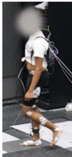
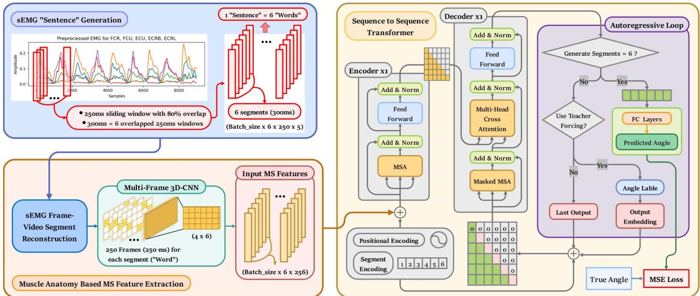
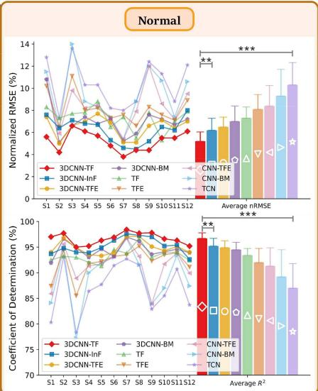
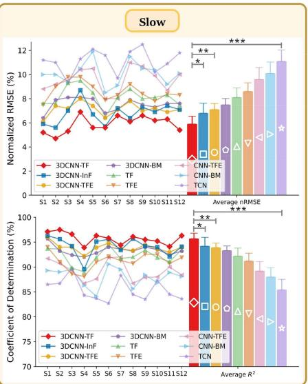
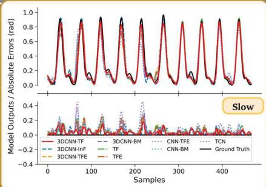
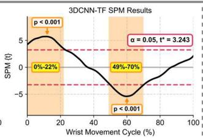

基于肌肉解剖学启发与序列到序列翻译的 Transformer 框架：利用 sEMG 进行连续关节运动学预测

Zijun Wei、Zhiqiang Zhang，IEEE 高级会员，以及 Sheng Quan Xie，IEEE Fellow

摘要——实现康复机器人按需辅助（assist-as-needed，AAN）控制的关键在于准确预测患者的运动意图。本研究首次从序列到序列（sequence-to-sequence，Seq2Seq）翻译的视角重新定义运动意图预测问题，分别将 sEMG 信号与关节角度类比为源语言与目标语言。所提出的 3DCNN-TF 模型实现了神经控制信号向运动学表征的精确翻译。该模型由三个模块组成：sEMG「句子」生成模块，将多个 sEMG 滑动窗口组合为一条「句子」；基于肌肉解剖学和电极放置的 3DCNN 模块，从「句子」中的每个「词」提取肌肉协同特征；Transformer（TF）模块，自回归地生成下一时刻的关节角度作为翻译结果。实验结果表明，3DCNN-TF 模型在不同速度下对腕关节与膝关节屈伸角度的连续预测任务中，相比八个基线模型和现有研究取得了更优的整体性能。此外，3DCNN-TF 在预测精度和计算效率之间达到了最优平衡，并表现出卓越的鲁棒性和泛化能力。具体而言，3DCNN-TF 在腕关节和膝关节数据集上的平均 nRMSE 和 $R^2$ 值分别为（6.2% / 95.5%）和（5.5% / 96.2%），平均训练时间不到两分钟。此外，3DCNN-TF 能够在不损失精度的前提下提前至多 300 ms 预测关节角度，这对于康复机器人的实时 AAN 控制至关重要。

关键词——表面肌电信号（sEMG）、上肢康复、深度学习、肌肉解剖学、序列到序列、连续关节运动学估计方法。

## I. 引言

约 85% 的脑卒中（stroke）患者会出现偏瘫（hemiparesis），即使经过康复治疗，其上下肢仍存在持续性运动功能障碍，严重影响其生活质量 [1]。然而，现有的大多数康复机器人仅能基于阻抗和导纳控制提供被动辅助，不足以显著改善患者的运动功能 [2]。研究 [3] 表明，提高康复效率的关键在于最大化患者的主动参与和训练强度，而非仅仅依赖机器人辅助。这与神经可塑性原则相一致，该原则强调有效的康复需要持续且主动的患者参与，以诱导大脑和神经系统的重塑。因此，开发一种能够根据患者的努力程度实时精确调整机器人辅助的"按需辅助（Assist-As-Needed, AAN）"控制策略至关重要。实现这一目标的关键在于准确且连续地预测患者的运动意图 [3]。先前的研究已经证明，表面肌电信号（surface electromyography, sEMG）因其无创性和便携性，已被广泛用于预测运动意图 [4]。因此，本研究将进一步研究基于 sEMG 的关节运动学的连续估计。

基于我们对过去十年 186 项相关研究的系统综述 [4]，深度学习（deep learning, DL）已被广泛用于利用 sEMG 连续预测关节运动学和动力学。DL 能够自动提取和选择 sEMG 中的高级特征，并利用神经网络的拟合能力在这些特征与运动意图之间建立非线性映射。该综述 [4] 还强调，目前大多数 DL 模型专注于结合卷积神经网络（convolutional neural network, CNN）、循环神经网络（recurrent neural network, RNN）和多头自注意力（multi-head self-attention, MSA）机制的混合神经网络，例如 CNN-BM（基于双向长短期记忆网络 BiLSTM 与 MSA 的 CNN 模型）。与仅使用 CNN 或 RNN 的模型相比，这些组合已展现出更优的预测性能。具体而言，CNN-BM 首先使用 CNN 从 sEMG 中提取空间特征，然后应用 BiLSTM 捕捉这些特征之间的长期双向上下文依赖关系，从而获得 sEMG 的时空表示，随后采用 MSA 来增强对关键时空特征的加权。

然而，MSA 的注意力分布仅作用于 BiLSTM 所提取的时空特征，而 BiLSTM 由于其循环结构仍存在固有局限，例如对长程上下文关系的记忆能力有限、训练过程中存在梯度消失或爆炸的风险，以及缺乏并行计算能力 [4], [5]。相比之下，Transformer（TF）模型克服了这些局限。TF 能够在不依赖序列顺序的情况下，同时捕捉序列中所有位置之间的上下文关系，这使其对时间距离不敏感。因此，在最新的研究中，TF 及其变体 BERT 已经取代了 BiLSTM [4], [5], [6]。然而，根据从 PubMed、Web of Science、Scopus 和 IEEE Xplore 检索到的所有相关文献 [5], [6], [7], [8], [9], [10], [11], [12], [13], [14], [15], [16], [17], [18]，除研究 [7]、[17] 和 [18] 外，大多数研究仅采用 TF 编码器（TFE）来从 sEMG 连续估计关节运动学。该方法仅利用了 TFE 在捕捉输入序列内上下文依赖方面的优势，却忽视了 TF 解码器（TFD）基于 TFE 提供的上下文表示生成时序相关目标序列的潜力。

此外，尽管研究 [7]、[17] 和 [18] 采用了完整的编码器-解码器框架，但它们都采用了 Informer（InF）模型，这是 TF 的一种变体 [19]。事实上，InF 是为长期时间序列预测而设计的，其稀疏 MSA 和蒸馏操作可能会在短的 sEMG 特征序列中丢失细节信息，从而降低预测性能 [20]。此外，InF 解码器是一次性生成整个目标序列，而不是以自回归方式逐步生成。虽然这种方法可以提高推理速度并捕捉更长的时间依赖性，但缺乏增量反馈可能导致误差累积，因为模型无法动态调整输出 [20]。鉴于 sEMG 的非平稳特性需要精确捕捉短期时间特征和高频动态，并考虑到 sEMG 滑动窗口是一个短时间序列，InF 可能并非最优选择。相反，使用具有完整 MSA 和自回归生成的 TFD 可能最大化预测精度。

根据我们综述中的结论，深度学习（Deep Learning, DL）模型的核心概念应围绕从表面肌电（surface electromyography, sEMG）信号中准确提取时空特征、增强关键特征的权重，并根据这些特征之间的上下文依赖关系推导输入与输出之间的因果关系，同时尽可能滤除冗余特征和噪声，以提高预测精度和鲁棒性 [4]。此外，该综述还强调了提取肌肉协同（Muscle Synergy, MS）特征的重要性。由于 sEMG 存在个体差异、时变特性以及主动肌与拮抗肌之间的耦合和串扰，提取 MS 特征可以进一步消除其中的冗余与噪声成分。因此，基于上述结论，我们以 CNN-玻尔兹曼机（Boltzmann Machine, BM）为基准模板，并分别改进 CNN 与 BM 模块，以获得更优的运动意图预测性能。

我们最近关于 MS 特征提取的研究 [21] 在保留 BM 模块不变的前提下，从四个不同角度对 CNN-BM 中的 CNN 模块进行了改进，结果表明，基于目标肌肉解剖结构与 sEMG 电极位置构建的 3DCNN-BM 相比其他方法具备更高效的 MS 特征提取能力以及最优的运动意图预测性能。因此，本研究继续沿用文献 [21] 中的 3DCNN 进行 MS 特征提取，并将 3DCNN-BM 作为基线模型之一。

此外，本研究的根本依据在于：根据肌肉骨骼动力学与运动学原理，肢体运动过程中的 sEMG 信号与相应关节角可被视为以不同形式表征同一神经控制信息的两种生理语言。具体而言，sEMG 表达的是基于动作电位的隐式神经指令，而关节角则是肌肉收缩的显式运动结果，二者之间蕴含着强烈的因果对应关系。从语言翻译的角度出发，使用 sEMG 预测关节角类似于同声传译，要求模型将 sEMG 所承载的隐式神经语言翻译为以关节角表示的运动学表达。因此，本研究采用基于序列到序列（Sequence-to-Sequence, Seq2Seq）的 Transformer（TF）来改进 3DCNN-BM 中的 BM 模块，从而实现从 sEMG 到关节角的精确翻译。

所提出的 3DCNN-TF 模型由三个模块组成：sEMG"句子"生成模块，其将每一个 sEMG 滑动窗口解释为一个"词"，并在允许的预测延迟范围内将多个"词"组合成一个"句子"；3DCNN 模块，用于从 sEMG"句子"中的每个"词"提取 MS 特征；TF 模块，基于 MS 特征序列与先验关节角序列之间的全局上下文依赖关系，逐步生成下一时刻的关节角作为翻译结果。

值得注意的是，TF 模块相较于传统 TF 架构引入了五项关键改进：新增段编码（segment encoding）以区分"句子"内"词"的先后顺序；3DCNN 模块替代了 TFE 中传统的嵌入层，用于提取 MS 特征作为每个"词"的语义表示；在 TFD 中引入额外的因果掩码（causal mask），以在下一关节角度生成过程中严格保证时序因果性；在自回归循环训练阶段采用基于调度采样（Scheduled Sampling）[22] 的动态 Teacher Forcing 策略，以加速模型收敛并缓解误差累积；与常规多层 TF 设计不同，所提 TF 模块中的 TFE 和 TFD 均为单层结构，在维持预测性能的同时显著降低了计算复杂度。

所提 3DCNN-TF 模型在我们的腕关节数据集以及 EPIC Lab [23] 提供的公开下肢数据集上进行了验证。该模型与八个基线模型（3DCNN-InF、3DCNN-TFE、3DCNN-BM、TF、TFE、CNN-TFE、CNN-BM 和 TCN）进行了比较，用于在慢速、正常和快速平地行走条件下预测腕关节与膝关节的屈/伸角度。实验结果表明，3DCNN-TF 模型在预测精度与计算效率之间取得了最优的整体平衡，同时展现出卓越的泛化能力与鲁棒性。此外，3DCNN-TF 模型能够在不牺牲预测精度的前提下提前 300 毫秒（ms）预测关节角度。总体而言，本研究的主要贡献在于首次从 Seq2Seq 翻译的视角重新定义了运动意图预测问题。具体而言，该方法改进了先前 3DCNN-BM [21] 中的 BM 模块，从而实现对 CNN-BM 框架的全面提升。通过将 sEMG 信号类比为源语言、将关节角度类比为目标语言，所提 3DCNN-TF 模型将目标肌肉的解剖学先验知识与 Seq2Seq 算法相融合，实现了从 sEMG 信号到腕关节与膝关节角度的精确且具有前瞻性的翻译。

  

(a)

  

(b)  
图 1. IRASS 和 EPIC 数据集的实验方案 [24], [23]。

## II. 材料（MATERIALS）

## A. IRASS 数据集

本数据集经利兹大学（University of Leeds）MaPS 与工程联合学院研究伦理委员会（Joint Faculty Research Ethics Committee of the University of Leeds）审批通过（编号 MEEC 18-002），共涉及 12 名受试者（其中男性 8 名、女性 4 名，年龄 28.9 ± 2.8 岁），所有受试者均提供了知情同意并参与了实验。

如图 1（a）所示，实验前，所有受试者被要求保持直立姿势，双肘屈曲 90 度，双肩外展 90 度，双手置于中立位。随后，记录每位受试者的最大自主收缩（maximum voluntary contraction, MVC）值，用于对 sEMG 信号进行归一化处理。实验过程中，要求受试者连续进行腕关节屈伸运动，掌指关节（metacarpophalangeal, MCP）保持完全伸直，同时避免腕关节的尺偏和桡偏。每位受试者进行 5 组试次，试次之间休息 3 分钟以防止肌肉疲劳。

腕关节屈伸运动通过 VICON 动作捕捉系统（VICON Motion Systems Ltd., U.K.）进行记录，采样频率为 250 Hz。根据 VICON 上肢模型，在受试者右臂上放置 16 个对应的反光标记点，由 VICON Nexus 软件计算腕关节屈伸角度。同时，使用 Delsys TrignoTM 公司的 Avanti 传感器以 2000 Hz 采样率采集腕部两块屈肌——桡侧腕屈肌（flexor carpi radialis, FCR）和尺侧腕屈肌（flexor carpi ulnaris, FCU），以及三块伸肌——尺侧腕伸肌（extensor carpi ulnaris, ECU）、桡侧腕长伸肌（extensor carpi radialis longus, ECRL）和桡侧腕短伸肌（extensor carpi radialis brevis, ECRB）的 sEMG 信号。此外，为保证 sEMG 信号质量，对受试者前臂进行了剃毛处理并用酒精擦拭清洁，以最大程度降低皮肤阻抗和运动伪影。电极放置位置参照 SENIAM 指南确定，并通过触诊和信号质量评估加以确认。最后，使用 VICON Nexus 软件中的触发模块对 sEMG 数据和关节角度数据进行同步，并以 1000 Hz 进行重采样。

## B. 公开的 EPIC Lab 数据集

为进一步评估 3DCNN-TF 模型在不同关节间的泛化能力，使用了来自 EPIC Lab 的公开下肢数据集 [23]。该数据集包含 22 名健康受试者的数据（身高 $1 . 7 0 \pm 0 . 0 7 \mathrm { m }$，体重 $6 8 . 3 \pm 1 0 . 8 3 $ kg，年龄 21 ± 3.4 岁）。每位受试者的详细信息参见文献 [23]。为与 IRASS 数据集中的受试者数量保持一致，从该数据集中选取了 12 名受试者（男性 6 名、女性 6 名）。

如图1(b)所示，本研究使用了这些12名受试者在平地行走时的数据。每名受试者以三种不同的速度进行了环形行走：慢速（0.88 ± 0.19 m/s）、正常速度（1.17 ± 0.21 m/s）和快速 $( 1 . 4 5 \pm 0 . 2 7 \mathrm { m / s } )$，每个速度下在逆时针和顺时针方向各重复五次。

膝关节屈曲/伸展角度使用电子测角仪（Biometrics Ltd., Newport, U.K.）以1000 Hz进行记录。同时，右下肢11块目标肌肉的表面肌电（surface electromyography, sEMG）信号也以1000 Hz进行了采集（Biometrics Ltd., Newport, U.K.）。电极放置位置通过触诊并依据SENIAM指南确定。此外，与IRASS数据集类似，电极放置部位在实验前进行了剃毛并用酒精清洁。另外，由于膝关节屈曲/伸展并不涉及所有11块肌肉，本研究仅使用了与膝关节屈曲/伸展相关的六块肌肉的sEMG信号：半腱肌（semitendinosus, ST）、股薄肌（gracilis, GR）、股二头肌（biceps femoris, BF）、股直肌（rectus femoris, RF）、股外侧肌（vastus lateralis, VL）和股内侧肌（vastus medialis, VM）。

## C. 信号预处理

鉴于sEMG信号的有效频率范围在20-400 Hz之间，且该范围外的成分主要由运动伪影和噪声构成 [25]，首先对两个数据集的sEMG信号应用了20-400 Hz的五阶巴特沃斯（Butterworth）带通滤波器，随后使用50 Hz陷波滤波器消除工频干扰。为获得更平滑的sEMG包络线信号以实现稳定的模型训练和更快的收敛，随后进行了全波整流和5 Hz五阶巴特沃斯低通滤波处理。最后，由于仅IRASS数据集记录了最大随意收缩（maximum voluntary contraction, MVC）值，IRASS数据集的sEMG包络线根据其各自的MVC值进行归一化处理，而EPIC数据集的sEMG包络线则使用Z分数（Z-score）归一化方法进行了归一化。至于关节角度，两个数据集均使用5 Hz的五阶巴特沃斯低通滤波器进行了平滑处理，然后进行最小-最大（min-max）归一化，将腕关节和膝关节角度分别线性缩放到[-1, 1]和[0, 1]的范围内。

  

图 2. (a) IRASS 数据集的 2D sEMG 帧重建。(b) EPIC 数据集的 2D sEMG 帧重建。(c) 使用 IRASS 数据集演示的 3DCNN-BM 模型框架。

关于滑动窗口分割，实时应用中的控制系统延迟不应超过 300 毫秒，以避免用户感受到明显的系统滞后 [26]。此外，实验中膝关节的运动速度高于腕关节，过短的窗口无法捕获足够的信息，从而降低预测精度。相反，较长的窗口会引入冗余并增加延迟，却无法提升预测性能。因此，在以 50 毫秒为步长、从 50 毫秒到 250 毫秒的五种窗口尺寸进行评估后，对 IRASS 数据集采用了 250 毫秒滑动窗口，对 EPIC 数据集采用了 150 毫秒滑动窗口，两者均设置 80% 的重叠率，从而在预测精度与延迟之间取得了最佳平衡。

## III. 方法

本节详细介绍了所提出的 3DCNN-TF 模型中每个模块的具体细节，并对八个基线模型进行了描述。此外，还讨论了所采用的超参数与损失函数设置，以及用于定量评估各模型预测精度与训练效率的性能指标。

## A. 基于 3DCNN 的 MS 特征提取模块

本研究沿用文献 [21] 中的方法，从 sEMG 视频片段中提取 MS 特征作为语义信息。每一帧 2D sEMG 图像表示在解剖横截面上各目标肌肉在每个时刻的相对收缩比例。因此，堆叠的多帧 sEMG 视频片段表征了该横截面内目标肌肉的三维动态收缩过程。图 2(a) 和 (b) 分别展示了将 IRASS 和 EPIC 数据集中的 1D sEMG 信号重建为 2D sEMG 帧的过程。具体而言，以电极放置位置作为解剖横截面，通过 Complete Anatomy 软件（3D4Medical Ltd.）获取腕关节和膝关节目标肌肉的解剖分布。此外，目标肌肉中心与电极之间的中点被指定为该目标肌肉在 2D sEMG 帧中的新位置。

图 2(c) 展示了以 IRASS 数据集为例的 3DCNN-BM 模型框架。在 250 ms 的滑动窗口下，每个窗口包含 250 帧的 4×6 的二维 sEMG 帧。这些帧首先被堆叠为视频片段，随后输入到配备 4×6 全覆盖卷积核的 3DCNN 中以提取 MS（Multi-Scale，多尺度）特征。采用批归一化（Batch Normalization, BN）以增强训练稳定性并加速收敛，并使用 LeakyReLU 激活函数提升 3DCNN 的非线性表征能力，从而实现 MS 特征的全面提取。通过平均池化在保留关键 MS 特征的同时降低特征冗余与噪声。随后，将维度为 256 的 MS 特征传入 BM 模块，该模块由单层 BiLSTM 和八头的 MSA（Multi-Head Self-Attention，多头自注意力机制）构成。该模块在 MS 特征元素之间捕获双向上下文依赖关系，并对关键依赖赋予更高权重，从而进一步突出关键的 MS 信息。最后，使用两层带有 LeakyReLU 激活函数的全连接（Fully Connected, FC）层，在 MS 特征与关节角度之间建立精确的非线性映射。

## B. sEMG "句子"生成模块

不同于以往仅基于单个 sEMG 滑动窗口来预测关节角度的研究，本研究从机器翻译的视角出发，引入了多窗口到多角度的句子级翻译框架，将采集到的整段 sEMG 信号视为需要翻译的"段落"。因此，每个滑动窗口被视作该"段落"中的一个"单词"，这些"单词"按时间顺序排列以构成"句子"，每个"句子"由相同数量的"单词"组成。考虑到实际应用中允许的最大预测延迟为 300 ms 且滑动窗口重叠率为 80%，IRASS 和 EPIC 数据集中每个 sEMG "句子"分别由六个 250 ms 和十个 150 ms 的 sEMG "单词"构成。类似地，作为这些 sEMG "单词"和"句子"的翻译结果，关节角度的"单词"与"句子"也以相同方式生成。

  

图 3. 使用 IRASS 数据集展示的所提出的 3DCNN-TF 模型框架。

如图 3 所示，以 IRASS 数据集为例，sEMG“句子”生成模块的输出形状为（Batch size $\times ~ 6 ~ \times ~ 2 5 0 \times 5 )$，表示每个“句子”包含六个“单词”，每个“单词”的维度为 $2 5 0 \times 5 .$。这些“单词”随后被输入到 3DCNN 模块中，每个“单词”被重建为 250 帧 sEMG 信号。随后，“句子”内的所有 sEMG 帧被堆叠成视频片段，并输入到 3DCNN 中以提取每个“单词”的 MS 特征。最终，每个“句子”中的六个“单词”被转换为六个 256 维的 MS 特征（Batch size $\times \ 6 \times 2 5 6 )$），作为后续 TF 模块的输入。

## C. 基于 Seq2Seq 的 Transformer 模块

如图 3 所示，TF 模块由四个主要组件构成：位置编码与片段编码、基于 MSA 的 TFE、采用因果掩码 MSA 与多头交叉注意力（MCA）的 TFD，以及自回归生成循环。此外，由于 MS 特征提取模块取代了 TFE 之前传统的嵌入层，因此仅保留 TFD 之前的嵌入层，用于将输入的关节角度标签转换为与 MS 特征具有相同维度的向量表示。这使得 TFD 能够更好地捕捉和对齐 MS 特征与关节角度特征之间的跨序列依赖关系。

与基于循环结构的 BiLSTM 不同，TF 模型以并行方式处理所有输入数据，因此缺乏对输入中序列关系的内在理解。因此，本研究首先采用基于正弦和余弦函数的固定位置编码来标记 MS 和关节角度序列中各元素的相对位置。此外，还需要额外的标记以帮助 TF 模块区分同一“句子”内不同“单词”的排列。受 BERT 模型 [27] 中下一句预测（NSP）的启发，添加了基于“单词”位置索引的片段编码，以区分每个特征序列所属的“单词”。最后，将这两种编码分别添加到 MS 序列和关节角度序列中，再输入到 TFE 和 TFD，从而使得 TF 模块能够理解这些特征序列中的局部和全局顺序关系。

不同于先前采用多层编码器-解码器结构的研究 [5]、[6]、[7]、[8]、[9]、[10]、[11]、[12]、[13]、[14]、[15]、[16]、[17]、[18]，本研究仅使用单层 TFE 和 TFD 即可达到最优性能，这一点已通过大量实验验证。

如图 3 所示，TFE 由多头自注意力（MSA）和前馈网络（feed-forward network, FFN）组成，每个组件均与层归一化（layer normalization, LN）和残差连接相集成，分别表示为 LayerNorm (x + MSA (x)) 和 LayerNorm (x + FFN (x))。

这种设计确保了 MSA 和 FFN 的训练稳定性，并缓解了梯度消失问题。

此外，MSA 的注意力头数和模型维度分别设置为 h = 8 和 $d _ { \mathrm { m o d e l } } = 2 5 6$，使 MSA 能够从八个不同视角并行捕捉 MS 序列中的全局上下文依赖关系。

具体而言，自注意力（self-attention, SA）和 MSA 的方程如下 [28]：

$$
\begin{array}{l} \text { SA } (Q, K, V) = \text { softmax } \left(\frac {Q K ^ {T}}{\sqrt {d _ {k}}}\right) V \\ \text { MSA } (Q, K, V) = \text { Concat } (\text { head } _ {1}, \ldots , \text { head } _ {\text { h }}) W ^ {O} \\ \text { where   head } _ {\text { i }} = \text { SA } \left(Q W _ {i} ^ {Q}, K W _ {i} ^ {K}, V W _ {i} ^ {V}\right) \end{array}
$$

在这里，查询（Query, Q）、键（Key, K）和值（Value, V）均由输入MS特征序列的线性投影得到。对于每个注意力头，Q、K和V的投影矩阵分别为 $W _ { i } ^ { Q } \in \mathbb { R } ^ { d _ { \mathrm { m o d e l } } \times d _ { k } } $$  $W _ { i } ^ { K } \in \mathbb { R } ^ { d _ { \mathrm { m o d e l } } \times d _ { k } }$ ，以及 $W _ { i } ^ { V } \in \mathbb { R } ^ { d _ { \mathrm { m o d e l } } \times d _ { v } ^ { \circ } }$ ，每个头的维度设置为 $d _ { k } = d _ { v } = d _ { \mathrm { m o d e l } } ~ / h = 3 2$ 。点积 $Q K ^ { T }$ 用作相似度得分，用于衡量MS特征序列内各元素之间的相关性。随后，softmax函数将这些相关性转换为每个MS元素的注意力权重，然后与V进行加权求和，以突出MS序列中的关键信息。归一化缩放因子 $\sqrt { d _ { k } }$ 确保了softmax在高维空间中的梯度稳定性。最后，所有注意力头的输出被拼接起来，并通过 $W ^ { i } ^ { 0 } \in \mathbb R ^ { h d _ { v } \times d _ { \mathrm { m o d e l } } }$ 进行线性变换，以获得最终输出。FFN通过逐位置非线性变换进一步细化并记忆MS特征序列中的关键信息。

由于传统的TFD在训练过程中接收完整的真实标签序列，为了更好地使训练过程与推理时的自回归生成对齐，传统TFD中的MSA会应用因果掩码，确保训练期间只能看到当前及过去的时间步，而未来时间步不可访问。然而，本研究采用自回归训练循环，其中TFD仅接收历史步骤，未来步骤被显式置零，从而无需使用因果掩码。尽管如此，由于MSA仍然关注输入序列中的所有位置，因此保留了因果掩码，以防止未来时间步中的零值扭曲注意力权重分布，并减少不必要的计算。

MCA与MSA类似，只是Q由已知关节角度上下文的投影得到，而K和V由经TFE细化的MS关键上下文表示的投影得到。这使得MCA能够从多个角度捕获MS与关节角度之间的跨序列依赖关系。与传统TFD不同，MCA的K和V输入也应用了因果掩码，以防止在生成当前步骤预测时使用未来的MS信息。这迫使MCA更加关注历史的关键MS数据，避免将注意力分配给不相关的MS数据，从而提高预测精度和计算效率。

传统 TF 训练中所使用的 Teacher Forcing（教师强制）在每个时间步将真实标签（ground truth labels）作为输入。然而，在推理阶段，传统 TF 仅依赖自身过去的预测结果，从而导致暴露偏差（exposure bias）与误差累积 [22]。因此，本研究在自回归循环中采用具有线性衰减的 Scheduled Sampling（计划采样）[22]，在训练过程中动态调整使用 Teacher Forcing 的概率，使模型逐步适应推理阶段所采用的自回归生成模式。该方法的公式如下：

$$
\begin{array}{c} x _ {t} = \left\{ \begin{array}{l l} y _ {t - 1} ^ {\text {true}}, & \text {if r <   p_{tf} (e)} \\ \hat {y} _ {t - 1}, & \text {if r\geq p_{tf} (e)} \end{array} \right. \\ p _ {\text {tf}} (e) = 1 - \frac {e}{E} \end{array}
$$

其中 $e$ 和 $E$ 分别表示当前和总的训练轮次（epochs），$r$ 是在 $[0, 1]$ 范围内的随机数。基于概率 $p_{\mathrm{tf}}(e)$，模型决定在当前时间步是否将真实标签 $y_{t-1}^{\mathrm{true}}$ 作为 TFD 的输入 $x_t$。如图 3 所示，当 $r$ 小于 $p_{\mathrm{tf}}(e)$ 时，TFD 使用真实关节角度标签 $y_{t-1}^{\mathrm{true}}$ 作为输入；否则，使用上一步的预测值 $\hat{y}_{t-1}$。随着训练的进行，$p_{\mathrm{tf}}(e)$ 逐渐减小，使 $x_t$ 从最初完全依赖 $y_{t-1}^{\mathrm{true}}$ 线性过渡到最终仅使用 $\hat{y}_{t-1}$。这有助于模型在推理过程中动态调整下一步预测，减少误差累积并提高泛化能力。

## D. 基线模型

本研究采用八个基线模型，包括五个用于 3DCNN 和 TF 模块消融研究的模型，以及三个近期文献中具有代表性的深度学习（DL）模型。五个消融模型包括 3DCNN-Inf、3DCNN-TFE 和 3DCNN-BM，它们依次将 3DCNN-TF 中的 TF 模块替换为 Inf、TFE 和 BM 模块；以及 TF 和 TFE 模型，其中 3DCNN 模块被完全移除。其他三个代表性模型为 CNN-TFE、CNN-BM 和 TCN。

具体而言，3DCNN-Inf 中的 Inf 模块采用与文献 [19] 相同的架构设计。为获得最佳预测性能，3DCNN-Inf 的编码器和解码器均设置为四层（通过多次实验验证）。每一层均使用 ProbSparse MSA 和蒸馏操作。此外，为了公平比较，ProbSparse 注意力头数和模型维度分别设置为 8 和 256，与 3DCNN-TF 完全相同。3DCNN-TFE 是从 3DCNN-TF 中移除 TFD 和自回归循环部分得到的，仅保留位置编码、段编码、TFE 和 FC 层。TF 和 TFE 分别将 3DCNN-TF 和 3DCNN-TFE 中的 3DCNN 模块替换为 $d_{\mathrm{model}} = 256$ 的嵌入层，其输入也从 MS 特征变为预处理后的 sEMG 信号。

至于代表性模型，CNN-TFE 和 CNN-BM 通过将 3DCNN-TFE 和 3DCNN-BM 中的 3DCNN 模块替换为使用常规 $3 \times 3$ 卷积核的三通道 2DCNN 构建而成，通道数分别设置为 64、128 和 256。最后，TCN 是基于 EPIC 数据集 [29] 中使用的 TCN 架构修改而来，由三个残差块组成，通道大小分别为 64、128 和 256。每个残差块包含两个一维因果膨胀卷积层，膨胀因子和卷积核大小与文献 [29] 保持一致。

## E. 模型训练设置

为了最大限度地降低训练环境的影响，所有模型均基于 Google Colab 平台并使用 Pytorch 框架开发与训练。为确保可复现性与公平对比，所有模型均采用相同的超参数设置。具体而言，模型训练使用 AdamW 优化器，批量大小（batch size）设为 256，初始学习率设为 0.001。为促进模型收敛，采用了自适应学习率衰减策略：一旦验证损失（validation loss）进入平台期，学习率即按 0.8 的因子逐步降低。此外，LeakyReLU 激活函数的斜率设为 0.1，并施加 20% 的 dropout 率以防止过拟合。上述所有超参数值均通过反复实验确定。

此外，为保证收敛并公平对比训练时间，所有模型均训练 1000 个 epoch。预测关节角度与真实关节角度之间的均方误差（mean squared error, MSE）被用作训练损失函数。

在数据划分方面，每位受试者的数据被随机分为 80% 用于训练、20% 用于测试。考虑到实际应用中康复设备的计算资源有限，模型训练使用了一颗入门级的 NVIDIA Tesla T4 GPU，其计算性能与 NVIDIA GeForce RTX 2070 相当。该设置模拟了临床设备的运行环境，确保实验结果的实践相关性。

## F. 性能指标

本研究采用归一化均方根误差（normalized root mean square error, nRMSE）和决定系数 $( \mathbb { R } ^ { 2 } )$ 作为性能指标，分别用于评估误差的大小以及预测关节角度与实际关节角度之间的相关性。考虑到本研究中的跨数据集比较，nRMSE 对样本量和输出范围的变化具有较强的稳健性，因此被选用来代替 RMSE。$\mathrm { R } ^ { 2 }$ 被用于评估每个模型的整体拟合优度，与 nRMSE 在性能评估上形成有效互补。这两个指标的公式如下：

$$
\begin{array}{c} \text {nRMSE} = \frac {\sqrt {\frac {1}{N} \sum_ {i = 1} ^ {N} \left(\theta_ {i} - \hat {\theta} _ {i}\right) ^ {2}}}{\theta_ {\max} - \theta_ {\min}} \\ R ^ {2} = 1 - \frac {\operatorname{Var} (\theta - \hat {\theta})}{\operatorname{Var} (\theta)} \end{array}
$$

其中 $\theta$ 和 $\hat{\theta}$ 分别代表真实的关节角度和预测的关节角度，N 表示样本量。nRMSE 的值越低、$\mathrm{R}^{2}$ 的值越接近 1，表明精度越高。

此外，与 RMSE 和 $\mathrm{R}^{2}$ 等整体性能指标不同，本研究采用基于双尾 t 检验的统计参数映射（Statistical Parametric Mapping, SPM）在整个时间序列上进行连续的统计推断。在对所有受试者运动周期的时长和关节角度进行双重归一化之后，利用 SPM 识别整个周期中存在预测角度与真实值之间显著差异的特定区间，显著性水平设为 $\alpha = 0.05$。

特别地，为了进一步量化所有模型的综合性能，本研究提出了一种综合性能指数（Overall Performance Index, OPI）指标，将预测精度（nRMSE 和 $\mathrm{R}^{2}$）与计算效率（训练时间）整合在一起。具体而言，OPI 的计算方法如下：

$$
\begin{array}{l} \text { OPI } = w _ {P} \cdot \left[ \frac {(1 - \mathfrak {n} \mathrm{RMSE} _ {\mathrm{norm}}) + R _ {\mathrm{norm}} ^ {2}}{2} \right] \\ \quad + w _ {T} \cdot \exp (- \mathrm{Time} _ {\mathrm{norm}}) \end{array}
$$

其中 $w _ { P }$ 和 $w _ { T }$ 分别为预测精度和训练时间的权重，且 $w _ { P } + ~ w _ { T } = ~ 1$。nRMSEnorm、$\bar { R } _ { \mathrm { n o r m } } ^ { 2 }$ 和 ${ \mathrm { T i m e } } _ { \mathrm { n o r m } }$ 分别表示每个模型归一化后的 nRMSE、R2 和训练时间。在本研究中，$w _ { P }$ 和 wT 均设为 0.5，以平衡预测精度的重要性与模型在实际应用场景中的实用性。值得注意的是，训练时间采用指数衰减函数进行非线性惩罚，更能反映实际应用中对训练时间的容忍度。

  

图 4. 所有模型在 IRASS 数据集上的 nRMSE $/ \mathsf { R } ^ { 2 }$ 结果，以及每个模型对应的 nRMSE $/ \mathsf { R } ^ { 2 }$ 平均值与标准差。显著性水平设为 0.05（$p <$ 0.001，$p < 0 . 0 1$，${ } * p < 0 . 0 5 { \mathrm { ) } }$）

## IV. 结果（RESULTS）

## A. 全部模型的预测结果

1) IRASS 数据集：图 4 展示了所有模型在 IRASS 数据集上的 nRMSE 与 $R^{2}$ 结果。与其他模型相比，3DCNN-TF 在所有受试者上均表现出始终更优的预测性能。具体而言，在 12 名受试者中，3DCNN-TF 取得了最低的平均 nRMSE（6.2%）和最高的平均 $R^{2}$（95.5%）。此外，根据柱状图中误差线的分布，3DCNN-TF 表现出最高的预测稳定性，结果的变异性极小。其余模型按性能从优到劣排序及其对应的平均 nRMSE 和 $R^{2}$ 值如下：3DCNN-InF（7.3% / 94%）、3DCNN-TFE（7.7% / 93.4%）、3DCNN-BM（8% / 92.8%）、TF（8.7% / 91.5%）、TFE（9.2% / 90.6%）、CNN-TFE（10.2% / 88.8%）、CNN-BM（10.7% / 87.4%）以及 TCN（12.5% / 82.6%）。

此外，为了系统地评估 3DCNN-TF 相对于其他模型的性能优势，对 nRMSE 和 $R^{2}$ 进行了一元重复测量方差分析（one-way repeated measures ANOVA），以模型类型作为被试内因子。随后采用经 Holm-Bonferroni 校正的事后配对 t 检验评估 3DCNN-TF 与其他模型之间的差异，显著性水平设定为 $\alpha = 0.05$。统计分析表明，3DCNN-TF 显著优于所有其他模型 $(p < 0.05)$，有力地证明了 3DCNN-TF 在 IRASS 数据集上具有卓越的预测性能。

  

图 5. 所有模型在 EPIC 数据集上三种步速下的 nRMSE/R2 结果，以及每个模型的平均 nRMSE/R2 值和相应的标准差。显著性水平设为 0.05 $( * * * p < 0 . 0 0 1$ 1, $p < 0 . 0 1$ , 和 $\stackrel { - } { * } p < 0 . 0 5 )$ 。

2) EPIC 数据集：图 5 展示了所有模型在 EPIC 数据集上的 nRMSE 和 $\mathrm { R } ^ { 2 }$ 结果。除快步试验中的受试者 S6 外，3DCNN-TF 在该试验的其他受试者以及常速和慢速行走试验中均展现了最佳的预测性能。具体而言，3DCNN-TF 在三种行走速度下对全部 12 个受试者取得了最低的平均 nRMSE 和最高的平均 $\mathtt { R } ^ { 2 }$：快速（5.4% /96.2% ）、常速（5.2% /96.7% ）和慢速（5.9% /95.7% ），总体平均为（5.5% /96.2% ）。同样，柱状图中的误差条表明 3DCNN-TF 始终表现出最低的性能变异性。其他模型在三种行走速度下的性能排序与 IRASS 数据集上的排序一致，对应的平均 nRMSE 和 $\mathrm { R } ^ { 2 }$ 值如下：3DCNN-InF（6.5% /94.7% ）、3DCNN-TFE（6.9% /94.2% ）、3DCNN-BM（7.3% /93.7% ）、TF（7.7% /92.8% ）、TFE（8.2% /91.7% ）、CNN-TFE（9.2% /89.6% ）、CNN-BM（9.7% /88.3% ）和 TCN（10.6% /86.2% ）。

采用与 IRASS 数据集相同的统计显著性分析方法，结果显示 3DCNN-TF 与所有其他模型之间存在显著的性能差异（ $p < 0 . 0 5 )$ ），进一步证明了其在 EPIC 数据集上优异的预测性能。然而值得注意的是，与快步和常速行走试验相比（ $\left( \begin{array} { l } { p < 0 . 0 1 } \end{array} \right)$ ），3DCNN-TF 与 3DCNN-InF 之间的性能差距在慢速行走试验中有所缩小（ $p < 0 . 0 5 )$ ）。

3) 模型训练时间与 OPI 比较：图 6 展示了所有模型在两个数据集上的训练时间和 OPI 评分。在 IRASS 数据集上，各模型的训练时间由短到长排序为：3DCNN-BM、3DCNN-TFE、TFE、3DCNN-InF、3DCNN-TF、TF、CNN-BM、CNN-TFE 和 TCN。在 EPIC 数据集上，TF 的训练时间显著增加，排名仅次于训练时间最长的 TCN。然而，统计分析表明，3DCNN-TF 与 3DCNN-BM 相比，在训练时间上无显著差异 $\cdot > 0 . 0 5 )$ ，

  

图 6. 所有模型在 IRASS 数据集和 EPIC 数据集上的训练时间和 OPI 得分。显著性水平设为 0.05（ $\pmb { p } < 0 . 0 0 1$ ， $p < 0 . 0 1$ ， and p < 0.05）。

3DCNN-TFE、TFE 和 3DCNN-InF 在 IRASS 数据集上，所有这些模型都在不到一分钟的时间内完成了训练。在 EPIC 数据集上（其数据量平均比 IRASS 多 30%），3DCNN-TF 与所有其他模型相比在训练时间上表现出显著差异 $( \textit { \textbf { p } } < 0 . 0 5 )$，但其训练时间仍保持在两分钟以内。总体而言，尽管 TF 模块的训练时间随着数据集的增大而显著增加，但 3DCNN-TF 仍保持了相对较短的训练时间，并达到了最高的预测准确率。因此，3DCNN-TF 在两个数据集上均获得了最高的 OPI（Overall Performance Index，综合性能指数）分数，显著优于所有基线模型。

  

图 7. (a) 和 (b) 分别展示了在 IRASS 数据集和 EPIC 数据集上所有模型预测的关节角度示例，以及与实际关节角度相比对应的绝对误差值。(c) 3DCNN-TF 的 SPM 分析结果。

## B. 预测关节角度与 SPM 分析的代表性示例

图 7(a) 和 (b) 分别展示了在 EPIC 和 IRASS 数据集上所有模型的代表性预测示例。具体而言，从每个数据集中各选取了三名代表性受试者，以直观比较实际关节角度与各模型预测角度之间的差异，并给出相应的绝对误差。这六名受试者的预测结果与误差表明，尽管在运动幅度和速度上存在个体差异，3DCNN-TF 的预测误差始终小于其他模型。值得注意的是，在关节角度拐点之间的稳定运动阶段，3DCNN-TF 的预测与实际关节角度高度一致。然而，在关节角度突变阶段，其预测误差增大，表明在捕捉瞬态 sEMG 特征方面仍有改进空间。这一点由图 7(c) 的 SPM 结果所证实。对于腕关节，在屈曲峰值阶段（0–22%，$p < 0 . 0 0 1 )$和伸展峰值阶段（49–70%，$p < 0 . 0 0 1 )$观察到显著差异，而其余 57% 的稳态阶段则无显著差异。对于膝关节，仅在屈曲峰值阶段（29–36%，$p = 0 . 0 1 5 )$出现显著差异，在整个周期其余 93% 的时段内均无显著差异。

## C. 3DCNN-TF 的前瞻性预测能力

由于固有的机电延迟（electromechanical delay, EMD），sEMG 信号在实际运动发生前约 30–150 ms 即已携带运动意图信息 [4], [7]。这不仅有助于降低预测延迟，还能使模型对未来的关节角度进行前瞻预测。如图 8(a) 所示，EPIC 和 IRASS 数据集中采集的 sEMG 信号与其对应的实际关节角度在时间上存在错位，sEMG 在 EMD 范围内提前采集，从而为提前预测提供了机会。值得注意的是，即使不考虑 EMD，模型本身也可能具备对未来关节角度进行预测的内在能力。

因此，本研究对 sEMG 与关节角度进行了时间上的重新对齐，以测试 3DCNN-TF 的有效提前预测时间范围。如图 8(a) 所示，考虑 EMD 后，在保持关节角度固定不变的前提下，将 sEMG 信号向前作时间平移，以验证实际的 EMD 范围以及 3DCNN-TF 自身的最大提前预测时间范围。时间平移范围设置为 0 至 900 ms，步长为 100 ms。

图 8(b) 展示了 3DCNN-TF 在 EPIC 和 IRASS 数据集上不同提前时间范围内的预测性能。结果表明，预测精度在超过 300 ms 后开始显著下降 $( \textit { \textbf { p } } < 0 . 0 5 )$，说明 3DCNN-TF 能够在不损失性能的情况下提前预测最多 300 ms。此外，若以 $\mathsf { R } ^ { 2 } \geq 9 0 \%$ 作为可接受阈值，3DCNN-TF 则可提前预测最多 600 ms。值得注意的是，3DCNN-TF 在 100 ms 时达到峰值性能且方差最小，这与 30–150 ms 的 EMD 范围相吻合，由此验证了 EPIC 和 IRASS 数据集中的 EMD 约为 100 ms，而 3DCNN-TF 固有的提前预测能力约为 200 ms。

  

图 8. (a) 评估前的 sEMG-角度时间对齐。(b) 3DCNN-TF 在两个数据集上的提前预测能力。

## V. 讨论

## A. 全部模型的预测结果分析

根据 nRMSE、$R^2$ 和训练时间的结果，所提出的 3DCNN-TF 模型在两个数据集上均表现出更优的预测性能，平均训练时间不到两分钟。最高的 OPI 得分进一步验证了 3DCNN-TF 在预测精度与计算效率之间取得了最佳平衡。此外，在 EPIC 和 IRASS 数据集上开展的跨速度与跨关节实验，进一步证明了 3DCNN-TF 相比其他模型具有更优的鲁棒性与泛化能力。

具体而言，3DCNN-TF 在 IRASS 数据集上 nRMSE 和 $R^2$ 的平均标准差分别为 1.22% 和 2.01%，均显著低于基线模型（nRMSE：1.37%–2.67%；$R^2$：2.23%–5.89%）。在 EPIC 数据集内三种不同行走速度下，3DCNN-TF 的 nRMSE 和 $R^2$ 的平均标准差分别为 0.86% 和 1.31%，同样低于基线模型（nRMSE：1.07%–1.78%；$R^2$：1.67%–4.12%）。在跨关节比较方面，3DCNN-TF 在腕关节和膝关节之间表现出相当的性能，两个数据集上的平均 nRMSE 和 $R^2$ 差异仅为 0.7%。此外，图 7(c) 中所有受试者腕关节和膝关节周期的平均轨迹显示，3DCNN-TF 的预测值与真实值之间具有极佳的一致性。较窄的标准差带表明 3DCNN-TF 在不同受试者、关节和运动速度下均具有很强的泛化能力与鲁棒性。

B. 3DCNN-TF 的预测前瞻能力

值得注意的是，尽管 3DCNN-TF 在三种步行速度下的性能没有显著差异 $( \mathrm { ~ \it ~ \ / ~ p ~ } > \mathrm { ~ 0 . 0 5 ) ~ }$，但其他基线模型在正常速度下表现出显著优越的性能 $( \textit { p } < 0 . 0 5 )$。此外，所有模型在正常速度下的平均性能始终最高。一种可能的解释是，受试者必须在不熟悉的步行速度下有意识地调整步态和平衡，从而导致非典型的运动控制和肌肉激活模式。此外，在这些条件下维持步态稳定性需要更大的肌肉募集，从而增加了 sEMG 的串扰。至于 3DCNN-TF 在腕关节预测中相较于膝关节表现略逊一筹，可能有以下几个因素。首先，腕关节比膝关节具有更多的自由度，在腕关节屈伸过程中可能发生轻微的尺偏或桡偏，从而干扰 sEMG 信号。其次，EPIC 数据集所包含的数据量多于 IRASS 数据集，导致数据量失衡并影响模型学习。最后，如图 7 所示，步行受下意识控制，表现出更稳定的节律模式（稳态区间占比 93%）。相比之下，自主性腕关节屈伸在速度和幅度上具有更大的变异性（稳态区间占比 57%），给模型预测带来了额外的挑战。

研究 [30] 表明，在实际肌肉收缩开始之前提供机器人辅助可显著增强自主肌肉激活。这种快速辅助策略在不增加运动任务难度的情况下，有效提高了患者的康复效率。因此，评估 3DCNN-TF 对未来关节角度的提前预测时间范围至关重要。具体而言，该时间范围需要覆盖康复机器人中执行器的响应延迟和系统通信延迟，以及信号采集与处理、滑动时间窗和模型推理所带来的延迟。事实上，由于滑动窗在实时应用中以增量方式运行，EPIC 和 IRASS 数据集的滑动窗延迟对应于 20% 的非重叠部分，分别为 30 ms 和 50 ms。至于模型推理延迟，3DCNN-TF 在两个数据集测试集上的平均计算时间为 21 ms。由于每个测试集平均包含 10 个关节运动周期，因此单个周期的推理延迟约为 2.1 ms。总体而言，鉴于 3DCNN-TF 可提前预测长达 300 ms，在考虑上述延迟后，剩余的缓冲时间足以满足实时预测和快速辅助的需求，同时也降低了实际预测场景中与信号丢失和运动伪影相关的风险。

## C. 3DCNN-TF 的消融研究

1) 3DCNN 模块：3DCNN 模块的消融研究包含两组对比。第一组将 3DCNN-TF 和 3DCNN-TFE 与 TF 和 TFE 进行对比，第二组将 3DCNN-TFE 和 3DCNN-BM 与 CNN-TFE 和 CNN-BM 进行对比。这些对比共同证明了 3DCNN 模块的重要性及其相对于传统 CNN 的优越性。

首先，与 TF 和 TFE 相比，引入额外的 3DCNN 模块不仅通过将平均归一化均方根误差（nRMSE）降低 22% 来提升预测性能，还显著缩短了训练时间，尤其是将 TF 的平均训练时间缩短了 75%。其次，与传统 CNN 相比，3DCNN-TFE 和 3DCNN-BM 均实现了更好的预测性能和训练效率，将平均 nRMSE 降低了 25%，训练时间缩短了 81%。此外，CNN-TFE 与 TFE 之间的对比进一步表明，使用传统 CNN 会降低 TFE 的预测性能，同时增加不必要的训练时间。这是因为传统 CNN 处理基于滑动窗口大小和电极通道构建的 sEMG 图像，其中 3×3 的 2D 卷积核仅能从 sEMG 图像中提取局部特征，无法充分捕捉 sEMG 图像时空分量中的 MS 特征。因此，这限制了后续 TFE 和 BM 模块的效果。

相比之下，3DCNN 模块基于解剖学先验知识，能够从原始 sEMG 中高效提取 MS 特征。这些具有生理学可解释性的 MS 特征封装了基本的运动控制信息 [21]。因此，3DCNN 能有效消除原始 sEMG 中的冗余特征与噪声，保留肌肉收缩的动态时空特征，从而实现 sEMG 信号的精炼与压缩。此外，由于每个 2D sEMG 帧的像素数量显著低于完整 sEMG 图像，并且 3DCNN 的卷积核可覆盖整个 sEMG 视频片段，因此输入可以一步直接转换为 MS 特征。相比之下，2DCNN 仅能提取局部特征，并且需要多个池化步骤才能完成有效的特征提取与降维。总体而言，3DCNN 不仅大幅降低了 MS 特征提取过程中的计算复杂度，还为后续的 TF、TFE 和 BM 模块提供了更紧凑的 sEMG 表示。这有助于加快训练速度，并为 sEMG 中的关键 MS 特征建立更精确的上下文依赖关系，最终改善性能与效率。

2) TF 模块：TF 模块的消融研究同样包含两组对比。第一组将 3DCNN-TF 与同样采用 3DCNN 的其他模型（3DCNN-InF、3DCNN-TFE 和 3DCNN-BM）进行对比，第二组将 TF 与 TFE 进行对比。这些对比共同验证了采用完整 TF 结构的必要性。

第一次比较表明，与在 3DCNN（三维卷积神经网络，3D Convolutional Neural Network）之后使用 InF（Informer）、TFE（Transformer Encoder）或 BM 相比，3DCNN-TF 分别将平均 nRMSE（normalized Root Mean Square Error，归一化均方根误差）降低了 15.2%、19.9% 和 23.5%。第二次比较表明，TFD（Transformer Decoder）的优势并不完全依赖于输入特征的质量。即使没有 3DCNN 提供的 MS（Multi-Scale，多尺度）特征，TF（Transformer）仍然优于 TFE，将平均 nRMSE 降低了 5.7%。这些显著的改进源于完整 TF 架构相较于 InF、TFE 和 BM 的三个关键优势：完整的 MSA（Multi-head Self-Attention，多头自注意力）、自回归生成以及 MCA（Multi-head Cross-Attention，多头交叉注意力）。

首先，基于 sEMG（surface Electromyography，表面肌电信号）的关节角度预测是一项短期时间序列预测任务，需要捕获 sEMG 中的高频动态和细粒度特征。然而，InF 是为长期序列预测设计的，无法在此场景中充分发挥其优势。这一局限源于 InF 在长期预测中以精度换取计算效率，其基于最大池化的 ProbSparse 自注意力和蒸馏操作会丢失 MS 特征之间关键的上下文关系。相比之下，TF 的 MSA 捕获了 MS 特征序列内完整的全局上下文依赖关系，保留了所有关键的 MS 信息。这一点从模型深度上也得到了进一步验证：单层 TF 实现了比四层 InF 更高的预测精度。此外，TF 的自回归生成与 InF 的一次性生成不同，能够利用历史信息动态调整预测策略，从而纠正偏差并确保 TFD 输出的时间一致性与稳定性。因此，3DCNN-TF 比 3DCNN-InF 更有效地平衡了精度和计算效率。

其次，除自回归生成外，TF 与 TFE 的对比进一步凸显了 MCA 的重要性。MCA 使 TFD 能够基于当前 sEMG 信号与历史关节角度之间的跨序列上下文依赖关系，从 TFE 提供的 MS 信息中动态筛选与下一步关节角度预测最相关的关键信息，从而准确生成下一步的关节角度。

最后，TF 与 BM 的对比进一步验证了 TF 三个关键优势的综合效应。由于 BM 的 MSA 构建在 BiLSTM（Bidirectional Long Short-Term Memory，双向长短期记忆网络）之上，因此受到 BiLSTM 循环结构的约束，限制了其建立特征序列远距离上下文依赖关系的能力，从而降低了预测性能。相比之下，TF 能够并行建模跨越任意时间跨度的上下文依赖关系，并缓解 BiLSTM 固有的梯度消失或爆炸问题。然而，TF 的这些优势以计算效率降低为代价。

## D. 与现有研究的比较

对于 IRASS 数据集，3DCNN-TF 的预测性能（平均 $R^{2}=0.96$）不仅超过了文献 [21] 中提出的 3DCNN-BM 模型，还超过了另外三项使用同一数据集的相关研究。这些研究包括：一种使用直接配点（direct collocation, DC）生理参数优化方法的个性化肌肉骨骼（musculoskeletal, MSK）模型 [31]（平均 $R^{2}=0.88$），一种基于拉格朗日运动方程和 MSK 逆动力学的生成对抗网络（generative adversarial network, GAN）[32]（平均 $R^{2}=0.92$），以及一种使用 CNN-LSTM 训练卡尔曼滤波器参数和增益的深度卡尔曼滤波网络（deep Kalman filter network, DKFN）[33]（平均 $R^{2}=0.87$）。值得注意的是，文献 [21] 已证明 3DCNN-BM 在该研究中的表现优于其他基线模型，包括基于图拓扑的 GraphSAGE-BM、基于卷积自编码器的 CAE-BM、基于多尺度时空卷积核的 MCNN-BM，以及其他经典深度学习模型（CNN、LSTM、BiLSTM 和 CNN-BiLSTM）。因此，可以推断 3DCNN-TF 在 IRASS 数据集上的表现同样优于这些模型。

对于 EPIC 数据集，3DCNN-TF 的预测性能（平均 $R^{2}=0.96$）超过了使用同一数据集的两项相关研究。这些研究包括：使用由非负矩阵分解（non-negative matrix factorization, NMF）选出的三块最相关肌肉的 sEMG 信号均方根（root mean square, RMS）特征训练的 RNN 和 CNN 模型 [34]（平均 $R^{2}=0.74$），以及一种融合高斯过程回归（Gaussian process regression, GPR）、自适应频率振荡器（adaptive frequency oscillators, AFO）和无迹卡尔曼滤波器（unscented Kalman filter, UKF）的步态相位估计模型 [35]（平均 $R^{2}=0.88$）。

此外，文献 [21] 中使用的第二个 Ninapro DB2 数据集中的 sEMG 电极均匀分布在前臂周围，没有针对性地放置在特定肌肉上方。因此，该数据集未严格遵循目标肌肉的解剖学分布进行 MS 特征提取，从而限制了对 3DCNN 性能的验证。相比之下，本研究在两个数据集中都将 sEMG 电极的放置与目标肌肉的解剖学分布精确对齐，从而充分证明了将 3DCNN 用于基于肌肉解剖学的 MS 特征提取的可行性。

## E. 局限性与未来工作

本研究中使用的两个数据集以及所提出的 3DCNN-TF 模型仍存在若干局限性。关于数据集，未来研究应纳入更多关节类型、多自由度关节运动、更多受试者以及更长时间的随机和复杂运动，以全面评估模型的鲁棒性和泛化能力。此外，未来工作还应纳入脑卒中患者，并测试 3DCNN-TF 的实时预测能力，以确保其在实际非标准化康复场景中的可靠性。

关于 3DCNN-TF 模型，除了降低其在 2D sEMG 帧重建过程中对目标肌肉和表面肌电图（sEMG）电极精确定位的依赖外，还必须在不损失性能的前提下提高 Transformer（TF）模块的训练效率。因此，未来工作可以整合基于极坐标的显式空间协同编码（如文献 [36] 所提出的方法），其中电极相位差编码肌肉激活的相对空间关系，从而提高 3DCNN 的肌肉协同（MS）提取能力及其对电极位移的鲁棒性。此外，还可以考虑其他 TF 变体，以降低多头自注意力（MSA）、多头交叉注意力（MCA）和前馈网络（FFN）的计算复杂度。此外，基于深度学习的 3DCNN-TF 本质上是一个黑箱工具，缺乏关于 sEMG 与关节运动学之间神经生理机制的可解释性。因此，未来研究可以将基于肌肉骨骼（MSK）的运动方程作为附加约束整合到当前的均方误差（MSE）损失函数中。此外，3DCNN-TF 可以作为生成器网络，而文献 [37] 中提出的多关节分层优化 Hill 模型可以作为生成对抗网络（GAN）框架中的判别器网络。该方法将在对抗训练过程中利用肌肉骨骼生物力学先验，以增强模型的可解释性和多关节协调预测能力，同时降低其对大规模训练数据集的依赖。此外，3DCNN-TF 可以扩展为一个融合 sEMG 和惯性测量单元（IMU）信号的多模态融合框架，以提高预测精度。此外，该模型可以在大规模数据集上进行预训练，以提取与受试者无关和受试者特定的 MS 组件，随后进行受试者特定的微调，以实现快速的小样本迁移学习。

## VI. 结论

本研究首次从序列到序列（Seq2Seq）翻译的角度重新定义了运动意图预测问题，通过将 sEMG 和关节角度分别类比为源语言和目标语言，实现了从神经控制信号到运动学表征的准确翻译。具体而言，模型输入被重新构造为由多个 sEMG 滑动窗口堆叠而成的"句子"，其中每个滑动窗口作为"句子"中的一个"词"。这种设计使模型能够捕获更全面的时间信息，从而克服了传统方法仅依赖单窗口预测的局限性。此外，鉴于先前研究 [21] 已经证明基于目标肌肉解剖结构的 3DCNN 能够从 sEMG 信号中有效提取 MS 特征，本研究将 3DCNN 模块与基于改进 Seq2Seq 的 TF 模块相结合，从而实现了从 sEMG 到关节角度的精确预测。

首先，3DCNN 模块根据目标肌肉的解剖学分布和电极放置，将每个"句子"重建为 sEMG 视频片段，从而提取代表神经控制本质的 MS（运动单元）特征。这显著提升了模型的预测精度，同时大幅缩短了训练时间。随后，TF 模块通过 TFE、TFD 与自回归生成循环的协同作用，从多个视角动态捕捉 MS 特征序列与关节角度序列之间的全局上下文依赖关系，最终以逐步生成的方式将精确的关节角度预测作为翻译结果输出。

在涉及腕关节与膝关节屈/伸任务的两个数据集上的实验结果表明，相较于八个基线模型，3DCNN-TF 在预测精度与计算效率之间取得了最优的整体平衡，并在鲁棒性与可推广性方面表现优异。此外，3DCNN-TF 能够在不损失精度的前提下提前 300 ms 预测关节角度，凸显了其在实时康复辅助中的潜力。

## 参考文献

[1] F. Xiong 等，《中风后运动恢复中的新兴肢体康复治疗》（Emerging limb rehabilitation therapy after post-stroke motor recovery），《Front. Aging Neurosci.》，第 14 卷，2022 年 3 月，文章编号 863379，doi：10.3389/FNAGI.2022.863379/PDF。

[2] J. Berning、G. E. Francisco、S. H. Chang、B. J. Fregly、M. K. O'Malley，《肌电控制与神经肌肉骨骼建模：康复机器人的互补技术》（Myoelectric control and neuromusculoskeletal modeling: Complementary technologies for rehabilitation robotics），《Curr. Opin. Biomed. Eng.》，第 19 卷，2021 年 9 月，文章编号 100313，doi：10.1016/J.COBME.2021.100313。

[3] A. Basteris、S. M. Nijenhuis、A. H. A. Stienen、J. H. Buurke、G. B. Prange、F. Amirabdollahian，《机器人介导的中风后上肢康复中的训练模式：基于系统综述的分类框架》（Training modalities in robot-mediated upper limb rehabilitation in stroke: A framework for classification based on a systematic review），《J. Neuroengineering Rehabil.》，第 11 卷第 1 期，第 1–15 页，2014 年 7 月，doi：10.1186/1743-0003-11-111。

[4] Z. Wei、Z. Q. Zhang、S. Q. Xie，《基于 sEMG 的上肢康复连续运动意图预测：基于模型与无模型方法的系统综述》（Continuous motion intention prediction using sEMG for upper-limb rehabilitation: A systematic review of model-based and model-free approaches），《IEEE Trans. Neural Syst. Rehabil. Eng.》，第 32 卷，第 1487–1504 页，2024 年，doi：10.1109/TNSRE.2024.3383857。

[5] Z. Chen、H. Wang、H. Chen、T. Wei，《基于 Transformer 的混合 sEMG-FMG 模态深度学习模型的连续手指关节角度估计》（Continuous motion finger joint angle estimation utilizing hybrid sEMG-FMG modality driven transformer-based deep learning model），《Biomed. Signal Process. Control》，第 85 卷，2023 年 8 月，文章编号 105030，doi：10.1016/J.BSPC.2023.105030。

[6] C. Lin、X. Chen、W. Guo、N. Jiang、D. Farina、J. Su，《基于 BERT 的表面肌电信号连续估计手部运动学的跨受试者方法》（A BERT based method for continuous estimation of cross-subject hand kinematics from surface electromyographic signals），《IEEE Trans. Neural Syst. Rehabil. Eng.》，第 31 卷，第 87–96 页，2023 年，doi：10.1109/TNSRE.2022.3216528。

[7] T. Liang 等人，"基于 sEMG 的端到端人类膝关节角度连续预测：使用紧耦合卷积 Transformer 模型"（sEMG-based end-to-end continues prediction of human knee joint angles using the tightly coupled convolutional transformer model），*IEEE 生物医学与健康信息学杂志*（IEEE J. Biomed. Health Inform.），第 27 卷，第 11 期，第 5272–5280 页，2023 年 11 月，doi: 10.1109/JBHI.2023.3304639。

[8] C. Lin 和 X. Zhang，"用于基于表面肌电信号连续估计手指运动学的融合 Inception 与 Transformer 网络"（Fusion inception and transformer network for continuous estimation of finger kinematics from surface electromyography），*神经机器人学前沿*（Front. Neurorobot.），第 18 卷，2024 年 5 月，文章编号 1305605，doi: 10.3389/FN-BOT.2024.1305605/BIBTEX。

[9] C. Lin 和 Z. He，"用于连续估计手指关节运动学的旋转 Transformer 跨被试模型以及面向新被试的迁移学习方法"（A rotary transformer cross-subject model for continuous estimation of finger joints kinematics and a transfer learning approach for new subjects），*神经科学前沿*（Front. Neurosci.），第 18 卷，2024 年 3 月，文章编号 1306050，doi: 10.3389/FNINS.2024.1306050/BIBTEX。

[10] Z. An 等人，"SCTNET：用于基于 sEMG 连续估计手指关节角度的移位窗口与卷积层 Transformer"（SCTNET: Shifted windows and convolution layers transformer for continuous angle estimation of finger joints using sEMG），*IEEE 传感器杂志*（IEEE Sensors J.），第 24 卷，第 16 期，第 27007–27016 页，2024 年 8 月，doi: 10.1109/JSEN.2024.3423795。

[11] N. A. S. Putro、C. Avian、S. W. Prakosa、M. I. Mahali 和 J. S. Leu，"利用特征提取与基于 Transformer 的深度学习模型通过表面肌电信号估计手指关节角度"（Estimating finger joint angles by surface EMG signal using feature extraction and transformer-based deep learning model），*生物医学信号处理与控制*（Biomed. Signal Process. Control），第 87 卷，2024 年 1 月，文章编号 105447，doi: 10.1016/J.BSPC.2023.105447。

[12] Y. Bai、X. Guan、L. He、Z. Wang、Z. Li 和 M. Zhu，"使用 Transformer 算法与多生物信号融合估计肩肘关节的旋转加速度"（Estimating rotational acceleration in shoulder and elbow joints using a transformer algorithm and a fusion of biosignals），*Sensors*，第 24 卷，第 6 期，2024 年 3 月，文章编号 1726，doi: 10.3390/S24061726。

[13] M. Zeng、J. Gu 和 Y. Feng，"基于 sEMG-Transformer 的下肢外骨骼机器人控制运动预测"（Motion prediction based on sEMG-transformer for lower limb exoskeleton robot control），载于：*第 8 届 IEEE 先进机器人与机电一体化国际会议论文集*（Proc. 8th IEEE Int. Conf. Adv. Robot. Mechatron.），2023 年，第 864–869 页，doi: 10.1109/ICARM58088.2023.10218920。

[14] Z. Weng 等人，"用于从 sEMG 信号连续解码精细手指运动的混合 CNN-Transformer 方法"（A hybrid CNN-transformer approach for continuous fine finger motion decoding from sEMG signals），载于：*IEEE 计算智能与虚拟环境测量系统及应用国际会议论文集*（Proc. IEEE Int. Conf. Comput. Intell. Virtual Environ. Meas. Syst. Appl.），2024 年，第 1–6 页，doi: 10.1109/CIVEMSA58715.2024.10586636。

[15] X. Li、X. Zhang、L. Zhang、X. Chen 和 P. Zhou，"用于肌电模式识别并支持肌肉力估计的基于 Transformer 的多任务学习框架"（A transformer-based multi-task learning framework for myoelectric pattern recognition supporting muscle force estimation），*IEEE 神经系统与康复工程汇刊*（IEEE Trans. Neural Syst. Rehabil. Eng.），第 31 卷，第 3255–3264 页，2023 年，doi: 10.1109/TNSRE.2023.3298797。

[16] N. Leroux、J. Finkbeiner 和 E. Neftci，"使用脉冲神经元实现在线 Transformer 以实现快速假肢手控制"（Online transformers with spiking neurons for fast prosthetic hand control），载于：*IEEE 生物医学电路与系统会议论文集*（Proc. IEEE Biomed. Circuits Syst. Conf.），2023 年，第 1–6 页，doi: 10.1109/BIOCAS58349.2023.10388996。

[17] Y. Zhu 等人，"Conv-Informer：一种结合 sEMG 与下肢关节角度进行步态轨迹预测的数据驱动方法"（Conv-informer: A data-driven method combining sEMG and lower limb joint angles for gait trajectory prediction），载于：*IEEE 实时计算与机器人国际会议论文集*（Proc. IEEE Int. Conf. Real-Time Comput. Robot.），2024 年，第 653–658 页，doi: 10.1109/RCAR61438.2024.10671373。

[18] X. Zhou、L. Zhang、J. Liu、J. Ye、C. Wang 和 X. Wu，"A novel multistream informer used for lower extremity joint angle estimation"（用于下肢关节角度估计的 novel multistream informer），发表于 Proc. 12th Int. Conf. CYBER Technol. Automat., Control, Intell. Syst.，2022 年，第 413–419 页，doi: 10.1109/CYBER55403.2022.9907576。

[19] H. Zhou 等，"Informer: Beyond efficient transformer for long sequence time-series forecasting"（Informer：面向长序列时间序列预测的高效 Transformer），发表于 Proc. AAAI Conf. Artif. Intell.，2021 年，第 35 卷，第 12 期，第 11106–11115 页，doi: 10.1609/AAAI.V35I12.17325。

[20] Q. Zhu、J. Han、K. Chai 和 C. Zhao，"Time series analysis based on informer algorithms: A survey"（基于 informer 算法的时间序列分析综述），Symmetry，2023 年 4 月，第 15 卷，第 4 期，文章编号 951，doi: 10.3390/SYM15040951。

[21] Z. Wei、M. Li、Z. Q. Zhang 和 S. Q. Xie，"Continuous prediction of wrist joint kinematics using surface electromyography from the perspective of muscle anatomy and muscle synergy feature extraction"（从肌肉解剖与肌力协同特征提取角度利用表面肌电图进行腕关节运动学的连续预测），IEEE J. Biomed. Health Inform.，2025 年 1 月，第 29 卷，第 1 期，第 43–55 页，doi: 10.1109/JBHI.2024.3484994。

[22] S. Bengio、O. Vinyals、N. Jaitly 和 N. Shazeer，"Scheduled sampling for sequence prediction with recurrent neural networks"（循环神经网络的计划采样用于序列学习），发表于 Proc. Adv. Neural Inf. Process. Syst.，2015 年，第 28 卷，第 1171–1179 页。

[23] J. Camargo、A. Ramanathan、W. Flanagan 和 A. Young，"A comprehensive, open-source dataset of lower limb biomechanics in multiple conditions of stairs, ramps, and level-ground ambulation and transitions"（楼梯、坡道、平地行走与过渡等多种条件下下肢生物力学的综合性开源数据集），J. Biomech.，2021 年 4 月，第 119 卷，文章编号 110320，doi: 10.1016/J.JBIOMECH.2021.110320。

[24] Y. Zhao、Z. Zhang、Z. Li、M. Z. Yang、A. A. Dehghani-Sanij 和 S. Xie，"An EMG-driven musculoskeletal model for estimating continuous wrist motion"（基于肌电图驱动肌肉骨骼模型的连续腕部运动估计），IEEE Trans. Neural Syst. Rehabil. Eng.，2020 年 12 月，第 28 卷，第 12 期，第 3113–3120 页，doi: 10.1109/TNSRE.2020.3038051。

[25] A. Demir、T. Koike-Akino、Y. Wang、M. Haruna 和 D. Erdogmus，"EEG-GNN: Graph Neural networks for classification of electroencephalogram (EEG) signals"（EEG-GNN：用于脑电图（EEG）信号分类的图神经网络），发表于 Proc. 43rd Annu. Int. Conf. IEEE Eng. Med. Biol. Soc.，2021 年，第 1061–1067 页，doi: 10.1109/EMBC46164.2021.9630194。

[26] K. Dinashi、A. Ameri、M. A. Akhaee、K. Englehart 和 E. Scheme，"Compression of EMG signals using deep convolutional autoencoders"（基于深度卷积自编码器的肌电图信号压缩），IEEE J. Biomed. Health Inform.，2022 年 7 月，第 26 卷，第 7 期，第 2888–2897 页，doi: 10.1109/JBHI.2022.3142034。

[27] J. Devlin、M.-W. Chang、K. Lee、K. T. Google 和 A. I. Language，"BERT: Pre-training of deep bidirectional transformers for language understanding"（BERT：用于语言理解的深度双向 Transformer 预训练），发表于 Proc. Conf. North，2019 年，第 4171–4186 页，doi: 10.18653/V1/N19-1423。

[28] A. Vaswani 等，"Attention is all you need"（注意力就是你所需的一切），发表于 Proc. Adv. Neural Inf. Process. Syst.，2017 年，第 30 卷，第 6000–6010 页。

[29] S. Bai、J. Z. Kolter 和 V. Koltun，"An empirical evaluation of generic convolutional and recurrent networks for sequence modeling"（用于序列建模的通用卷积网络与循环网络的经验评估），CoRR，第 abs/1803.01271 卷，2018 年，arXiv:1803.01271。

[30] A. C. Dzewaltowski and P. Malcolm, "在机电延迟内使用机器人辅助增强肌肉激活: 对康复的意义," IEEE Trans. Neural Syst. Rehabil. Eng., vol. 32, pp. 2432–2440, 2024, doi: 10.1109/TNSRE.2024.3419688.

[31] Y. Zhao et al., "计算高效的个人化 EMG 驱动腕关节肌肉骨骼模型," IEEE Trans. Instrum. Meas., vol. 72, 2023, Art. no. 4001410, doi: 10.1109/TIM.2022.3225023.

[32] Y. Shi, S. Ma, Y. Zhao, C. Shi, and Z. Zhang, "基于物理信息的少样本对抗学习用于基于 sEMG 的肌肉力与关节运动学估计," IEEE J. Biomed. Health Inform., vol. 28, no. 3, pp. 1309–1320, Mar. 2024, doi: 10.1109/JBHI.2023.3347672.

[33] T. Bao, Y. Zhao, S. A. R. Zaidi, S. Xie, P. Yang, and Z. Zhang, "基于 sEMG 的手部运动学估计深度卡尔曼滤波网络," Pattern Recognit. Lett., vol. 143, pp. 88–94, Mar. 2021, doi: 10.1016/J.PATREC.2021.01.001.

[34] J. Yang, Z. Lu, S. Chen, C. Liu, and H. Zhao, "基于表面 EMG 的膝关节角度连续预测," Biomed. Signal Process. Control, vol. 95, Sep. 2024, Art. no. 106354, doi: 10.1016/J.BSPC.2024.106354.

[35] Y. You, J. Lin, S. Zhang, W. Huo, J. Han, and N. Yu, "一种自适应振荡器驱动的步态相位模型用于跨速度连续运动估计," IEEE Trans. Instrum. Meas., vol. 73, 2024, Art. no. 2514014, doi: 10.1109/TIM.2024.3381303.

[36] A. Tigrini et al., "基于相量的肌电协同特征: 一种用于提升步态相位识别性能的快速手工特征提取方案," Sensors, vol. 24, no. 17, Sep. 2024, Art. no. 5828, doi: 10.3390/S24175828.

[37] L. Han, L. Cheng, H. Li, Y. Zou, S. Qin, and M. Zhou, "个人化手部和腕部肌肉骨骼建模与运动估计的分层优化," IEEE Trans. Biomed. Eng., vol. 72, no. 1, pp. 454–465, Jan. 2025, doi: 10.1109/TBME.2024.3456235.