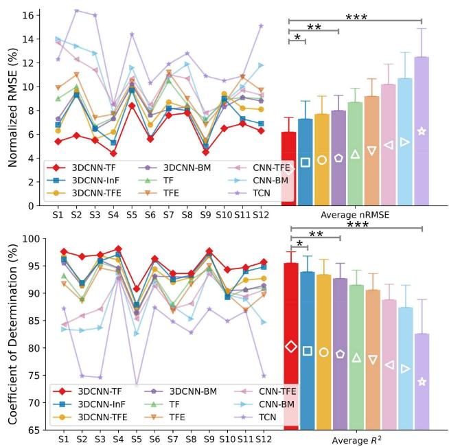
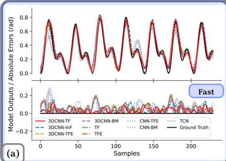
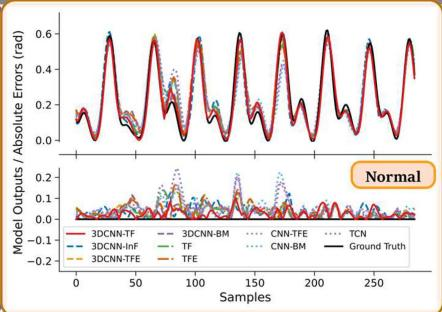
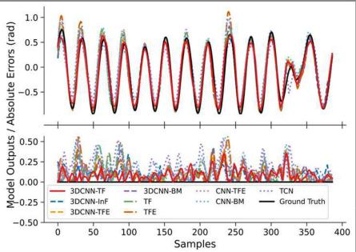
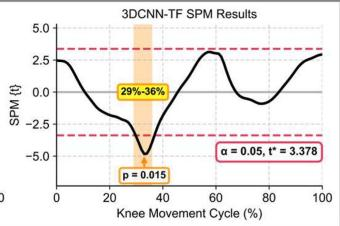

# 基于肌肉解剖学与序列到序列翻译的 Transformer 框架用于 sEMG 连续关节运动学预测

Zijun Wei , Zhiqiang Zhang , Senior Member, IEEE, and Sheng Quan Xie , Fellow, IEEE

摘要—实现康复机器人按需辅助（assist-as-needed, AAN）控制的关键在于准确预测患者的运动意图。本研究首次从序列到序列（sequence-to-sequence）翻译的角度重新定义了运动意图预测，将表面肌电（sEMG）信号和关节角度分别类比为源语言和目标语言。所提出的 3DCNN-TF 模型实现了神经控制信号向运动学表征的精确翻译。该模型包含三个模块：一个将多个 sEMG 滑动窗口编译为“句子”的 sEMG “句子”生成模块；一个基于肌肉解剖学和电极布局、用于从“句子”中的每个“单词”提取肌肉协同特征的 3DCNN 模块；以及一个自回归生成下一个关节角度作为翻译结果的 Transformer (TF) 模块。实验结果表明，在不同速度下连续预测腕部和膝关节屈曲/伸展角度时，与八种基线模型及现有研究相比，3DCNN-TF 模型取得了更优越的综合性能。此外，3DCNN-TF 在预测精度与计算效率之间取得了最佳平衡，同时表现出卓越的鲁棒性和泛化能力。具体而言，3DCNN-TF 在腕部和膝部数据集上分别取得了 (6.2% /95.5% ) 和 (5.5% /96.2% ) 的平均 nRMSE 和 R2 值，平均训练时间少于两分钟。此外，3DCNN-TF 可以在不损失精度的情况下提前长达 300 ms 预测关节角度，这对于康复机器人的实时 AAN 控制至关重要。

索引词—表面肌电图（sEMG），上肢康复，深度学习，肌肉解剖学，序列到序列，连续关节运动学估计方法。

## I. 引言

大约 85% 的患者在中风后会出现偏瘫，即使在康复治疗后，其上下肢仍存在持续的运动功能障碍，从而严重影响其生活质量 [1]。然而，大多数现有的康复机器人仅能基于阻抗和导纳控制提供被动辅助，这不足以显著改善患者的运动功能 [2]。研究 [3] 表明，提高康复效率的关键在于最大限度地提高患者的主动参与度和训练强度，而不仅仅是依赖机器人的辅助。这与神经可塑性原理相吻合，该原理强调有效的康复需要患者持续且主动的参与，以诱导大脑和神经系统的重塑。因此，开发一种能够根据患者的用力程度实时精确调节机器人辅助力的“按需辅助”（Assist-As-Needed, AAN）控制策略至关重要。实现这一目标的关键在于对患者运动意图的准确且连续的预测 [3]。先前的研究表明，表面肌电图（surface electromyography, sEMG）由于其无创性和便携性，已被广泛用于预测运动意图 [4]。因此，本研究将进一步探究基于 sEMG 的关节运动学连续估计。

基于我们对过去十年中 186 项相关研究的系统性综述 [4]，深度学习（deep learning, DL）已被广泛应用于利用 sEMG 连续预测关节运动学和动力学。DL 能够从 sEMG 中自动提取并选择高级特征，并利用神经网络的拟合能力建立这些特征与运动意图之间的非线性映射。该综述 [4] 还强调，目前大多数 DL 模型都集中在结合卷积神经网络（convolutional neural networks, CNN）、循环神经网络（recurrent neural networks, RNN）和多头自注意力（multi-head self-attention, MSA）机制的混合神经网络上，例如 CNN-BM（结合 MSA 的 CNN-BiLSTM）。与仅采用 CNN 或 RNN 的模型相比，这些组合展现出了更优越的预测性能。具体而言，CNN-BM 首先使用 CNN 从 sEMG 中提取空间特征，然后应用 BiLSTM 捕捉这些特征之间的长期双向上下文依赖关系，从而获得 sEMG 的时空表征，

随后利用 MSA 来增强关键时空特征的权重。

然而，MSA（多头自注意力机制）的注意力分布仅作用于 BiLSTM 提取的时空特征，而 BiLSTM 由于其循环结构仍存在固有局限性，例如记忆长程上下文关系的能力有限、训练过程中存在梯度消失或梯度爆炸的风险，以及缺乏并行计算能力 [4], [5]。相比之下，Transformer（TF）模型克服了这些局限性。TF 能够同时捕获序列中所有位置之间的上下文关系，而不依赖于时序先后顺序，这使其对时间距离不敏感。因此，在最新的研究中，TF 及其变体 BERT 已取代了 BiLSTM [4], [5], [6]。然而，根据从 PubMed、Web of Science、Scopus 和 IEEE Xplore 检索到的所有相关文献 [5], [6], [7], [8], [9], [10], [11], [12], [13], [14], [15], [16], [17], [18]，除研究 [7]、[17] 和 [18] 外，大多数研究仅采用了 TF 编码器（TFE）来进行基于 sEMG（表面肌电信号）的关节运动学连续估计。该方法仅利用了 TFE 在捕获输入序列内部上下文依赖关系方面的优势，却忽略了 TF 解码器（TFD）基于 TFE 提供的上下文表征生成具有时间相关性的目标序列的潜力。

此外，尽管研究 [7]、[17] 和 [18] 采用了完整的编码器-解码器架构，但它们均采用了作为 TF 变体的 Informer（InF）模型 [19]。事实上，InF 是为长程时间序列预测而设计的，其稀疏 MSA 和蒸馏操作可能会丢失短 sEMG 特征序列中的细节信息，从而降低预测性能 [20]。此外，InF 解码器是一次性生成整个目标序列，而不是以自回归方式逐步生成。尽管这种方法可以提高推理速度并捕获更长的时间依赖性，但由于缺乏增量反馈，模型无法动态调整输出，从而可能导致误差累积 [20]。鉴于 sEMG 的非平稳特性需要精确捕获短期时间特征和高频动态，且考虑到 sEMG 滑动窗口属于短时序列，InF 可能并非最佳选择。相反，采用具有全 MSA 和自回归生成机制的 TFD 或许能最大化预测精度。

根据我们综述中的结论，DL（深度学习）模型的核心理念应围绕准确提取 sEMG（表面肌电图）的时空特征、增强关键特征的权重，并基于这些特征之间的上下文依赖关系推导输入与输出之间的因果关系，同时尽可能滤除冗余特征与噪声，以提高预测精度和鲁棒性 [4]。此外，该综述强调了提取肌肉协同（Muscle Synergy, MS）特征的重要性，这可以进一步消除由于个体差异、sEMG 的时变特性以及主动肌与拮抗肌之间的耦合与串扰而在 sEMG 中产生的冗余与噪声成分。因此，基于这些结论，我们采用 CNN-BM 作为基础模板，并对 CNN 和 BM 模块进行改进，以实现更好的运动意图预测性能。

我们在近期关于 MS 特征提取的研究 [21] 中，在保持 BM 模块不变的情况下，从四个不同角度改进了 CNN-BM 中的 CNN 模块，证明了与其他方法相比，基于目标肌肉解剖结构和 sEMG 电极排布的 3DCNN-BM 实现了最高效的 MS 特征提取能力和最佳的运动意图预测性能。因此，本研究继续采用研究 [21] 中的 3DCNN 来提取 MS 特征，并将 3DCNN-BM 作为基线模型之一。

此外，本研究的底层基本逻辑在于：根据肌肉骨骼动力学和运动学，肢体运动过程中的 sEMG 信号与相应的关节角度可以被视为两种生理语言，以不同形式表征相同的神经控制信息。具体而言，sEMG 表征了基于动作电位的隐式神经指令，而关节角度是肌肉收缩的显式运动结果，这表明二者之间存在很强的因果对应关系。从语言翻译的角度来看，利用 sEMG 预测关节角度类似于同声传译，要求模型将 sEMG 的隐式神经语言翻译为作为运动学表达的关节角度。因此，本研究使用基于序列到序列（Seq2Seq）的 TF（Transformer）改进 3DCNN-BM 中的 BM 模块，从而实现从 sEMG 到关节角度的精准翻译。

所提出的 3DCNN-TF 模型由三个模块组成：一个 sEMG“句子”生成模块，将每个 sEMG 滑动窗口解释为一个“单词”，并在允许的预测延迟内将多个“单词”组合成一个“句子”；一个 3DCNN 模块，从 sEMG“句子”中的每个“单词”提取 MS 特征；以及一个 TF 模块，基于 MS 特征序列与先验关节角度序列之间的全局上下文依赖关系，逐步生成下一个关节角度作为翻译结果。

值得注意的是，TF 模块在传统 TF 架构的基础上结合了五项关键改进：引入了额外的分段编码（segment encoding）以区分“句子”内“词”的时序顺序；在 TFE 中由 3DCNN 模块替代传统的嵌入层，以提取 MS 特征作为每个“词”的语义表示；在 TFD 中集成了额外的因果掩码（causal mask），以在生成下一关节角度时严格遵循时间因果性；在自回归循环训练期间采用了基于计划采样（Scheduled Sampling）[22] 的动态 Teacher Forcing 策略，以加速模型收敛并减轻误差累积；与传统的多层 TF 设计不同，所提出的 TF 模块中的 TFE 和 TFD 均为单层结构，在保持预测性能的同时显著降低了计算复杂度。

所提出的 3DCNN-TF 模型在我们自建的手腕关节数据集以及来自 EPIC Lab [23] 的公开下肢数据集上进行了验证。该模型与八个基线模型（3DCNN-InF、3DCNN-TFE、3DCNN-BM、TF、TFE、CNN-TFE、CNN-BM 和 TCN）进行了对比，用于预测慢速、正常速度和快速平地行走期间的手腕和膝关节屈/伸角度。实验结果表明，3DCNN-TF 模型取得了最优的综合性能，兼顾了预测精度与计算效率，同时展现出卓越的泛化性和鲁棒性。此外，3DCNN-TF 模型能够在不损失预测精度的情况下提前 300 毫秒（ms）预测关节角度。总体而言，本研究的主要贡献在于首次从 Seq2Seq 翻译的角度重新定义了运动意图预测问题。具体而言，它改进了先前 3DCNN-BM [21] 中的 BM 模块，从而实现了对 CNN-BM 框架的全面提升。通过将 sEMG 信号和关节角度分别比作源语言和目标语言，所提出的 3DCNN-TF 模型将目标肌肉的解剖学先验知识与 Seq2Seq 算法相结合，实现了从 sEMG 信号到手腕及膝关节角度的高精度与前瞻性翻译。

  
(a)

  
(b)  
Fig. 1. IRASS 和 EPIC 数据集的实验方案 [24], [23]。

## II. 材料

## A. IRASS 数据集

该数据集已获得利兹大学（University of Leeds）数学与物理科学及工程联合学院研究伦理委员会（MEEC 18-002）的批准，共有 12 名受试者（8 名男性和 4 名女性，年龄为 28.9 ± 2.8 岁）签署了知情同意书并参与了实验。

如图 1(a) 所示，实验前，所有受试者被要求保持直立姿势，肘部屈曲 90 度，肩部外展 90 度，手部处于中立位。随后，记录每位受试者的最大自主收缩（maximum voluntary contraction, MVC）值，用于归一化 sEMG 信号。实验过程中，受试者被要求进行连续的腕部屈伸运动，同时掌指（metacarpophalangeal, MCP）关节完全伸展，并避免腕部尺偏和桡偏。每位受试者进行五次试验，每次试验之间休息三分钟以防止肌肉疲劳。

腕部屈/伸运动使用 VICON 动作捕捉系统（VICON Motion Systems Ltd., U.K.）以 250 Hz 的频率进行记录。根据 VICON 上肢模型，在受试者的右臂上放置了 16 个相应的反光标记点，使 VICON Nexus 软件能够计算腕关节的屈/伸角度。同时，使用 Avanti 传感器（Delsys TrignoTM）以 2000 Hz 采集来自两块屈腕肌：桡侧腕屈肌（flexor carpi radialis, FCR）和尺侧腕屈肌（flexor carpi ulnaris, FCU），以及三块伸腕肌：尺侧腕伸肌（extensor carpi ulnaris, ECU）、桡侧腕长伸肌（extensor carpi radialis longus, ECRL）和桡侧腕短伸肌（extensor carpi radialis brevis, ECRB）的 sEMG 信号。此外，为确保 sEMG 信号的质量，对受试者的前臂进行了刮毛并用酒精清洁，以尽量减少皮肤阻抗和运动伪影。电极放置位置根据 SENIAM 指南确定，并通过触诊和信号质量评估进行确认。最后，使用 VICON Nexus 软件中的触发模块对 sEMG 数据和关节角度数据进行同步，并重采样至 1000 Hz。

## B. 开放获取 EPIC Lab 数据集

为进一步评估 3DCNN-TF 模型在不同关节间的泛化能力，本研究采用了来自 EPIC Lab 的公开下肢数据集 [23]。该数据集包含来自 22 名健康受试者（身高 $1 . 7 0 \pm 0 . 0 7 \mathrm { m }$ ，体重 $6 8 . 3 \pm 1 0 . 8 3 $ kg，年龄 21 ± 3.4 岁）的数据。每位受试者的详细信息见文献 [23]。为与 IRASS 数据集中的受试者数量保持一致，从该数据集中选取了 12 名受试者（6 名男性和 6 名女性）。

如图 1(b) 所示，本研究使用了这 12 名受试者在平地行走时的数据。每位受试者以三种不同的速度进行环形行走：慢速（0.88 ± 0.19 m/s）、正常速度（1.17 ± 0.21 m/s）和快速 $( 1 . 4 5 \pm 0 . 2 7 \mathrm { m / s } )$，在每个速度下分别沿逆时针和顺时针方向各重复五次。

使用电子角度计（Biometrics Ltd., Newport, U.K.）以 1000 Hz 的采样率记录膝关节屈曲/伸展角度。同时，还以 1000 Hz 的采样率采集了右下肢 11 块目标肌肉的 sEMG 信号（Biometrics Ltd., Newport, U.K.）。电极放置位置通过触诊并根据 SENIAM 指南确定。此外，与 IRASS 数据集类似，实验前对电极放置部位进行了剃毛并用酒精清洁。另外，由于膝关节屈曲/伸展并不涉及所有 11 块肌肉，本研究仅使用了与膝关节屈曲/伸展相关的 6 块肌肉的 sEMG 信号：半腱肌（semitendinosus, ST）、股薄肌（gracilis, GR）、股二头肌（biceps femoris, BF）、股直肌（rectus femoris, RF）、股外侧肌（vastus lateralis, VL）和股内侧肌（vastus medialis, VM）。

## C. 信号预处理

鉴于 sEMG 信号的有效频率范围在 20-400 Hz 之间，该范围之外的分量主要由运动伪影和噪声组成 [25]，首先对两个数据集中的 sEMG 信号应用了 20-400 Hz 的五阶巴特沃斯（Butterworth）带通滤波器，随后使用 50 Hz 陷波滤波器消除工频干扰。为了获得更平滑的 sEMG 包络信号以实现稳定的模型训练和更快的收敛，随后应用了全波整流和 5 Hz 五阶巴特沃斯低通滤波器。最后，由于仅对 IRASS 数据集记录了 MVC 值，IRASS 数据集的 sEMG 包络根据其各自的 MVC 值进行归一化，而 EPIC 数据集的 sEMG 包络则使用 Z-score 归一化。对于关节角度，两个数据集均使用 5 Hz 的五阶巴特沃斯低通滤波器进行平滑处理，随后采用最小-最大归一化（min-max normalization）分别将腕关节和膝关节角度线性缩放至 [-1, 1] 和 [0, 1] 的范围内。

  
Fig. 2. (a) IRASS 数据集的 2D sEMG 帧重构。(b) EPIC 数据集的 2D sEMG 帧重构。(c) 使用 IRASS 数据集展示的 3DCNN-BM 模型框架。

关于滑动窗口分割，在实时应用中控制系统延迟不应超过 300 ms，以避免用户察觉到明显的系统延迟 [26]。此外，在实验中膝关节的运动速度快于腕关节，过短的窗口无法捕获足够的信息，从而会降低预测精度。相反，较长的窗口会引入冗余并增加延迟，且不会提高预测性能。因此，在评估了从 50 ms 到 250 ms（以 50 ms 为步长递增）的五种窗口大小后，对 IRASS 数据集应用了 250 ms 的滑动窗口，对 EPIC 数据集应用了 150 ms 的滑动窗口，重叠率均为 80%，从而在预测精度和延迟之间实现了最佳平衡。

## III. 方法

本节详细介绍了所提出的 3DCNN-TF 模型中的各个模块，并对八个基准模型进行了描述。此外，还讨论了所采用的超参数和损失函数设置，以及用于定量评估各模型预测精度和训练效率的性能指标。

## A. 基于 3DCNN 的 MS 特征提取模块

本研究采用与 [21] 相同的方法，从 sEMG 视频片段中提取 MS（肌肉协同，Muscle Synergy）特征作为语义。每个 2D sEMG 帧代表目标肌肉在每个时刻跨解剖截面的相对收缩率。因此，堆叠的多帧 sEMG 视频片段代表了该截面内目标肌肉的三维动态收缩过程。图 2(a) 和 (b) 分别展示了将来自 IRASS 和 EPIC 数据集的 1D sEMG 信号重构成 2D sEMG 帧的过程。具体而言，以电极放置位置作为解剖截面，通过 Complete Anatomy 软件（3D4Medical Ltd.）获取腕关节和膝关节目标肌肉的解剖分布。此外，目标肌肉中心与电极之间的中点随后被指定为该目标肌肉在 2D sEMG 帧中的新位置。

图 2(c) 以 IRASS 数据集为例展示了 3DCNN-BM 模型框架。在滑动窗口大小为 250 ms 时，每个窗口包含 250 帧 4×6 的 2D sEMG 帧。这些帧首先被堆叠成视频片段，随后送入配有尺寸为 4×6 的全覆盖卷积核的 3DCNN 中以提取 MS 特征。应用批量归一化（BN）以增强训练稳定性并加速收敛，并利用 LeakyReLU 激活函数提高 3DCNN 的非线性表征能力，从而实现全面的 MS 特征提取。执行平均池化以在保留关键 MS 特征的同时减少特征冗余和噪声。随后，维度为 256 的 MS 特征被传递到 BM 模块，该模块包含单层 BiLSTM 和具有 8 个头的 MSA。该模块捕获 MS 特征元素之间的双向上下文依赖关系，并为关键依赖项分配更高的权重，从而进一步强化关键 MS 信息。最后，采用两个带有 LeakyReLU 激活的全连接（FC）层来建立 MS 特征与关节角度之间的精确非线性映射。

## B. sEMG“句子”生成模块

与以往仅基于单个 sEMG（表面肌电图）滑动窗口预测关节角度的研究不同，本研究从机器翻译的视角引入了一种多窗口到多角度的句子级翻译框架，将采集到的完整 sEMG 信号视为需要翻译的“段落”。因此，每个滑动窗口被视为该“段落”中的一个“词”，这些“词”按时间顺序排列组成“句子”，且每个“句子”由相同数量的“词”组成。考虑到实际应用中最大 300 ms 的预测延迟以及 80% 的滑动窗口重叠率，IRASS 和 EPIC 数据集中的每个 sEMG “句子”分别包含六个 250 ms 和十个 150 ms 的 sEMG “词”。同样，作为这些 sEMG “词”和“句子”的翻译结果，关节角度的“词”和“句子”也采用相同的方法生成。

  
Fig. 3. 使用 IRASS 数据集展示的所提出的 3DCNN-TF 模型框架。

如图 3 所示，以 IRASS 数据集为例，sEMG “句子”生成模块的输出形状为 (Batch size $\times ~ 6 ~ \times ~ 2 5 0 \times 5 )$ ，表明每个“句子”包含六个“词”，每个“词”的尺寸为 $2 5 0 \times 5 .$ 。然后将这些“词”输入到 3DCNN 模块中，其中每个“词”被重构为 250 个 sEMG 帧。随后，一个“句子”内的所有 sEMG 帧被堆叠成视频片段并输入到 3DCNN 中，以提取每个“词”的 MS（多尺度）特征。最终，每个“句子”中的六个“词”被转换为六个 256 维的 MS 特征 (Batch size $\times \ 6 \times 2 5 6 )$ )，作为后续 TF 模块的输入。

## C. 基于 Seq2Seq 的 Transformer 模块

如图 3 所示，TF 模块包括四个主要组成部分：位置和分段编码、基于 MSA 的 TFE、带有因果掩码 MSA 和多头交叉注意力（MCA）的 TFD，以及自回归生成循环。此外，由于 MS 特征提取模块取代了 TFE 之前的传统嵌入层，因此仅保留 TFD 之前的嵌入层，以将输入的关节角度标签转换为与 MS 特征维度相同的向量表示。这使得 TFD 能够更好地捕获并对齐 MS 特征与关节角度特征之间的跨序列依赖关系。

与基于循环结构的 BiLSTM 不同，TF 模型并行处理所有输入数据，因此缺乏对输入内部时序关系的固有理解。因此，本研究首先利用基于正弦和余弦函数的固定位置编码（positional encoding）来标记 MS 和关节角度序列中元素的相对位置。此外，还需要额外的标记来帮助 TF 模块区分同一“句子”内不同“词”的排列。受 BERT 模型 [27] 中下一句预测（Next Sentence Prediction, NSP）的启发，本研究添加了基于“词”位置索引的分段编码（segment encoding），以区分每个特征序列属于哪个“词”。最后，在将 MS 和关节角度序列输入 TFE 和 TFD 之前，将这两种编码与序列相加，使 TF 模块能够理解这些特征序列中的局部和全局顺序。

与先前采用多层编码器-解码器结构的研究 [5], [6], [7], [8], [9], [10], [11], [12], [13], [14], [15], [16], [17], [18] 不同，大量实验验证表明，本研究仅使用单层 TFE 和 TFD 即可实现最佳性能。如图 3 所示，TFE 由 MSA 和前馈网络（feed-forward network, FFN）组成，两者均集成了层归一化（layer normalization, LN）和残差连接，表示为 LayerNorm (x + MSA (x)) 和 LayerNorm (x + FFN (x))。这种设计确保了 MSA 和 FFN 的训练稳定性，并缓解了梯度消失问题。此外，MSA 的注意力头数和模型维度分别设置为 h= 8 和 $d _ { \mathrm { m o d e l } } = 2 5 6$，使 MSA 能够从八个不同的视角并行捕获 MS 序列内的全局上下文依赖关系。具体而言，自注意力（self-attention, SA）和 MSA 的公式如下 [28]：

$$
\begin{array}{l} \text { SA } (Q, K, V) = \text { softmax } \left(\frac {Q K ^ {T}}{\sqrt {d _ {k}}}\right) V \\ \text { MSA } (Q, K, V) = \text { Concat } (\text { head } _ {1}, \ldots , \text { head } _ {\text { h }}) W ^ {O} \\ \text { where   head } _ {\text { i }} = \text { SA } \left(Q W _ {i} ^ {Q}, K W _ {i} ^ {K}, V W _ {i} ^ {V}\right) \end{array}
$$

此处，查询（Q）、键（K）和值（V）均来自输入 MS 特征序列的线性投影。对于每个注意力头，Q、K 和 V 的投影矩阵分别为 $W _ { i } ^ { Q } \in \mathbb { R } ^ { d _ { \mathrm { m o d e l } } \times d _ { k } }$、$W _ { i } ^ { K } \in \mathbb { R } ^ { d _ { \mathrm { m o d e l } } \times d _ { k } }$ 和 $W _ { i } ^ { V } \in \mathbb { R } ^ { d _ { \mathrm { m o d e l } } \times d _ { v } ^ { \circ } }$，每个头的维度设置为 $d _ { k } = d _ { v } = d _ { \mathrm { m o d e l } } ~ / h = 3 2$。点积 $Q K ^ { T }$ 用作相似度得分，以衡量 MS 特征序列内各元素之间的相关性。随后，softmax 函数将这些相关性转换为每个 MS 元素的注意力权重，然后与 V 进行加权求和，以突出 MS 序列中的关键信息。归一化缩放因子 $\sqrt { d _ { k } }$ 确保了高维情况下 softmax 的梯度稳定性。最后，拼接所有注意力头的输出，并通过 $W ^ { 0 } \in \mathbb R ^ { h d _ { v } \times d _ { \mathrm { m o d e l } } }$ 进行线性变换以获得最终输出。FFN 通过逐位置非线性变换进一步精炼并记忆 MS 特征序列中的关键信息。

由于传统 TFD 在训练期间接收完整的真实标签序列，为了使训练过程与推理期间的自回归生成更好地对齐，传统 TFD 中的 MSA 应用了因果掩码（causal masking），确保训练期间仅当前和过去的时间步可见，而未来的时间步保持不可访问。然而，本研究采用了自回归训练循环，其中 TFD 仅接收历史时间步，未来的时间步被显式置零，从而消除了对因果掩码的需求。尽管如此，由于 MSA 仍会关注输入序列中的所有位置，因此仍保留了因果掩码，以防止未来时间步的零值扭曲注意力权重分布，并减少不必要的计算。

MCA 与 MSA 类似，不同之处在于 Q 源自已知关节角上下文的投影，而 K 和 V 源自经 TFE 精炼后的 MS 关键上下文表征的投影。这使得 MCA 能够从多个角度捕捉 MS 与关节角之间的跨序列依赖关系。与传统 TFD 不同，因果掩码也应用于 MCA 的 K 和 V 输入，以防止在生成当前步预测时使用未来的 MS 信息。这迫使 MCA 更多地关注历史关键 MS 数据，避免将注意力分配给无关的 MS 数据，从而提高了预测精度和计算效率。

传统 TF 训练中使用的 Teacher Forcing（教师强制）在每个时间步均采用真实标签作为输入。然而，在推理过程中，传统 TF 仅依赖其自身先前的预测，从而导致曝光偏差和误差累积 [22]。因此，本研究在自回归循环中采用了具有线性衰减的 Scheduled Sampling（计划采样）[22]，在训练期间动态调整使用 Teacher Forcing 的概率，以使模型逐步适应推理时所采用的自回归生成模式。该方法的公式如下：

$$
\begin{array}{c} x _ {t} = \left\{ \begin{array}{l l} y _ {t - 1} ^ {\text {true}}, & \text {if r <   p_{tf} (e)} \\ \hat {y} _ {t - 1}, & \text {if r\geq p_{tf} (e)} \end{array} \right. \\ p _ {\text {tf}} (e) = 1 - \frac {e}{E} \end{array}
$$

其中 $e$ 和 $E$ 分别表示当前轮数（epoch）和总轮数，$r$ 是 $[0, 1]$ 范围内的随机数。基于概率 $p _ { \mathrm { t f } } ( e )$，模型决定在当前时间步是否使用真实标签 $y _ { t - 1 } ^ { \mathrm { t r u e } }$ 作为 TFD 的输入 $x _ { t }$。如图 Fig. 3 所示，当 $r$ 小于 $p _ { \mathrm { t f } } ( e )$ 时，TFD 使用真实关节角度标签 $y _ { t - 1 } ^ { \mathrm { t r u e } }$ 作为输入；否则，它使用上一步的预测值 $\hat { y } _ { t - 1 }$。随着训练的进行，$p _ { \mathrm { t f } } ( e )$ 逐渐减小，使 $x _ { t }$ 从最初完全依赖 $y _ { t - 1 } ^ { \mathrm { t r u e } }$ 线性过渡到最终仅使用 $\hat { y } _ { t - 1 }$。这有助于模型在推理过程中动态调整下一步预测，减少误差累积并提高泛化能力。

## D. 基线模型

本研究采用了八个基线模型，其中包括五个用于针对 3DCNN 和 TF 模块进行消融实验的模型，以及三个来自近期研究的代表性 DL（深度学习）模型。五个消融模型包括 3DCNN-Inf、3DCNN-TFE 和 3DCNN-BM，它们分别依次将 3DCNN-TF 中的 TF 模块替换为 Inf、TFE 和 BM 模块；以及完全移除了 3DCNN 模块的 TF 和 TFE 模型。另外三个代表性模型为 CNN-TFE、CNN-BM 和 TCN。

具体而言，3DCNN-Inf 中的 Inf 模块采用了与 [19] 相同的架构设计。为实现最佳预测性能，经多次实验验证，3DCNN-Inf 中的编码器和解码器均设置为四层。每一层均使用 ProbSparse MSA 和蒸馏操作。此外，为了进行公平比较，ProbSparse 注意力头数和模型维度分别设置为 8 和 256，与 3DCNN-TF 保持一致。3DCNN-TFE 是通过从 3DCNN-TF 中移除 TFD 和自回归循环部分衍生而来的，仅保留了位置和分段编码、TFE 以及 FC 层。TF 和 TFE 分别用嵌入维度为 $d _ { \mathrm { m o d e l } } = 2 5 6 .$ 的嵌入层替换了 3DCNN-TF 和 3DCNN-TFE 中的 3DCNN 模块，且其输入从 MS 特征变为预处理后的 sEMG 信号。

对于代表性模型，CNN-TFE 和 CNN-BM 是通过使用具有常规 $3 \times 3$ 卷积核的三通道 2DCNN 替换 3DCNN-TFE 和 3DCNN-BM 中的 3DCNN 模块构建的，通道数分别设置为 64、128 和 256。最后，TCN 基于 EPIC 数据集 [29] 中使用的 TCN 架构进行了修改，包含三个通道大小分别为 64、128 和 256 的残差块。每个残差块包含两个一维因果空洞卷积（1D causal dilated convolutional）层，其空洞因子和卷积核大小与 [29] 保持一致。

## E. 模型训练设置

为了最小化训练环境的影响，所有模型均在 Google Colab 平台上使用 Pytorch 框架进行开发和训练。为了确保可复现性和公平比较，所有模型均采用了相同的超参数设置。具体而言，模型训练采用 AdamW 优化器，批大小为 256，初始学习率设置为 0.001。采用自适应学习率衰减策略以促进模型收敛：一旦验证损失趋于平稳，学习率便逐步按 0.8 的比例衰减。此外，LeakyReLU 激活函数的斜率设置为 0.1，并应用了 20% 的 dropout 率以防止过拟合。上述所有超参数值均通过迭代实验确定。

此外，为了确保收敛性以及训练时间的公平比较，所有模型均训练了 1000 个 epoch。预测关节角度与真实关节角度之间的均方误差（MSE）被用作训练损失函数。

在数据划分方面，每位受试者的数据被随机划分为 80% 的训练集和 20% 的测试集。考虑到康复设备在实际应用中的计算资源有限，模型训练在一张入门级 NVIDIA Tesla T4 GPU 上进行，其计算性能与 NVIDIA GeForce RTX 2070 相当。该配置模拟了临床设备的运行环境，确保了实验结果的实际应用价值。

## F. 性能指标

本研究采用归一化均方根误差（normalized root mean square error，nRMSE）和决定系数 $( \mathbb { R } ^ { 2 } )$ 作为性能指标，分别用于评估误差大小以及预测关节角度与实际关节角度之间的相关性。考虑到本研究中的跨数据集比较，本研究选择了对样本量和输出范围变化具有鲁棒性的 nRMSE，而非 RMSE。$\mathrm { R } ^ { 2 }$ 用于评估各模型的整体拟合优度，在性能评估中有效地补充了 nRMSE。这两个指标的计算公式如下：

$$
\begin{array}{c} \text {nRMSE} = \frac {\sqrt {\frac {1}{N} \sum_ {i = 1} ^ {N} \left(\theta_ {i} - \hat {\theta} _ {i}\right) ^ {2}}}{\theta_ {\max} - \theta_ {\min}} \\ R ^ {2} = 1 - \frac {\operatorname{Var} (\theta - \hat {\theta})}{\operatorname{Var} (\theta)} \end{array}
$$

其中 $\theta$ 和 $\hat { \theta }$ 分别表示真实和预测的关节角度，$N$ 表示样本量。较低的 nRMSE 值以及越接近 1 的 $\mathtt { R } ^ { 2 }$ 值表示更高的准确性。

此外，与 RMSE 和 $\mathrm { R } ^ { 2 }$ 等全局性能指标不同，本研究利用基于双尾 t 检验的统计参数图（Statistical Parametric Mapping，SPM）在整个时间序列上进行连续统计推断。在对所有受试者的运动周期进行时间和关节角度的双重归一化后，使用 SPM 识别周期内预测角度与真实值之间存在显著差异的具体区间，显著性水平设为 $\alpha = 0 . 0 5$。

值得注意的是，为了进一步量化所有模型的综合性能，本文提出了一种综合性能指标（overall performance index，OPI），融合了预测精度（nRMSE 和 $\scriptstyle \mathrm { R } ^ { 2 } )$ 以及计算效率（训练时间）。具体而言，OPI 的计算公式如下：

$$
\begin{array}{l} \text { OPI } = w _ {P} \cdot \left[ \frac {(1 - \mathfrak {n} \mathrm{RMSE} _ {\mathrm{norm}}) + R _ {\mathrm{norm}} ^ {2}}{2} \right] \\ \quad + w _ {T} \cdot \exp (- \mathrm{Time} _ {\mathrm{norm}}) \end{array}
$$

其中 $w _ { P }$ 和 $w _ { T }$ 分别为预测精度和训练时间的权重，且满足 $w _ { P } + ~ w _ { T } = ~ 1$。$\text{nRMSE}_{\text{norm}}$、$\bar { R } _ { \mathrm { n o r m } } ^ { 2 }$ 和 ${ \mathrm { T i m e } } _ { \mathrm { n o r m } }$ 分别表示每个模型的归一化 nRMSE、$\mathtt { R } ^ { 2 } .$ 和归一化训练时间。在本研究中，$w _ { P }$ 和 $w_T$ 均设置为 0.5，以平衡预测精度的重要性与模型在实际应用场景中的实用性。值得注意的是，训练时间采用指数衰减函数进行非线性惩罚，从而更好地反映了实际应用中对训练时间的容忍度。

  
Fig. 4. 所有模型在 IRASS 数据集上的 $\text{nRMSE} / \mathsf { R } ^ { 2 }$ 结果，以及各模型的平均 $\text{nRMSE} / \mathsf { R } ^ { 2 }$ 值和相应的标准差。显著性水平设置为 0.05（$p <$ 0.001、$p < 0 . 0 1$ 以及 ${ } * p < 0 . 0 5 { \mathrm { ) } }$

## IV. 结果

## A. 所有模型的预测结果

1) IRASS 数据集：Fig. 4 展示了所有模型在 IRASS 数据集上的 nRMSE 和 $\mathrm { R } ^ { 2 }$ 结果。与其他模型相比，3DCNN-TF 在所有受试者中均始终表现出更优越的预测性能。具体而言，在 12 名受试者中，它取得了最低的平均 nRMSE（6.2% ）和最高的平均 $\mathrm { R } ^ { 2 }$（95.5% ）。此外，从柱状图中的误差棒分布可以看出，3DCNN-TF 表现出了最高的预测稳定性，结果的变异性最小。其余模型按性能从优到劣的排序及其对应的平均 nRMSE 和 $\mathrm { R } ^ { 2 }$ 值如下：3DCNN-InF（7.3% /94% ）、3DCNN-TFE（7.7% /93.4% ）、3DCNN-BM（8% /92.8% ）、TF（8.7% /91.5% ）、TFE（9.2% /90.6% ）、CNN-TFE（10.2% /88.8% ）、CNN-BM（10.7% /87.4% ）和 TCN（12.5% /82.6% ）。

此外，为了系统评估 3DCNN-TF 相比于其他模型的性能优势，以模型类型作为被试内因素，对 nRMSE 和 $\mathtt { R } ^ { 2 } .$ 进行了单因素重复测量方差分析（one-way repeated measures ANOVA）。采用经 Holm-Bonferroni 校正的事后配对 t 检验（post-hoc paired t-tests）来评估 3DCNN-TF 与其他模型之间的差异，显著性水平设定为 $\alpha = 0 . 0 5$。统计分析表明，3DCNN-TF 的表现显著优于所有其他模型 $( \ p < 0 . 0 5 )$，有力地证明了 3DCNN-TF 在 IRASS 数据集上卓越的预测性能。

  
Fig. 5. 所有模型在 EPIC 数据集上三种步行速度下的 nRMSE/R2 结果，以及每个模型的平均 nRMSE/R2 值和相应的标准差。显著性水平设为 0.05 $( * * * p < 0 . 0 0 1$ 1, $p < 0 . 0 1$ , and $\stackrel { - } { * } p < 0 . 0 5 )$ 。

2) EPIC 数据集：Fig. 5 展示了所有模型在 EPIC 数据集上的 nRMSE 和 $\mathrm { R } ^ { 2 }$ 结果。除了快走试验中的受试者 S6 外，3DCNN-TF 在该试验的其他受试者中，以及在正常速度和慢速步行试验中均展现出最佳的预测性能。具体而言，3DCNN-TF 在全部 12 名受试者的三种步行速度下均取得了最低的平均 nRMSE 和最高的平均 $\mathtt { R } ^ { 2 }$：快走（5.4% /96.2%）、正常步速（5.2% /96.7%）和慢走（5.9% /95.7%），总平均值为（5.5% /96.2%）。同样，柱状图中的误差线表明，3DCNN-TF 始终表现出最低的性能变异性。其他模型在三种步行速度下的性能排序与在 IRASS 数据集中的顺序一致，对应的平均 nRMSE 和 $\mathrm { R } ^ { 2 }$ 值如下：3DCNN-InF（6.5% /94.7%）、3DCNN-TFE（6.9% /94.2%）、3DCNN-BM（7.3% /93.7%）、TF（7.7% /92.8%）、TFE（8.2% /91.7%）、CNN-TFE（9.2% /89.6%）、CNN-BM（9.7% /88.3%）和 TCN（10.6% /86.2%）。

采用与 IRASS 数据集中相同的统计显著性分析，结果显示 3DCNN-TF 与所有其他模型之间存在显著的性能差异（$p < 0 . 0 5$），进一步证明了其在 EPIC 数据集上的卓越预测性能。然而，值得注意的是，与快走和正常步速试验（$\left( \begin{array} { l } { p < 0 . 0 1 } \end{array} \right)$）相比，3DCNN-TF 与 3DCNN-InF 之间的性能差距在慢走试验中有所缩小（$p < 0 . 0 5$）。

3) 模型训练时间与 OPI 对比：Fig. 6 给出了所有模型在两个数据集上的训练时间和 OPI 得分。在 IRASS 数据集上，模型的训练时间按从短到长排序如下：3DCNN-BM、3DCNN-TFE、TFE、3DCNN-InF、3DCNN-TF、TF、CNN-BM、CNN-TFE 和 TCN。在 EPIC 数据集上，TF 的训练时间显著增加，仅次于训练时间最长的 TCN。然而，统计分析表明，3DCNN-TF 的训练时间与 3DCNN-BM 相比并无显著性差异（$\cdot > 0 . 0 5 )$，

  
Fig. 6. 所有模型在 IRASS 数据集和 EPIC 数据集上的训练时间与 OPI 得分。显著性水平设为 0.05（$\pmb { p } < 0 . 0 0 1$ , $p < 0 . 0 1$ , and p < 0.05）。

在 IRASS 数据集上，3DCNN-TFE、TFE 和 3DCNN-InF 的训练时间均在一分钟以内。在数据量平均比 IRASS 多出 30% 的 EPIC 数据集上，3DCNN-TF 的训练时间与其他所有模型相比表现出显著差异 $( \textit { \textbf { p } } < 0 . 0 5 )$ ，但其训练时间依然保持在两分钟以内。总体而言，尽管 $\mathrm { T F }$ 模块的训练时间随着数据集规模的增大而显著增加，3DCNN-TF 仍保持了相对较短的训练时间，并实现了最高的预测精度。因此，3DCNN-TF 在两个数据集上均取得了最高的 OPI 得分，显著优于所有基准模型。

  
Fig. 7. (a) 和 (b) 分别展示了所有模型在 IRASS 数据集和 EPIC 数据集上的关节角度预测示例，以及与实际关节角度相比的相应绝对误差值。(c) 3DCNN-TF 的 SPM 分析结果。

## B. 预测关节角度的代表性示例及 SPM 分析

图 7(a) 和 (b) 分别展示了所有模型在 EPIC 和 IRASS 数据集上的代表性预测示例。具体而言，从每个数据集中选取了三名代表性受试者，以直观比较实际关节角度与各模型预测角度之间的差异及其对应的绝对误差。这六名受试者的预测结果和误差表明，尽管在运动幅度和速度上存在个体差异，但与其他模型相比，3DCNN-TF 始终表现出更小的预测误差。值得注意的是，在关节角度拐点之间的稳定运动阶段，3DCNN-TF 的预测结果与实际关节角度高度一致。然而，在关节角度突变阶段，其预测误差有所增加，这表明在捕获瞬态 sEMG 特征方面仍有改进空间。图 7(c) 中的 SPM 结果证实了这一点。对于腕部，在最大屈曲阶段（0–22%，$p < 0 . 0 0 1 )$ 和最大伸展阶段（49-70%，$p < 0 . 0 0 1 )$ 观察到了显著性差异，而其余 57% 的稳态阶段则未表现出显著差异。对于膝关节，显著性差异仅出现在最大屈曲阶段（29–36%，$p = 0 . 0 1 5 )$，周期内其余 93% 的部分均无显著差异。

## C. 3DCNN-TF 的超前预测能力

由于固有的机电延迟（electromechanical delay, EMD），sEMG 信号在实际运动发生前约 30– 150 ms 便传递了运动意图信息 [4], [7]。这不仅有助于降低预测延迟，还能使模型预测未来的关节角度。如图 8(a) 所示，在 EPIC 和 IRASS 数据集中采集的 sEMG 信号与其对应的实际关节角度在时间上是非对齐的，sEMG 在 EMD 范围内被提前采集，从而为提前预测提供了契机。值得注意的是，即使不考虑 EMD，模型本身也可能具备预测未来关节角度的内在能力。

因此，本研究在时间上将 sEMG 与关节角度重新对齐，以测试 3DCNN-TF 的有效提前预测时间范围。如图 8(a) 所示，考虑到 EMD，在保持关节角度固定的同时，将 sEMG 信号向前进行时间平移，以验证实际的 EMD 范围以及 3DCNN-TF 本身的最大提前预测时间范围。时间平移范围设置为 0 至 900 ms，步长为 100 ms。

Fig. 8(b) 展示了 3DCNN-TF 在 EPIC 和 IRASS 数据集上跨不同提前时间范围的预测性能。结果表明，预测精度在超过 300 ms 时开始显著下降 $( \textit { \textbf { p } } < 0 . 0 5 )$，这表明 3DCNN-TF 最多可提前 300 ms 进行预测而无性能损失。此外，如果将 $\mathsf { R } ^ { 2 } \geq 9 0 \%$ 的阈值视为可接受范围，3DCNN-TF 最多可提前 600 ms 进行预测。值得注意的是，3DCNN-TF 在 100 ms 时表现出最佳性能和最小方差，这与 30–150 ms 的机电延迟（Electromechanical Delay, EMD）范围一致，从而验证了 EPIC 和 IRASS 数据集中的 EMD 约为 100 ms，而 3DCNN-TF 固有的提前预测能力约为 200 ms。

  
Fig. 8. (a) 评估前 sEMG-角度时间对齐。(b) 3DCNN-TF 在两个数据集上的提前预测能力。

## V. 讨论

## A. 所有模型的预测结果分析

基于 nRMSE、$\mathbf { R } ^ { 2 } { \mathrm { . } }$ 和训练时间的结果，所提出的 3DCNN-TF 模型在两个数据集上均表现出卓越的预测性能，平均训练时间少于两分钟。最高的 OPI 得分进一步验证了 3DCNN-TF 在预测精度和计算效率之间达到了最佳平衡。此外，在 EPIC 和 IRASS 数据集上的跨速度和跨关节实验进一步证明了与其他模型相比，3DCNN-TF 具有更出色的鲁棒性和泛化能力。

具体而言，3DCNN-TF 在 IRASS 数据集上的 nRMSE 和 $\mathrm { R } ^ { 2 }$ 平均标准差分别为 1.22% 和 2.01%，均显著低于基线模型（nRMSE：1.37%–2.67%；$\mathrm { R } ^ { 2 } \colon 2 . 2 3 \% - 5 . 8 9 \% \big )$。在 EPIC 数据集的三种不同步行速度下，3DCNN-TF 的 nRMSE 和 $\mathrm { R } ^ { 2 }$ 平均标准差分别为 0.86% 和 1.31%，同样低于基线模型（nRMSE：1.07%–1.78%；$\mathbf { R } ^ { 2 } { \boldsymbol { : } }$ 1.67%–4.12%）。对于跨关节比较，3DCNN-TF 在手腕和膝关节之间表现出相当的性能，在两个数据集上的平均 nRMSE 和 $\mathtt { R } ^ { 2 }$ 差异仅为 0.7%。此外，图 7(c) 中所有受试者手腕和膝关节周期的平均轨迹表明，3DCNN-TF 的预测与真实值之间具有极好的一致性。较窄的标准差带表明 3DCNN-TF 跨受试者、关节和运动速度具有强大的泛化能力和鲁棒性。

值得注意的是，尽管 3DCNN-TF 在三种步行速度下的性能没有显著差异 $( \mathrm { ~ \it ~ \ / ~ p ~ } > \mathrm { ~ 0 . 0 5 ) ~ }$，但其他基线模型在正常速度下均表现出显著更优的性能 $( \textit { p } < 0 . 0 5 )$。此外，所有模型的平均性能在正常速度下始终最高。一种可能的解释是，受试者在不熟悉的速度下必须有意识地调整步态和平衡，从而导致了非典型的运动控制和肌肉激活模式。此外，在这些条件下保持步态稳定性需要更多的肌肉募集，从而增加了 sEMG 串扰。至于 3DCNN-TF 在腕关节预测中的性能略逊于膝关节，可能有若干因素共同作用。首先，腕关节比膝关节具有更多的自由度，且在腕关节屈伸过程中可能会发生轻微的尺偏或桡偏，从而干扰 sEMG 信号。其次，EPIC 数据集比 IRASS 数据集包含更多的数据，导致数据量的不平衡，进而影响了模型学习。最后，如 Fig. 7 所示，步行是潜意识控制的，表现出更稳定的节律模式（93% 稳态区间）。相比之下，自主的腕部屈伸涉及速度和幅度上更大的变异性（57% 稳态区间），这给模型预测带来了额外的挑战。

## B. 3DCNN-TF 的前瞻预测能力

研究 [30] 表明，在实际肌肉收缩发生之前提供机器人辅助可以显著增强自主肌肉激活。这种快速辅助策略在不增加运动任务难度的情况下，有效提高了患者的康复效率。因此，评估 3DCNN-TF 针对未来关节角度的提前预测时间范围至关重要。具体而言，该时间范围需要涵盖康复机器人中的执行器响应延迟和系统通信延迟，以及来自信号采集与处理、滑动时间窗口和模型推理的延迟。事实上，由于滑动窗口在实时应用中是增量运行的，EPIC 和 IRASS 数据集的滑动窗口延迟对应于 20% 的非重叠部分，分别为 30 ms 和 50 ms。关于模型推理延迟，3DCNN-TF 在两个数据集的测试集上的平均计算时间为 21 ms。由于每个测试集平均包含 10 个关节运动周期，单个周期的推理延迟约为 2.1 ms。总体而言，鉴于 3DCNN-TF 最多可提前 300 ms 进行预测，在计入上述延迟后，剩余的缓冲时间足以用于实时预测和快速辅助，同时也降低了实际预测场景中与信号丢失和运动伪影相关的风险。

## C. 3DCNN-TF 的消融实验

1) 3DCNN 模块：3DCNN 模块的消融实验包含两组对比。第一组将 3DCNN-TF 和 3DCNN-TFE 与 TF 和 TFE 进行对比，第二组将 3DCNN-TFE 和 3DCNN-BM 与 CNN-TFE 和 CNN-BM 进行对比。这些对比共同证明了 3DCNN 模块的重要性及其相比于传统 CNN 的优越性。

首先，与 TF 和 TFE 相比，额外引入 3DCNN 模块不仅通过将平均 nRMSE 降低 22% 提高了预测性能，而且显著缩短了训练时间，特别是将 TF 的平均训练时间减少了 75%。其次，与传统 CNN 相比，3DCNN-TFE 和 3DCNN-BM 均取得了更好的预测性能和训练效率，平均 nRMSE 降低了 25%，训练时间缩短了 81%。此外，CNN-TFE 与 TFE 之间的对比进一步表明，使用传统 CNN 会降低 TFE 的预测性能，同时增加不必要的训练时间。这是因为传统 CNN 处理基于滑动窗口大小和电极通道构建的 sEMG 图像，其中 3×3 2D 卷积核仅局限于从 sEMG 图像中提取局部特征，无法充分捕获来自 sEMG 图像时空成分的 MS 特征。因此，这限制了后续 TFE 和 BM 模块的有效性。

相比之下，基于解剖学先验知识的 3DCNN 模块能够从原始 sEMG 中高效提取 MS 特征。这些具有生理可解释性的 MS 特征概括了关键的运动控制信息 [21]。因此，3DCNN 有效地消除了原始 sEMG 中的冗余特征和噪声，保留了肌肉收缩的动态时空特征，从而实现了 sEMG 信号的精炼与压缩。此外，由于每个 2D sEMG 帧中的像素数量明显低于完整 sEMG 图像，且 3DCNN 的卷积核可以覆盖整个 sEMG 视频片段，因此输入可以一步直接转化为 MS 特征。相反，2DCNN 仅提取局部特征，并需要多次池化步骤以实现有效的特征提取和降维。总体而言，3DCNN 不仅大幅降低了 MS 特征提取过程中的计算复杂度，而且为后续的 TF、TFE 和 BM 模块提供了更紧凑的 sEMG 表征。这有助于加快训练速度，并为 sEMG 中的关键 MS 特征建立更精确的上下文依赖关系，最终提高了性能和效率。

2) TF 模块：TF 模块的消融实验同样包含两组对比。第一组将 3DCNN-TF 与其他同样采用 3DCNN 的模型（3DCNN-InF、3DCNN-TFE 和 3DCNN-BM）进行对比，第二组将 TF 与 TFE 进行对比。这些对比共同验证了采用完整 TF 结构的必要性。

第一个对比表明，相较于在 3DCNN 之后接 InF、TFE 或 BM，3DCNN-TF 的平均 nRMSE 分别降低了 15.2%、19.9% 和 23.5%。第二个对比显示，TFD 的优势并不完全依赖于输入特征的质量。即使没有 3DCNN 提供的 MS 特征，TF 的表现仍然优于 TFE，平均 nRMSE 降低了 5.7%。这些显著的提升源于完整的 TF 架构相比于 InF、TFE 和 BM 所具备的三大关键优势：完整的 MSA、自回归生成以及 MCA。

首先，基于 sEMG 的关节角度预测是一项短期时间序列预测任务，需要捕获 sEMG 中的高频动态和细粒度特征。然而，专为长序列预测设计的 InF 在此场景下无法充分发挥其优势。这一局限性是因为 InF 在长期预测中牺牲了精度以换取计算效率，其 ProbSparse MSA 以及基于最大池化的蒸馏操作丢失了 MS 特征之间关键的上下文关系。相比之下，TF 的 MSA 能够捕获 MS 特征序列内完整的全局上下文依赖关系，保留了所有关键的 MS 信息。这一点在模型深度上也得到了进一步印证，单层 TF 实现了比四层 InF 更高的预测精度。此外，与 InF 的单次生成（one-shot generation）相比，TF 的自回归生成利用历史信息动态调整预测策略，从而纠正偏差并确保 TFD 输出的时间连贯性和稳定性。因此，3DCNN-TF 比 3DCNN-InF 更有效地平衡了精度和计算效率。

其次，除了自回归生成之外，TF 与 TFE 之间的对比进一步突出了 MCA 的重要性。MCA 使 TFD 能够基于当前 sEMG 信号与历史关节角度之间的跨序列上下文依赖关系，动态筛选由 TFE 提供的、与下一步关节角度预测最相关的关键 MS 信息，从而准确生成下一步的关节角度。

最后，TF 与 BM 之间的对比进一步验证了 TF 三大关键优势的综合效果。由于 BM 的 MSA 构建在 BiLSTM 之上，其受到 BiLSTM 循环结构的限制，难以在特征序列内建立长距离上下文依赖关系，从而导致预测性能下降。相比之下，TF 能够并行建模任意时间跨度内的上下文依赖关系，并缓解 BiLSTM 固有的梯度消失或爆炸问题。尽管如此，TF 的这些优势是以牺牲计算效率为代价的。

## D. 与现有研究的对比

对于 IRASS 数据集，3DCNN-TF 的预测性能（平均 $\mathrm { R } ^ { 2 } = 0 . 9 6 )$ 不仅超过了研究 [21] 中提出的 3DCNN-BM 模型，还优于使用相同数据集的其他三项相关研究。这些研究包括：采用直接配置（DC）生理参数优化方法的个性化肌肉骨骼（MSK）模型 [31]（平均 R2 = 0.88）；基于拉格朗日运动方程和 MSK 逆动力学的生成对抗网络（GAN）[32]（平均 $\mathrm { R } ^ { 2 } = 0 . 9 2 )$ ；以及利用 CNN-LSTM 训练卡尔曼滤波参数与增益的深度卡尔曼滤波网络（DKFN）[33]（平均 $\mathrm { R } ^ { 2 } = 0 . 8 7 )$ 。值得注意的是，研究 [21] 已证明 3DCNN-BM 优于该研究中的其他基线模型，包括基于图拓扑的 GraphSAGE-BM、基于卷积自编码器的 CAE-BM、基于多尺度时空卷积核的 MCNN-BM 以及其他经典深度学习（DL）模型（CNN、LSTM、BiLSTM 和 CNN-BiLSTM）。因此，可以推断 3DCNN-TF 在 IRASS 数据集上也优于这些模型。

对于 EPIC 数据集，3DCNN-TF 的预测性能（平均 $\mathrm { R } ^ { 2 } = 0 . 9 6 )$ 超过了使用相同数据集的两项相关研究。这两项研究分别为：利用非负矩阵分解（NMF）选出的三个最相关肌肉的表面肌电（sEMG）信号均方根（RMS）特征进行训练的 RNN 和 CNN 模型 [34]（平均 $\mathrm { R } ^ { 2 } = 0 . 7 4 )$ ，以及融合了高斯过程回归（GPR）、自适应频率振荡器（AFO）和无迹卡尔曼滤波（UKF）的步态相位估计模型 [35]（平均 $\mathrm { R } ^ { 2 } = 0 . 8 8 )$ 。

此外，研究 [21] 中使用的第二个 Ninapro DB2 数据集中的 sEMG 电极是均匀分布在前臂周围的，并未针对特定肌肉进行定向放置。因此，该数据集未能严格遵循目标肌肉的解剖分布来进行肌肉协同（MS）特征提取，从而限制了对 3DCNN 性能的验证。相比之下，本研究在两个数据集中均将 sEMG 电极放置与目标肌肉的解剖分布进行了精确对齐，从而充分证明了结合肌肉解剖结构利用 3DCNN 进行 MS 特征提取的可行性。

## E. 局限性与未来工作

本研究中的两个数据集以及所提出的 3DCNN-TF 模型仍存在若干局限性。关于数据集方面，未来的研究应纳入更多关节类型、多自由度关节运动、更多受试者以及更长时间的随机和复杂运动，以全面评估模型的鲁棒性与泛化能力。此外，未来的工作应纳入中风患者并测试 3DCNN-TF 的实时预测能力，以确保其在实际非标准化康复场景中的可靠性。

对于 3DCNN-TF 模型，除了减少在 2D sEMG 帧重构过程中对其目标肌肉和 sEMG 电极精确定位的依赖外，在不降低性能的前提下提高 TF 模块的训练效率也至关重要。因此，未来的工作可以结合 [36] 中提出的基于极坐标的显式空间协同编码，其中电极相位差对肌肉激活的相对空间关系进行编码，从而提高 3DCNN 的 MS（肌肉协同）提取能力以及对电极偏移的鲁棒性。此外，可以考虑其他 TF 变体以降低 MSA、MCA 和 FFN 的计算复杂度。此外，基于 DL（深度学习）的 3DCNN-TF 本质上是一个黑盒工具，缺乏关于 sEMG 与关节运动学之间神经生理学机制的可解释性。因此，未来的研究可以将基于 MSK（肌肉骨骼）的运动方程作为附加约束融入到当前的 MSE 损失函数中。此外，在 GAN（生成对抗网络）框架中，3DCNN-TF 可作为生成器网络，而来自 [37] 的多关节分层优化 Hill 模型可作为判别器网络。该方法将在对抗训练中利用 MSK 生物力学先验知识，以增强模型的可解释性和多关节协调预测能力，同时减少对大规模训练数据集的依赖。此外，3DCNN-TF 可以扩展为一个整合 sEMG 和 IMU 信号的多模态融合框架，以提高预测精度。另外，该模型可以在大规模数据集上进行预训练，以提取受试者不变和受试者特异的 MS 分量，随后进行受试者特异的微调，以实现快速的少样本迁移学习（few-shot transfer learning）。

## VI. 结论

本研究首次从 Seq2Seq 翻译的角度重新定义了运动意图预测问题，将 sEMG 和关节角度分别类比为源语言和目标语言，实现了从神经控制信号到运动学表征的精确翻译。具体而言，模型输入被重新表述为由多个 sEMG 滑动窗口堆叠而成的“句子”，其中每个滑动窗口作为“句子”中的一个“词”。这种设计使模型能够捕获更全面的时间信息，从而克服了仅依赖单窗口预测的传统方法的局限性。此外，鉴于先前的研究 [21] 已经证明基于目标肌肉解剖结构的 3DCNN 能够从 sEMG 信号中有效提取 MS 特征，本研究将 3DCNN 模块与改进的基于 Seq2Seq 的 TF 模块相结合，从而实现了从 sEMG 到关节角度的精准预测。

首先，3DCNN 模块根据目标肌肉的解剖学分布和电极放置，将每个“句子”重构为 sEMG 视频片段，从而提取出代表神经控制本质的 MS 特征。这在显著提升模型预测精度的同时，大幅减少了训练时间。随后，TF 模块通过 TFE、TFD 与自回归生成循环的协同作用，从多个视角动态捕获 MS 特征序列与关节角度序列之间的全局上下文依赖关系，最终逐步生成作为翻译结果的精确关节角度预测。

在涉及腕部和膝部屈/伸任务的两个数据集上的实验结果表明，与八个基线模型相比，3DCNN-TF 取得了最佳的综合性能，在预测精度与计算效率之间达到了最佳平衡，同时表现出卓越的鲁棒性和泛化能力。此外，3DCNN-TF 能够在不损失精度的情况下提前长达 300 ms 预测关节角度，凸显了其在实时康复辅助中的巨大潜力。

## 参考文献

[1] F. Xiong et al., “Emerging limb rehabilitation therapy after post-stroke motor recovery,” Front. Aging Neurosci., vol. 14, Mar. 2022, Art. no. 863379, doi: 10.3389/FNAGI.2022.863379/PDF.

[2] J. Berning, G. E. Francisco, S. H. Chang, B. J. Fregly, and M. K. O’Malley, “Myoelectric control and neuromusculoskeletal modeling: Complementary technologies for rehabilitation robotics,” Curr. Opin. Biomed. Eng., vol. 19, Sep. 2021, Art. no. 100313, doi: 10.1016/J.COBME.2021.100313.

[3] A. Basteris, S. M. Nijenhuis, A. H. A. Stienen, J. H. Buurke, G. B. Prange, and F. Amirabdollahian, “Training modalities in robot-mediated upper limb rehabilitation in stroke: A framework for classification based on a systematic review,” J. Neuroengineering Rehabil., vol. 11, no. 1, pp. 1–15, Jul. 2014, doi: 10.1186/1743-0003-11-111.

[4] Z. Wei, Z. Q. Zhang, and S. Q. Xie, “Continuous motion intention prediction using sEMG for upper-limb rehabilitation: A systematic review of model-based and model-free approaches,” IEEE Trans. Neural Syst. Rehabil. Eng., vol. 32, pp. 1487–1504, 2024, doi: 10.1109/TNSRE.2024.3383857.

[5] Z. Chen, H. Wang, H. Chen, and T. Wei, “Continuous motion finger joint angle estimation utilizing hybrid sEMG-FMG modality driven transformer-based deep learning model,” Biomed. Signal Process. Control, vol. 85, Aug. 2023, Art. no. 105030, doi: 10.1016/J.BSPC.2023.105030.

[6] C. Lin, X. Chen, W. Guo, N. Jiang, D. Farina, and J. Su, “A BERT based method for continuous estimation of cross-subject hand kinematics from surface electromyographic signals,” IEEE Trans. Neural Syst. Rehabil. Eng., vol. 31, pp. 87–96, 2023, doi: 10.1109/TNSRE.2022.3216528.

[7] T. Liang et al., “sEMG-based end-to-end continues prediction of human knee joint angles using the tightly coupled convolutional transformer model,” IEEE J. Biomed. Health Inform., vol. 27, no. 11, pp. 5272–5280, Nov. 2023, doi: 10.1109/JBHI.2023.3304639.

[8] C. Lin and X. Zhang, “Fusion inception and transformer network for continuous estimation of finger kinematics from surface electromyography,” Front. Neurorobot., vol. 18, May 2024, Art. no. 1305605, doi: 10.3389/FN-BOT.2024.1305605/BIBTEX.

[9] C. Lin and Z. He, “A rotary transformer cross-subject model for continuous estimation of finger joints kinematics and a transfer learning approach for new subjects,” Front. Neurosci., vol. 18, Mar. 2024, Art. no. 1306050, doi: 10.3389/FNINS.2024.1306050/BIBTEX.

[10] Z. An et al., “SCTNET: Shifted windows and convolution layers transformer for continuous angle estimation of finger joints using sEMG,” IEEE Sensors J., vol. 24, no. 16, pp. 27007–27016, Aug. 2024, doi: 10.1109/JSEN.2024.3423795.

[11] N. A. S. Putro, C. Avian, S. W. Prakosa, M. I. Mahali, and J. S. Leu, “Estimating finger joint angles by surface EMG signal using feature extraction and transformer-based deep learning model,” Biomed. Signal Process. Control, vol. 87, Jan. 2024, Art. no. 105447, doi: 10.1016/J.BSPC.2023.105447.

[12] Y. Bai, X. Guan, L. He, Z. Wang, Z. Li, and M. Zhu, “Estimating rotational acceleration in shoulder and elbowjoints using a transformer algorithm and a fusion of biosignals,” Sensors, vol. 24, no. 6, Mar. 2024, Art. no. 1726, doi: 10.3390/S24061726.

[13] M. Zeng, J. Gu, and Y. Feng, “Motion prediction based on sEMGtransformer for lower limb exoskeleton robot control,” in Proc. 8th IEEE Int. Conf. Adv. Robot. Mechatron., 2023, pp. 864–869, doi: 10.1109/ICARM58088.2023.10218920.

[14] Z. Weng et al., “A hybrid CNN-transformer approach for continuous fine finger motion decoding from sEMG signals,” in Proc. IEEE Int. Conf. Comput. Intell. Virtual Environ. Meas. Syst. Appl., 2024, pp. 1–6, doi: 10.1109/CIVEMSA58715.2024.10586636.

[15] X. Li, X. Zhang, L. Zhang, X. Chen, and P. Zhou, “A transformer-based multi-task learning framework for myoelectric pattern recognition supporting muscle force estimation,” IEEE Trans. Neural Syst. Rehabil. Eng., vol. 31, pp. 3255–3264, 2023, doi: 10.1109/TNSRE.2023.3298797.

[16] N. Leroux, J. Finkbeiner, and E. Neftci, “Online transformers with spiking neurons for fast prosthetic hand control,” in Proc. IEEE Biomed. Circuits Syst. Conf., 2023, pp. 1–6, doi: 10.1109/BIOCAS58349.2023.10388996.

[17] Y. Zhu et al., “Conv-informer: A data-driven method combining sEMG and lower limb joint angles for gait trajectory prediction,” in Proc. IEEE Int. Conf. Real-Time Comput. Robot., 2024, pp. 653–658, doi: 10.1109/RCAR61438.2024.10671373.

[18] X. Zhou, L. Zhang, J. Liu, J. Ye, C. Wang, and X. Wu, “A novel multistream informer used for lower extremity joint angle estimation,” in Proc. 12th Int. Conf. CYBER Technol. Automat., Control, Intell. Syst., 2022, pp. 413–419, doi: 10.1109/CYBER55403.2022.9907576.

[19] H. Zhou et al., “Informer: Beyond efficient transformer for long sequence time-series forecasting,” in Proc. AAAI Conf. Artif. Intell., 2021, vol. 35, no. 12, pp. 11106–11115, doi: 10.1609/AAAI.V35I12.17325.

[20] Q. Zhu, J. Han, K. Chai, and C. Zhao, “Time series analysis based on informer algorithms: A survey,” Symmetry, vol. 15, no. 4, Apr. 2023, Art. no. 951, doi: 10.3390/SYM15040951.

[21] Z. Wei, M. Li, Z. Q. Zhang, and S. Q. Xie, “Continuous prediction of wrist joint kinematics using surface electromyography from the perspective of muscle anatomy and muscle synergy feature extraction,” IEEE J. Biomed. Health Inform., vol. 29, no. 1, pp. 43–55, Jan. 2025, doi: 10.1109/JBHI.2024.3484994.

[22] S. Bengio, O. Vinyals, N. Jaitly, and N. Shazeer, “Scheduled sampling for sequence prediction with recurrent neural networks,” in Proc. Adv. Neural Inf. Process. Syst., 2015, vol. 28, pp. 1171–1179.

[23] J. Camargo, A. Ramanathan, W. Flanagan, and A. Young, “A comprehensive, open-source dataset of lower limb biomechanics in multiple conditions of stairs, ramps, and level-ground ambulation and transitions,” J. Biomech., vol. 119, Apr. 2021, Art. no. 110320, doi: 10.1016/J.JBIOMECH.2021.110320.

[24] Y. Zhao, Z. Zhang, Z. Li, Z. Yang, A. A. Dehghani-Sanij, and S. Xie, “An EMG-driven musculoskeletal model for estimating continuous wrist motion,” IEEE Trans. Neural Syst. Rehabil. Eng., vol. 28, no. 12, pp. 3113–3120, Dec. 2020, doi: 10.1109/TNSRE.2020.3038051.

[25] A. Demir, T. Koike-Akino, Y. Wang, M. Haruna, and D. Erdogmus, “EEG-GNN: Graph Neural networks for classification of electroencephalogram (EEG) signals,” in Proc. 43rd Annu. Int. Conf. IEEE Eng. Med. Biol. Soc., 2021, pp. 1061–1067, doi: 10.1109/EMBC46164.2021.9630194.

[26] K. Dinashi, A. Ameri, M. A. Akhaee, K. Englehart, and E. Scheme, “Compression of EMG signals using deep convolutional autoencoders,” IEEE J. Biomed. Health Inform., vol. 26, no. 7, pp. 2888–2897, Jul. 2022, doi: 10.1109/JBHI.2022.3142034.

[27] J. Devlin, M.-W. Chang, K. Lee, K. T. Google, and A. I. Language, “BERT: Pre-training of deep bidirectional transformers for language understanding,” in Proc. Conf. North, 2019, pp. 4171–4186, doi: 10.18653/V1/N19-1423.

[28] A. Vaswani et al., “Attention is all you need,” in Proc. Adv. Neural Inf. Process. Syst., 2017, vol. 30, pp. 6000–6010.

[29] S. Bai, J. Z. Kolter, and V. Koltun, “An empirical evaluation of generic convolutional and recurrent networks for sequence modeling,” CoRR, vol. abs/1803.01271, 2018, arXiv:1803.01271.

[30] A. C. Dzewaltowski and P. Malcolm, “在机电延迟期内利用机器人辅助增强肌肉激活：对康复的启示？,” IEEE Trans. Neural Syst. Rehabil. Eng., vol. 32, pp. 2432–2440, 2024, doi: 10.1109/TNSRE.2024.3419688.

[31] Y. Zhao et al., “计算高效的腕关节个性化 EMG 驱动肌骨模型,” IEEE Trans. Instrum. Meas., vol. 72, 2023, Art. no. 4001410, doi: 10.1109/TIM.2022.3225023.

[32] Y. Shi, S. Ma, Y. Zhao, C. Shi, and Z. Zhang, “基于物理先验的少样本对抗学习用于基于 sEMG 的肌力和关节运动学估计,” IEEE J. Biomed. Health Inform., vol. 28, no. 3, pp. 1309–1320, Mar. 2024, doi: 10.1109/JBHI.2023.3347672.

[33] T. Bao, Y. Zhao, S. A. R. Zaidi, S. Xie, P. Yang, and Z. Zhang, “用于利用 sEMG 估计手部运动学的深度卡尔曼滤波网络,” Pattern Recognit. Lett., vol. 143, pp. 88–94, Mar. 2021, doi: 10.1016/J.PATREC.2021.01.001.

[34] J. Yang, Z. Lu, S. Chen, C. Liu, and H. Zhao, “基于表面肌电的膝关节角度连续预测,” Biomed. Signal Process. Control, vol. 95, Sep. 2024, Art. no. 106354, doi: 10.1016/J.BSPC.2024.106354.

[35] Y. You, J. Lin, S. Zhang, W. Huo, J. Han, and N. Yu, “用于跨速度连续运动估计的自适应振荡器驱动步态相位模型,” IEEE Trans. Instrum. Meas., vol. 73, 2024, Art. no. 2514014, doi: 10.1109/TIM.2024.3381303.

[36] A. Tigrini et al., “基于相量的肌电协同特征：一种提升步态相位识别性能的快速手工特征提取方案,” Sensors, vol. 24, no. 17, Sep. 2024, Art. no. 5828, doi: 10.3390/S24175828.

[37] L. Han, L. Cheng, H. Li, Y. Zou, S. Qin, and M. Zhou, “用于个性化手和手腕肌骨建模与运动估计的分层优化,” IEEE Trans. Biomed. Eng., vol. 72, no. 1, pp. 454–465, Jan. 2025, doi: 10.1109/TBME.2024.3456235.