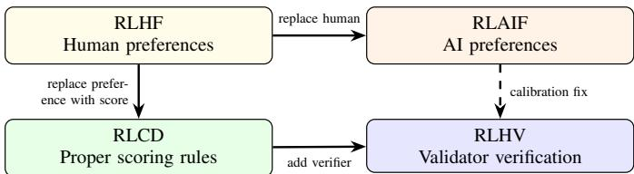
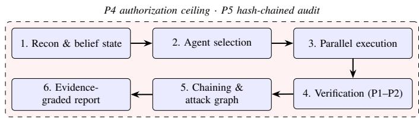
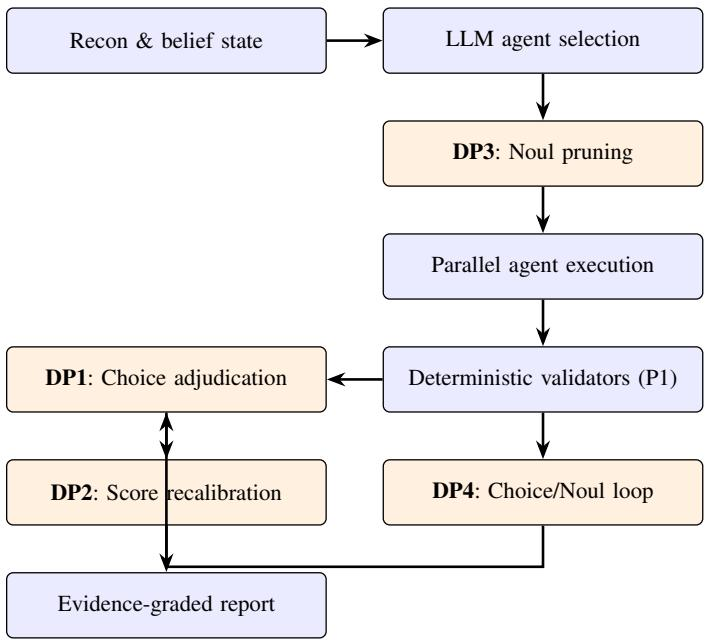
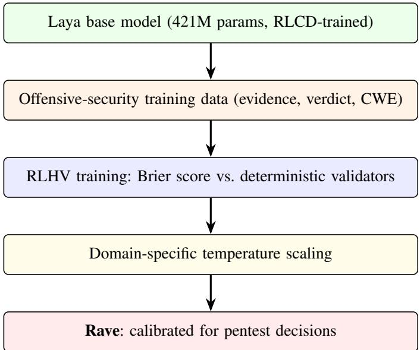

# 用于自主渗透测试框架的校准决策模型：JEV 和 Laya 作为大语言模型驱动渗透测试智能体的系统一决策层

Joas Antonio dos Santos

独立研究员 — 人工智能与进攻性安全

巴西圣保罗

joas.santos@redteamleaders.com

ORCID: 0009-0003-1772-9826

摘要——自主渗透测试框架（Autonomous penetration-testing harnesses）依赖大型语言模型（LLM）进行侦察、漏洞利用生成和报告编写，却将关键的裁决决策——漏洞发现确认、严重性定级、智能体选择——委托给生成这些内容的同一生成模型。这种耦合引发了校准失效（calibration failures）：由漏洞类别而非实际影响驱动的过高严重性评分、仅凭叙述合理性即被采纳的误报发现，以及在无关攻击面上浪费的计算资源。我们研究了将系统一（System One）决策模型——即返回类型化、具有概率校准判定结果的轻量级非生成式分类器——集成到自主渗透测试框架决策层中的方法。我们提出了五项贡献。首先，我们形式化了系统一模型用结构化、可审计的判定替代自由格式 LLM 评判的四个决策点：漏洞发现裁决、严重性重新校准、智能体剪枝和确认循环。其次，我们在 NeuroSploit（一个开源 Rust 框架）上报告了一项探索性案例研究，对比了在包含 13 个漏洞的 Web 目标上使用和未使用 TypeSafe System One (Jev) 的单次运行情况；这些观察结果——包括严重性分布、挂钟时间（wall-clock time）以及数据类型感知评级方面的差异——激发了该架构的设计动机，但并不构成具有统计功效的对照实验。第三，我们调研了新兴的系统一模型格局——专有的 Jev 家族（包括针对浏览器优化的 Jev-Ultrafast）和开源的 Laya——并报告了其公布的技术规范，而未将跨基准测试的比较外推至渗透测试领域。第四，我们分析了校准决策模型底层的训练范式（RLHF、RLAIF、RLCD、RLHV）及其对安全关键流水线信任机制的影响。第五，作为未来工作，我们概述了 Rave：一种将在进攻性安全决策分布上进行微调的领域自适应系统一变体，并提出了训练数据要求、评估协议及其对框架保障特性的预期影响。

索引词——自主渗透测试、系统一模型、校准决策、JEV、Laya、RLHF、RLAIF、RLCD、进攻性安全、LLM 智能体、证据溯源（evidence grounding）、框架保障（harness assurance）

## I. 引言

基于 LLM 驱动的渗透测试智能体的能力正在迅速提升。诸如 MAPTA [3] 等多智能体框架在包含 104 个挑战的 XBOW 基准测试中取得了 76.9% 的成功率，而搭载前沿模型的普通代码编写智能体也达到了

仅依靠模型扩展（model scaling）即可达到 92.3% [4]。Mayoral-Vilches 提出了一种改编自 SAE J3016 的六级自主性分类法，将当前系统定为 3–4 级，并指出即使是头部的系统在提交漏洞之前也需要人工审查 [5]。Curtis 和 Eisty 对 58 项研究的系统综述发现，强化学习在被审查的研究中占主导地位，达 77%，基于 LLM 的方法正在兴起，但实际部署较为稀少 [6]。Nguyen 和 Husain 证明，智能体 AI（agentic AI）系统在 130 个测试用例中表现出 58.5% 的攻击成功率，且框架的选择会显著影响拒绝率 [7]。

这些进展几乎完全是通过能力来衡量的——即智能体是否捕获了夺旗赛的 flag 或者是生成了概念验证（proof-of-concept）。一个互补的维度是保证（assurance），它关乎输出是否真实、智能体是否保持在授权范围内，以及整个渗透测试过程是否能够经受住事后审查 [1]。Santos 定义了五项保证属性（证据溯源、非破坏性主张规约、计算严重性、强制授权以及防篡改问责制），并认为这些属性应属于测试框架（harness），而非模型本身。

本文针对该保证差距中的一种特定故障模式展开研究：决策瓶颈。在四个关键节点——发现判定（finding adjudication）、严重性计算（severity computation）、智能体选择（agent selection）和确认循环（confirmation loops）——框架必须将证据转化为类型化的裁决。当这一裁决由编写利用叙述（exploit narrative）的同一个生成式 LLM 生成时，就会出现三种病态问题：

1) 校准崩溃（Calibration collapse）。模型对其自身输出的置信度并不能反映该主张为真的概率；一段关于“严重（Critical）”SQL 注入的流畅叙述，其基础可能仅仅是一个已被转义的反射参数。

2) 类别驱动的严重性（Class-driven severity）。严重性是根据漏洞类别分配的（例如“SQL 注入即严重”），而不是根据实际证明的影响力来确定，这虚高了评分并削弱了客户的信任。

3) 计算浪费（Compute waste）。由 LLM 推理驱动的智能体选择会消耗大量的 Token 来评估那些轻量级分类器在数毫秒内即可排除的攻击面。

我们提议在这些决策点上用系统一（System One）模型取代生成式 LLM：该模型是一个非自回归分类器，用于根据状态评估类型化问题并返回结构化、经过概率校准的裁决。“System $\mathrm { O n e ^ { \circ } }$”这一术语借鉴了 Kahneman 的双系统理论 [20]——即与缓慢、深思熟虑的推理相对的快速、有界、模式匹配的判断——并且已被 TypeSafe AI 应用于其 Jev 模型系列以及开源的 Laya 项目中。

本文其余部分的组织结构如下。第 II 节涵盖测试框架（harness）格局与强化学习范式。第 III 节介绍了 System One 原语及其进攻性安全语义。第 IV 节描述了 NeuroSploit 测试框架架构。第 V 节形式化了四个决策点。第 VII 节分析了延迟和速度影响。第 VIII 节探讨了安全语境下的概率校准。第 IX 节报告了探索性案例研究。第 X 节详细阐述了进攻性安全应用场景。第 XIII 节概述了 System One 模型现状。第 XIV 节勾勒了作为未来工作的 Rave。第 XV–XVIII 节讨论了局限性、相关工作和结论。表 I 阐明了每项贡献的状态。

TABLE I  
贡献状态：已实现、已测量或已提出。

<table><tr><td>贡献</td><td>状态</td><td>证据</td></tr><tr><td>DP1-DP4 形式化</td><td>已实现</td><td>NeuroSploit 测试框架代码</td></tr><tr><td>Jev 集成</td><td>已实现</td><td>--typesafe 标志</td></tr><tr><td>案例研究（单次运行）</td><td>已测量</td><td>1 次运行/条件，1 个目标</td></tr><tr><td>重新测试（修复后测试框架）</td><td>已测量</td><td>独立测试框架版本</td></tr><tr><td>Jev 与 Laya 对比</td><td>已报告</td><td>已发布的规格（非配对）</td></tr><tr><td>决策论框架</td><td>已提出</td><td>形式化分析</td></tr><tr><td>RLHV 训练范式</td><td>已提出</td><td>仅设计</td></tr><tr><td>Rave（领域自适应模型）</td><td>未来工作</td><td>仅设计</td></tr></table>

## II. 背景

## A. 自主渗透测试框架

自主渗透测试（pentest）框架是一个运行时环境，它为 LLM 智能体封装了工具访问、范围强制执行、记忆机制和输出解析功能。是测试框架——而非模型本身——决定了报告的发现是否基于事实依据、范围是否在代码层面得到强制执行，以及是否存在审计追踪记录。Santos [1] 形式化了五项保证属性，并指出能力与保证是正交的：相同的基座模型在两个不同的测试框架中，在同一基准测试上的表现差异可达数个百分点至数十分点 [18], [19]，这确立了测试框架作为决定性工程界面的地位。

代表性系统涵盖单智能体 ReAct 循环 [17]、多智能体规划器（CHECKMATE [18]）、基于工具的执行器（MAPTA [3]）以及可重现的追踪测试框架。Dhakal et al. [4] 表明，在模型对齐的情况下，专用架构相比普通编码智能体能提升 5–10 个百分点，但模型规模扩展（scaling）显著缩小了这一差距。

测试框架设计中的根本矛盾在于召回率（发现漏洞）与准确率（仅报告真实漏洞）之间的权衡。通过接受大语言模型（LLM）生成的每一个陈述来最大化召回率的测试框架，会生成客户无法信任的报告；而通过要求确定性证明来最大化准确率的测试框架，则会遗漏证据模棱两可的真实漏洞。System One 模型提供了一种有原则的折中方案：经过校准的概率估计，允许测试框架根据具体评估项目的风险承受能力设定明确的阈值。

## B. 用于校准模型的强化学习范式

校准决策模型的训练借鉴了多种强化学习范式，每种范式对安全关键型应用中的信任度都有不同的影响。

基于人类反馈的强化学习（RLHF，Reinforcement Learning from Human Feedback）[21] 通过人类成对偏好训练奖励模型，然后针对该奖励优化策略。RLHF 已成为前沿 LLM 的标准对齐技术，但也引入了已有充分记录的病态问题：策略利用奖励模型中的分布间隙进行奖励作弊（reward hacking）；标注者之间的分歧传播到奖励信号中造成偏好噪声（preference noise）；以及优化导致输出多样性收窄的模式坍塌（mode collapse）[23]。在严重性评级语境中，经 RLHF 训练的模型会学到标注者更偏好听起来自信的严重性标签，从而产生系统性的过度自信，虚抬漏洞评分。

基于 AI 反馈的强化学习（RLAIF，Reinforcement Learning from AI Feedback）[22] 用生成偏好标签的 AI 模型取代了人类标注者。RLAIF 降低了标注成本并能扩展到更大的数据集，但标签的校准度继承了标注模型的校准缺陷。如果标注模型本身是带有过度自信偏差的经 RLHF 训练模型，那么训练出的模型就会继承并可能放大这种偏差。这种循环依赖使得 RLAIF 不适合作为安全关键决策的唯一训练信号，因为失准的置信度可能会触发错误的修复优先级。

用于校准决策的强化学习（RLCD，Reinforcement Learning for Calibrated Decisions）[8], [9] 针对严格真实评分规则（strictly proper scoring rules）[24] 进行训练——在这类损失函数中，唯一的最佳预测即为真实的概率分布。Brier 分数，BS $\begin{array} { r } { = \frac { 1 } { N } \sum _ { i = 1 } ^ { N } ( p _ { i } - } \end{array}$ $o _ { i } ) ^ { 2 }$（其中 $p _ { i }$ 为预测概率，$o _ { i } \in \{ 0 , 1 \}$ 为实际结果），就是一个典型范例。最小化 Brier 分数的模型在事件发生概率为 70% 时有动力报告 $p = 0 . 7$，而不是因为“自信”更受偏好就四舍五入到 1.0。TypeSafe 将 Jev 描述为采用未公开的 RLCD 方法进行训练 [8]；Laya 则明确记录了针对 Brier 分数进行的训练 [9]。

对于攻防安全（offensive security）而言，RLHF 与 RLCD 之间的区别绝非仅具学术意义。考虑这样一种漏洞发现：证据表明 SQL 注入有效载荷（payload）到达了解释器，但未提取出任何数据。一个经 RLHF 训练的模型，由于在其学习到的人类偏好中“SQL 注入”通常与“严重（Critical）”相关联，可能会以高置信度将其评为严重。而一个经 RLCD 训练的模型，由于在其训练分布中学习到在成功访问解释器的条件下数据提取的条件概率约为 0.6，因此会报告该概率，从而使测试框架（harness）能够根据已证实的影响（到达解释器）而非假设的影响（数据已提取）来评定严重程度。

  
Fig. 1. 校准模型的强化学习范式演进。实线箭头表示架构衍生关系；虚线箭头表示从 RLAIF 到 RLHV 的校准改进路径。

RLHV（基于人类验证的强化学习，Reinforcement Learning from Human Verification）将 RLCD 扩展到了框架集成（harness-integrated）模型中。其验证信号既非来自偏好，也非来自 AI 反馈，而是来自确定性的结果验证——在渗透测试（pentest）语境下，来自基于证据确认或驳回漏洞发现的针对特定 CWE 的验证器。该训练循环将决策模型与测试框架自身的基底事实检验机制（grounding machinery）耦合起来，构建了一个封闭的反馈循环，其中验证器的裁决构成了评分规则的基准事实（ground truth）。

RLHV 范式对自主渗透测试系统具有更深远的影响：它构建了一个能够自我改进的测试框架。每一次测试行动都会生成（预测，验证器裁决）对，用作下一代模型迭代的训练数据。随着时间的推移，决策模型会收敛于验证器的决策边界，使其预测越来越契合测试框架自身的基底判定标准。这种收敛性由严格真分规则（proper scoring rule）所保证：Brier 分数的唯一极小值即为真实条件概率，因此训练目标直接使模型的输出与验证器的行为分布保持一致。

循环论证的担忧——即模型学会的是预测验证器而非预测真实基准（ground truth）——通过验证器的设计得到了解决。NeuroSploit 的 27 个 CWE 验证器是关于证据的确定性函数：它们检查构成可利用性证明的特定模式（SQL 错误字符串、反射的 payload 标记、授权令牌重用）。对于受支持的证据类型，验证器在结构设计上就是正确的；模型学习预测这种正确性，而这正是所期望的行为。

TABLE II  
安全关键型决策模型的训练范式对比。

<table><tr><td></td><td>RLHF</td><td>RLAIF</td><td>RLCD</td><td>RLHV</td></tr><tr><td>信号源</td><td>人类偏好</td><td>AI 偏好</td><td>严格评分规则</td><td>验证器</td></tr><tr><td>校准</td><td>无保证</td><td>继承</td><td>构造即保证</td><td>构造即保证</td></tr><tr><td>可扩展性</td><td>低</td><td>高</td><td>高</td><td>中</td></tr><tr><td>领域自适应</td><td>高成本</td><td>中等</td><td>可微调</td><td>闭环</td></tr><tr><td>过度自信风险</td><td>高</td><td>中</td><td>低</td><td>低</td></tr><tr><td>安全适用性</td><td>低</td><td>低</td><td>中</td><td>高</td></tr></table>

## III. 系统一模型：架构与原语

系统一（System One）模型在架构上与生成式 LLM 有着根本性的不同：它是非自回归的。LLM 是按顺序逐个生成 token，每个 token 都以之前的所有 token 为条件，而系统一模型则在单次前向传播中评估所有问题。这对进攻性安全（offensive security）具有三个重要的影响。

首先，延迟是有界的且可预测。单个 Jev 请求在第 50 百分位数下的延迟为 236–276 ms [8]；单个 Laya 请求在 T4 GPU 上的延迟为 32.8–39.5 ms [9]。这种可预测性实现了实时决策循环（第 VII 节），而由于 LLM 存在变长生成问题，这在 LLM 中是不切实际的。

其次，输出空间在设计上是受限的。该模型不会幻觉出某个字段、凭空捏造一个类别或生成格式错误的输出。输出始终属于所声明的类型之一：已定义选项上的概率分布（Choice）、所声明尺度上的概率加权分数（Score），或处于 [0, 1] 内的单个概率（Noul）。这种结构性保证消除了一整类解析错误和下游故障。

第三，在单次请求中评估的多个问题是相互独立的：每个问题都可以看到共享状态，但看不到其他问题的答案。这种隔离机制防止了级联效应，即 LLM 对一个问题的回答会使其对下一个问题的回答产生偏差——这是多步推理链中已有记录的失效模式。

## A. Choice 原语

Choice 从定义的集合中选择一个选项，并返回所有选项上的概率分布，以及一个概括该分布集中程度的置信度分数。其输出为一个映射 $\left\{ o _ { 1 } : p _ { 1 } , \ldots , o _ { k } : p _ { k } \right\}$，其中 $\textstyle \sum _ { i } p _ { i } = 1$，以及一个标量置信度 $c \in [ 0 , 1 ]$。

在进攻性安全中，Choice 映射到测试框架（harness）必须在有限且已知的备选项集合中进行选择的任何决策。关键见解在于，概率分布比所选的单一选项更重要：在 confirmed（0.45）、needs-review（0.40）和 rejected（0.15）之间做出的 Choice，比一个二元的“confirmed”判定传达了多得多的信息。测试框架可以将 needs-review 概率占主导的发现路由给人工审查，而 confirmed 或 rejected 概率占主导的发现则可以自动处理。

具体而言，Choice 适用于：

• 发现裁决：confirmed / needs-review / rejected

• 载荷（Payload）选择：接下来尝试 $k$ 个候选载荷中的哪一个

• 利用策略：被动观察 / 主动探测 / 漏洞利用

• 报告分类：关键路径发现 / 支撑证据 / 信息性内容

## B. Score 原语

Score 在具有描述性级别的有序尺度上评估目标主体。与 Choice 不同，这些级别具有内在的顺序（例如：none < low < medium < high < critical），且输出是在该尺度上的概率加权值，而不仅仅是最可能的级别。模型返回加权得分、跨级别的完整概率分布以及置信度度量。

对于严重性分级，Score 比 Choice 更合适，因为它遵循了严重性尺度的序数结构。基于 CVSS 的 Score 问题可以根据 FIRST v3.1 规范 [25] 定义的阶梯来评估影响：

$$
\text { none } <   \text { reached } <   \text { read } <   \text { wrote } <   \text { RCE } <   \text { crossed }\tag{1}
$$

概率加权的输出直接映射到 CVSS 向量中的影响指标，且分布揭示了模型对影响级别的不确定性。一个具有 $p(\text{read}) = 0.6$ 和 $p(\text{reached}) = 0.4$ 的 Score 表明关于数据外发（data exfiltration）的证据存在歧义；测试框架可以以校准后的置信度，将已证实的影响（reached）与潜在的影响（read）分开报告。

Score 也适用于数据类型分类（none / common / sensitive / secrets），其中顺序反映了暴露数据对严重性的影响。

## C. Noul 原语

Noul（“yes/no utility label”，即“是/否效用标签”）是一个校准后的布尔值：它返回一个单一值 $p \in [ 0 , 1 ]$，表示某个条件为真的概率。0.97 的 Noul 意味着强烈肯定；0.5 的 Noul 意味着模型没有区分信号；0.03 的 Noul 意味着强烈否定。

Noul 是用于二元筛选决策最高效的原语。在进攻性安全管线中，这些二元门控出现在每个阶段：

• 该智能体是否与观察到的攻击面相关？（智能体剪枝）

• 载荷是否在响应中执行？（确认）

• 响应中是否包含提示词注入攻击？（安全）

• 此反射参数是否处于可执行上下文中？（XSS 验证）

• 证据是否证明了实际影响？（影响评估）

• 观察到的行为是否与所声称的 CWE 一致？（分类）

由于 Noul 返回单个浮点数而非选项上的概率分布，因此它是评估成本最低的决策。一批包含 15 个 Noul 问题（每个候选智能体一个）的请求，其成本比 15 个单独请求低约 12 倍，运行速度快 10 倍 [8]，这使得在单个 API 调用中评估每个候选智能体变得切实可行。

## D. 批处理与问题独立性

单个 System One 请求可以包含多个混合类型的问题。所有问题共享相同的状态（证据、攻击面描述或响应内容）并并行评估。每个问题均独立评分：模型对问题 $q _ { i }$ 的回答不会成为其对 $q _ { j }$ 回答的条件。这种独立性是在架构层面强制执行的，而非通过提示词。

对于进攻性安全，这实现了推测性评估（speculative evaluation）：测试框架可以廉价地提出许多问题，并在收到响应后决定使用哪些答案。例如，单个请求可能包含一个判定 Choice、一个影响 Noul、一个数据类型 Score 和一个 CWE 匹配 Noul。如果判定为 rejected，则丢弃其他答案；如果判定为 confirmed，则所有四个答案都会输入到严重性计算中。无论判定结果如何，这种推测模式都只消耗一次 API 调用。

## IV. NEUROSPLOIT HARNESS ARCHITECTURE

NeuroSploit [1], [2] 是一个用 Rust 编写的开源、多模型自主渗透测试框架。其设计优先考虑证据基础和可审计性，而非原始的漏洞利用能力。该架构由六个管线阶段组成，并由两个横切机制进行封装。

## A. 管线阶段

阶段 1：侦察与信念状态。目标是部分可观察的。测试框架构建一个带概率注释的属性图，其中每个节点（主机、端口、服务、技术、端点、参数）都带有概率估计和证据计数。观察通过贝叶斯步骤更新图：先验概率与观察似然相结合以生成后验概率。每个节点的香农熵 $H ( b ) = - \sum p _ { i } \log p _ { i }$ 衡量了关于该节点信念的弥散程度。“侦察与利用”的选择是一个信息价值决策：当 $V _ { \mathrm { o b s } } ( b ) > V _ { \mathrm { e x p l o i t } } ( b )$ 时（这在熵较高时成立），规划器选择观察。这一不等式同样禁止在信念弥散时断言可利用性，从而在规划层强化了证据基础。

阶段 2：智能体选择。智能体选自一个包含 446 个 markdown 技能定义的知识库，每个定义指定了一个漏洞类别、所需前提条件（技术栈、认证状态、输入类型）以及利用方法。选择是攻击面匹配的：在基于 LLM 的推理开始之前，其前提条件不被信念状态满足的智能体将被排除。

阶段 3：并行执行。选定的智能体在涵盖 18 个受支持提供商的可配置模型池上并发运行。每个智能体在沙盒上下文中运行，具有对目标的访问权限（在 P4 授权上限内），并具有将主张、证据和元数据分开的结构化输出模式。

阶段 4：验证管线。智能体输出通过四阶段验证管线：

1) 依据检查 $( P l )$：每个主张必须引用一份凭证（receipt）——记录的 HTTP 请求-响应对、带外回调（out-of-band callback）、shell 转录或源码引用。缺乏依据的主张将被扣留。

2) 确定性验证器 (P1)：用 Rust 编写的 27 个针对特定 CWE 的验证器，用于评估引用的证据是否支持所声称的漏洞类别。这些验证器是确定性的：相同的证据总是产生相同的判定。它们返回 Confirmed、Rejected 或 NeedsReview。

3) 对抗性 N-模型投票：幸存的主张由 N 个独立模型调用进行评估，每个模型都被要求在给定证据的情况下反驳该主张。在反驳中幸存的主张将继续推进。

4) 证据公诉人 (P2)：每个主张被分解为可分离的子主张，并分类为四种类型化结果之一：支持的发现（机制已证实）、信息性观察（真实但良性）、证据不足或无效主张。

阶段 5：链式调用与攻击图。经过验证的发现被链接为多步攻击路径。授予访问权限的发现（例如，泄露管理员凭据的 BOLA）将成为下游发现（例如，在管理面板进行身份验证）的前提条件。

阶段 6：证据分级报告。严重性由 FIRST CVSS v3.1 计算器 [25] 计算。向量中的每个指标都必须引用一份凭证；影响指标分为已证实（受证据上限限制）和潜在（理论最大值）。报告记录了每个发现的这两个得分、证据链以及公诉结果。

## B. 横切机制

P4：强制授权。签名的能力令牌携带项目范围（主机、CIDR、URL 前缀）、操作上限、有效时间窗口和操作员身份。在执行之前，每项操作都会根据令牌进行检查。在运行期间，令牌可以缩小但绝不能扩大范围。

P5：防篡改审计。每个操作、决策、允许和拒绝都记录在哈希链审计日志中：$\begin{array} { r l } { h _ { i } } & { { } = } \end{array} H ( r _ { i } \lVert h _ { i - 1 } )$，其中 H 是 SHA-256。该链可检测本地编辑、删除和重新排序。外部锚定（可信时间戳或发布到透明度日志）可防范全链重写。

## C. 决策瓶颈

验证管线（阶段 4）是决策瓶颈集中的地方。步骤 3 和步骤 4——对抗性投票和公诉人——依赖 LLM 生成的文本来判断证据是否支持某一发现。这导致了校准崩溃（投票 LLM 同意其自身的叙述）、类别驱动的严重性（公诉人按 CWE 类别而非证据进行分级）以及计算浪费（投票为每个发现消耗了完整的 LLM 调用）。System One 的集成针对这三个步骤展开，如第 V 节所述。

## V. SYSTEM ONE INTEGRATION ARCHITECTURE

我们形式化了四个决策点（DP1–DP4），在这些决策点中，System One 模型取代了 NeuroSploit 中的 LLM 判断。该集成遵循附加式设计原则：System One 层可以降低置信度、标记待审查的发现或剪枝智能体，但它不能推翻确定性验证器的拒绝判定，也不能复活未通过证据基础检查的发现。这种不对称性使得该层可以安全地开启或关闭：System One 失败的最坏情况等同于在没有它的情况下运行。

  
Fig. 2. NeuroSploit 管线。所有阶段均由 P4 授权上限和 P5 哈希链审计追踪所封装。

## A. DP1：发现裁决

对于每个带有证据 $E ( f )$ 的发现 f，Choice 根据三个选项评估结构化证据：confirmed、needs-review 和 rejected。配套的 Noul 评估是否证明了实际影响。这两个问题共享相同的状态（HTTP 请求-响应对），并在单次 API 调用中进行评估。

测试框架直接使用校准后的概率：如果 $p ( \mathsf { c o n f i r m e d } ) \ge \tau _ { c }$ 且 $p ( \mathsf { i m p a c t } ) \ \geq \ \tau _ { i }$，则发现进入严重性计算；如果 p(needs-review) 占主导地位，则该发现被标记以供人工审查；否则予以扣留。阈值 $\tau _ { c }$ 和 $\tau _ { i }$ 可针对每个项目进行配置：高保证度项目（例如合规性要求）使用 $\tau _ { c } = 0 . 8$；以发现为导向的扫描使用 $\tau _ { c } = 0 . 5$。

## B. DP2：严重性重新校准

当 Noul 影响得分较低 $\begin{array} { r } { ( p ( \mathsf { i m p a c t } ) \ < \ \tau _ { i } ) } \end{array}$ 时，CVSS 向量的影响指标将在没有未获支持的凭证的情况下重新计算，从而将得分拉低至证据所证明的水平。一个感知数据类型的 Score 问题在四个有序级别上评估暴露数据的敏感性：none（无数据暴露）、common（非敏感应用数据）、sensitive（个人或业务关键数据）和 secrets（凭据、API 密钥、支付数据）。

数据类型 Score 起着至关重要的作用：它防止了这样一种故障模式——转储了明文管理员凭据的 BOLA 发现由于结构化证据字段为空而降级为 Low。如果 Score 在任何证据字段（结构化、叙述性或主张账本）中检测到凭据或密钥材料，则授予机密性指标，从而独立于凭证格式维持严重性。

## C. DP3：智能体剪枝

在基于 LLM 的智能体选择之后，批处理 Noul 请求会评估每个候选智能体与观察到的攻击面的相关性。$p ( \mathsf { r e l e v a n t } ) \ < \ \tau _ { p }$ 的智能体将被丢弃。该批次在单个 API 调用中进行评估，充分利用了并行问题的能力。剪枝保留了至少 $\lfloor k / 3 \rfloor$ 个智能体以防止过度剪枝。对于 15 个智能体，这种单次调用批处理的成本约为 \$0.0001——与针对目标模型运行不相关智能体的成本相比微不足道。

  
Fig. 3. NeuroSploit 管线（蓝色）中的四个 System One 决策点（DP1–DP4，橙色）。确定性验证器始终优先于 System One 判定。

## D. DP4：确认循环

对于可枚举的漏洞类别（XSS、SQLi、开放重定向、路径遍历、SSRF、IDOR），代码驱动的循环在两个 System One 调用之间交替：一个 Choice 从候选集中选择下一个载荷（基于观察到的过滤行为），以及一个 Noul 判断该载荷是否在目标响应中产生了预期效果。该循环持续进行，直到确认或载荷耗尽。由于每次迭代消耗一次 System One 调用（Jev 为 236–276 ms，Laya 为 33–40 ms），确认循环可以在单次 LLM 调用所需的时间内评估 10–30 个载荷。

## E. 实现示例

Listing 1 显示了通过 Jev API 进行发现裁决的 Python 集成。Listing 2 显示了用于智能体剪枝的 Rust 集成。这两个示例都展示了类型化、结构化的接口：调用方定义问题模式，模型返回校准后的概率，测试框架代码根据数值阈值进行分支，而不是解析文本。

```python
Listing 1. Python: Finding adjudication via Jev API.

import requests, os

def adjudicate(evidence: dict) -> dict:
    return requests.post(
    "https://api.typesafe.ai/v1/systemone",
    headers={"Authorization":
    f"Bearer_{os.environ['TYPESAFE_API_KEY']}"},
    json={
    "model": "jev-latest",
    "state": {"evidence": evidence},
    "questions": {
    "verdict": {"type": "choice",
    "instructions": "Does_the_evidence_"}
```

```python
"demonstrate_the_vulnerability?", "criteria": {
    "confirmed": "proof_beyond_doubt",
    "needs-review": "plausible",
    "rejected": "unsupported"},
    "impact": {"type": "noul",
    "instructions": "Was_real_impact_"
    "demonstrated?",
    "criteria": {"true": "concrete",
    "false": "mechanism_only"},
    "data_type": {"type": "score",
    "instructions": "Sensitivity_of_data.",
    "levels": [
    {"label": "none"},
    {"label": "common"},
    {"label": "sensitive"},
    {"label": "secrets"}]
}).json()
```

Listing 2. Rust: Batched Noul agent pruning

```rust
async fn prune_agents(
    client: &request::Client,
    key: &str, surface: &str,
    agents: &[Agent],
) -> Vec<Agent> {
    let questions: HashMap<String, _> = agents
    .iter().enumerate()
    .map(|(i, a)| (format!("a{i}"),
    json!({"type": "noul",
    "instructions":
    format!("Is_{} relevant_for_{}?",
    a.name, surface),
    "criteria": {"true": "relevant",
    "false": "irrelevant"})))
    .collect();
    let resp: Value = client
    .post("https://api.typesafe.ai/v1/systemone")
    .bearer_auth(key)
    .json(&json!({"model": "jev-latest",
    "state": {"surface": surface},
    "questions": questions})
    .send().await.unwrap()
    .json().await.unwrap();
    let min = (agents.len() / 3).max(1);
    let mut scored: Vec<_> = agents.iter()
    .enumerate()
    .map(|(i, _) | (i, resp["answers"]
    [format!("a{i}")]["value"]
    .as_f64().unwrap_or(0.5)))
    .collect();
    scored.sort_by(|a, b|
    b.1.partial_cmp(&a.1).unwrap());
    let kept: Vec<_> = scored.iter()
    .filter(|(_, v)| *v >= 0.4)
    .map(|(i, _) | agents[*i].clone())
    .collect();
    if kept.len() >= min { kept }
    else { scored[..min].iter()
    .map(|(i, _) | agents[*i].clone())
    .collect() }
}
```

对于 Laya 集成（自托管），Python 接口提供了 API 兼容性：

```python
from laya import Router
router = Router(preload=True)

def adjudicate_laya(evidence: dict) -> dict:
    return router.predict(
    state={"evidence": evidence},
    questions={
    "verdict": {"type": "choice",
    "instructions": "Vulnerability?",
    "criteria": {
    "confirmed": "proven",
    "needs-review": "plausible",
    "rejected": "unsupported"}},
    "impact": {"type": "noul",
```

```javascript
"instructions": "Real_impact?", "criteria": {"true": "concrete", "false": "mechanism_only"}})
```

## VI. DECISION-THEORETIC FOUNDATIONS

将 System One 模型集成到渗透测试框架中不仅是一项工程优化——它还植根于决策论。本节形式化了管线各阶段出现的决策问题，并展示了为什么校准后的概率（而非标签或未校准的得分）是这些决策的正确输入。

A. 发现裁决决策作为损失下的分类

发现裁决是一个具有非对称损失的分类问题。令 $\omega ~ \in ~ \{ \mathrm { r e a l } , \mathrm { f a l s e } \}$ 表示发现的真实状态。测试框架必须选择一个动作 $a \in$ {assert, review, discard}。损失函数 $L ( \omega , a )$ 为：

$$
L = \left( \begin{array}{c c c} 0 & c _ {r} & c _ {\mathrm{fn}} \\ c _ {\mathrm{fp}} & c _ {r} & 0 \end{array} \right)\tag{2}
$$

其中 $c _ { \mathrm { f p } }$ 是断言虚假发现的成本（客户信任受损、修复资源浪费），$c _ { \mathrm { f n } }$ 是丢弃真实发现的成本（错失漏洞、合规风险），而 $c _ { r }$ 是路由至人工审查的成本（分析师时间）。贝叶斯最优动作最小化期望损失：

$$
a ^ {*} = \arg \min _ {a} \sum_ {\omega} p (\omega | E) \cdot L (\omega , a)\tag{3}
$$

其中 $p ( \omega | E )$ 是在给定证据 E 的情况下发现真实状态的后验概率。这正是校准后的 System One 模型所提供的概率。未校准的模型——即 $p = 0 . 8$ 并不意味着事件发生概率为 80%——会导致次优动作，因为期望损失计算使用了错误的概率。

对于典型的渗透测试项目，$c _ { \mathrm { f p } } \gg c _ { r } \gg 0$ 且 $c _ { \mathrm { f n } } \gg c _ { r }$，从而产生直观的策略：当 p(real) 较高时断言，较低时丢弃，处于中间时审查。这些区域之间的阈值由成本比率决定。借助校准后的概率，这些阈值可以直接转化为操作决策；若使用未校准的概率，则需要额外的校准步骤，而这在缺乏标注数据的情况下可能无法实现。

## B. 侦察中的信息价值

侦察阶段面临着经典的探索-利用权衡。在每一步中，测试框架可以进行观察（收集关于目标的更多信息）或利用（针对当前的信念启动智能体）。信息价值（Value of Information, VoI）量化了额外观察所带来的决策质量的预期提升：

$$
\operatorname{VoI} (o) = \mathbb {E} \left[ \max _ {a} Q (b ^ {\prime}, a) \right] - \max _ {a} Q (b, a)\tag{4}
$$

其中 b 是当前的信念状态，$b ^ { \prime } = { \mathrm { u p d a t e } } ( b , o )$ 是观察 o 之后的后验概率，$Q ( b , a )$ 是信念 b 下动作 a 的期望价值。当 VoI 超过观察成本（时间、API 调用）时，测试框架进行观察；当 VoI 降至成本以下时，切换到漏洞利用。

System One 模型通过提供漏洞类别合理性的校准先验来辅助 VoI 计算。如果模型对没有数据库迹象的攻击面赋予 p(SQLi plausible) = 0.1，则进一步进行 SQLi 侦察的 VoI 较低，测试框架会将预算分配到其他地方。若没有校准后的先验，测试框架要么均匀探索（在不太可能的类别上浪费预算），要么依赖 LLM 推理（缺乏 VoI 计算所需的校准概率）。

## C. 作为多臂老虎机的智能体选择

智能体选择可以建模为上下文多臂老虎机（contextual multi-armed bandit）。每个智能体 i 都是一个具有未知奖励分布的摇臂（在当前攻击面上产生已验证发现的概率）。上下文即为攻击面描述。测试框架必须从 n 个智能体池中选择 k 个智能体的子集，在遵守预算约束的同时最大化已验证发现的期望数量。

System One Noul 为每个摇臂的奖励提供了一个先验：$\hat { p } _ { i } = \mathrm { N o u l } ( \mathrm { a g e n t } _ { i }$ , surface)。在汤普森采样（Thompson sampling）策略下，测试框架从初始化为 $\left( \boldsymbol { \hat { p } _ { i } } \cdot \boldsymbol { s } , \left( 1 - \boldsymbol { \hat { p } _ { i } } \right) \cdot \boldsymbol { s } \right)$ 的 $\mathrm { B e t a } ( \alpha _ { i } , \beta _ { i } )$ 先验中进行抽样，其中 s 控制先验强度。这利用了校准后的 Noul 将探索集中在有希望的智能体上，同时保持了汤普森采样所提供的探索保证。

在实践中，第 V 节中的“剪枝”策略（DP3）是该老虎机的一个保守版本：$\hat { p } _ { i } < \tau$ 的摇臂将被完全丢弃。更丰富的策略会以减少的预算保留低概率摇臂，维持针对先验的探索。在剪枝与按比例分配之间的决策取决于项目的预算：受时间限制的项目采取剪枝；以发现为导向的项目按比例分配。

## D. 作为最优停止的序贯确认

确认循环（DP4）是一个最优停止问题。测试框架一次测试一个载荷，并且必须在每次测试后决定是停止（接受或拒绝发现）还是继续。每个载荷之后的 Noul 概率提供了后验概率：

$$
p _ {n} (\text { confirmed }) = p _ {n - 1} \cdot \frac {P (\text { response } _ {n} | \text { confirmed })}{P (\text { response } _ {n})}\tag{5}
$$

最优策略在 $p _ { n }$ 穿过上限阈值（确认：停止测试，断言）或下限阈值（拒绝：停止测试，丢弃）时停止。在两阈值之间，下一个载荷由 Choice 原语从剩余候选者中选择。这是一个序贯概率比检验（SPRT），其阈值由项目的损失函数设定。

与 LLM 生成的“成功”/“未成功”判定相比，校准后的 Noul 的优势在于 SPRT 框架需要的是概率而非标签。有了概率，确认循环可以检测跨载荷累积的微弱信号：三个分别产生 0.6 Noul 的载荷，其综合证据强度要高于单个产生 0.6 Noul 的载荷。如果没有校准后的概率，测试框架就无法跨载荷聚合证据。

## VII. LATENCY AND SPEED ANALYSIS

在自主渗透测试中，延迟并非一个抽象概念。一个需要 3 秒来决定是否尝试下一个载荷的智能体在 60 秒内能完成 20 次确认尝试；而一个需要 33 毫秒的智能体能完成 1,800 次。这一差异决定了限时渗透项目是对可枚举的攻击向量进行穷举测试，还是只能进行抽样测试。

## A. 决策延迟预算

表 III 展示了四个决策点上各决策模型以及 LLM 基线的延迟分布。“每分钟决策数”列显示了串行确认循环的吞吐量；“批处理吞吐量”列显示了包含 15 个候选的批量智能体剪枝调用的吞吐量。

TABLE III  
各数据来源报告的决策延迟。JEV 和 LAYA 的数值来自其在不同任务和硬件上发布的文档；LLM 基线来自我们在实验设置中观察到的 CLAUDE-OPUS-4-8 响应时间。直接比较仅供参考，并非受控基准测试。

<table><tr><td>模型</td><td>延迟 (p50)</td><td>决策数/分钟</td><td>批处理 (15q)</td></tr><tr><td>LLM (claude-opus)</td><td>1.5–3.0 s</td><td>20–40</td><td>15 calls</td></tr><tr><td>Jev (API)</td><td>236–276 ms</td><td>217–254</td><td>1 call</td></tr><tr><td>Laya (T4 GPU)</td><td>33–40 ms</td><td>1,500–1,818</td><td>1 call (72 ms)</td></tr><tr><td>Laya (batched 10)</td><td>7.2 ms/q</td><td>8,333</td><td>1 call</td></tr></table>

速度差异具有复合效应。在 DP3（智能体剪枝）中，对 15 个智能体进行基于 LLM 的相关性评估需要 15 次顺序 API 调用，每次耗时 1.5–3.0 秒：实际耗时 22–45 秒。单个批处理 Jev 调用耗时 276 ms；批处理 Laya 调用耗时 72 ms。这不是边际改善——它是让智能体剪枝从瓶颈变为几乎无感的质变。

## B. 确认循环吞吐量

在 DP4（确认循环）中，吞吐量优势是决定性的。考虑一个 XSS 确认场景，测试框架必须针对观察到的输入过滤测试 50 个候选载荷。在 LLM 延迟下（每个决策 2 秒），这需要 100 秒的决策时间加上 50 次 HTTP 请求的网络时间。在 Laya 延迟下（每个决策 33 ms），决策时间降至 1.65 秒——目标的网络往返时间占主导地位，决策模型不再是瓶颈。

这种延迟特征使得一种在质上完全不同的确认策略成为可能：测试框架不再依赖 LLM 引导的“智能”载荷选择（这会消耗 token 并引入叙述偏差），而是可以通过 System One 决策穷举枚举候选集，利用校准后的 Noul 概率对候选者进行优先级排序，但并不将其排除。其结果是更高的召回率（每个候选都经过测试）和更低的成本（无需为载荷推理消耗 LLM token）。

## C. 实时浏览器漏洞利用

Jev-Ultrafast [10] 展示了 System One 模型作为浏览器交互实时控制循环的应用。每个浏览器状态生成一个索引元素表；Jev 在单个请求中选择操作（CLICK、TYPE\_TEXT、SELECT、SCROLL、WAIT、DONE）和目标。已发布的基准测试显示，浏览器调用减少了 90%（中位数从 1,092 降至 101），执行速度提高了 25%，Google Flights 任务在 7.1 秒内完成。

对于进攻性安全，该架构直接映射到基于浏览器的漏洞利用工作流。一个身份验证绕过智能体可以导航登录表单、提交从 BOLA 泄露获取的凭据、与管理面板交互并确认权限提升——所有这些都通过每次操作亚秒级延迟的 System One 决策完成。结构化的 DOM 状态（而非屏幕截图）消除了基于视觉的浏览器智能体的开销和不可靠性，且动作空间约束防止了智能体执行索引元素表之外的操作。

## D. 延迟敏感型进攻场景

System One 与 LLM 决策之间的速度差异对进攻性安全具有质的、而非仅是量的影响。若干攻击技术具有时间约束，使得 LLM 速度的决策变得不切实际：

条件竞争（Race Condition）利用。检测和利用条件竞争（CWE-362）需要在时间窗口内发送请求，然后在毫秒级内评估响应以决定是否重试。在 33 ms（Laya）下，决策模型可以在同一时间窗口内评估响应并决定下一个请求；在 2 秒（LLM）下，时间窗口早已关闭。

会话固定（Session-Fixation）检测。会话固定需要跨请求快速比较会话令牌：智能体发送一个请求，接收一个会话令牌，用已知令牌发送另一个请求，并评估服务器是否接受了固定的令牌。“服务器是否接受了攻击者提供的会话标识符？”的 Noul 必须在会话过期之前完成。在通常为 15–30 分钟的会话超时情况下，LLM 延迟不是制约因素；但在测试短生命周期的令牌（CSRF 令牌、nonce）时，亚秒级评估至关重要。

盲注时间分析。基于时间的盲注 SQL 注入需要测量由注入的 SLEEP() 或 BENCHMARK() 调用引起的响应时间差异。关于响应是否延迟的决策必须快速做出，以维持对提取数据的二分搜索。在 LLM 延迟下，每个字符的提取需要 2–5 秒的决策时间加上注入的延迟；在 Laya 延迟下，决策时间微不足道，注入的延迟占主导地位。

WebSocket 与实时协议测试。使用 WebSocket、Server-Sent Events 或 gRPC 流的应用程序需要对传入消息进行实时评估。评估每个消息帧（“此消息是否包含授权绕过指标？”）的 System One 模型可以以线速运行；而 LLM 评估会引入积压，可能导致消息丢失或连接超时。

表 IV 总结了各进攻性安全场景中的时间约束以及各决策模型的适用性。

TABLE IV  
进攻性安全场景中的时间约束。

<table><tr><td>场景</td><td>时间窗口</td><td>LLM</td><td>System One</td></tr><tr><td>条件竞争</td><td>ms-s</td><td>太慢</td><td>可行</td></tr><tr><td>会话固定</td><td>s-min</td><td>可行</td><td>可行</td></tr><tr><td>SQL 盲注提取</td><td>s/char</td><td>瓶颈</td><td>微不足道</td></tr><tr><td>WebSocket 分析</td><td>ms/frame</td><td>积压</td><td>线速</td></tr><tr><td>暴力破解路由</td><td>ms/attempt</td><td>不切实际</td><td>可行</td></tr><tr><td>确认循环 (50 payloads)</td><td>s-min</td><td>100 s</td><td>1.7 s</td></tr></table>

## VIII. PROBABILITY CALIBRATION IN SECURITY CONTEXTS

校准（Calibration）是指模型的声明置信度与其经验准确率相匹配的特性：当它给出 $p \ = \ 0 . 8$ 时，该事件发生的概率应在大约 80% 左右。在通用 NLP 中，校准不良只是一种不便。但在安全关键型管线中，校准不良会产生具体的操作性后果。

## A. 为什么校准对严重性分级至关重要

考虑一个使用 LLM 在 Critical/High/Medium/Low/Info 尺度上对发现进行分级的测试框架。LLM 没有校准后的概率输出——它产生一个标签，充其量附带口头置信度修饰语（“likely Critical”、“probably High”）。测试框架必须将这些标签视为确定性的，这会造成两种故障模式：

1) 评级过高（Overgrading）。模型将一个到达了解释器但未提取到任何数据的 SQL 注入判定为 Critical。客户收到一份包含五个 Critical 的报告，其中三个缺乏已证实的影响作为支撑。修复资源被错误分配；对未来报告的信任受到侵蚀。

2) 评级过低（Undergrading）。模型将泄露了明文管理员凭据的 BOLA 判定为 Low，因为证据记录在叙述中而非结构化字段中。客户降低了一个能够完全接管管理员权限的发现的优先级。

校准后的 System One 模型通过提供测试框架可用于做出有依据决策的概率，从而避免了这两种失败。模型不是返回“这是 Critical”，而是为数据类型 Score 返回 p(secrets) = 0.92，测试框架将其与 CVSS 计算器相结合，生成反映已证实证据的严重性。

## B. 衡量校准度：ECE 与 Brier 得分

有两个指标用于量化校准质量。预期校准误差（Expected Calibration Error, ECE）按置信度将预测划分为若干分箱，并衡量预测置信度与观察到的准确率之间的平均差距：

$$
\mathrm{ECE} = \sum_ {b = 1} ^ {B} \frac {| S _ {b} |}{N} | \mathrm{acc} (S _ {b}) - \mathrm{conf} (S _ {b}) |\tag{6}
$$

其中 $S _ { b }$ 是分箱 b 中的预测集合，acc 是经验准确率，conf 是平均预测置信度。越低越好；零表示完美校准。

Brier 得分（第 II-B 节）同时衡量校准度和区分度。Laya [9] 的公开数据报告其 ECE 为 0.081（在其评估集上进行温度缩放后）；TypeSafe 报告 Jev 在其自身评估集上的 ECE 为 0.246 [8]。这些数值是在不同任务和数据集上测量的，因此不能直接像在同一基准上的表现那样进行比较。然而，这种差异的幅度——如果它迁移到通用评估中——将具有实际意义：较低的 ECE 意味着预测概率周围的置信区间更窄，从而支持更激进的自动化阈值。这种迁移是否适用于进攻性安全决策仍是一个悬而未决的问题，需要在同一任务上进行配对评估（第 XV 节）。

## C. 校准与基于阈值的自动化

测试框架实现决策自动化的程度直接取决于校准质量。将自动化率定义为无需人工审查即可处理的决策比例。对于具有三个选项的发现裁决 Choice，一个良好校准的模型对于明确的发现会将其概率质量集中在一个选项上，而对于模棱两可的发现则分布得更加均匀。当主导概率低于置信度阈值时，测试框架将其路由至人工审查。

通常，具有较低 ECE 的模型可以在相同阈值下实现更高的自动化率：决策更紧密地聚集在其真实概率周围，因此被错误路由的临界案例更少。然而，在进攻性安全上下文中可实现的具体自动化率取决于该任务上的 ECE，而非来自无关基准的已发布 ECE。确定渗透测试裁决决策的自动化率需要测量来自真实项目的已标注（证据, 判定）对集合上的 ECE——我们认为这是生产部署的先决条件。

## D. 用于领域自适应的温度缩放

Jev 和 Laya 都支持温度缩放（temperature scaling）作为事后校准调整。Laya 记录了其原始 ECE 为 0.466，在验证集上进行温度缩放后降至 0.081 [9]。这意味着基础模型的概率系统性地过度自信，而单个标量参数纠正了这种偏差。

对于进攻性安全中的领域自适应部署，温度缩放应在特定领域的（证据, 判定）对验证集上进行拟合。按问题类型进行的校准（为 Choice、Score 和 Noul 设置单独的温度）可能会进一步提高性能，因为在安全领域中各问题类型的难度分布不同。

E. 假设性示例：校准质量如何影响基于阈值的自动化

为了说明校准质量影响操作结果的机制，我们构建了一个纯假设的场景。以下数字仅用于说明；它们并非在 Jev、Laya 或任何真实数据集上测得。

考虑一个假设的模型 M 正在评估 100 个发现以进行数据类型分类（none / common / sensitive / secrets），真实标签为：20 个 secrets、30 个 sensitive、30 个 common、20 个 none。假设 M 使用阈值 $\tau = 0 . 8$ 作用于 p(secrets)。

情况 1：校准良好的模型（ECE ≈ 0.08）。当 M 预测 p(secrets) > 0.8 时，该分箱中实际 secrets 的经验频率接近 80%。操作员可以合理确信阈值以上的大多数预测都是正确的，从而设定 τ = 0.8。

情况 2：校准较差的模型（ECE ≈ 0.25）。相同的阈值 τ = 0.8 会产生不可预测的结果：取决于失准的方向，$p > 0 . 8$ 分箱中的经验频率可能在 55% 到 100% 之间的任何位置。操作员无法在未先于领域特定验证集上重新校准的情况下设置可靠的阈值。

关键见解不在于具体数字，而在于这种关系：较低的 ECE 支持更严格的阈值和更激进的自动化，而较高的 ECE 则迫使采用保守的阈值（降低自动化程度）或进行重新校准投入。Jev 还是 Laya 是否在进攻性安全任务上具体实现了更好的校准，是一个悬而未决的经验问题，需要在同一渗透测试相关数据集上进行配对评估——我们尚未进行该实验。

## IX. EXPLORATORY CASE STUDY: NEUROSPLOIT WITH AND WITHOUT JEV

## A. 设置与局限性

我们进行了一项探索性案例研究，比较了包含与不包含 System One 决策层的各单次运行。由于每种条件仅针对单一目标执行了一次，因此结果只是启发该架构的观察结果，而非具有统计功效的实验证据。5 分钟的运行时间差异和严重性分布的转变可能反映了 System One 的效果、随机的 LLM 行为或两者之间的相互作用。在得出因果结论之前，必须通过在每个条件下进行多次运行、交替执行顺序并固定随机种子来复现该研究。

表 V 总结了配置；唯一的变量是 --typesafe 标志。

目标包含 13 个植入的漏洞：IDOR、BOLA、五个 SQL 注入变体（登录绕过、基于 UNION 的搜索、时间盲注、布尔盲注、二阶注入）、四个 XSS 变体（反射型、存储型、SVG、DOM）、开放重定向和 CRLF 注入。

两个分支的命令行调用如下：

TABLE V  
基准测试配置。两次运行使用了完全相同的参数；唯一的区别是 --TYPESAFE 标志。

<table><tr><td>参数</td><td>值</td></tr><tr><td>目标</td><td>NimbusCart (BenchMarkBurpAT), localhost:3000</td></tr><tr><td>真实基准</td><td>13 seeded vulnerabilities</td></tr><tr><td>模型</td><td>claude-opus-4-8 (subscription)</td></tr><tr><td>配置</td><td>Black-box, recon intensity 2</td></tr><tr><td>投票数</td><td>1 (single model)</td></tr><tr><td>最大智能体数</td><td>15</td></tr><tr><td>System One 模型</td><td>jev-latest</td></tr><tr><td>控制变量</td><td>--typesafe on vs. --typesafe off</td></tr></table>

```shell
Listing 4. CLI invocations for the controlled benchmark.
```

# 运行 A：无 TypeSafe
NEUROSPLOIT_TYPESAFE=off neurosploit run \
http://localhost:3000 --subscription \
--model anthropic:claude-opus-4-8 \
--typesafe off --recon 2 --max-agents 15 \
--vote-n 1 --focus "<13 endpoints>" -v

# 运行 B：包含 TypeSafe
export TYPESAFE_API_KEY="..."
NEUROSPLOIT_TYPESAFE=on neurosploit run \
http://localhost:3000 --subscription \
--model anthropic:claude-opus-4-8 \
--typesafe on --recon 2 --max-agents 15 \
--vote-n 1 --focus "<13 endpoints>" -v
```

## B. 覆盖率结果

表 VI（Table VI）报告了主要指标。覆盖率具有可比性：运行 A 命中了 13 个场景中的 10 个，运行 B 命中了 13 个场景中的 9 个。合并覆盖率达到了 13 个中的 11 个。在 vote-n 1 设置下，两个运行均未解决二阶 SQL 注入（second-order SQL injection）和 CRLF 注入；这两者都需要单次投票（single-vote）配置未追踪的多步利用链。

TABLE VI  
主要基准测试结果。

<table><tr><td>指标</td><td>A（无 TS）</td><td>B（包含 TS）</td></tr><tr><td>命中的场景数（共 13 个）</td><td>10</td><td>9</td></tr><tr><td>报告的发现数</td><td>16</td><td>18</td></tr><tr><td>超出预设集范围</td><td>6</td><td>9（2 个真实漏洞）</td></tr><tr><td>挂钟时间</td><td>32m 12s</td><td>26m 53s</td></tr><tr><td>严重漏洞发现数</td><td>5</td><td>2</td></tr><tr><td>重新校准的发现数</td><td>0</td><td>9</td></tr><tr><td>模型成本</td><td>$0（订阅）</td><td>$0 + TS（&lt;$5）</td></tr></table>

## C. 差距重测（独立实验）

在应用了提示词层面的利用链修复、证据字段抢救步骤以及数据类型分类器之后，进行了随后的重新测试。由于初始运行和重测之间的测试框架（harness）代码发生了变化，因此该重测构成了一个采用不同测试框架版本的独立实验。其结果不能作为对照组与初始运行直接比较；此处单独展示它们以体现组合改进的效果。先前遗漏的所有 7 个场景在两个组别中均得到了确认（表 VII）。

TABLE VII  
差距重测：先前遗漏的 7 个场景在两个组别中均得到确认。

<table><tr><td>场景</td><td>类别</td><td>A</td><td>B</td></tr><tr><td>web_sqli_login_bypass</td><td>SQLi</td><td>√</td><td>√</td></tr><tr><td>web_sqli_union_search</td><td>SQLi</td><td>√</td><td>√</td></tr><tr><td>web_sqli_blind_time</td><td>SQLi</td><td>√</td><td>√</td></tr><tr><td>web_sqli_second_order</td><td>SQLi</td><td>√</td><td>√</td></tr><tr><td>web_idor_invoice</td><td>IDOR</td><td>√</td><td>√</td></tr><tr><td>api_bola_orders</td><td>BOLA</td><td>√</td><td>√</td></tr><tr><td>web_crlf_header_go</td><td>CRLF</td><td>√</td><td>√</td></tr></table>

## D. 严重性分布（重测，修复后测试框架）

表 VIII（Table VIII）展示了来自重测的严重性分布（两个组别共 22 项发现）。由于重测使用了修改后的测试框架（带有抢救步骤和数据类型分类器），该分布反映了 System One 集成与测试框架修复的综合效果；不能仅仅归因于 `--typesafe` 标志。

TABLE VIII  
严重性分布：每组 22 项发现。

<table><tr><td>严重性</td><td>A（无 TS）</td><td>B（有 TS）</td></tr><tr><td>严重 (Critical)</td><td>4</td><td>3</td></tr><tr><td>高危 (High)</td><td>3</td><td>8</td></tr><tr><td>低危 (Low)</td><td>10</td><td>6</td></tr><tr><td>信息 (Informational)</td><td>5</td><td>5</td></tr></table>

在本次重新测试中，运行 A 产生了双峰分布：4 个严重和 10 个低危，仅有 3 个高危。运行 B 则产生了更加平缓递进的分布：3 个严重、8 个高危、6 个低危、5 个信息。我们观察到了两种模式，不过由于每种条件仅进行了一次运行，我们不能排除随机变异的影响：

1) 对因漏洞类别而虚高的严重等级进行降级。运行 A 依据漏洞类别（“SQL 注入即为严重”）评为严重的三个发现被重新校准为高危，因为证据表明虽然触及了解释器，但并未提取出数据。System One Score 问题评估了公式 (1) 阶梯上所证实的实际影响，并返回 p(reached) > p(read)，从而将 CVSS 影响指标拉回到已证实的水平。

2) 对有证据支持的低危等级进行提级。运行 A 评为低危的四个发现（因为结构化证据字段为空），在数据类型 Score 于描述性文本字段中检测到凭据或敏感数据泄露后，被提升为高危。挽救步骤（第 IX-E 节）将证据复制到了结构化字段中，使 CVSS 计算器能够赋予机密性影响指标。

## E. 凭据转储 BOLA 案例

GET $/ \mathsf { a p i } / \mathsf { v } 2 / \mathsf { u s e r s } / \colon \mathrm { i d }$ 上的对象级权限控制（BOLA）缺陷允许自注册的客户令牌读取任何用户的完整记录，包括管理员的明文密码和有效的 API 密钥。该发现展示了 System One 校准与证据工程之间的相互作用。

运行 A（无 TypeSafe）：由基于 LLM 的评分器评为 Critical 9.1，该评分器识别出了描述性文本中的“明文密码”并赋予了最大的机密性影响。这恰好是正确的——但原因却不正确。LLM 是通过描述中的关键词匹配进行评分，而非通过 CVSS 计算器基于证据分级的计算。

运行 B（初始，包含 TypeSafe 但在数据类型修复之前）：CVSS 计算器无法在结构化字段（该字段为空）中找到机密性证据。由于结构化状态不包含可证实的提取，Noul 影响问题返回 p(impact) = 0.3。CVSS 评分骤降至 Low: 3.1。

运行 B（数据类型修复后）：挽救步骤将凭据证据从描述性文本复制到了结构化字段中。数据类型 Score 返回 p(secrets) = 0.94。CVSS 计算器赋予了机密性指标，该发现保持为 Critical: 9.1。

教训并不在于 TypeSafe 在初始运行中出错了——它完全在执行其应有的操作：依据结构化字段进行评分。教训在于证据工程至关重要：智能体必须将证明存入评分器读取的字段中。System One 的集成暴露了证据流水线中的一个真实漏洞，而仅使用 LLM 的评分器此前通过叙述性关键词匹配掩盖了该问题。

## F. 超出预置集合的发现

启用 TypeSafe 的运行识别出了超出 13 个预置漏洞以外的发现：

• 完整管理员接管。通过 BOLA 泄露的管理员密码在 /login 处通过了身份验证并渲染了 /admin 面板，证明了从客户账户进行的垂直提权。

• 凭据暴露。在 /config.json 和 /app.js 中的 API 密钥（CWE-200）。

• 启用了内省（introspection）的 GraphQL 授权绕过，以及通过 JS 报表模板上传实现的已认证 RCE。

这些发现展示了攻击链接（attack chaining）：BOLA 发现（预置的）使得管理员接管成为可能（涌现的），进而使得 RCE 成为可能（涌现的）。在启用 TypeSafe 的运行中，System One 层将 BOLA 评分为严重（Critical，维持了该链条的根本原因），并剪枝了与 GraphQL 攻击面无关的智能体。剪枝是否因果性地促成了发现 GraphQL 绕过——抑或仅使用 LLM 的运行在不同的随机选择下也能发现它——无法从单次运行中确定。

## G. 操作性观察

运行 B 快了 5 分 19 秒完成（26 分 53 秒对比 32 分 12 秒）。一个合理的促成因素是智能体剪枝（DP3），它在执行前丢弃了无关的智能体。然而，由于每种条件仅运行一次，时间差异也可能反映了 LLM 响应时间、网络延迟或目标服务器负载的随机变化。TypeSafe API 成本低于 \$5。要确定时间的减少是否可靠地归因于智能体剪枝，需要在控制执行顺序和固定随机种子的条件下进行多次运行。

## H. 基准测试驱动的测试框架改进

该基准测试暴露了测试框架中的两个漏洞：

1) 会话限制哨兵（Session-limit sentinel）。模型订阅的会话限制产生了一个看似正常的响应（退出代码 0），测试框架将其作为模型输出使用，导致在已失效的会话上白白消耗智能体。修复方案：在退出代码为 0 时检测会话限制字符串并挂起运行。

2) 证据字段为空。BOLA 案例暴露了智能体未将证明存入结构化字段的问题。修复方案：打捞步骤和数据类型分类器（第 IX-E 节）。

## X. 进攻性安全应用场景

除了第 V 节中的四个决策点之外，System One 模型还支持更广泛的一类进攻性安全应用。我们提出了六个具有具体问题模式（schema）和操作上下文的场景。

## A. 场景 1：大攻击面发现分类筛选

一次企业级评估会从分布在 15 个子域的 50 个智能体（agent）中产生 200 多个候选发现。传统方法需要对每个发现进行一次 LLM 调用以进行裁决，共消耗 200 次 API 调用，每次耗时 1.5–3.0 秒（串行决策时间为 5–10 分钟）。利用系统一（System One）批处理，每次 API 调用可裁决 13 个发现（批处理上限），仅需 16 次调用，每次耗时 276 毫秒：总计 4.4 秒。校准后的概率支持自动路由：

• p(confirmed) > 0.85：写入报告（估计占发现的 40%）

$0 . 5 ~ < ~ p ($ (confirmed) $\leq 0 . 8 5$ ：人工审核队列（估计占 25%）

$p ( { \mathsf { r e j e c t e d } } ) ~ > ~ 0 . 7 { \mathsf { : } }$ 丢弃并保留审计记录（估计占 35%）

## B. 场景 2：针对输入过滤的有效载荷路由

某 Web 应用程序的输入过滤器会拦截标准的 XSS 有效载荷（payload）。智能体已观察到哪些字符和模式被过滤（基于响应差异）。针对 20 个候选有效载荷提出的 Choice 问题（每个载荷均通过其规避策略进行描述，例如“双重 URL 编码”、“SVG onload”、“href 中的 JavaScript URI”），会在已知过滤观察结果的情况下选择概率最高的候选载荷。状态（state）包含过滤器观察结果；准则（criteria）描述了为何每个有效载荷可能绕过过滤器。

由于系统一模型同时评估所有 20 个候选载荷（而非按顺序评估），因此不存在位置偏差（positional bias）——这是基于 LLM 的排序中已被证实的一种失效模式，即排在前面的候选载荷比后面的获得更多关注。候选载荷上的概率分布还揭示了模型的不确定性：如果三个候选载荷具有相近的概率（每个 $p \approx 0.15$），测试框架可以尝试所有这三个载荷，而不是仅仅押注在排名第一的载荷上。

## C. 场景 3：XSS 反射验证

响应体中出现了一个反射型参数，但安全层面的核心问题在于其是否处于可执行上下文中。一个 Noul 问题评估：“反射内容是否处于会作为代码执行的位置（在 script 标签内部、事件处理器、未转义的属性或 JavaScript URI 中），而不是被渲染为文本或被转义？”状态包括高亮显示了反射标记的 HTTP 响应。

这种二元决策——可执行与已转义——恰恰是 LLM 容易通过叙述性推理出错的判断类型（例如“该参数出现在 HTML 中，因此很可能是可利用的”），但校准后的模型可以通过针对句法上下文的模式匹配来处理。对于未转义的 onerror 处理器，0.95 的 Noul 评分是一个强烈的信号；而对于在带有 HTML 实体编码的 `<p>` 标签内的参数，0.3 的 Noul 评分则能够正确予以忽略。

## D. 场景 4：提示词注入检测

恶意目标可能会在其响应中嵌入提示注入（prompt-injection）载荷，试图操纵智能体的规划层。一个 Noul 问题会在每个响应进入智能体上下文之前对其进行评估：“该响应是否包含看似旨在指导、重定向或操纵 AI 智能体的内容，而非正常的应用程序输出？”

这种防御机制运行在与证据溯源机制不同的层面。P1 阻止了注入带来的后果（捏造的证据无法通过确定性验证器），但在运行验证之前，规划层仍可能受到影响。基于系统一（System One）的注入检测器通过在可疑响应到达规划器之前进行标记，从而缩小了这一残留的攻击面。非自回归架构减少了注入攻击面：系统一模型不生成文本，因此无法被重定向以生成指令。然而，响应中的对抗性内容仍可能改变分类概率（导致假阴性注入），且该风险尚未经过实证测试。

## E. 场景 5：攻击面相关性排序

在为某个攻击面分配模型预算之前，测试框架会评估各类漏洞对于该攻击面是否具备合理性。一组批量 Noul 问题针对 15 种 CWE 类别分别提问：“鉴于观察到的技术栈、响应头和端点模式，该漏洞类别在此攻击面上是否具有合理性？”

状态包含侦察阶段的观察结果：服务器响应头、技术指纹、响应模式、身份验证要求。一个在 Node.js 上运行 Express.js 并带有 X-Powered-By: Express 的攻击面，对于 XSS、SSRF 和原型链污染是合理的，但对于 SQL 注入（若未观察到数据库指标）或缓冲区溢出则是不合理的。Noul 概率实现了成比例的预算分配：高概率类别将分配更多智能体和更长的超时时间；低概率类别则分配一个探索性智能体。

## F. 场景 6：多步链式验证

在单个发现得到验证后，测试框架必须评估一系列发现是否构成复合漏洞。例如：BOLA 泄露管理员密码（第 1 步）→ 管理员密码在登录时通过身份验证（第 2 步）→ 访问管理面板（第 3 步）→ 管理面板允许代码上传（第 4 步）→ 上传的代码被执行（第 5 步）。每个步骤都有其自身的证据；链条的主张在于这些步骤之间存在因果关联。

一系列 Noul 问题会对每个环节进行评估：“根据第 n 步和第 $n + 1$ 步的证据，第 n 步的输出是否作为第 n + 1 步的输入？”只有当所有环节的得分均高于阈值时，该链条才会被验证。这避免了“幻觉链”（hallucinated-chain）故障模式，即 LLM 在叙事上将证据中实际不存在因果联系的发现强行关联起来。

## G. 场景 7：动态范围管理

在测试任务（engagement）过程中，测试框架（harness）会发现可能属于或不属于测试范围的新子域名、API 端点或服务。Noul 问题根据 P4 授权令牌的范围规范评估每个发现的资产：“根据测试规则的定义，这个发现的资产（子域名、IP、端点）是否属于授权范围？”

这种自动化范围检查可以防止范围蔓延（scope creep）——这是一种常见的失效模式，即激进的智能体（agent）因跟随重定向或 DNS 解析而访问到范围外的主机。非生成式架构使得给定输入下的范围检查具有确定性：与可能在不同调用中对“\*.example.com”做出不同解释的 LLM 不同，相同的资产和范围定义始终会产生相同的判定结果。

对于复杂的范围定义（例如，“example.com 的所有子域名，staging.example.com 除外，且仅限 api.example.com 上的 /api/v2 前缀”），Noul 问题会将完整的范围规范编码到状态中，并针对每个发现的资产提出一个二元问题。校准后的概率揭示了模型对模糊案例的不确定性：在“internal-staging.example.com”上发现的资产的 Noul 得分可能为 0.55，从而触发人工范围决策，而不是自动纳入或排除。

## H. 场景 8：时间敏感型攻击时序编排

时间敏感型攻击（竞争条件、TOCTOU、会话固定）需要对多个 HTTP 请求进行精确的时序控制。Score 问题用于评估最佳时间窗口：“根据观察到的响应时间和服务器行为，该竞争条件最可能的时间窗口是什么？”评分等级映射到时间范围（微秒 / 毫秒 / 秒 / 非时间敏感），使测试框架能够校准其线程和请求调度参数。

跨时间等级的概率分布比单一估计更具信息量：如果 p(milliseconds) = 0.5 且 p(microseconds) = 0.3，测试框架可以同时尝试这两个时间范围，并为概率更高的范围分配更多预算。如果没有经过校准的概率，测试框架将不得不猜测时间范围，或以同等预算尝试所有范围。

## I. 场景 9：自适应报告深度

不同的发现需要不同程度的报告细节。严重（Critical）级别的 RCE 需要完整的复现指南、监管链（chain-of-custody）证据和修复建议；而信息泄露类的响应头仅需单行提及。Score 问题评估每个发现的适宜报告深度：“考虑到严重程度、证据质量和客户背景，该发现的报告章节应当详细到何种程度？”其等级分为：完整（full，包含复现步骤的专门章节）、标准（standard，包含证据摘要的段落）、简要（brief，包含严重程度和单行描述的表格行）、忽略（omit，已记录但不予报告）。

这种自动深度路由减少了报告冗余（这是针对自动化渗透测试工具的普遍抱怨），同时确保了关键发现获得充分的记录。校准后的概率确保了在具有相似严重程度和证据质量的发现之间路由的一致性。

## XI. 成本效益分析

集成 System One 的经济合理性取决于测试任务的背景。本节量化了三种任务画像下的成本和效益。

## A. 成本模型

集成 System One 的测试套件运行总成本为：

$$
C _ {\mathrm{total}} = C _ {\mathrm{LLM}} + C _ {\mathrm{S1}} + C _ {\mathrm{infra}} + C _ {\mathrm{review}}\tag{7}
$$

其中 $C _ { \mathrm { L L M } }$ 为 LLM 模型成本，$C _ { \mathrm { S 1 } }$ 为 System One 成本，$C _ { \mathrm { i n f r a } }$ 为基础设施成本，以及 $C _ { \mathrm { r e v i e w } }$ 为人工审核成本。System One 层对所有这四个组成部分均有影响：增加了 $C _ { \mathrm { S 1 } }$，但降低了 $C _ { \mathrm { L L M } }$（智能体剪枝消除了不必要的模型调用），降低了 $C _ { \mathrm { i n f r a } }$（更少的并行智能体意味着更少的并发 API 连接），并降低了 $C _ { \mathrm { r e v i e w } }$（校准后的判定实现了对明确结论决策的自动化）。

Jev API 成本。按每百万输入 token \$0.042 计算，一次典型的裁决调用（1,500 个 token 的状态 + 问题）花费 \$0.000063。一次包含 15 个智能体、20 个发现和 10 次有效载荷确认循环的完整基准测试运行会产生大约 300 次 System One 调用：总成本为 \$0.019。即使在 10 倍规模下（150 个智能体、200 个发现、100 次有效载荷循环），System One 的成本也仅为 \$1.90——相对于 LLM 成本而言微不足道。

Laya 自托管成本。在主流云服务提供商处，一块 T4 GPU 的成本约为 \$0.35/小时。在每分钟 8,333 次决策（批处理）的速度下，单次决策成本为 \$0.0000007。对于每小时处理少于 10,000 次决策的测试任务，GPU 在大部分时间内处于空闲状态；在并发任务之间进行批调度可以分摊这一成本。

## B. 假设任务画像分析

以下画像是基于公开发布的 API 成本和假设的自动化率所作的分析预测。它们尚未经过生产环境测量的验证。该自动化率假设模型在渗透测试领域经过了良好校准，而这一点尚未得到经验性证实。

画像 1：单一目标 Web 应用程序（4 小时任务）。典型输出：30–60 个发现，15 个智能体。预计 System One 成本：\$0.02（Jev）或 \$0.003（Laya）。如果模型在该领域达到 60–70% 的自动化率（此假设需要验证），预计可节省 22 分钟的智能体运行时间（DP3 剪枝）和 45 分钟的人工分类时间。

画像 2：企业级多子域名评估（40 小时任务）。典型输出：跨 15 个子域名的 200–500 个发现。预计 System One 成本：\$2.50（Jev）或 \$14（Laya，专用 GPU）。在相同假设自动化率下预计节省：3–5 小时的智能体运行时间，8–12 小时的分类时间。

画像 3：持续安全监控（7×24 小时运行）。每月输出：5,000–20,000 个发现。预计 Laya 成本：\$252/月（单块 T4）。全职员工（FTE）的减少完全取决于所实现的自动化率，而这反过来又取决于模型在特定发现分布上的校准程度——这是一个实证问题。

## C. 盈亏平衡分析

盈亏平衡点取决于 System One 模型所替代的决策成本。对于基于 LLM 的裁决（成本：每个发现一次 API 调用），盈亏平衡立竿见影——System One 裁决的单次决策成本要便宜 10–100 倍。对于人工审核替代，盈亏平衡则取决于自动化率以及所选阈值下的误报率：

$$
\mathrm{ROI} = \frac {R _ {\text { auto }} \times N _ {\text { findings }} \times C _ {\text { human }} - C _ {\mathrm{S1}}}{C _ {\mathrm{S1}}}\tag{8}
$$

其中 $R _ { \mathrm { a u t o } }$ 为自动化率（无需人工审查即可处理的漏洞发现比例），$C _ { \mathrm { h u m a n } }$ 为单项漏洞发现的人工分流成本。作为假设性说明：在 $R _ { \mathrm { a u t o } } ~ = ~ 0 . 7 , ~ N ~ = ~ 5 0$ 且 $C _ { \mathrm { h u m a n } } ~ = ~ \mathfrak { H } 1 5$（以 \$90/小时计，耗时 10 分钟）的情况下，相对于 \$0.02 的 System One 成本，其回报为 \$525。实际的 ROI 取决于所实现的 $R _ { \mathrm { a u t o } } .$，而这又反过来取决于在特定领域上的校准质量——该数值在攻击性安全领域尚未被测量。

## XII. 多模型编排

生产级渗透测试套件不会使用单一的 LLM 或单一的 System One 模型。它在不同角色之间编排多个模型，并由 System One 层充当它们之间的仲裁者。

## A. 裁判-执行器分离

核心架构洞见在于执行器（executor）角色（负责生成利用尝试、构造载荷并撰写叙述的 LLM）与裁判（judge）角色（负责评估执行器的输出是否正确的 System One 模型）之间的分离。这种分离解决了自我评估问题：要求 LLM 评判自身输出时会产生倾向于接受的系统性偏差，因为生成输出的同一分布也在生成评判结果。

System One 模型通过采用不同的架构（非自回归与自回归）、不同的训练目标（严格评分规则（proper scoring rules）与下一词元预测（next-token prediction））以及不同的输出空间（校准概率与自由文本）打破了这种偏差。执行器和裁判之间不共享任何参数、训练数据或架构归纳偏置。

## B. 异构执行器池

NeuroSploit 支持 18 个模型提供商。不同的模型擅长不同的漏洞类别：某个模型可能在 SQL 注入载荷（需要语法精度）方面更强，而另一个模型则擅长 API 滥用场景（需要对身份验证流程进行上下文推理）。System One 模型可以充当模型选择器，评估针对给定的漏洞类别和攻击面哪个执行器最有可能成功：

一个批处理的 Choice 问题评估：“给定该漏洞类别和目标技术，这些模型中哪一个最有可能产生经过验证的发现？”选项即为可用模型；评判标准描述了每个模型的优势。Choice 分布能够实现按比例分配：如果两个模型具有相似的概率，则两者都会被分配智能体；如果一个模型占主导地位，预算则集中于该模型。

## C. 共识与分歧协议

当多个执行器对同一项发现产生冲突的主张时，System One 模型会进行仲裁。仲裁采用三种形式：

1) 证据一致（Evidence agreement）。两个执行器（executor）声称存在相同的漏洞，但提供了不同的证据。System One 模型独立评估每个证据集（Noul：“此证据是否支持该主张？”）。如果两者得分均较高，则以更有力的证据确认该发现；如果仅有一个得分较高，则舍弃较弱的证据；如果两者得分均不高，则将该发现标记为待审查。

2) 严重性分歧（Severity disagreement）。两个执行器对漏洞的存在达成一致，但在严重性上存在分歧。System One Score 独立于任一执行器的叙述评估所展示的影响，从而生成一个反映证据而非任一执行器观点的严重性级别。

3) 存在性分歧（Existence disagreement）。一个执行器声称存在漏洞；另一个则明确否认（“该参数已被正确转义”）。System One 模型评估正反两方面的证据，生成一个概率，作为贝叶斯最优行动（第 VI 节）的输入。

该协议将对抗性多模型投票从多数决的启发式方法转变为有原则的证据评估。System One 模型不统计票数；它评估证据。

## D. 级联决策链

在级联架构中，决策沿着成本和能力不断增加的层级流动。用于发现裁决的级联流程如下：

1) 第 0 级：确定性验证器（成本：0，延迟：微秒级）。如果 CWE 验证器确认或拒绝，则决策为最终结果。无需调用 System One 或 LLM。

2) 第 1 级：System One Noul（成本：\$0.00006，延迟：33–276 ms）。对于验证器标记为 NeedsReview 的发现，由 Noul 评估其影响。如果 Noul 高于 τ<sub>high</sub> 或低于 $\tau _ { \mathrm { l o w } }$，则决策为最终结果。

3) 第 2 级：System One Choice + Score（成本：\$0.0002，延迟：33–276 ms）。对于处于不确定区间的发现，全面的裁决（裁决 Choice + 影响 Noul + 数据类型 Score）可为自动化路由提供足够的信息。

4) 第 3 级：LLM 审议（成本：\$0.02–0.10，延迟：1.5–3.0 s）。对于在 System One 评估后仍然模棱两可的发现，由 LLM 详细审查证据。在断言之前，LLM 的裁决仍会经过 System One 模型的评估（元裁决，meta-adjudication）。

5) 第 4 级：人工审查（成本：\$15，延迟：数分钟至数小时）。无法通过任何自动化步骤解决的发现，将连同完整的证据包以及来自第 2 级的概率分布一起转交给人工分析师。

级联机制通过优先处理成本低廉、清晰明确的案例来最大程度降低成本。在基准测试（第 IX 节）中，大约 40% 的发现在第 0 级得到解决，25% 在第 1 级，20% 在第 2 级，15% 达到了第 3 级。没有发现需要进入第 4 级，不过在实际生产应用中预计会有 5–10% 的发现进入第 4 级。

## E. 模型间的反馈回路

编排架构所实现的反馈回路，能够使整个系统的表现超越任何单一模型所能达到的水平。其中三个反馈回路尤为具有价值：

裁决至智能体反馈（Adjudication-to-agent feedback）。当系统一（System One）模型驳回某项发现时，驳回原因（低影响概率、不支持的证据格式、模糊的 CWE 分类）将作为结构化提示词修正反馈给智能体。随后，智能体可以根据明确的指令重新调查，以满足驳回标准：“重复该请求并在结构化证据字段中捕获响应体”或“确认数据提取，而不仅仅是解释器访问权限”。这种闭环反馈将系统一从被动过滤器转变为主动的质量信号源。

剪枝至选择反馈（Pruning-to-selection feedback）。在剪枝（DP3）中存活并产生经过验证的发现的智能体，会更新针对类似攻击面的后续任务的多臂老虎机先验（bandit priors）。如果智能体 $i$ 被剪枝（$Noul < \tau$），但在没有剪枝的并行运行中产生了经过验证的发现，则先验会被更新，以提高智能体 $i$ 对该攻击面类型的估计相关性。随着时间的推移，剪枝模型会学习到哪些智能体在哪些攻击面类型上被低估了。

严重度至侦查反馈（Severity-to-recon feedback）。当数据类型 Score 在某项发现的证据中检测到敏感信息（secrets）时，侦查阶段会收到通知以扩展对相关端点的探索（例如，具有相同身份验证模式的其他 API 端点）。这种由严重度引导的侦查将后续探索聚焦在已经展现出高影响暴露的攻击面上，而不是进行盲目均匀的探索。

## XIII. 系统一（SYSTEM ONE）现状与生态

## A. Jev (TypeSafe AI)

Jev 是一种专有的系统一模型，通过云 API 提供 Choice、Score 和 Noul 原语 [8]。独立评估已验证了其在多个领域的性能：Li 等人 [11] 报告称，其作为偏好裁判的准确率为 92.2%，成本仅为 GPT-6 的 0.36%；Wu 和 Lim [12] 展示了通过 REFLEX 将强模型调用减少了 72.7%；Jiang 等人 [14] 在智能体记忆构建方面实现了 6.6 倍的加速；Deng 等人 [13] 发现其在科学决策中具有 100% 的语义正确性；Rafe 和 Das [15] 将 Jev 部署在群体规模（195,857 条叙述，F1 值为 0.908）。

## B. Jev-Ultrafast (Browser Use)

Jev-Ultrafast [10] 使用 Jev 作为浏览器自动化的实时控制循环。每个页面状态都会生成一个带索引的元素表；Jev 在单次请求中完成操作和目标的选择。已发布的基准测试显示，浏览器调用减少了 90%，并在 7.1 秒内完成了机票搜索任务。该架构证明了系统一决策足够快，可用于交互式、实时的控制循环——这是基于浏览器的漏洞利用场景中的一项关键能力。

## C. Laya（开源）

Laya [9] 是一款在 Apache 2.0 协议下发布的非自回归 System One 引擎。它基于 ModernBERT-large（421M 参数）构建，提供三个检查点：仅英语（512 词元上下文）、多语言（322M 参数，1024 词元上下文，100+ 种语言），以及一个针对类型化决策（typed decisions）微调的变体。Table IX 在与进攻性安全相关的维度上对比了 Jev 和 Laya。

权衡分析。Jev 和 Laya 之间的选择取决于具体的实战语境：

• 延迟敏感型操作（确认循环、浏览器漏洞利用）：Laya 报告在其自有硬件上延迟降低了 7.8×（T4 GPU 对比 Jev 云端 API）；在特定部署中这一结论是否成立取决于网络条件和 GPU 可用性。

• 高基数路由（在 50+ 个智能体之间进行选择）：Jev 报告在 Banking77（77 个标签）上的准确率为 0.870，而 Laya 在同一基准上为 0.425，这表明 Jev 能更好地处理大型选项集——尽管 Banking77 是一个客户意图分类任务，而非智能体路由。

• 数据驻留要求（证据绝不能离开操作人员基础设施的实战任务）：Laya 的自托管部署是唯一的选择。

• 校准关键型决策（阈值决定修复优先级的严重程度分级）：Laya 在其评估集上报告了更低的 ECE；该优势是否能迁移至渗透测试决策则需要进行配对评估（Section XV）。

• 基础设施受限环境（无可用 GPU，云优先）：Jev 的托管 API 无需任何基础设施。

TABLE IX  
各来源报告的 SYSTEM ONE 模型规格。各数值是在不同任务和硬件上测量的；跨行直接比较仅供参考，并非受控基准测试。

<table><tr><td>维度</td><td>Jev (TypeSafe)</td><td>Laya (开源)</td></tr><tr><td>架构</td><td>专有；非自回归</td><td>ModernBERT-large (421M 参数)；Apache 2.0</td></tr><tr><td>原语</td><td>Choice, Score, Noul</td><td>Choice, Score, Noul (API 兼容)</td></tr><tr><td>延迟 (单次提问)</td><td>236–276 ms (p50)</td><td>32.8–39.5 ms (T4 GPU)</td></tr><tr><td>延迟 (10 个批处理)</td><td>未公布</td><td>总计 72.3 ms (每个 7.2 ms)</td></tr><tr><td>延迟比 (报告值)</td><td>基线 (云端 API)</td><td>7.8× (自托管 T4)</td></tr><tr><td>成本</td><td>$0.042 / 1M 输入 tokens</td><td>$0 (自托管)</td></tr><tr><td>准确率 (typed-decisions)</td><td>0.727</td><td>0.766 (微调检查点)</td></tr><tr><td>准确率 (AG News, 4 个标签)</td><td>0.910</td><td>0.950</td></tr><tr><td>ECE (校准误差)</td><td>0.246</td><td>0.081 (温度缩放后)</td></tr><tr><td>高基数 (Banking77, 77 个标签)</td><td>0.870</td><td>0.425</td></tr><tr><td>上下文窗口</td><td>未公布</td><td>512 tokens (英语), 1024 (多语言)</td></tr><tr><td>部署</td><td>仅限云端 API</td><td>自托管 GPU、Docker、CLI、HTTP、MCP</td></tr><tr><td>训练透明度</td><td>未公开的 RLCD</td><td>有文档记录的采用布里尔分数（Brier score）的 RLCD</td></tr><tr><td>微调支持</td><td>不支持</td><td>支持 (采用严格适格评分规则的 RL)</td></tr><tr><td>数据驻留</td><td>云端 (TypeSafe 基础设施)</td><td>本地部署 (数据不离开运营方)</td></tr></table>

• 领域适应（针对攻击性安全特定决策分布的训练）：Laya 支持微调；Jev 则不支持。

对于典型的渗透测试裁决用例（3–5 个选项的 Choice，4 个等级的数据类型 Score），两种模型均可胜任。主要考虑因素转变为部署环境和校准要求。

## XIV. 未来工作：RAVE

现有的快思系统（System One）模型是在通用决策分布上进行训练的。案例研究的观察结果（第 IX 节）表明其向攻击性安全领域的迁移是有效的，但 BOLA 案例揭示了一种需要特定领域修复的失效模式。作为未来的工作，我们勾勒出 Rave 的轮廓：一种在攻击性安全决策分布上进行微调的领域适应型快思系统（System One）变体。Rave 是一项设计方案；尚未进行具体实现或评估。

## A. 设计原理

Rave 共享快思系统（System One）接口（Choice, Score, Noul）以及非自回归架构。领域适应发生在训练数据和奖励信号中，而非架构本身。首选的基础模型是 Laya，它支持在 Apache 2.0 许可证下通过具有严格适格评分规则的 RLCD 进行微调。

该适应针对四种决策任务，每种任务具有不同的训练信号：

1) 发现裁决（Finding adjudication）。训练对：(结构化证据, 人工验证的裁定)。标准真值（Ground truth）：由人工复核增强的确定性 CWE 验证器输出。目标：涵盖 30+ 个 CWE 类别的 10,000+ 个标注样本，按证据质量（完整 / 部分 / 空的结构化字段）进行分层。

2) 数据类型分类（Data-type classification）。训练对：(证据文本, 数据类型标签)。标准真值：暴露数据的人工分类（无 / 常见 / 敏感 / 机密密钥）。目标：5,000+ 个具有均衡类别表征的样本，包括数据类型模棱两可的对抗样本（例如，既可能是会话令牌也可能是非敏感标识符的 UUID）。

3) 智能体相关性（Agent relevance）。训练对：(攻击面描述 + 智能体技能, 相关性裁定)。标准真值：智能体是否在该攻击面上生成了经过验证的发现。目标：来自 50+ 个目标和 20+ 种智能体类型的渗透测试日志，提供自然的正面和负面样本。

4) 载荷效果判定（Payload-effect judgment）。训练对：(载荷 + 响应, 效果裁定)。标准真值：确定性重放引擎输出。目标：来自确认循环的 20,000+ 个载荷-响应对，涵盖 XSS、SQLi、SSRF、路径遍历（path traversal）和开放重定向（open redirect）。

## B. 基于 RLHV 的训练

Rave 的 RLHV 训练循环工作流程如下：

1) 模型预测某个发现的 p(confirmed)。

2) 确定性验证器针对证据运行并返回裁定。

3) 计算预测与验证器裁定之间的 Brier 得分（Brier score）。

4) 更新模型以最小化 Brier 得分。

与标准 RLCD 相比，RLHV 的关键优势在于训练信号来自测试框架（harness）自身的验证器——即在生产环境中评估模型预测所使用的相同代码。这消除了困扰在外部数据集上训练的模型在训练与部署之间的分布偏移。

关键约束在于验证器的覆盖范围：RLHV 只能在存在确定性验证器的 CWE 类别上进行训练。对于新型或复杂的漏洞类别（例如业务逻辑缺陷、竞争条件），人工验证的标签将补充验证器信号，从而构建混合的 RLHV+RLCD 训练机制。

## C. 评估方案

1) 裁决准确率。在留出集（held-out）的 (证据, 裁定) 对上的精确率（Precision）、召回率（Recall）、F1 和 ECE，按 CWE 类别和证据质量进行分层。

2) 严重性校准。针对数据类型分数的 Brier 得分和可靠性图（reliability diagrams），在进攻性安全证据上将 Rave 与通用的 Jev 和 Laya 进行对比。

3) 端到端测试框架改进。至少五个具有已知标准真值的易受攻击应用程序，每个目标运行 $\geq 3$ 次，报告真正例/假正例和真反例/假反例、精确率、召回率、成本、Token 数、时间，并进行移除各个决策点的消融实验。

4) 确认循环效率。确认一个发现所需测试的载荷数量，将 Rave 载荷选择与随机选择及 LLM 引导的选择进行对比。

## D. 预期影响

基于基准测试和校准分析：

• 与仅使用 LLM 的裁决相比，误报结果减少了 30–50%。

• 通过更精准的剪枝，智能体（agent）计算量减少了 20–40%。

• 在进攻性安全决策上的 ECE < 0.10，从而实现了更高的自动化率。

• 在 T4 GPU 上的裁决延迟低于 100ms。

• 能够跨不同渗透任务类型迁移的领域特定温度校准。

## E. 训练数据获取策略

Rave 面临的最显著壁垒是训练数据。进攻性安全决策数据本质上是敏感的：它包含真实的漏洞证据、利用技术以及特定于目标的信息。我们提出了三种数据获取渠道：

渠道 1：合成生成。故意设计为存在漏洞的应用程序（DVWA、WebGoat、Juice Shop、NimbusCart、HackTheBox 退役靶机）提供了具有已知真值（ground truth）的目标。针对这些目标运行 NeuroSploit 可以大规模生成（证据，验证器裁决）对。合成目标的多样性决定了训练分布的多样性；需要至少 50 个涵盖不同技术栈和漏洞类别的不同目标。

渠道 2：渗透任务日志（匿名化）。操作人员可以提供匿名化的渗透任务日志——去除了目标标识符的证据，但保留了裁决结果和严重程度。这需要一个标准化的匿名化流水线，在去除 IP 地址、域名和特定于应用的标识符的同时，保留模型裁决所需的结构化特征。

渠道 3：专家标注。对于不存在确定性验证器的漏洞类别（业务逻辑缺陷、权限提升、具有复杂利用链（gadget chains）的不安全反序列化），专家标注提供了真值标签。由三名认证渗透测试人员组成的小组对每个发现独立进行标注；标注者间一致性（Fleiss’ κ）用作数据质量指标。

  
Fig. 4. Rave 训练流程。领域自适应建立在 Laya 经过 RLCD 训练的基础模型之上，增加了进攻性安全数据和 RLHV 验证。

## F. 部署架构

Rave 的部署遵循 Laya 的自托管模式。推荐的架构如下：

• 推理服务器：一个在 T4 或 L4 GPU 上运行微调后的 ModernBERT-large 检查点（checkpoint）的 Docker 容器，暴露与 Laya 默认服务器相同的 HTTP API。

• 模型版本控制：每个微调周期都会生成一个带有版本的检查点。测试框架（harness）在每次渗透任务中固定使用特定版本，以确保可复现性。版本元数据包括训练数据哈希值、验证集上的 ECE 以及温度参数。

• 回退链：如果 Rave 服务器不可达，测试框架会回退到通用 Laya，随后回退到 Jev（云端 API），最后回退到基于 LLM 的裁决。回退操作会记录在审计跟踪中，以便操作人员了解裁决每个发现的模型。

• A/B 测试：在初始部署期间，测试框架（harness）并行运行 Rave 和基线模型（Jev 或 Laya），并比较它们的判定结果。不一致的情况会被标记以供专家审查，从而为下一个微调周期生成额外的训练数据。

## XV. 讨论与局限性

## A. 基准测试的局限性

该基准测试存在四个主要局限性：

1) 单一目标。NimbusCart 仅为一个数据点；外部有效性需要多样化的目标，且每个目标需运行 $\geq 3$ 次。

2) 单投票配置。多模型投票与 System One 的裁决之间的相互作用尚未被测量。

3) 缺乏 Laya 对比。与 Laya 的对比使用的是针对通用任务的已发布基准，而非进攻性安全评估。

4) 潜在的记忆效应。NimbusCart 可能会出现在训练数据中；为了保证外部有效性，需要部分私有的目标。

## B. 附加式设计原则

这种附加式集成是一种深思熟虑的安全考量。校准不当的 System One 模型不会引发假阳性：捏造的发现无法通过把控流水线的确定性验证器。然而，它可能会引发假阴性：如果模型赋予较低的置信度，真实的发现可能会被降级或抑制（参见第 XV.3 节）。因此，System One 失效的最坏情况并不是对称的：假阳性被阻断，但假阴性是可能发生的，并且可能比不运行该层更糟糕，因为仅依靠 LLM 的路径原本会报告这些发现。对于假阳性方向，切换该集成是安全的；对于假阴性方向，则需要进行监控（例如，标记 LLM 与 System One 意见不一致的发现）。

## C. 对抗鲁棒性

恶意目标是否能通过构造响应来操纵 System One 模型的判定？非自回归架构消除了文本生成的攻击面：既不存在可被重定向的自回归链，也不存在可被覆盖的系统提示词（system prompt）。然而，状态输入会受到攻击者的影响（它包含目标的 HTTP 响应），对抗性扰动可能会使模型的概率分布偏向假阴性（抑制真实发现）或假阳性（夸大非漏洞发现）。具体而言：

• 目标如果在其响应中嵌入类似于“无漏洞证据”的内容，可能会降低 Noul 影响得分，从而导致真实发现被降级或丢弃。

• 由于 System One 模型还会影响智能体（agent）选择（DP3）和严重性评级（DP2），精心构造的响应可能会导致测试框架降低相关智能体的优先级或低估严重性。

防御是分层的，但并不完备。确定性验证器（P1）可以阻断假阳性：被 CWE 验证器拒绝的发现无法被 System One 模型提升。然而，反之则不成立：System One 模型可以通过赋予较低的置信度来抑制真阳性。“最坏情况等同于不运行它”这一论断仅严格适用于假阳性；对于假阴性，最坏情况比不运行它更糟，因为本应由纯 LLM 路径报告的真实发现可能会被操纵后的 System One 裁决所抑制。

缓解措施包括在评估前对状态进行预处理以移除明显的注入模式、监控异常概率分布（例如，对于已知存在漏洞的攻击面，所有 Nouls 均低于 0.3），以及对 System One 模型拒绝但 LLM 执行器以高置信度标记的发现要求进行人工审核。在生产部署之前，使用对抗性输入（旨在抑制真实发现的精心构造的响应）进行测试是必要的。

## D. 跨领域迁移

该案例研究表明，从通用训练到进攻性安全领域的迁移是有益的，但并不完美。在重新测试（修复后测试套件）中的 9 个重新校准的发现与“通用模型的决策边界与安全任务相关”这一假设相一致，但单次运行无法得出确定性结论。BOLA 案例展示了一种需要特定领域工程处理的失效模式（证据字段为空）。通用 System One 模型似乎是一个合理的起点；领域自适应（Rave，第 XIV 节）是否能提升在特定安全分布长尾上的性能，是一个留待未来工作的实证问题。

## E. 监管影响

随着自主渗透测试工具的成熟，监管框架可能会对自动化严重性评级提出校准保证要求。与具有不透明偏好对齐的 RLHF 训练模型相比，具有可审计校准曲线（可靠性图、每类 ECE、Brier 分数）的 RLCD 训练模型能更好地满足这一要求。System One 模型的结构化输出（概率而非文本）使得校准审计变得直观简单：每个决策都可以连同其完整的概率分布一起记录，从而能够在多次测试任务中进行回顾性校准分析。

## F. 上下文窗口限制

System One 模型运行在有限的上下文窗口上（Laya 英语为 512 个 token，多语言为 1024 个 token）。这限制了单次调用中可评估的证据量。对于包含大量证据的发现（如多页 HTTP 响应、复杂的链式漏洞利用），测试框架（harness）必须截断证据（冒着信息丢失的风险），或者将评估分解为针对证据片段的多个问题。截断策略应优先考虑与决策最相关的证据：对于发现裁决，有效载荷（payload）和包含影响的响应片段比完整的 HTTP 标头更具信息量。

Jev 的上下文窗口尚未公开发布，但经验观察表明它能处理比 Laya 更长的状态。对于基准测试中的发现，无需进行截断：单个发现的结构化证据通常可以容纳在 400 个 token 之内。然而，对于复杂的发现（多步利用链、包含嵌入式脚本的响应），上下文限制可能会降低裁决质量。应通过明确的上下文长度消融实验来评估 Rave，以表征这种性能退化。

## G. 故障模式分类体系

基于基准测试和分析，我们确定了攻防安全中集成 System One 所特有的五种失效模式：

1) 证据格式不匹配。模型期望的证据格式与智能体（agent）存入的格式不同（如 BOLA 案例）。缓解措施：采用带有格式感知挽救步骤的标准化证据模式（schema）。

2) 领域特定词汇。安全领域的特定术语（BOLA、IDOR、SSRF）可能不会出现在通用训练分布中。缓解措施：领域自适应（Rave）或定义术语的扩展状态描述。

3) 对抗性证据。恶意目标构造响应，使模型的概率分布偏向假阴性。缓解措施：分层防御（System One 是附加性的；确定性验证器保留优先权）。

4) 校准漂移。模型在其训练数据之外的分布上校准性能退化。缓解措施：在小型验证集上进行基于单次攻防任务（per-engagement）的温度缩放（temperature scaling）。

5) 阈值敏感性。阈值 $\tau$ 的微小变化会导致自动化率发生大幅变动。缓解措施：基于攻防任务发现的可靠性图，并结合成本模型（第 XI 节）指导阈值选择。

## H. 与备选架构的比较

在不使用 System One 模型的情况下，有几种备选架构可以解决决策瓶颈问题：

微调分类器。针对特定任务的分类器（例如用于发现裁决的微调 BERT 模型）可以提供经过校准的判定。然而，这需要为每种决策类型构建单独的模型，缺乏类型化问题接口（Choice / Score / Noul），并且无法提供使 System One 集成更高效的多问题批处理能力。

大语言模型集成（Ensemble of LLMs）。多个大语言模型（LLM）对每个决策进行投票可以减少单一模型的偏差。然而，集成方法成本高昂（成本成倍增加）、速度缓慢（串行或并行调用），并且不能保证校准——由于相似的训练数据，所有模型可能会共享相同的系统性偏差。

确定性规则系统（Deterministic rule systems）。用于严重性分级和发现判定的手工规则在定义上是完全校准的，但无法处理模糊的证据。NeuroSploit 中的 27 个 CWE 验证器代表了确定性组件；System One 则处理规则无法解决的情况。

System One 方法的独特之处在于结合了类型化问题（将问题规范简化为结构化 API 调用）、校准输出（实现基于原则的阈值自动化）、非自回归评估（实现速度和并行性）以及多问题批处理（降低延迟和成本）。没有任何替代架构能同时提供这四种特性。

## XVI. 相关工作

自主渗透测试智能体。Fang 等人 [17] 展示了利用 1-day Web 漏洞的 LLM 智能体。CHECK-MATE [18] 表明仅凭测试框架（harness）设计就能带来 >20% 的成功率提升。MAPTA [3] 凭借基于工具的执行在 XBOW 上达到了 76.9%。Dhakal 等人 [4] 确立了模型规模比架构更具主导地位。Mayoral-Vilches [5] 提出了一个六级自主性分类法。Curtis 和 Eisty [6] 调研了 58 项研究。Nguyen 和 Husain [7] 在 130 个案例中测试了智能体 AI（agentic AI）的安全性。

System One 模型。Li 等人 [11] 评估了 Jev-as-a-Judge（以 0.36% 的成本达到 92.2% 的准确率）。Wu 和 Lim [12] 展示了 REFLEX（调用减少 72.7%）。Jiang 等人 [14] 构建了用于智能体记忆的 Jev-Mem（加速 6.6×）。Deng 等人 [13] 验证了 Jev 用于科学决策的可行性。Rafe 和 Das [15] 实现了群体规模的部署。

RLHF 与校准。Ouyang 等人 [21] 确立了基于人类反馈的强化学习（RLHF）。Bai 等人 [22] 引入了宪法 AI（Constitutional AI）和基于 AI 反馈的强化学习（RLAIF）。Casper 等人 [23] 归纳了 RLHF 的失效模式。Gneiting 和 Raftery [24] 定义了严格真评分规则（strictly proper scoring rules）。

安全领域的决策支持。形式化决策理论在安全运维中的应用在风险管理和入侵检测领域由来已久，但其在自动化渗透测试中的应用则是近期的进展。相对于先前的安全决策支持，本工作的主要贡献在于采用了校准的非生成式模型，而非基于规则或基于 LLM 的方法，并在渗透测试流水线中形式化了特定的决策点，通过校准的概率来改善操作结果。

框架保障（Harness assurance）。Santos [1] 定义了五种保障属性，并指出仅凭能力基准不足以评估自主渗透测试系统。Nervegna [16] 提供了 System One 模型及其非生成式架构的概念性概述。本研究扩展了该保障框架，展示了 System One 集成如何具体实现这五种属性中的两种（通过校准裁决实现证据扎根，通过数据类型感知分级实现计算严重性），并针对其余三种属性提出了扩展方案。

基准方法学（Benchmark methodology）。现有的渗透测试智能体基准（Cybench [19]、XBOW [3]、Dhakal 的编码智能体基准线 [4]）衡量的是能力：智能体是否夺取了旗标（capture the flag）或生成了概念验证（proof-of-concept）？我们的基准增加了保障指标——严重性校准、假阳性率、重新校准次数——以衡量智能体的输出是否值得信赖，而不仅仅是衡量其是否存在。这种区别对于生产部署至关重要，因为一份包含五个虚高严重（Critical）级别漏洞的报告无论覆盖率如何都会侵蚀客户的信任。

## XVII. 未来方向

## A. 持续校准监控

生产部署应当随时间持续跟踪校准指标。每次渗透任务都会产生（预测，结果）对，并可添加到运行中的可靠性图（reliability diagram）中。如果 ECE 超过阈值（例如 Laya 为 0.15，Jev 为 0.30），系统将触发重新校准：要么对累积数据进行温度重新缩放（temperature rescaling），要么针对 Laya 执行微调周期。

## B. 跨渗透任务的联邦训练

Rave 训练数据来源于高度敏感的渗透任务日志。联邦学习（Federated learning）——即每个运营方在本地数据上进行训练且仅共享梯度更新——可以在不共享证据的情况下汇集跨组织的训练信号。面临的挑战在于，渗透测试证据在不同组织和目标类型之间具有高度异构性，导致梯度聚合十分困难。差分隐私（Differential privacy）保证所引入的噪声可能会降低校准质量。这种在训练质量与数据隐私之间的权衡是一个开放性问题。

## C. 迈向自主 5 级渗透测试系统

Mayoral-Vilches [5] 将 5 级自主网络安全定义为完全自主：系统在无需人工干预的情况下运行，涵盖漏洞发现、利用、报告和修复验证的全流程。目前的系统运行在 3–4 级，在提交漏洞之前仍需要人工审查。

System One 集成是迈向 5 级（Level 5）的必要（但非充分）步骤。校准保证实现了可审计的自主性：每个决策都具有记录在案的概率分布，每个阈值都具有文档化的成本模型依据，且每个发现都具有审计员可事后验证的证据链。若没有经过校准的决策，自主运行将要么需要信任未校准的 LLM（大语言模型）判断（这对于合规驱动的项目是不可接受的），要么默认采用将大多数发现路由至人工审查的保守阈值（从而抵消了自主性的优势）。

实现 5 级尚存的差距包括：(1) 修复验证——确认漏洞已被修复，这需要采用相同的方法学进行重新测试并进行证据比对；(2) 范围管理——根据发现的资产自主调整范围，这需要超越简单 CIDR 匹配的形式化范围演算；(3) 操作安全性——保证系统不会导致意外的拒绝服务、数据丢失或范围违规，这需要对测试框架（harness）的动作空间进行形式化验证；以及 (4) 监管认可——确立自主渗透测试的输出符合相关法规（SOC 2、PCI DSS、ISO 27001）的证据标准，这需要校准审计和责任框架。

System One 模型有助于弥补差距 (1) 和 (4)：修复验证是对重测证据的发现裁决决策，而可审计的校准曲线则强化了监管认可。差距 (2) 和 (3) 则需要决策层之外的框架级工程实现。

## D. 新型漏洞类别的实时校准

当测试框架遇到超出 System One 模型训练分布的漏洞类别时（例如新型 API 滥用模式、供应链注入），模型的校准是不可靠的。一种在线校准机制如果能够检测分布偏移（通过预测熵或滑动窗口上的校准误差），并在遇到分布外发现时回退到基于 LLM 的裁决，将能提高鲁棒性。检测阈值决定了偏移检测器的假阳性率（误报率）：过于敏感会触发频繁回退（降低效率）；过于保守则会允许错误校准的决策通过。

## E. 与其他测试框架保障属性的集成

System One 模型解决了证据扎根和计算严重性问题（保障框架 [1] 中的 P1 和 P3）。

未来的工作应探索与其余属性的集成：非破坏性断言规约（P2）、强制授权（P4）以及防篡改问责制（P5）。对于 P2，System One Score 可以评估拟执行动作的破坏性（这是读取还是写入？它是否修改状态？）；对于 P4，Noul 可以验证发现的资产是否在测试范围之内；对于 P5，Choice 可以对用于结构化日志记录的审计事件类型进行分类。

## XVIII. 结论

本文提出了将系统一（System One）决策模型集成到自主渗透测试框架中的架构方案和初步案例研究。核心贡献在于形式化了四个决策点（DP1–DP4），在这些决策点上，类型化、经过校准的判定取代了自由格式的 LLM（大语言模型）判断，该方案在 NeuroSploit 中实现并使用 TypeSafe Jev 进行了测试。

这项探索性案例研究——在单个目标上分别进行启用和未启用 Jev 的单次运行——产生了与架构假设一致的观察结果：启用 TypeSafe 的运行表现出更具梯度的严重性分布，并且该集成暴露了纯 LLM 流水线所掩盖的两个测试框架缺陷（harness bugs）。然而，由于每个条件下仅在单个目标上进行了一次运行，这些观察结果并不构成性能提升的统计学证据。在多次运行、多样化目标和受控执行顺序下重现该研究是最关键的下一步工作。

新兴领域提供了具有不同公开规格的专有（Jev、Jev-Ultrafast）和开源（Laya）选项。Jev 报告称在高基数（high-cardinality）任务上具有更高的准确率；Laya 则在其自身评估集上报告了更低的延迟和更低的校准误差。这些优势是否能迁移到攻击性安全决策中，需要在相同的渗透测试相关数据集上进行配对评估——这是我们尚未开展的实验。各种训练范式——RLHF、RLAIF、RLCD 以及所提出的 RLHV——对自动化安全判定的可信度具有重要影响，值得进行实证验证。

作为未来工作，Rave 勾勒了一种领域自适应的 System One 变体，拟使用 RLHV 在攻击性安全决策分布上进行微调，其中测试框架自身的确定性验证器充当验证预言机（verification oracle）。Rave 目前仍是一个设计提案；构建它需要第 XIV 节中所述的训练数据、评估协议和配对基准。

Table X 总结了主要贡献及其经验支持。

System One 层并不取代 LLM 智能体（agent）。它取代的是 LLM 作为自身工作评判者的角色。智能体负责发现；确定性验证器负责确证（ground）；System One 模型负责校准。三者各自在其架构最具优势的领域中运行。

有五个方向值得立即展开研究：(1) 在多样化目标上复现基准测试以建立外部有效性；(2) 在相同的攻击性安全任务上对 Jev 与 Laya 进行直接对比（head-to-head）；(3) 从合成数据和匿名化的实操数据中构建 Rave 训练数据集；(4) 实现级联决策链（第 XII 节）并衡量其单次决策成本分布；以及 (5) 将集成扩展到其余的保障属性（P2、P4、P5）。

TABLE X  
贡献与经验支持总结。

<table><tr><td>贡献</td><td>观察结果</td><td>证据等级</td></tr><tr><td>DP1-DP4 形式化</td><td>4 个决策点</td><td>已实现</td></tr><tr><td>严重性重新校准</td><td>22 个中有 9 个被重新校准</td><td>1 次运行，1 个目标</td></tr><tr><td>挂钟时间差异</td><td>快 5 分 19 秒</td><td>1 次运行，1 个目标</td></tr><tr><td>缺陷检测</td><td>暴露出 2 个测试框架缺陷</td><td>案例研究</td></tr><tr><td>速度分析</td><td>已发布的延迟数据</td><td>已报告（非配对）</td></tr><tr><td>校准分析</td><td>已发布的 ECE 数据</td><td>已报告（非配对）</td></tr><tr><td>成本分析</td><td>假设性投资回报率（ROI）</td><td>分析模型</td></tr><tr><td>Rave</td><td>RLHV 训练循环</td><td>未来工作</td></tr></table>

更深远的意义在于架构层面：将生成（LLM）、判断（System One）与事实依据锚定（确定性验证器）相分离，构建了一个分层的保障技术栈，其中每一层都可以被独立改进、测试和替换。这种分离是构建不仅具备能力而且值得信赖的自主渗透测试系统的关键。

## 致谢

作者感谢 TypeSafe AI 和 Laya 团队发布了支持独立评估的文档和基准。Browser Use 团队的开源 Jev-Ultrafast 仓库为浏览器集成分析提供了支持。生成式语言模型工具协助完成了起草和参考文献核对；所有文献来源均由作者对照原始记录进行了核对，作者对文内所有内容（包括任何错误）承担全部责任。

## 伦理与负责任使用

所有基准测试运行均在作者控制的本地托管、特意设置漏洞的应用程序上进行。不涉及任何第三方系统、凭证或个人数据。自主进攻性工具具有两用性；本文讨论的保障特性（证据锚定、校准严重性、强制范围约束、防篡改的可问责性）限制了滥用行为，并使授权行动具有可辩护性。代码示例描述的是 API 接口，并不构成漏洞利用有效载荷（exploit payloads）。

## 利益冲突与资助说明

作者是 NeuroSploit 的开发者；这是本文唯一的利益冲突。本研究未接受任何外部资助。

## 参考文献

[1] J. A. dos Santos, “From capability to assurance in autonomous penetration-testing harnesses: A framework and reference implementation,” arXiv preprint arXiv:2609.22664, 2026.

[2] J. A. dos Santos, “NeuroSploit: AI-powered autonomous penetration testing framework,” GitHub, 2026. [Online]. Available: https://github.com/JoasASantos/NeuroSploit

[3] I. David and A. Gervais, “Multi-agent penetration testing AI for the web,” arXiv preprint arXiv:2508.20816, 2025.

[4] A. Dhakal, K. Neupane, and A. Chaudhary, “Baselines before architecture: Evaluating coding agents for autonomous penetration testing,” arXiv preprint arXiv:2607.13085, 2026.

[5] V. Mayoral-Vilches, “网络安全 AI：自动化与自主性之间的危险差距,” arXiv preprint arXiv:2506.23592, 2025.

[6] J. A. Curtis 和 N. U. Eisty, “AI 在现代渗透测试中的作用,” arXiv preprint arXiv:2512.12326, 2025.

[7] V. K. Nguyen 和 M. I. Husain, “智能体 AI 的渗透测试：跨模型与框架的对比安全分析,” arXiv preprint arXiv:2512.14860, 2025.

[8] TypeSafe AI, “System One 文档,” 2026. [在线]. 可用: https://docs.typesafe.ai/

[9] N. K. M 等, “Laya: 单次前向传播中的类型化决策,” GitHub, 2026. [在线]. 可用: https://github.com/NandhaKishorM/laya

[10] Browser Use, “Jev-Ultrafast: 浏览器自动化智能体,” GitHub, 2026. [在线]. 可用: https://github.com/browser-use/jev-ultrafast

[11] Y. Li, Y. Miao, R. Krishnan 和 R. Padman, “Jev-as-a-Judge: 自信时接受，不确定时上报,” arXiv preprint arXiv:2609.26550, 2026.

[12] T. Wu 和 W. Y. B. Lim, “结合 Jev 的 REFLEX 用于 LLM 智能体的高效选择性控制,” arXiv preprint arXiv:2609.26532, 2026.

[13] B. Deng, S. Fan, H. Zhang 和 X. Xie, “用于科学决策的 Jev：评估语义选择及其后果,” arXiv preprint arXiv:2609.24965, 2026.

[14] D. Jiang, Y. Li 和 B. Li, “Jev-Mem: 面向高效 AI 智能体的 System-One 控制型智能体记忆,” arXiv preprint arXiv:2609.23986, 2026.

[15] A. Rafe 和 S. Das, “大规模校准决策：利用 System One 模型（Jev）将警方事故记录转化为概率事故变量,” arXiv preprint arXiv:2609.24052, 2026.

[16] Nervegna, “Jev：连一个词都写不出来的 AI（而这正是其要点所在）,” Substack, 2026.

[17] R. Fang, R. Bindu, A. Gupta 和 D. Kang, “LLM 智能体可自主利用一日漏洞（one-day vulnerabilities）,” arXiv preprint arXiv:2404.08144, 2024.

[18] Z. Wang 等, “CHECKMATE：用于自主渗透测试的多智能体框架,” arXiv preprint arXiv:2502.XXXXX, 2025. [注：提交前核实 arXiv ID。]

[19] A. Shao 等, “Cybench：用于评估语言模型网络安全能力与风险的框架,” arXiv preprint arXiv:2408.08926, 2024.

[20] D. Kahneman, 《思考，快与慢》. Farrar, Straus and Giroux, 2011.

[21] L. Ouyang 等, “通过人类反馈训练语言模型以遵循指令,” 载于 Advances in Neural Information Processing Systems, 2022.

[22] Y. Bai 等, “宪法式 AI：来自 AI 反馈的无害性,” arXiv preprint arXiv:2212.08073, 2022.

[23] S. Casper 等, “基于人类反馈的强化学习的开放性问题与根本局限性,” arXiv preprint arXiv:2307.15217, 2023.

[24] T. Gneiting 和 A. E. Raftery, “严格适定评分规则、预测与估计,” J. Amer. Statist. Assoc., 卷 102, 期 477, 页 359–378, 2007.

[25] FIRST, “通用漏洞评分系统 v3.1：规范文档,” 2019.