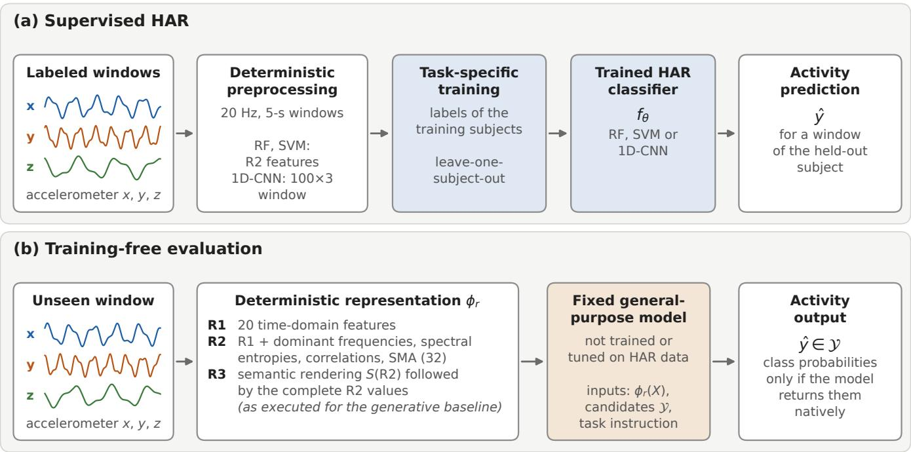
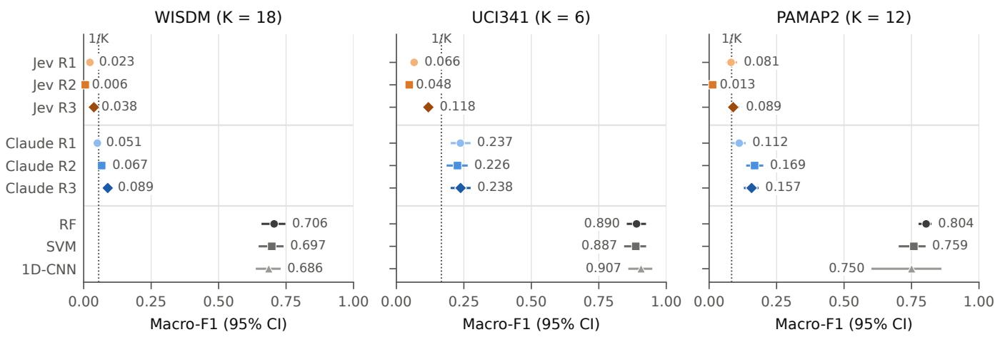
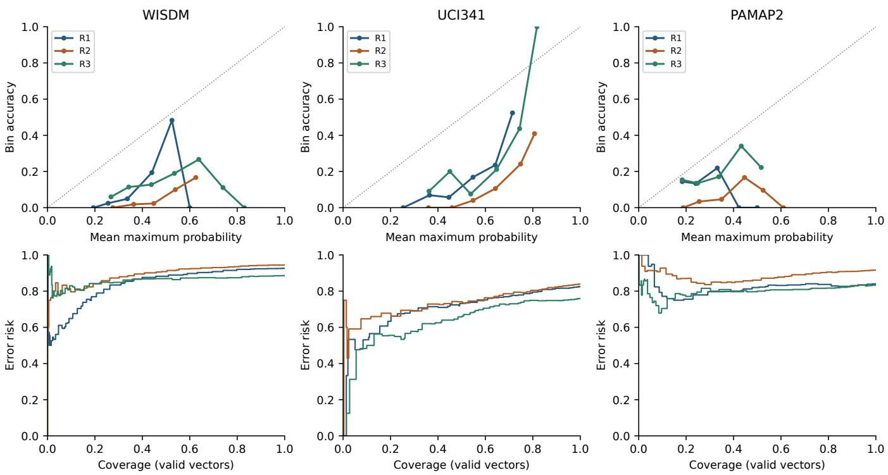
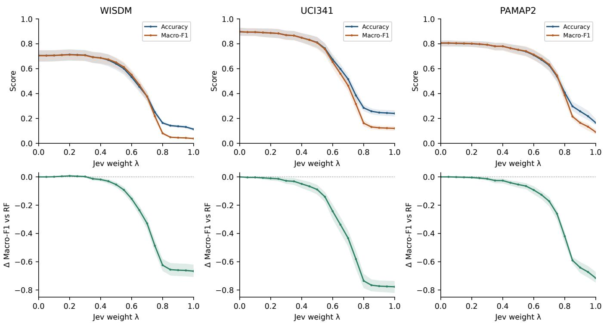

# 更多的特征并非更多的证据：使用 Jev 进行免训练人体活动识别的局限性

Orhan Konak

orhan.konak@hpi.de

Hasso Plattner Institute, University of Potsdam

Potsdam, Germany

## 摘要

通用模型展现了无需训练任务特定分类器即可做出基于传感器的决策的前景，这有望减少人体活动识别（Human Activity Recognition, HAR）对标注数据的依赖。然而，此类模型是否能够直接且充分地解释物理传感器信号的确定性描述，以取代或补充经过训练的 HAR 模型，目前尚不清楚。我们在来自 WISDM、UCI341 和 PAMAP2 的 1,800 个类别平衡的加速度计时间窗口上，使用固定的通用概率决策模型 Jev 对这一问题进行了研究。Jev 没有接收到任何标注示例、检索上下文或特定于 HAR 的参数更新。我们评估了三种确定性传感器表征，并将 5,400 次 Jev 决策与一个生成式基线和三个有监督 HAR 模型进行了对比。Jev 的表现远低于有监督识别，其最强表征在三个数据集上的 macro-F1 仅达到 0.038、0.118 和 0.089，而有监督模型则在 0.686 到 0.907 之间。更多的数值特征并未改善 Jev 的表现。相反，它们在所有三个数据集上都降低了识别性能；而使用确定性语义呈现来扩充相同的数值证据在一定程度上恢复了性能，尽管该实验并未将语义与伴随的序列化及冗余变化隔离开来。Jev 查询速度快且成本低，但其概率并不能可靠地针对识别进行校准。事后融合分析发现其在 WISDM 上有微小的改善，但在 UCI341 或 PAMAP2 上未能重现。这些结果表明，免训练传感器决策不仅取决于信号中包含的可用信息，还取决于模型是否能够利用展示该信息的表征。因此，传感器到模型的接口应当被视为模型评估的一部分，而非中立的预处理步骤。

## 关键词

human activity recognition, wearable sensing, training-free inference, probabilistic decision models, uncertainty estimation, sensor-based machine learning

## 1 引言

廉价、快速的活动决策只有在对其预期应用具有足够高的正确率时才是有用的。基于传感器的活动识别（HAR）传统上使用任务特定的训练数据来学习从物理测量值到活动标签的映射 [10]。通用模型催生了一种不同的工作流程。可以将传感器时间窗口与一组候选活动一起描述给模型，使其无需训练专用的传感器分类器即可做出决策。其吸引力是显而易见的，尤其是在测量数据充裕而标注稀缺的情况下。尚不明确的是，这种接口在基于传感器的活动识别中的实际效果究竟如何。

我们对 Jev 进行了研究，这是 Type-Safe AI 厂商以“系统一模型”（System One Models）[1] 为名推出的专有模型。Jev 接收一个状态和一组有界的候选选项，并返回带有类型的决策及其概率。我们将其视为一种可观察的 API 契约，而非特定内部架构、推理过程或训练语料库的证据。我们要探究的问题是，一个固定的通用决策模型在没有针对 HAR（人体活动识别）的特定训练或带标签的参考样例的情况下，能否利用加速度计信号的确定性描述。

结果显示出明显的局限性。在三个数据集上，监督分类器仍然遥遥领先于 Jev 和生成式基线模型。更多的数值特征并未对 Jev 产生帮助：将 20 个特征的统计表示扩展为 32 个信号感知特征会导致预测倾向于单一类别。使用确定性的语义渲染来增强相同的数值表示虽然恢复了部分性能，但仍存在较大的绝对差距。更多的传感器信息并不一定意味着更多可用的证据。在此，该结论描述的是所测试的接口；它并不是关于特征数量或所有通用模型的普适规律。

这种差异的重要性超越了单纯的独立准确率。观察到的 Jev 的低 API 成本和亚秒级的响应时间中位数使得重复查询变得可行，但其较差的识别能力和不完善的概率有效性限制了这些查询所能支持的应用。在一项单独的探索性分析中，少量的 Jev 概率贡献可以在 WISDM 上提升随机森林（Random Forest, RF）的性能，但这一模式在另外两个数据集上并未复现。我们报告了整个固定的融合曲线，而不是将追溯选取的权重作为可部署模型呈现。

本文主要有三点贡献：

• 我们隔离出了一种严格的免训练 HAR 设置，其中固定的通用决策模型仅接收当前传感器窗口的确定性表示、固定的任务指令以及候选活动集，而无需针对 HAR 的特定训练、带标签的参考样例或检索。我们在与三个监督式 HAR 参考模型和一个生成式基线模型相同的跨受试者（subject-independent）基准窗口上评估了此设置。

• 我们表明，传感器表示中可用的信息对于固定的通用决策模型而言并不一定构成可用证据。添加数值信号描述符降低了 Jev 在所有三个数据集上的识别能力，而使用确定性语义渲染增强完整的数值表示则部分恢复了性能。这表明传感器到模型的接口是模型评估的一部分，而非中立的预处理选择。

• 我们通过概率验证、校准与选择性预测分析、运行度量以及一项独立冻结的事后融合研究，刻画了该接口的局限性和潜在互补价值。Jev 的表现仍远落后于经过训练的 HAR 模型，而在 WISDM 上观察到的小幅融合增益并未在 UCI341 或 PAMAP2 上复现。

## 2 相关工作

我们将本工作置于三条研究脉络中。首先，我们回顾传统的基于传感器的 HAR 以及减少其对特定任务标注数据依赖的方法。接着，我们讨论基于基础模型（foundation model）、零样本（zero-shot）以及免训练（training-free）的活动识别方法。最后，我们将这些方法与本研究所探讨的通用概率决策模型区分开来。

## 2.1 基于传感器的人体活动识别

基于传感器的人体活动识别（HAR）传统上被形式化为一个监督学习问题。来自可穿戴或移动传感器的测量数据被划分为时间窗口，并用于针对预定义的一组活动训练分类器。早期的系统通常依赖于人工设计的统计与频域特征，而深度学习则将大部分表征学习转移到了模型本身 [15, 25]。尽管监督模型具备强大的识别性能，但它们仍然依赖于训练期间可用的数据，并且当用户、设备、传感器佩戴位置或活动分布发生变化时可能会面临困难。

因此，大量工作研究了如何减少这种依赖性。例如，自监督学习利用未标注的传感器数据来学习可重用的表征，然后再将其适配到下游 HAR 任务中 [13]。跨数据集方法则通过学习可在不同感知配置和活动空间之间迁移的表征来解决相关问题。GOAT 将传感器表征与自然语言监督相结合，并在跨数据集和零样本活动识别上评估了这一思想 [14]。这些方法提高了 HAR 模型的泛化能力，但它们仍然需要从传感器数据中学习传感器表征或调整模型参数。

我们的工作考虑了一种不同的设定。我们并不试图学习更好的传感器表征或将识别模型适配到目标数据集。相反，我们探讨的是：当决策模型保持固定，且在推理阶段仅提供当前传感器观测的确定性描述时，活动识别究竟能达到何种程度。

## 2.2 基础模型与免训练 HAR

基础模型（Foundation models）最近为基于传感器的人体活动识别（HAR）引入了新的方法。大规模预训练无需从头学习每个识别任务，而是可以提供能够跨数据集和应用复用的表征或先验知识。最近的一项综述指出了几个新兴方向，包括专用于 HAR 的基础模型、通用时间序列或多模态模型的适配，以及将大语言模型集成到基于传感器的活动识别中 [2]。例如，SensorLLM 首先将运动传感器信号与文本描述进行对齐，随后针对 HAR 执行任务感知微调 [12]。SensorLM 则从大规模可穿戴数据中学习传感器-语言表征，并在多个下游任务中支持零样本活动识别 [27]。最近的基准测试工作也开始在基于传感器的 HAR 场景下对基础模型进行系统评估。例如，HARBench 从多个维度评估模型，包括领域和传感器位置的鲁棒性，以及少样本和零样本性能 [24]。

零样本识别也得到了研究，它在训练期间不需要每个目标活动的样本。IMUZero 将学习到的传感器表征与由语言模型生成的语义活动属性相结合，以识别未见过的活动 [23]。在不同的传感领域中，ADL-LLM 将环境智能家居传感器事件转换为文本描述，并使用通用语言模型进行零样本活动识别 [4]。这些方法表明，预训练的语言知识有助于连接传感器观测数据与先前未见过的活动概念，尽管它们在学习特定于传感器的模型或表征的程度上有所不同。

更近期的研究明确探讨了可穿戴运动数据的免训练推理（training-free inference）。RAG-HAR 从传感器时间窗口中提取统计描述符，从向量数据库中检索相似的有标签样本，并将这些上下文证据提供给大语言模型以进行活动识别 [21]。RAG-HAR+ 强化了这种检索优先的设计，并减少了需要进行 LLM 推理的样本数量 [9]。ZARA 从参考传感器数据构建了一个有统计依据的文本知识库，并将检索到的证据与智能体式（agentic）LLM 工作流相结合，以实现免训练的运动时间序列推理 [11]。STELLA 则采用了另一个方向，通过学习一个紧凑的传感器分词器（tokenizer），将其输出投影到冻结语言模型的嵌入空间中以进行活动识别 [22]。

综合来看，这些研究表明，消除特定任务分类器的训练并不意味着只对应一种单一的实验设定。系统仍可能学习特定于传感器的表征、使用带标签的参考数据、检索样本，或依赖生成式语言模型的推理。我们研究了一种互补的设定，其中既不针对目标任务训练传感器编码器或 HAR（人类活动识别）分类器，也不在推理时提供或检索带标签的传感器样本。固定的决策模型仅接收当前传感器窗口的确定性表征、固定的任务指令以及候选活动集合。在既有的 HAR 基准上评估预训练通用模型会引入额外的方​​法学层面的担忧。公开传感器数据集在模型预训练期间可能已被接触过，这使得很难确定某个基准是否真正未被见过。Haresamudram 等人利用记忆测试调查了这一问题，并报告有证据表明大型语言模型能够复现公开可穿戴传感器数据集的部分内容 [7]。因此，我们并不假设专有通用模型的预训练数据中一定不存在公开的 HAR 基准。

## 2.3 System One 与通用决策模型

上述讨论的方法主要通过学习得到的传感器表征、检索机制或生成式语言模型推理来使用预训练模型。然而，活动识别最终需要在候选活动之间做出有界的决策。这就提出了一个问题：直接针对结构化决策设计的通用模型能否为免训练 HAR 提供一种不同的接口。

TypeSafe AI 于 2026 年 9 月推出了 Jev，作为其提出的 System One Models（系统一模型）类别下的首个公开模型。据厂商介绍，System One Models 专为快速、结构化的决策而设计，而非自回归文本生成。Jev 接收输入状态以及预定义的选择，并返回带类型的概率决策 [1]。Jev 的架构和训练数据的细节仍属于专有信息。因此，我们将 Jev 视为黑盒决策模型，不对其内部运行机制做任何假设。

独立研究已经开始在不同的应用领域中对 Jev 进行评估。Rafe 和 Das 使用 Jev 将警方的事故叙述转化为概率性事故变量，并明确对照编码字段和盲法人工判断评估了其概率输出 [16]。Huang 等人 [8] 研究了将 Jev 作为放射学报告之间事实一致性的低成本评判器。与我们使用确定性信号派生特征最密切相关的是，JEVQA 在无需任务特定模型训练的情况下，利用编码元数据、比特流统计信息以及像素派生特征，评估了 Jev 在视频质量预测方面的表现 [20]。这些研究表明，Jev 可以作为固定的决策组件跨越截然不同的输入领域运行，同时也说明其不确定性估计需要进行实证评估，而不能直接假定为可靠。

我们的研究关注基于传感器的用户活动识别（Human Activity Recognition, HAR）。我们研究了一个固定的 System One Model 是否可以在无需 HAR 特定训练、微调或带标签参考样例的情况下，将来自可穿戴运动测量值的确定性表征映射到语义活动类别。与目标为感知视频质量评分的 JEVQA 不同，我们的目标类别描述的是产生所测运动信号的实际人体物理活动。我们分别评估了识别性能以及模型给出的概率在多大程度上提供了关于预测不确定性的有用信息。

## 3 实验设置与方法

我们设计本研究旨在区分免训练 HAR 中容易混淆的三个问题。首先，固定的通用决策模型能否完全仅凭传感器窗口的确定性描述来识别活动？其次，识别效果在多大程度上取决于呈现给模型的表征？第三，由此产生的决策是否提供了有用的概率、操作优势，或者超越已训练 HAR 分类器的互补信息？Figure 1 总结了监督评估与免训练评估的路径。本节的其余部分定义了用于回答这些问题的数据集、表征形式、模型以及统计协议。

## 3.1 范围与分析源流

推理单元为五秒加速度计窗口 $X _ { i }$ ∈ $\mathbb { R } ^ { 1 0 0 \times 3 }$，其标签为 $y _ { i } \in \mathcal { Y } = \left\{ c _ { 1 } , . . . , c _ { K } \right\}$。监督分类器从其他受试者的带标签窗口中学习决策规则。相比之下，Jev 接收 $\phi _ { r } ( X _ { i } ) .$、固定任务指令  以及固定的候选词汇表：

$$
J _ {1. 1 3. 0} \left(\phi_ {r} \left(X _ {i}\right), I, \mathcal {Y}\right) = \left(\hat {y} _ {i} ^ {\text { native }}, \mathbf {p} _ {i}, c _ {i} ^ {\text { native }}\right).\tag{1}
$$

在我们的评估中，原生选择（native choice）和概率 argmax 是截然不同的输出。在返回的向量通过以下检查之前，我们不会假定它是有效的。“无训练（Training-free）”意味着在查询中不进行针对 HAR 的特定模型拟合、微调或包含带标注的示例；这并不意味着没有提供商预训练、用于评估的基准标签或经验预处理。

主要的评估协议在进行外部模型推理之前已在版本控制中冻结。它具体规定了基准、评估指标、自助法（bootstrap）流程和故障规则。我们将此称为推理前协议冻结（pre-inference protocol freeze），而非正式的预注册，因为这些提交记录未在公共注册表中进行独立的时间戳标记。在 Jev 推理之前指定了额外的置信度和错误重叠诊断，但它们并非原始主协议的一部分。混合分析是在 Jev 主要结果得出之后设计的，因此作为事后（post hoc）和探索性分析单独对待。

## 3.2 数据集、预处理与基准选择

我们使用 WISDM 的智能手表加速度计数据（UCI507）[26]、UCI341/HAPT 的原始智能手机加速度数据 [19]，以及 PAMAP2 的 Protocol 手/手腕加速度计数据 [17, 18]。UCI341 不是传统的预分窗 UCI HAR 基准：我们使用其六种基本活动，排除了姿势转换，并从原始记录中构建了新的 5 秒窗口。我们保留了原生活动分类体系，而不是跨数据集进行类别映射（Table 1）。

物理预处理。所有通道均保留重力和方向；没有旋转、身体/重力分离或按窗口归一化处理。WISDM 中的完全重复观测值被移除。活动改变、非递增时间戳或至少 500 ms 的间隙会切分数据段。在数据段内部，线性插值生成 20 Hz 的网格。这一冻结的 WISDM 流程没有抗混叠滤波器，因此混叠仍是一个局限。UCI341 的数值使用 9.80665 $\mathrm { m } / \mathrm { s } ^ { 2 }$ 从  转换而来，并从 50 Hz 重采样至 20 Hz。其标签区间采用冻结的从 1 开始的包含性解释（1-based inclusive interpretation）；源文档并没有明确确定端点索引方式。PAMAP2 使用 Protocol 文件的第 5–7 列（已为 $\mathrm { m } / \mathrm { s } ^ { 2 }$ 单位），排除了代码 0。仅当完整两侧的间隙小于 500 ms 时，缺失的选定轴三元组才会进行线性插值；更长的间隙会切分数据段，不完整的末端会被丢弃。UCI341 和 PAMAP2 采用带有 Kaiser 窗 $( \beta = 5 )$ 的固定多相 FIR 重采样、零边界扩展，并保留边缘瞬态。

没有任何窗口跨越已标注的活动或受试者边界。一个完整的窗口需要包含直至其5秒终点的原生观测数据；其输出的时间网格覆盖 0–4.95 s。不完整的剩余部分将被丢弃。因此，活动标签用于界定合规性、分段以及评估分层，但绝不参与特征值计算、语义阈值拟合或模型查询。这是针对孤立活动片段的评估，而非连续转换检测。

  
Figure 1: 冻结流水线概览，沿用自生成基线阶段。此处显示的 R3 条件随后原封不动地用于 Jev：语义渲染加上完整的 R2 数值。“Unseen”（未见）表示不在监督训练折或查询示例中；这并不代表其未出现在专有预训练中。

Table 1: 冻结的研究输入。每个窗口在 20 Hz 下包含 100 个样本，跨度为 5 s，且无重叠。“Eligible”（合格）为预处理后的全部总体；“benchmark”（基准）为匹配的评估子集。

<table><tr><td>数据集</td><td>受试者</td><td>类别</td><td>所选信号</td><td>原生采样率</td><td>Eligible</td><td>Benchmark</td></tr><tr><td>WISDM (UCI507)</td><td>51</td><td>18</td><td>手表加速度, xyz</td><td>带时间戳</td><td>31,945</td><td>900</td></tr><tr><td>UCI341 (HAPT)</td><td>30</td><td>6</td><td>智能手机总加速度, xyz</td><td>50 Hz</td><td>2,579</td><td>300</td></tr><tr><td>PAMAP2 (UCI231)</td><td>9</td><td>12</td><td>手部/手腕 ±16g 加速度, xyz</td><td>100 Hz</td><td>3,833</td><td>600</td></tr></table>

匹配基准。冻结的 v2 基准每个类别包含 50 个窗口：900 个 WISDM 窗口、300 个 UCI341 窗口和 600 个 PAMAP2 窗口。配额按标识符升序在符合条件的受试者之间进行轮流分配（round-robin），然后在每个受试者/类别序列上进行确定性分布。对于序列长度 $n$ 和配额 $q < n ,$ 所选索引为 $\lfloor ( 2 j + 1 ) ( n - 1 ) / ( 2 q ) \rfloor , j = 0 , . . . , q - 1 ;$ 耗尽的序列贡献所有窗口。因此，选择是按类别分层的，并且独立于模型预测、特征和置信度。在进行任何外部模型推理之前，v2 替换了较早的最早窗口规则；v1 作为溯源保留，未用于推理。监督预测仅在基准选择之后才加入。所有识别比较均使用完全相同的窗口；全样本基线结果不会替换为匹配子集的分数。

## 3.3 表征：信息量与可访问性

R1: 20 个数值特征。对于每个轴和幅值 $m _ { t } =$ $( x _ { t } ^ { 2 } + y _ { t } ^ { 2 } + z _ { t } ^ { 2 } ) ^ { 1 / 2 }$，R1 包含均值、总体标准差、最小值、最大值和均方幅值：

$$
\mu_ {x} = T ^ {- 1} \sum_ {t} x _ {t}, \quad \sigma_ {x} = \sqrt {T ^ {- 1} \sum_ {t} (x _ {t} - \mu_ {x}) ^ {2}}, \quad E _ {x} = T ^ {- 1} \sum_ {t} x _ {t} ^ {2}.\tag{2}
$$

数值以 float64 计算，并在序列化时不对特征进行舍入。

R2：32个数值特征。R2 保留所有 R1 的数值不变，并增加了四个主频、四个归一化谱熵、三个两两 Pearson 相关系数以及信号幅值面积（signal magnitude area）。对于每个均值中心化的通道，未加窗的实数 DFT 使用了 0.2–10 Hz 范围内的 50 个正频段，不包括 DC（直流分量）但包括 Nyquist（奈奎斯特频率）。

令 $P _ { j } = | F _ { j } | ^ { 2 }$ 且 $q _ { j } = P _ { j } / \sum _ { l = 1 } ^ { 5 0 } P _ { l }$

$$
f _ {\mathrm{dom}} = f _ {\arg \max _ {1 \leq j \leq 5 0} P _ {j}}, \quad H _ {\mathrm{spec}} = - \frac {\sum_ {j : q _ {j} > 0} q _ {j} \ln q _ {j}}{\ln 5 0}.\tag{3}
$$

对于恒定信号或总功率为零的情况，频率和熵均设为零哨兵值（zero sentinels）；当频率完全并列时，选择最低的频段。当任一轴为恒定信号时，相关系数为零。最后，

$$
\mathrm{SMA} = T ^ {- 1} \sum_ {t} (| x _ {t} | + | y _ {t} | + | z _ {t} |).\tag{4}
$$

归一化熵公式和零功率约定与实际执行的实现相一致。

R3：语义增强，而非仅有语义文本。一个确定性英文渲染器  描述了所有 32 个特征，并为 20 个选定的量附加了低（low）、中（moderate）或高（high）的限定词（对于绝对相关系数，则为弱（weak）、中（moderate）或强（strong））。边界是所有 31,945 个 WISDM 手表窗口的三分之一和三分之二分位数，拟合时不使用活动标签，并在 UCI341 和 PAMAP2 上原样复用。均值和极值仍保持数值形式。处于边界上的数值归入较低的类别中。这是一个经验性的、直推式（transductive）的 WISDM 预处理步骤，而不是局限于训练受试者的阈值拟合。

输入到两个通用模型的实际输入为

$$
\boxed {\mathrm{R3} = S (\mathrm{R2}) \oplus \mathrm{R2},}\tag{5}
$$

其中 ⊕ 表示序列化为单个输入。叙述文本显示两位小数（极小的非零值采用科学记数法）；后附的 JSON 则保留了完整的未舍入 R2 数值。 没有引入任何活动名称、定义或其他传感器观测数据。

已记录的 R3 偏差。早期的表示边界规定 R3 仅包含叙述文本。Claude 基准测试无意中保留了历史审计的 JSON 后缀。记录的勘误根据相应的 R2 有效载荷验证了所有 1,800 个 Claude R3 请求；没有替换任何结果。在进行任何 Jev 请求之前，为了保持可比性，Jev 的协议明确采用了相同的完整 R3 输入。因此，R3–R2 衡量的是语义渲染、冗余以及序列化/长度变化的联合效应。它无法确立语义的孤立因果效应，也无法支持有关纯叙述文本 R3 的论断。

## 3.4 推断与有监督基准

Jev 使用固定标识符 jev-1.13.0 和 TypeSafe System One 端点。R1/R2 是结构化对象；R3 是冻结字符串。单选题按规范顺序提供原生候选名称，且不附带描述。共享指令要求提供在 5 秒加速度计窗口期间执行的一项活动。不使用标注样本、检索、外部工具或提示微调。每个数据集/窗口接收 R1、R2 和 R3，总计 5,400 次请求。数据集/窗口顺序基于哈希并交错排列，采用顺序请求。协议仅允许传输层重试；HTTP-200 响应绝不会因内容或正确性而被替换。Jev 的完整运行未发生任何重试。

Claude Sonnet 5 作为生成式基线，通过 Anthropic API 进行查询，其结构化输出被限制在相同的活动词汇表、相同的指令、窗口以及表征载荷中。其保存的输出提供标签，而非适用于本分析的原生类别概率向量。因此，我们不构建 Claude 的校准估计，也不将口头置信度与 Jev 的概率进行比较。

监督基线在完整的合格人群上采用留一受试者交叉验证（LOSO）评估。RF（随机森林）在 R2 上使用 500 棵树、平方根特征子采样、平衡类别权重以及随机种子 2026。SVM 采用训练折标准化、RBF 核、$C = 1$、基于尺度的 gamma 以及平衡类别权重，不进行概率校准。CNN 接收经过训练折各轴标准化的原始 100 × 3 窗口：包含 64/128/128 通道的卷积块（卷积核为 5/5/3）、批归一化（Batch Normalization）和 ReLU、两个最大池化层、全局平均池化以及线性输出。Adam 优化器使用学习率 $1 0 ^ { - 3 }$、权重衰减 $1 0 ^ { - 4 }$、批大小 128 以及逆频率类别权重。训练在 100 轮（epoch）内停止，早停耐心值（patience）为 10；通过循环选取的独立验证受试者来确定检查点，绝不使用测试受试者。在初始的 CNN 冒烟阶段之后，进行了完整的冻结全 LOSO 评估。所有报告的 CNN 得分均使用该完整评估的结果。未针对匹配子集或混合分析进行重新调优。

## 3.5 识别、概率与统计不确定性

识别在每个基准窗口上使用 Jev 的原生选择。缺失、失败、拒绝或无效的选择均计为错误，并会降低真实类别的召回率；实际未发生上述情况。主要指标宏 F1（macro-F1）在整个原生分类体系上取平均值，未定义的类别 F1 设为零；准确率（accuracy）为次要指标：

$$
F _ {\text { macro }} = K ^ {- 1} \sum_ {k} F 1 _ {k}, \quad \text { Acc } = N ^ {- 1} \sum_ {i} \mathbb {1} [ \hat {y} _ {i} ^ {\text { native }} = y _ {i} ].\tag{6}
$$

Jev 概率向量必须恰好覆盖每个候选类别一次，为有限值且位于 [0, 1] 区间内，并满足 $\begin{array} { r } { \big | \sum _ { k } p _ { i k } - 1 \big | \ \leq \ 1 0 ^ { - 6 } } \end{array}$。无效向量仅在概率指标中被排除并予以计数；它们绝不会被截断（clamped）、填补（imputed）或重新归一化（renormalized）。即使某个有效原生选择（native choice）对应的概率向量无效，它仍会保留在识别评分中。概率分析采用带有规范顺序平局决胜的 $\hat { y } _ { i } ^ { p ^ { \smash { - } } } = \arg \operatorname* { m a x } _ { k } \hat { p } _ { i k }$ 以及 $c _ { i } = \operatorname* { m a x } _ { k } p _ { i k }$，而非提供商单独的原生置信度。

在有效向量集 $V$ 上，我们报告多分类 Brier 分数 [3]、截断负对数似然（clipped negative log-likelihood）以及十分箱期望校准误差（expected calibration error, ECE）[6]：

$$
\mathrm{BS} = | V | ^ {- 1} \sum_ {i \in V} \sum_ {k} (p _ {i k} - \mathbb {1} [ y _ {i} = c _ {k} ]) ^ {2},\tag{7}
$$

$$
\mathrm{NLL} = - | V | ^ {- 1} \sum_ {i \in V} \ln \max (p _ {i, y _ {i}}, 1 0 ^ {- 1 2}),\tag{8}
$$

$$
\mathrm{ECE} = \sum_ {b} \frac {| B _ {b} |}{| V |} | \mathrm{acc} (B _ {b}) - \overline {{c}} (B _ {b}) |.\tag{9}
$$

分箱为 $[ 0 , 0 . 1 ) , \ldots , [ 0 . 9 , 1 ] ,$，并保留空分箱计数。截断仅限于 NLL 评估，不会修复向量。选择性预测（selective prediction）[5] 使用每个唯一观测到的置信度

阈值：

$$
A _ {\tau} = \{i \in V: c _ {i} \geq \tau \}, \quad \mathrm{coverage} (\tau) = | A _ {\tau} | / | V |,\tag{10}
$$

$$
\mathrm{risk} (\tau) = | A _ {\tau} | ^ {- 1} \sum_ {i \in A _ {\tau}} \mathbb {1} [ \hat {y} _ {i} ^ {p} \neq y _ {i} ].\tag{11}
$$

覆盖率是以有效向量为条件的，而非全部 API 请求。阶梯状风险-覆盖率曲线下面积（AURC）仅用于描述性分析。未针对部署拟合任何置信度阈值。

准确率和宏 F1（macro-F1）区间采用受试者聚类自举法（subject-cluster bootstrap）。我们在每个数据集中使用 10,000 次重采样，随机种子设为 2026。每次重采样均有放回地抽取原始数量的受试者，并包含其所有基准窗口（按重复次数计）。我们计算汇总指标，而非受试者的平均得分；缺失的类别仍保留在宏 F1 的分母中。百分位数边界采用线性插值。配对比较共享重采样抽取与窗口。这些区间是描述性的，以固定基准和观测到的模型响应为条件；它们既非同时置信带，亦非来自重复 API 运行的证据。本研究未进行显著性检验，亦未做出经多重比较校正的优势声明。

## 3.6 运行度量与研究辅助

延迟是在并发数为 1 时观察到的请求到响应的实际挂钟时间（wall time），包含网络/服务效应。它不包括传感器采集和预处理。成本使用记录的 token 数量和执行时冻结的标价计算，而非实际发票：Jev 为每百万输入 token 0.042 美元，输出免费；Claude 为每百万输入 token 2 美元，每百万输出 token 10 美元。我们报告了冻结的中位数和第 95 百分位数，以及 Jev 观察到的最大值；现有的评分摘要中不包含第 99 百分位数。未进行新的计时实验。

生成式 AI 工具（ChatGPT/Codex 和 Claude）被用于语言润色、实现与代码检查、分析支持，以及根据记录的结果准备论文的图表。研究问题、实验设计、科学决策、解释以及对该工作的责任均由作者承担。评估的 Jev 和 Claude 输出属于实验观察结果，与使用这些工具进行研究辅助截然不同。本文报告的所有数值结果均源自冻结的可执行分析；AI 生成的建议未被视为实证证据。

## 4 主要结果

我们围绕免训练（training-free）评估的三个方面来组织主要结果。首先，我们将识别性能与生成式和监督式基准进行比较。然后，我们考察传感器表征如何改变 Jev 的预测，并评估其返回的概率是否提供了有用的不确定性信息。最后，我们报告了观察到的延迟和 API 成本。事后融合分析（post-hoc fusion analysis）单独放在第 5 节中，因为它是已知 Jev 主要结果之后才设计的。

## 4.1 独立识别：巨大的监督学习差距

Table 2 报告了所有主要识别条件及其冻结区间。Jev R3 在 WISDM 上的 macro-F1 为 0.0378，在 UCI341 上为 0.1184，在 PAMAP2 上为 0.0893。相应的 RF（随机森林）值分别为 0.7057、0.8899 和 0.8041。因此，Jev 与 RF 相比，macro-F1 分别落后 0.6679、0.7715 和 0.7148。即使是表现最强的 Jev 条件，也远低于所有三个监督式基准。这些结果不支持在所评估的条件下将 Jev 直接用作已训练 HAR（人类活动识别）分类器的即插即用替代品。

Claude 的表现也远低于监督式识别，尽管在表征和数据集的每种配对组合中，其点估计值均超过了 Jev。Jev 与 Claude 在 PAMAP2 R1 上的配对差异具有跨越零的 95% 区间；我们并不主张其具有普遍的统计优越性。Figure 2 中对 Jev、Claude 与监督式基准的配对比较为这两种免训练接口的薄弱表现提供了背景。已发表的基于检索的系统和传感器预训练系统使用了明显不同的信息预算和协议，因此我们未将它们与这些结果进行数值上的对比排序。

## 4.2 表征：数值丰富化可能会失效

R2 包含了 R1 的所有特征，然而 Jev 的 macro-F1 在每个数据集上均有所下降。R2 将 899/900 个 WISDM 窗口、300/300 个 UCI341 窗口以及 595/600 个 PAMAP2 窗口均判定为步行（walking）。在每个类别恰好有 50 个样本的情况下，单类别预测的准确率为 1/，macro-F1 为 $2 / [ K ( K + 1 ) ]$；UCI341 的 R2 得分恰好就是这种塌缩解（collapsed solution）。其宽度为零的 bootstrap 区间反映了该基准在受试者/类别构成下的恒定行为，而非有效泛化的精确证据。

R3 挽回了部分损失。在 WISDM、UCI341 和 PAMAP2 上，配对的 R3–R2 macro-F1 差异分别为 0.0319 [0.0283, 0.0355]、0.0708 [0.0513, 0.0887] 和 0.0763 [0.0579, 0.0987]。相对于 R1，其提升分别为 0.0147 [0.0050, 0.0236]、0.0527 [0.0333, 0.0718] 和 0.0080 [−0.0072, 0.0219]。因此，PAMAP2 的 R3–R1 区间并不支持存在显著改善。R3 没有添加新的测量信息，而是改变了现有信息的呈现方式。它的部分恢复支持了接口的实际重要性，但其具体机制仍未明确。

## 4.3 概率有效性并不意味着校准良好

所有 5,400 个 Jev 选择都是有效的，但有 86 个概率向量未能满足冻结标准（frozen criterion），留下 5,314 个用于概率评估（Table 3）。我们保留了这种区分：成功的类型化答案并不能证明其分布是可用的。在有效向量中，原生选择（native choice）与规范概率 argmax 在 96 种情况下不一致，其中包括 WISDM、UCI341 和 PAMAP2 上的 22、2 和 29 个 R3 案例。因此，混合端点必须与基于概率 argmax 的识别进行比较，而不是与主要的原生选择得分进行比较。

R3 的 ECE 分别为 0.2532、0.3489 和 0.1294。平均最大概率分别为 0.3667、0.5844 和 0.2952，而有效向量上的 argmax 准确率仅为 0.1135、0.2405 和 0.1658。7 个 WISDM R3 案例需要使用冻结 NLL 下限；没有其他条件

Table 2: 所有匹配的主要识别结果，报告为估计值 [95% 受试者聚类区间]。分数为比例。Jev 在每个窗口上都使用原生选择（native choice）；其他系统使用其冻结的类别预测。

<table><tr><td>数据集</td><td>模型</td><td>表示</td><td>准确率 [95% CI]</td><td>Macro-F1 [95% CI]</td></tr><tr><td>WISDM</td><td>Jev</td><td>R1</td><td>0.0733 [0.0653, 0.0822]</td><td>0.0231 [0.0153, 0.0320]</td></tr><tr><td>WISDM</td><td>Claude</td><td>R1</td><td>0.1278 [0.1173, 0.1386]</td><td>0.0507 [0.0428, 0.0587]</td></tr><tr><td>WISDM</td><td>Jev</td><td>R2</td><td>0.0556 [0.0546, 0.0562]</td><td>0.0059 [0.0058, 0.0059]</td></tr><tr><td>WISDM</td><td>Claude</td><td>R2</td><td>0.1422 [0.1288, 0.1569]</td><td>0.0666 [0.0536, 0.0815]</td></tr><tr><td>WISDM</td><td>Jev</td><td>R3</td><td>0.1122 [0.1001, 0.1237]</td><td>0.0378 [0.0341, 0.0414]</td></tr><tr><td>WISDM</td><td>Claude</td><td>R3</td><td>0.1467 [0.1321, 0.1616]</td><td>0.0891 [0.0757, 0.1019]</td></tr><tr><td>WISDM</td><td>RF</td><td>native</td><td>0.7056 [0.6567, 0.7489]</td><td>0.7057 [0.6589, 0.7475]</td></tr><tr><td>WISDM</td><td>SVM</td><td>native</td><td>0.7000 [0.6488, 0.7455]</td><td>0.6970 [0.6483, 0.7407]</td></tr><tr><td>WISDM</td><td>1D-CNN</td><td>native</td><td>0.6856 [0.6355, 0.7317]</td><td>0.6857 [0.6377, 0.7300]</td></tr><tr><td>UCI341</td><td>Jev</td><td>R1</td><td>0.1767 [0.1667, 0.1889]</td><td>0.0657 [0.0537, 0.0799]</td></tr><tr><td>UCI341</td><td>Claude</td><td>R1</td><td>0.3300 [0.2943, 0.3673]</td><td>0.2372 [0.2012, 0.2749]</td></tr><tr><td>UCI341</td><td>Jev</td><td>R2</td><td>0.1667 [0.1667, 0.1667]</td><td>0.0476 [0.0476, 0.0476]</td></tr><tr><td>UCI341</td><td>Claude</td><td>R2</td><td>0.2933 [0.2569, 0.3298]</td><td>0.2263 [0.1859, 0.2641]</td></tr><tr><td>UCI341</td><td>Jev</td><td>R3</td><td>0.2367 [0.2118, 0.2619]</td><td>0.1184 [0.0989, 0.1363]</td></tr><tr><td>UCI341</td><td>Claude</td><td>R3</td><td>0.3267 [0.2847, 0.3693]</td><td>0.2379 [0.2011, 0.2751]</td></tr><tr><td>UCI341</td><td>RF</td><td>native</td><td>0.8900 [0.8542, 0.9252]</td><td>0.8899 [0.8536, 0.9250]</td></tr><tr><td>UCI341</td><td>SVM</td><td>native</td><td>0.8867 [0.8435, 0.9252]</td><td>0.8869 [0.8438, 0.9253]</td></tr><tr><td>UCI341</td><td>1D-CNN</td><td>native</td><td>0.9067 [0.8587, 0.9487]</td><td>0.9067 [0.8591, 0.9483]</td></tr><tr><td>PAMAP2</td><td>Jev</td><td>R1</td><td>0.1567 [0.1386, 0.1807]</td><td>0.0812 [0.0631, 0.1038]</td></tr><tr><td>PAMAP2</td><td>Claude</td><td>R1</td><td>0.1800 [0.1369, 0.2356]</td><td>0.1116 [0.0836, 0.1356]</td></tr><tr><td>PAMAP2</td><td>Jev</td><td>R2</td><td>0.0833 [0.0754, 0.0939]</td><td>0.0129 [0.0118, 0.0145]</td></tr><tr><td>PAMAP2</td><td>Claude</td><td>R2</td><td>0.2367 [0.1931, 0.2949]</td><td>0.1686 [0.1374, 0.2008]</td></tr><tr><td>PAMAP2</td><td>Jev</td><td>R3</td><td>0.1617 [0.1426, 0.1983]</td><td>0.0893 [0.0711, 0.1116]</td></tr><tr><td>PAMAP2</td><td>Claude</td><td>R3</td><td>0.2433 [0.2036, 0.2977]</td><td>0.1575 [0.1289, 0.1835]</td></tr><tr><td>PAMAP2</td><td>RF</td><td>native</td><td>0.8033 [0.7763, 0.8250]</td><td>0.8041 [0.7761, 0.8241]</td></tr><tr><td>PAMAP2</td><td>SVM</td><td>native</td><td>0.7550 [0.7055, 0.7959]</td><td>0.7586 [0.7025, 0.8021]</td></tr><tr><td>PAMAP2</td><td>1D-CNN</td><td>native</td><td>0.7433 [0.5763, 0.8555]</td><td>0.7504 [0.6014, 0.8607]</td></tr></table>

  
Figure 2: Jev、Claude 生成式基线以及监督 HAR 参考在匹配基准上的宏 F1（macro-F1），附带 95% 受试者聚类 bootstrap 区间。两种免训练模型均使用相同的冻结基准窗口和表征 R1–R3；监督模型数值来自相同窗口上的冻结 LOSO 预测。虚线标记了 1/ 作为尺度参考。在所有九组数据集–表征对中，Jev 的点估计值均低于 Claude，且远低于监督参考。具体数值报告于 Table 2 中。

。置信度不能被解读为经过验证的正确性概率。PAMAP2 上更小的 ECE 也不能证明模型整体表现更好：ECE 取决于置信度分布、分箱以及任务构成。

Table 3: 仅基于有效向量的冻结 Jev 概率指标；未进行修复。“Native ≠ argmax”统计了原生选择与规范概率 argmax 之间的不一致次数。BS、NLL、ECE 和 AURC 均为点估计值；冻结分析未为这些指标提供区间。

<table><tr><td>数据集</td><td>表征</td><td>有效/总数</td><td>Native ≠ argmax</td><td>BS</td><td>NLL</td><td>ECE</td><td>AURC</td><td>argmax 准确率</td></tr><tr><td>WISDM</td><td>R1</td><td>882/900</td><td>17</td><td>1.0282</td><td>3.3020</td><td>0.2495</td><td>0.8408</td><td>0.0737</td></tr><tr><td>WISDM</td><td>R2</td><td>883/900</td><td>0</td><td>1.1350</td><td>3.4987</td><td>0.4154</td><td>0.8908</td><td>0.0555</td></tr><tr><td>WISDM</td><td>R3</td><td>890/900</td><td>22</td><td>1.0571</td><td>3.5944</td><td>0.2532</td><td>0.8600</td><td>0.1135</td></tr><tr><td>UCI341</td><td>R1</td><td>297/300</td><td>4</td><td>0.9523</td><td>1.9385</td><td>0.3665</td><td>0.7022</td><td>0.1751</td></tr><tr><td>UCI341</td><td>R2</td><td>292/300</td><td>0</td><td>1.1045</td><td>2.2255</td><td>0.5018</td><td>0.7334</td><td>0.1610</td></tr><tr><td>UCI341</td><td>R3</td><td>291/300</td><td>2</td><td>0.9400</td><td>1.8631</td><td>0.3489</td><td>0.6306</td><td>0.2405</td></tr><tr><td>PAMAP2</td><td>R1</td><td>590/600</td><td>21</td><td>0.9274</td><td>2.5515</td><td>0.1043</td><td>0.8223</td><td>0.1593</td></tr><tr><td>PAMAP2</td><td>R2</td><td>598/600</td><td>1</td><td>1.0108</td><td>2.7647</td><td>0.2903</td><td>0.8845</td><td>0.0836</td></tr><tr><td>PAMAP2</td><td>R3</td><td>591/600</td><td>29</td><td>0.9319</td><td>2.5462</td><td>0.1294</td><td>0.8012</td><td>0.1658</td></tr></table>

  
Figure 3: Jev 概率审查，直接渲染自冻结的可靠性区间和风险-覆盖率点。上部面板显示非空区间中的经验准确率与平均最大概率；对角线表示完全校准。下部面板显示在每个冻结置信度阈值下以有效向量为条件的风险。未选择任何阈值，也未拟合置信度校准。

选择性拒绝可以改变错误率，但图 3 中的完整曲线并未提供通用的操作保证。R3 的 AURC 分别为 0.8600、0.6306 和 0.8012。在 WISDM 上，尽管全覆盖识别率较低，R1 的 AURC（0.8408）仍低于 R3。因此，用于分类和置信度排序的表征质量不一定会同步提升。在附加的前瞻性诊断中，R3 用于 argmax 正确性的最大置信度 AUROC 分别为 0.5803、0.6750 和 0.5859。这些是原始主要规范之外的诊断，而非拟合的接受策略。

## 4.4 成本与延迟：可行的请求，较弱的决策

Jev 的九个条件级中位数介于 0.291–0.300 s 之间，而 Claude 为 1.440–1.558 s。按记录的标价计算，Jev 的成本为每 1,000 个窗口 0.035–0.071 USD，而 Claude 为 1.545–3.547 USD。在此基础上，包含 5,400 个用例的完整 Jev 运行成本为 0.2777 USD；Claude 运行成本为 12.8168 USD。这些是观测到的特定运行 API 比较，并非受控的硬件基准测试或保证的未来价格。

Table 4: 观测到的串行 API 延迟和冻结标价成本。每行对应一个数据集/表征条件。成本为每 1,000 个窗口的 USD 金额，根据记录的使用量计算；计时不包括采集和预处理。

<table><tr><td rowspan="2">数据集</td><td rowspan="2">表征</td><td rowspan="2">中位数 (s)</td><td colspan="2">Jev</td><td colspan="3">Claude</td></tr><tr><td>p95 (s)</td><td>最大值 (s)</td><td>USD/1k</td><td>中位数 (s)</td><td>USD/1k</td></tr><tr><td>WISDM</td><td>R1</td><td>0.296</td><td>0.668</td><td>5.327</td><td>0.0376</td><td>1.457</td><td>1.6342</td></tr><tr><td>WISDM</td><td>R2</td><td>0.292</td><td>0.561</td><td>2.225</td><td>0.0492</td><td>1.471</td><td>2.0587</td></tr><tr><td>WISDM</td><td>R3</td><td>0.300</td><td>0.561</td><td>1.930</td><td>0.0707</td><td>1.519</td><td>3.5469</td></tr><tr><td>UCI341</td><td>R1</td><td>0.292</td><td>0.480</td><td>1.184</td><td>0.0348</td><td>1.489</td><td>1.5446</td></tr><tr><td>UCI341</td><td>R2</td><td>0.292</td><td>0.507</td><td>5.335</td><td>0.0461</td><td>1.491</td><td>1.9632</td></tr><tr><td>UCI341</td><td>R3</td><td>0.293</td><td>0.516</td><td>1.704</td><td>0.0677</td><td>1.558</td><td>3.4533</td></tr><tr><td>PAMAP2</td><td>R1</td><td>0.293</td><td>0.516</td><td>2.001</td><td>0.0359</td><td>1.440</td><td>1.5607</td></tr><tr><td>PAMAP2</td><td>R2</td><td>0.291</td><td>0.579</td><td>1.670</td><td>0.0474</td><td>1.448</td><td>1.9859</td></tr><tr><td>PAMAP2</td><td>R3</td><td>0.295</td><td>0.622</td><td>1.559</td><td>0.0690</td><td>1.531</td><td>3.4745</td></tr></table>

所有 Jev 请求均顺利完成，未发生重试或出现无效选择。尽管如此，最慢的响应时间为 5.335 s，超过了 5 秒的窗口时长。亚秒级的中位数响应时间适用于周期性查询，但并不能证明其具备硬性时限保证（deadline guarantees）、高负载下的流式吞吐量、端侧推理、离线运行或低能耗特性。在能够请求决策之前，窗口数据累积本身就已经耗费了 5 秒。监督模型的本地推理和训练成本具有不同的边界；我们并未声称其在 API 成本方面优于 RF 部署。

## 5 事后探索性概率融合

本分析旨在探讨独立的弱 Jev 证据是否能够补充专用分类器。该分析的构思以及 R3 的选择均基于已完成的主要实验结果。它不属于推理前主评估协议的一部分。其协议、完整权重网格、算术规则、排除项以及自举法（bootstrap）在混合评分前均已冻结；未进行进一步的 Jev 推理或重新调优。

对于相同的窗口，线性概率池为

$$
\mathbf {p} _ {H, i} (\lambda) = (1 - \lambda) \mathbf {p} _ {R F, i} + \lambda \mathbf {p} _ {J e v, i},\tag{12}
$$

$$
\hat {y} _ {H, i} (\lambda) = \arg \max _ {c _ {k} \in \mathcal {Y}} p _ {H, i, k} (\lambda),\tag{13}
$$

$$
\Lambda = \{k / 2 0: k = 0, \ldots , 2 0 \}.\tag{14}
$$

运算采用 float64；若出现平局，则按规范类别顺序选择第一个最大值。这是以观测值为条件的两个输出的线性集成。非正式表述“Jev 作为先验”绝不能误解为贝叶斯先验-似然更新或经过校准的后验推理。

先前冻结的 RF 模型仅为了导出概率而重新执行。该门控要求在 90 个折叠中精确复现全部 38,357 个完整 LOSO 硬预测以及全部 1,800 个基准预测，包括折叠哈希值以及 RF predict 与概率 argmax 的一致性。保存的验证报告显示不匹配数为零。融合采用保存的概率导出结果。RF 向量必须是有穷的、在取值范围内、完整的，且在 $1 0 ^ { - 9 } ;$ 内和为 1；Jev 使用其原有的 $1 0 ^ { - 6 }$ 标准。

每个数据集使用一个固定的完整用例（complete-case）子集，用于单独的 RF、单独的 Jev 概率 argmax 以及所有 21 个权重：890/900 个 WISDM 窗口、291/300 个 UCI341 窗口和 591/600 个 PAMAP2 窗口。排除的 10、9 和 9 个用例存在无效的 Jev R3 向量；均未进行修复。所有受试者仍有代表性。端点在这些完全相同的子集上复现了 RF 和 Jev argmax。它们不必等于 Table 2，后者使用了所有用例和原生 Jev 选择。Bootstrap 抽样在数据集内的每个权重之间进行配对。

完整敏感性曲线即为结果（Figure 4；所有点和区间见 Appendix A）。在 WISDM 上，RF 端点的宏 F1（macro-F1）为 0.7050。在描述性示例  = 0.20 处，宏 F1 为 0.7120，准确率为 0.7135。配对增益为 0.0070 [0.0024, 0.0125] 的宏 F1 和 0.0079 [0.0033, 0.0136] 的准确率。在此权重下，RF 的 8 个错误预测变为正确，1 个正确预测变为错误，在 890 个窗口中净增加 7 个正确决策。这种微小的提升在实际中远小于独立差距。

相同的  = 0.20 在 UCI341 上产生的宏 F1 变化为 −0.0103 [−0.0253, 0.0034]，在 PAMAP2 上为 −0.0043 [−0.0125, 0.0042]。PAMAP2 在 $\lambda = 0 . 0 5$ 处的微小正向宏 F1 变化为 0.00017 [−0.00454, 0.00525]，准确率保持不变；这并不是 WISDM 结果的复现。较大的 Jev 权重会使所有三个数据集的表现大幅下降。我们既不隐瞒不利的网格点，也不定义拟合的 ★。在这条探索性曲线上发现的有利点估计区间，并不能验证部署权重的有效性，也不能确立其在新的受试者或数据集上的效益。

## 6 讨论

综合来看，这些结果揭示了传感器表征中包含的信息与固定的通用模型可以使用的信息之间的区别。巨大的监督差距表明所评估的表征保留了大量的活动信息，而跨 R1、R2 和 R3 的表现表明，对这些信息的获取在很大程度上取决于呈现给模型的接口。我们首先讨论这一含义，然后考虑数据集之间存在差异的可能原因，以及对未来 HAR（人类活动识别）系统的实际影响。

## 6.1 传感器接口是模型评估的一部分

本研究最明确的实际发现是拥有传感器描述符与有效使用它们之间存在的差距。RF 接收与导致 Jev 趋向近乎单类别预测相同的 R2 特征。因此，对于经过训练的映射而言，这些描述符包含有用的预测结构，而所测试的固定决策接口却未能充分利用其中大部分信息。R3 改变了源自测量的相同信息呈现给模型的方式，并在一定程度上恢复了识别能力。这表明传感器到模型的接口应被视为实验设计的一部分。

  
Figure 4: 事后探索性融合：针对每个数据集在相同完整用例窗口上的完整冻结 21 权重曲线。阴影表示逐点 95% 受试者聚类区间，而非同步置信带。未拟合或选择最优权重。第二行显示了所有权重下与 RF 配对的宏 F1（macro-F1）差异；增加 Jev 权重最终会导致巨大的损失。

有几种机制可以解释这种行为，包括数值处理、与特征名称的关联、序列化格式、排序、冗余以及输入长度。R3 同时改变了其中的若干因素，并且我们并未评估仅散文、长度匹配或重新排序的变体。因此，我们无法将这种恢复明确归因于语义语言。该实验所表明的是，即使底层传感器测量值保持不变，改变表征方式也会实质性地改变模型行为。

## 6.2 数据集为何存在差异：待检验的解释

UCI341 的六种基本活动和智能手机放置位置与 WISDM 在手腕处的十八种活动有所不同。相较于细粒度的手部相关活动（其类别特征可能取决于信号中所缺乏的上下文或物体交互），粗粒度的姿态和移动区分可能更容易与汇总加速度特征相关联，这是合乎情理的。这或许有助于解释 Jev 在 UCI341 R3 上具有更高的宏 F1。然而，类别数量、放置位置、分类体系、受试者构成、记录条件和预处理都是同时变化的。原始的跨数据集得分无法孤立其中的任何单一因素，且类别数量的变化也会改变平凡精度（trivial accuracy）。

PAMAP2 包含十二种活动，但仅有九名受试者，且活动覆盖不均。某些活动可能具有独特的强度或周期性，而另一些活动可能共享手腕运动模式。这些都是造成异质性识别的合理解释，而非经过测量的因果效应。其较少的受试者聚类数量也限制了区间的稳定性。语义阈值是基于 WISDM 完整的未标记特征总体开发的，并原封不动地进行了迁移。设备/放置位置和分布的差异可能会改变“低”或“高”在其他数据集上传达的含义。我们并未重新拟合阈值来验证这一解释。

WISDM 的融合增益可能反映了在 RF（随机森林）裕度较小时，偶尔出现的互补概率排序。因此，在 WISDM 上，即使是一个较弱的独立分类器，也能提供概率排序，从而有利地改变少量的 RF 决策。UCI341 起始于更强的 RF 基准端点，可能提供较少的有用修正；PAMAP2 则具有不同的错误结构和样本群体。这些仅是假设。观察到的修正/错误计数支持一种局部权衡，而非经过证实的机制，也不是类似于 WISDM 的数据必然会受益的规则。仅凭数据集名称、类别数量和传感器放置位置不足以预测成功。几个 WISDM 候选字符串较为简短（例如“teeth”、“soup”和“catch”），而非完整的活动描述；对它们的解释是另一个不受控制的接口差异。

## 6.3 HAR 研究人员可以采用和应当避免的做法

对于拥有带标签训练数据且有识别质量要求的系统，这些结果更支持采用针对任务训练的传感器分类器。Jev 提供了快速、低成本的类型化 API，且不需要针对特定任务进行拟合，但这些操作优势并不能弥补所观察到的独立错误率。在这种情况下，现有证据并不支持将其用作唯一的活动识别器、可信的伪标签生成器或安全攸关的决策组件。

因此，探索性增强应保留监督参考基准，并验证返回的每个概率向量。原生决策和概率 argmax 应分别评估，并且融合端点应在完全相同的完整案例上进行比较。任何混合权重或拒绝阈值在实际应用前都需要经过独立验证。我们的结果不支持将 WISDM 权重直接迁移到另一个数据集。

在接口设计方面，应从审计预测分布和错误入手，而不是假设特征越多就必然越有帮助。保持物理单位和表示来源。公开对未标记目标分布、分割标签以及检索样本的任何使用，以确保“免训练（training-free）”不会掩盖信息优势。对于实时系统，应纳入采集延迟、长尾网络延迟、服务可用性和回退行为；仅凭中位数 API 延迟并不能确立实时识别器。

## 7 局限性、伦理与可复现性

范围与推断。我们评估了一个固定的 Jev 版本、一个生成式基线、三个公开数据集、三个冻结接口以及每个案例一个完成的响应。我们未评估备选提示词、顺序、传感器、语言、个性化模型或版本间的变异性。专有预训练数据未知；无法排除公开基准污染的可能性 [7]。这些结果仅局限于所测试的流程管线，并不适用于未来的所有通用决策模型。我们的解释并不暗示对其他配置的检验。

采样与部署。类别平衡使得罕见活动和常见活动具有相同的代表性，这与日常现实中的发生率不同。标签定义了清晰的活动边界，并排除了短暂的过渡过程。5秒的窗口和汇总特征忽略了时间细节。WISDM 阈值拟合包含了未标记的评估人群，因此这是一个转导式（transductive）而非完全归纳式（inductive）的流程。WISDM 插值与外部数据集的 FIR 重采样存在差异；边缘效应和可能的 WISDM 混叠现象依然存在。UCI341 缺乏用于检测潜在采集间隙的时间戳。完全案例概率分析可能存在选择偏差，并且仅描述有效响应。受试者聚类区间未涵盖模型服务变异性或所有实验不确定性来源。探索性融合和逐点区间无法确立通用的先验收益。

伦理范围。本研究重用了现有的公开传感器数据集；未招募新的参与者，也未收集新的人体测量数据。通用 API 接收导出的传感器表征和活动名称，不包含受试者标识符或真实标签（ground-truth labels）。导出的运动特征可能仍包含个人信息；省略标识符并不等同于确立了匿名性。本研究未尝试进行身份识别或临床决策。重用行为遵循原始数据集的文档和访问条款。这项针对公开数据的方法学二次分析未获得新的伦理批准；亦未申请正式的机构豁免。作者声明没有外部资助或支持项目，并声明不存在利益冲突。TypeSafe AI 未资助或支持本研究，获取 Jev 的访问权限是通过公开可用的 API 进行的，并由作者自费支付。

可复现性与溯源性。所准备的工件（artifact）将冻结的预处理、基准选择、推理请求/响应、主要评分、额外诊断以及事后融合进行了分离。记录的模型标识符、精确序列化的请求、候选顺序、依赖版本、窗口键（window keys）、校验和以及验证清单为可追溯性提供了支持。本手稿的表格和新图表均由已评分的 CSV/JSON 工件渲染而成；构建本手稿无需进行模型查询、训练、bootstrap 重运行或调优。现有的矢量图予以保留。附录 B 将相关结论映射至工件路径；所准备的工件索引在正文之外包含了详细的提交（commit）和校验和记录。支持所报告结果的代码、评估脚本和衍生工件已准备公开提供。相应的归档记录将单独提供。

## 8 结论

Jev 查询速度快且成本低，但在评估设置中无法取代经过训练的 HAR（人类活动识别）分类器。增加数值信号特征可能会降低识别性能，而通过确定性语义渲染来增强相同的数值证据则可以部分弥补这一损失。这表明传感器到模型的接口必须经过评估，而不能仅被视为中立的预处理步骤。在 WISDM 上获得的小幅探索性融合增益进一步表明，较弱的独立识别性能并不一定意味着模型不包含互补信息。然而，该增益并未在 UCI341 或 PAMAP2 上复现，因此不支持通用的融合策略。更广泛地说，我们的结果表明传感器接口本身就是模型的一部分。提供更多的信号描述符并不能保证通用决策模型能将其转化为更有用的证据。快速且低成本的推理固然很有价值，但这并不能消除验证物理传感器测量值如何被表征和解释的必要性。

## References

[1] Diogo Almeida. 2026. Introducing System One Models & Jev. TypeSafe AI Blog. Accessed: 2026-09-26. https://typesafe.ai/blog/introducing-system-one-modelsand-jev

[2] Sizhen Bian, Mengxi Liu, Lala Shakti Swarup Ray, Bo Zhou, Bin Guo, Zhiwen Yu, Thomas Ploetz, Paul Lukowicz, Siyu Yuan, and Vitor Fortes Rey. 2026. Foundation Models Defining A New Era In Sensor-based Human Activity Recognition: A Survey And Outlook. Proceedings ofthe ACM on Interactive, Mobile, Wearable and Ubiquitous Technologies 10, 2 (2026), 1–38. doi:10.1145/3810230

[3] Glenn W. Brier. 1950. Verification of Forecasts Expressed in Terms of Probability. Monthly Weather Review 78, 1 (1950), 1–3. doi:10.1175/1520-0493(1950)078<0001: VOFEIT>2.0.CO;2

[4] Gabriele Civitarese, Michele Fiori, Priyankar Choudhary, and Claudio Bettini. 2025. Large Language Models Are Zero-Shot Recognizers for Activities of Daily Living. ACM Transactions on Intelligent Systems and Technology 16, 4 (2025), 1–32. doi:10.1145/3725856

[5] Yonatan Geifman and Ran El-Yaniv. 2017. Selective Classification for Deep Neu ral Networks. In Advances in Neural Information Processing Systems, Vol. 30. Curran Associates, Inc. https://proceedings.neurips.cc/paper/2017/hash/ 4a8423d5e91fda00bb7e46540e2b0cf1-Abstract.htm

[6] Chuan Guo, Geof Pleiss, Yu Sun, and Kilian Q. Weinberger. 2017. On Calibration of Modern Neural Networks. In Proceedings ofthe 34th International Conference on Machine Learning (Proceedings ofMachine Learning Research, Vol. 70). PMLR, 1321–1330. https://proceedings.mlr.press/v70/guo17a.html

[7] Harish Haresamudram, Hrudhai Rajasekhar, Nikhil Murlidhar Shanbhogue, and Thomas Ploetz. 2024. Large Language Models Memorize Sensor Datasets! Im plications on Human Activity Recognition Research. arXiv:2406.05900 [cs.LG] doi:10.48550/arXiv.2406.05900

[8] Jiaju Huang, Hao Yang, Xinyu Ma, Xinglong Liang, Kunyan Cai, Junqiang Ma, Shaobin Chen, Yue Sun, and Tao Tan. 2026. Jev 能否评判放射学报告？评估用于临床真实性的系统一（System One）模型. arXiv:2609.27607 doi:10. 48550/arXiv.2609.27607

[9] Hansi Karunarathna, Nirhoshan Sivaroopan, Chamara Madarasingha, Anura Jayasumana, and Kanchana Thilakarathna. 2026. RAG-HAR+：面向边缘部署的高性价比基于 LLM 的人体活动识别. arXiv:2607.26631 [cs.LG] doi:10.48550/arXiv.2607.26631

[10] Oscar D. Lara and Miguel A. Labrador. 2013. 基于可穿戴传感器的人体活动识别综述. IEEE Communications Surveys & Tutorials 15, 3 (2013), 1192–1209. doi:10.1109/SURV.2012.110112.00192

[11] Zechen Li, Baiyu Chen, Hao Xue, and Flora D. Salim. 2026. ZARA：基于循证 LLM 智能体的免训练运动时间序列推理. 载于 Proceedings of the 64th Annual Meeting of the Association for Computational Linguistics (Volume 1: Long Papers). Association for Computational Linguistics, 美国加利福尼亚州圣迭戈, 14986–15008. doi:10.18653/v1/2026.acllong.684

[12] Zechen Li, Shohreh Deldari, Linyao Chen, Hao Xue, and Flora D. Salim. 2025. SensorLLM：面向人体活动识别的运动传感器与大语言模型对齐. 载于 Proceedings of the 2025 Conference on Empirical Methods in Natural Language Processing. Association for Computational Linguistics, 中国苏州, 354–379. doi:10.18653/v1/2025.emnlp-main.19

[13] Aleksej Logacjov. 2024. 基于加速度计的人体活动识别自监督学习综述. Proceedings of the ACM on Interactive, Mobile, Wearable and Ubiquitous Technologies 8, 4, Article 149 (2024), 42 页. doi:10.1145/3699767

[14] Shenghuan Miao and Ling Chen. 2024. GOAT：基于自然语言监督的通用跨数据集活动识别框架. Proceedings of the ACM on Interactive, Mobile, Wearable and Ubiquitous Technologies 8, 4 (2024), 1–28. doi:10.1145/3699736

[15] Francisco Javier Ordóñez and Daniel Roggen. 2016. 用于多模态可穿戴活动识别的深度卷积与 LSTM 循环神经网络. Sensors 16, 1 (2016), 115. doi:10.3390/s16010115

[16] Amir Rafe and Subasish Das. 2026. 大规模校准决策：使用系统一模型 (Jev) 将警方车祸叙述转化为概率性车祸变量. arXiv:2609.24052 doi:10.48550/arXiv.2609.24052

[17] Attila Reiss. 2012. PAMAP2 身体活动监测. UCI Machine Learning Repository. 数据集. doi:10.24432/C5NW2H

[18] Attila Reiss and Didier Stricker. 2012. 介绍一个用于活动监测的新基准数据集. 载于 Proceedings of the 16th IEEE International Symposium on Wearable Computers. IEEE, 英国纽卡斯尔, 108–109. doi:10.1109/ ISWC.2012.13

[19] Jorge Reyes-Ortiz, Davide Anguita, Luca Oneto, and Xavier Parra. 2015. Smartphone-Based Recognition of Human Activities and Postural Transitions. UCI Machine Learning Repository. Dataset. doi:10.24432/C54G7M

[20] Werner Robitza. 2026. JEVQA – Video Quality from Metadata, Bitstream, and Pixel Features with a General-Purpose Decision Model. arXiv:2609.24395 [eess.IV] doi:10.48550/arXiv.2609.24395

[21] Nirhoshan Sivaroopan, Hansi Karunarathna, Chamara Madarasingha, Anura P. Jayasumana, and Kanchana Thilakarathna. 2026. RAG-HAR: Retrieval Augmented Generation-based Human Activity Recognition. In 2026 IEEE International Conference on Pervasive Computing and Communications (PerCom). IEEE, 1–12.

[22] Nirhoshan Sivaroopan, Albert Y. Zomaya, and Kanchana Thilakarathna. 2026. STELLA: Eficient Sensor-to-LLM Translation for On-Device Human Activity Recognition. arXiv:2607.03089 [cs.LG] doi:10.48550/arXiv.2607.03089

[23] Jie Su, Fengtong Ge, Zhenyu Wen, Taotao Li, Yang Bai, Yejian Zhou, and Xiaoqin Zhang. 2025. IMUZero: Zero-Shot Human Activity Recognition by Language-Based Cross Modality Fusion. Proceedings of the ACM on Interactive, Mobile, Wearable and Ubiquitous Technologies 9, 4 (2025), 1–28. doi:10.1145/3770669

[24] Kei Tanigaki, Takuya Maekawa, and Takahiro Hara. 2026. HARBench: A Com prehensive Benchmark for Evaluating Foundation Models in Sensor-based Hu man Activity Recognition. In 2026 IEEE International Conference on Pervasive Computing and Communications (PerCom). IEEE, Pisa, Italy, 1–11. doi:10.1109/ PerCom67906.2026.11524533

[25] Jindong Wang, Yiqiang Chen, Shuji Hao, Xiaohui Peng, and Lisha Hu. 2019. Deep Learning for Sensor-Based Activity Recognition: A Survey. Pattern Recognition Letters 119 (2019), 3–11. doi:10.1016/j.patrec.2018.02.010

[26] Gary Weiss. 2019. WISDM Smartphone and Smartwatch Activity and Biometrics Dataset. UCI Machine Learning Repository. Dataset. doi:10.24432/C5HK59

[27] Yuwei Zhang, Kumar Ayush, Siyuan Qiao, A. Ali Heydari, Girish Narayanswamy, Maxwell A. Xu, Ahmed A. Metwally, Shawn Xu, Jake Garrison, Xuhai Xu, Tim Althof, Yun Liu, Pushmeet Kohli, Jiening Zhan, Mark Malhotra, Shwetak Patel, Cecilia Mascolo, Xin Liu, Daniel McDuf, and Yuzhe Yang. 2025. SensorLM: Learning the Language of Wearable Sensors. arXiv:2506.09108 [cs.LG] doi:10. 48550/arXiv.2506.09108

## A 完整的探索性融合结果

下表复现了每一个冻结权重、点估计值和 95% 区间。所有得分均为比例；每个数据集都有一个固定的完整案例（complete-case）子集。差异是针对该子集的 RF（随机森林）终点进行配对计算的。这些是事后探索性的逐点区间，而非经过多重性调整的证据或选定模型。

Table 5: WISDM：所有探索性融合权重。得分和配对差异均为比例，附带 95% 受试者聚类区间。

<table><tr><td>λ</td><td>准确率</td><td>宏 F1 (Macro-F1)</td><td>Δ 准确率</td><td>Δ 宏 F1</td></tr><tr><td>0.00</td><td>0.7056 [0.6562, 0.7494]</td><td>0.7050 [0.6578, 0.7469]</td><td>0.0000 [0.0000, 0.0000]</td><td>0.0000 [0.0000, 0.0000]</td></tr><tr><td>0.05</td><td>0.7056 [0.6562, 0.7494]</td><td>0.7049 [0.6577, 0.7469]</td><td>0.0000 [0.0000, 0.0000]</td><td>-0.0001 [-0.0004, 0.0000]</td></tr><tr><td>0.10</td><td>0.7067 [0.6581, 0.7497]</td><td>0.7060 [0.6596, 0.7474]</td><td>0.0011 [0.0000, 0.0034]</td><td>0.0010 [-0.0003, 0.0034]</td></tr><tr><td>0.15</td><td>0.7101 [0.6618, 0.7528]</td><td>0.7091 [0.6632, 0.7498]</td><td>0.0045 [0.0011, 0.0091]</td><td>0.0041 [0.0006, 0.0087]</td></tr><tr><td>0.20</td><td>0.7135 [0.6652, 0.7561]</td><td>0.7120 [0.6662, 0.7527]</td><td>0.0079 [0.0033, 0.0136]</td><td>0.0070 [0.0024, 0.0125]</td></tr><tr><td>0.25</td><td>0.7112 [0.6640, 0.7531]</td><td>0.7093 [0.6644, 0.7496]</td><td>0.0056 [-0.0011, 0.0127]</td><td>0.0043 [-0.0024, 0.0113]</td></tr><tr><td>0.30</td><td>0.7090 [0.6618, 0.7508]</td><td>0.7072 [0.6628, 0.7470]</td><td>0.0034 [-0.0034, 0.0104]</td><td>0.0022 [-0.0050, 0.0095]</td></tr><tr><td>0.35</td><td>0.6933 [0.6455, 0.7368]</td><td>0.6917 [0.6470, 0.7322]</td><td>-0.0124 [-0.0236, -0.0022]</td><td>-0.0133 [-0.0256, -0.0021]</td></tr><tr><td>0.40</td><td>0.6865 [0.6374, 0.7306]</td><td>0.6864 [0.6411, 0.7275]</td><td>-0.0191 [-0.0302, -0.0089]</td><td>-0.0185 [-0.0308, -0.0075]</td></tr><tr><td>0.45</td><td>0.6697 [0.6196, 0.7154]</td><td>0.6743 [0.6288, 0.7149]</td><td>-0.0360 [-0.0517, -0.0213]</td><td>-0.0307 [-0.0479, -0.0159]</td></tr><tr><td>0.50</td><td>0.6393 [0.5906, 0.6840]</td><td>0.6506 [0.6060, 0.6901]</td><td>-0.0663 [-0.0858, -0.0480]</td><td>-0.0543 [-0.0739, -0.0369]</td></tr><tr><td>0.55</td><td>0.6000 [0.5522, 0.6451]</td><td>0.6131 [0.5681, 0.6537]</td><td>-0.1056 [-0.1297, -0.0828]</td><td>-0.0919 [-0.1172, -0.0699]</td></tr><tr><td>0.60</td><td>0.5326 [0.4872, 0.5761]</td><td>0.5504 [0.5061, 0.5900]</td><td>-0.1730 [-0.1996, -0.1472]</td><td>-0.1546 [-0.1826, -0.1292]</td></tr><tr><td>0.65</td><td>0.4551 [0.4130, 0.4972]</td><td>0.4693 [0.4238, 0.5108]</td><td>-0.2506 [-0.2819, -0.2190]</td><td>-0.2357 [-0.2700, -0.2047]</td></tr><tr><td>0.70</td><td>0.3764 [0.3422, 0.4112]</td><td>0.3758 [0.3345, 0.4121]</td><td>-0.3292 [-0.3641, -0.2926]</td><td>-0.3292 [-0.3692, -0.2924]</td></tr><tr><td>0.75</td><td>0.2506 [0.2248, 0.2778]</td><td>0.2181 [0.1826, 0.2512]</td><td>-0.4551 [-0.4936, -0.4141]</td><td>-0.4869 [-0.5325, -0.4451]</td></tr><tr><td>0.80</td><td>0.1640 [0.1519, 0.1761]</td><td>0.0806 [0.0678, 0.0934]</td><td>-0.5416 [-0.5817, -0.4960]</td><td>-0.6243 [-0.6654, -0.5803]</td></tr><tr><td>0.85</td><td>0.1427 [0.1315, 0.1531]</td><td>0.0493 [0.0447, 0.0545]</td><td>-0.5629 [-0.6051, -0.5147]</td><td>-0.6557 [-0.6977, -0.6086]</td></tr><tr><td>0.90</td><td>0.1371 [0.1257, 0.1481]</td><td>0.0456 [0.0422, 0.0490]</td><td>-0.5685 [-0.6109, -0.5205]</td><td>-0.6594 [-0.7012, -0.6123]</td></tr><tr><td>0.95</td><td>0.1315 [0.1196, 0.1430]</td><td>0.0435 [0.0399, 0.0472]</td><td>-0.5742 [-0.6170, -0.5255]</td><td>-0.6614 [-0.7035, -0.6143]</td></tr><tr><td>1.00</td><td>0.1135 [0.1010, 0.1257]</td><td>0.0385 [0.0347, 0.0424]</td><td>-0.5921 [-0.6336, -0.5461]</td><td>-0.6665 [-0.7075, -0.6207]</td></tr></table>

Table 6：UCI341：所有探索性融合权重。得分与配对差异均为带有 95% 受试者聚类区间的比例。

<table><tr><td>λ</td><td>准确率</td><td>宏 F1</td><td>Δ 准确率</td><td>Δ 宏 F1</td></tr><tr><td>0.00</td><td>0.8969 [0.8648, 0.9288]</td><td>0.8974 [0.8648, 0.9291]</td><td>0.0000 [0.0000, 0.0000]</td><td>0.0000 [0.0000, 0.0000]</td></tr><tr><td>0.05</td><td>0.8935 [0.8627, 0.9241]</td><td>0.8940 [0.8627, 0.9246]</td><td>-0.0034 [-0.0108, 0.0000]</td><td>-0.0034 [-0.0106, 0.0000]</td></tr><tr><td>0.10</td><td>0.8935 [0.8627, 0.9241]</td><td>0.8940 [0.8627, 0.9246]</td><td>-0.0034 [-0.0108, 0.0000]</td><td>-0.0034 [-0.0106, 0.0000]</td></tr><tr><td>0.20</td><td>0.8866 [0.8497, 0.9221]</td><td>0.8870 [0.8492, 0.9226]</td><td>-0.0103 [-0.0254, 0.0035]</td><td>-0.0103 [-0.0253, 0.0034]</td></tr><tr><td>0.25</td><td>0.8832 [0.8462, 0.9181]</td><td>0.8835 [0.8455, 0.9185]</td><td>-0.0137 [-0.0304, 0.0000]</td><td>-0.0139 [-0.0306, 0.0001]</td></tr><tr><td>0.30</td><td>0.8694 [0.8328, 0.9052]</td><td>0.8696 [0.8317, 0.9054]</td><td>-0.0275 [-0.0488, -0.0070]</td><td>-0.0278 [-0.0496, -0.0075]</td></tr><tr><td>0.35</td><td>0.8660 [0.8294, 0.9030]</td><td>0.8660 [0.8279, 0.9032]</td><td>-0.0309 [-0.0552, -0.0076]</td><td>-0.0314 [-0.0563, -0.0083]</td></tr><tr><td>0.40</td><td>0.8488 [0.8114, 0.8857]</td><td>0.8480 [0.8089, 0.8855]</td><td>-0.0481 [-0.0766, -0.0217]</td><td>-0.0494 [-0.0794, -0.0225]</td></tr><tr><td>0.45</td><td>0.8316 [0.7905, 0.8720]</td><td>0.8306 [0.7864, 0.8721]</td><td>-0.0653 [-0.0959, -0.0350]</td><td>-0.0668 [-0.0995, -0.0356]</td></tr><tr><td>0.50</td><td>0.8110 [0.7675, 0.8547]</td><td>0.8081 [0.7591, 0.8537]</td><td>-0.0859 [-0.1159, -0.0554]</td><td>-0.0893 [-0.1247, -0.0565]</td></tr><tr><td>0.55</td><td>0.7629 [0.7196, 0.8057]</td><td>0.7567 [0.7080, 0.8018]</td><td>-0.1340 [-0.1661, -0.1031]</td><td>-0.1406 [-0.1779, -0.1065]</td></tr><tr><td>0.60</td><td>0.6735 [0.6291, 0.7167]</td><td>0.6543 [0.6020, 0.7017]</td><td>-0.2234 [-0.2702, -0.1794]</td><td>-0.2431 [-0.2993, -0.1942]</td></tr><tr><td>0.65</td><td>0.5979 [0.5548, 0.6386]</td><td>0.5597 [0.5066, 0.6066]</td><td>-0.2990 [-0.3495, -0.2525]</td><td>-0.3377 [-0.3965, -0.2838]</td></tr><tr><td>0.70</td><td>0.5155 [0.4798, 0.5482]</td><td>0.4634 [0.4203, 0.4998]</td><td>-0.3814 [-0.4339, -0.3333]</td><td>-0.4340 [-0.4928, -0.3811]</td></tr><tr><td>0.75</td><td>0.3849 [0.3432, 0.4262]</td><td>0.3161 [0.2595, 0.3687]</td><td>-0.5120 [-0.5700, -0.4585]</td><td>-0.5813 [-0.6525, -0.5178]</td></tr><tr><td>0.80</td><td>0.2852 [0.2581, 0.3114]</td><td>0.1623 [0.1352, 0.1903]</td><td>-0.6117 [-0.6632, -0.5629]</td><td>-0.7351 [-0.7864, -0.6848]</td></tr><tr><td>0.85</td><td>0.2577 [0.2331, 0.2809]</td><td>0.1316 [0.1134, 0.1475]</td><td>-0.6392 [-0.6877, -0.5931]</td><td>-0.7658 [-0.8092, -0.7247]</td></tr><tr><td>0.90</td><td>0.2474 [0.2243, 0.2704]</td><td>0.1250 [0.1072, 0.1415]</td><td>-0.6495 [-0.6944, -0.6060]</td><td>-0.7724 [-0.8137, -0.7325]</td></tr><tr><td>0.95</td><td>0.2440 [0.2201, 0.2680]</td><td>0.1225 [0.1037, 0.1398]</td><td>-0.6529 [-0.6979, -0.6083]</td><td>-0.7749 [-0.8165, -0.7343]</td></tr><tr><td>1.00</td><td>0.2405 [0.2158, 0.2656]</td><td>0.1203 [0.1005, 0.1381]</td><td>-0.6564 [-0.7036, -0.6105]</td><td>-0.7771 [-0.8210, -0.7352]</td></tr></table>

Table 7: PAMAP2：所有探索性融合权重。得分和配对差异均为具有 95% 受试者聚类区间的比例。

<table><tr><td>λ</td><td>准确率</td><td>Macro-F1</td><td>Δ 准确率</td><td>Δ Macro-F1</td></tr><tr><td>0.00</td><td>0.8054 [0.7795, 0.8265]</td><td>0.8061 [0.7786, 0.8255]</td><td>0.0000 [0.0000, 0.0000]</td><td>0.0000 [0.0000, 0.0000]</td></tr><tr><td>0.05</td><td>0.8054 [0.7782, 0.8276]</td><td>0.8063 [0.7776, 0.8266]</td><td>0.0000 [-0.0046, 0.0050]</td><td>0.0002 [-0.0045, 0.0052]</td></tr><tr><td>0.10</td><td>0.8037 [0.7783, 0.8248]</td><td>0.8048 [0.7783, 0.8241]</td><td>-0.0017 [-0.0081, 0.0063]</td><td>-0.0013 [-0.0084, 0.0067]</td></tr><tr><td>0.15</td><td>0.8020 [0.7764, 0.8234]</td><td>0.8033 [0.7768, 0.8225]</td><td>-0.0034 [-0.0086, 0.0034]</td><td>-0.0028 [-0.0089, 0.0046]</td></tr><tr><td>0.20</td><td>0.8003 [0.7750, 0.8222]</td><td>0.8018 [0.7755, 0.8211]</td><td>-0.0051 [-0.0128, 0.0029]</td><td>-0.0043 [-0.0125, 0.0042]</td></tr><tr><td>0.25</td><td>0.7970 [0.7696, 0.8208]</td><td>0.7978 [0.7679, 0.8195]</td><td>-0.0085 [-0.0167, 0.0000]</td><td>-0.0083 [-0.0174, 0.0011]</td></tr><tr><td>0.30</td><td>0.7919 [0.7640, 0.8173]</td><td>0.7926 [0.7613, 0.8165]</td><td>-0.0135 [-0.0246, -0.0032]</td><td>-0.0135 [-0.0256, -0.0032]</td></tr><tr><td>0.35</td><td>0.7800 [0.7500, 0.8084]</td><td>0.7803 [0.7450, 0.8070]</td><td>-0.0254 [-0.0423, -0.0094]</td><td>-0.0257 [-0.0451, -0.0109]</td></tr><tr><td>0.40</td><td>0.7800 [0.7500, 0.8084]</td><td>0.7799 [0.7438, 0.8069]</td><td>-0.0254 [-0.0423, -0.0094]</td><td>-0.0262 [-0.0466, -0.0110]</td></tr><tr><td>0.45</td><td>0.7648 [0.7324, 0.7967]</td><td>0.7646 [0.7269, 0.7955]</td><td>-0.0406 [-0.0584, -0.0232]</td><td>-0.0415 [-0.0618, -0.0252]</td></tr><tr><td>0.50</td><td>0.7513 [0.7165, 0.7877]</td><td>0.7520 [0.7112, 0.7870]</td><td>-0.0541 [-0.0748, -0.0333]</td><td>-0.0540 [-0.0774, -0.0337]</td></tr><tr><td>0.55</td><td>0.7377 [0.7020, 0.7748]</td><td>0.7411 [0.6994, 0.7788]</td><td>-0.0677 [-0.0851, -0.0483]</td><td>-0.0650 [-0.0872, -0.0442]</td></tr><tr><td>0.60</td><td>0.7090 [0.6708, 0.7495]</td><td>0.7133 [0.6695, 0.7540]</td><td>-0.0964 [-0.1202, -0.0725]</td><td>-0.0928 [-0.1234, -0.0659]</td></tr><tr><td>0.65</td><td>0.6717 [0.6309, 0.7116]</td><td>0.6795 [0.6357, 0.7166]</td><td>-0.1337 [-0.1623, -0.1045]</td><td>-0.1265 [-0.1573, -0.1023]</td></tr><tr><td>0.70</td><td>0.6261 [0.5786, 0.6685]</td><td>0.6335 [0.5862, 0.6716]</td><td>-0.1794 [-0.2166, -0.1439]</td><td>-0.1725 [-0.2095, -0.1433]</td></tr><tr><td>0.75</td><td>0.5381 [0.4925, 0.5793]</td><td>0.5459 [0.4968, 0.5748]</td><td>-0.2673 [-0.3066, -0.2252]</td><td>-0.2601 [-0.3029, -0.2344]</td></tr><tr><td>0.80</td><td>0.4078 [0.3586, 0.4521]</td><td>0.3860 [0.3268, 0.4206]</td><td>-0.3976 [-0.4395, -0.3492]</td><td>-0.4201 [-0.4696, -0.3869]</td></tr><tr><td>0.85</td><td>0.2978 [0.2604, 0.3345]</td><td>0.2158 [0.1922, 0.2347]</td><td>-0.5076 [-0.5424, -0.4592]</td><td>-0.5903 [-0.6115, -0.5662]</td></tr><tr><td>0.90</td><td>0.2572 [0.2199, 0.2998]</td><td>0.1646 [0.1359, 0.1842]</td><td>-0.5482 [-0.5940, -0.4900]</td><td>-0.6415 [-0.6804, -0.6017]</td></tr><tr><td>0.95</td><td>0.2183 [0.1863, 0.2629]</td><td>0.1339 [0.1015, 0.1593]</td><td>-0.5871 [-0.6282, -0.5289]</td><td>-0.6722 [-0.7118, -0.6302]</td></tr><tr><td>1.00</td><td>0.1658 [0.1465, 0.1979]</td><td>0.0907 [0.0727, 0.1110]</td><td>-0.6396 [-0.6724, -0.5857]</td><td>-0.7154 [-0.7479, -0.6723]</td></tr></table>

## B 工件映射与审计边界

Table 8: 紧凑工件映射。路径均相对于研究代码仓库；完整哈希值与溯源信息位于随附的工件索引及冻结清单中。

<table><tr><td>证据</td><td>工件或目录</td></tr><tr><td>预处理/表征</td><td>docs/protocol_v1.md; docs/dataset_adaptation_protocol_v1.md; configs/semantic_thresholds_v1.yaml</td></tr><tr><td>基准与偏差</td><td>docs/training_free_evaluation_protocol_v2.md; docs/training_free_v2_r3_protocol_deviation.md</td></tr><tr><td>Jev 请求契约</td><td>docs/jev_inference_protocol_v1.md</td></tr><tr><td>主要评分与区间</td><td>results/training_free_v2/scored_jev/summary.csv; paired_differences.csv in the same directory</td></tr><tr><td>概率审计</td><td>probabilistic.csv; probabilistic_details.json in the main scoring directory</td></tr><tr><td>运行证据</td><td>operational.csv in the main scoring directory and results/training_free_v2/scored/</td></tr><tr><td>探索性融合</td><td>docs/hybrid_protocol_v1.md; results/exploratory/hybrid_v1/scored/</td></tr><tr><td>独立冻结验证</td><td>results/training_free_v2/scored_jev_validation_v1.json; results/exploratory/hybrid_v1/scored_ validation_v1.json</td></tr></table>

主概率审计包含所有可靠性分箱（reliability-bin）计数以及阈值级别的覆盖度/风险值。完整的配对比较、类别指标和混淆矩阵保留在冻结的评分工件中。轻量级源码包提供了编译本手稿所需的材料；它不重新分发原始人体传感器档案，也不声称包含提供商的模型权重。

## B.1 冻结的候选词汇表

以下字符串按列出的顺序提供，不附带定义。拼写和大小写均属于冻结接口的一部分。

WISDM.. walking, jogging, stairs, sitting, standing, typing, teeth, soup, chips, pasta, drinking, sandwich, kicking, catch, dribbling, writing, clapping, folding.

UCI341. WALKING, WALKING\_UPSTAIRS, WALKING\_DOWNSTAIRS, SITTING, STANDING, LAYING.

PAMAP2. lying, sitting, standing, walking, running, cycling, Nordic walking, ascending stairs, descending stairs, vacuum cleaning, ironing, rope jumping.