# 基于 sEMG 痉挛检测的上肢康复速度场按需辅助控制器

Ye Li , Aiguo Song ∗, Jianwei Lai, Ye Lu, Huijun Li

School of Instrument Science and Engineering, Southeast University, Nanjing 210096, China

文章信息

关键词：康复训练 按需辅助控制器 速度场 痉挛检测 长短期记忆网络（Long Short-Term Memory）

## 摘要

机器人辅助训练在促进脑卒中偏瘫患者运动功能恢复方面展现出巨大潜力。在各种康复策略中，按需辅助（AAN）策略根据任务表现或生理状态促进用户主动参与，同时尽量减少机器人干预，已在康复机器人领域得到广泛应用。本文提出了一种集成痉挛检测功能的新型可变导纳速度场 AAN 控制器。主要目标是开发一种既能实现上肢轨迹跟踪又能确保训练安全性的控制策略。首先，我们设计了一个导纳控制速度场控制器，通过自适应调整导纳参数来实现 AAN 特性。速度场设计确保了精确的轨迹跟踪，同时保持了时间维度的灵活性。其次，我们提出了一种基于 sEMG 的痉挛检测方法，利用长短期记忆（LSTM）网络对肘部痉挛模式进行建模。此外，设计了平滑速度切换函数，以在痉挛阶段实现患肢的缓慢拉伸。该控制器的性能在平面上肢康复机器人系统上，通过健康受试者和脑卒中后患者进行了实验验证。结果表明，与传统的力场控制器和基于阻抗的控制器相比，所提出的控制器实现了更好的轨迹跟踪精度并增强了 AAN 性能，且能够在检测到受试者痉挛时调整速度。

## 1. 引言

脑卒中是导致慢性身体残疾的主要原因之一，70% 至 80% 的脑卒中后患者丧失了进行日常生活活动的能力 [1]。康复机器人因其能够提供重复且精确的训练而广泛应用于脑卒中后治疗。大量临床研究也证明了机器人辅助康复对患者康复的积极影响，患者的主动参与显著提高了治疗效果 [2,3]。为了确保患者的主动参与，开发了基于按需辅助（AAN）策略的控制器 [4]，其中机器人控制器向患者提供所需的最小辅助。

大多数 AAN（按需辅助）控制器利用阻抗控制作为其基本控制策略，这在保持顺应性的同时确保了精确的轨迹跟踪，并能够根据患者的训练表现自适应调整机器人阻抗参数或期望轨迹 [5,6]。然而，这些控制器依赖于基于时间的期望轨迹，要求患者的患肢在预定时间到达轨迹上的特定位置，这可能会在康复训练期间导致不恰当的辅助。另一类常见的 AAN 控制器涉及构建力场控制（FFC）方法，以提供引导患者沿着期望轨迹运动的辅助力。例如，Pan 等人 [7] 将训练空间划分为人主导区域和机器人主导区域，实现了一个虚拟力场通道，以引导患者沿着轨迹进行顺应性辅助训练。在 Rossa 等人 [8] 的研究中，设计了一个势场函数来计算不同位置所需的辅助力，并结合示教学习策略，使机器人能够模仿治疗师引导的训练轨迹。尽管基于力场的控制器消除了严格的时间约束，但它们通常无法实现精确的轨迹跟踪，并且往往需要额外的耗散场来稳定机器人的运动速度 [9]。

为了在保持精确轨迹跟踪的同时实现运动时间的自由度，一些研究提出了速度场控制（VFC）方法。这些控制器引导患者以期望速度沿轨迹运动，从而有效地将时间因素与患者运动解耦。它们还可以根据患者的表现或轨迹偏差自适应调整期望速度，从而实现基于速度场的 AAN 控制。例如，Guo 等人 [10] 提出了一种用于上肢康复训练的基于任务表现的自适应速度按需辅助控制器。该控制器在任务轨迹的法向施加位置约束以限制跟踪误差，同时在切向施加速率控制以保持运动过程中的时间灵活性。Hernandez 等人 [11] 引入了一种以自适应速度场为核心的 AAN 训练策略，其中速度场的方向和大小随位置变化，以促进患者的积极主动参与。

另一方面，痉挛是神经损伤患者中高度普遍的症状，据估计中风后的发生率在 30% 至 80% 之间 [12]。这种情况会导致异常的姿势和运动模式，从而显著阻碍运动功能的恢复 [13]。因此，在机器人辅助康复训练中进行痉挛检测尤为关键。目前的痉挛检测方法通常依赖临床医生根据量表（例如 Ashworth 量表、改良 Ashworth 量表（Modified Ashworth Scale））手动评估肢体阻力。这些方法依赖于临床医生的经验，无法实现实时痉挛检测。因此，一些研究提出了用于康复训练的实时痉挛检测方法。例如，Hu 等人 [14] 提出了一种基于希尔伯特-黄变换（Hilbert-Huang transform）边际谱熵的痉挛检测方法，该方法能够精确识别表面肌电（sEMG）信号中的牵张反射起始，并通过患者实验得到了验证。Trigili 等人 [15] 设计了一种用于上肢神经康复的 4 自由度（DOF）肩-肘外骨骼，并开发了一种基于阈值的在线痉挛检测方法。当在机器人关节处检测到异常力矩分布时，即被识别为痉挛，机器人随后切换至透明模式以确保康复训练的安全性。尽管生物力学信号和 sEMG 信号均可用于痉挛检测，但基于 sEMG 的方法因其直接测量能力和更高的精度而得到了更广泛的应用 [14,16]。然而，大多数现有的基于 sEMG 的痉挛检测方法主要集中在痉挛分级和离线评估上，致力于康复训练中实时痉挛检测的研究相对有限 [12]。

在本研究中，我们提出了一种新颖的速度场控制（VFC），用于在期望任务轨迹周围构建平滑的速度场。该方法与基于可变导纳的底层控制器相结合，以跟踪参考速度矢量并实现按需辅助（AAN）特性。由于参考速度取决于位置而非时间，所提出的方法在康复训练过程中提供了时间维度的灵活性。此外，为了解决康复过程中的痉挛问题，我们引入了一种基于 sEMG 的痉挛检测方法，该方法利用长短期记忆（LSTM）网络对 sEMG 信号的时间序列特征进行建模，从而实现精确的痉挛检测。系统可以根据检测到的痉挛状态平滑切换机器人的速度场，确保康复训练的安全与稳定。所提方法的有效性已在 2 自由度（DOF）上肢康复机器人上得到验证。本文的主要贡献如下：

(1) 提出了一种新颖的可变导纳 VFC（VA-VFC）。与现有的 VFC 策略 [17,18] 相比，所提出的控制器优化了速度场的构建，能够根据受试者的轨迹偏差实现平滑的速度调制。通过结合可变导纳策略，该方法在保持时间灵活性的同时增强了患者的主动参与度。所提出的 VA-VFC 的有效性已在多种训练场景中得到验证。

(2) 开发了一种基于表面肌电（sEMG）的痉挛检测方法，该方法将 sEMG 与 LSTM（长短期记忆）网络相结合，以在患者主动训练期间实现准确的痉挛检测。此外，基于检测结果，设计了一种速度平滑切换函数，以确保在发生痉挛时进行安全稳定的康复训练。

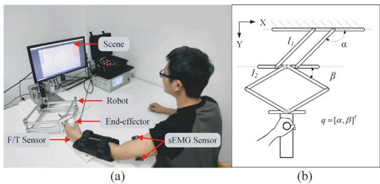  
Fig. 1. (a) 康复系统的训练场景。(b) 2 自由度（DOF）上肢康复机器人的结构简图。

(3) 在健康受试者和中风后患者身上进行了全面的实验验证，证明了所提出的带痉挛检测的 VA-VFC 在临床康复应用中的可行性和潜力。

## 2. 上肢康复系统

平面康复机器人因其易用性、低成本和高安全性等优势而已被广泛应用于医院和研究机构 [2,3]。在我们前期的工作 [19] 中，开发了一种基于末端执行器的 2 自由度（DOF）机器人（见 Fig. 1(a)），用于中风或神经损伤受试者的上肢康复训练。该康复机器人采用并联连杆与菱形连杆串联结合的结构设计，使其能够为患者提供大范围的平面平移运动。臂托与末端执行器相连以支撑患肢。该康复机器人可提供 shoulder and lb h b l f h l f 30N。机器人的末端执行器上安装了一个六维力/力矩传感器（Mini45 Titanium, ATI Industrial Automation, USA）以采集交互力数据，而机器人的各个关节上安装了编码器（Encoder MR, maxon international, CHE）以采集 角度数据。对于 sEMG 信号采集，将 sEMG 电极（Trigno™ Wireless System, Delsys, USA）放置在受试者上肢的肱二头肌（BB）和肱三头肌（TB）上，以记录神经肌肉活动。

机器人的简化示意图如 Fig. 1(b) 所示，它由通过刚性连杆连接的两个旋转关节组成。将机器人关节的角度、角速度和角加速度分别表示为 、$\dot { \mathbf { \zeta } } , \ddot { q } \in \mathbb { R } ^ { 2 }$，则机器人的动力学方程可描述如下：

$$
M _ {q} (q) \ddot {q} + C _ {q} (q, \dot {q}) \dot {q} + G _ {q} (q) + D _ {q} (\dot {q}) = \tau_ {r} + J _ {r} ^ {T} F _ {h}\tag{1}
$$

其中 $M _ { q }$ 为机器人的惯性矩阵，$C _ { q }$ 为机器人的科氏力及离心力矩阵，$G _ { q }$ 表示重力矢量，$D _ { q }$ 表示摩擦力矢量。$\tau _ { r }$ 为机器人关节提供的力矩矢量，$F _ { h }$ 为患者施加在机器人末端执行器上的力矢量（相互作用力）， 为与机器人结构参数和关节角相关的机器人雅可比矩阵（Jacobian matrix）。

基于 Fig. 1(b) 中的简化示意图，本研究中使用的康复机器人可建模为一种具有特定构型的二连杆机械臂。相应地，该上肢康复机器人的正向运动学公式可推导如下：

$$
\left\{ \begin{array}{l l} x = L _ {1} \cos (\alpha) \\ y = L _ {1} \sin (\alpha) + 2 L _ {2} \sin (\beta) \end{array} \right.\tag{2}
$$

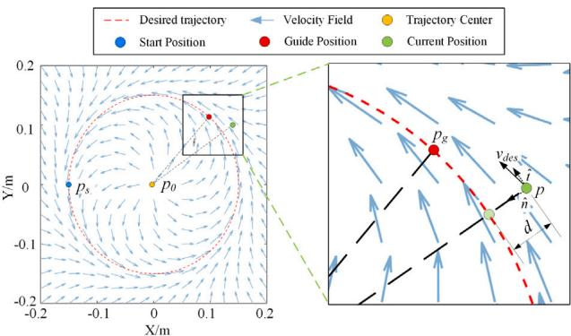  
Fig. 2. 圆形轨迹训练任务的速度场。

通过将末端执行器位置矢量 $p = [ x , y ] ^ { T }$ 对关节角矢量 $q = [ \alpha , \beta ] ^ { T }$ 求导，可获得机器人的雅可比矩阵：

$$
J _ {r} = \left[ \begin{array}{c c} - L _ {1} \sin (\alpha) & 0 \\ L _ {1} \cos (\alpha) & 2 L _ {2} \cos (\beta) \end{array} \right]\tag{3}
$$

利用该雅可比矩阵，我们可以建立基于笛卡尔空间变量的机器人动力学模型，如下所示：

$$
M _ {p} (p) \ddot {p} + C _ {p} (p, \dot {p}) \dot {p} + D _ {p} (\dot {p}) = J _ {r} ^ {- T} \tau_ {r} + F _ {h}\tag{4}
$$

其中 $p , \dot { p } , \ddot { p } \in \mathbb { R } ^ { 2 }$ 分别表示机器人末端执行器的位置、速度和加速度。新的动力学项定义为 $M _ { p } ( p ) = J _ { r } ^ { - T } M _ { q } ( q ) J _ { r } ^ { - 1 } , C _ { p } ( p , \dot { p } ) = J _ { r } ^ { - T } [ C _ { q } ( q , \dot { q } ) - M _ { q } ( q ) J ^ { - 1 } \dot { J } ] J _ { r } ^ { - 1 }$ 和 $D _ { p } ( \dot { p } ) = J _ { r } ^ { - T } D _ { q } ( \dot { q } )$ )。由于机器人进行平面运动，因此在 (4) 中可以忽略重力项 $G _ { q }$。

为确保受试者在康复训练过程中的安全，该康复系统配备了急停按钮，且机器人助力 $F _ { r }$ 的上限设定为 15 N。

## 3. 控制器设计

在本节中，提出了一种 VA-VFC，它以速度的形式描述期望的训练轨迹，从而克服了传统路径控制器的时间依赖性，并在运动时序上提供了更大的灵活性。在所提出的控制器中，速度场向量被用作机器人的期望输入，以引导运动朝向期望路径。控制目标是在确保机器人柔顺行为的同时，在患者无法遵循期望速度曲线时为其提供辅助。

## 3.1. 自适应速度场

康复训练轨迹通常要么由解析表达式以图形方式定义，要么是由康复治疗师提供的示范轨迹。对于解析轨迹，可以基于其数学模型构建期望速度场。对于示范轨迹，可以通过对示范轨迹进行采样来生成期望速度场，其中增加采样点数量可以获得更平滑的速度场。本研究提出的速度场构建方法既适用于解析轨迹，也适用于示范轨迹。

本研究考虑的期望路径是笛卡尔空间中半径为 $r = 0 .$ .15m 的圆形轨迹，如图 Fig. 2 所示。为简化计算，轨迹中心（以黄点表示）设为 $p _ { 0 } =$ [0, 0]。在康复训练过程中，通过显示界面向受试者提供视觉反馈，显示：目标轨迹、当前位置 $p ,$ 以及投影在 $p$ 前方  度的引导位置 $p _ { g } .$。在实验方案中，受试者均从圆形轨迹左侧的起点 $p _ { s }$ 开始运动，并按逆时针方向进行训练。速度场 $v _ { d e s }$（以蓝色箭头表示）旨在引导末端执行器沿参考轨迹运动，它由位置  而非时间  进行参数化。速度场可由指向路径的法向量 ̂ 和沿路径的切向量 ̂ 构建。其公式表达如下：

$$
v _ {d e s} (p, \dot {p}) = k (p, \dot {p}) \hat {n} + c (p, \dot {p}) \hat {t}\tag{5}
$$

单位向量 ̂ 和 ̂ 在 $v _ { d e s }$ 中的贡献分别根据非线性函数 (, ̇) 和 (, ̇) 进行加权。为了实现顺应性康复训练，期望当末端执行器接近期望轨迹时，速度场主要由切向向量 ̂ 引导，以确保沿期望轨迹运动。相反，当末端执行器进一步偏离期望轨迹时，速度场越来越由法向向量 $\hat { n } ,$ 主导，从而辅助患者纠正运动偏差。为了平衡这两种效应，我们在 [11,20] 的基础上改进了权重参数设计，得到 $\begin{array} { r } { k ( p , \dot { p } ) \stackrel { \star } { = } \frac { k _ { 0 } t a n h ( k _ { 1 } d ) } { \| \dot { p } \| + \varepsilon _ { 0 } } , \stackrel { \smile } { c ( p , \dot { p } ) } \stackrel { \star } { = } \frac { c _ { 0 } ( 1 - t a n h ( c _ { 1 } d ) ) } { \| \dot { p } \| + \varepsilon _ { 0 } } } \end{array}$，其中 $d \ = \ \left\| p - p _ { d } \right\|$ 为当前位置与期望路径之间的距离。在此，$k _ { 0 }$ 和 $c _ { 0 }$ 是用于调节速度场大小的标量参数，而 $k _ { 1 }$ 和 $c _ { 1 }$ 是调节速度场形状的参数，$\varepsilon _ { 0 }$ 是为了防止出现除以零问题而引入的小常数。

对于圆和直线等解析轨迹，可以使用 (5) 构建平滑速度场。对于基于示教的轨迹，也可以通过将 (5) 应用于拟合采样点来生成速度场，并可采用离线算法来优化计算效率 [21]。

## 3.2. 可变导纳控制器

速度场控制器的目标是使机器人跟踪期望速度并最小化偏差。考虑到患者与机器人之间的相互作用力 $F _ { h }$，采用导纳控制模型来确定参考速度，从而在训练过程中实现更自然的运动并提高患者的主动参与度（见 Fig. 3）。

$$
M _ {d} (\dot {v} _ {r e f} - \dot {v} _ {d e s}) + B _ {d} (v _ {r e f} - v _ {d e s}) = F _ {h}\tag{6}
$$

其中 $v _ { r e f }$ 是经导纳模型处理后的机器人参考速度。$M _ { d }$ 和 $B _ { d }$ 分别表示用户定义的惯性参数和阻尼参数，用于调节机器人的导纳特性。$M _ { d }$ 和 $B _ { d }$ 均被设计为正定对角矩阵，以简化计算。阻尼参数 $B _ { d }$ 根据 (7) 进行实时动态调整，对于较小的速度误差实现最小干预，而对于较大的误差提供有力支持，从而确保康复训练过程中的 AAN（按需辅助，Assist-As-Needed）特性 [22,23]。

$$
B _ {d} = \frac {\bar {B} _ {d}}{1 + \exp (- \rho_ {B} \left\| e _ {v} \right\|)}\tag{7}
$$

其中 $e _ { v } = \dot { p } - v _ { r e f }$ 表示速度误差，$\bar{B}_d$ 为阻尼参数的上限，$\rho _ { B }$ 表示用户可调的比例因子。$\bar{B}_d$ 和 $\rho _ { B }$ 的值越大，控制器对速度跟踪误差的反应越剧烈且越迅速。

由于系统存在不确定性以及建模面临挑战，许多研究通常使用径向基函数神经网络（Radial Basis Function Neural Network，RBFNN）来逼近机器人未知的动力学分量 [6,24]。RBFNN 函数可以在紧集 $\varOmega _ { N }$ 上表示如下：

$$
F _ {c o m p} (z) = W ^ {T} \sigma (z) + \delta (z)\tag{8}
$$

其中 $F _ { c o m p } ( z ) ~ \in ~ \mathbb { R } ^ { m }$ 定义为 $F _ { c o m p } ~ = ~ - C _ { p } ( p , \dot { p } ) v _ { r e f } - D ( \dot { p } ) ~ -$ $M _ { p } ( p ) \dot { v } _ { r e f }$，$m$ 表示力向量的维度。$\sigma \in \mathbb { R } ^ { l }$ 为激活向量函数，$l$ 表示神经元的数量，$\boldsymbol { z } ~ = ~ [ p , \dot { p } , v _ { r e f } , \dot { v } _ { r e f } ]$ 为网络的输入向量，$W ~ \in ~ \mathbb { R } ^ { l \times m }$ 为网络的有界理想权重矩阵，满足 $\| W \| _ { F } ^ { 2 } < \bar { W }$，$\delta ( z )$ 为函数拟合误差。在训练任务期间，RBFNN 的估计权重矩阵根据式 (9) 进行自适应更新，同时实时计算 $F _ { c o m p }$，从而为机器人系统提供前馈补偿。

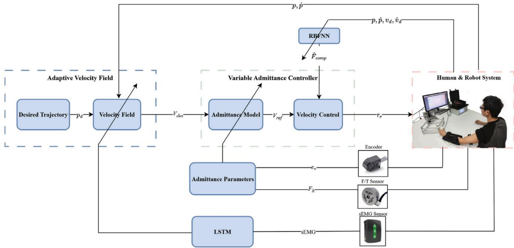  
Fig. 3. 所提出控制器的框图。

$$
\dot {\hat {W}} = \left\{ \begin{array}{l l} \phi - \frac {t r (\hat {W} ^ {T} \phi)}{t r (\hat {W} ^ {T} \hat {W})} \hat {W}, i f t r (\hat {W} ^ {T} \hat {W}) > \bar {W} \\ \qquad \qquad \qquad \text {and} t r (\hat {W} ^ {T} \phi) > 0 \\ \phi , o t h e r w i s e \end{array} \right.\tag{9}
$$

其中 $\phi = \gamma \sigma ( z ) e _ { v } ^ { T }$，$\gamma \in \mathbb { R } ^ { + }$ 为可调正数常数。式 (9) 通过投影算子保证了估计权重矩阵 $\hat { W }$ 的有界性。

为了实现稳定的速度控制并确保 $e _ { v }$ 的收敛性，控制器设计如下：

$$
\boldsymbol {\tau} = - \boldsymbol {J} _ {r} ^ {T} (\boldsymbol {K} _ {r} t a n h (\rho \boldsymbol {e} _ {v}) + \hat {\boldsymbol {F}} _ {c o m p})\tag{10}
$$

其中 $\hat { F } _ { c o m p } = \hat { W } ^ { T } \sigma ( z ) \in \mathbb { R } ^ { m }$ 是通过 RBFNN（径向基函数神经网络）对 $F _ { c o m p }$ 的估计，其中 ̂ 是理想权重矩阵  的估计值。$K _ { r } \in \mathbb { R } ^ { l \times l }$ 是对角正定矩阵，控制器中采用 ℎ(⋅) 以引入饱和比例型反馈项。$\rho$ 是决定控制器对速度误差灵敏度的缩放因子——较大的 $\dot { } \rho$ 值会对偏差产生更强的响应。在本研究中，基于经验调节选取了 $\rho = 1 0$。

为了表述清晰，权重矩阵的估计误差定义为 $\tilde { W } = W - \hat { W }$，而机器人动力学估计误差由 $F _ { c o m p } - \hat { F } _ { c o m p } = \hat { W } ^ { T } \sigma ( z ) + \varepsilon .$ 给出。将 (10) 代入 $( 4 )$，速度误差 $e _ { v }$ 的闭环动力学可以写为如下形式：

$$
M _ {p} (p) \dot {e} _ {v} = - C _ {p} (p, \dot {p}) e _ {v} - K _ {r} t a n h (\rho (e _ {v})) + \tilde {W} ^ {T} \sigma + \varepsilon + F _ {h}\tag{11}
$$

闭环系统 (11) 的稳定性可以通过 Lyapunov 理论进行证明。首先，考虑 Lyapunov 函数 $\begin{array} { r } { V = \frac { 1 } { 2 } e _ { v } ^ { T } M _ { p } ( p ) e _ { v } + } \end{array}$ ${ \textstyle \frac { 1 } { 7 } } t r ( \tilde { W } ^ { T } { \cal T } ^ { - 1 } \tilde { W } ) _ { : }$，其中 ${ \boldsymbol { { r } } } = \gamma { \boldsymbol { { I } } } \in R ^ { l \times l }$ 为对角矩阵。接着， 的时间导数可推导为：

$$
\dot {V} = e _ {v} ^ {T} M _ {p} (p) \dot {e} _ {v} + \frac {1}{2} e _ {v} ^ {T} \dot {M} _ {p} (p) e _ {v} + t r (\tilde {W} ^ {T} \Gamma^ {- 1} \tilde {W})\tag{12}
$$

假设 Jacobian 矩阵保持非奇异，则机器人动力学模型保持 $\dot { M } _ { p } ( p ) -$ $2 C _ { p } ( p , { \dot { p } } )$ 的斜对称特性，这意味着：

$$
\frac {1}{2} e _ {v} ^ {T} \dot {M} _ {p} (p) e _ {v} = e _ {v} ^ {T} C _ {p} (p, \dot {p}) e _ {v}\tag{13}
$$

将 (11) 和 (13) 代入 (12)，可得到修正后的表达式：

$$
\dot {V} = - e _ {v} ^ {T} K _ {r} \tanh (\rho e _ {v}) + e _ {v} ^ {T} (\varepsilon + F _ {h}) + e _ {v} ^ {T} \tilde {W} ^ {T} \sigma + t r (\tilde {W} ^ {T} \Gamma \tilde {W})\tag{14}
$$

此外，由于 $\dot { \tilde { W } } = - \dot { \hat { W } } = - { \cal { \Gamma } } \sigma e _ { v } ^ { T } ,$ 式 (14) 中有 $t r ( \tilde { W } ^ { T } \bar { I } ^ { - 1 } \dot { \tilde { W } } ) =$ $- t r ( \tilde { W } ^ { T } \sigma e _ { { \scriptscriptstyle { \cal { v } } } } ^ { T } ) = - e _ { { \scriptscriptstyle { \cal { v } } } } ^ { T } \tilde { W } ^ { T } \sigma$。在有界性假设 ‖‖ $\leq \bar { \varepsilon }$ 和 $\left\| F _ { h } \right\| \leq { \bar { F } } _ { h }$ 下，我们可以建立如下不等式：

$$
\dot {V} = - e _ {v} ^ {T} K _ {r} \tanh (\rho e _ {v}) + e _ {v} ^ {T} (\varepsilon + F _ {h})
$$

$$
\leq - K _ {r} \tanh (\rho e _ {v}) \left\| e _ {v} \right\| + (\bar {\varepsilon} + \bar {F} _ {h}) \left\| e _ {v} \right\|\tag{15}
$$

结合引理 1，令 $K _ { r } = \mathrm { d i a g } ( k _ { 1 } , k _ { 2 } )$ 并定义 $k _ { \mathrm { m i n } } =$ min $\{ k _ { 1 } , k _ { 2 } \}$，式 (15) 可以重写为：

$$
\dot {V} \leq - (k _ {\mathrm{min}} - \bar {\varepsilon} - \bar {F} _ {h}) \left\| e _ {v} \right\| + 0. 2 7 8 5 (\frac {k _ {1} + k _ {2}}{\rho})\tag{16}
$$

注意，若 $\begin{array} { r } { \left\| \boldsymbol { e } _ { v } \right\| > \frac { 0 . 2 7 8 5 ( k _ { 1 } + k _ { 2 } ) } { \rho ( k _ { \mathrm { m i n } } - \bar { \varepsilon } - \bar { F } _ { h } ) } } \end{array}$，则 $\dot { V } \leq 0$。因此，存在有限时间 ，使得对于 $\forall t > T$，满足 $\begin{array} { r } { \left\| e _ { v } \right\| \le \frac { 0 . 2 7 8 5 ( k _ { 1 } + k _ { 2 } ) } { \rho ( k _ { \operatorname* { m i n } } - \bar { \varepsilon } - \bar { F } _ { h } ) } } \end{array}$。

引理 1. 对于 $\forall e _ { v }$ 和 $\forall \rho > 0 ,$，有 $\begin{array} { r } { 0 < \| e _ { v } \| { - e _ { v } t a n h ( \rho e _ { v } ) } \leq \frac { 0 . 2 7 8 5 } { \rho } } \end{array}$ 成立 [25]。

## 4. 痉挛检测与速度切换

目前，许多基于 sEMG 的痉挛检测方法主要采用基于阈值的方法 [26,27]（例如单阈值法、双阈值法）或统计技术 [16]（例如近似广义似然比法和累积和法）。尽管这些方法实现起来相对简单，但它们容易受到噪声干扰，且通常难以准确检测痉挛发生的时刻。为了提高痉挛检测的准确性，近年来提出了各种机器学习方法。在这些方法中，LSTM（长短期记忆）网络在识别时间信号模式方面表现出显著优势，因为它能够维持由短期事件激活的状态以形成长期记忆 [28]。鉴于 sEMG 信号的时间序列特性，LSTM 网络特别适用于识别肌肉活动时刻，而无需对 sEMG 信号进行启发式的特征选择和提取。在本研究中，我们开发了一种基于 LSTM 的分类器，用于自动学习肌肉激活特征，从而实现肌肉痉挛与正常康复运动之间的实时区分。

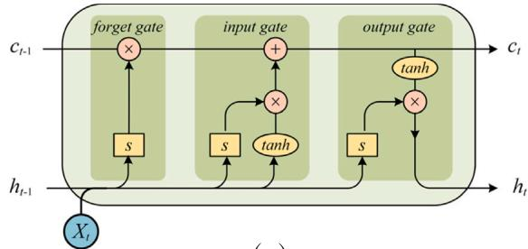  
(a)

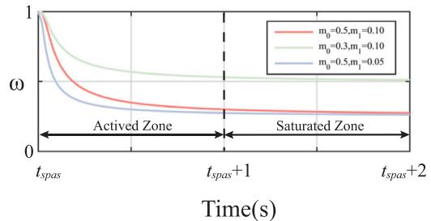  
(b)  
Fig. 4. 用于痉挛检测和速度切换的函数与结构。(a) LSTM 网络架构。(b) 速度平滑过渡函数。

脑卒中后上肢痉挛主要表现为肘部痉挛 [29]。因此，在本研究中，我们采用双通道 sEMG 采集系统，以 2148 Hz 的采样率记录来自 BB（肱二头肌）和 TB（肱三头肌）的肘部肌肉活动。原始 sEMG 信号使用截止频率为 20 Hz 和 450 Hz 的 4 阶巴特沃斯（Butterworth）带通滤波器进行处理以去除信号噪声，然后根据实验前校准期间记录的 sEMG 峰值进行归一化。随后，使用步长为 50 ms 的 200 ms 滑动窗口对处理后的信号进行分段 [30,31]。这些处理后的 sEMG 数据被用于我们 LSTM 模型的训练和预测。

在我们之前的研究 [32] 中，招募了 6 名伴有痉挛的脑卒中患者，在主动和被动肘关节屈曲-伸展运动期间采集 sEMG 信号。对于每位患者，记录了约 40–50 s 的 BB 和 TB 信号。采集到的信号随后由经验丰富的医生分类并标记为痉挛和非痉挛类别。经过滤波和分段后，将 17 个连续的重叠窗口组合成一个 1 秒的样本，总共生成了 6720 个带标记的样本。本研究利用该经过临床验证的 sEMG 数据集来训练基于 LSTM 的痉挛检测模型。

LSTM 模型的架构如图 Fig. 4(a) 所示，其包含三个基本组成部分：输入门、遗忘门和输出门：

$$
i _ {t} = s (W _ {i} [ h _ {t - 1}, x _ {t} ] + b _ {i})\tag{17}
$$

$$
f _ {t} = s (W _ {f} [ h _ {t - 1}, x _ {t} ] + b _ {f})\tag{18}
$$

$$
o _ {t} = s (W _ {o} [ h _ {t - 1}, x _ {t} ] + b _ {o})\tag{19}
$$

式中，$W _ { i } / b _ { i } , \ : W _ { f } / b _ { f } , \ : W _ { o } / b _ { o }$ 分别表示输入门、遗忘门和输出门的权重与偏置。激活函数  代表 sigmoid 函数，而 $x _ { t }$ 和 $h _ { t - 1 }$ 分别对应当前输入和上一隐藏状态。

输入 $x _ { t }$ 由采用上述方法分段的批处理 sEMG 信号序列组成，每个序列包含 200 个时间步和 2 个代表 BT 与 TT 通道的特征。隐藏状态 $h _ { t }$ 通过一个中间变量 $c _ { t }$ 进行更新，该变量通常称为细胞状态（cell state）：

$$
\left\{ \begin{array}{l l} \tilde {c} _ {t} = g (W _ {c} [ h _ {t - 1}, x _ {t} ] + b _ {c}) \\ c _ {t} = f _ {t} \cdot c _ {t - 1} + i _ {t} \cdot \tilde {c} _ {t} \end{array} \right.\tag{20}
$$

Table 1  
脑卒中后患者的临床特征

<table><tr><td>ID</td><td>年龄/性别</td><td>IS</td><td>BRS</td><td>MAS</td></tr><tr><td>P1</td><td>75/男</td><td>右侧</td><td>IV</td><td>0</td></tr><tr><td>P2</td><td>46/男</td><td>右侧</td><td>III</td><td>1+</td></tr><tr><td>P3</td><td>49/男</td><td>右侧</td><td>VI</td><td>0</td></tr><tr><td>P4</td><td>60/男</td><td>右侧</td><td>VI</td><td>0</td></tr><tr><td>P5</td><td>63/男</td><td>左侧</td><td>IV</td><td>1</td></tr><tr><td>P6</td><td>58/男</td><td>左侧</td><td>V</td><td>0</td></tr><tr><td>P7</td><td>47/男</td><td>左侧</td><td>III</td><td>1+</td></tr><tr><td>P8</td><td>45/女</td><td>右侧</td><td>VI</td><td>1+</td></tr><tr><td>P9</td><td>51/女</td><td>右侧</td><td>VI</td><td>0</td></tr><tr><td>P10</td><td>72/女</td><td>左侧</td><td>VI</td><td>0</td></tr></table>

IS=患侧（Impaired Side），BRS=Brunnstrom 康复分期（Brunnstrom Recovery Stage），MAS=改良 Ashworth 量表（Modified Ashworth Scale）

式中，$W _ { c }$ 和 $b _ { c }$ 表示权重与偏置，$g$ 表示将状态值转换至 −1 到 1 范围内的双曲正切函数。随后，隐藏状态可由 $c _ { t }$ 和 $o _ { t }$ 计算如下：

$$
h _ {t} = o _ {t} \cdot g (c _ {t})\tag{21}
$$

LSTM 网络的最终输出通过全连接层进行处理，以生成痉挛状态的预测。具体而言，LSTM 网络层包含 200 个 LSTM 单元，模型优化采用学习率为 0.01 的 Adam 优化器进行。分类概率分布由输出层确定，该输出层由一个 softmax 层和一个后续的分类层组成。基于该 LSTM 模型，患者的 sEMG 数据集被划分为训练集和测试集，其中 80% 用于训练，20% 用于测试。模型训练与优化采用了 3 折交叉验证策略。最终的痉挛检测准确率达到了 95.61%。

相关研究表明，在痉挛期间拉伸上肢有助于缓解痉挛并促进功能恢复 [29,33]。基于临床建议，我们提出了一种切换函数来转换痉挛状态下的速度场。当系统检测到上肢痉挛时，训练速度会被调整至较慢的速度以确保安全。这种调整使患者能够在机器人辅助下继续进行缓慢、受控的拉伸训练，从而减轻痉挛。痉挛发生后的速度场计算如下：

$$
\left\{ \begin{array}{l l} & v _ {d e s} ^ {\prime} = k ^ {\prime} \hat {n} + c ^ {\prime} \hat {t} \\ & k ^ {\prime} = \omega (t) ^ {2} k \\ & c ^ {\prime} = \omega (t) ^ {2} c \\ & \omega (t) = (1 - m _ {0} \exp (- \frac {m _ {1}}{(t - t _ {s p a s})})) \\ & \text {if} m _ {0} \text {and} m _ {1} \text {for all } t \in [ 0, 1 ] \end{array} \right.\tag{22}
$$

如图 Fig. 4(b) 所示，$\omega(t)$ 表示将速度场从原始速度平滑过渡到较慢速度的切换函数，$t _ { s p a s }$ 表示检测到痉挛的时刻，$m _ { 0 } ~ \in ~ ( 0 , 1 )$ 决定了较慢速度的幅度，而 $m _ { 1 }$ 调节速度变化的速率。在本研究中，选取了 $m _ { 0 } ~ = ~ 0 . 5$ 和 $m _ { 1 } = 0 . 1$。

通过动态调整机器人的速度场，在确保训练安全的同时仍为患者提供有益的拉伸运动。

## 5. 实验

## 5.1. 实验设置

所提出的控制器的性能通过两项实验进行了验证。实验 1 旨在将所提出的 AAN 控制器与力场控制（FFC）方法 [7] 以及基于阻抗的控制（IMC）方法 [34] 进行比较。实验 2 旨在评估所提出的痉挛检测和速度切换方法的有效性。招募了 10 名健康受试者（6 名男性和 4 名女性，均为右利手；年龄：25.8 ± 3.1 岁；标记为 H1–H10）和 10 名卒中后患者（临床特征总结于 Table 1；标记为 P1–P10）参与实验。所有受试者在参与前均充分知晓实验流程及潜在风险，并签署了知情同意书。研究方案获得了中大医院（Zhongda Hospital）伦理委员会的批准（2022ZDSYLL397-P01）。整个实验过程均由医生进行监督，以确保安全并防止任何意外伤害。

Table 2  
本研究中使用的性能指标公式和单位。

<table><tr><td>指标</td><td>公式</td><td>单位</td></tr><tr><td>TE</td><td> $\frac{1}{n}\sum_{i=1}^{n}\left\|\boldsymbol{p}_{i}-\boldsymbol{p}_{d,i}\right\|$ </td><td>cm</td></tr><tr><td>MV</td><td> $\frac{1}{n}\sum_{i=1}^{n}\left\|\dot{\boldsymbol{p}}_{i}\right\|$ </td><td>m/s</td></tr><tr><td>MS</td><td> $\frac{1}{n}\sum_{i=1}^{n}\left\|\ddot{\boldsymbol{p}}_{i}\right\|$ </td><td>m/s2</td></tr><tr><td>IF</td><td> $\frac{1}{n}\sum_{i=1}^{n}\left\|\boldsymbol{F}_{r,i}\right\|$ </td><td>N</td></tr><tr><td>SW</td><td> $\sum_{i=1}^{n}\left\|\boldsymbol{F}_{h,i}\dot{\boldsymbol{q}}_{i}\right\|\Delta t$ </td><td>J</td></tr><tr><td>MA</td><td> $\frac{1}{n}\sum_{i=1}^{n}\left(\left\|\boldsymbol{S}_{BB,i}\right\|+\left\|\boldsymbol{S}_{TB,i}\right\|\right)$ </td><td>-</td></tr></table>

如图 1 所示，受试者坐在屏幕前方以及机器人的右侧，使用其非优势臂或患臂执行任务。在正式实验之前，进行了 4 分钟的熟悉环节，以帮助受试者适应实验 1 和实验 2 的流程。在实验 1 中，10 名健康受试者和 6 名无痉挛症状的患者（MAS 评分 = 0）在不同训练模式下执行了圆形轨迹跟踪运动，每完成一个完整的圆计为一个回合（episode）。每种训练模式进行 10 个回合，且在每种模式之后提供两分钟的休息间隔，以减轻疲劳效应。为进一步验证所提出的基于痉挛检测的速度切换控制策略的有效性和临床适用性，对 4 名伴有痉挛症状的患者（MAS 评分 = 1/1+）开展了实验 2。实验 2 遵循与实验 1 相似的方案，患者在 VA-VFC 模式下执行了 10 个回合的圆形轨迹跟踪。在实验过程中，当患肢达到某些姿势时通常会发生痉挛，常表现为肌张力增高以及运动阻力变大。在这种情况下，需要缓慢拉伸患肢以缓解痉挛。在实验 2 中，每当检测到痉挛时，控制器会自动切换到低速模式以辅助肢体拉伸，从而实现这一目的。

为了定量分析不同控制模式和实验人员下的控制性能，表 2 中定义了以下指标 [3,11]：平均轨迹误差（TE）、平均运动速度（MV）、运动平滑度（MS）、平均交互力（IF）、受试者机械功（SW）以及肌肉激活水平（MA）。其中，TE、MV 和 MS 反映了训练任务的稳定性和准确性。具体而言，较低的 TE 和 MS 值以及较高的 MV 表明更好的控制性能和任务完成度。相比之下，IF、PW 和 MA 表征了患者在训练过程中的参与度，数值越高表明付出的努力程度越大。

在表 2 中， 表示采样时间， 表示单个回合中的采样点数，而 $S _ { B B }$ 和 $S _ { T B }$ 分别对应肱二头肌（BB）和肱三头肌（TB）的归一化 sEMG。

## 5.2. 所提出的 VA-VFC 方法的性能

在本实验中，我们将所提出的 VA-VFC 模式与另外两种控制模式（FFC 模式和 IMC 模式）的性能进行了比较。在所有三种模式下，受试者均被要求尽可能准确且快速地跟踪圆形轨迹。训练过程中的运动和交互力数据被记录下来以进行对比分析。为了评估受试者的主动参与度，仅将沿运动方向的分力 $( F _ { h } \cdot \hat { t } > 0 , \cdots$ 表示点积）视为主动贡献。

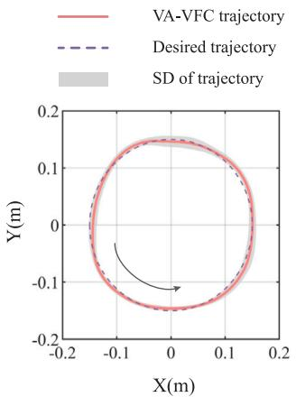  
(a)

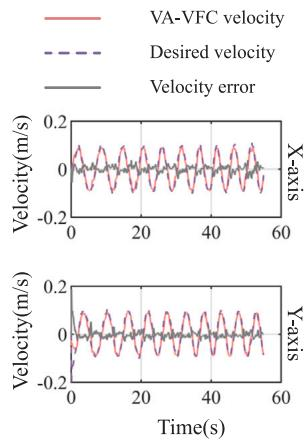  
(b)  
Fig. 5. 圆形轨迹任务中受试者 H2 在 VA-VFC 模式下的轨迹和速度跟踪性能。

首先，为评估所提出的 VA-VFC 方法在位置和速度控制方面的有效性，Fig. 5 展示了受试者 H2 在 VA-VFC 模式下的轨迹和速度跟踪性能。Fig. 5(a) 给出了实验 1 完成后的平均轨迹及其对应的标准差。结果表明，VA-VFC 模式下的运动轨迹平滑且与期望轨迹高度吻合，说明 VA-VFC 具有优异的位置控制性能。如图 Fig. 5(b) 所示，对比了受试者 H2 在 X 和 Y 方向上的参考速度曲线与实际速度曲线。在训练开始时，末端执行器从静止状态启动，导致初始速度误差相对较大。根据 (10)，机器人提供了大量辅助以帮助受试者快速逼近参考速度曲线。训练开始约 2 s 后，受试者在两个方向上的实际速度均与参考速度紧密吻合。X 和 Y 方向上的平均速度误差分别为 $e _ { v , x } ~ { = } ~ 0 . 0 1 0 \pm 0 . 0 0 8 ~ \mathrm { m / s }$ 和 $\boldsymbol { e } _ { v , y } \ =$ 0.010±0.009 m∕s，表明所提出的 VA-VFC 方法实现了有效的速度跟踪。

Fig. 6 对比了健康受试者在三种不同训练模式下的性能指标，并展示了各项指标对应的平均值和标准差。运动速度未观察到显著差异，这是因为控制器参数经过预调，以在所有模式下保持相近的运动速度，从而确保对其他性能指标评估的公平性。相比之下，与其他两种模式相比，VA-VFC 模式表现出显著更低的平均轨迹误差和更高的运动平滑度，表明该控制策略能够实现更平滑、更精准的轨迹跟踪。相反，FFC 模式导致了更大的轨迹误差和更低的平滑度，这可归因于它仅提供力场辅助，而没有对运动的位置或速度进行严格约束，从而允许了更高的运动自由度。

此外，如 Fig. 6 底行所示，VA-VFC 和 FFC 模式下的交互力、受试者机械功以及肌肉激活水平相当，且均显著高于 IMC 模式。这表明 VA-VFC 和 FFC 在激发受试者主动参与以及实现更有效的 AAN（按需辅助）方面更为有效。相比之下，在 IMC 模式下观察到的较低参与度可能是由于其依赖基于时间的期望轨迹，从而限制了受试者在运动时机上的自由度。

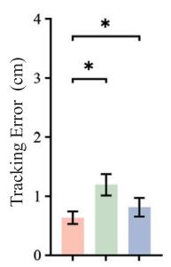

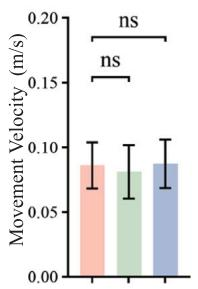

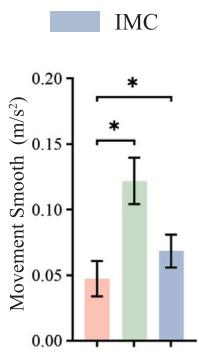

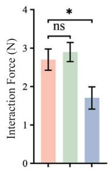

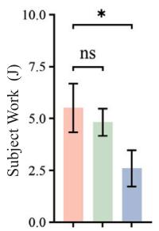

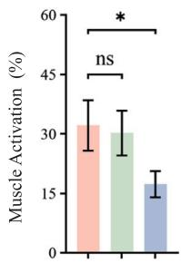  
Fig. 6. 健康受试者在三种训练模式下的性能指标对比（“ns”：无显著性差异；$\stackrel { \scriptscriptstyle < \ast , } { \cdot } p < 0 . 0 5 )$

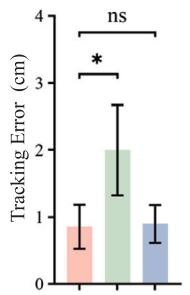

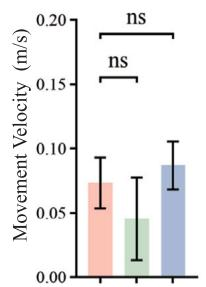

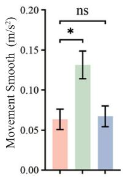

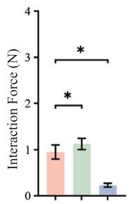

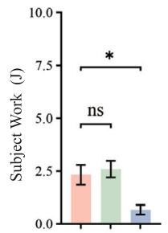

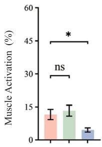  
Fig. 7. 脑卒中后患者在三种训练模式下的性能指标对比（“ns”：无显著性差异；$\stackrel { \scriptscriptstyle < \ast , } { \cdot } p < 0 . 0 5 )$

同样，Fig. 7 展示了脑卒中患者在三种训练模式下的性能指标对比。如图 Fig. 7 顶行所示，VA-VFC 模式与 IMC 模式在轨迹误差、运动速度和运动平滑度方面没有显著差异。然而，这两种模式的性能均显著优于 FFC 模式，表明 VA-VFC 和 IMC 能够实现更平滑的运动、更高的轨迹跟踪精度以及更好的速度稳定性。这一发现与 Fig. 6 中健康受试者的结果一致。此外，患者在 FFC 模式下的平均运动速度明显低于健康受试者，这主要是因为患者的上肢运动能力下降，通常依赖机器人的辅助来完成运动。在这种情况下，FFC 模式无法有效保证一致的速度跟踪。

在 Fig. 7 的底行中可以看出，与 IMC 模式相比，VA-VFC 模式下的交互力、受试者机械功以及肌肉激活水平显著更高，表明 VA-VFC 能更有效地促进患者的主动参与。这一观察结果也与 Fig. 6 中健康受试者的结果一致。此外，VA-VFC 模式下的受试者机械功和肌肉激活水平与 FFC 模式并无显著差异，这表明两种模式在促进主动参与方面具有相似的效果。

健康受试者和患者的实验结果表明，所提出的 VA-VFC 方法有效地结合了 FFC（提高患者参与度）和 IMC（平滑且精确的轨迹跟踪）两者的优势。此外，通过在运动过程中提供时间灵活性，VA-VFC 模式能够实现更自然且有效的 AAN（按需辅助）。

## 5.3. 基于痉挛检测的速度切换性能

在本实验中，对所提出的基于 LSTM 的痉挛检测方法及后续的速度切换策略进行了验证。所有四名患有上肢痉挛的脑卒中患者在训练期间均出现了痉挛，且系统成功检测到了每例痉挛情况。受试者 P7 的检测和切换过程如图 Fig. 8 所示。如图 Fig. 8(a) 所示，受试者 P7 在第三轮次运动开始后约 4.5 s 时，其 BB（肱二头肌）和 TB（肱三头肌）的 sEMG 信号出现了突增。这种信号突变被基于 LSTM 的检测方法识别（由黑色垂直虚线标出）。检测到之后，控制器立即触发了式 (22) 中描述的速度切换函数，实现了向低速模式的平滑过渡，如图 Fig. 8(b) 所示。这种自适应调整有效缓解了肌肉痉挛并改善了关节活动度，确保了康复训练过程的安全性和稳定性。

此外，图 8(c) 展示了痉挛发作前后机器人辅助力 $F _ { r }$ 和人体交互力 $F _ { h }$ 的变化。可以观察到，在痉挛发作后，患者无法再产生主动运动力，从而促使机器人增加其辅助力以帮助完成训练任务。因此，训练模式从 AAN 训练平稳过渡到了机器人辅助的被动训练。此外，图 8(c) 表明，仅依靠交互力来检测痉挛具有挑战性，因为此类机械响应通常表现出明显的延迟。因此，与生物力学方法 [12,15] 相比，所提出的基于 sEMG 的痉挛检测方法在痉挛检测中具有更优越的准确性和实时性。

## 6. 结论

本文提出了一种用于脑卒中后上肢 AAN 康复训练的 VA-VFC 方法，该方法可同时实现基于 sEMG 信号的痉挛检测并调整速度场以确保训练安全。为了在运动时序上提供自由度并在训练过程中最大化受试者的主动参与度，我们提出了一种新型 VFC 控制器。其主要思想是在具有可变速度范围的速度域中定义运动控制问题，同时结合可变导纳策略以增强 AAN 性能。并且使用 Lyapunov 函数在理论上证明了所提出控制器的稳定性。此外，为解决康复过程中因痉挛引起的安全问题，开发了一种基于 sEMG 的痉挛检测方法。通过采集 BB 和 TB 的 sEMG 信号，并利用 LSTM 网络，系统能够检测痉挛的发作，并随后在控制器中执行平稳的速度过渡，以确保安全稳定的康复训练。

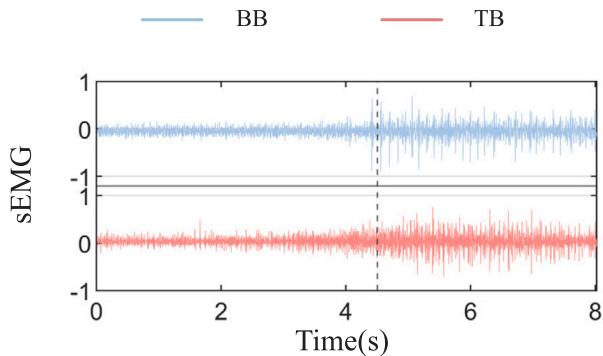

(a)  
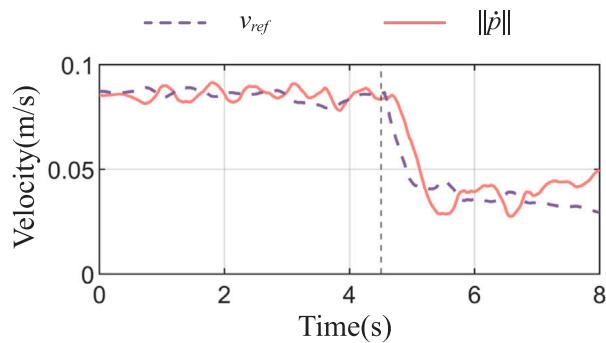  
(b)

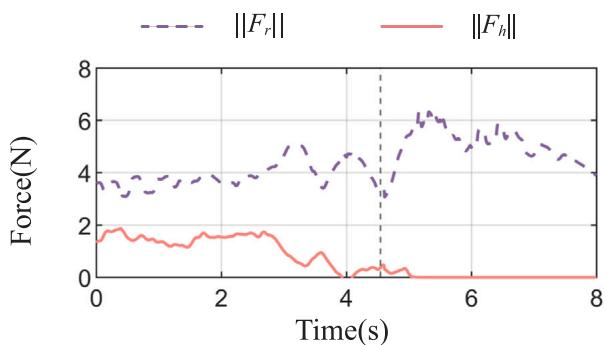  
(c)  
Fig. 8. 受试者 P7 在痉挛发作前后的 sEMG、速度和交互力表现。黑色垂直虚线表示 LSTM 模型检测到痉挛的时间点。(a) BB 和 TB 的 sEMG 信号。(b) 参考速度 $v _ { r e f }$ 和实际速度 ‖ ̇‖。(c) 机器人辅助力 $F _ { r }$ 和人体交互力 $F _ { h } .$

所提出的 VA-VFC 方法在平面上肢康复机器人系统上得以实现，并在包含 10 名健康受试者和 10 名脑卒中后患者的实验中进行了评估。实验结果表明，该控制器实现了稳定的速度控制，在保持高轨迹跟踪精度的同时促进了主动参与，并能够根据检测到的痉挛实现平滑的速度过渡，且跟踪误差未发生显著增加。

总体而言，本研究提供了初步证据，证明所提出的控制器能有效实现速度调制和 AAN 辅助，同时为康复中与痉挛相关的挑战提供了可行的解决方案。尽管如此，仍存在若干局限性需要指出。当前的痉挛 sEMG 数据集相对较小，且实验是在简化的训练条件下进行的，这可能会限制结果的泛化性。此外，所提方法的长期临床疗效尚待确立。未来的研究将旨在把数据集扩展到更广泛且更具代表性的患者群体中，在日常生活活动（ADL）任务中应用所提出的框架，并开展纵向评估以评估其持续的临床疗效。

Table 3  
速度场控制器参数的数值与单位。

<table><tr><td>参数</td><td>数值</td><td>单位</td></tr><tr><td> $k_0$ </td><td>0.01</td><td> $m^2/s^2$ </td></tr><tr><td> $c_0$ </td><td>0.02</td><td> $m^2/s^2$ </td></tr><tr><td> $k_1$ </td><td>10</td><td> $m^{-1}$ </td></tr><tr><td> $c_1$ </td><td>10</td><td> $m^{-1}$ </td></tr><tr><td> $ε_0$ </td><td>0.002</td><td>m/s</td></tr><tr><td> $M_d$ </td><td>diag(0.5, 0.5)</td><td>kg</td></tr><tr><td> $\bar{B}_d$ </td><td>diag(40, 40)</td><td>Ns/m</td></tr><tr><td> $ρ_B$ </td><td>25</td><td>-</td></tr></table>

Table 4  
不同的导纳参数组。

<table><tr><td>分类</td><td>M(kg)</td><td> $\bar{B}$ (Ns/m)</td></tr><tr><td>小</td><td>diag(0.5,0.5)</td><td>diag(10,10)</td></tr><tr><td>中</td><td>diag(1.0,1.0)</td><td>diag(40,40)</td></tr><tr><td>大</td><td>diag(1.5,1.5)</td><td>diag(70,70)</td></tr></table>

## CRediT 作者贡献声明

Ye Li：撰写 – 初稿、验证、软件、方法学、概念构思。Aiguo Song：监督、项目管理。Jianwei Lai：撰写 – 审阅与编辑、调查研究、形式分析。Ye Lu：撰写 – 审阅与编辑、数据管理。Huijun Li：监督。

## 伦理声明

涉及人类受试者的研究已通过中大医院（Zhongda Hospital）伦理委员会的审查和批准（2022ZDSYLL397- P01）。作者已提供本研究的伦理批准文件。

## 利益冲突声明

作者声明，不存在可能对本文报道的工作产生影响的已知竞争性经济利益或人际关系。

## 致谢

本研究得到了江苏省重点研发计划（项目编号：BE2023023-1）和国家自然科学基金（项目编号：623B2025）的资助。

## 附录 A. 速度场控制中控制器参数性能分析

本研究中提出的 VA-VFC 参数是通过仿真分析和初步实验测试确定的，其对应数值总结于表 3 中。

表 3 中列出的参数 $k _ { 0 } , \ c _ { 0 } , \ k _ { 1 }$ 和 $c _ { 1 }$ 在构建速度场中起着关键作用。图 9 展示了改变这些权重参数对生成速度场的影响。如图所示，$k _ { 0 }$ 和 $c _ { 0 }$ 主要影响速度场的幅值，直接影响整体运动速度。相比之下，$k _ { 1 }$ 和 $c _ { 1 }$ 调节速度场对轨迹误差的敏感度，从而决定了控制器对偏离期望路径的响应强度。

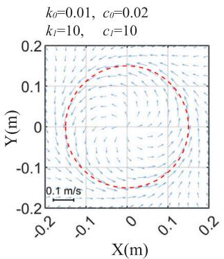

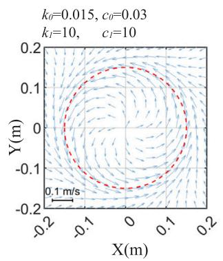

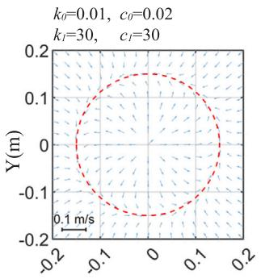  
X(m)

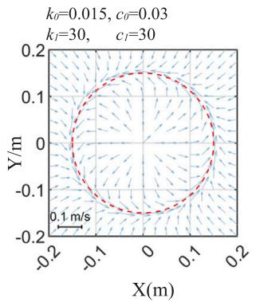  
Fig. 9. 权重参数对速度机构建的影响（其中 $\varepsilon _ { 0 } = 0 . 0 0 5 ~ \mathrm { m / s ) }$

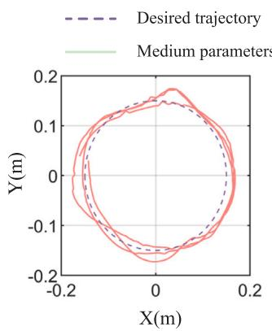

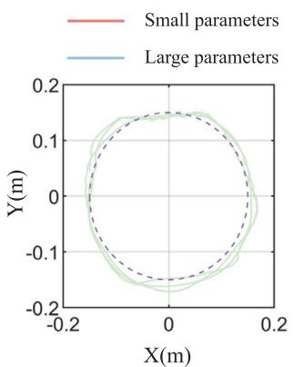

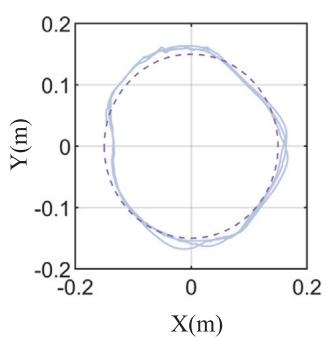

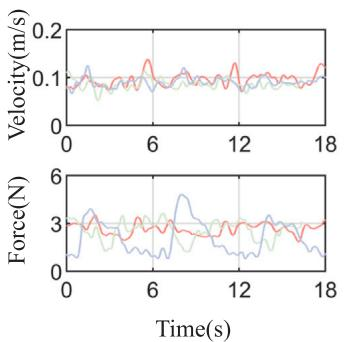  
Fig. 10. 不同导纳设置下的轨迹、速度和交互力。

为了分析导纳特性对控制性能的影响，在 VA-VFC 模式下对受试者 H2 进行的预备实验中应用了三组不同的导纳参数（小导纳参数、中导纳参数和大导纳参数），相应的参数值列于表 4 中。为了进行定量评估，对比了这三种设置下的轨迹误差、运动速度和交互力，结果汇总于图 10 和表 5 中。

  
Fig. 11. 每边长为 0.1 m 的矩形轨迹到达任务，黑色箭头指示运动方向。

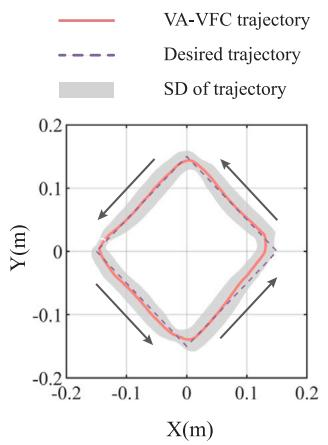  
(a)

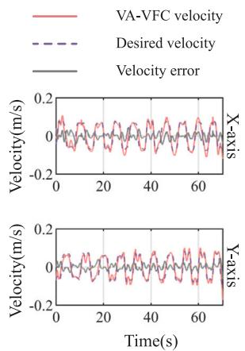  
(b)  
Fig. 12. 矩形轨迹任务期间，受试者 P4 在 VA-VFC 模式下的轨迹和速度跟踪性能。

Table 5  
不同导纳设置下轨迹误差、运动速度和交互力的均值与标准差。

<table><tr><td>分类</td><td>TE (cm)</td><td>MV (m/s)</td><td>IF (N)</td></tr><tr><td>小</td><td>1.171 ± 0.651</td><td>0.096 ± 0.014</td><td>2.651 ± 0.362</td></tr><tr><td>中</td><td>1.036 ± 0.586</td><td>0.086 ± 0.011</td><td>2.548 ± 0.611</td></tr><tr><td>大</td><td>0.862 ± 0.460</td><td>0.090 ± 0.010</td><td>2.072 ± 1.084</td></tr></table>

如 Fig. 10 所示，所提出的控制器在所有三种导纳设置下均有效协助受试者完成了圆形轨迹任务。此外，随着导纳参数的增加，轨迹误差和交互力均有所减小。这是因为较高的导纳导致控制主导权逐渐从人转移到机器人。相比之下，在不同导纳水平下运动速度保持相对稳定，证明了所提出的控制器在维持一致速度控制方面的鲁棒性。综合考虑轨迹精度与交互力之间的权衡，实验最终选择了中等导纳参数。

## 附录 B. 矩形轨迹到达任务

为了进一步验证所提出的 VA-VFC 方法在不同场景下的可行性，设计了一个矩形轨迹到达任务，如 Fig. 11 所示。在虚拟环境中，蘑菇依次出现在矩形路径的拐角处，受试者需要在控制器的辅助下尽可能快速且准确地抓取它们。

Fig. 12(a) 展示了在矩形轨迹任务中受试者 P4 在 VFC 模式下的轨迹和速度跟踪性能。如 Fig. 12(a) 所示，即使在存在急转角过渡的情况下，所提出的 VA-VFC 方法也能有效辅助患者精确跟随期望的矩形路径。最终得到的轨迹跟踪误差为 $0 . 0 0 9 \pm 0 . 0 0 4 2$ m，表明在整个运动过程中具有较高的空间精度。

此外，Fig. 12(b) 对比了受试者 P4 沿 X 和 Y 方向的参考速度与实际速度曲线。在两个方向上，实际速度均紧密跟随参考速度，平均速度误差分别为 $e _ { v , x } = 0 . 0 1 3 \pm 0 . 0 1 0 ~ \mathrm { m / s }$ 和 $e _ { v , y } = 0 . 0 1 2 \pm 0 . 0 0 9$ $\mathrm { m } / \mathrm { s } ,$。这些结果表明，所提出的 VA VFC 方法实现了平滑且精确的速度控制，证实了其在复杂轨迹跟踪场景中的鲁棒性和适应性。

## 数据可用性

数据可应要求提供。

## 参考文献

[1] Maeshima S, Osawa A, Mi azaki Y, Seki Y, Miura C, Tazawa Y, Tanahashi N. Influence of dysphagia on short-term outcome in patients with acute stroke. Am J Phys Med Rehabil 2011;90(4):316–20.

[2] Luo L, Peng L, Wang C, Hou Z-G. A greedy assist-as-needed controller for upper limb rehabilitation. IEEE Trans Neural Netw Learn Syst 2019;30(11):3433–43.

[3] Li X, Zeng H, Zhang J, Song A. Engagement enhancement based on Bayesian optimization for adaptive assist-as-needed controller. IEEE Robot Autom Lett 2022:7(1):49–56.

[4] Sommerhalder M, Zimmermann Y, Song J, Riener R, Wolf P. Polymorphic control f k f d d d d l d b d h b l Trans Robot. 2023:40:298–315

[5] Pezeshki L, Sadeghian H, Keshmiri M, Chen X, Haddadin S. Cooperative assistas-needed control for robotic rehabilitation: A two-player game approach. IEEE Robot, Autom Lett 2023:8(5):2852–9.

[6] Pehlivan AU, Losey DP, O’Malley MK. Minimal assist-as-needed controller for upper limb robotic rehabilitation. IEEE Trans Robot 2015;32(1):113–24.

[7] Pan J, Zhang L, Sun Q. Development of a force-field-based control strategy for an upper-limb rehabilitation robot. Mech Sci 2022;13(2):949–59.

[8] Rossa C, Najafi M, Tavakoli M, Adams K. Robotic rehabilitation and assistance for individuals with movement disorders based on a kinematic model of the upper limb. JEEE Trans Med Robot Bionics 2021:3(1):190–203.

[9] Najafi M, Rossa C, Adams K, Tavakoli M. Using potential field function with a velocity field controller to learn and reproduce the therapist’s assistance in robot-assisted rehabilitation. JEEE Trans Mechatronics 2020:25(3):1622–33.

[10] Guo Y, Wang H, Tian Y, Caldwell DG. Task performance-based adaptive velocity assist-as-needed control for an upper limb exoskeleton. Biomed Signal Process Control 2022;73:103474.

[11] Garcia-Hernandez N, Munguia-Angeles C, Parra-Vega V. Assist-as-needed roboti strategy based on velocity fields for enhancing motor training. IEEE Trans Mechatronics 2024

[12] Guo X, Wallace R, Tan Y, Oetomo D, Klaic M, Crocher V. Technologyassisted assessment of spasticity: a systematic review. J NeuroEng. Rehabi 2022:19(1):138.

[13] Chalard A. Amarantini D. Tissevre J. Marque P. Tallet J. Gasq D. Spastic co-contraction, rather that spasticity, is associated with impaired active function in adults with acquired brain injury: a pilot study. J Rehabil Med 2019:51(4):307–11.

[14] Hu B. Zhang X. Mu J. Wu M. Zhu Z. Liu Z. Wang Y. Spasticity measurement based on the HHT marginal spectrum entropy of sEMG using a portable system: A preliminary study. IEEE Trans Neural Syst Rehabil Eng 2018;26(7):1424–34.

[15] Trigili E, Crea S, Moisè M, Baldoni A, Cempini M, Ercolini G, Marconi D, Posteraro E. Carrozza MC. Vitiello N. Design and experimental characterization of a shoulder-elbow exoskeleton with compliant joints for post-stroke rehabilitation. JEEE Trans Mechatronics 2019:24(4):1485–96

[16] Tigrini A, Mengarelli A, Cardarelli S, Fioretti S, Verdini F. Improving EMG signal change point detection for low SNR by using extended Teager-Kaiser energy operator. IEEE Trans Med Robot Bionics 2020;PP(99)

[17] Asl HJ, Narikiyo T. An assistive control strategy for rehabilitation robots using velocity field and force field（一种利用速度场和力场的康复机器人辅助控制策略）, In: Proc. IEEE int, conf, rehabil, robot., JEEE: 2019 p. 790–5.

[18] Shi D, Li L, Zhang W, Ding X. Field-based human-centred control on so (3) for assist-as-needed robotic rehabilitation（面向按需辅助机器人康复的基于 SO(3) 场的以人为中心控制）. IEEE Trans Med Robot Bionics 2022:4(3):785–95.

[19] Fan Y, Zhu L, Wang H, Song A. Synthesize personalized training for robot-assisted upper limb rehabilitation with diversity enhancement（融合多样性增强的机器人辅助上肢康复个性化训练合成）. IEEE Trans Vis Comput Graphics 2023;30(8):5705–18.

[20] Cervantes I, Kelly R, Alvarez-Ramirez J, Moreno J. A robust velocity field control（一种鲁棒速度场控制）. IEEE Trans Control Syst Technol 2002;10(6):888–94.

[21] Cheng M-Y, Wang Y-H. Velocity field construction for contour following tasks represented in NURBS form（以 NURBS 形式表示的轮廓跟踪任务的速度场构建）. IEEE Trans Autom Control 2009;54(10):2405–10.

[22] Asl HJ, Yamashita M, Narikiyo T, Kawanishi M. Field-based assist-asneeded control schemes for rehabilitation robots（基于场的康复机器人按需辅助控制方案）. IEEE Trans Mechatronic 2020;25(4):2100–11.

[ ] h ifi k i h h bi h h k li Impedance variation and learning strategies in human–robot interaction（人机交互中的阻抗变化与学习策略）. IEEE T. Cybern 2021:52(7):6462–75.

[24] He W, Xue C, Yu X, Li Z, Yang C. Admittance-based controller design for physical human–robot interaction in the constrained task space（受限任务空间中物理人机交互的基于导纳的控制器设计）. IEEE Trans Autom Sci Eng 2020:17(4):1937-49

[25] Liu S, Liu Y, Wang N. Nonlinear disturbance observer-based backstepping f l d d k l f d h l h uncertainties and external disturbances（存在不确定性与外部干扰时基于非线性干扰观测器的反步 f l d d k l f d h l h 控制）. Nonlinear Dynam 2017:88(1):465–76.

[26] Merlo, Andrea, Farina, Dario, Merletti, Roberto. A fast and reliable technique for muscle activity detection from surface EMG signals（一种利用表面肌电信号检测肌肉活动的快速可靠技术）.. IEEE Trans Biomed Eng 2003.

[27] Mccool P, Chatlani N, Petropoulakis L, Soraghan JJ, Menon R, Lakany H. Lower arm electromyography (EMG) activity detection using local binary patterns（基于局部二值模式的前臂肌电图（EMG）活动检测）. IEEE Trans Neural Syst Rehabil Eng 2014;22(5):1003–12.

[28] Wang C, Peng L, Hou Z-G, Zhang P, Fang P. An easy-to-use assessment system for spasticity severity quantification in post-stroke rehabilitation（脑卒中后康复中痉挛严重程度量化的易用评估系统）. IEEE Trans Cogn Dey Syst 2023:16(3):828–39.

[29] Pilla A, Trigili E, McKinney Z, Fanciullacci C, Malasoma C, Posteraro F, Crea S, Vitiello N Robotic rehabilitation and multimodal instrumented assessment, of post-stroke elbow motor functions—A randomized controlled trial protocol（脑卒中后肘部运动功能的机器人康复与多模态仪器化评估——一项随机对照试验方案）. Front Neurol 2020:11:587293.

[30] Wang W, Zhao C, Li X, Zhang Z-Q, Yuan X, Li H. Research on multimodal fusion recognition method of upper limb motion patterns（上肢运动模式多模态融合识别方法研究）. IEEE Trans Instrum Meas.2023:72

[31] Wang W, Ren H, Su S, Zhang P, Zhang J. A brain-inspired decision-making h d f l b k l b d l b d multimodal information fusion（一种基于多模态信息融合的类脑决策 h d f l b k l b d l b d 方法）, Measurement 2025:241:115728

[32] Li Y, Song A, Huang G, Shen Y, Lu Y, Li H. Feature selection and machine l i f li li b i i d i h bil（特征选择与机器学习 l i f li li b i i d i h bil） assist. technol., i-cREATe world rehabil.. IEEE; 2024, p. 1–4.

[33] Gandolfi M, Valè N, Dimitrova EK, Mazzoleni S, Battini E, Filippetti M, Picelli A, Santamato A, Gravina M, Saltuari L, et al. Effectiveness of robot-assisted upper limb training on spasticity, function and muscle activity in chronic stroke patients treated with botulinum toxin: a randomized single-blinded controlled trial. Front Neurol 2019:10:41.

[34] Bai J, Song A, Wang T, Li H. A novel backstepping adaptive impedance control for an upper limb rehabilitation robot. Comput Electr Eng 2019;80:106465.

  
Ye Li 于 2018 年在中国南京东南大学（Southeast University）仪器科学与工程学院获得测控技术与仪器专业学士学位。他目前正在东南大学仪器科学与工程学院攻读仪器科学与技术专业博士学位。

他的研究方向包括康复机器人和人机交互。

Aiguo Song（IEEE Senior Member）于 1996 年在中国南京东南大学获得测量与控制专业博士学位。

他在同行评审期刊上发表或合著了 210 余篇学术论文。其 H 指数（Google Scholar）为 39。他目前是东南大学仪器科学与工程学院的教授。他目前的研究兴趣集中在遥操作、触觉显示、移动机器人和康复机器人领域。

Jianwei Lai 于 2018 年在中国哈尔滨东北林业大学（Northeast Forestry University）获得自动化专业学士学位。他目前正在中国南京东南大学仪器科学与工程学院攻读仪器科学与技术专业博士学位。

他目前的研究方向包括软体机器人和手部康复机器人。

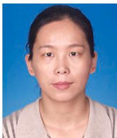

Ye Lu 于 2020 年在中国东北大学秦皇岛分校（Northeastern University at Qinhuangdao）控制工程学院获得学士学位。他目前正在中国南京东南大学仪器科学与工程学院攻读仪器科学与技术专业博士学位。

他的研究方向包括外骨骼机器人、人机交互和新型执行器设计。

Huijun Li 分别于 1999 年和 2002 年在中国郑州郑州大学（Zhengzhou University）获得仪器科学学士学位和凝聚态物理学硕士学位，并于 2005 年在中国南京东南大学获得测量与控制专业博士学位。

她现任 Southeast University（东南大学）School of Instrument Science and Engineering（仪器科学与工程学院）教授。她目前的研究方向包括遥操作与康复机器人。