检查更新

## OPEN ACCESS（开放获取）

编辑：Guoping Zhao，Darmstadt University of Technology（德国达姆施塔特工业大学），德国

审稿人：Le Li，Northwestern Polytechnical University（西北工业大学），中国；Xinxing Chen，Southern University of Science and Technology（南方科技大学），中国；Peter Wolf，ETH Zürich（苏黎世联邦理工学院），瑞士

Peng Chen chenpeng@swjtu.edu.cn Hongchen He hxkfhhc@126.com

收稿日期：2023年02月07日 录用日期：2023年04月10日 出版日期：2023年05月02日

## 引用 (CITATION)

Li X, Lu Q, Chen P, Gong S, Yu X, He H and Li K (2023) Assistance level quantification-based human-robot interaction space reshaping for rehabilitation training. Front. Neurorobot. 17:1161007. doi: 10.3389/fnbot.2023.1161007

## 版权 (COPYRIGHT)

© 2023 Li, Lu, Chen, Gong, Yu, He and Li. 这是一个依据知识共享署名许可协议（Creative Commons Attribution License, CC BY）条款分发的开放获取文章。只要注明原作者和版权所有者，并且引用本期刊上的原始出版物，符合公认的学术规范，就允许在其他论坛中使用、分发或复制。任何不符合这些条款的使用、分发或复制均不被允许。

# 基于助力水平量化的人机交互空间重塑用于康复训练

Xiangyun Li1,2, Qi Lu3, Peng Chen4\*, Shan Gong3, Xi Yu5,6, Hongchen He6,7,8\* and Kang Li1,2

1Sichuan University（四川大学）West China Hospital（华西医院）West China Biomedical Big Data Center（华西生物医学大数据中心），成都，中国，2Sichuan University（四川大学）Med-X Center for Informatics（医工交叉医学信息学中心），成都，中国，3Sichuan University（四川大学）Sichuan University-Pittsburgh Institute（匹兹堡学院），成都，中国，4Southwest Jiaotong University（西南交通大学）School of Mechanical Engineering（机械工程学院），成都，中国，5Sichuan University（四川大学）West China Hospital（华西医院）Department of Orthopedic Surgery and Orthopedic Research Institute（骨科与骨科研究所），成都，中国，Department of Rehabilitation Medicine（康复医学科），West China Hospital（华西医院），Sichuan University（四川大学），成都，中国，7Sichuan University（四川大学）West China School of Medicine（华西临床医学院）School of Rehabilitation Sciences（康复科学学院），成都，中国，8Sichuan University（四川大学）West China Hospital（华西医院）Key Laboratory of Rehabilitation Medicine in Sichuan Province（四川省康复医学重点实验室），成都，中国

脑卒中（Stroke）由于其高发病率和高致残率，已成为严重威胁人类健康的主要疾病。大多数患者在脑卒中后会出现上肢运动功能障碍，这显著损害了脑卒中幸存者的日常生活活动（ADL）能力。机器人在医院和社区参与治疗，为脑卒中康复提供了一种可选的解决方案；然而，康复机器人仍难以像传统治疗中的人类临床医生那样交互式地提供所需辅助。为了实现安全且有效的康复训练，提出了一种基于患者康复状态的人机交互空间重塑方法。根据不同的康复状态，我们设计了七种适用于区分康复训练阶段的实验方案。为了实现按需辅助（AAN）控制，引入了 PSO-SVM 分类模型和 LSTM-KF 回归模型，利用肌电（EMG）和运动学数据来识别患者的运动能力，并研究了用于交互空间塑形的区域控制器。进行了十组离线和在线实验及相应的数据处理，并展示了机器学习和 AAN 控制结果，确保了有效且安全的上肢康复训练。为了探讨不同训练阶段和期次中的人机交互，我们通过考虑患者的参与度定义了一个量化辅助水平指标来表征康复需求，该指标具有应用于临床上肢康复训练的潜力。

## 关键词

人机交互，康复训练，AAN（按需辅助），辅助水平量化，交互空间重塑，EMG（肌电）

## 1. 引言

脑卒中（Stroke）因其高发病率和高致残率，已成为严重威胁人类健康的主要疾病。大多数脑卒中患者伴有上肢运动功能障碍，给他们的身心带来了巨大痛苦（Benjamin et al., 2017）。上肢功能的丧失显著削弱了脑卒中幸存者的日常生活活动（activities of daily living, ADL）能力。目前，随着脑卒中患者数量的不断增加，物理治疗师的匮乏已成为一个严峻问题。脑卒中康复过程具有复杂性，可划分为不同的阶段（Malouin et al., 1994），患者在各个阶段都具有相应的安全运动空间。机器人通过参与医院和社区的治疗，为脑卒中康复提供了一种可选方案，但与传统疗法相比，上肢康复机器人的疗效改善幅度仍然有限（Berning et al., 2021）。机器人提供的高强度和重复性训练对人体肢体功能的恢复具有积极影响（Kapsalyamov et al., 2019），而患者在运动执行过程中的参与度在神经可塑性（neuroplasticity）中发挥着更为关键的作用（Mark et al., 2006）。然而，机器人的过度辅助可能导致患者对机器人产生过度依赖，且大多数康复机器人无法像人类治疗师那样通过交谈和观察直接感知患者的参与程度，因此，如果在训练过程中无法为机器人的控制提供适宜的辅助水平，则很难保证康复效果。

运动能力反映了患者主动参与运动的意图与能力（Wang et al., 2022）。对于脑卒中康复而言，仅凭外部力量的测量很难辨别主动运动中肌肉活动的参与情况。因此，康复过程中还需要生理信号来感知肌肉活动状态，并需要借助肌电信号（electromyography, EMG）来解析肌肉协同激活（Nordin et al., 2014）。EMG 在临床领域得到了广泛应用，因为它即使在没有实际运动发生时也能表征运动意图，并且在线系统产生的延迟更小（Lo and Xie, 2012），或可用于触发功能性电刺激（FES）（Li et al., 2022）。结合参与者的生理和生物力学特性，EMG 信号可以转化为肌肉力和关节力矩（Nasr et al., 2021），这有助于为机器人的定制化控制器解码不同患者的运动意图。通过表征患者的运动能力和康复需求来制定康复机器人的控制策略，将对患者产生积极影响（Qian et al., 2019），并且可以在允许的人机交互空间内通过调节所需的辅助量来实现顺应性控制（compliance control）。

为了在康复过程中实现运动能力的持续恢复，有必要通过 EMG（肌电信号）获取患者运动能力和运动意图的变化，对康复机器人的控制参数进行相应调整，从而提供一种自适应方式以满足患者在不同康复训练阶段和周期中的需求。因此，越来越多的控制策略被引入到康复机器人的应用中。一种基于自适应技术的外骨骼控制器已被开发出来 (Proietti et al., 2015)，该控制器可以通过 EMG 获取参与者的肌肉活动，并在被动辅助和主动辅助模式下调整助力水平。此外，一篇综述指出，阻抗触觉训练策略可能在提高患者注意力和运动学习方面具有巨大潜力，然而所提出的分类法并未包含本研究中的结果指标，如 EMG 或脑激活 (Basalp et al., 2021)。在人机协作方面，提出了一种基于 EMG 的导纳控制方案，该方案能够改善中风幸存者的踝关节运动范围和运动稳定性，并具有应用于临床康复训练的潜力 (Zhuang et al., 2021)。对于通过阻抗或导纳控制实现的按需辅助（assist-as-need, AAN）(Hussain et al., 2017)，通常采用离线运行，通过增益自适应以调整机器人的柔顺性，或利用无传感器力估计来对患者的能力进行建模 (Proietti et al., 2017)，亦或是通过添加患者肢体动力学的固定模型来实现，而该模型需要针对每位参与者进行手动调整 (Wolbrecht et al., 2008)。机器人设备上的传感器可以提供对运动能力的实时、客观测量，有助于患者在机器人干预过程中跟踪康复进展 (Tran et al., 2018)，同时也可以从患者处获取对机器人助力的感知反馈。

在人机交互中，自适应阻抗参数调节使助行/辅助机器人具备运动顺应性（Wen et al., 2017）。基于自适应控制，在线阻抗估计可以最大限度地减小人机交互力，并确保有效的按需辅助（AAN, Assist-As-Needed）。与下肢外骨骼不同，用于上肢康复的末端式机器人提供了更多的自由度，但当瘫痪或痉挛导致人体关节刚度过高且无法快速反应时，超出安全范围的额外交互空间可能会导致二次损伤（Zhang and Cheah, 2015），并且机器人与人体工作空间的不协调可能会在康复训练中引发潜在风险，仅将人机交互力限制在适当范围内并不能保证中风患者在上肢康复中的安全。为了在 AAN 控制中保护患者，研究引入了关节空间壁来约束手臂关节的运动（Brokaw et al., 2014）。借助虚拟隧道技术，AAN 路径控制器涵盖了从完全被动到无任何支持的主动运动的辅助范围（Keller et al., 2013）。然而，这些区域控制方法依赖于位置信息，而不是患者在不同康复阶段的运动能力。中风后偏瘫的大多数患者都会遭受不同程度的肌肉痉挛、肌张力增高或无力（Brunnstrm and Englund, 2010）。为了缓解这些症状，根据 Brunnstrom 提出的分类，康复训练可分为被动、主动和抗阻模式（Brunnstrom et al., 2009）。在临床实践中，评估患者上肢状态的等级通常通过改良 Ashworth 量表（Modified Ashworth Scale, MAS）计算得出（Bohannon and Smith, 1987），该量表具有高度的可靠性和通用性（Tsuji et al., 2002）。然而，MAS 无法直接输入到控制器中（Mehrholz et al., 2005），而肌肉收缩力、关节旋转角度和力矩等与生理相关的参数（Yang et al., 2021）则更适合用于控制。特别是像 MuscleNET 这样的方法，通过机器学习将肌电信号（EMG）映射到运动学和动力学生物力学变量，以应用于生物机电一体化设备的控制（Nasr et al., 2021）。也有外骨骼 AAN 控制系统将运动能力作为输入，例如通过表面肌电（surface Electromyography, sEMG）控制的用于上肢助力可穿戴外骨骼（Liu et al., 2021）。与其他类型的输入信号相比，sEMG 等生理信号可以在患者实际运动之前和运动期间被检测到，更便于将患者的运动意图和运动能力解读为控制器的输入。然而，大多数研究都集中在运动时间等性能指标上（Basalp et al., 2021），而基于 sEMG 的安全人机交互空间尚未得到充分研究。为了确保安全有效的 AAN 控制，EMG 的机器学习结果应为交互空间重塑和辅助水平量化提供参考，以实时适应患者的参与度。

在本研究中，提出了一种基于康复训练辅助水平量化的人机交互空间重塑方法。主要贡献和创新点如下：

(1) 设计了用于量化中风康复患者运动能力的实验方案。与通用的 AAN（按需辅助，Assist-as-Needed）机器人康复训练不同，所设计的方案涵盖了主动、被动和抗阻康复模式，并从康复训练进展的角度对训练阶段（training sessions）进行了分级，这为通过交互空间重塑细分运动能力以实现安全 AAN 控制提供了基础。

(2) 针对中风康复患者的康复进展，建立了运动能力水平与训练阶段之间的映射关系，分类器的输出被用于通过球面虚拟边界重塑交互空间。考虑到安全的在线调整，本文还引入了结合卡尔曼滤波的长短期记忆网络（LSTM-KF）模型来预测感知力矩，从而为 AAN 控制提供增益修正。对于与 ADL（日常生活活动，Activities of Daily Living）相关的更复杂的运动任务，识别每个训练阶段基本动作的运动能力也是有益的。

(3) 从人机交互的角度，将归一化平均感知力矩（NMPT，normalized mean perceived torque）与辅助水平相关联，从而对运动能力进行了进一步量化。分析了辅助水平的变化，按训练阶段表征了患者在 AAN 控制中的需求，并揭示了他们在不同康复阶段的参与度。

本文由四部分组成，主要包括以下章节：第 2 节是本研究使用的方法，介绍了用于 sEMG（表面肌电）和运动学数据采集的实验方案、数据预处理方法、分类和回归模型的建立，以及用于交互空间重塑的 AAN 控制。第 3 节展示了实验结果，随后对辅助水平量化进行了讨论，第 5 节对全文进行了总结。

## 2. 方法

在脑卒中的不同康复阶段，应设计相应的康复训练策略。为了适应患者的不同康复阶段并实现按需辅助（Assist-As-Needed, AAN）控制，康复机器人需要感知肌肉状态并识别康复阶段。它需要一种分类算法来区分不同的恢复状态，以及一种回归算法来在连续训练过程中获取机器人辅助力矩的感知。因此，利用来自参与者的表面肌电（sEMG）和运动学数据训练了粒子群优化支持向量机（PSO-SVM）分类器和 LSTM-KF 回归模型，作为 AAN 控制的输入。脑卒中患者与康复机器人之间的完整交互过程如图 Figure 1 所示。

## 2.1. 实验方案

实验主要使用以下设备采集实验数据。安装了一个 8 通道 sEMG 系统（BTS FreeEMG300, Italy）以采集肱二头肌和肱三头肌的电活动，这两块肌肉是上肢运动的两个重要肌肉。同时，参与者在手腕处佩戴了动作捕捉传感器，用于测量参与者手臂从初始水平位置到运动轨迹上任意位置的旋转角度，随后计算了角度的一阶和二阶微分数据。机械臂（ROKAE Mate ER3 Pro）用于上肢屈伸运动的康复训练实验。

共招募了 10 名年龄在 19–25 岁的年轻男性，均为右利手、健康、无已知神经或心理疾病，且未服用精神类药物或任何影响中枢神经系统的药物。在离线实验阶段，我们每天安排一到两名参与者进行实验。数据采集完成后，我们进行了分类模型和回归模型的训练，共采集了 10 名参与者的离线实验数据。随后，相同的 10 名参与者在另一天参加了在线实验。参与者被要求在实验前一天充分休息。每位参与者均被告知了实验方案，并在获得口头知情同意后参与实验。本研究涉及的方案已获得当地伦理委员会的批准，并遵循《赫尔辛基宣言》（Declaration of Helsinki）执行。

参考临床治疗中的康复训练，实验中采用水平康复床采集数据，并根据实际康复的不同阶段设计了具有代表性的实验方案。由于不同神经通路和运动功能障碍的影响，中风患者的肌力较低且肢体协调性较差。在实验开始时，我们通过表面肌电（sEMG）设备采集的肌电（EMG）数据调整受试者的初始状态，以确定他们在放松和收缩状态之间的肌肉状况。在康复早期，肌肉没有足够的力量运动，随着康复训练的推进，情况会逐渐好转。根据康复进程，康复训练实验被分为三个阶段，即被动、主动和抗阻训练阶段。被动训练要求受试者在整个过程中保持放松，以模拟完全弛缓状态，并在机器人运动的带动下完成手臂的屈伸运动，受试者的 sEMG 幅值用于判断其是否保持被动状态。通常，受试者在被动训练期间被要求将其 sEMG 幅值保持在 200 v 以下。由于肌力的个体差异，实验中每位受试者的 200 v 数值可以稍作调整。在主动训练中，受试者需要模拟上肢已恢复到一定程度、能够发力并在机械臂少量辅助下完成手臂屈伸运动的状态。最后，在抗阻训练中，受试者需要朝机器人运动的相反方向施力。换言之，当机器人向上抬起时，受试者需要施加向下的力；对于向下运动，他们需要在运动过程中施加向上的力，从而通过对抗机器人达到增强力量的目的。接下来，根据患者在各个阶段的运动能力对上述训练环节进行了分类。共有七种类型的实验方案：完全被动训练（PT）、具有轻微运动能力的被动训练（PT+）、运动能力较弱的主动训练（AT-）、正常主动训练（AT）、运动能力较强的主动训练（AT+）、运动能力较弱的抗阻训练（RT-）和抗阻训练（RT）。

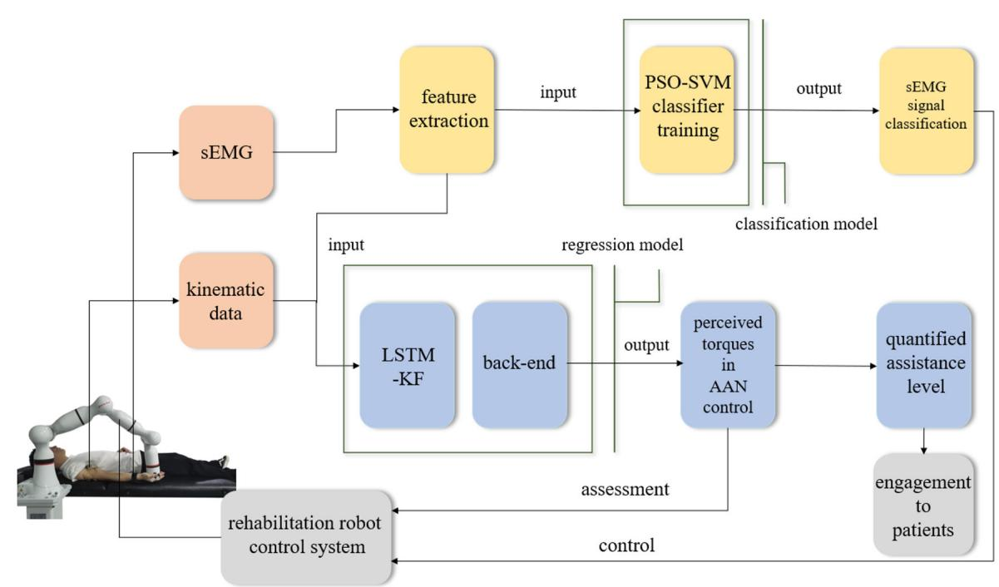  
中风患者与康复机器人之间的交互过程

实验分为三个步骤：首先，在机械臂的辅助下，离线完成上述七种实验方案的数据采集，以获取肱二头肌和肱三头肌的两组 sEMG（表面肌电）数据，以及关节角及其一阶和二阶差分的三组运动学数据。然后，将 sEMG 数据用作训练集来训练分类算法并得到分类模型。同时，将 sEMG 数据和运动学数据作为输入信号以完成回归模型的训练。接下来，在在线条件下，要求参与者执行 7 种实验方案，并根据生成的模型对相应的康复训练阶段进行分类以提供控制和调节信号，同时通过相应的回归模型修改交互空间以及与机器人辅助水平相关的感知力矩。

在数据采集过程中，首先对受试者的皮肤进行清洁，并将表面肌电（sEMG）电极和动作捕捉传感器放置在受试者的手臂上，以识别肌肉激活和关节旋转。在机器人的末端执行器上安装了一条弹性绑带，以便受试者的手掌可以顺应性地连接在其上 (Zhang et al., 2020)。实验安装位置以及手臂屈曲和伸展运动的轨迹如图 Figure 2 所示。实验中的机器人在每个关节上都内置了关节角度位置传感器。然后，通过底层封装的实时雅可比矩阵计算程序，将 7 × 1 的关节角度向量转换为末端执行器在笛卡尔空间中的坐标，并实时存储该坐标值。当受试者的手掌通过绑带与末端执行器连接时，即可获取患者的实际训练轨迹。在离线训练数据采集实验中，受试者平躺在床上，手臂和大腿与地面平行。在康复机器人的辅助下，他们根据设计的七种实验方案进行上肢屈伸运动的康复训练。如图 Figure 2 所示，在每个实验方案中，首先进行 20 s 的屈曲运动，到达最高点 A 后休息 10 s，随后进行 20 s 的伸展运动，到达最低点 B 后休息 10 s。上述动作为一次试验（trial），共耗时 60 s。每个阶段（session）包括两次试验，共耗时 120 s，两个阶段之间的休息时间持续 3 min。每位受试者完成这七种实验方案需要 32 min。实验过程中必须确保受试者的安全。如果患者出现心悸、头晕等不适症状，应立即停止实验。在线实验的流程遵循离线实验的流程。当受试者根据不同的实验方案施力时，系统会对康复训练阶段进行分类，并将相应的控制信号传输至机械臂，以便其将交互空间重塑为不同的康复状态以确保安全。同时，结合回归模型的输出，通过人机交互中受试者的感知力矩计算出用于按需辅助（AAN）控制的增益系数，从而根据患者的参与度来量化辅助水平。

FIGURE 2 康复训练实验装置。  
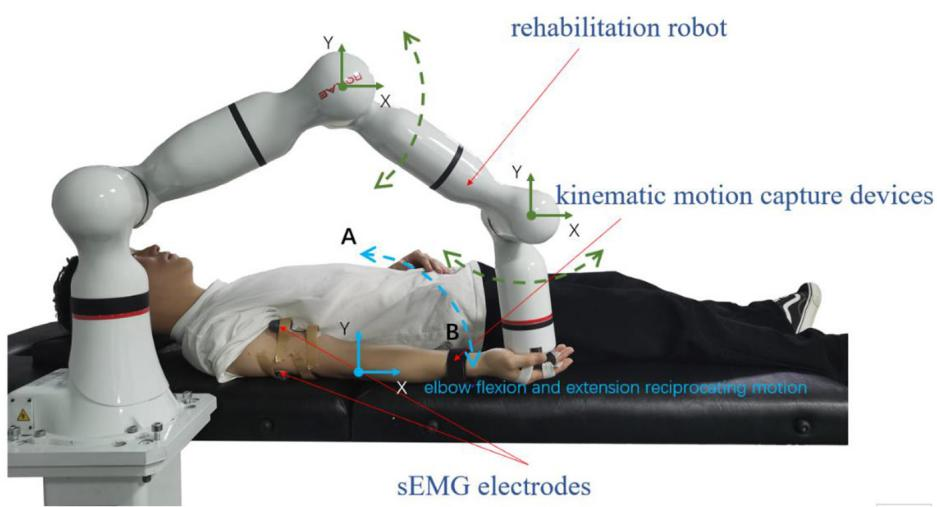  
机械臂可以根据受试者当前的训练阶段进行调整，以便根据恢复状态进行有针对性的康复训练。经 sEMG 判定肌力不稳定的患者，其上肢周围神经损伤尚未完全恢复，周围肌肉控制尚未完全激活（Li et al., 2021），机械臂可以根据分类结果调整交互空间以起到保护作用；(ii) 同时，根据回归模型获得的感知力矩，可以修改机械臂控制的增益，从而实现 AAN 控制，并与康复训练中辅助水平的量化相关联。

## 2.2. 在线实验系统构建

为了验证本文提出的康复训练辅助方法是否能在实际康复过程中实现对不同恢复状态的识别，以及在连续训练阶段中是否能随辅助水平的变化实现 AAN 控制，在离线实验的基础上进行了在线实验设计，在线系统包括患者、数据处理和控制模块，如图 3 所示。

在在线实验中，受试者同样在机械臂的辅助下，遵循七种实验方案完成上肢屈曲和伸展的康复训练。不同之处在于，在线实验中采集的数据将被实时处理。经过分类和回归模型处理后，可分别获得对受试者当前康复状态的识别结果以及 AAN 控制中的交互力矩。此后，结果通过交换机传输至控制模块，以实现以下两个目的：(i) 运动半径

## 2.3. EMG 数据预处理与机器学习

为了实现对患者运动能力的实时追踪，并根据康复阶段调整康复机器人的控制策略，本文利用每位参与者不同康复训练实验的数据来进行分类和回归模型的训练。支持向量机（Support Vector Machine, SVM）具有简单、鲁棒、高精度和强泛化能力等优点。在本文中，SVM 被用于训练阶段分类模型。同时研究发现（Gref et al., 2017），与通过传统参数辨识方法训练的回归模型相比，应用长短期记忆网络（Long Short-Term Memory, LSTM）的回归模型在关节力矩估计的精度上得到了显著提高，且模型的误差值也有所降低。因此，本文引入了基于 LSTM 的训练回归模型来预测患者在按需辅助（AAN）控制中的感知力矩，这为康复机器人的反馈增益调整提供了输入，并通过感知力矩对辅助水平进行量化，以揭示患者对 AAN 控制的参与度。

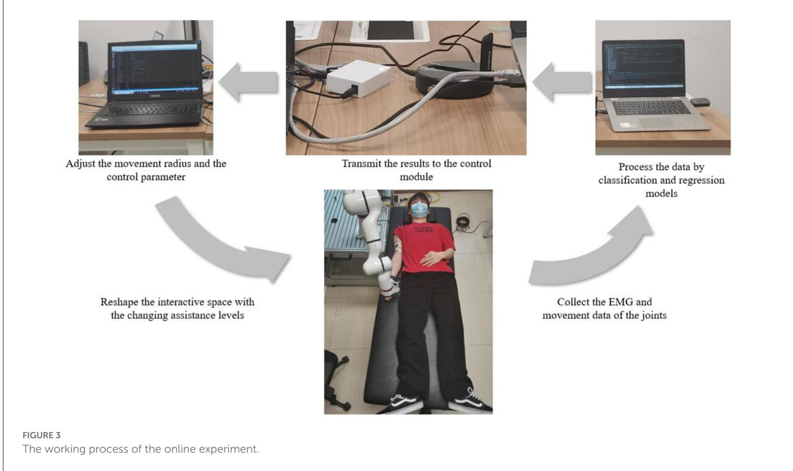

对表面肌电（sEMG）数据进行了滤波处理，以去除噪声并保持有用信息不变。sEMG 原始信号的有效频率主要分布在 0–500Hz，而由工频干扰、电极移动和运动伪影产生的噪声频率范围均在 20Hz 以下。采用五阶巴特沃斯（Butterworth）带通滤波器（20–500Hz）对原始 sEMG 信号进行处理。同时，为了提取主动肌电信号并消除静息状态下的无用信息，对肱二头肌和肱三头肌通道的 EMG 数据进行了截取。此外，通过设定阈值来消除每位参与者所有通道中的非活动数据。阈值设定为 70%，幅值排名前 70% 的数据将被保留，其余数据将被剔除。

## 2.3.1. PSO-SVM 分类器

SVM（支持向量机）是一种二分类器，它通过在特征空间中寻找一个最优超平面，使两组样本数据特征之间的距离最大化，从而生成分类模型。尽管 SVM 具有较强的泛化和分类能力，但它对噪声敏感，而 EMG（肌电）信号也较为微弱且容易受到噪声干扰，这导致了数据处理的困难。此外，SVM 模型训练的样本数据越多，所需的约束条件就越多，这会导致训练速度下降并使模型的稳定性变差。在本文中，通过优化 SVM 的参数来提高其性能。主要优化的参数是惩罚参数 C 和核参数 σ。粒子群优化（Particle Swarm Optimization, PSO）是一种通过模拟鸟类捕食行为而设计的群体智能算法。其目的是使所有粒子在多维搜索空间中找到最优解。由于其原理简单、易于实现且收敛速度快等优点，近年来在许多研究中被用于优化 SVM 参数。因此，本文在此也利用 PSO 来优化 SVM 参数。在本节中，介绍了 SVM 算法的基本原理并解释了 PSO 算法，随后将这两种算法结合以应用于 sEMG（表面肌电信号）分类。

SVM 主要分为线性可分和不可分两种情况。在前一种情况下，对于样本数据 $( x _ { i } , y _ { i } ) , i =$ 1, 2......, n, $x ~ \in ~ R ^ { d } , ~ y ~ \in ~ | ~ - ~ 1 , ~ + 1 | .$ ，可以找到最优超平面 $w ^ { T } X + b = 0 ,$ ，且样本数据到该超平面的距离为 2/||w||，因此分类问题转化为约束优化问题：

$$
\min \frac {1}{2} | | w | | ^ {2}\tag{1}
$$

$$
s. t. y _ {i} \left(w x _ {i} + b\right) \geq 1\tag{2}
$$

在不可分的情况下，样本分类无法通过一条直线完成，因此有必要允许存在少数不满足 $y _ { i } \ ( w x _ { i } + b ) \geq 1$ 要求的样本数据点，并引入松弛变量 $\xi _ { i } \ge 0 ( \mathrm { i } = 1 , 2 . . . , \mathrm { n } )$ 和惩罚参数 C，此时分类问题可修改为：

$$
\min \frac {1}{2} | | w | | ^ {2} + C \sum_ {i = 1} ^ {n} \xi_ {i}\tag{3}
$$

$$
s. t. y _ {i} (w x _ {i} + b) - 1 + \xi_ {i} \geq 0\tag{4}
$$

通过调整 $\xi _ { i }$ 和 $C ,$ 的值，可以剔除无效数据点以避免过学习。求解超平面的公式如下：

$$
f (x) = \operatorname{sgn} \left[ \sum_ {i = 1} ^ {n} \alpha_ {i} ^ {*} y _ {i} k (x _ {i}, x) + b ^ {*} \right]\tag{5}
$$

其中核函数为径向基表达式：

$$
k \left(x _ {i}, x\right) = \exp \left(- \frac {\left| \left| x _ {i} - x \right| \right| ^ {2}}{2 \sigma^ {2}}\right)\tag{6}
$$

接下来，使用 PSO（粒子群优化）算法来优化 SVM 参数。PSO 算法的原理是通过搜索个体最优值和全局最优值来不断更新自身的速度和位置。经过多次迭代后，即可获得目标参数的最优组合。具体表达式如下：

$$
v _ {t + 1} = \omega v _ {t} + c _ {1} r _ {1} (p b e s t _ {t} - x _ {t}) + c _ {2} r _ {2} (g b e s t _ {t} - x _ {t})\tag{7}
$$

$$
x _ {t + 1} = x _ {t} + \nu_ {t + 1}\tag{8}
$$

式中，$\nu _ { t }$ 表示在时间 t 迭代时的速度，vt+1 表示在时间 $t + 1 ,$ 迭代时的速度，x 表示在时间 t 迭代时的位置，$x _ { t + 1 }$ 表示在时间 $t + 1$ 迭代时的位置，ω 为惯性权重，$c _ { 1 }$ 和 $c _ { 2 }$ 为学习因子，$r _ { 1 }$ 和 $r _ { 2 }$ 为 0–1 随机数。pbest 为粒子在时间 t 迭代时个体极值点的位置，gbest 为粒子在时间 t 迭代时全局极值点的位置。

PSO 用于 SVM 的参数优化。该算法的步骤主要包括：将样本划分为训练集和测试集，并进行归一化。初始化粒子群参数并计算粒子适应度。根据粒子适应度，找到个体极值点的位置和全局极值点的位置。利用更新后的粒子速度和位置，由训练集生成分类器以判断准确率是否达到最优。如果是，则将惩罚参数 C 和核参数 σ 作为输出；如果否，则重新计算粒子适应度并继续迭代。

采用 PSO-SVM 方法对来自三个康复阶段的 sEMG 数据进行分类。首先，截取数据的活动部分，并进行分层抽样以获得足以反映原始数据整体趋势的数据集。之后，使用时域方法对所获得的数据集进行特征提取。提取的主要时域特征包括平均绝对值（MAV，反映整体肌肉激活状态）、波长长度（WL，反映波形的复杂度）、过零点数（$\mathrm { Z C }$，反映样本的复杂度）、均方根（RMS）、自回归系数（AR，反映数据变换状态）。特征提取后，每个 sEMG 数据片段都可以用提取的特征向量来替代。在每个主要阶段的所有数据完成预处理后，代表数据所属时段的对应标签即可用于基于 PSO-SVM 的模型训练。

## 2.3.2. 基于 LSTM-KF 的回归模型

LSTM 是一种特殊类型的循环神经网络（Recurrent Neural Network，RNN），用于处理具有较长间隔的时间序列信息。与 RNN 相比，LSTM 增加了输入阈值、遗忘阈值和输出阈值，并且权重在自循环过程中会持续变化。考虑到 LSTM 容易受到数据序列长度的影响（Simo et al., 2019），而卡尔曼滤波（Kalman filter）能够根据系统的观测值优化系统的内部状态，因此可将其与 LSTM 相结合以提高预测精度。在本文中，采集的运动学数据经由卡尔曼滤波处理，其预测过程被嵌入到 LSTM 的信息记忆过程中，从而构建 LSTM-KF 模型并获得最佳观测值。

LSTM 通过设置不同的阈值组合来控制和保护单元状态（cell state），并对时间序列中的信息进行筛选和剔除。LSTM 的输入包括单元状态 $( c _ { t } ) _ { : }$、隐藏层输入 $\left( h _ { t - 1 } \right)$ 以及当前输入 (x )。其工作机制是接收当前输入 x 和上一状态传递过来的输出 $h _ { t - 1 }$。通过拼接不同的激活函数，完成不同阈值的赋值，以获得信息筛选后的输出值。遗忘阈值、输入阈值、单元状态更新和输出阈值的数学表达式如下：

遗忘阈值：

$$
f _ {t} = \sigma \left(W _ {f} \left[ h _ {t - 1}, x _ {t} \right]\right)
$$

输入阈值：

(9)

$$
\begin{array}{c} i _ {t} = \sigma \left(W _ {i} \left[ h _ {t - 1}, x _ {t} \right]\right) \\ \tilde {C} _ {t} = \tanh \left(W _ {C} \left[ h _ {t - 1}, x _ {t} \right]\right) \end{array}\tag{10}
$$

(11)

单元状态更新：

$$
C _ {t} = f _ {t} * C _ {t - 1} + i _ {t} * \tilde {C} _ {t}\tag{12}
$$

输出阈值：

$$
o _ {t} = \sigma \left(W _ {o} \left[ h _ {t - 1}, x _ {t} \right]\right)\tag{13}
$$

最终输出：

$$
h _ {t} = o _ {t} * \tanh (C _ {t})\tag{14}
$$

在上述公式中，σ 表示 sigmoid 函数；W 为不同阈值的权重矩阵；$o _ { t } , i _ { t } , f _ { t }$ 是通过 sigmoid 函数转换得到的介于 0 到 1 之间的值，表示门状态。$\tilde { C } _ { t }$ 作为输入数据经 tanh 函数转换后的值，其取值介于 −1 到 1 之间。

如上所述，训练好的 LSTM 模型的性能容易受到时间序列长度的影响。为了减轻这种影响，本文将卡尔曼滤波（Kalman filter, KF）与 LSTM 相结合。KF 能够对不确定动态系统进行预测，且具有良好的抗干扰能力。假设系统在时间 t 的状态为 $X _ { t } ,$ 时间 t 的预测误差协方差矩阵为 $R _ { t } ,$ 前一状态的系统状态和预测误差协方差矩阵分别为 $X _ { t - 1 }$ 和 $R _ { t - 1 }$。对于 KF，根据均方误差（mean square error, MSE），时间 t 的最佳估计为 ${ \hat { X } } _ { t } .$ 考虑外部控制变量和环境因素，修正后的结果如下：

$$
\hat {X} _ {t} = F _ {t} \hat {X} _ {t - 1} + B _ {t} \overrightarrow {u _ {t}}\tag{15}
$$

$$
R _ {t} = F _ {t} R _ {t - 1} F _ {t} ^ {T} + Q _ {t}\tag{16}
$$

其中 $F _ { t }$ 表示 KF 的预测过程，$B _ { t }$ 为控制矩阵，$\overrightarrow { u _ { t } }$ 为控制向量，$Q _ { t }$ 为环境噪声的协方差矩阵。根据时间 t 的观测数据，可分别表示高斯分布的预测部分 $\begin{array} { r l } { ( \mu _ { 0 } , \Sigma _ { 0 } ) \ = } & { { } ( H _ { t } \hat { X } _ { t } , H _ { t } R _ { t } H _ { t } ^ { T } ) } \end{array}$ 与高斯分布的测量部分 $( \mu _ { 1 } , \Sigma _ { 1 } ) = ( \hat { Y } _ { t } , P _ { t } )$，其中 H 为观测矩阵，$\hat { Y } _ { t }$ 为观测值，$P _ { t }$ 为观测协方差矩阵。将这两个分布相乘，可通过 KF 获得更新后的最优估计分布 $\left( \mu ^ { ' } , \Sigma ^ { ' } \right) = ( H _ { t } \hat { X } _ { t } ^ { ' } , H _ { t } R _ { t } ^ { ' } H _ { t } ^ { T } )$

$$
\left(\mu^ {\prime}, \Sigma^ {\prime}\right) = (\mu_ {0} + K (\mu_ {1} - \mu_ {0}), \Sigma_ {0} - K \Sigma_ {0})\tag{17}
$$

代入数据后，可得：

$$
\hat {X} _ {t} ^ {\prime} = \hat {X} _ {t} + H _ {t} ^ {- 1} K (\hat {Y} _ {t} - H _ {t} \hat {X} _ {t}) = \hat {X} _ {t} + K ^ {\prime} (\hat {Y} _ {t} - H _ {t} \hat {X} _ {t})\tag{18}
$$

$$
R _ {t} ^ {\prime} = R _ {t} - H _ {t} ^ {- 1} K H _ {t} R _ {t} = R _ {t} \left(I - H _ {t} ^ {- 1} K H _ {t}\right) = R _ {t} \left(I - K ^ {\prime} H _ {t}\right)\tag{19}
$$

其中最优估计 $( \hat { X } _ { t } ^ { \prime } )$ 和预测误差协方差矩阵 $( R _ { t } ^ { \prime } )$ 可以在 KF 处理后得到更新。K 为卡尔曼增益矩阵，$K ^ { \prime }$ 为更新后的卡尔曼增益：

$$
K = \Sigma_ {0} (\Sigma_ {0} + \Sigma_ {1}) ^ {- 1} = H _ {t} R _ {t} H _ {t} ^ {T} (H _ {t} R _ {t} H _ {t} ^ {T} + P _ {t}) ^ {- 1}\tag{20}
$$

$$
K ^ {\prime} = H _ {t} ^ {- 1} K = R _ {t} H _ {t} ^ {T} \left(H _ {t} R _ {t} H _ {t} ^ {T} + P _ {t}\right) ^ {- 1}\tag{21}
$$

结合 LSTM 的记忆与遗忘功能以及 KF 的抗干扰预测功能，构建了 LSTM-KF 模型。将上一时刻系统状态的均值 $( \hat { X } _ { t - 1 } )$ 输入 LSTM，以获得当前时刻系统状态的均值 $( \hat { X } _ { t } )$。经由 KF 算法处理后，获得最优估计均值 $( \hat { X } _ { t } ^ { ' } )$。

在本节中，基于 LSTM-KF 的神经网络模型用于对实验数据进行回归，以预测用于按需辅助（AAN，Assist-as-needed）控制的感知力矩，并用于量化康复机器人的辅助水平。该回归模型的框架如图 Figure 4 所示，分为四个部分：输入层、LSTM-KF 模型、后端全连接层和输出层。输入层接收在各种康复状态下从受试者处采集的表面肌电（sEMG）信号和运动学数据。sEMG 信号包含对应于肱二头肌和肱三头肌的两个通道。运动学数据包含三个通道，分别对应于关节角度（θ）、关节角度的一阶差分（θ˙）和关节角度的二阶差分（θ¨）。接收数据的维度为 5，隐藏层的维度为 64。由于 sEMG 信号采集设备与运动学信号采集设备的采样频率不同，sEMG 信号的采样率为 1000Hz，而运动学数据的采样率为 60Hz，在输入神经网络模型之前需要进行下采样，随后融合 sEMG 信号和运动学数据。由此获得了一个大小约为 $1 3 , 0 0 0 ~ \times 5$ 的数据矩阵，即共有 13,000 个数据点，每个数据点包含 5 个特征值。接下来，对数据矩阵进行切片，以 200 个数据点为一组，将前 199 个数据点的特征值作为单次输入，并将第 200 个点的力矩值作为标签，因此滑动窗口的长度为 200，步长值为 10。在后端设置了两个全连接层，批大小（batch size）设为 8，轮数（epochs）设为 50。两者之间额外添加了一个 dropout 层以避免过拟合，最终输出为受试者感知力矩值的预测一维数据。

## 2.4. 按需辅助控制（Assist-as-needed control）

康复训练是一种典型的人机交互场景。脑卒中患者通常肌力不稳定，这使得他们在康复训练过程中极易因肌肉疲劳或痉挛而导致肢体突然下垂，从而造成二次损伤。因此，在使用 AAN（按需辅助）控制策略提升康复效果的同时，确保使用者的安全至关重要。为了满足安全要求，辅助水平应与患者的运动能力相匹配（Zhang et al., 2020）。所提出的 ANN 控制策略是通过协调不同的子功能模块来实现安全目标的。首先，利用 SVM-PSO 和 LSTM-KF 对患者的 EMG 信号进行分析以识别其运动能力，随后以此为基础，通过人工势场法调整区域控制器的控制参数。借助该控制器，当训练阶段和会话中出现疲劳或痉挛时，通过安全地匹配患者的运动能力来实现交互空间的重塑。

## 2.4.1. 机器人运动学与动力学

在强调人机交互的康复训练中，机器人末端执行器的期望路径通常在任务空间中指定。因此，设 $X$ 表示末端执行器在笛卡尔空间中的位置和姿态向量。

$$
X = f (q)\tag{22}
$$

其中 $X ~ \in ~ R ^ { n }$ 表示机器人末端执行器在笛卡尔空间中的位置向量，$q \in R ^ { n }$ 是表示机器人在关节空间中位姿状态的 $n \times 1$ 维关节角向量，$f ( . ) \in R ^ { n }  R ^ { n }$ 表示从关节空间到任务空间的映射。对公式 (22) 进行求导：

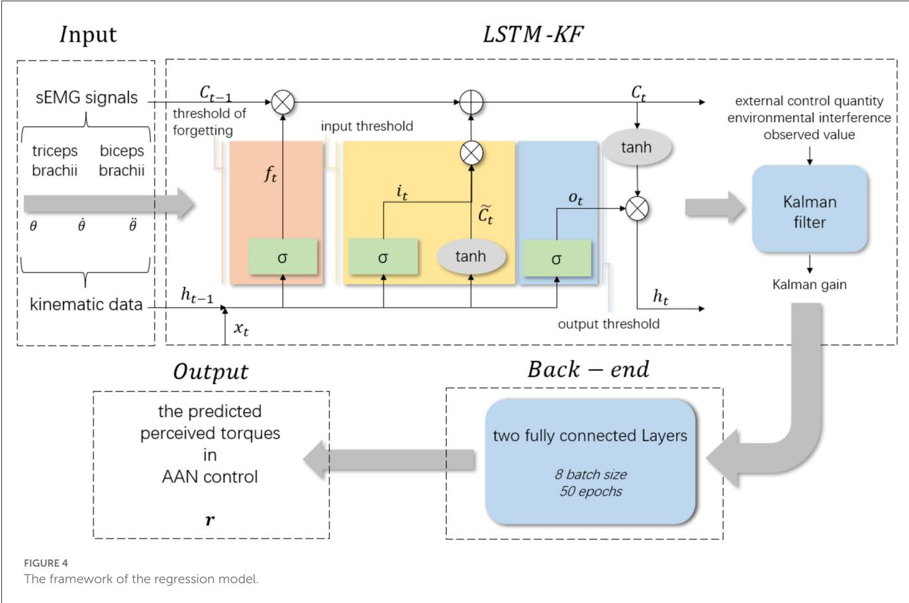

$$
\dot {X} = J (q) \dot {q}\tag{23}
$$

其中 $\dot { X }$ 是末端执行器在笛卡尔空间中的速度向量，$\dot { q }$ 表示关节空间中的关节速度向量，$J \left( q \right) \in R ^ { n \times n }$ 是将速度从关节空间映射到任务空间的雅可比矩阵。

在交互式康复训练场景中，力矩控制更为适用。因此，康复机器人的动力学方程描述如下：

$$
M (q) \ddot {q} + C (q, \dot {q}) \dot {q} + G (q) = \tau\tag{24}
$$

$M ( q ) \in R ^ { n \times n }$ 为对称正定的惯性矩阵，$C ( q , \dot { q } ) \dot { q } \in R ^ { n }$ 表示离心力与科里奥利力向量，$G \left( q \right) \in R ^ { n }$ 表示重力向量，$\tau \in R ^ { n } \mathrm { i }$ 为关节控制力矩输入。惯性矩阵 $M(q)$、离心力与科里奥利力向量 $C \left( q , \dot { q } \right)$ 具有如下关系：

$$
\dot {q} ^ {T} (\dot {M} - 2 C) \dot {q} = 0\tag{25}
$$

## 2.4.2. 用于空间整形的区域控制器设计

与传统的机器人轨迹跟踪控制策略不同，在临床康复训练中期望患者能够拥有更高的参与度，并能根据患者的康复训练进程实时在线调整控制参数，以满足患者的康复需求。因此，提出了一种基于患者 EMG（肌电）信号和运动学数据进行在线调整的 AAN（按需辅助）控制策略，如图 Figure 5 所示，该策略通过人机交互空间重构和控制参数在线调整来确保训练的安全与有效。

对于定点位置控制，其控制目标是使任务空间位置误差 $e ~ = ~ X _ { c } - X _ { d }$ 最终收敛到零，其中 $X _ { c }$ 和 $X _ { d }$ 分别表示当前位置和期望位置。为实现该目标，定义了一个基于误差的势函数 $F ( e )$ 如下：

$$
F (e) = \frac {1}{2} e k _ {f} e ^ {T}\tag{26}
$$

其中 $k _ { f }$ 为常数增益。求取 $F ( e )$ 的梯度如下：

$$
\frac {\partial F (e)}{\partial e} = k _ {f} e\tag{27}
$$

注意，当势函数的梯度接近零时，$e$ 也趋近于零。因此，为了完成控制目标，可以在控制律中考虑包含势函数负梯度的控制项，以持续驱动机械臂接近期望位置，直至误差 $e$ 为零。

与定点位置跟踪不同，考虑到康复训练的临床应用并不要求过高的跟踪精度性能，且为了确保患者安全并提高患者康复训练的积极性，本文考虑了一种区域跟踪控制器，这意味着只要康复机器人的末端执行器到达指定区域，控制方案即被执行且控制目标得以实现。在本文中，考虑如下定义的球形空间：

$$
\Omega = \left\{X | g (X) = (x - x _ {0}) ^ {2} + (y - y _ {0}) ^ {2} + (z - z _ {0}) ^ {2} - r ^ {2} \leq 0 \right\}\tag{28}
$$

其中 $[ x _ { 0 } , y _ { 0 } , z _ { 0 } ] ^ { T } \in R ^ { 3 } \mathrm { i s }$ 为球形区域的中心，$X =$ [x, $y , z ] ^ { T } \in R ^ { 3 }$ 为机器人末端执行器的当前位置，$r$ 为球形区域的半径。$g ( X ) : R ^ { 3 } \ \to \ R$ 为目标函数。

所定义区域的大小可以根据从参与者采集的 EMG 信号和运动学数据的分类结果进行调整。考虑到康复训练的实际需求，如上所述，康复训练实验被分为三个不同阶段：(i) 被动训练模式；(ii) 主动训练模式；(iii) 抗阻训练模式。根据实际安全要求，这三个阶段可进一步细分为七种不同的方案：完全被动训练（PT）、具轻微运动能力的被动训练（PT+）、正常主动训练（AT）、具较弱运动能力的主动训练（AT-）、具较强运动能力的主动训练（AT+）、抗阻训练（RT）以及具较弱运动能力的抗阻训练（RT-）。因此，不同方案的自由运动空间半径如下。

$$
r = \left\{ \begin{array}{l l} r _ {a}, & P T \\ r _ {b}, & P T + \\ r _ {c}, & A T - \\ r _ {d}, & A T \\ r _ {e}, & A T + \\ r _ {f}, & R T - \\ r _ {g}, & R T \end{array} \right.\tag{29}
$$

其中 $r _ { a } , r _ { b } , r _ { c } , r _ { d } , r _ { e } , r _ { f } , r _ { g }$ 为七个离散值，考虑到不同方案训练过程中不同的运动能力以及安全要求，半径值设定为 $r _ { e } > r _ { d } > r _ { c } > r _ { g } > r _ { f } > r _ { b } > r _ { a } .$。

为了使控制目标更加明确，基于误差 e 改写后的公式 (28) 如下。

$$
g (e) = | | e | | ^ {2} - r ^ {2}\tag{30}
$$

$$
e = X _ {c} - X _ {d}\tag{31}
$$

其中 $X _ { c } \in R ^ { n }$ 表示机器人末端执行器的当前位置向量，$X _ { d } ~ \in ~ R ^ { n }$ 表示笛卡尔空间中机器人末端执行器的期望位置向量。$g \ ( e ) : R ^ { n } \ \to$

R 是控制的目标函数。所选择的目标函数关于 e 是连续且可微的，因此 g (e) 的有界性保证了其一阶和二阶偏导数的有界性。由此，任务空间中的势函数被具体指定为公式 (32)。

$$
P (e) = \frac {k _ {p}}{2} \max (0, g (e)) ^ {2} = \frac {k _ {p}}{2} \max (0, | | e | | ^ {2} - r ^ {2}) ^ {2}\tag{32}
$$

这意味着，

$$
P (e) = \left\{ \begin{array}{l} 0, \qquad g (e) \leq 0 \\ \frac {k _ {p}}{2} g (e) ^ {2}, g (e) > 0 \end{array} \right.\tag{33}
$$

其中 $k _ { p }$ 为正常数系数。

因此，势函数 $P ( e )$ 的梯度如下。

$$
(\frac {\partial P (e)}{\partial e}) ^ {T} = \left\{ \begin{array}{c c} 0, & g (e) \leq 0 \\ k _ {p} g (e) (\frac {\partial g (e)}{\partial e}) ^ {T}, & g (e) > 0 \end{array} \right.\tag{34}
$$

改写后的公式 (34) 如下。

$$
\left(\frac {\partial P (e)}{\partial e}\right) ^ {T} = 2 k _ {p} \max (0, g (e)) e\tag{35}
$$

从 $( 3 4 )$ 可知，$( \partial P \left( e \right) / \partial e ) ^ { T }$ 是连续的，因为当 $X _ { c }$ 接近由式 (28) 定义的空间边界时，$g \left( e \right)$ 接近于零，而当 $X _ { c }$ 位于给定空间内部时，其保持为零。基于 (35)，定义了如公式 (36) 所示的交互空间跟踪控制器。

$$
\tau = - K _ {\nu} \dot {q} - J ^ {T} (q) (\frac {\partial P (e)}{\partial e}) ^ {T} + G (q)\tag{36}
$$

控制方案 (36) 中的第二项包含势函数的负梯度项，该项将持续驱动机械臂移动至期望区域，直到梯度值为零。G(q) 为一个 n×1 的重力补偿项。而 $\begin{array} { l c l } { K _ { \nu } } & { \in } & { R ^ { n \times n } } \end{array}$ 为正定速度反馈增益矩阵。

$$
K _ {\nu} = k _ {\nu} I\tag{37}
$$

$k _ { \nu }$ 是一个随患者训练方案变化的正标量增益，$I ~ \in ~ R ^ { n \times n }$ 表示单位矩阵。增益 $k _ { \nu }$ 应具备可调性，以满足与助力水平感知相关的患者实际参与度需求。因此，建立了基于 sEMG 和运动学数据的 LSTM-KF 回归所得到的增益与感知力矩之间的映射关系。

$$
k _ {\nu} = k _ {\nu 0} + c _ {1} \left(\frac {c _ {2}}{1 + e ^ {- \hbar}} \ln \left(\frac {c _ {3}}{\hbar}\right)\right)\tag{38}
$$

其中 $k _ { \nu 0 }$ 为确保 $k _ { \nu } \mathrm { i } s$ 为正的正标量常数。ℏ 表示利用 sEMG 和运动学数据通过 LSTM-KF 估计出的感知力矩。$c _ { 1 } , c _ { 2 } , c _ { 3 }$ 为三个正常数。

由此，得出增益 $K _ { \nu }$ 的方程式。

$$
K _ {\nu} = (k _ {\nu 0} + c _ {1} (\frac {c _ {2}}{1 + e ^ {- \hbar}} \ln (\frac {c _ {3}}{\hbar}))) I\tag{39}
$$

将 (39) 代入控制律 (36) 中：

$$
\begin{array}{c} \tau = - (k _ {v 0} + c _ {1} (\frac {c _ {2}}{1 + e ^ {- \hbar}} \ln (\frac {c _ {3}}{\hbar}))) I \dot {q} - 2 J ^ {T} (q) k _ {p} \\ \max (0, g (e)) e + G (q) \end{array}\tag{40}
$$

$J ^ { T } \left( q \right)$ 为雅可比矩阵（Jacobian matrix）的转置。

根据式 (40)，AAN 控制的框架如下所示。

## 3. 实验结果

## 3.1. 机器学习结果

采集到的 EMG 和运动学数据通过训练好的分类和回归模型进行处理。分类模型的输出应用于 AAN 控制系统，康复机器人根据患者的运动能力进行控制。回归模型的输出在 AAN 控制中表示为感知力矩，这将是从人机交互角度量化康复机器人对患者助力水平的基础。以下是分类和回归模型的处理结果。

## 3.1.1. 分类模型结果

针对 10 名受试者和七种实验方案，采用第 2.2.1 节中提到的 PSO-SVM 算法进行离线实验和模型训练。为验证分类模型的性能，90% 的数据集被用作训练集，其余 10% 用作测试集。首先，对每位受试者的所有原始数据进行预处理和分段。为了准确表征受试者的康复状态，采用阈值检测和滑动窗口的方法处理数据，并以尽可能少的特征损失将患者的 sEMG 信号映射到高维向量。10 名受试者在离线条件下被动训练、主动训练和抗阻训练康复阶段的分类准确率如 Table 1 所示。

同时，为实现实时人机交互，按照离线实验的步骤进行了在线测试实验。在机器人的辅助下，受试者根据七种实验方案完成了肘关节屈伸的康复训练实验。不同之处在于，在实验过程中，离线训练的分类模型将用于识别受试者的康复阶段，并通过回归模型估计的感知力矩来调节控制部分的增益。在线条件下，10 名受试者在被动训练（二分类）、主动训练（三分类）和抗阻训练（二分类）三种训练模式下的分类准确率和 Kappa 系数如 Figure $^ { 6 , }$ 所示，受试者 4 的混淆矩阵如 Figure 7 所示。

## 3.1.2. 回归模型结果

在本实验中，提出了一种 LSTM-KF 模型来估计感知力矩。由于每种实验方案中的肌肉状态各不相同，相应的模型拟合能力也存在差异。Figure 8 显示了预测的感知力矩（蓝色曲线）与参考值（橙色曲线）。同时，在 10 名受试者的 7 种实验方案中，基于平均绝对误差（MAE）损失在测试集上对模型进行了评估，如 Table 2 所示。

## 3.2. 用于交互空间重塑的 AAN 控制结果

控制参数可根据上述机器学习算法的结果进行实时在线调整，以确保受试者在康复训练期间的安全，并满足受试者在不同康复阶段和训练任务中的需求。本节主要在三个不同康复阶段和七种协议下进行了在线实验，以说明所提出的 AAN（按需辅助）控制器在被动、主动和抗阻机器人康复训练中的有效性与安全性。所提出控制器的两个参数可在线调节，以满足康复训练中的安全要求。这些实验为非临床试验，旨在研究其在患者身上的潜在应用，健康受试者的参与证明了所提出的 AAN 控制器可以通过在线修改控制参数，确保患者在康复训练中沿期望运动轨迹的安全性。在线实验中 AAN 的控制结果和交互空间重塑如图 Figure 9 所示。

本文将上肢的屈伸运动作为实验任务。因此，笛卡尔空间中的期望轨迹在此给出如下

$$
\left\{ \begin{array}{c} x = x _ {1} - 0. 1 5 \sin (w t) \\ y = y _ {1} \\ z = z _ {1} + 0. 1 5 \sin (w t) \end{array} \right.\tag{41}
$$

其中 $( x _ { 1 } , y _ { 1 } , z _ { 1 } )$ 为初始坐标，通过受试者 1 的实验结果可以验证所提控制器的有效性。设定 $c _ { 1 } = 0 . 1 , c _ { 2 } = 2 . 0 , c _ { 3 } = 5 . 0 ,$ $w ~ = ~ 0 . 1 r a d / s , k _ { \nu 0 } ~ = ~ 1 0 . 0 , k _ { p } ~ = ~ 6 0 0 0 . 0 .$。值得注意的是，用于验证所提 AAN 控制策略的目标轨迹是 XOZ 平面上的二维轨迹。然而，机器人与受试者之间的交互空间是以设定轨迹为中心、可实时调整的三维球形空间。实际上，受试者可以在虚拟球体包络的空间内自由进行三维运动。此外，AAN 控制方法并不局限于平面或单关节运动，设定轨迹可以根据具体的康复需求进行修改，以执行三维运动或多关节运动。AAN 控制通过目标轨迹周围的虚拟边界来确保患者的安全，该边界也与交互空间和辅助等级相关。

TABLE 1 10 名受试者在离线条件下三个训练阶段的分类准确率。

<table><tr><td rowspan="2"></td><td colspan="2">被动</td><td colspan="2">主动</td><td colspan="2">抗阻</td></tr><tr><td>训练</td><td>测试</td><td>训练</td><td>测试</td><td>训练</td><td>测试</td></tr><tr><td>S1</td><td>100.00%</td><td>99.65%</td><td>100.00%</td><td>99.87%</td><td>98.95%</td><td>99.25%</td></tr><tr><td>S2</td><td>100.00%</td><td>100.00%</td><td>99.25%</td><td>98.80%</td><td>99.70%</td><td>99.10%</td></tr><tr><td>S3</td><td>100.00%</td><td>100.00%</td><td>99.78%</td><td>98.44%</td><td>100.00%</td><td>100.00%</td></tr><tr><td>S4</td><td>98.43%</td><td>98.59%</td><td>99.85%</td><td>99.78%</td><td>97.62%</td><td>96.55%</td></tr><tr><td>S5</td><td>100.00%</td><td>99.54%</td><td>100.00%</td><td>100.00%</td><td>97.17%</td><td>96.73%</td></tr><tr><td>S6</td><td>100.00%</td><td>99.76%</td><td>100.00%</td><td>99.61%</td><td>93.14%</td><td>94.75%</td></tr><tr><td>S7</td><td>100.00%</td><td>100.00%</td><td>99.78%</td><td>100.00%</td><td>90.95%</td><td>90.48%</td></tr><tr><td>S8</td><td>100.00%</td><td>100.00%</td><td>100.00%</td><td>99.88%</td><td>100.00%</td><td>99.85%</td></tr><tr><td>S9</td><td>97.81%</td><td>98.54%</td><td>98.66%</td><td>97.67%</td><td>99.85%</td><td>99.77%</td></tr><tr><td>S10</td><td>100.00%</td><td>100.00%</td><td>95.37%</td><td>93.98%</td><td>99.52%</td><td>99.52%</td></tr></table>

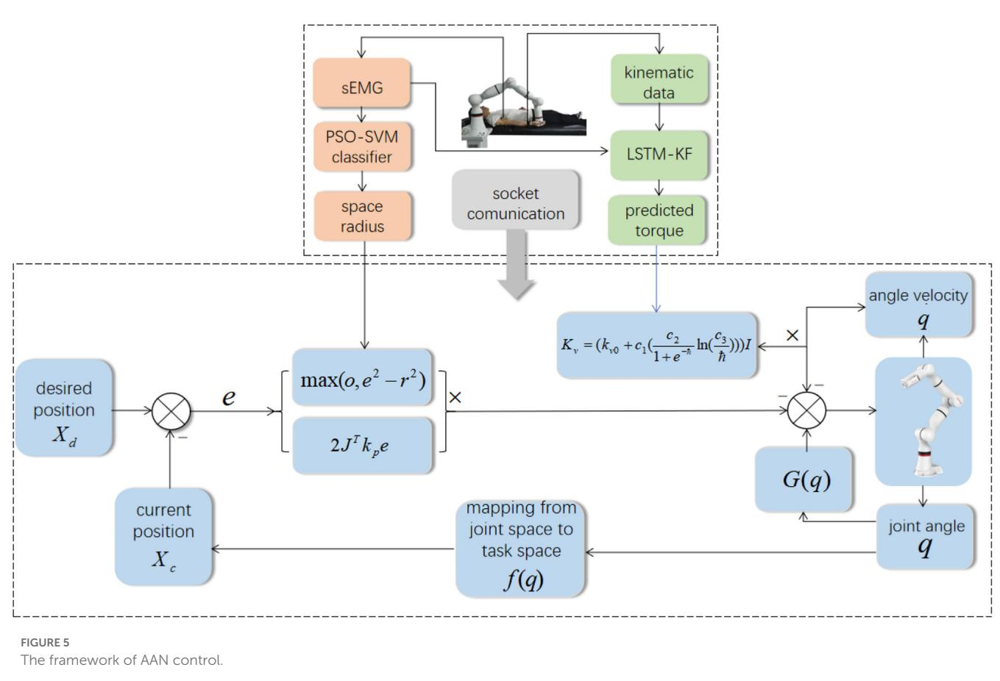

## 3.2.1. 被动康复训练模式的验证

被动训练主要适用于处于康复早期的运动功能障碍患者。在该模式下，康复机器人起主导作用。因此，受试者被要求放松，并在机器人的带动下被动进行上肢屈伸运动的重复训练。然而，该模式可进一步细分为两种方案，即方案1：完全被动训练（PT），以及方案2：具备微弱运动能力的被动训练（PT+）。受试者被要求分别执行这两种方案，以便控制参数可以根据 sEMG 信号和运动学数据进行实时调整，从而为患者制定更详尽的康复训练策略，在满足康复训练需求的同时确保训练过程的安全性。设置 $r _ { a } = 0 . 0 4 m , r _ { b } = 0 . 0 2 m$

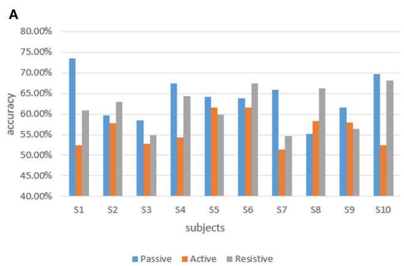

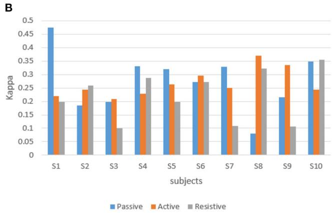  
在线实验下 10 名受试者在三个训练阶段的分类准确率和 Kappa 系数。(A) 10 名受试者的分类准确率。(B) 10 名受试者的 Kappa 系数。

A  
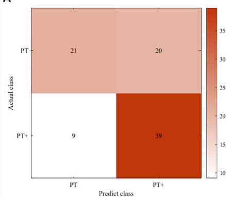

B  
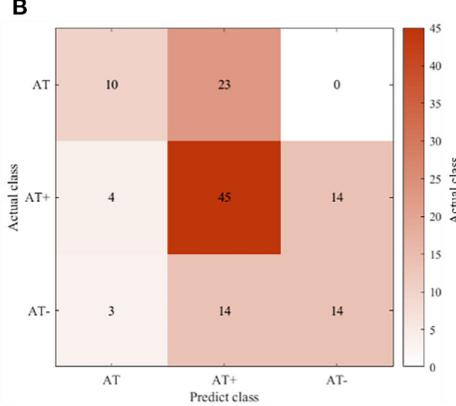

C  
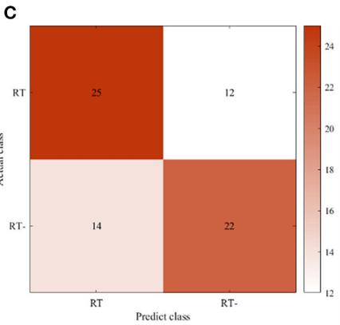  
参与者四在线实验的混淆矩阵。(A) 被动训练。(B) 主动训练。(C) 抗阻训练。

在 Figure 10 中，actual\_PT 为方案 PT 中的训练轨迹，expected\_PT 为方案 PT 中的理想轨迹，actual\_PT+ 为方案 PT+ 中的训练轨迹，expected\_PT+ 为方案 PT+ 中的理想轨迹。Figure 10 表明，在被动训练模式的两种方案中，实际训练轨迹均收敛于定义的交互空间内，因此实验结果验证了 AAN 控制器在被动训练模式下的安全性和有效性。从 Figure 11A 可以看出，在 PT 和 PT+ 方案中，交互空间的半径均能相对有效地进行在线调整。在 PT 方案中，提供了较小的交互空间以对参与者实现更高等级的安全保护。PT+ 方案中稍大的交互空间可以为参与者提供用于恢复关节正常活动范围的交互空间。从 Figure 11B 可以看出，方案 PT 中的速度反馈增益 $k _ { \nu }$ 通常大于方案 PT+ 中的增益，这是因为参与者在该 PT 方案中模拟的是弛缓性瘫痪状态，而较小的速度反馈增益可确保训练过程中的安全性。PT+ 方案中的速度反馈增益 $k _ { \nu }$ 大于 PT 方案中的增益，这在训练中为参与者提供了相对更宽的交互空间，从而在脑卒中早期康复训练中安全地缓解痉挛。

## 3.2.2. 主动康复训练模式验证

主动训练主要适用于脑卒中后运动障碍患者的中期康复，此时患者的运动能力已部分恢复，并在训练期间具备一定的运动能力。因此，在实验中，参与者需要主动跟随康复机器人的运动方向参与康复

FIGURE 8  
A  
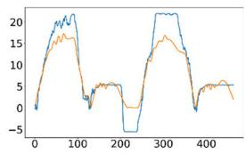

C  
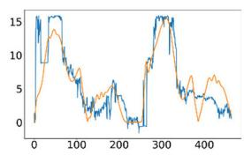

B  
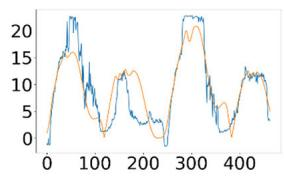

D  
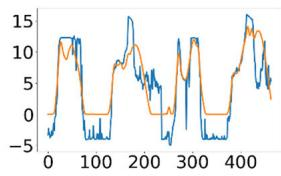

E  
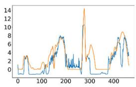

F  
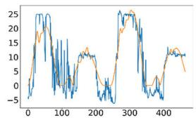

G  
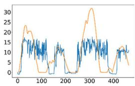  
参与者1在七种实验方案下的感知力矩预测结果。(A) 具有微弱运动能力的被动训练 $( \mathsf { P T } + ) 。$ (B) 完全被动训练 (PT)。(C) 具有较弱运动能力的主动训练 (AT-)。(D) 正常主动训练 (AT)。(E) 具有较强运动能力的主动训练 (AT+)。(F) 具有较弱运动能力的抗阻训练 (RT-)。(G) 抗阻训练 (RT)。

TABLE 2 10位参与者在七种实验方案下的 MAE。

<table><tr><td></td><td>PT</td><td>PT+</td><td>AT-</td><td>AT</td><td>AT+</td><td>RT-</td><td>RT</td><td>Mean</td></tr><tr><td>S1</td><td>0.2378</td><td>0.1997</td><td>0.1706</td><td>0.1750</td><td>0.1571</td><td>0.1850</td><td>0.1782</td><td>0.1862</td></tr><tr><td>S2</td><td>0.1564</td><td>0.1633</td><td>0.1320</td><td>0.1576</td><td>0.0988</td><td>0.2243</td><td>0.3530</td><td>0.1836</td></tr><tr><td>S3</td><td>0.2531</td><td>0.0144</td><td>0.8953</td><td>0.7373</td><td>0.5829</td><td>0.4627</td><td>1.6895</td><td>0.6622</td></tr><tr><td>S4</td><td>0.1566</td><td>0.1411</td><td>0.0980</td><td>0.1268</td><td>0.2625</td><td>0.2113</td><td>0.2534</td><td>0.1785</td></tr><tr><td>S5</td><td>0.0973</td><td>0.1951</td><td>0.1506</td><td>0.1540</td><td>0.0676</td><td>0.2370</td><td>0.2644</td><td>0.1666</td></tr><tr><td>S6</td><td>0.1774</td><td>0.1805</td><td>0.1943</td><td>0.1852</td><td>0.1667</td><td>0.1794</td><td>0.2222</td><td>0.1865</td></tr><tr><td>S7</td><td>0.1829</td><td>0.1833</td><td>0.1703</td><td>0.1039</td><td>0.1141</td><td>0.1934</td><td>0.3962</td><td>0.1920</td></tr><tr><td>S8</td><td>0.1675</td><td>0.1626</td><td>0.1500</td><td>0.1640</td><td>0.1252</td><td>0.2310</td><td>0.2390</td><td>0.1770</td></tr><tr><td>S9</td><td>1.7032</td><td>0.5814</td><td>0.6112</td><td>2.2937</td><td>3.4626</td><td>0.5482</td><td>1.0312</td><td>1.4616</td></tr><tr><td>S10</td><td>0.6558</td><td>0.2473</td><td>0.2733</td><td>0.1505</td><td>0.2739</td><td>1.1969</td><td>0.6691</td><td>0.4953</td></tr><tr><td>MEAN</td><td>0.3788</td><td>0.2069</td><td>0.2846</td><td>0.4248</td><td>0.5311</td><td>0.3669</td><td>0.5296</td><td>0.3890</td></tr></table>

训练。在这一康复阶段中，同样考虑了三种不同类型的方案，即方案1：正常主动训练（AT），方案2：具有较弱运动能力的主动训练（AT-），以及方案3：具有较强运动能力的主动训练（AT+）。参与者被要求模拟三种不同的方案，以验证 AAN 控制器能够在不同方案中确保患者的安全并适应不同的训练需求。设定 $r _ { c } = 0 . 1 0 m , r _ { d } = 0 . 1 2 m , r _ { e } = 0 . 1 4 m 。$

在 Figure 12 中，actual\_AT 表示 AT 方案中的训练轨迹，expected\_AT 表示该方案中的理想轨迹

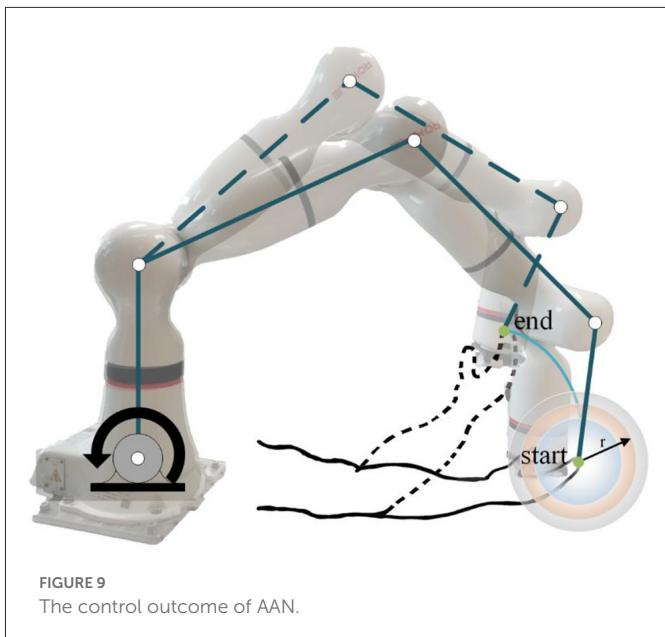

AT、actual\_AT+ 表示方案 AT+ 中的训练轨迹，expected\_AT+ 表示方案 AT+ 中的理想轨迹，actual\_AT- 表示方案 AT- 中的训练轨迹，expected\_AT- 表示方案 AT- 中的理想轨迹。Figure 12 表明，主动训练模式下三种方案的训练轨迹均被限制在各自定义的交互空间内，这验证了所提出的 AAN 控制器能够确保参与者在主动训练模式的三种方案中的训练安全性。Figure 13A 显示，在线实验中三种方案的交互空间半径满足：r $\left( \mathrm { A T - } \right) < \mathrm { r } \left( \mathrm { A T } \right) < \mathrm { r } \left( \mathrm { A T + } \right)$。这是因为随着肌力的逐渐增强，需要给予患者更大的交互空间，从而在保证安全交互的前提下通过提高参与度来提升训练质量。Figure 13B 表明，在主动训练中，患者已恢复了一定的运动能力，需要在训练过程中获得适量的辅助力。因此，在三种方案的在线实验中，速度反馈增益 $k _ { \nu }$ 依次减小，以匹配患者逐渐增强的肌力，从而激发其康复意愿。

## 3.2.3. 抗阻康复训练模式的验证

脑卒中康复后期的患者已基本恢复运动能力，但其上肢肌力仍显不足，因此需要通过抗阻训练来强化肌力。在实验中，参与者被要求沿康复机器人运动方向的反方向进行训练。鉴于抗阻训练对体力的要求较高，训练过程中很容易出现突然乏力和下落的情况。因此，在抗阻训练模式下，也可细分为两种方案，方案1：抗阻训练（RT）和方案2：运动能力较弱的抗阻训练（RT-）。同样，参与者被要求在抗阻训练中模拟这两种方案，以验证 AAN 控制器的正确性和安全性。设置 $r _ { f } ~ =$ 0.06m, $r _ { g } = 0 . 0 8 m$

在 Figure 14 中，actual\_RT 表示 RT 方案中的训练轨迹，expected\_RT 表示 RT 方案中的理想轨迹，actual\_RT- 表示 RT- 方案中的训练轨迹，expected\_RT- 表示 RT- 方案中的理想轨迹。如 Figure 14 所示，在阻抗训练模式下的两种方案在线实验中，实际训练轨迹分别收敛于所定义的交互空间区域内。Figure 15A 展示了阻抗训练模式下在线实验的交互空间调整结果，两种方案均能实现相对稳定的调整。RT- 方案的设计考虑了阻抗训练中力量突降的情况，因此与 RT 方案相比，它需要相对更小的交互空间以确保参与者的安全，实验结果验证了该方案设计的有效性。Figure 15B 中速度反馈增益 $k _ { \nu }$ 的调节也反映了阻抗训练模式下两种方案的不同需求。RT- 方案中的 $k _ { \nu }$ 值通常小于 RT 方案，因为在力量突降或肌肉疲劳的情况下，RT 方案需要更大的速度反馈增益以确保参与者的安全。

## 3.3. AAN 控制中辅助的量化

脑卒中后，强烈建议采用通过机器人和非机器人设备获取的运动学测量指标，以精确量化影响治疗策略选择的上肢感觉运动障碍（Treussart et al., 2020）。在上肢康复训练中，患者在按需辅助（AAN）控制中的参与度与机器人的辅助水平密切相关，这可以从人机交互的角度进行探讨。在人机交互中，辅助水平决定了辅助者提供的支持量（Passenberg et al., 2011），康复训练的这一水平应当被定量描述。尽管机器人本身被认为适合记录位置、速度和关节力矩等运动数据，并通过这些参数在康复过程中实现运动学和动力学的定量可靠测量（Nataliya et al., 2017），但由于机器人的惯性和臂重，测量系统会对执行的运动产生影响（Schwarz et al., 2019）。在本文中，应用基于感知力矩的速度反馈增益 $K _ { \nu }$ 来满足参与度需求，并且应进一步探讨感知力矩是否与量化的辅助水平相关。由于患者在康复过程中接受机器人辅助是一个协作过程，因此辅助水平可以通过一个训练周期内的累积运动感知而非单一力矩来衡量。在本文中，感知力矩由所提出的 LSTM-KF 方法进行估计。康复周期中患者的力矩总和通过求和进行测量。患者的力矩总和被定义为 TPT（总感知力矩，Total Perceived Torques），并表示为公式：

A  
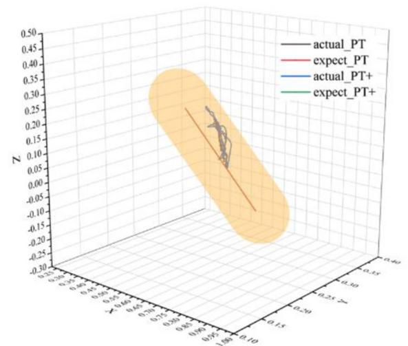

B  
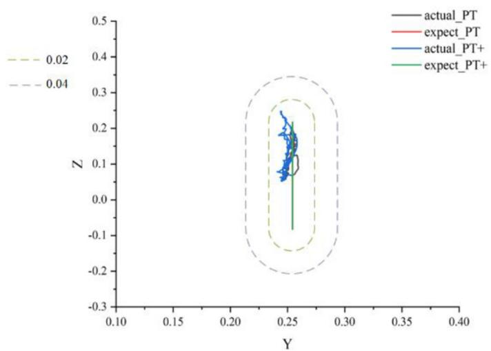

C  
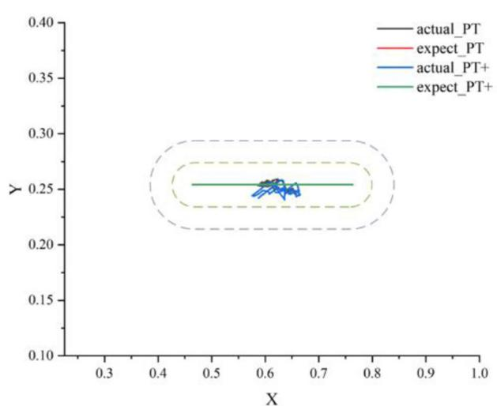

D  
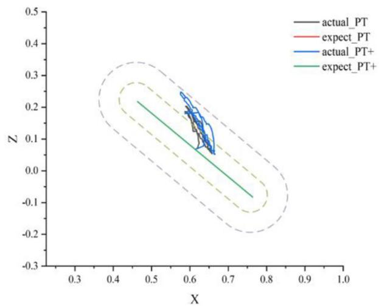  
被动训练模式下的理想运动轨迹与实际训练轨迹：(A) 三维空间视图；(B) YOZ 视图；(C) XOY 视图；(D) XOZ 视图。

$$
T P T = \sum_ {t = 0} ^ {t _ {T}} \left\| T _ {p} \right\|\tag{42}
$$

这里，$t _ { T }$ 为对应离散上肢关节旋转步数的当前时刻，$T _ { p }$ 为感知力矩，k·k 为二范数。通过对离散时间步中感知力矩的估计，8 名受试者的 TPT 计算结果如 Table 3 所示。

从 Table 3 可以看出，对于大多数受试者而言，三种方案中主动训练的 TPT 值最小，而阻抗训练的 TPT 值最大。

考虑到参与者之间的差异，归一化感知力矩均值进一步按公式 (43) 计算。

$$
N M P T = \frac {\frac {1}{N} \sum_ {t = 0} ^ {s _ {T}} \left\| T _ {p} \right\|}{\max _ {P} \left(\frac {1}{N} \sum_ {t = 0} ^ {t _ {T}} \left\| T _ {p} \right\|\right)}\tag{43}
$$

此处，$\textstyle { \frac { 1 } { N } } \sum _ { t = 0 } ^ { s _ { T } } \left\| T _ { P } \right\|$ 是不同方案中交互力矩的平均值，而 $\max _ {P} \textstyle { \frac { 1 } { N } } \sum _ { t = 0 } ^ { t _ { T } } \left\| T _ { P } \right\|$ 是 PT（被动训练）中的最大平均值。利用来自 10 名参与者的 TPT 数据，在 Table 4 中获得了 NMPT。

NMPT 的结果可以根据康复训练阶段和训练节次进行分析。对于被动和主动训练中的肘部屈伸运动，参与者的上肢旋转方向与机器人一致。参与者的肌力越大，感知力矩和 NMPT 值就越小，这代表了更好的参与度和运动能力。在阻抗训练中，NMPT 越大越好，因为患者的运动意图与机器人的运动方向相反，因此参与度和运动能力仍可通过 NMPT 来表达。NMPT 可以被解释为 AAN（按需辅助）控制中的量化辅助水平，并揭示患者的参与度，特别是在患者脑卒中康复过程中针对不稳定状态所细分的康复阶段和训练节次中。在此基础上，根据所有训练节次中的 NMPT 值定义了参与者的辅助水平指标。为了使辅助水平指标可视化，Figure 16 中绘制了 10 名参与者在七种实验方案数据下的 NMPT 值。

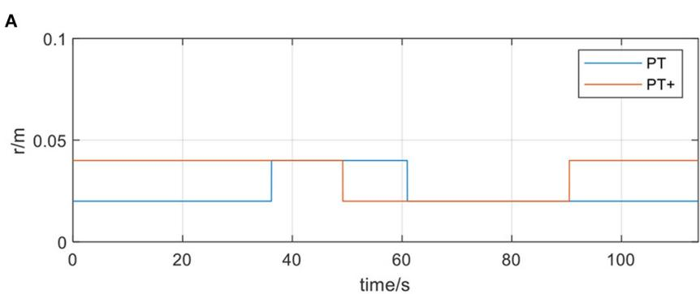

B  
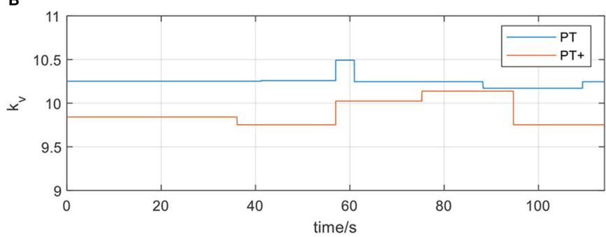  
(A) 被动训练模式下的球形空间半径；(B) 被动训练模式下的速度反馈增益 k

## 4. 讨论

目前的工作侧重于患者在康复训练阶段和环节中的运动能力变化，以及将运动能力的变化映射到这些阶段和环节的方法。其目标是识别患者当前的康复训练阶段和环节，然后根据这些阶段和环节调整机器人的工作空间，以实现安全的 AAN（按需辅助，Assist-As-Needed）控制。在离线实验中，参与者被要求按照 PT、PT+、AT-、AT、AT+、RT-、RT 的顺序进行实验；而在在线实验中，参与者康复环节的切换是不确定的，并且会根据参与者的意图随机改变。在离线阶段，每天招募一到两名参与者进行实验。在获得足够数量的数据后，数据集按 9:1 的比例划分为训练集和测试集，并对分类模型和回归模型进行了训练。共采集了 10 名参与者的离线实验数据，且这 10 名参与者在另一天参加了在线实验。在实际应用初期情况有所不同，因为特定患者的数据难以获取。考虑到这一问题以及个体间的差异，患者在训练开始时跟随机器人运动，并采集了少量的 EMG 数据，因为 SVM 适用于小样本学习 (Khairuddin et al., 2021)。随着康复实验的推进，系统将获取更多患者在不同康复阶段和环节的数据，这些数据可用作特定患者进一步算法模型训练的输入。

在离线实验中，从 Table 1 可以看出，分类模型的平均准确率大多在 95% 以上。有研究提出了一种利用 sEMG 信号和 SVM 的康复机器人 ReRobot 上肢运动模式识别方法，其分类准确率为 94.18% (Cai et al., 2019)，这表明本文针对康复训练的表面肌电数据分类是可行的。它们区分了患者在每个阶段的运动能力，以便根据康复进展为康复机器人提供相应的控制策略，从而达到人机交互中 AAN 的目的。在在线实验中，Figure 6 显示三个训练阶段的准确率分别达到了 73.47%、61.61% 和 68.07%，Figure 7 显示最高 Kappa 系数分别为 0.4740、0.3701 和 0.3553。这些多分类结果的准确率优于在线应用中通常的 55–70% (Zhang et al., 2018)，表明所提出的康复系统能够实时区分不同康复阶段的训练环节，并根据患者的运动能力对康复机器人进行调整。

A  
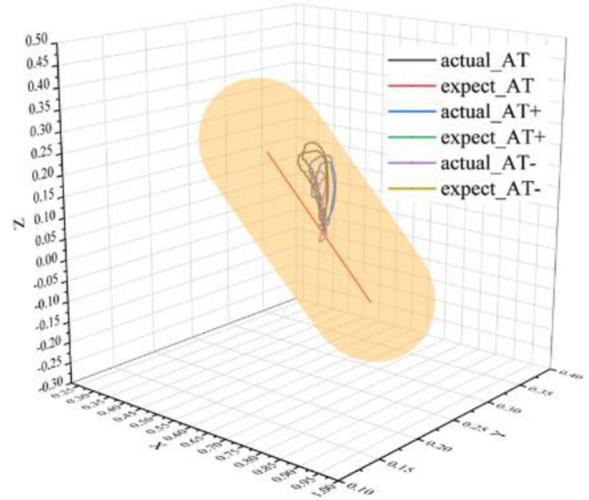

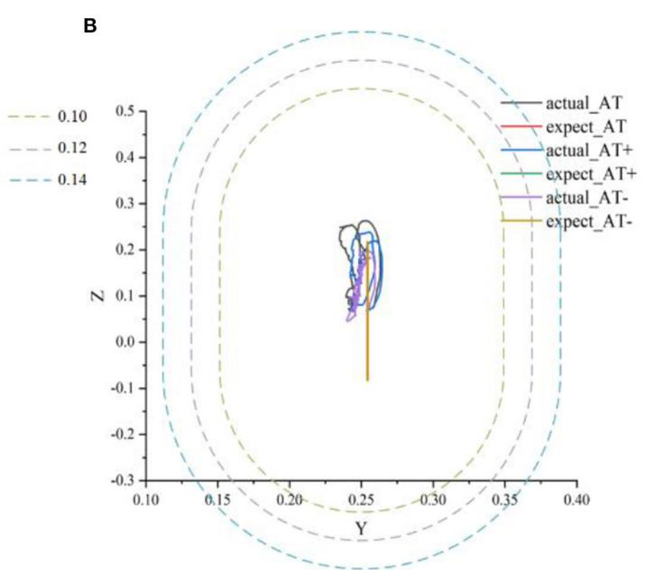

C  
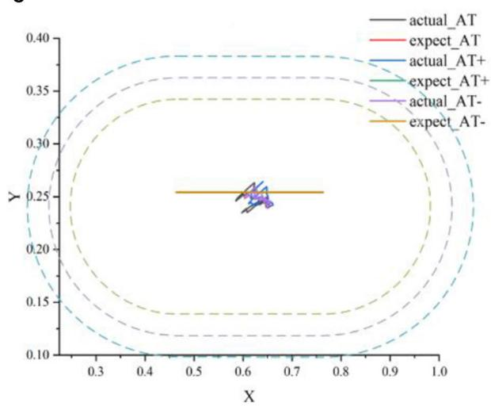

D  
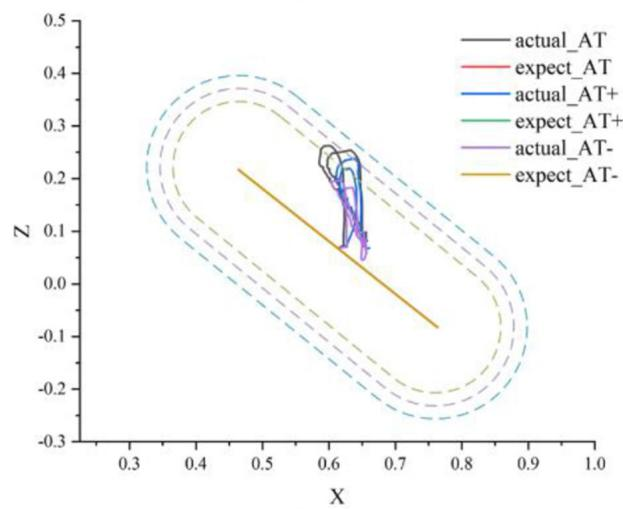  
主动训练模式下的理想运动轨迹与实际训练轨迹：(A) 三维空间视图；(B) YOZ 视图；(C) XOY 视图；(D) XOZ 视图。

从 Figure 8 所示的回归模型结果可以看出，该回归模型在完全被动训练（PT）以及伴有微弱运动能力的被动训练（PT+）范式中表现尤为出色，具有显著的准确性和跟踪性能。这是因为参与者在该方案下的运动能力相对稳定且可预测。$\mathrm { B y }$ 相比之下，该模型在抗阻训练（RT）方案中的表现略显不足，突发的变化趋势有时未能得到很好的预测，并且还可以观察到一定的延迟，这是因为在该方案中，参与者的肌力可能会因持续负荷而突然下降，从而导致突发性的下降过程，且突发变化出现在患者的 sEMG 数据中，噪声也变得明显。这种下降通常发生在短时间内，因此其预测准确性相对较低。同时，为了验证回归模型的准确性，接下来对 MAE 结果进行了讨论。在 Table 2 中，除参与者 3 和参与者 9 外，其余参与者在七种实验方案下的 MAE 值均 <0.5，这表明所提出的回归模型具有较低的预测误差，并且在交互力矩的估计中具有充分的性能 (Kingma and Ba, 2014)。同时，通过纵向对比可以发现，PT、AT 和 RT- 的 MAE 值最低，反映出这三种实验方案的回归模型具有更好的拟合能力。总体而言，MAE 的总平均值为 0.3890，证明了 LSTM-KF 方法在实时估计参与者感知力矩方面具有较好的性能，为在线调整控制参数以及量化助力水平以用于进一步的临床应用提供了可能。此外，能够泛化到新受试者的预测模型将是有帮助的 (Gerig et al., 2017)。针对事先没有新患者 sEMG 数据的情况，进一步尝试了交叉验证，即每次利用 9 名参与者的数据训练分类模型，留出 1 名用于验证分类模型性能。该方法用于交叉验证全部 10 名参与者在三个训练阶段的数据，分类准确率如 Table 5 所示。可以看出，大多数分类准确率值均低于针对每位参与者单独训练的个体模型，且训练的通用模型在三个训练阶段的所有平均分类准确率值均小于训练的个体模型。然而，在实验初期，使用通用模型对新参与者的数据进行分类是一种可行的替代方法。随着康复训练的继续，将获得参与者在各个康复阶段和训练周期中充足的 sEMG 数据，这些数据可用作针对特定患者训练个体分类模型的输入，从而提高模型的准确性和效率。

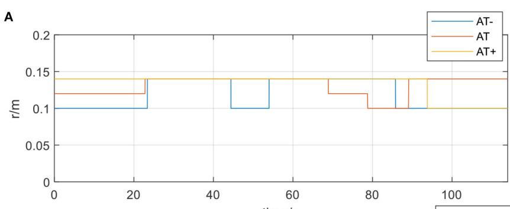

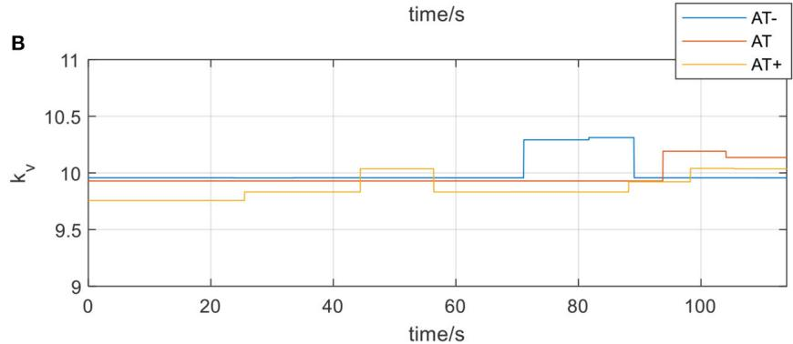  
(A) 主动训练模式下球形空间的半径；(B) 主动训练模式下的速度反馈增益 $k$。

辅助水平指标反映了患者的运动能力和康复疗程。为了证明本实验中的康复训练是否合理，对辅助水平指标进行了分析。从 Figure 16 中可以明显看出，在三种方案中，大多数受试者在主动训练中的辅助水平均相对较小，而在被动训练中则较大，且 PT 疗程与 PT+ 疗程的辅助水平接近，指标在 1.0 左右，这代表了患者需求相对于训练疗程基线的变化。在被动和主动训练中，上肢完成与机器人运动一致的旋转。辅助水平指标越小，说明参与度和运动能力越好。在抗阻训练中，受试者应在旋转过程中尝试以相反的运动意图来抵抗机器人。因此，它成为一种用于增强运动能力的辅助形式，其水平并不一定高于被动和主动训练，通常应用于脑卒中康复的后期。与被动和主动训练不同，在抗阻训练中，辅助水平指标随着运动能力的提高而增大。为了防止上肢向反方向突然下落，机器人的辅助力矩值被设置在相对安全的范围内，这导致部分辅助水平指标小于 1.0。在实际康复训练中，运动能力并不总是如 Figure 16 所示随着疗程从 PT- 依次改变至 RT，但该指标值仍然能够反映患者在属于被动、主动或抗阻训练阶段的训练疗程中辅助需求的变化。

还可以发现，两个被动训练疗程在总体趋势上大多差异很小，这是因为患者在康复早期阶段状态不稳定且缺乏足够的肌力；而在主动训练阶段的三个疗程中，随着患者在康复过程中肌力的增强，辅助水平呈现出下降趋势。

A  
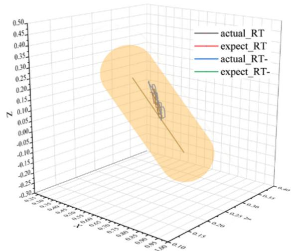

B  
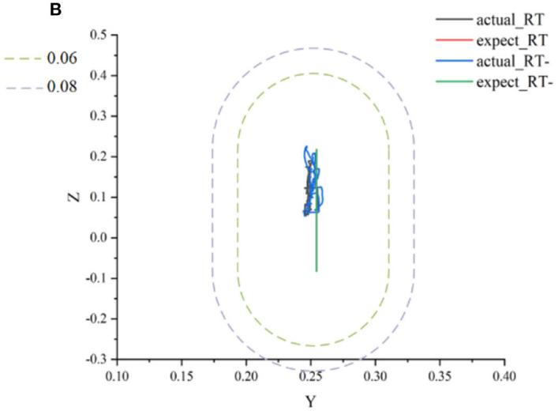

C  
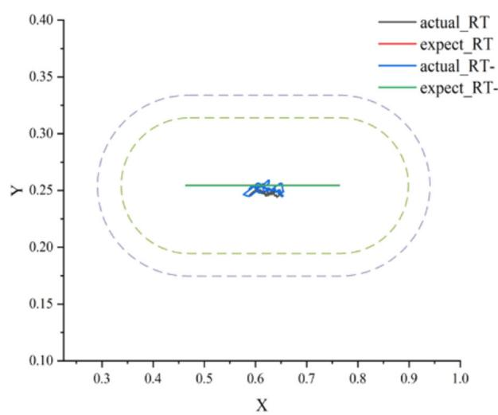

D  
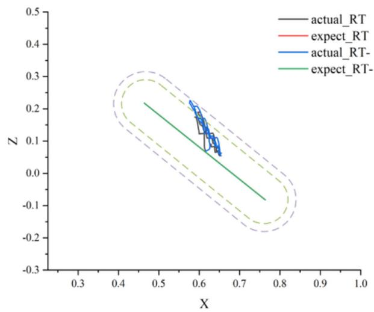  
阻抗训练模式下的理想运动轨迹与实际训练轨迹：(A) 三维空间图；(B) YOZ 视图；(C) XOY 视图；(D) XOZ 视图。

参与者 S4 是主动训练阶段的一个特例。AT+ 中异常的辅助水平指标值是由 AT 中的肌肉疲劳引起的。由于力量下降，运动能力无法达到 AT+ 的预期范围，甚至低于 AT 的水平。在两个阻抗环节中，RT 环节的值大于 RT- 环节，这代表了康复效果的巩固。辅助水平的量化按训练阶段和环节表征了患者的参与需求，用于安全地重塑人机交互空间，促进上肢康复机器人的临床应用。如果要将结果提供给治疗师以进行具有医学意义的运动能力分析（Murphy 和 Hger，2015），则应在处于不同中风康复阶段的更多参与者中深入研究各康复状态下该指标的详细范围。

## 5. 结论

本研究聚焦于面向中风患者被动、主动和反应性训练全阶段的上肢康复。通过设计的实验方案，从康复进展的角度对训练环节进行分级，并根据细分的运动能力采集 sEMG（表面肌电）数据。为实现 AAN 控制，PSO-SVM 分类器的输出通过球形虚拟边界重塑交互空间，LSTM-KF 模型预测感知力矩以提供增益调整。通过这种方式，区域控制器在每个训练环节中确保了康复的安全性。从人机交互的角度来看，通过分析 10 组实验的结果，量化的辅助水平表征了 AAN 控制中患者的需求。

FIGURE 16  
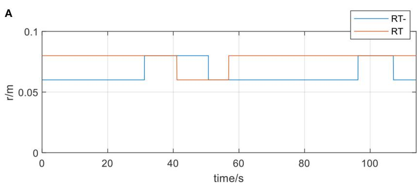

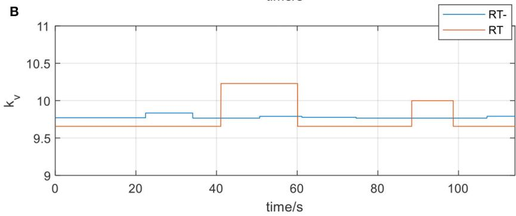  
(A) 阻抗训练模式下球形空间的半径；(B) 阻抗训练模式下的速度反馈增益 $k _ { v }$。

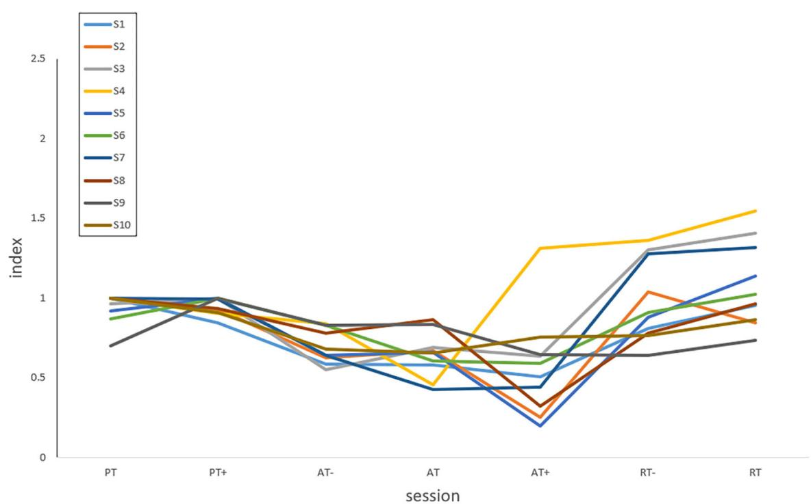  
10 位参与者在七种实验方案下的辅助水平指标。

TABLE 3 10 位参与者在七种实验方案下的总感知力矩值。

<table><tr><td></td><td>PT</td><td>PT+</td><td>AT-</td><td>AT</td><td>AT+</td><td>RT-</td><td>RT</td></tr><tr><td>S1</td><td>5400.55</td><td>4555.31</td><td>3159.53</td><td>3135.66</td><td>2733.77</td><td>4386.09</td><td>5152.81</td></tr><tr><td>S2</td><td>4630.22</td><td>4311.25</td><td>2886.18</td><td>3093.00</td><td>1176.41</td><td>4813.02</td><td>3905.10</td></tr><tr><td>S3</td><td>4088.47</td><td>4265.15</td><td>2376.27</td><td>2895.42</td><td>2702.52</td><td>5469.25</td><td>5942.42</td></tr><tr><td>S4</td><td>3826.01</td><td>3409.05</td><td>3201.36</td><td>1762.58</td><td>4982.95</td><td>5036.48</td><td>5907.66</td></tr><tr><td>S5</td><td>3734.77</td><td>4127.71</td><td>2587.66</td><td>2698.64</td><td>816.17</td><td>3546.80</td><td>4762.83</td></tr><tr><td>S6</td><td>3920.90</td><td>4446.01</td><td>3706.18</td><td>2683.19</td><td>2548.39</td><td>4237.62</td><td>4719.10</td></tr><tr><td>S7</td><td>3816.12</td><td>5903.69</td><td>2521.68</td><td>1718.20</td><td>1739.73</td><td>5019.03</td><td>5177.91</td></tr><tr><td>S8</td><td>4205.00</td><td>3929.18</td><td>3233.89</td><td>3640.02</td><td>2608.22</td><td>3283.41</td><td>4060.02</td></tr><tr><td>S9</td><td>3644.98</td><td>5335.62</td><td>4403.53</td><td>4208.14</td><td>3428.40</td><td>3418.65</td><td>3897.73</td></tr><tr><td>S10</td><td>5358.99</td><td>5041.23</td><td>3573.60</td><td>3504.55</td><td>4080.19</td><td>4034.72</td><td>4623.92</td></tr></table>

TABLE 4 10 名受试者在七种实验方案下的归一化平均感知力矩值。

<table><tr><td></td><td>PT</td><td>PT+</td><td>AT-</td><td>AT</td><td>AT+</td><td>RT-</td><td>RT</td></tr><tr><td>S1</td><td>1.00</td><td>0.84</td><td>0.59</td><td>0.58</td><td>0.51</td><td>0.81</td><td>0.95</td></tr><tr><td>S2</td><td>1.00</td><td>0.93</td><td>0.62</td><td>0.67</td><td>0.25</td><td>1.04</td><td>0.84</td></tr><tr><td>S3</td><td>0.96</td><td>1.00</td><td>0.55</td><td>0.69</td><td>0.64</td><td>1.30</td><td>1.41</td></tr><tr><td>S4</td><td>1.00</td><td>0.90</td><td>0.84</td><td>0.46</td><td>1.31</td><td>1.36</td><td>1.55</td></tr><tr><td>S5</td><td>0.92</td><td>1.00</td><td>0.64</td><td>0.66</td><td>0.20</td><td>0.88</td><td>1.14</td></tr><tr><td>S6</td><td>0.87</td><td>1.00</td><td>0.83</td><td>0.61</td><td>0.59</td><td>0.91</td><td>1.02</td></tr><tr><td>S7</td><td>1.00</td><td>0.99</td><td>0.64</td><td>0.43</td><td>0.44</td><td>1.27</td><td>1.32</td></tr><tr><td>S8</td><td>1.00</td><td>0.93</td><td>0.78</td><td>0.87</td><td>0.32</td><td>0.78</td><td>0.97</td></tr><tr><td>S9</td><td>0.70</td><td>1.00</td><td>0.83</td><td>0.83</td><td>0.64</td><td>0.64</td><td>0.74</td></tr><tr><td>S10</td><td>1.00</td><td>0.91</td><td>0.68</td><td>0.66</td><td>0.75</td><td>0.76</td><td>0.87</td></tr></table>

TABLE 5 10 名受试者在三个训练阶段中不同模型的分类准确率。

<table><tr><td rowspan="2"></td><td colspan="2">被动</td><td colspan="2">主动</td><td colspan="2">抗阻</td></tr><tr><td>个体模型</td><td>通用模型</td><td>个体模型</td><td>通用模型</td><td>个体模型</td><td>通用模型</td></tr><tr><td>S1</td><td>73.47%</td><td>57.33%</td><td>52.50%</td><td>40.36%</td><td>60.94%</td><td>57.03%</td></tr><tr><td>S2</td><td>59.73%</td><td>62.69%</td><td>57.81%</td><td>46.91%</td><td>62.89%</td><td>73.39%</td></tr><tr><td>S3</td><td>58.50%</td><td>50.45%</td><td>52.70%</td><td>39.26%</td><td>54.90%</td><td>56.86%</td></tr><tr><td>S4</td><td>67.42%</td><td>50.68%</td><td>54.33%</td><td>49.61%</td><td>64.38%</td><td>65.75%</td></tr><tr><td>S5</td><td>64.20%</td><td>61.73%</td><td>61.59%</td><td>52.52%</td><td>59.78%</td><td>57.14%</td></tr><tr><td>S6</td><td>63.81%</td><td>64.76%</td><td>61.61%</td><td>45.11%</td><td>67.44%</td><td>52.81%</td></tr><tr><td>S7</td><td>65.81%</td><td>64.10%</td><td>51.35%</td><td>58.61%</td><td>54.64%</td><td>53.28%</td></tr><tr><td>S8</td><td>55.10%</td><td>59.63%</td><td>58.27%</td><td>58.48%</td><td>66.30%</td><td>64.65%</td></tr><tr><td>S9</td><td>61.63%</td><td>56.98%</td><td>57.89%</td><td>50.32%</td><td>56.44%</td><td>59.41%</td></tr><tr><td>S10</td><td>69.77%</td><td>53.49%</td><td>52.35%</td><td>44.62%</td><td>68.07%</td><td>56.25%</td></tr><tr><td>平均值</td><td>63.94%</td><td>58.18%</td><td>56.04%</td><td>48.58%</td><td>61.58%</td><td>59.66%</td></tr></table>

在本研究中，仅在参与者的上肢贴附了两个 sEMG（表面肌电）电极。sEMG 数据分类结果作为 AAN（按需辅助）控制的输入，主要旨在通过识别康复状态来验证人机交互空间重塑的可行性。在未来的工作中，将在上肢布置更多的 sEMG 电极，借助更完整的肌肉激活数据有望提升分类算法的性能。此外，将招募处于不同康复阶段的卒中患者而非健康参与者参与基于所提出交互空间重塑方法的训练，并对系统的实时性能进行评估。通过充分考虑患者的参与度，该方法在具有量化辅助水平的临床上肢康复训练中将具有更大的应用潜力。

## 数据可用性声明

支持本文结论的原始数据将由作者毫无保留地提供。

## 伦理声明

涉及人类参与者的研究已通过四川大学华西医院伦理委员会的审查并获得批准。患者/参与者提供了参与本研究的书面知情同意书。

## 作者贡献

XL 和 PC 撰写了手稿。HH 分析了临床问题。QL 和 SG 实现了 AAN 控制和机器学习方法。XY 提供了实验方案设计的建议。PC 和 KL 致力于辅助水平的量化工作。所有作者都对本文做出了贡献，并批准了提交的版本。

## 参考文献

Basalp, E., Wolf, P., and Marchal-Crespo, L. (2021). Haptic training: which types facilitate (re)learning of which motor task and for whom? Answers by a review. IEEE Trans, Haptics 14, 722–739. doi: 10.1109/TOH.2021.3104518

Benjamin, E. J., Blaha, M. J., Chiuve, S. E., Cushman, M., Das, S. R., Deo, R., et al. (2017). Heart disease and stroke statistics−2017 update: a report from the american heart association, Circulation 135, e146-e603, doi: 10.1161/CIR.0000000000000485

Berning, J., Francisco, G. E., Chang, S. H., Fregly, B. J., and O’Malley, M. K. (2021). Myoelectric control and neuromusculoskeletal modeling: complementary technologies for rehabilitation robotics. Curr. Opinion Biomed. Eng. 19, 100313 doi: 10.1016/i.cobme,2021.100313

Bohannon, R. W., and Smith, M. B. (1987). Interrater reliability of a modified ashworth scale of muscle spasticity. Phys. Ther. 67, 206–207. doi: 10.1093/ptj/67.2.206

Brokaw, E. B., Nichols, D., Holley, R. J., and Lum, P. S. (2014). Robotic therapy provides a stimulus for upper limb motor recovery after stroke that is complementar to and distinct from conventional therapy. Neurorehab. Neural Repair 28, 367–376. doi: 10.1177/1545968313510974

Brunnstrm, H. R., and Englund, E. M. (2010). Cause of death in patients with dementia disorders. Eur. J. Neurol. 16, 488–492. doi: 10.1111/i.1468-1331.2008.02503.x

Brunnstrom, M., Gustafson, H., Passant, L. U., and Englund, E. (2009). Prevalence of dementia subtypes: a 30-year retrospective survey of neuropathological reports. Arch. Gerontol. Geriatr. 49, 146–149. doi: 10.1016/j.archger.2008.06.005

Cai, S. Q., Chen, Y., Huang, S. Y., Wu, Y., Zheng, H. Q., Li, X., et al. (2019). SVM based classification of sEMG signals for upper-limb self-rehabilitation training. Front 13, 31. doi: 10.3389/fnbot.2019.00031

## 资助

本研究得到了国家自然科学基金（National Natural Science Foundation of China，项目编号：62103291）、四川省科技计划（Sichuan Science and Technology Program，项目编号：2022YFH0073、2022YFS0021、2023ZHCG0075 和 2023GJHZ0108）以及四川大学华西医院“1·3·5”卓越学科项目（项目编号：ZYYC21004 和 ZYJC21081）的资助。本文所陈述的所有调查结果和成果均代表作者个人观点，并不代表资助机构的立场。

## 致谢

我们感谢所有参与本项研究的志愿者。

## 利益冲突

作者声明，本研究是在不存在任何可能被解释为潜在利益冲突的商业或财务关系的情况下开展的。

## 出版商声明

本文中所表达的所有主张仅代表作者个人观点，并不一定代表其附属机构，或出版商、编辑及审稿人的观点。本文中可能评估的任何产品，或其制造商可能提出的任何声明，均未得到出版商的保证或认可。

Gerig, N., Wolf, P., Sigrist, R., Riener, R., and Rauter, G. (2017). Automated feedback selection for robot-assisted training. Nephron Clin. Practice 16, 149–174. doi: 10.1515/jicss-2017-0012

Gref, K., Srivastava, R. K., Jan, K., Steunebrink, B. R., and Jürgen, S. (2017). LSTM: a search space Odyssey. IEEE Trans. Neural Networks Learning Syst. 28, 2222–2232. doi: 10.1109/TNNLS.2016,2582924

Hussain, S., Jamwal, P. K., Ghayesh, M. H., and Xie, S. Q. (2017). Assist-as-needed control of an intrinsically compliant robotic gait training orthosis. IEEE Trans. Ind Electr. 64, 1675–1685. doi: 10.1109/TIE.2016.2580123

Kapsalyamov, A., Hussain, S., Sharipov, A., and Jamwal, P. (2019). Brain–computer interface and assist-as-needed model for upper limb robotic arm. Adv. Mech. Eng. 11, 1687814019875537. doi: 10.1177/1687814019875537

Keller, U., Rauter, G., and Riener, R. (2013). Assist-as-needed path control for the PASCAL rehabilitation robot. IEEE Int. Conf. Rehab. Robotics 2013, 6650475 doi: 10.1109/ICORR.2013.6650475

Khairuddin, I. M., Sidek, S. N., Majeed, A. P. P. A., Razman, M. A. M., Puzi, A. A., and Yusof, H. M. (2021). The classification of movement intention through machine learning models: the identification of significant time-domain EMG features. Peerj Comp. Sci. 7, e379. doi: 10.7717/peerj-cs.379

Kingma, D. P., and Ba, J. (2014). Adam: a method for stochastic optimization, in International Conference on Learning Representations. Ithaca, NY.

Li, H., Yu, L., Ye, D. Y., Chang, L., Zhao, F. Z., Wang, H., et al. (2021). Rehabilitation training combined with jiaji electroacupuncture can promote the recovery of muscle group function and improve the quality of life in patients with

upper limb peripheral nerve injury. J. Healthcare Eng. 2021, 568. doi: 10.1155/2021/ 3621568

Li, L., Hu, C. P., Kenry, W. C., and Raymond, K. Y. (2022). Immediate efects of functional electrical stimulation-assisted cycling on the paretic muscles ofpatients with hemiparesis after stroke: evidence from electrical impedance myography. Front. Aging Neurosci. 14, 880221. doi: 10.3389/fnagi.2022.880221

Liu, C., Liang, H. B., Murata, Y., Li, P. R., Ueda, N., Matsuzawa, R., and Zhu, C. (2021). A wearable lightweight exoskeleton with full degrees of freedom for upper-limb power assistance. Adv. Robotics 35, 413–424. doi: 10.1080/01691864.2020. 1854115

Lo, H. S., and Xie, S. Q. (2012). Exoskeleton robots for upper-limb rehabilitation: state of the art and future prospects. Med. Eng. Physics 34, 261–268. doi: 10.1016/j.medengphy.2011.10.004

Malouin, F., Pichard, L., Bonneau, C., Durand, A., and Corriveau, D. (1994) Evaluating motor recovery early after stroke: comparison of the fugl-meyer assessment and the motor assessment scale. Arch. Phys. Med. Rehab. 75, 1206–1212. doi: 10.1016/0003-9993(94)90006-X

Mark, V. W., Taub, E., and Morris, D. M. (2006). Neuroplasticity and constraint induced movement therapy. Europa Med. 42, 269–284.

Mehrholz, J., Wagner, K., Meissner, D., Grundmann, K., Zange, C., Koch, R., et al (2005). Reliability of the modified tardieu scale and the modified ashworth scale in adult patients with severe brain injury: a comparison study. Clin. Rehab. 19, 751–759. doi: 10.1191/0269215505cr889oa

Murphy, M. A., and Hger, C. K. (2015). Kinematic analysis of the upper extremity after stroke – how far have we reached and what have we grasped? Physical Ther. Rev. 20, 137-155. doi: 10.1179/1743288X15Y.0000000002

Nasr, A., Bell, S., He, J. Y., Whittaker, R, L., Jiang, N., Dickerson, C. R., et al. (2021). MuscleNET: mapping electromyography to kinematic and dynamic biomechanical variables by machine learning. J. Neural Eng. 18. doi: 10.1101/2021.07.07.451532

Nataliya, S., Itshak, M., and Simona, B. H. (2017). Parameters and measures in assessment of motor learning in neurorehabilitation; a systematic review of the literature. Front. Hum. Neurosci. 11, 82. doi: 10.3389/fnhum.2017.00082

Nordin, N., Xie, S. Q., and Wuensche, B. (2014). Assessment of movement quality in robot-assisted upper limb rehabilitation after stroke: a review. J. NeuroEng. Rehab. 11, 137. doi: 10.1186/1743-0003-11-137

Passenberg, C., Groten, R., Peer, A., and Buss, M. (2011). Towards Real-Time Haptic Assistance Adaptation Optimizing Task Performance and Human Efort. IEEE World Haptics Conference. Piscataway, NJ: IEEE.

Proietti, T., Jarrasse, N., Roby-Brami, A., and Morel, G. (2015). Adaptive Control ot a Robotic Exoskeletonfor Neurorehabilitation. International IEEE/EMBS Conference on Neural Engineering. Piscataway, NJ: IEEE.

Proietti, T., Morel, G., Roby-Brami, A., and Jarrasse, N. (2017). “Comparison of diferent error signals driving the adaptation in assist-as-needed controllers for neurorehabilitation with an upper-limb robotic exoskeleton,” in 2017 IEEE International Conference on Robotics and Automation (ICRA). Piscataway, NJ: IEEE.

Qian, Z. Q., Lv, D. Y., Lv, Y. B., and Zhu, M. (2019). Modeling and Quantification of Impact of Psychological Factors on Rehabilitation of Stroke Patients. IEEE J. Biomed Health Inf. 23, 683–692. doi: 10.1109/JBHI.2018.2827100

Schwarz, A., Kanzler, C. M., Lambercy, O., Luft, A. R., and Veerbeek, J. M. (2019). Systematic review on kinematic assessments of upper limb movements after stroke. Stroke. 50, 718–727. doi: 10.1161/STROKEAHA.118.023531

Simo, M., Neto, P., and Gibaru, O. (2019). EMG-based online classification of gestures with recurrent neural networks. Pattern Recognit. Lett. 128, 45–51. doi: 10.1016/j.patrec.2019.07.021

Tran, V. D., Dario, P., and Mazzoleni, S. (2018). 中风后上肢机器人辅助治疗的运动学测量指标及其与临床疗效指标的相关性：综述. Med. Eng. Phys. 53, 5. doi: 10.1016/j.medengphy.2017.12.005

Treussart, B., Gefard, F., Vignais, N., and Marin, F. (2020). “在携带未知负载时通过 EMG 信号控制上肢外骨骼，” 载于 2020 IEEE International Conference on Robotics and Automation (ICRA). Piscataway, NJ: IEEE

Tsuji, T., Ota, T., Kimura, A., Chino, N., and Ishigami, S. (2002). 改良 Ashworth 量表（MAS）评定脑卒中患者痉挛状态的评分者间信度研究. Jap. Assoc. Rehab. Med. 39, 409–415. doi: 10.2490/jjrm1963.39.409

Wang, W. D., Zhang, J. B., Kong, D. Z., Su, S. B., and Yuan, X. Q. (2022). 基于混合感知模型的上肢外骨骼控制方法研究. Robotica 40, 3669–3685. doi: 10.1017/S0263574722000480

Wen, Y. S., Jennie Gao, X. H., and Stephanie Huang, H. (2017). 基于自适应动态规划的新型动力下肢假肢控制框架. IEEE Trans. Neural Networks Learning Syst. 28, 2215–2220. doi: 10.1109/TNNLS.2016.2584559

Wolbrecht, E. T., Chan, V., Reinkensmever, D. J., and Bobrow, J. E. (2008). 优化基于模型的顺应性机器人辅助以促进神经康复. IEEE Trans. Neural Syst. Rehab. Eng. 16, 286–297. doi: 10.1109/TNSRE.2008.918389

Yang, Z. Y., Guo, S. X., Liu, Y., and Hirata, H. (2021). 一种用于上肢运动康复的基于意图的在线双侧训练系统. Microsystem Technol. Nanosyst. Inf. Storage Proc. Syst. 27, 211–222. doi: 10.1007/s00542-020-04939-x

Zhang, A., Gao, N., Wang, L., and Li, Q. (2018). “分类器窗口长度和通道数量对用于上肢运动分类的 EMG 模式识别的综合影响，” 载于 2018 11th International Congress on Image and Signal Processing, BioMedical Engineering and Informatics (CISP-BMEI). Piscataway, NJ: IEEE.

Zhang, J. J., and Cheah, C. C. (2015). 上肢康复机器人人机交互控制的无源性与稳定性. IEEE Trans. Robotics 31, 233–245. doi: 10.1109/TRO.2015.2392451

Zhang, L. G., Guo, S., and Sun, Q. (2020). 用于上肢被动、助力、主动和阻抗机器人辅助康复训练的按需辅助控制器. Appl. Sci.. 11, 340. doi: 10.3390/app11010340

Zhuang, Y., Leng, Y., Zhou, J., Song, R., Li, L. S., Steven, W., et al. (2021). 健全人与中风幸存者基于 EMG 导纳控制方案对踝关节外骨骼的自主控制. IEEE Trans. Biomed. Eng. 68, 695–705. doi: 10.1109/TBME.2020.3012296