文章

# 基于模型预测控制的按需辅助策略用于减少机器人辅助康复中的运动懈怠

Choonggun Kim 1 , Youngjin Moon 2 and Jaesoon Choi 2,\*

1 韩国首尔西江大学机械工程系（Department of Mechanical Engineering, Sogang University, Seoul 04107, Republic of Korea）; kcg1755@sogang.ac.kr

2 韩国首尔蔚山大学医学院首尔峨山医院生物医学工程系（Department of Biomedical Engineering, Asan Medical Center, University of Ulsan College of Medicine, Seoul 05505, Republic of Korea）; jacobian@amc.seoul.kr

通讯作者：fides@amc.seoul.kr;

## 摘要

本研究提出了一种基于模型预测控制（Model Predictive Control, MPC）的上肢康复机器人按需辅助（Assist-as-Needed, AAN）策略，特别侧重于缓解运动懈怠（motor slacking）。在传统的基于误差的 AAN 方法中，机器人辅助是通过与跟踪误差绑定的单一系数来调节的；因此，主动用力的减少会被辅助通道吸收，并被较小的跟踪误差所掩盖。所提出的方法通过引入双通道导纳结构解耦了该机制，其中机器人辅助增益 $A _ { k }$ 和用户参与度反映增益 $B _ { k }$ 在单一凸 MPC 表述中进行联合优化。代价函数考虑了轨迹跟踪、参与度感知力对齐、辅助抑制以及通过能量罐（energy-tank）约束强制实现的无源性。该控制器在移动式上肢康复机器人上进行了两项实验验证。第一个实验确认了在三种指定贡献水平下 $A _ { k }$ 和 $B _ { k }$ 的差异化自适应，随着贡献从不足转变为适当，参与比例从 0.103 增加到 0.879。第二个实验在诱发运动懈怠的条件下（任务方向贡献降至 45%），将该控制器与基于误差的 AAN 基线和遗忘因子 AAN 基线进行了对比。在相同的综合输入下，所提出的控制器产生的人体总体贡献比例较低，为 0.282，而两个基线分别为 0.595 和 0.535。这表明外部施加的参与度减少在控制器分配中得到了更明确的体现，而不是被误差驱动的辅助补偿所掩盖。这些结果表明，所提出的方法将 AAN 控制拓展为一种保持参与度、抗懈怠的机器人辅助康复策略。

## Check for updates

学术编辑：Vidas Raudonis, Arunas Lipnickas and Ligita Šiline˙

接收日期：2026年3月30日 修订日期：2026年4月23日 接受日期：2026年4月25日 发表日期：2026年4月28日

版权所有：© 2026 作者所有。许可方 MDPI，瑞士巴塞尔。本文是一篇依据知识共享署名（Creative Commons Attribution, CC BY）许可条款和条件分发的开放获取文章。

关键词：按需辅助（Assist-as-Needed）；模型预测控制（Model Predictive Control）；上肢康复机器人；运动懈怠（motor slacking）；人机交互；导纳控制

## 1. 引言

神经损伤（包括中风、创伤性脑损伤和脊髓损伤）显著损害患者的日常生活活动能力并降低其自主生活能力，这凸显了早期、重复性、任务导向型运动训练的必要性 [1,2]。传统的徒手康复受到对治疗师依赖性高、体力消耗大以及训练强度不一致的限制 [3]。机器人辅助康复通过出色的重复性、再现性以及进行高强度、可量化训练的能力克服了这些局限 [4]。此后，研究已逐步转向自适应系统，该类系统能够根据患者的具体表现量身定制辅助，同时实现对参与度和康复效果的定量评估 [5,6]。

现存的上肢康复机器人控制策略主要分为两类。第一类涵盖位置跟踪、阻抗控制和导纳控制，可确保预定义参考轨迹的稳定执行 [7,8]，提供安全、可预测的运动以及有保障的任务完成度，尤其适用于重度损伤患者。第二类是按需辅助（Assist-as-Needed, AAN）范式，它根据患者的残余运动能力和瞬时任务表现来调节机器人辅助 [9,10]。AAN 在患者能够独立运动时保留其自主控制，仅在运动表现低于可接受水平时才提供辅助，从而促进患者的主动参与。近期的 AAN 架构主要依据三种信息来源来确定辅助量：任务表现误差、生理或行为信号以及人机交互力 [5,11,12]。

尽管取得了这些进展，但两种范式在结构上仍容易引发运动懈怠（motor slacking）。基于跟踪的控制专注于复现期望运动，而不考虑患者的主动贡献，因此极易导致患者对机器人系统产生被动依赖 [7,13]。尽管 AAN 旨在减少不必要的辅助，但许多现有设计仍将任务完成和轨迹误差最小化置于优先地位 [9]：较大的跟踪偏差会引发更强的回复力或更高的辅助刚度，从而有效抑制可观测误差；然而，完成任务的最终责任仍由机器人承担。因此，自主参与度降低的结构性倾向在架构层面上并未得到解决。

近期研究已将基于优化的公式构建或参与度感知（participation-aware）指标融入按需辅助（assist-as-needed, AAN）设计中。在模型预测控制（MPC）方面，文献 [14] 针对机器人辅助康复提出了一种最优阻抗 MPC 方案，文献 [15] 将基于 Laguerre 的预测控制器应用于穿戴式上肢康复机器人。在参与度感知 AAN 方面，一种迭代框架通过跨多次试验的交互因子来调节辅助力 [16]；健侧肢体运动已被用于估计所需的辅助力 [12]；此外，实时自适应控制器已基于任务表现误差和多模态用户响应来调制辅助力 [5,6]。这些研究推动了基于优化和参与度感知的康复控制发展，但它们存在一个共同的结构性局限：机器人辅助力作为单一通道进行调节，直接或间接地与跟踪误差或外部估计的用力代理指标相耦合。因此，主动用力的减少被辅助通道所吸收，在跟踪误差很小的情况下仅仅表现为机器人辅助力的增加，而未能在控制器层面作为独立变量进行表征。

本研究从控制结构的角度重新审视了运动懈怠（motor slacking）。运动懈怠不仅被视为过度辅助的后果，更被解释为一种适应性现象，即患者在重复交互中逐渐认识到机器人将确保任务完成，从而减少了主动用力 [13,17]。为了将该概念具体化并应用于控制器设计，主动用力由用户交互力在任务方向上的投影 $\mathbf { t } _ { k } ^ { \top } \mathbf { F } _ { \mathrm { i n t e r } , k } ,$ 来近似，其中 $\mathbf { t } _ { k }$ 为单位任务方向向量，$\mathbf { F } _ { \mathrm { i n t e r } , k }$ 为测得的交互力。随后，运动懈怠在操作层面上被解释为在其他任务条件一致的情况下该物理量的减少；精确的控制公式构建将在第 3 节中介绍。因此，核心问题不在于机器人辅助力本身的大小，而在于控制目标的设计结构是否使得任务的完成不抑制对任务方向用户贡献的调节。抑制运动懈怠需要一种在保持跟踪性能的同时限制冗余辅助的架构，这是一个天然适用于模型预测控制（MPC）的多目标问题 [14,15]。

受此视角的启发，本文提出了一种用于上肢康复机器人的基于 MPC 的 AAN 控制架构，该架构限制了控制器端可能引发运动懈怠（motor slacking）的补偿机制。所提出的框架并非调度单一辅助通道，而是在单个凸 MPC 表述中，将机器人辅助增益 $A _ { k }$ 和用户参与度反映增益 $B _ { k }$ 作为两个独立的决策变量进行调节。主要贡献如下：

将运动懈怠在操作上形式化为自主交互力在任务方向投影的减小，从而提供了一个可测量的控制量，控制器的目标直接基于该控制量构建 [13,17]。

开发了一种双通道凸 MPC 表述，其中用户参与度被视为显式决策变量。双通道导纳结构在单个凸 MPC 内独立优化 $A _ { k }$ 和 $B _ { k }$，同时兼顾跟踪、参与度反映、辅助抑制和无源性。这使所提出的设计区别于先前的单通道 MPC 方法 [14,15] 以及基于误差或因子调度的 AAN 方法 [5,12,16]（在这些方法中，参与度被合并到了辅助通道中）。

所提出的控制器在移动式上肢康复机器人上进行了控制器层面的实验验证，并与两种代表性的 AAN 基线方法（即基于误差的 AAN 方案和基于遗忘因子的 AAN 方案）进行了对比。评估检验了在任务方向上人体贡献的减少是否能在控制器分配中被观察到，而不是被较小的跟踪误差所掩盖。

本文其余部分的结构安排如下。第 2 节介绍了所提出的康复机器人系统的硬件和软件架构。第 3 节描述了将运动懈怠纳入控制目标的 RMS-AAN 算法的设计方法。第 4 节报告了实验设置和性能评估结果。最后，第 5 节总结了本文并讨论了未来的研究方向。

## 2. 系统设计与实现

## 系统配置

如图 Figure 1 所示，所提出的康复机器人采用移动平台–球形操作臂架构，以生成上肢训练运动，同时保持与用户的安全物理交互。该平台产生平面平移运动以及偏航旋转，球形操作臂在末端提供手腕姿态支撑和物理接口。在本研究中，控制表述针对 $(x, y)$ 空间中的平面康复任务；与姿态相关的运动被视为辅助功能，而非所提出 MPC 设计的主要重点。

移动平台配备有三个全向轮，在手部任务点产生 x 和 y 方向的平面运动，同时调节平台的偏航角以调整上肢的整体朝向，从而作为平面康复运动的主要驱动单元。2自由度（2-DOF）球面机械臂支持腕部姿态自适应，根据用户的抓握构型选择性地针对旋转分量，并在训练过程中作为远端物理接口稳定腕部。

在训练过程中，使用者的手腕固定在球面机械臂上，前臂支撑在安装于移动平台上的手臂支架上。安装在球面机械臂末端和手臂支架上的力/力矩（F/T）传感器测量两个接触位置处的人机交互力；测得的旋量被转换至统一的任务空间坐标系中，并合成为合交互力 $\mathbf { F } _ { \mathrm { i n t e r } } ,$ ，该力被施加于导纳控制器。

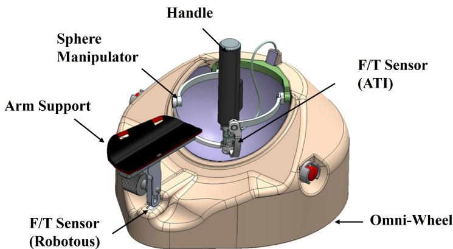  
Figure 1. 移动式上肢机器人系统构型。

测得的交互力驱动导纳控制回路，如图 Figure 2 所示，产生与用户输入一致的顺应性任务空间运动。尽管系统同时支持平面平移和前臂朝向运动，但 RMS-AAN 控制器仅处理平面任务；任务变量定义为 $\mathbf { x } _ { a } = [ x _ { a } y _ { a } ] ^ { \top }$

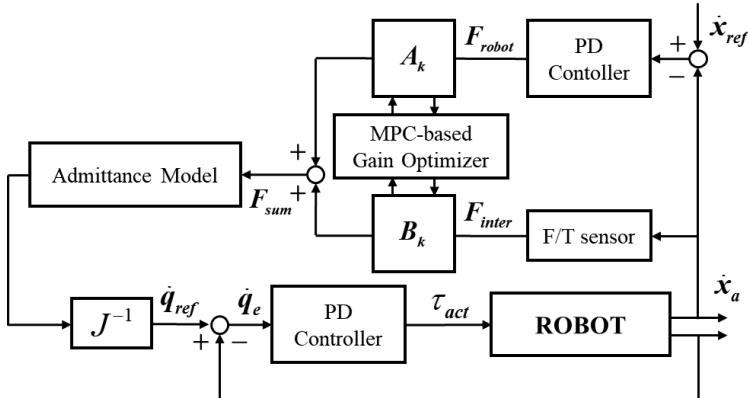  
Figure 2. 所提出的移动式上肢康复机器人控制架构。

导纳回路计算目标控制位置。虚拟导纳模型为一个具有恒定、对角、正定质量和阻尼矩阵的二阶线性系统，将每个平面轴解耦为独立的导纳通道，同时保留对用户交互具有物理可解释性的顺应性响应。控制律表示为

$$
M _ {v} \ddot {\mathbf {x}} _ {a} + B _ {v} \dot {\mathbf {x}} _ {a} = A _ {c} (t) \mathbf {F} _ {\text { robot }} + B _ {c} (t) \mathbf {F} _ {\text { inter }}, \quad 0 \leq A _ {c} (t) \leq 1, \quad 0 \leq B _ {c} (t) \leq 1\tag{1}
$$

其中 $M _ { v } \in \mathbb R ^ { 2 \times 2 }$ 和 $B _ { v } \in \mathbb R ^ { 2 \times 2 }$ 分别表示虚拟质量和阻尼矩阵。这些矩阵决定了平面康复动力学所需的顺应特性。项 $\mathbf { F } _ { \mathrm { r o b o t } }$ 表示用于参考跟踪的机器人生成辅助力，并通过 PD 律计算得到：

$$
\mathbf {F} _ {\mathrm{robot}} = K _ {p} (\mathbf {x} _ {\mathrm{ref}} - \mathbf {x} _ {a}) + K _ {d} (\dot {\mathbf {x}} _ {\mathrm{ref}} - \dot {\mathbf {x}} _ {a})\tag{2}
$$

时变连续时间增益 $A _ { c } ( t )$ 和 $B _ { c } ( t )$ 分别独立调节机器人辅助通道和用户参与通道的贡献。具体而言，$A _ { c } ( t ) = 1$ 且 $B _ { c } ( t ) = 0$ 对应于机器人主导的任务保证模式，而 $A _ { c } ( t ) = 0$ 且 $B _ { c } ( t ) = 1$ 对应于人主导的顺应模式。介于两者之间的值在这两种极限情况之间进行连续插值，从而使控制器能够在任务完成度与用户参与度之间取得平衡。

为了进行模型推导，对应于 (1) 的连续时间平面动力学表示为

$$
\ddot {\mathbf {x}} _ {a} = M _ {v} ^ {- 1} (- B _ {v} \dot {\mathbf {x}} _ {a} + A _ {c} (t) \mathbf {F} _ {\mathrm{robot}} + B _ {c} (t) \mathbf {F} _ {\mathrm{inter}})\tag{3}
$$

式中，$A _ { c } ( t )$ 和 $B _ { c } ( t )$ 分别表示连续时间下的瞬时辅助增益和参与增益。对于 MPC 预测，这些增益在每个控制步长进行采样，并分别表示为 $A _ { k }$ 和 $B _ { k }$。此外，在预测模型中，预测的辅助力被视为外生量，从而使状态更新方程对优化变量保持仿射性。第 3 节提供了对该处理方法的详细阐述与依据。

令离散时间状态定义为 $\mathbf { z } _ { k } = \left[ \mathbf { x } _ { a , k } ^ { \top } , \dot { \mathbf { x } } _ { a , k } ^ { \top } \right] ^ { \top } \in \mathbb { R } ^ { 4 }$，且 $\mathbf { u } _ { k } = \left[ A _ { k } , B _ { k } \right] ^ { \top } \in \mathbb { R } ^ { 2 }$。采用采样周期为 $T _ { s }$ 的显式前向欧拉离散化，预测模型可写为

$$
\mathbf {z} _ {k + 1} = \mathbf {A} \mathbf {z} _ {k} + \mathbf {G} _ {k} \mathbf {u} _ {k}\tag{4}
$$

$$
\mathbf {A} = \left[ \begin{array}{c c} I _ {2} & T _ {s}   I _ {2} \\ \mathbf {0} _ {2 \times 2} & I _ {2} - T _ {s} M _ {v} ^ {- 1} B _ {v} \end{array} \right], \qquad \mathbf {G} _ {k} = \left[ \begin{array}{c c} \mathbf {0} _ {2 \times 1} & \mathbf {0} _ {2 \times 1} \\ T _ {s} M _ {v} ^ {- 1} \hat {\mathbf {F}} _ {\mathrm{robot}, k} & T _ {s} M _ {v} ^ {- 1} \mathbf {F} _ {\mathrm{inter}, k} \end{array} \right]
$$

此处，$\hat { \mathbf { F } } _ { \mathrm { r o b o t } , k }$ 由 (2) 获得，并被视为已知的外部信号，从而使 $\mathbf { G } _ { k } \in \mathbb { R } ^ { 4 \times 2 }$ 保持对 ${ \bf { u } } _ { k }$ 的仿射依赖性。在 $( 4 )$ 中，$A _ { k }$ 和 $B _ { k }$ 独立缩放机器人辅助通道和用户参与通道，从而将本文所提出的双通道导纳架构与传统的单系数混合方法区分开来。

导纳层生成的任务空间速度指令随后通过逆雅可比矩阵映射到执行器空间，生成关节空间速度参考 $\dot { \theta } _ { \mathrm { r e f } } .$ 。该参考随后由底层 PID 控制器进行跟踪，以生成执行器扭矩指令 $\tau _ { \mathrm { a c t } }$ ，从而驱动机器人实现期望的康复运动。

## 3. 减少运动懈怠的按需辅助控制

为解决传统按需辅助（Assist-as-Needed, AAN）控制中的运动懈怠（motor slacking）问题，本文提出了减少运动懈怠的 AAN（Reduced Motor Slacking AAN, RMS-AAN）框架，该框架在保持稳定任务执行的同时保留了用户的主动参与。该控制器被构建为在预测时域 N 内的模型预测控制（MPC）问题，联合优化辅助增益 $A _ { k }$ 和参与反映增益 $B _ { k }$。

控制设计围绕三个目标展开。第一个目标是跟踪性能，确保任务执行精度和有界的瞬态误差。第二个目标是参与反映，当用户主动协助运动时，鼓励控制器保留任务方向的人体贡献。第三个目标是辅助抑制，惩罚不必要的机器人主导行为并减少突然的增益变化。由于这些目标部分相互冲突，它们通过带有显式增益和无源性约束的凸二次规划（QP）进行平衡。

## 3.1. 建模假设与预测模型

线性 MPC 的构建基于四个假设。第一，$M _ { v }$ 和 $B _ { v }$ 为常数、对角且正定矩阵，使得平面导纳动力学呈线性时不变；由于任务是准平面和准水平的，因此忽略了科氏力、离心力和重力项。第二，$M _ { v }$ 和 $B _ { v }$ 的对角结构将两个笛卡尔坐标解耦为独立的单自由度（single-DOF）导纳通道，这是平面末端执行器导纳控制中的标准近似 [18]。第三，$\mathbf { F } _ { \mathrm { i n t e r } }$ 是在消除偏差、坐标系变换和一阶低通滤波后，由两个校准的六轴力/力矩（F/T）传感器重构得到的任务空间合力。第四，(1) 不包含显式的虚拟刚度项；向参考轨迹的恢复改由 (2) 中基于 PD 的辅助力提供，其中 $K _ { p }$ 作为由 $A _ { k }$ 缩放的有效任务空间刚度。

连续时间动力学 (3) 通过显式前向欧拉法离散化，以保持预测模型关于 MPC 变量的仿射特性。速度子动力学 $I _ { 2 } - T _ { s } M _ { v } ^ { - 1 } B _ { v }$ 的数值稳定性要求

$$
T _ {s} <   \frac {2}{\max _ {i} \lambda_ {i} \left(M _ {v} ^ {- 1} B _ {v}\right)}\tag{5}
$$

这并非全矩阵 A 的渐近 Schur 稳定性（Schur-stability）条件，因为根据其构造，A 保留了位置积分器。在 $M _ { v } = 2 \mathbf { I } _ { 2 }$ 且 $B _ { v } = 4 0 \mathbf { I } _ { 2 } , ( 5 )$ 的情况下，得到 $T _ { s } < 0 . 1 { \ : } s ,$，所选取的 $T _ { s } = 1 0$ ms 满足该条件。时变 $A _ { k }$ 和 $B _ { k }$ 下的交互端口稳定性在第 3.3 节中通过能量储能罐（energy-tank）约束单独处理。

另一个问题是 $\hat { \mathbf { F } } _ { \mathrm { r o b o t } , k }$ 通过 (2) 依赖于预测状态；若直接代入预测模型将产生双线性公式。为保持凸 $\mathrm { Q P } ,$ $\hat { \mathbf { F } } _ { \mathrm { r o b o t } , k + i | k }$ 改为基于名义轨迹进行预先计算，该名义轨迹是通过将由前一步平移得到的热启动（warm-started）输入序列对模型进行前向积分获得的。随后，$\hat { \mathbf { F } } _ { \mathrm { r o b o t } , k + i | k }$ 和 $\mathbf { F } _ { \mathrm { i n t e r } , k + i | k }$ 作为已知的外生量进入预测模型，从而产生仿射线性时变（LTV）结构。在实际应用中，该近似误差通过增益变化率惩罚项 $J _ { \Delta A }$ 和 $J _ { \Delta B }$ 得以减小。

## 3.2. RMS-AAN 代价函数的设计

所提出的代价函数旨在将跟踪质量、参与度体现以及辅助抑制显式地纳入单个凸优化问题中进行处理。

跟踪性能通过参考轨迹与预测轨迹之间的位置和速度误差来量化。采用基于 $\ell$-范数的代价是因为它随着误差幅值非线性增加，从而允许在大误差区域进行积极校正，同时避免在小误差区域出现过度敏感 [14,15,19,20]：

$$
J _ {t r a c k} = \sum_ {i = 0} ^ {N - 1} \Big (\| \mathbf {x} _ {a, k + i | k} - \mathbf {x} _ {r e f, k + i | k} \| _ {\mathbf {Q} _ {x}} ^ {2} + \| \dot {\mathbf {x}} _ {a, k + i | k} - \dot {\mathbf {x}} _ {r e f, k + i | k} \| _ {\mathbf {Q} _ {v}} ^ {2} \Big) + \| \mathbf {x} _ {a, k + N | k} - \mathbf {x} _ {r e f, k + N | k} \| _ {\mathbf {Q} _ {f}} ^ {2}\tag{6}
$$

其中 ${ \bf Q } _ { x } \succeq 0 , { \bf Q } _ { v } \succeq 0$ 以及 $\mathbf { Q } _ { f } \succeq 0$ 分别是位置、速度和终端误差权重矩阵。尽管原则上允许零元素，但三者均被选为严格正定的对角矩阵，以保持 QP 的凸性、维持数值条件性，并保留沿两个任务空间轴的跟踪正则化。

令 $h _ { k + i | k } = \mathbf { t } _ { k + i } ^ { \top } \mathbf { F } _ { \mathrm { i n t e r } , k + i | k }$ 表示用户交互力在任务方向上的投影，其中 $\mathbf { t } _ { k + i }$ 为单位任务推进方向。在相匹配的任务条件下，运动松弛（motor slacking）在操作层面上与 $h _ { k + i | k }$ 的减小相关联。为了在控制器层面保持这种任务方向的人体贡献，引入了对齐代价：

$$
J _ {a l i g n} = \sum_ {i = 0} ^ {N - 1} S \left(B _ {k + i | k} \mathbf {t} _ {k + i} ^ {\top} \mathbf {F} _ {\text { inter }, k + i | k} - \mathbf {t} _ {k + i} ^ {\top} \hat {\mathbf {F}} _ {\text { robot }, k + i | k}\right) ^ {2}\tag{7}
$$

其中 $S \geq 0$ 为标量对齐权重。当用户产生与任务推进方向一致的力分量时，该项促使参与度反映增益 $B _ { k + i | k }$ 增大 [9,13,16,21,22]。

(7) 中仅使用了任务方向上的投影，因为控制目标的核心是沿着参考路径推进；正交分量属于横向偏差，已由 (6) 进行了惩罚。(7) 中的不对称性（即 $B _ { k + i | k }$ 与 $\mathbf { F } _ { \mathrm { i n t e r } , k + i | k }$ 相乘，而不与 $\hat { \mathbf { F } } _ { \mathrm { r o b o t } , k + i | k } ,$ 相乘）是有意设计的：机器人项是实现任务的参考通道，而人体项则是其反映的贡献受到调节的通道。

由于 $\mathbf { F } _ { \mathrm { i n t e r } }$ 可能随时间波动，因此在较短的预测时域上应用了零阶保持近似：

$$
\mathbf {F} _ {\mathrm{inter}, k + i | k} \approx \mathbf {F} _ {\mathrm{inter}, k}, \qquad i = 0, 1, \ldots , N - 1\tag{8}
$$

这种近似是可接受的，因为 QP（二次规划）在每个采样步都会重新求解，且相对于自主上肢交互力的预期变化，该时域较短。尽管如此，时域内用户力的突发性波动可能会降低预测精度，这应被视为当前线性化表述的一个局限性。

为保持凸性，$\hat { \mathbf { F } } _ { \mathrm { r o b o t } , k + i | k }$ 是根据标称导纳轨迹预先计算的，而不是直接耦合到预测的优化状态：

$$
\hat {\mathbf {F}} _ {\mathrm{robot}, k + i | k} = K _ {p} \Big (\mathbf {x} _ {r e f, k + i | k} - \hat {\mathbf {x}} _ {a, k + i | k} \Big) + K _ {d} \Big (\dot {\mathbf {x}} _ {r e f, k + i | k} - \dot {\hat {\mathbf {x}}} _ {a, k + i | k} \Big)\tag{9}
$$

其中 $\big ( \hat { \mathbf { x } } _ { a , k + i | k } , \dot { \hat { \mathbf { x } } } _ { a , k + i | k } \big )$ 是通过使用平移后的前一输入序列对预测模型进行前向积分得到的。

助力抑制项对缩放后的机器人助力大小进行惩罚：

$$
J _ {a s s i s t} = \sum_ {i = 0} ^ {N - 1} \left\| A _ {k + i | k} \hat {\mathbf {F}} _ {\mathrm{robot}, k + i | k} \right\| _ {\mathbf {R}} ^ {2}\tag{10}
$$

其中 $\mathbf R \succeq 0$ 是助力加权矩阵。

助力通过期望助力参考值 $A _ { d e s , k + i | k }$ 进一步进行调整，该参考值取决于预测的跟踪误差幅度。标量跟踪误差定义为

$$
e _ {k + i | k} ^ {x} = \left\| \mathbf {x} _ {r e f, k + i | k} - \mathbf {x} _ {a, k + i | k} \right\| _ {2}, \qquad e _ {k + i | k} ^ {\dot {x}} = \left\| \dot {\mathbf {x}} _ {r e f, k + i | k} - \dot {\mathbf {x}} _ {a, k + i | k} \right\| _ {2}\tag{11}
$$

期望助力增益为

$$
A _ {d e s, k + i | k} = \operatorname{sat} _ {[ 0, 1 ]} \left(K _ {A, x} \operatorname{sat} _ {[ 0, 1 ]} \left(\frac {e _ {k + i | k} ^ {x}}{e _ {r e f} ^ {x}}\right) + K _ {A, \dot {x}} \operatorname{sat} _ {[ 0, 1 ]} \left(\frac {e _ {k + i | k} ^ {\dot {x}}}{e _ {r e f} ^ {\dot {x}}}\right)\right)\tag{12}
$$

其中 $e _ { r e f } ^ { x }$ 和 $e _ { r e f } ^ { \dot { x } }$ 是用于归一化的最大容许位置误差和速度误差。内层饱和函数可防止单一误差通道主导助力需求；外层饱和函数确保与增益边界 $0 \leq A _ { k + i \mid k } \leq 1$ 保持一致。随后，增益 $A _ { k + i \vert k }$ 通过以下目标函数向该参考值调整：

$$
J _ {A} = \sum_ {i = 0} ^ {N - 1} \omega_ {A} \Big (A _ {k + i | k} - A _ {d e s, k + i | k} \Big) ^ {2}\tag{13}
$$

为了抑制不连续的干预和高频增益振荡，对两个增益序列均施加了平滑惩罚项。令 $A _ { k - 1 }$ 和 $B _ { k - 1 }$ 表示在前一个控制步施加的增益；平滑惩罚项定义为

$$
J _ {\Delta A} = \omega_ {\Delta A} \Big (A _ {k | k} - A _ {k - 1} \Big) ^ {2} + \sum_ {i = 1} ^ {N - 1} \omega_ {\Delta A} \Big (A _ {k + i | k} - A _ {k + i - 1 | k} \Big) ^ {2}\tag{14}
$$

$$
J _ {\Delta B} = \omega_ {\Delta B} \left(B _ {k | k} - B _ {k - 1}\right) ^ {2} + \sum_ {i = 1} ^ {N - 1} \omega_ {\Delta B} \left(B _ {k + i | k} - B _ {k + i - 1 | k}\right) ^ {2}\tag{15}
$$

该公式显式地将第一个预测动作与先前应用的增益关联起来，从而避免了在 $i = 0$ 处可能出现的索引歧义。

包含 ${ \cal J } _ { t r a c k } , { \cal J } _ { a l i g n } ,$ Jassist, $J _ { A } , J _ { \Delta A }$ 以及 $J _ { \Delta B }$ 的总目标函数关于决策变量是二次且凸的，因此适用于实时 $\mathrm { Q P }$（二次规划）实现。

代价项包含内环权重 $\left( \mathbf { Q } _ { x } , \mathbf { Q } _ { v } , \mathbf { Q } _ { f } , S , \mathbf { R } , \omega _ { A } \right)$ 以及外环系数 $\left( \lambda _ { 1 } , \ldots , \lambda _ { 6 } \right)$。为了保证可重复性，采用分阶段整定程序。内环权重通过布赖森规则（Bryson-rule）归一化进行初始化，对角元素设置为与各物理量工作范围的平方成反比。随后增大 $( \mathbf { Q } _ { x } , \mathbf { Q } _ { v } , \mathbf { Q } _ { f } )$ 直至在标称辅助轮廓下实现可接受的跟踪效果，并选取 $\left( \mathbf { R } , \omega _ { A } \right)$ 使得 $A _ { k }$ 在低误差阶段保持较小且不发生过早饱和。外环系数在最后整定：$\lambda _ { 3 }$ 和 $\lambda _ { 4 }$ 用于设定控制器对任务方向用户用力变化的响应度，而 $\lambda _ { 5 }$ 和 $\lambda _ { 6 }$ 则用于抑制 $A _ { k }$ 与 $B _ { k }$ 中的高频振荡。由于机器人辅助的突变会直接影响指令力，因此 $\omega _ { \Delta A }$ 设置得大于 $\omega _ { \Delta B }$。

## 3.3. 基于能量罐的 RMS-AAN 被动性约束

传统的固定参数导纳控制在标称条件下能够保持交互端口的被动性。然而，在所提出的架构中，对 $A _ { k }$ 和 $B _ { k }$ 的独立调节可能会向环境注入净能量。为了在保持凸 $\mathrm { Q P }$ 结构的同时限制此类能量注入，利用当前控制步中可用的测量值，以保守的采样保持方式构建了能量罐约束 [18,23]。

设 $\mathbf { F } _ { \mathrm { c m d } , k }$ 表示执行器生成的指令力。当前步的物理动力学可写为

$$
M _ {v} \ddot {\mathbf {x}} _ {a} + B _ {v} \dot {\mathbf {x}} _ {a} = \mathbf {F} _ {\mathrm{cmd}, k} + \mathbf {F} _ {\mathrm{inter}, k}\tag{16}
$$

将 (16) 与双通道导纳模型进行对比，可得出执行器功率为

$$
P _ {a c t, k} = \dot {\mathbf {x}} _ {a, k} ^ {\top} \mathbf {F} _ {\mathrm{cmd}, k} = \dot {\mathbf {x}} _ {a, k} ^ {\top} \big (A _ {k} \hat {\mathbf {F}} _ {\mathrm{robot}, k} + (B _ {k} - 1) \mathbf {F} _ {\mathrm{inter}, k} \big)\tag{17}
$$

设 $E _ { k }$ 表示存储在能量罐中的能量。净能量注入会从能量罐中抽取能量，而虚拟阻尼则为其重新充能：

$$
E _ {k + 1} = E _ {k} + T _ {s} \dot {\mathbf {x}} _ {a, k} ^ {\top} B _ {v} \dot {\mathbf {x}} _ {a, k} - T _ {s} [ P _ {a c t, k} ] _ {+} \geq 0\tag{18}
$$

由于 $\left[ P _ { a c t , k } \right] .$ + 是分段定义的，因此引入了一个非负辅助变量：

$$
p _ {k + i | k} \geq P _ {a c t, k + i | k}, \quad p _ {k + i | k} \geq 0, \quad i = 0, 1, \dots , N - 1\tag{19}
$$

以及在整个时域上施加保守的能量水槽更新：

$$
E _ {k + i + 1 | k} = E _ {k + i | k} + T _ {s} \dot {\mathbf {x}} _ {a, k} ^ {\top} B _ {v} \dot {\mathbf {x}} _ {a, k} - T _ {s} p _ {k + i | k} \geq 0, i = 0, 1, \ldots , N - 1\tag{20}
$$

在此，对于所有时域步长，补给项中的当前测量速度 $\dot { \mathbf { x } } _ { a , k }$ 均保持恒定。这保持了 QP 的线性度，并给出了一个保守的保持被动性约束。

增益边界也在预测时域内强制施加：

$$
0 \leq A _ {k + i | k} \leq 1, \quad 0 \leq B _ {k + i | k} \leq 1, \quad i = 0, 1, \dots , N - 1\tag{21}
$$

在 (20) 中使用当前测量速度从三个方面引入了保守性：$p _ { k + i | k }$ 上界限定了正向执行器功率；基于阻尼的补给项是根据当前速度而非预测速度计算的，倾向于低估累积耗散；并且在时域内逐步强制执行能量水槽的非负性。因此，(19) 和 (20) 提供了一个保守的采样数据被动性条件 [24]，尽管与完全预测的非线性水槽相比，辅助力的受限可能会稍微提前。初始能量 $E _ { 0 }$ 和上限 $E _ { \mathrm { m a x } }$ 作为实际的稳定裕度：增大 E 允许净辅助的瞬态阶段更长，而 $E _ { \mathrm { m a x } }$ 可防止在耗散区间内发生无界累积。

最终的优化问题表述为

$$
\begin{array}{l l} \min _ {\{\mathbf {u} _ {k + i | k} \} _ {i = 0} ^ {N - 1}, \{p _ {k + i | k} \} _ {i = 0} ^ {N - 1}} & \lambda_ {1} J _ {t r a c k} + \lambda_ {2} J _ {a s s i s t} + \lambda_ {3} J _ {a l i g n} + \lambda_ {4} J _ {A} + \lambda_ {5} J _ {\Delta A} + \lambda_ {6} J _ {\Delta B} \\ \text {s.t.} & \text {prediction model in (4),} \\ & \text {tank and gain constraints in (19) - (21).} \end{array}\tag{22}
$$

## 3.4. MPC 预测结构、输入参数化与稳定性

所提出的控制器遵循标准的滚动时域 MPC 结构。在每个采样时刻 $k$，(22) 中的 QP 在时域 N 上求解；仅应用第一个控制动作 $\mathbf { u } _ { k \mid k } ^ { * }$，并在下一步使用更新的状态和交互力重复进行优化。遵循标准实时 MPC 的常规做法 [25–27]，将先前的最优输入序列平移一步，同时用作求解器的热启动和 (9) 的名义输入序列。

输入序列 $\mathbf { u } _ { k + i | k } = [ A _ { k + i | k } , \ B _ { k + i | k } ] ^ { \top }$ 采用稠密形式进行参数化，产生 2N 个标量增益变量。连同 N 个辅助储能器变量 $p _ { k + i | k } ,$ 一起，最终的二次规划（QP）包含 3N 个标量决策变量。此处未施加基函数降维，因为所选的时域长度 $N = 2 0$ 在实时计算中依然可行，而稠密参数化则保留了两个增益通道的逐步灵活性。

在任意外部交互力和容许增益序列下，形式上的闭环稳定性并非显而易见的，因为有效交互导纳是由 MPC 输出直接调制的。实际稳定性是通过三种互补机制来促进的：(i) 式 (6) 中的终端惩罚项 $\mathbf { Q } _ { f }$，它促进时域末端向参考值收缩；(ii) 式 (19) 和 (20) 中的能量储能器（energy-tank）约束，用于限制交互端口处的净能量注入；以及 (iii) 平滑惩罚项 $J _ { \Delta A }$ 和 $J _ { \Delta B }$，用于抑制有效导纳的快速变化。

## 4. 结果

本节评估所提出的控制器是否在显式反映用户参与度降低的同时实现“按需辅助”（AAN, Assist-As-Needed）行为。其目标是验证第 3 节中的双通道结构在受控且可复现的条件下是否能产生 $A _ { k }$ 和 $B _ { k }$ 的差异化自适应。如图 Figure 3 所示，实验平台由一台 5 自由度（5-DOF）移动上肢康复机器人和一个基于游戏的视觉界面组成。评估重点针对 x 和 y 方向的平面运动；球形操作手不包含在主动控制中，且 Finte $\mathbf { F } _ { \mathrm { i n t e r } }$ 被定义为两个力/力矩（F/T）传感器测量的合力。受试者被指示通过产生适当的交互力，用当前光标（蓝色）跟随目标点（红色）。导纳参数为 $M _ { v } = 2 I _ { 2 }$ 和 $B _ { v } = 4 0 I _ { 2 }$，内部增益为 $K _ { p } = 7 0 I _ { 2 }$ 和 $K _ { d } = 1 0 I _ { 2 }$。MPC 参数和实现细节分别列于 Table 1 和 Table 2 中。

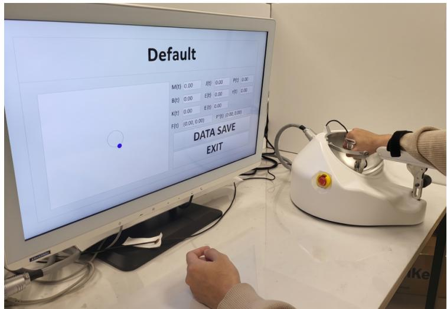  
Figure 3. 实验装置；使用移动上肢康复机器人进行的平面轨迹跟踪任务。

Table 1. RMS-AAN 控制器中使用的 MPC 参数。

<table><tr><td>参数</td><td>数值</td><td>参数</td><td>数值</td></tr><tr><td>N</td><td>20</td><td> $\mathbf{Q}_x$ </td><td>120 $\mathbf{I}_2$ </td></tr><tr><td> $\mathbf{Q}_v$ </td><td>10 $\mathbf{I}_2$ </td><td> $\mathbf{Q}_f$ </td><td>250 $\mathbf{I}_2$ </td></tr><tr><td>S</td><td>0.002</td><td> $\mathbf{R}$ </td><td>0.0015 $\mathbf{I}_2$ </td></tr><tr><td> $\omega_{\Delta A}$ </td><td>8.0</td><td> $\omega_{\Delta B}$ </td><td>1.0</td></tr><tr><td> $\omega_A$ </td><td>1.0</td><td> $\lambda_1$ </td><td>5.0</td></tr><tr><td> $\lambda_2$ </td><td>10.0</td><td> $\lambda_3$ </td><td>50.0</td></tr><tr><td> $\lambda_4$ </td><td>30.0</td><td> $\lambda_5$ </td><td>50.0</td></tr><tr><td> $\lambda_6$ </td><td>30.0</td><td> $K_{A,x}$ </td><td>0.60</td></tr><tr><td> $K_{A,\dot{x}}$ </td><td>0.30</td><td> $E_0$ </td><td>0.2</td></tr><tr><td> $E_{\text{max}}$ </td><td>1.0</td><td> $e^{x}_{ref}$ </td><td>0.03</td></tr><tr><td> $e^{x}_{ref}$ </td><td>0.06</td><td></td><td></td></tr></table>

Table 2. MPC 实现与计算细节。

<table><tr><td>项目</td><td>数值</td></tr><tr><td>QP 求解器</td><td>OSQP（稀疏，算子分裂）</td></tr><tr><td>采样周期  $T_s$ </td><td>10 ms</td></tr><tr><td>预测时域 N</td><td>20</td></tr><tr><td>决策变量</td><td>2N 个增益变量 + N 个辅助变量 = 3N = 60</td></tr><tr><td>实现平台</td><td>C++17, real-time Linux</td></tr><tr><td>计算平台</td><td>Intel Core i9-9900K, Ubuntu 22.04 (PREEMPT_RT)</td></tr><tr><td>平均/最差求解时间</td><td>3/5 ms</td></tr></table>

目标轨迹为一条半径为 0.12 m 的圆形路径，在 270 s 内重复 9 次。指示的贡献条件每 90 s 改变一次，产生三个连续的条件：任务方向贡献不足、适中和过度。

## 4.1. 按需辅助行为的实验验证

Figure 4 显示，在所有三个区间内，实际轨迹均能稳定跟踪参考圆形路径，其中在贡献不足时偏差最大，在适中贡献时偏差最小。Table 3 中的定量结果与 Figure 5 中的时间历程相一致。RMS 位置误差在三个区间内单调递减，从贡献不足时的 56.59 mm 降至适中贡献时的 19.23 mm，以及过度贡献时的 16.81 mm。因此，随着用户贡献的增加，跟踪精度得到了提高，而不是像以牺牲跟踪性能来换取参与度的误差驱动型 AAN 律所预测的那样发生恶化。

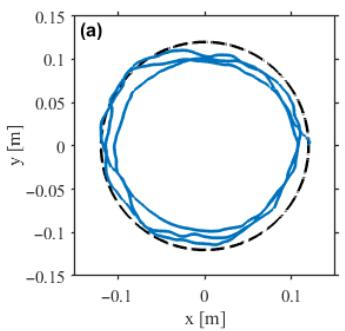

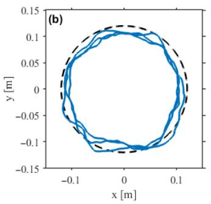  
- - - 参考轨迹 实际轨迹

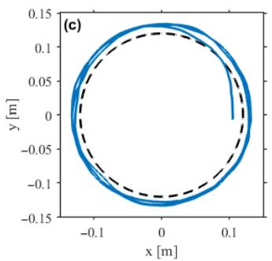

Figure 4. 三种用户贡献水平下的轨迹跟踪结果：(a) 不足，(b) 适度，以及 (c) 过度。  
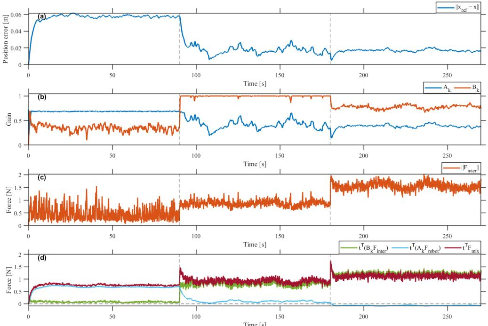  
Figure 5. 用于按需辅助（Assist-as-Needed）行为实验验证的时域响应：(a) 位置误差，(b) 增益轨迹 $A _ { k }$ 和 $B _ { k } ,$ (c) 交互力幅值 $\lVert \mathbf { F } _ { \mathrm { i n t e r } } \rVert$ ，以及 (d) 任务方向力分量 ${ \bf t } ^ { \top } ( B _ { k } { \bf F } _ { \mathrm { i n t e r } } ) , { \bf t } ^ { \top } ( A _ { k } { \bf F } _ { \mathrm { r o b o t } } )$ 和 $\mathbf { t } ^ { \top } \mathbf { F } _ { \mathrm { m i x } }$

Table 3. 实验结果指标。

<table><tr><td>指标</td><td>区间 1（不足）</td><td>区间 2（适度）</td><td>区间 3（过度）</td></tr><tr><td>均方根位置误差 (mm)</td><td>56.59</td><td>19.23</td><td>16.81</td></tr><tr><td>平均  $A_k$ </td><td>0.682</td><td>0.426</td><td>0.382</td></tr><tr><td>平均  $B_k$ </td><td>0.347</td><td>0.995</td><td>0.775</td></tr><tr><td>参与率</td><td>0.103</td><td>0.879</td><td>1.000</td></tr><tr><td>机器人做功 (J)</td><td>1.478</td><td>0.268</td><td>-0.150</td></tr></table>

Figure 5b 中的增益轨迹展示了两个通道之间相反的重新分配过程。机器人辅助平均增益 $A _ { k }$ 从 0.682 下降至 0.426 和 0.382，而参与反映平均增益 $B _ { k }$ 则从 0.347 上升至 0.995，随后下降至 0.775。$B _ { k }$ 在第三个区间的非单调行为表明，在用户任务方向施力过度的情况下，控制器对任务方向的总力进行了调控，而不是进一步放大 $\mathbf { F } _ { \mathrm { i n t e r } }$。

为了检验这些内部增益变化是否反映了用户用力的实际转变，在优化循环之外根据测量力计算了任务方向参与率 $\rho _ { \mathrm { h u m a n } } = { \bf t } ^ { \top } { \left( B _ { k } { \bf F } _ { \mathrm { i n t e r } } \right) } / { \bf t } ^ { \top } { \bf F } _ { \mathrm { m i x } }$。该比率在三个区间内的演变过程为 $0 . 1 0 3  0 . 8 7 9  1 . 0 0 0$，与内部优化的 $B _ { k }$ 紧密契合。这种一致性证实了增益轨迹反映的是人类在任务方向上的真实贡献，而非代价函数构建所产生的人为效应。

Figure 5c,d 证实了这些发现。交互力范数 $\lVert \mathbf { F } _ { \mathrm { i n t e r } } \rVert$ 跨区间增长，且主导任务方向分量从 $\mathbf { t } ^ { \top } ( A _ { k } \mathbf { F } _ { \mathrm { r o b o t } } )$ 转移到 $\mathbf { t } ^ { \top } ( B _ { k } \mathbf { F } _ { \mathrm { i n t e r } } )$，并在第三个区间内主要呈现为负值。机器人净指令功 $\begin{array} { r } { W _ { \mathrm { r o b o t } } = \int \mathbf { v } ^ { \top } \mathbf { F } _ { \mathrm { c m d } } d t , } \end{array}$（其中 $\mathbf { F } _ { \mathrm { c m d } } = A _ { k } \mathbf { F } _ { \mathrm { r o b o t } } + ( B _ { k } - 1 ) \mathbf { F } _ { \mathrm { i n t e r } }$）从 1.478 减小到 0.268，然后降至 $\mathrm { t o } - 0 . 1 5 0 \mathrm { J }$，证实了一旦用户贡献超过任务需求，机器人行为就会从助力转变为阻力。在所有区间内，$\mathbf { t } ^ { \top } \mathbf { F } _ { \mathrm { m i x } }$ 均保持有界，与稳定的任务执行一致。

## 4.2. 诱导运动懈怠下的对比评估

Figure 6 和 7 对比了在诱导运动懈怠（motor slacking）下的三种控制器：基于误差的 AAN（GAAN）、Wolbrecht 等人的遗忘因子 AAN 以及所提出的 RMS-AAN。对所有三种控制器施加了完全相同的合成交互力曲线。任务方向 t 遵循参考速度方向，并且 $M _ { v } \mathbf { a } _ { \mathrm { r e f } } + B _ { v } \mathbf { v } _ { \mathrm { r e f } }$ 的任务方向分量用作标称任务需求。主要平行分量按贡献调度 $c ( t )$ 进行缩放：在 0 到 10 s 以及 20 到 30 s 期间 $c ( t ) \colon c ( t ) = 1 . 0$，在 10 到 20 s 的懈怠区间内 $c ( t ) = 0 . 4 5$。叠加了漂移、震颤、垂直分量、噪声、延迟和低通滤波，以模拟实际变化。由于所有控制器接收相同的输入，Figure 7b–d 中的差异反映的是控制器结构而非输入的可变性。

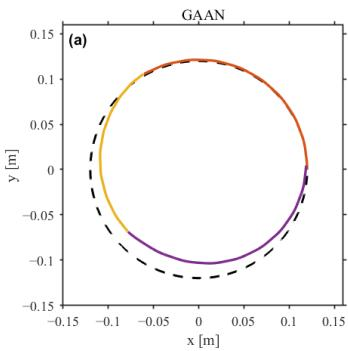

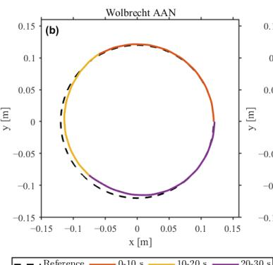

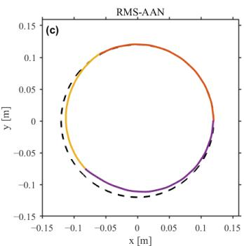  
Figure 6. 诱导运动懈怠下的平面轨迹跟踪：(a) GAAN，(b) Wolbrecht-AAN，以及 (c) RMS-AAN。颜色指示各子区间：0–10、10–20 和 20–30 s。

图 7a 中外部定义的参考值独立地反映了用户贡献的减少。预设贡献 $c(t)$（虚线所示）在离线状态下施加并在各控制器之间共享，而测得的任务方向贡献比 $\mathbf { t } ^ { \top } \mathbf { F } _ { \mathrm { i n t e r } } / F _ { \mathrm { n o m . } }$（实线所示）则是根据交互力和参考运动学计算得出的，未采用控制器内部变量。在 10 到 20 秒之间，两个参考值均下降至约 0.45，独立于控制器状态界定了低参与度区间。这些参考值替代了诸如表面肌电（surface EMG）、任务完成延迟或自我报告用力程度等直接的行为或生理指标；使用此类外部指标进行交叉验证将留待未来工作进行。

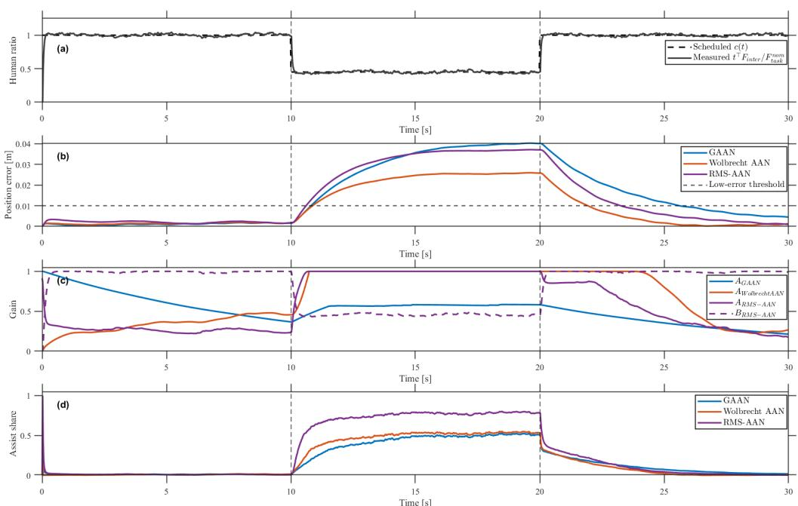  
Figure 7. 诱导运动懈怠下 GAAN、Wolbrecht-AAN 和所提出的 RMS-AAN 的时域比较：(a) 预设贡献 $c ( t )$（虚线）与测得的任务方向贡献比（实线）；(b) 带有低误差阈值的位置误差；(c) 增益轨迹 $A _ { \mathrm { G A A N } } ,$ AWolbrecht-AAN, $A _ { \mathrm { R M S - A A N } } ,$ 以及 $B _ { \mathrm { R M S - A A N } } ;$ (d) 辅助份额。

这三种控制器在响应施加的贡献减少方面存在差异。GAAN 仅通过 $\mathbf { F } _ { \mathrm { m i x } } = \mathbf { F } _ { \mathrm { i n t e r } } + A _ { \mathrm { e r r } } \mathbf { F } _ { \mathrm { r o b o t } }$ 根据跟踪误差来确定辅助力。Wolbrecht-AAN 通过递归遗忘机制扩展了这一结构，使得当用户表现良好时辅助力会衰减，尽管该调整仍然受跟踪误差演化驱动。RMS-AAN 则采用 $\mathbf { F } _ { \mathrm { m i x } } = A _ { k } \mathbf { F } _ { \mathrm { r o b o t } } + B _ { k } \mathbf { F } _ { \mathrm { i n t e r } }$ 并联合优化 $A _ { k }$ 与 $B _ { k }$，从而明确将辅助与参与度反映分离开来。

所有三种控制器都在 Figure $^ { 6 , }$ 中保持了整体的圆形轨迹，但 Figure 7 中的时域响应揭示了明显的结构性差异。在 10 到 ${ 2 0 } \mathbf { s } ,$ 期间，测得的贡献度下降至约 0.45。GAAN 迅速将 $A _ { \mathrm { G A A N } }$ 推向 1，几乎立即进行了补偿，并将低参与度状态掩盖在较小的跟踪误差之后。Wolbrecht-AAN 表现出延迟响应：在松弛开始时，由于基于遗忘的更新无法瞬时补偿，其跟踪误差出现短暂增加，但辅助增益最终上升以抑制残余误差。而 RMS-AAN 则通过减小 $B _ { k }$ 和增大 $A _ { k } ,$ 重新分配了控制器配置，从而使参与度的降低显式化，而不是将其掩盖在较低的跟踪误差之后。

Table 4 总结了描述性的权衡。RMS-AAN 的 RMS 跟踪误差为 31.85 mm，与 GAAN 的 32.46 mm 相当，略高于 Wolbrecht-AAN 的 22.24 mm，同时产生了最低的综合参与度比率 $\rho _ { \mathrm { h u m a n } } = 0 . 2 8 2$ 这一较低的值表明，外部降低的贡献度得到了更明确的体现，而不是被辅助补偿所掩盖。GAAN 和 Wolbrecht-AAN 较大的 $\rho _ { \mathrm { h u m a n } }$ 值并不意味着更高的参与度，因为这两种基线方法都通过误差驱动的辅助进行了补偿。在相同的合成输入下，RMS-AAN 因此在控制器分配中更清晰地表征了低参与度状态，而基线方法则通过增加辅助将其掩盖。由于该评估是在受控输入设计下针对单个受试者进行的，因此未进行推断统计分析，所报告的指标应作描述性解释。

Table 4. 诱导运动松弛下各方法的指标对比。

<table><tr><td>指标</td><td>GAAN</td><td>Wolbrecht-AAN</td><td>RMS-AAN</td></tr><tr><td>RMS 位置误差 (mm)</td><td>32.46</td><td>22.24</td><td>31.85</td></tr><tr><td>参与度比率  $\rho_{human}$ </td><td>0.595</td><td>0.535</td><td>0.282</td></tr></table>

这些结果应被解释为受控条件下的控制器级证据。单受试者设置和施加的松懈特性（slacking profile）是经过深思熟虑的选择，旨在确保各个控制器具有相同的输入；因此，观察到的差异反映的是控制器结构，而非受试者间变异性或自主行为差异。然而，该设计无法重现神经功能受损用户的自主适应动态或质性不同的力产生模式（如痉挛、异常协同和本体感觉缺失）。作为本项工作的下一阶段，计划采用包含健康先导队列以及随后的亚急性中风队列的多受试者方案，并结合上述外部指标。

## 5. 结论

本文提出了一种基于模型预测控制（MPC）的上肢康复机器人按需辅助（AAN）控制框架，该框架明确解决了运动松懈（motor slacking）问题。主要贡献在于将运动松懈操作化为在匹配任务条件下任务方向上人类贡献的自适应减少。RMS-AAN 在单个兼容二次规划（QP）的 MPC 内解耦了机器人辅助通道和用户参与通道，共同处理轨迹跟踪、参与度对齐、辅助抑制、误差响应辅助整形以及增益平滑。源自能量罐（energy-tank）框架的保持无源性线性约束促进了时变增益下的稳定交互。

实验结果表明，该方法在根据用户参与度重新分配人机贡献的同时，保持了稳定的任务执行。在诱发的运动松懈下，RMS-AAN 将减少的人类贡献和增加的机器人补偿表示为不同的量，而基于误差的 GAAN 基线和 Wolbrecht et al. 的遗忘因子 AAN 则将降低的参与度掩盖在较低的跟踪误差之后。因此，所提出的方法通过将用户参与度作为控制器分配中的显式变量，对面向跟踪的 AAN 形成了补充。

目前的验证仅限于单个健康受试者和合成的松懈特性；这些证据应被解释为控制器层面的概念验证，而非临床有效性。未来的工作将从三个方向扩展验证：首先是针对健康先导队列、随后针对亚急性中风队列的多受试者实验；其次是将控制器内部变量与外部行为和生理指标（如表面肌电信号 surface EMG、任务完成潜伏期和自我报告的努力程度）进行交叉验证；最后是在更多样化的康复任务中开展长期临床研究。

作者贡献：概念构思，C.K.、Y.M. 和 J.C.；方法学，C.K.；软件，C.K.；验证，C.K.；形式分析，C.K.；调查，C.K.；资源，Y.M. 和 J.C.；数据管护，C.K.；撰写——初稿准备，C.K.；撰写——审阅与编辑，Y.M. 和 J.C.；可视化，C.K.；监督，Y.M. 和 J.C.；项目管理，Y.M. 和 J.C.；资金获取，Y.M. 和 J.C.。所有作者均已阅读并同意手稿的发表版本。

资金支持：本研究由韩国保健福祉部（Ministry of Health & Welfare, Republic of Korea）资助的韩国保健产业振兴院（Korea Health Industry Development Institute, KHIDI）韩国卫生技术研发项目（资助编号：RS-2018-KH049508）以及韩国产业通商资源部（Ministry of Trade, Industry & Energy, MOTIE, Korea）资助的技术创新计划（资助编号：RS-2024-00423853）共同支持。

数据可用性声明：支持本研究结果的数据可在合理要求下向通讯作者索取。

致谢：在本手稿的准备过程中，作者使用 ChatGPT 5.4 进行了语法修正与结构增强。作者对生成的内容进行了审查与编辑，并对本发表成果的内容承担全部责任。

利益冲突：作者声明不存在利益冲突。

## 参考文献

1. Langhorne, P.; Coupar, F.; Pollock, A. Motor recovery after stroke: A systematic review. Lancet Neurol. 2009, 8, 741–754. [CrossRef] [PubMed]

2. Waddell, K.J.; Birkenmeier, R.L.; Moore, J.L.; Hornby, T.G.; Lang, C.E. Feasibility of high-repetition, task-specific training for individuals with upper-extremity paresis. Am. J. Occup. Ther. 2014, 68, 444–453. [CrossRef] [PubMed]

3. Maciejasz, P.; Eschweiler, J.; Gerlach-Hahn, K.; Jansen-Troy, A.; Leonhardt, S. A survey on robotic devices for upper limb rehabilitation. J. Neuroeng. Rehabil. 2014, 11, 3. [CrossRef] [PubMed]

4. Veerbeek, J.M.; Langbroek-Amersfoort, A.C.; van Wegen, E.E.H.; Meskers, C.G.M.; Kwakkel, G. Effects of robot-assisted therapy for the upper limb after stroke. Neurorehabilit. Neural Repair 2017, 31, 107–121. [CrossRef]

5. Arantes, A.P.; Bressan, N.; Borges, L.R.; McGibbon, C.A. Evaluation of a novel real-time adaptive assist-as-needed controller for robot-assisted upper extremity rehabilitation following stroke. PLoS ONE 2023, 18, e0292627. [CrossRef]

6. Odemis, E.; Baysal, C.V. Development of a participation assessment system based on multimodal evaluation of user responses for upper limb rehabilitation. Biomed. Signal Process. Control 2021, 70, 103066. [CrossRef]

7. Marchal-Crespo, L.; Reinkensmeyer, D.J. Review of control strategies for robotic movement training after neurologic injury. J. Neuroeng. Rehabil. 2009, 6, 20. [CrossRef]

8. Proietti, T.; Crocher, V.; Roby-Brami, A.; Jarrasse, N. Upper-limb robotic exoskeletons for neurorehabilitation: A review on control strategies. IEEE Rev. Biomed. Eng. 2016, 9, 4–14. [CrossRef] [PubMed]

9. Wolbrecht, E.T.; Chan, V.; Reinkensmeyer, D.J.; Bobrow, J.E. Optimizing compliant, model-based robotic assistance to promote neurorehabilitation. IEEE Trans. Neural Syst. Rehabil. Eng. 2008, 16, 286–297. [CrossRef]

10. Zhang, L.; Guo, S.; Sun, Q. An assist-as-needed controller for passive, assistant, active, and resistive robot-aided rehabilitation training of the upper extremity. Appl. Sci. 2021, 11, 340. [CrossRef]

11. Luo, L.; Peng, L.; Wang, C.; Hou, Z.-G. A greedy assist-as-needed controller for upper limb rehabilitation. IEEE Trans. Neural Netw. Learn. Syst. 2019, 30, 3433–3443. [CrossRef] [PubMed]

12. Guo, B.; Li, Z.; Huang, M.; Li, X.; Han, J. Patient’s healthy-limb motion characteristic-based assist-as-needed control strategy for upper-limb rehabilitation robots. Sensors 2024, 24, 2082. [CrossRef] [PubMed]

13. Reinkensmeyer, D.J.; Akoner, O.M.; Ferris, D.P.; Gordon, K.E. Slacking by the human motor system: Computational models and implications for robotic orthoses. In Proceedings of the 2009 Annual International Conference of the IEEE Engineering in Medicine and Biology Society, Minneapolis, MN, USA, 3–6 September 2009; pp. 2129–2132. [CrossRef]

14. dos Santos, W.M.; Siqueira, A.A.G. Optimal impedance via model predictive control for robot-aided rehabilitation. Control Eng. Pract. 2019, 93, 104177. [CrossRef]

15. Yan, Y.; Tang, M.; Wang, W.; Zhang, Y.; An B. Trajectory tracking control of wearable upper limb rehabilitation robot based on Laguerre model predictive control. Robot. Auton. Syst. 2024, 179, 104745. [CrossRef]

16. Cao, R.; Cheng, L.; Yang, C.; Dong, Z. Iterative assist-as-needed control with interaction factor for rehabilitation robots. Sci. China Technol. Sci. 2021, 64, 836–846. [CrossRef]

17. Liu, J.; Cramer, S.C.; Reinkensmeyer, D.J. Learning to perform a new movement with robotic assistance: Comparison of haptic guidance and visual demonstration. J. Neuroeng. Rehabil. 2006, 3, 20. [CrossRef] [PubMed]

18. Keemink, A.Q.L.; van der Kooij, H.; Stienen, A.H.A. Admittance control for physical human–robot interaction. Int. J. Robot. Res. 2018, 37, 1421–1444. [CrossRef]

19. Karamanakos, P.; Geyer, T.; Kennel, R. On the choice of norm in finite control set model predictive control. IEEE Trans. Power Electron. 2018, 33, 7105–7117. [CrossRef]

20. Karamanakos, P.; Geyer, T. Guidelines for the design of finite control set model predictive controllers. IEEE Trans. Power Electron. 2020, 35, 7434–7450. [CrossRef]

21. Hogan, N. Adaptive control of mechanical impedance by coactivation of antagonist muscles. IEEE Trans. Autom. Control 1984, 29, 681–690. [CrossRef]

22. Fortineau, V.; Siegler, I.A.; Makarov, M.; Rodriguez-Ayerbe, P. Human arm endpoint-impedance in rhythmic human-robot interaction exhibits cyclic variations. PLoS ONE 2023, 18, e0295640. [CrossRef] [PubMed]

23. Ferraguti, F.; Landi, T.C.; Sabattini, L.; Bonfè, M.; Fantuzzi, C.; Secchi, C. A variable admittance control strategy for stable physical human–robot interaction. Int. J. Robot. Res. 2019, 38, 747–765. [CrossRef]

24. Ferraguti, F.; Preda, N.; Manurung, A.; Bonfè, M.; Lambercy, O.; Gassert, R.; Muradore, R.; Fiorini, P.; Secchi, C. An energy tank-based interactive control architecture for autonomous and teleoperated robotic surgery. IEEE Trans. Robot. 2015, 31, 1073–1088. [CrossRef]

25. Valencia-Palomo, G.; Rossiter, J.A.; López-Estrada, F.R. Improving the feed-forward compensator in predictive control for setpoint tracking. ISA Trans. 2014, 53, 755–766. [CrossRef] [PubMed]

26. Valencia-Palomo, G.; Rossiter, J.A. Predictive control implementation in a PLC using the IEC 1131.3 programming standard. In Proceedings of the European Control Conference (ECC), Budapest, Hungary, 23–26 August 2009; pp. 1317–1322. Available online: https://ieeexplore.ieee.org/document/7074588 (accessed on 24 April 2026 ).

27. Valencia-Palomo, G.; Rossiter, J.A. Novel programmable logic controller implementation of a predictive controller based on Laguerre functions and multiparametric solutions. IET Control Theory Appl. 2012, 6, 1003–1014. [CrossRef]

免责声明/出版商说明：所有出版物中包含的陈述、观点和数据仅代表个人作者和贡献者的观点，并不代表 MDPI 和/或编辑的观点。MDPI 和/或编辑对因内容中提及的任何想法、方法、说明或产品而导致的人身或财产损失不承担任何责任。