# 基于表现的机器人辅助上肢康复助力控制✰

Leigang Zhang a,\*, Shuai Guo a,b,\*, Fengfeng Xi c

a School of Mechatronic Engineering and Automation, Shanghai University（上海大学机电工程与自动化学院）, Shanghai 200444, China

b National Demonstration Center for Experiment Engineering Training Education, Shanghai University（上海大学国家级工程训练实验教学示范中心）, Shanghai 200444, China

c Department of Aerospace Engineering, Ryerson University（瑞尔森大学航空航天工程系）, 350 Victoria Street, Toronto, M5B 2K3 ON, Canada

## 期 刊 信 息

编辑：Dr. Tsu-Chin Tsao

关键词：上肢康复（Upper-limb rehabilitation） 按需助力控制（Assist-as-needed control） 末端执行器机器人（End-effector robot）

## 摘 要

临床研究结果表明，由机器人介导的中风后受试者康复训练具有能够执行高强度重复性和任务导向性任务的优势，可有效促进康复效果。然而，由于不同康复阶段受试者的残疾程度各不相同，他们可能具有不同的训练需求。因此，为了满足不同康复阶段受试者的康复训练需求，本文提出了一种用于安全机器人介导治疗的基于表现的助力控制策略。该策略包含通过轨迹跟踪误差进行切换的三种训练模式：零交互力（ZIF）模式、按需助力（AAN）模式以及限制交互区域（RIR）模式。在 ZIF 模式下，受试者可以自由规划其运动轨迹，机器人仅在受试者松弛（slacking）时提供固定助力。在 AAN 模式下，机器人通过调节刚度系数提供可变水平的助力，以根据受试者的运动能力提供协助。为确保安全性，在 RIR 模式下会施加较大的助力。为了验证和评估所提出的助力控制策略的有效性与性能，五名健全受试者基于末端执行器机器人介导训练系统进行了一组任务导向的连续运动实验。初步实验结果表明，所提出的控制策略运行正常，能够根据受试者的运动表现提供相应的助力并调整工作模式。研究发现，随着轨迹跟踪误差的增加导致运动表现下降，机器人会提供更多助力。此外，刚度系数的自适应调节使所提出的助力控制策略能够诱导更多的积极主动发力。值得注意的是，所提策略的参数可以针对不同受试者进行个性化定制与调整，以满足各种需求。

## 1. 引言

脑卒中后受试者通常伴有不同程度的上肢运动功能障碍 [1]，这对他们的运动能力和日常生活活动产生了负面影响，并给他们及其家庭带来了经济和心理负担。根据运动再学习方案（motor relearning program）理论，在悉心指导下进行充分的康复训练可以帮助脑卒中幸存者恢复部分上肢运动能力 [2]。与传统康复训练方法相比，机器人辅助方法作为一种新型临床康复干预技术，具有能够提供高密度重复性和任务导向性康复训练的优势 [3]。此外，临床研究结果表明，机器人辅助训练方法对手臂运动功能的恢复具有积极作用 [4, 5]。

机器人辅助系统的机械结构在机器人辅助物理训练中发挥着重要作用。在过去的几十年里，研究人员开发了许多机器人辅助训练系统，主要分为两类 [6, 7]：外骨骼式，例如 Armin 系统 [8] 和 Harmony 系统 [9]；以及末端执行器式，例如 MIT-MANUS 系统 [10] 和 GEN-TLE/S 系统 [11]。这些机器人辅助训练系统已有效应用于临床康复治疗中，能够为患者提供充足的辅助。尽管外骨骼式机器人辅助系统能够开展上肢单关节的康复训练，但与传统康复训练方法相比，末端执行器式机器人辅助系统在康复训练中同样具有积极的效果和优势 [12, 13]。此外，末端执行器式机器人辅助训练系统还具备一些优势，例如结构简单、训练任务规划简化以及对不同受试者的良好适应性。

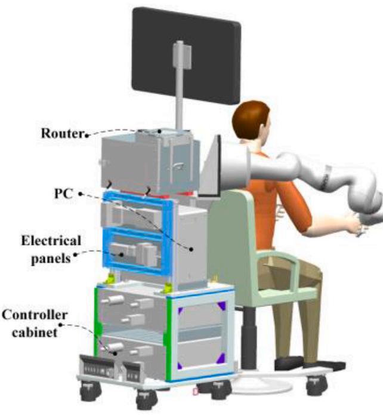

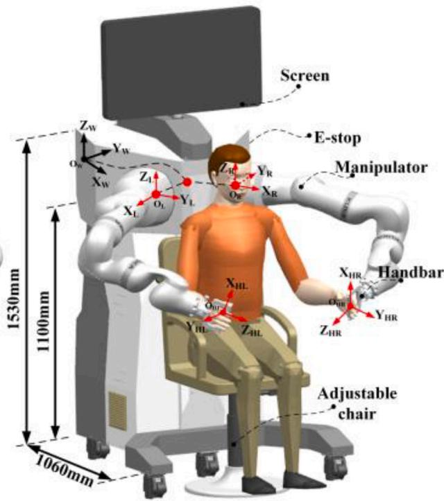  
(b)  
Fig. 1. 机器人辅助训练系统的机械结构。(a) 内部结构示意图。(b) 设计的三维模型。

由于机器人辅助训练是一种以患者为中心、且需要患者与机器人之间进行物理接触的方法，因此这些系统的控制策略在康复治疗中也起着至关重要的作用。近年来，诸如阻抗控制 [14]、比例-积分-微分（Proportion-Integration-Derivative, PID）控制 [15] 等控制策略已被应用于机器人辅助系统中，以协助上肢完成预定的训练任务，这些策略的分类和特征可在先前的综述文献 [16–19] 中找到。对于存在严重手臂运动障碍的人群，这些控制器中的大多数被设计为严格跟踪期望的运动模式。这些控制策略将受试者施加的主动交互力或力矩视为外部扰动，并施加反向控制力以消除跟踪误差，从而获得有效的轨迹跟踪效果。由于处于康复早期的上肢运动功能障碍患者需要机器人辅助系统提供完全的支持来完成预定的训练活动，因此需要刚度较高的位置控制器来准确地跟随轨迹。然而，基于感觉运动整合理论 [20]，受试者的主动参与被认为是促进运动功能恢复的关键要素。研究结果表明，在物理训练过程中尽量减少机器人介入并最大化受试者的主动参与，可以刺激并促进患者的大脑神经可塑性 [21, 22]。因此，需要一种能够根据受试者需求提供必要辅助或矫正以完成康复训练任务的控制策略。根据受试者的运动表现提供机器人辅助，即按需辅助（assist-as-needed, AAN）控制，是实现这一特性的方法之一 [23, 24]。AAN 策略不仅可以在训练任务中激发受试者的主动参与，还可以促进运动恢复和物理治疗 [25, 26]。关于 AAN 控制策略的研究已成功应用于上肢 [27, 28]、下肢 [29, 30] 和手指 [31] 的康复训练中，以激发受试者的主动参与。

然而，固定的机器人辅助并不适用于处于不同康复阶段的受试者，控制策略应当能够根据受试者的运动表现调节辅助水平。此外，基于 AAN 原理的控制策略在末端执行器型机器人辅助训练系统中的应用仍较为少见。

为了满足受试者在不同康复阶段的康复训练需求，本文针对机器人辅助物理训练系统，提出了一种基于受试者运动表现的助力控制策略，以协助受试者的上肢完成训练任务。此外，所提出的策略包含三种训练模式，并根据轨迹跟踪误差进行模式切换，从而动态、自适应地调整助力水平。在此背景下，本研究对机器人辅助上肢康复领域做出了两项主要贡献：

(1) 本文提出的机器人辅助助力控制策略包含三种不同的训练模式：ZIF 模式、ANN 模式和 RIR 模式，能够通过单一控制器满足受试者在不同康复阶段的康复训练需求。鲜有控制策略能够覆盖受试者在任一康复阶段的训练需求。

(2) 在所提出的助力控制策略中，通过跟踪受试者手臂的运动表现，实现了机器人辅助训练过程中不同康复训练模式之间的安全切换。

本文其余部分的组织结构如下：第 2 节介绍了末端执行器式机器人辅助系统的描述与建模，第 3 节提出了基于表现的助力控制策略。第 4 节通过对五名健全受试者的实验，评估并验证了所提策略的性能。最后，第 5 节和第 6 节给出了实验结果，随后展开了讨论并得出结论。

## 2. 机器人辅助系统的建模

本研究所使用的机器人辅助训练系统的机械结构和总体透视图如图 1 所示，该系统是在早期研究 [32, 33] 所开发系统的基础上改进而来的版本。该训练系统主要由两台具有七个自由度（DOF）的工业机械臂（KUKA LBR iiwa7）以及身体结构支撑组成，机械臂主要用于在训练过程中引导上肢。受试者与机器人之间的交互采用背靠背模式，这也是该系统区别于以往机器人辅助系统之处。此外，在这种交互模式下，系统的可达工作空间和灵巧工作空间能够完全匹配人体上肢的生理可达工作空间和灵巧工作空间 [34]。

为了便于描述机器人的运动方式，选取两台机械臂关节轴线的交点作为全局参考坐标系。以右机械臂为例，运动学方程可表示如下：

$$
\mathbf {T} _ {\mathrm{HR}} ^ {\mathrm{W}} = \mathbf {T} _ {0} ^ {\mathrm{W}} \prod_ {i = 1} ^ {7} \left(\mathbf {T} _ {i} ^ {i - 1} (q _ {i})\right) \mathbf {T} _ {\mathrm{HR}} ^ {7}\tag{1}
$$

其中，$\mathbf { T } _ { \mathrm { H R } } ^ { 7 }$ 和 $\mathbf { T } _ { 0 } ^ { \mathrm { W } }$ 分别表示手柄与机器人法兰之间、以及机器人基座与全局坐标系之间的变换矩阵；$\mathbf { T } _ { i } ^ { i - 1 } \mathbf { i }$ 为机械臂两个相邻连杆之间的变换矩阵，${ \bf q } _ { i }$ 为机械臂的关节位置向量。通常，机械臂在关节空间中的非线性动力学方程可表示为：

$$
\mathbf {M} (q) \ddot {\mathbf {q}} + \mathbf {C} (q, \dot {q}) \dot {\mathbf {q}} + \mathbf {G} (q) + \mathbf {F} (\dot {q}) = \tau_ {\mathrm{c}} + \tau_ {\mathrm{ext}}\tag{2}
$$

$$
\boldsymbol {\tau} _ {\mathrm{ext}} = \mathbf {J} ^ {\mathrm{T}} (q) \mathbf {F} _ {\mathrm{ext}}\tag{3}
$$

$$
\mathbf {J} (q) = \left[ \begin{array}{c} \mathbf {J} _ {x} (q) \\ \mathbf {J} _ {\theta} (q) \end{array} \right]\tag{4}
$$

其中 q˙ 和 q¨ 为机械臂的关节速度和加速度向量，J(q) 为解析雅可比矩阵，$\mathbf { J } _ { x } ( q )$ 将关节速度 q ˙ 映射为末端执行器的平移速度，$\mathbf { J } _ { \theta } ( q )$ 将 $\dot { \mathbf { q } }$ 映射为末端执行器的旋转速度。$\tau _ { \mathrm { c } }$ 为关节施加的力矩，${ \bf M } ( { q } )$ 为惯性矩阵，${ \bf C } ( q , \dot { q } )$ 表示离心力项和科氏力项，$\mathbf { G } ( q )$ 表示重力项，${ \bf F } ( \dot { q } )$ 表示摩擦力向量，$\mathbf { F } _ { e x t }$ 为施加在机械臂末端执行器上的外力，$\tau _ { e x t }$ 为由外力引起的外力矩。

此外，基于笛卡尔变量的机械臂动力学方程可描述为：

$$
\mathbf {M} _ {x} (x) \ddot {\mathbf {x}} + \mathbf {C} _ {x} (x, \dot {x}) \dot {\mathbf {x}} + \mathbf {J} ^ {- \mathrm{T}} (q) \mathbf {G} (q) + \mathbf {J} ^ {- \mathrm{T}} (q) \mathbf {F} (\dot {q}) = \mathbf {F} _ {\tau} + \mathbf {F} _ {e x t}\tag{5}
$$

$$
\mathbf {M} _ {x} (x) = \left(\mathbf {J} (q) \mathbf {M} (q) ^ {- 1} \mathbf {J} ^ {T} (q)\right) ^ {- 1}\tag{6}
$$

$$
\mathbf {C} _ {x} (x, \dot {x}) \dot {x} = \mathbf {M} _ {x} (x) \left(\mathbf {J} (q) \mathbf {M} ^ {- 1} (q) \mathbf {C} (q, \dot {q}) - \dot {\mathbf {J}} (q)\right) \dot {\mathbf {q}}\tag{7}
$$

其中 x ˙ 和 x ¨ 为机械臂末端执行器的笛卡尔速度和加速度向量，$\mathbf { M } _ { x } \mathbf { i }$ 为末端执行器惯性矩阵，$\mathbf { C } _ { x } \mathbf { i } s$ 为笛卡尔科氏力矩阵，${ \mathbf { F } } _ { \tau } , { \mathbf { F } } _ { e x t }$ 分别为控制力向量和外力向量。

值得注意的是，(5) 中仅考虑了末端执行器的动力学，未包含零空间动力学。然而，本文机器人辅助训练系统中的机械臂包含七个自由度（DOFs）和一个冗余运动学轴（亦称零空间）。本研究采用了一种直接的策略——零空间投影方法 [35]，来控制和调节零空间运动。机器人在零空间中的期望行为在关节空间中由对称正定矩阵 $\mathbf { K } _ { q }$ 和 ${ \mathbf B } _ { q }$ 表征，随后通过投影矩阵 $\mathbf { N } ( q )$ 进行投影：

$$
\tau_ {\text { Null }} = \mathbf {N} (q) \left[ \mathbf {K} _ {q} (\mathbf {q} _ {\mathrm{d}, 0} - \mathbf {q}) - \mathbf {B} _ {q} \dot {\mathbf {q}} \right]\tag{8}
$$

其中映射矩阵 $\mathbf { N } ( q )$ 定义如下：

$$
N (q) = I - J ^ {\mathrm{T}} (q) \left(J ^ {\mathrm{T}} (q)\right) ^ {\#}\tag{9}
$$

$$
\mathbf {J} ^ {\#} (q) = \mathbf {W} ^ {- 1} \mathbf {J} ^ {\mathrm{T}} (q) (\mathbf {J} (q) \mathbf {W} ^ {- 1} \mathbf {J} ^ {\mathrm{T}} (q)) ^ {- 1}\tag{10}
$$

其中 $\mathbf { q } _ { \mathrm { d } , 0 } \in \mathbb { R } ^ { 7 \times 1 }$ 为机器人的初始姿态，$\mathbf { W }$ 为加权矩阵。通常，加权矩阵 $\mathbf { W }$ 可以通过多种方式构建 [36]。本工作所采用的权重矩阵 $\mathbf { W }$ 为更常用的最小范数（least-norm）[37] 解 $\mathbf { W } = \mathbf { I } .$。

## 3. 基于表现的辅助控制

本节的主要重点是介绍一种基于表现的辅助控制方法，该方法包含三种训练模式，可根据受试者的运动表现进行切换。

## 3.1. 笛卡尔阻抗控制

为了在机器人辅助训练期间实现机器人与受试者之间的顺应性交互，机器人需要在阻抗控制方案 [14] 下运行。阻抗控制背后的思想是放弃显式控制特定的机械臂变量（例如端点力、位置和速度），转而在与环境的交互点处调节输入流变量（例如相对于参考轨迹的机械臂端点位置或速度）与输出力变量（例如端点净力和力矩）之间的关系。笛卡尔阻抗控制的期望动力学关系可表示为：

$$
\mathbf {M} _ {\mathrm{x}} \Delta \ddot {\mathbf {x}} + \mathbf {D} _ {x} \Delta \dot {\mathbf {x}} + \mathbf {K} _ {x} \Delta \mathbf {x} = \mathbf {F} _ {e x t}\tag{11}
$$

其中 $\Delta \mathbf { x } = \mathbf { x } _ { \mathrm { c u r } } - \mathbf { x } _ { \mathrm { d e s } }$ 是机器人位置 $\mathbf { X } _ { \mathrm { { C u r } } }$ 与期望虚拟平衡位置 $\mathbf { X } _ { \mathrm { d e s } }$ 之间的位置误差，而 $\mathbf { M } _ { x } , \mathbf { D } _ { x }$ 以及 $\mathbf { K } _ { x }$ 分别是期望惯性、阻尼和刚度的对称正定矩阵。因此，机械臂在关节空间中的控制律可表示为：

$$
\mathbf {u} = \ddot {\mathbf {q}} _ {\text { cur }} = \mathbf {J} ^ {- 1} (q) \left[ \ddot {\mathbf {x}} _ {d e s} + \mathbf {M} _ {x} ^ {- 1} \left(\mathbf {F} _ {e x t} - \mathbf {D} _ {x} \Delta \dot {\mathbf {x}} - \mathbf {K} _ {x} \Delta \mathbf {x}\right) - \dot {\mathbf {J}} (q) \dot {\mathbf {q}} \right]\tag{12}
$$

为了简化系统并消除外力测量，将机器人在笛卡尔空间中的期望惯性矩阵设置为与机械臂末端执行器惯性矩阵一致，即 ${ \bf M } _ { x } = { \bf M } _ { x } ( { \pmb x } )$。此外，为了确保具有时变惯性矩阵系统的无源稳定性，必须引入科里奥利矩阵（Coriolis matrix）。该论点的稳定性证明在 [38] 中有详细推导，因此，公式 (11) 可以重写为：

$$
\mathbf {M} _ {\mathrm{x}} (x) \Delta \ddot {\mathbf {x}} + (\mathbf {C} _ {x} (x, \dot {x}) + \mathbf {D} _ {x}) \Delta \dot {\mathbf {x}} + \mathbf {K} _ {x} \Delta \mathbf {x} = \mathbf {F} _ {e x t}\tag{13}
$$

由于公式 (13) 中的惯性矩阵依赖于末端执行器位姿，出于上述同样的原因，阻尼矩阵也不应为常数矩阵。因此，采用了依赖于机器人位姿的阻尼矩阵 [39]，期望的机器人行为可以通过以下控制律实现：

$$
\mathbf {F} _ {\text { ext }} = \mathbf {G} _ {x} (x) + \mathbf {M} _ {x} (x) \ddot {\mathbf {x}} _ {d} + \mathbf {C} _ {x} (x, \dot {x}) \dot {\mathbf {x}} _ {\mathrm{d}} - \mathbf {D} _ {x} (x) \Delta \dot {\mathbf {x}} - \mathbf {K} _ {x} \Delta \mathbf {x}\tag{14}
$$

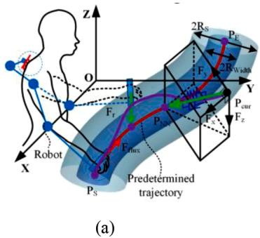

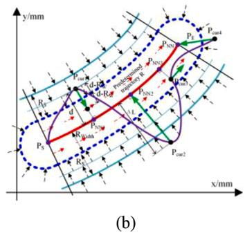  
Fig. 2. 增强空间虚拟零阻抗区域（ZIR）的示意图。(a) ZIR 示意图。(b) ${ \bf P } _ { \mathrm { N N } }$ 及机器人提供助力的示意图。Ps 和 Pe 分别为预定轨迹的起点和终点，紫色和红色曲线分别表示实际轨迹和预定轨迹。

最后，笛卡尔阻抗控制器的输入力矩定义为：

$$
\tau_ {c} = \mathbf {J} ^ {T} (q) \left[ \mathbf {M} _ {x} (x) \ddot {\mathbf {x}} _ {d e s} + \mathbf {C} _ {x} (x, \dot {x}) \dot {\mathbf {x}} _ {d e s} - \mathbf {D} _ {x} (x) \Delta \dot {\mathbf {x}} - \mathbf {K} _ {x} \Delta \mathbf {x} \right] + \mathbf {F} (\dot {q}) + \mathbf {G} (q)\tag{15}
$$

## 3.2. 基于表现的辅助控制策略

阻抗控制常用于机器人辅助康复治疗中，通过提供按需辅助（AAN）特性使机器人在笛卡尔空间中展现出柔顺性，并允许受试者偏离预定轨迹。然而，阻抗控制策略不允许时间自由度，只要受试者偏离了带有时序的预定轨迹，机器人就会提供辅助。因此，本文提出了一种基于表现的辅助控制策略，该策略包含通过轨迹误差进行切换的三种训练模式，以促进康复训练。

首先，如图 2 所示，采用死区零阻抗区域（Zero Impedance Region, ZIR）来代替预定义轨迹。在本研究中，受试者运动表现的评估器依赖于实际轨迹与预定轨迹之间的运动学偏差。此外，基于受试者的运动轨迹跟踪误差 $\Delta \mathbf {L}$ 划分了三种不同的训练模式，该误差可定义为：

$$
\Delta \mathbf {L} = \mathbf {P} _ {\text { cur }} - \mathbf {P} _ {\mathrm{NN}} (R)\tag{16}
$$

其中 $\mathbf { P } _ { c u r }$ 和 ${ \bf P } _ { N N }$ 分别表示受试者的实际位置以及预定轨迹上的最近点。当受试者的轨迹跟踪误差较小，即 $\|\Delta \mathbf { L } \parallel _ { 2 } \in [ 0 , \mathrm { R } _ { w i d t h } ]$ 时，机器人在 ZIR 内不提供任何辅助。受试者可以选择其偏好的轨迹，且机器人工作在零交互力（ZIF）模式下。如图 Fig. 2 中的蓝色区域所示，在半径可调（$\mathrm { R } _ { w i d t h }$）的 ZIR 内，机器人处于完全反向驱动状态。在该模式下，受试者被认为具有足够的能力来完成预定任务。然而，受试者可能会停留在 ZIR 内而不积极尝试完成任务，从而可能卡在某一位置。文献中已记录了受试者严重依赖辅助力的倾向或懈怠行为 [40]，这将大大降低受试者的主动参与度和努力程度。在 ZIF 模式下，引入了一条最小速度曲线来抵消这种现象，该曲线将构建一个虚拟运动。如果受试者静止不动或移动速度低于最小速度，机器人将产生一堵“移动墙”推动受试者跟上虚拟运动，同时机器人提供最小辅助力以协助完成预定任务并避免懈怠。最小辅助力 $\mathbf { F } _ { f u x }$ 可计算为：

$$
\mathbf {F} _ {\text { flux }} = \left\{ \begin{array}{c} k _ {\text { flux }} \frac {\mathbf {t} _ {\text { flux }}}{\left| \mathbf {t} _ {\text { flux }} \right|} \| \Delta \mathbf {L} \| _ {2} \in [ 0, R _ {\text { width }} ] \\ 0 e l s e \end{array} \right.\tag{17}
$$

$$
\mathbf {t} _ {f l u x} = \frac {d}{d R} \mathbf {P} _ {N N} (R)\tag{18}
$$

当跟踪误差增大，即 $\| \Delta \mathbf { L } \| _ { 2 } \in [ R _ { w i d t h } , \mathbf { R } _ { s } ]$（偏离 ZIR）时，辅助模式发生切换，此时机器人工作在 AAN 模式。在这种情况下，受试者的轨迹跟踪误差表明其无法完成预定轨迹上的训练任务。因此，机器人需要提供相应的辅助力来协助受试者完成任务，从而防止受试者因表现不佳而失去信心。调节机器人所提供的辅助力的一种方法是修改由机器人末端执行器在笛卡尔空间中呈现的机械阻抗。通常，一种常见的基于阻抗的 AAN 控制策略是更新标称阻抗参数（包括刚度和阻尼），机器人提供的辅助力可以表示为：

$$
\mathbf {F} _ {\text { assist }} = \left(\mathbf {K} _ {x \_ w a l l} (\| \Delta \mathbf {L} \| _ {2} - R _ {\text { width }}) + \mathbf {D} _ {x \_ w a l l} \frac {d}{d t} (\| \Delta \mathbf {L} \| _ {2} - R _ {\text { width }})\right) \times \overrightarrow {\mathbf {n}}\tag{19}
$$

$$
\overrightarrow {\mathbf {n}} = \frac {\mathbf {P} _ {c u r} - \mathbf {P} _ {N N} (R)}{\| \Delta \mathbf {L} \| _ {2}}\tag{20}
$$

其中 $\mathbf { K } _ { x \_ w a l l }$ 和 $\mathbf { D } _ { x \_ w a l l }$ 分别为正对角刚度矩阵和阻尼矩阵。如果在 AAN 模式下刚度系数 $\mathbf { K } _ { x \_ w a l l }$ 变得过大，即使轨迹跟踪误差很小，也会产生很大的辅助力。当刚度系数足够大时，机器人将精确跟踪预定轨迹，而忽略受试者的主动努力。然而，采用固定刚度系数参数的机器人所提供的辅助并不适合不同康复阶段具有不同损伤程度的受试者。在本文中，机器人辅助物理训练过程中的辅助力通过调节机器人在笛卡尔空间中的机械阻抗来修改，并且阻抗系数 $\Delta\mathbf{K}$ 根据受试者的轨迹跟踪误差进行修改：

$$
\mathbf {K} _ {x \_ w a l l} = \mathbf {K} _ {m i n} + \Delta \mathbf {K}\tag{21}
$$

$$
\Delta \mathbf {K} = \frac {\mathbf {K} _ {\max} - \mathbf {K} _ {\min}}{R _ {s} - R _ {\text { width }}}\tag{22}
$$

其中 ${ \bf K } _ { m i n }$ 和 ${ \bf K } _ { m i n }$ 表示 AAN 模式下刚度系数的上限和下限。在 AAN 模式下，轨迹跟踪误差与受试者的主动努力之间存在权衡。如果轨迹跟踪误差减小，则应采用较低的阻抗系数，以鼓励受试者积极参与并完成指定的训练活动。相反，当轨迹跟踪误差开始增大时，应使用较高的阻抗系数来辅助受试者成功减小轨迹误差。需要注意的是，由于阻尼力与速度相关而刚度力与位置相关，因此调节阻尼力或刚度力存在不同的方法。然而，如果轨迹跟踪误差足够大 ‖ $\Delta \mathbf { L } \parallel _ { 2 } \in [ \mathbf { R } _ { s } , \infty ] ;$ ，机器人将在限制交互区域（RIR）模式下工作。这表明受试者的表现较差，机器人将优先考虑受试者的安全性。此时，机器人将施加较大的辅助力，其计算公式如下：

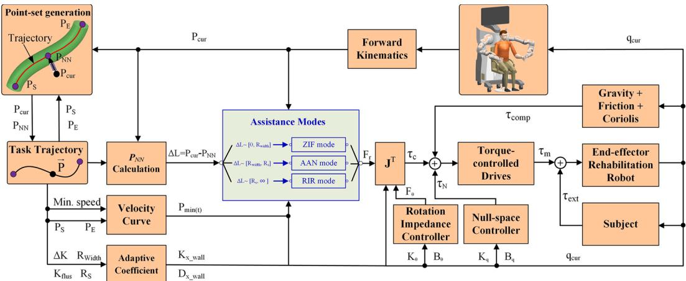  
Fig. 3. 所提出的辅助控制策略的整体控制结构。

$$
\mathbf {F} _ {\text { assist }} = \left(\mathbf {K} _ {\max} \cdot \left(\| \Delta \mathbf {L} \| _ {2} - R _ {\text { width }}\right)\right) \times \overrightarrow {\mathbf {n}}\tag{23}
$$

如果在机器人提供辅助力的情况下，受试者仍无法减小轨迹跟踪误差，我们认为该训练任务对受试者而言难度过大。因此，应停止训练任务并进行适当调整。最后，在机器人辅助训练过程中，根据所提出的控制策略计算得到的机器人辅助力 ${ \bf F } _ { r }$ 以及控制力矩 $\tau _ { c }$ 可表示如下：

$$
\mathbf {F} _ {r} = \mathbf {F} _ {\text { assist }} + \mathbf {F} _ {\text { flux }}\tag{24}
$$

然而，由于患者与机器人以背靠背模式进行交互，受手腕关节的生理活动范围（ROM）限制，机器人在辅助训练过程中的末端姿态不能是任意的。在兼顾机器人末端与受试者之间的交互时，机器人末端姿态既不能完全不受控制，也不能处于固定位置。因此，采用了一种基于欧拉角的笛卡尔旋转阻抗控制器来管理机器人末端的姿态。通过为机器人末端选取初始欧拉角姿态 $\theta _ { \mathrm { d } } ,$ 旋转笛卡尔阻抗控制器的应用形式如下：

$$
\mathbf {F} _ {\theta} = \mathbf {K} _ {\theta} (\theta_ {\mathrm{d}} - \theta) - \mathbf {B} _ {\theta} \dot {\theta}\tag{25}
$$

${ \pmb { \tau } } _ { \theta } = { \bf J } _ { \theta } ^ { \mathrm { T } } ( { q } ) { \bf F } _ { \theta }$ (26) 其中 $\mathbf { K } _ { \theta } \in \mathbb { R } ^ { 3 \times 3 }$ 和 $\mathbf { B } _ { \theta } \in \mathbb { R } ^ { 3 \times 3 }$ 分别为旋转阻抗控制器的阻抗参数，$\pmb \theta \in \mathbb R ^ { 3 \times 1 }$ 为机器人末端的欧拉角姿态，选取 $\mathbf { K } _ { \theta }$ 和 $\mathbf { B } _ { \pmb { \theta } }$ 是为了使末端执行器阻抗控制器中每个旋转方向的阻尼比近似恒定。机器人末端三个旋转方向上的旋转阻尼比近似表示为：

Table 1  
为评估实验招募的五名健全受试者的详细信息。

<table><tr><td>受试者</td><td>性别</td><td>年龄</td><td>体重</td><td>身高</td><td>损伤史</td></tr><tr><td>1</td><td>男</td><td>30</td><td>68 Kg</td><td>1.82 m</td><td>无</td></tr><tr><td>2</td><td>男</td><td>24</td><td>65 Kg</td><td>1.68 m</td><td>无</td></tr><tr><td>3</td><td>男</td><td>27</td><td>69 Kg</td><td>1.70 m</td><td>无</td></tr><tr><td>4</td><td>男</td><td>27</td><td>62 Kg</td><td>1.70 m</td><td>无</td></tr><tr><td>5</td><td>男</td><td>25</td><td>64 Kg</td><td>1.72 m</td><td>无</td></tr></table>

$$
\varsigma_ {i} = \frac {b _ {i}}{2 m _ {i} \sqrt {k _ {i} / m _ {i}}}\tag{27}
$$

其中，ki 和 bi 分别表示 $\mathbf { K } _ { \theta }$ 和 $\mathbf { B } _ { \theta }$ 的对角元素，m 是旋转末端执行器质量矩阵 [41] 对应的三个对角元素之一，由 (6) 式给出。根据所选旋转阻抗控制器的刚度 $\mathbf { K } _ { \theta }$，选择合适的阻尼矩阵 $\mathbf { B } _ { \theta }$ 以产生恒定的阻尼比 $\varsigma _ { i } \approx 0 . 4$。该选择介于无阻尼 $\varsigma _ { i } = 0$ 和临界阻尼 $\varsigma _ { i } = 1$ 之间。因此，在机器人末端与预定轨迹之间引入了刚度为 $\mathbf { K } _ { \theta }$ 的 3D 旋转弹簧。这保证了机器人在运动辅助过程中姿态发生顺应形变，并促进了与受试者手臂的交互。

因此，实现所提出的辅助控制策略的控制力矩 τ 最终可计算如下：

$$
\boldsymbol {\tau} = \mathbf {J} ^ {\mathrm{T}} (q) \left[ \mathbf {M} _ {x} (x) \ddot {\mathbf {x}} _ {\mathrm{des}} + \mathbf {C} _ {x} (x, \dot {x}) \dot {\mathbf {x}} _ {\mathrm{des}} \right] + \mathbf {F} (\dot {q}) + \mathbf {G} (q) + \mathbf {J} _ {x} ^ {T} (q) \mathbf {F} _ {\mathrm{r}} + \boldsymbol {\tau} _ {\theta} + \boldsymbol {\tau} _ {\text { Null }}\tag{28}
$$

所提出的基于性能的辅助控制策略的相应简化控制流程图如图 3 所示。研究中所述控制策略的高层控制器如图 3 左侧所示，它根据受试者手臂的运动性能确定所需的辅助力。底层控制器位于右侧，主要用于跟踪来自高层控制器的指令，同时补偿机器人的动力学模型。控制策略中的三种训练模式（ZIF、AAN 和 RIR）在中间蓝色区域进行选择和切换。控制器将根据受试者手臂的运动性能对其进行评估，并切换到期望的训练模式。此外，我们的控制策略是利用机器人阻抗控制器构建的，尽管它具有上述特征，但其无源性（passivity）是可以得到保证的。

## 4. 实验验证

本实验的目的是在所展示的机器人辅助系统（如图 1 所示）上，通过连续跟踪运动来验证和评估所提出的辅助控制策略的性能。通过快速机器人接口（Fast Robot Interface, FRI），机器人辅助系统中的机械臂能够以高达 1 kHz 的循环速率执行外部力矩控制 [42]。此外，在整个实验过程中，机器人的 FRI 摩擦力和重力补偿均处于激活状态。

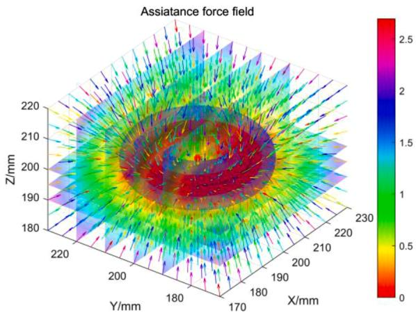

(a)  
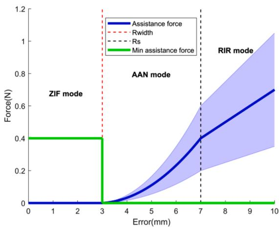  
(b)  
Fig. 4. 三种训练模式（ZIF 模式、AAN 模式、RIR 模式）的仿真结果。(a) 助力分布的仿真结果。(b) 不同模式下助力与轨迹跟踪误差之间的关系。

在本实验中，招募了五名健全受试者（5 名男性，平均年龄 26.6 岁，标准差（STD）为 2.3；平均身高 1.72 m，STD 为 0.1；平均体重 65.6 Kg，STD 为 2.9），且所有受试者均无肌肉骨骼或神经系统疾病。这些受试者的详细信息如 Table 1 所示。

我们假设在实验过程中使用受试者的右臂。本研究已获得岳阳中西医结合医院（Yueyang Hospital of Integrated Traditional Chinese and Western Medicine）伦理委员会的批准。在参与本研究之前，已收集所有受试者的书面知情同意书。

在实验前进行了仿真以演示和评估助力控制（以圆形轨迹为例）；结果如 Fig. 4 所示。当机器人处于红色区域内（在此区域内运动不受限制）时，其工作在 ZIF 模式。当它位于红色区域和蓝色区域之间时，工作在 AAN 模式，而在蓝色区域外时则工作在 RIR 模式。Fig. 4 中的颜色分布表示机器人提供的助力大小，而箭头表示助力的方向。上述仿真结果表明，如果受试者的运动速度小于预设的最小速度，机器人在 ZIF 模式下将提供固定的助力（发生懈怠时）。在 AAN 模式下，随着轨迹跟踪误差的增加，机器人将提供较小的助力，但在 RIR 模式下，将施加较大的助力以确保受试者的安全。仿真的一些重要参数如下：$R _ { w i d t h } ~ =$ 30mm, R = 70mm,Kmin = diag[10,10,10](N /m),ΔK = diag[22.5,22.5, $2 2 . 5 ] ( \mathrm { N / m } ) , \mathrm { K } _ { m a x } = d i a g [ 1 0 0 , 1 0 0 , 1 0 0 ] ( \mathrm { N / m } ) , k _ { f l u x } = 0 . 4 \mathrm { N } .$

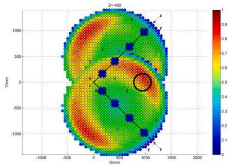

(a)  
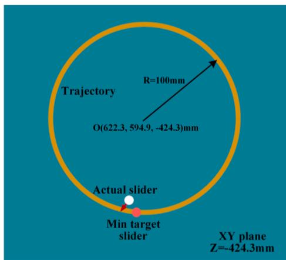

(b)  
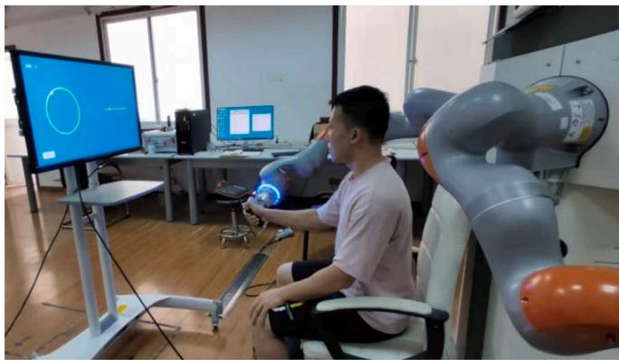  
(c)  
Fig. 5. 选定的训练轨迹及基于 Unity 的场景。(a) 训练轨迹。(b) 视觉反馈场景。(c) 部分受试者的实验测试场景。

图 4(a) 展示了机器人助力场的分布。图 4(b) 展示了不同训练模式下助力与轨迹跟踪误差之间的关系曲线。助力控制策略的三种训练模式（ZIF、AAN 和 RIR）的切换是基于受试者的轨迹跟踪误差实现的。

在整个实验过程中，参与者均收到明确指示，需尽最大努力在水平面内的圆形轨迹上进行连续跟踪运动。在本例中，轨迹中心和半径分别为 (622.3 mm, 594.9 mm, −424.3 mm) 和 100 mm。在本工作中，圆形轨迹是根据机器人的灵巧度图 [34, 33] 选取的（

Table 2  
实验过程中的参数。

<table><tr><td>参数</td><td>数值</td><td>单位</td></tr><tr><td> $R_{width}$ </td><td>20</td><td>mm</td></tr><tr><td> $R_S$ </td><td>90</td><td>mm</td></tr><tr><td> $\mathbf{K}_{min}$ </td><td>diag[40,40,40]</td><td>N/m</td></tr><tr><td> $\mathbf{K}_{max}$ </td><td>diag[600,600,600]</td><td>N/m</td></tr><tr><td> $\mathbf{D}_{x\_wall}$ </td><td>diag[43.3,31.68,37.19]</td><td>N-s/m</td></tr><tr><td> $\mathbf{K}_{flux}$ </td><td>1</td><td>N</td></tr><tr><td> $\mathbf{K}_\theta$ </td><td>diag[100,100,100]</td><td>N/rad</td></tr><tr><td> $\mathbf{B}_\theta$ </td><td>diag[3.0,3.4,1.6]</td><td>N-s/rad</td></tr><tr><td> $\theta_\mathrm{d}$ </td><td>[0.4,0.5,-2.0]</td><td>rad</td></tr><tr><td> $\mathbf{K}_q$ </td><td>diag[10,10,10,10,5,5,1]</td><td>N/rad</td></tr><tr><td> $\mathbf{B}_q$ </td><td>diag[2.5,3.6,2.1,2.1,0.3,0.2,0.1]</td><td>N-s/rad</td></tr><tr><td> $\mathbf{q}_{\mathrm {d},0}$ </td><td>[30,-10,20,65,10,-50,0]</td><td>deg</td></tr></table>

图 5(a)），其可完全被机器人的工作空间所覆盖。此外，还开发了一个基于 Unity 的视觉反馈场景，显示在受试者前方的屏幕上，以协助受试者感知空间轨迹，如图 5(c) 所示。图 5(b) 场景中的黄色曲线代表预定轨迹，红色箭头代表助力的大小。实际位置和最小位置（可调）以不同颜色（白色和红色）显示，两个球体指示每个时间点的最小位置和实际位置。实验过程中所提出的助力控制策略的详细参数如 Table 2 所示。

在健全受试者能够完成上述活动并良好跟踪指定轨迹的情况下，机器人主要在 ZIF 模式下运行。受试者被要求总共跟踪轨迹六圈，以验证和评估机器人介导辅助控制方法不同模态的效果。在前两圈（懈怠阶段），受试者主要在 ZIF 模式下运动，假装以低于最小速度的速度移动以模拟懈怠（处于放松状态）。在第二圈和第三圈中，受试者被要求在基于 Unity 的环境引导下主动跟踪轨迹（主动阶段），而在最后两圈中，他们被指示故意增大轨迹跟踪误差以模拟不良运动表现（表现不佳阶段）。在进行实验之前，受试者完成了几个简单任务，直至熟悉机器人介导的物理训练系统。为确保受试者在机器人介导训练期间的安全，实施了硬件和软件安全保护措施。软件中分别设置了机体外部的急停装置、速度以及交互力过载检测程序。出于安全考虑，整个系统可通过急停按钮立即停止。

在实验中，分别采集并计算了辅助力和机器人的运动数据。由于受试者的手通过专门设计的手柄与机器人相连，因此可以使用机器人的运动学方程来解算受试者手臂的位置。计算实际轨迹与预测轨迹之间的平均绝对误差（MAE）以评估受试者肢体的运动表现，其计算公式如下：

$$
\mathrm{MAE} = \frac {1}{N} \sum_ {j = 1} ^ {N} \| \mathbf {P} _ {\text { cur }} (j) - \mathbf {P} _ {N N} (j) \| _ {2}\tag{29}
$$

其中 $N$ 是预定任务中的采样点数。同样，为了进一步分析机器人提供的辅助力，平均辅助力（AAF）定义如下：

$$
\mathrm{AAF} = \frac {1}{N} \sum_ {j = 1} ^ {N} \| \mathbf {F} _ {\mathrm{r}} (j) \| _ {2}\tag{30}
$$

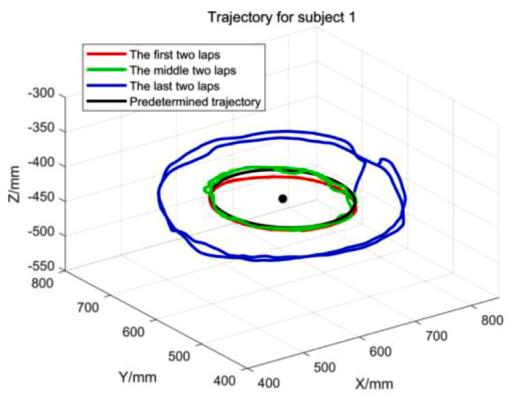

(a)  
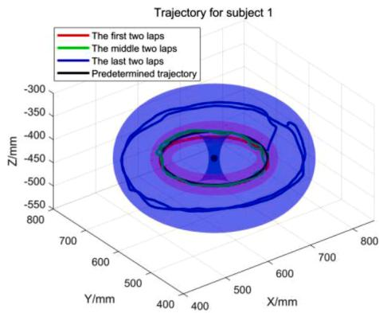  
(b)  
Fig. 6. 实验期间受试者 1 的轨迹。(a) 轨迹。(b) 带虚拟隧道的轨迹。

## 5. 结果与讨论

Fig. 6 中的红色通道和蓝色通道分别代表受试者 1 执行实验任务时机器人介导策略中三种模式的界限。红、绿、蓝和黑色曲线分别对应实验期间三种状态（懈怠、主动、欠佳）的实际轨迹以及预定轨迹。根据实验流程，后两圈主要集中在红色通道和蓝色通道之间，而前四圈则主要集中在红色通道内。

Fig. 8 展示了实验期间五名受试者在三种不同情况下实际轨迹与预定轨迹之间的轨迹跟踪误差 MAE 结果。五名受试者在前两圈的 MAE 分别为 7.3 mm、3.3 mm、6.5 mm、2.8 mm 和 2.6 mm；在第 3–4 圈的 MAE 分别为 6.2 mm、5.4 mm、7.1 mm、8.7 mm 和 5.0 mm；在最后两圈的 MAE 分别为 66.3 mm、73.1 mm、53.0 mm、65.1 mm 和 73.4 mm。

三种模式切换的边界由 Fig. 8 中的红黑虚线表示，该图还展示了机器人的辅助力与受试者 1 的轨迹跟踪误差之间的关系。与 Fig. $^ { 6 , }$ 中的结果一致，前四圈的运动主要集中在红色通道内，而最后两圈的运动主要集中在红色通道和蓝色通道之间，并且在最后两圈触发了 RIR 模式（如 Fig. 8 中的箭头所示）。Fig. 9 展示了实验期间五名健全受试者的 AAF 结果。前两圈的 AAF 分别为 8.2 N、5.3 N、7.5 N、4.7 N 和 4.3 N；第 3–4 圈的 AAF 分别为 1.4 N、1.3 N、1.4 N、1.4 N 和 1.3 N；最后两圈的 AAF 分别为 19.5 N、26.1 N、12.7 N、21.8 N 和 26.7 N。

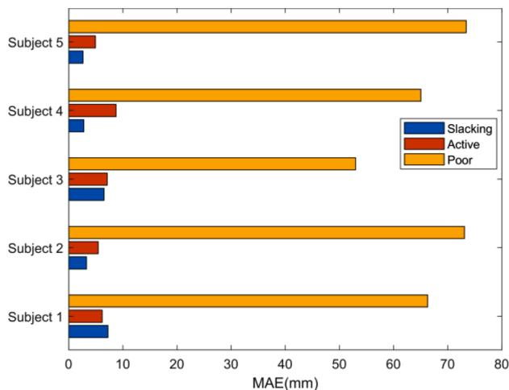  
Fig. 7. 五名健全受试者在不同情况下的 MAE 结果。

Fig. 10(a) 主要展示了机器人的总辅助力及其在三个方向上作用于受试者 1 的分力。受试者 1 与机器人末端之间的完整交互力矩如图 Fig. 10(b) 所示，其平均值为 1.9 N.m。

Fig. 11 主要展示了五名健全受试者分别在前两圈、第三至第四圈以及最后两圈期间 MAE 和 AAF 的均值与标准差。五名受试者的平均 MAE 和 AAF 在前两圈分别为 4.5 mm（STD：2.2 mm）和 5.7 N（STD：2.2 N），在第三和第四圈分别为 6.5 mm（STD：1.5 mm）和 1.3 N（STD：0.1 N），在最后两圈分别为 66.2 mm（STD：8.3 mm）和 21.4 N（STD：5.7 N）。

本文提出了一种用于连续跟踪运动的机器人辅助训练控制策略，该策略包含三种不同的辅助模式，并根据受试者的轨迹跟踪误差进行切换。此外，通过对五名健全受试者开展的一系列实验，对该控制策略的性能进行了初步验证与评估。如图 6 和图 8 所示，前四圈的运动（松弛和主动）主要集中在红色通道中，即机器人主要工作在 ZIF 模式，而后两圈（表现较差）主要工作在 AAN 模式和 RIR 模式。当控制策略在 ZIF 模式下工作且发生松弛时，机器人将提供固定的辅助力（在整个实验中设定为 1 N），以确保受试者的运动能够跟上预设的最小速度。然而，当受试者在红色通道内自主运动时（如图 6 和图 8 所示），受试者的轨迹跟踪误差极小，机器人的平均辅助力为 1.3 N。当控制策略工作在 AAN 模式且受试者的轨迹跟踪误差介于红色通道和蓝色通道之间时（如图 8 所示），机器人提供的辅助力将随着轨迹跟踪误差的增加而增大。阻抗刚度系数也会随着轨迹跟踪误差而变化。当轨迹跟踪误差大到偏离蓝色通道时（如图 8 所示，大约在 85 s 处），控制策略工作在 RIR 模式，机器人提供较大的辅助力以确保受试者的安全。

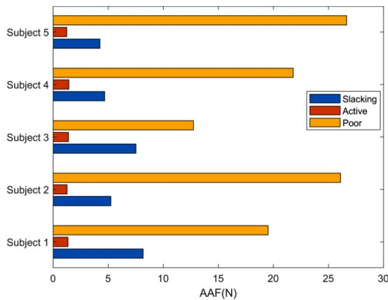  
Fig. 9. 五名健全受试者在不同情况下的 AAF 结果。

从五名健全受试者的实验结果可以看出，当控制策略在 ZIF 模式下工作且发生松弛时（前两圈），如图 7、图 9 和图 11 所示，平均 MAE 为 4.5 mm，平均 AAF 为 5.7 N。此处的平均辅助力大于预设值 1 N，主要是因为受试者处于放松状态，且受试者的手臂具有一定重力，机器人需要克服手臂重量来执行预定任务。因此，机器人必须克服手臂的重量来完成任务。当控制策略在没有松弛的 ZIF 模式下工作时（第三圈和第四圈），平均 MAE 和平均 AAF 分别为 6.5 mm 和 1.3 N。出于安全考虑，ZIF 模式下的阻抗刚度系数被设定为相对较低的值，因此机器人提供的辅助力并非严格等于零。该

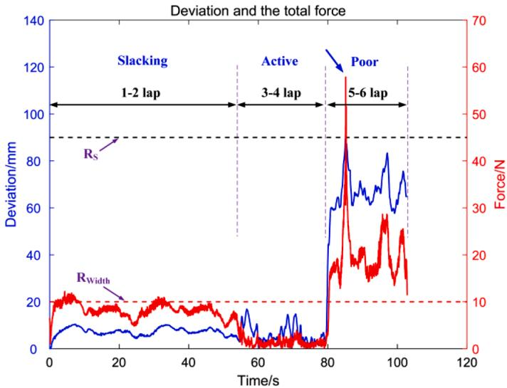  
Fig. 8. 机器人提供的总辅助力及受试者的轨迹跟踪误差。

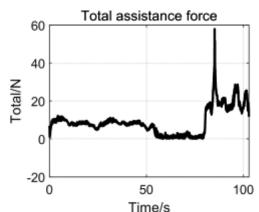

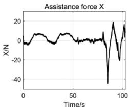

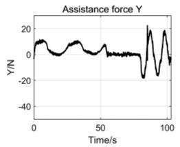

(a)  
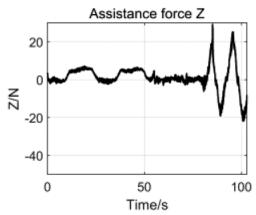

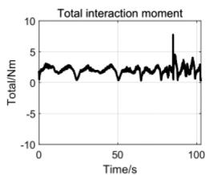

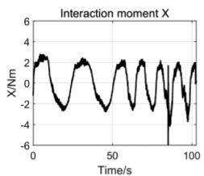

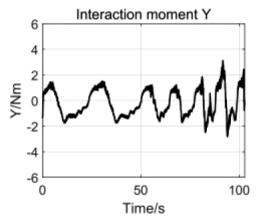  
(b)

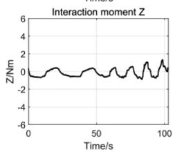

Fig. 10. 受试者与机器人之间的助力及交互力矩。(a) 为助力。(b) 为受试者与机器人之间的交互力矩。  
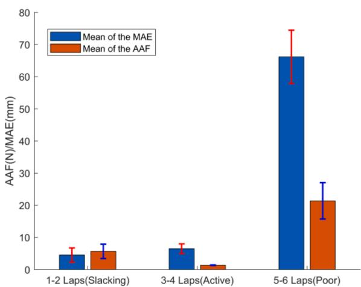  
Fig. 11. 5名健全受试者的 MAE 和 AAF 的均值及标准差。

实验结果表明，当控制策略工作在 AAN 模式（最后两圈）时，平均 MAE 为 66.2 mm，平均 AAF 为 21.4 N。从仿真结果（如图 4(b) 所示）和实验结果（如图 8 所示）可以看出，机器人根据受试者的轨迹跟踪误差来调整助力。当控制策略工作在 RIR 模式时，如图 8 所示（见箭头），机器人提供较大的助力，主要用于保障因表现欠佳而可能受到影响的受试者安全。由于在整个实验过程中旋转阻抗控制器的机器人期望姿态保持不变，受试者与机器人之间的交互力矩极小（平均值为 1.9 N.m，如图 10(b) 所示）。

基于末端执行器机器人辅助训练系统的传统 AAN 控制技术，可能会采用基于表现的控制策略，或通过监测速度域中的跟踪误差来提供 AAN 特性 [10, 28, 43]。本文提出的辅助控制策略能够为受试者提供空间和时间上的自由度，并根据受试者的运动表现自动切换控制策略的训练模式。由于不同患者的损伤程度各异，固定的辅助系数难以满足康复训练的需求 [44]。本文提出的机器人介导辅助控制策略能够根据受试者的运动表现调整刚度系数。由于较大的偏差意味着较差的运动表现，刚度因子以及机器人提供的辅助力会随着受试者偏差的增大而成比例增加。本研究中提出的辅助控制策略在高层控制器中具有可配置参数，研究的实验部分还使用预定的控制器参数评估了该控制策略的准确性和可行性。通过改变这些因素，可以使控制策略更加适宜。正如我们在引言中所述，调整控制策略的参数可以满足不同康复阶段的训练需求。

在涉及人机交互的场景中，对人机耦合动力学进行合理建模对于控制器的设计至关重要 [45, 46]，这可以为控制器的优化提供有用的见解。然而，在本文提出的控制策略中，我们将受试者的主动作用力视为机器人系统的外部力，而不是机器人控制系统的一部分。此外，在我们提出的辅助控制策略中，我们需要机器人在受试者手臂的运动表现变差时提供适当的辅助，而不是完全顺应受试者手臂的运动。

本研究存在一些局限性，可能会在后续研究中予以解决。末端执行器上还可以加装一个六维力传感器，以提升对交互力的测量能力。本研究招募了五名健康志愿者参与实验，以验证和评估所提出控制技术的有效性。为了推进其临床应用，有必要开展更多基于患者的实验研究，以证明所提控制策略的有效性。此外，后续研究应对人机耦合动力学进行建模，通过将受试者的主动发力作为控制器的一部分，以促进人机交互。

## 6. 结论

脑卒中后患者通常伴有一系列的损伤，并且在不同的康复阶段具有不同的康复训练需求。为了满足这些需求并促进主动参与度，本文提出了一种用于安全机器人辅助治疗的基于表现的助力控制策略。为了验证和评估该控制策略的性能，本研究招募了五名健全受试者，基于末端执行器式机器人辅助训练系统进行了一系列面向任务的实验。初步实验结果表明，所提出的基于表现的助力控制策略运行良好，能够根据受试者的运动表现很好地切换训练模式，并在不同模式下提供相应的助力。评估实验展示了所提出的控制策略在临床机器人辅助康复训练中的巨大潜力。

作为一项前瞻性研究，本工作仅招募了健全受试者进行实验。尽管如此，在下一阶段，需要进行基于患者的实验，以验证和评估所提出策略的性能与疗效，并在我们已取得的表现基础上帮助提高训练强度。

## CRediT 作者贡献声明

Leigang Zhang：方法学，软件，验证，调查，撰写——审阅与编辑，可视化。Shuai Guo：概念化，监督。Fengfeng Xi：监督，项目管理。

## 利益冲突声明

作者声明，他们没有已知可能看似影响本文所报道工作的竞争性经济利益或人际关系。

## 数据可用性

数据可根据合理要求提供。

## 致谢

本研究得到了国家自然科学基金（National Natural Science Foundation of China，资助号：61973205）和国家重点研发计划（China’s National Key Research and Development Program，资助号：2018YFC2001601）的支持。

## 补充材料

与本文相关的补充材料可在在线版本中找到，网址为 doi:10.1016/j.mechatronics.2022.102919。

## 参考文献

[1] Thrift AG, Cadilhac DA, Thayabaranathan T, Howard G, Howard VJ, Rothwell PM, Donnan GA Global stroke statistics, Int I Stroke 2013:9:6-18

[2] Kwakkel Gert. Impact of intensity of practice after stroke: issues for consideration. Disabil Rehabil 2006;28:823.

[3] Cortese M, Cempini M, Rogerio DARP, Soekadar SR, Carrozza MC, Vitiello N. A mechatronic system for robot-mediated hand telerehabilitation. IEEE/ASME Trans Mech 2015;20:1753 64

[4] Milot M-H, Spencer SJ, Chan V, Allington JP, Klein J, Chou C, Bobrow JE, Cramer SC, Reinkensmeyer DJ. A crossover pilot study evaluating the functional outcomes of two different types of robotic movement training in chronic stroke survivors using the arm exoskeleton BONES. J Neuroeng Rehabil 2013;10:112

[5] Jan Mehrholz, Marcus Pohl, Thomas Platz, Joachim Kugler, Bernhard Elsner. 机电与机器人辅助手臂训练用于改善中风后日常生活活动能力、手臂功能及手臂肌力. Cochrane Database Syst Rev 2018:CD006876.

[6] Mohebbi A. 康复与辅助中的人机交互：综述. Curr Rob Rep 2020;1:131 44.

[7] Roger G, Volker D. 用于治疗感觉运动障碍的康复机器人：神经生理学视角. J Neuroeng Rehabil 2018;15:46. -.

[8] T. Nef, M. Guidali, R. Riener, ARMin III——具有人体工学肩部驱动的手臂治疗外骨骼, 2009.

[9] Kim B, Deshpande AD. 用于促进肩肱节律的上半身外骨骼肩部机构控制. In: [C]//IEEE international conference on rehabilitation robotics; 2015

[10] Krebs HI, Ferraro M, Buerger SP, Newbery MJ, Makiyama A, Sandmann M, Lynch D, Volpe BT, Hogan N. 康复机器人：MIT-Manus 空间扩展的先导试验. J Neuroeng Rehabil 2004;1:1 15.

[11] Rui L, Amirabdollahian F, Topping M, Driessen B, Harwin W. 上肢机器人介导的中风治疗——GENTLE/s 方法. Auton Robots 2003;15:35–51.

[12] Chang WH, Kim YH. 脑卒中康复中的机器人辅助治疗. J Stroke 2013; 15:174–81.

[13] Lee S, Park G, Cho D, Kim H, Lee J-Y, Suyoung K, Park S-B, Shin J-H. 末端执行器型与外骨骼型康复机器人对中重度上肢功能障碍慢性脑卒中患者上肢功能影响的比较. Sci Rep 2020;10:1806.

[14] Neville Hogan. 阻抗控制：一种操作方法：第三部分 应用. J Dyn Syst Meas Control 1985.

[15] Joyo MK, Raza Y, Ahmed SF, Billah MM, Yusof ZM. 上肢康复机器人的优化比例-积分-微分控制器. Electronics (Basel) 2019;8:826. -.

[16] 机器人辅助上肢康复的高级控制技术综述. Adv Rob 2018:1 16.

[17] Narayan J, Kalita B, Dwivedy SK. 用于康复的基于机器人的上肢设备研发：系统综述. Augment Hum Res 2021;6.

[18] Proietti T, Crocher V, Roby-Brami A, Jarrasse N. 用于神经康复的上肢机器人外骨骼：控制策略综述. IEEE Rev Biomed Eng 2016: 4–14.

[19] Dalla Gasperina S, Roveda L, Pedrocchi A, Braghin F, Gandolla M. 上肢康复外骨骼患者协作控制策略综述. Front Rob AI 2021;8.

[20] Cauraugh J, Light K, Kim S, Thigpen M, Behrman A. 脑卒中后慢性运动功能障碍：通过肌电触发神经肌肉刺激恢复手腕和手指伸展. Stroke 2000;31:1360 4.

[21] Warraich Z, Kleim J. 神经可塑性：神经康复的生物学基础. PM R 2010;2:S208 19.

[22] Claude L, Moreno JC, Luis PJ. Human-robot interfaces in exoskeletons for gait training after stroke: state of the art and challenges. Appl Bionics Biomech 2014;9: 193–203.

[23] Azlan SYMA. Assist-as-needed control strategies for upper limb rehabilitation therapy: a review. J Mek 2019:57–74

[24] Mohd Khairuddin I, Sidek N, Md Yusof H, Baarath K, Abdul Majeed AP P. Assistiveas-needed strategy for upper-limb robotic systems: an initial survey. IOP Conf Ser Mater Sci Eng 2017;260:012027.

[25] Zhang L, Guo S, Sun Q. An assist-as-needed controller for passive, assistant, active, and resistive robot-aided rehabilitation training of the upper extremity. Appl Sci 2020;11.

[26] Grosmaire AG, Duret C. Does assist-as-needed upper limb robotic therapy promote participation in repetitive activity-based motor training in sub-acute stroke patients with severe paresis? NeuroRehabilitation 2017;41.

[27] Pehlivan A, Sergi F, O’Malley M. A subject-adaptive controller for wrist robotic rehabilitation. IEEE/ASME Trans Mech 2014;20.

[28] Asl HJ, Yamashita M, Narikiyo T, Kawanishi M. Field-based assist-as-needed control schemes for rehabilitation robots. IEEE/ASME Trans Mech 2020. 1-1.

[29] Duschau-Wicke A, Caprez A, Riener R. Patient-cooperative control increases active participation of individuals with SCI during robot-aided gait training. J Neuroeng Rehabil 2010;7:43.

[30] Maggioni S, Reinert N, Lünenburger L, Melendez-Calderon A. An adaptive and hybrid end-point/joint impedance controller for lower limb exoskeletons. Front Rob AI 2018;5.

[31] Agarwal P, Fern´andez Rodríguez B, Deshpande A. Assist-as-needed controllers for index finger module of a hand exoskeleton for rehabilitation. In: ASME 2015 dynamic systems and control conference; 2015.

[32] Zhang L, Guo S, Sun Q. Development and analysis of a bilateral end-effecter upper limb rehabilitation robot. J Mech Med Biol 2021.

[33] Zhang L, Guo S, Sun Q. Development and assist-as-needed control of an endeffector upper limb rehabilitation robot. Appl Sci 2020;10.

[34] Sun Q, Guo S, Zhang L. Kinematic dexterity analysis of human-robot interaction of an upper limb rehabilitation robot. Technol Health Care 2021;29:1029–45.

[35] Antonelli G, Arrichiello F, Chiaverini S. Experiments of formation control with multirobot systems using the null-space-based behavioral control. IEEE Trans Control Syst Technol 2009;17:1173 82.

[36] Dietrich A, Ott C, Albu-Sch¨affer A. An overview of null space projections for redundant, torque-controlled robots. Int J Rob Res 2015;34:1385–400.

[37] Penrose R. A generalized inverse for matrices, mathematical proceedings of the Cambridge philosophical society. Cambridge University Press; 1955. p. 406–13.

[38] Ott C. Cartesian impedance control of redundant and flexible-joint robots. Springer; 2008.

[39] Albu-Schaffer A, Ott C, Frese U, Hirzinger G. Cartesian impedance control of redundant robots: recent results with the DLR-light-weight-arms. In: 2003 IEEE International conference on robotics and automation (Cat. No. 03CH37422). IEEE; 2003. p. 3704–9.

[40] Casadio M, Sanguineti V. Learning, retention, and slacking: a model of the dynamics of recovery in robot therapy. IEEE Trans Neural Syst Rehabil Eng 2012; 20:286–96.

[41] Khatib O. Inertial properties in robotic manipulation: an object-level framework. Int J Rob Res 1995;14:19 36

[42] G. Schreiber, A. Stemmer, R. Bischoff, The fast research interface for the KUKA lightweight robot, 2010.

[43] Keller U, Rauter G, Riener R. Assist-as-needed path control for the PASCAL rehabilitation robot. In: International conference on rehabilitation robotics, 2013; 2013. p. 1–7.

[44] Guidali M, Duschau-Wicke A, Broggi S, Klamroth-Marganska V, Nef T, Riener R. A robotic system to train activities of daily living in a virtual environment. Med Biol Eng Comput 2011;49:1213 23.

[45] L. Roveda, A. Testa, A. Shahid, F. Braghin, D. Piga, Q-learning-based model predictive variable impedance control for physical human-robot collaboration, 2021.

[46] Roveda L, Maskani J, Franceschi P, Abdi A, Braghin F, Molinari Tosatti L, Pedrocchi N. Model-based reinforcement learning variable impedance control for human-robot collaboration. J Intellig Rob Syst 2020.

## L. Zhang 等人

Leigang Zhang 分别于2014年和2017年在安徽理工大学（Anhui University of Science and Technology）获得机械工程学士和硕士学位。他目前正在上海大学（Shanghai University）攻读机械工程及自动化专业的博士学位。他目前的研究兴趣包括机器人学、阻抗控制和上肢康复机器人。

Shuai Guo 于2006年在上海大学（Shanghai University）获得机械工程及自动化专业博士学位。他目前是上海大学教授，兼任上海机器人产业技术研究院（Shanghai Robot Industry Technology Research Institute）副院长。他的研究兴趣包括机器人学、康复机器人和工业机器人。

Fengfeng Xi 于1993年在多伦多大学（University of Toronto）获得机械工程博士学位。他目前是瑞尔森大学（Ryerson University）教授，兼任瑞尔森航空航天设计与创新研究所（Ryerson Institute for Aerospace Design and Innovation，RIADI）所长。他的研究方向包括计算动力学、智能飞机客舱与座椅设计，以及飞机制造自动化。