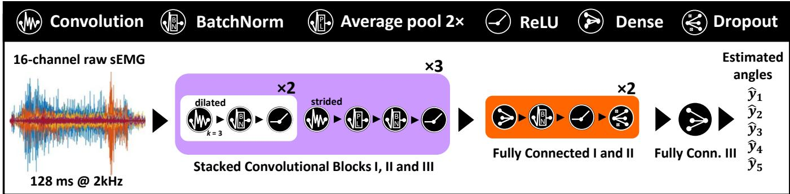
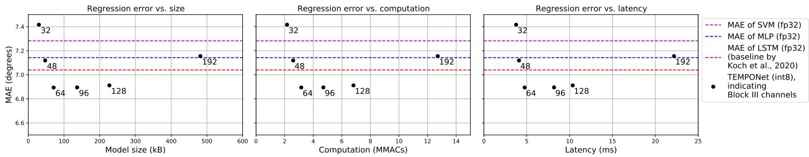
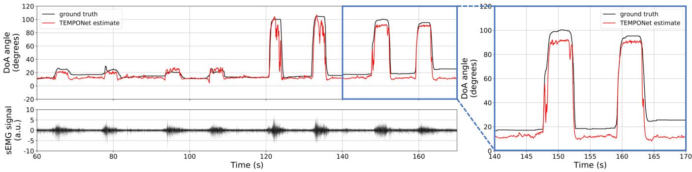

# sEMG-based Regression of Hand Kinematics with Temporal Convolutional Networks on a Low-Power Edge Microcontroller

Marcello Zanghieri1, Simone Benatti1,2, Alessio Burrello1, Victor Javier Kartsch Morinigo1, Roberto Meattini1, Gianluca Palli1, Claudio Melchiorri1, Luca Benini1,3

Abstract— Human-Machine Interfaces based on gesture control are a very active field of research, aiming to enable natural interaction with objects. Nowadays, one of the most promising State-of-the-Art (SoA) methodology for robotic hand control relies on the surface electromyographic (sEMG) signal, a non-invasive approach that can provide accurate and intuitive control when coupled with decoding algorithms based on Deep Learning (DL). However, the vast majority of the approaches so far have focused on sEMG classification, producing control systems that limit gestures to a predefined set of positions. In contrast, sEMG regression is still a new field, providing a more natural and complete control method that returns the complete hand kinematics. This work proposes a regression framework based on TEMPONet, a SoA Temporal Convolutional Network (TCN) for sEMG decoding, which we further optimize for deployment. We test our approach on the NinaPro DB8 dataset, targeting the estimation of 5 continuous degrees of freedom for 12 subjects (10 able-bodied and 2 trans-radial amputees) performing a set of 9 contralateral movements. Our model achieves a Mean Absolute Error of 6.89°, which is 0.15° better than the SoA. Our TCN reaches this accuracy with a memory footprint of only 70.9 kB, thanks to int8 quantization. This is remarkable since high-accuracy SoA neural networks for sEMG can reach sizes up to tens of MB, if deployment-oriented reductions like quantization or pruning are not applied. We deploy our model on the GAP8 edge microcontroller, obtaining 4.76 ms execution latency and an energy cost per inference of 0.243 mJ, showing that our solution is suitable for implementation on resource-constrained devices for real-time control.

## I. INTRODUCTION & RELATED WORKS

Human-Machine Interfaces (HMIs) for gesture control are gaining traction since they enable smart interaction with objects using natural hand gestures [1]. A popular approach to enable gesture control relies on mapping the Surface electromyography (sEMG) signals [2] on a set of intended gestures, using Machine Learning (ML) [3] and, more recently, Deep Learning (DL) techniques [4], [5].

Conventional ML algorithms, such as LDA, SVM, and ANN, achieve above 80% classification accuracy [3], [6], even though they are outperformed by DL models, which can leverage larger datasets, exploit feature learning, and handle time-windowing of the sEMG signal with no need for preliminary feature extraction [7], [8].

Although the use of the sEMG signal allows the conventional ML/DL approaches to control both gestures and grasps with a relative naturalness, the aforementioned systems are restricted to limited sets of predefined static positions (e.g. closed hand, pinch grasp, pointing index, etc.), which do not allow an entirely natural and versatile control.

As a result, targeting hand kinematics with sEMG-based regression is a promising research direction. Several DL approaches could tackle regression problems. However, most of them are computationally intensive and require a high memory footprint due to large model sizes [4], [5], [9], hampering deployability on edge devices with real-time execution constraints.

Thus, a DL reliable framework for energy-efficient platforms requires a careful multimodal HW-SW codesign. In particular, after finding a high-accuracy deep model, it is necessary to minimize its size (e.g., via quantization [10]), then determine the latency and power consumption of the model inference when it runs on the targeted embedded device. It is noteworthy that most convolutional networks proposed for sEMG reach State-of-the-Art (SoA) accuracy only at the cost of model size up to tens of MB [4], lacking deployment-oriented optimizations, such as stride and dilation, quantization [10], or pruning, which can cut down the model size by more than 10ˆ with only a marginal loss in accuracy [8].

The sEMG regression task has been addressed in several inspiring works, distinguished by the variable they target: kinematic (joint angle, joint velocity) or dynamic (finger force). The position of the joint angles represents the best indicator for hand kinematics, hence it is the most used parameter in hand gesture regression. For instance, in [11], the regression is targeted toward the joint angles of a dataglove, reaching a median $R ^ { 2 }$ of 0.63 using a Wiener filter. However, this work does not test other algorithms to improve the regression score since it is more focused on the control quality as perceived by users. In [12], a Long Short-Term Memory (LSTM) deep network is applied on the same dataset, yielding a Mean Absolute Error (MAE) of 7.04°. The limitation of this work is that it does not explore purely convolutional networks, which are more amenable to parallelization and hence more suitable for embedded control.

Alternative approaches to hand kinematics focus on the velocity of hand joint movements. For instance, velocity was targeted in [13], adopting a hybrid classification-regression setup which thresholds speed into 3 levels, thus still limiting the prediction to discrete classes. A completely orthogonal approach for sEMG regression focuses on hand dynamics instead of kinematics. The work [14] targeted a multiple-Degrees-of-Freedom (multi-DoF) force estimation However, force estimation is a more restricted application since it is limited to grasp movements.

A major shortcoming of all the aforementioned works is that none of them addresses the problem of deployment onto embedded control devices. In particular, they do not discuss how their models cope with resource-constrained platforms, nor explore techniques such as model search, quantization, and pruning.

In this work, we address the challenge of sEMG-based regression to decode hand kinematics. We propose a regression framework based on a Temporal Convolutional Network (TCN), a DL model for time series modeling suitable for real-time operation on resource-constrained devices. We present the following contributions:

‚ We apply the SoA TEMPONet TCN architecture on NinaPro DB8, a benchmark sEMG regression dataset also comprising trans-radial amputees, obtaining a Mean Absolute Error as low as 6.89°, which is 0.15° better than the dataset’s SoA even if our model’s bitwidth is reduced to int8, while the SoA network is float32.

‚ We further optimize our TCN framework, identifying the model size which yields the optimal tradeoff of regression error vs. memory footprint and multiply-andaccumulate (MAC) operations; we preserve regression accuracy, limiting the model size to 70.9 kB and the number of operations to 3.16 MMACs.

‚ We deploy our solution on the GAP8 edge microcontroller [15], measuring the performance in terms of latency and power consumption. We obtain 4.76 ms latency and 0.243 mJ energy cost per inference, demonstrating the suitability of our regression TEMPONet for edge low-power nodes working in real-time.

## II. MATERIALS & METHODS

## A. Surface Electromyographic Signal

The electromyography (EMG) signal [16], [17], [18] is an excellent indicator of muscle activity since it originates from the ion current through the muscular fibers’ membrane, triggered by electrical stimuli from the central nervous system propagating through motoneurons. The EMG typical amplitude and bandwidth are 10 µV´1 mV, and up to 2 kHz, respectively. What makes the EMG signal challenging is the intrinsic signal variability and the noise sources, mostly caused by floating ground, crosstalk, power line interference, and motion artifacts [6], [3].

sEMG is acquired with conductive electrodes placed on the skin surface above the muscles and collected by an instrumental differential amplifier. By virtue of its unobtrusiveness, sEMG is one of the most popular methods to esuccesfully nable Human-Machine Interfaces (HMIs).

## B. NinaPro Database 8

The Non-Invasive Adaptive hand Prosthetics Database 8 (NinaPro DB8) [11], [19] is a public sEMG database for finger position decoding, intended as a benchmark for estimation/reconstruction of kinematics instead of classification of gestures or grasps. In particular, contralateral movements are intended as a target for sEMG regression.

NinaPro DB8 comprises 10 able-bodied subjects and 2 right trans-radial amputees. All participants repeat 9 kinds1 of bilateral mirrored movements, lasting approximately 6 s´ 9 s (i.e., slow on purpose, for transient modelling), interleaved with approximately 3 s of rest. The muscular potential was recorded using 16 active double-differential sensors (from a Delsys Trigno IM Wireless EMG system), positioned on two rows of eight units around the participants’ right forearm in correspondence to the radiohumeral joint. Hand kinematics was acquired by an 18-Degree of Freedom (DoF) Cyberglove 2 worn on the left hand, contralateral to the sEMG electrodes forearm, measuring the angles of the 18 dataglove joints. All signals were upsampled to 2 kHz and post-synchronized.

In this $\mathbf { X } ( t ) \ \mapsto \ \mathbf { Y } ( t )$ multivariate regression formulation, the input information is the 16-channel sEMG signal, and the target is represented by 5 Degree of Actuations (DoAs), defined as linear combinations of the 18 DoF of the glove [11]. This DoF-to-DoA reduction serves to (i) discard or downscale irrelevant DoFs, and (ii) directly target DoAs defined as relevant hand movements.

The SoA on NinaPro DB8 is represented by the LSTM of [12],2 which attains a MAE of 7.04°. However, the proposed LSTM is not suitable for deployment on lowpower embedded platforms due to its float32 numeric format. Furthermore, the authors do not report the essential information about the number of hidden units, parameters, and MACs of the LSTM employed. Moreover, LSTMs are in general more difficult to train than convolutional models [21], a further downside that motivates our exploration of Temporal Convolutional Networks (as explained in the next Subsection II-C).

## C. Temporal Convolutional Networks

In this work, we address sEMG-to-kinematics regression treating the signal as a time series, exploring variants of the TEMPONet (Temporal Embedded Muscular Processing

  
Fig. 1. The TEMPONet TCN architecure, adapted for regression and further optimized compared to its first proposed version [7].

Online Network) topology [7], a Temporal Convolutional Network (TCN) designed for sEMG classification.

1) Background on TCNs: TCNs are a novel category of DL models that have become the SoA on several time-series tasks, outperforming Recurrent Neural Networks (RNNs) for both training tuning and accuracy [22], [21], [9]. The two specific properties of TCNs reside in their 1D convolutions along time: (i) causality: kernels only embrace a left-neighborhood of each sample, thus peeking at no future samples; (ii) dilation: a fixed step d is interleaved between filter inputs, thus widening the receptive field at constant model size. A dilated causal convolution works therefore as follows:

$$
\mathbf {y} _ {t} ^ {c _ {\text { out }}} = \operatorname{Conv} (\mathbf {x}) = \sum_ {c _ {\text { in }} = 1} ^ {C _ {\text { in }}} \sum_ {k = 0} ^ {K - 1} \mathbf {W} _ {k} ^ {c _ {\text { in }}, c _ {\text { out }}} \mathbf {x} _ {t - d \cdot k} ^ {c _ {\text { in }}}\tag{1}
$$

with x and y input and output feature map respectively, t time index, $c _ { \mathrm { i n } }$ and $c _ { \mathrm { o u t } }$ input and output channel respectively, K kernel size $\mathbf { W } \in \mathbb { R } ^ { K \times ^ { \bullet } C _ { \mathrm { i n } } \times C _ { \mathrm { o u t } } }$ filter tensor, and d dilation.

2) TEMPONet Architecture: The network we propose in this work is a further development of SoA TEMPONet [7] TCN. In addition to modifying it to target regression, we present a model exploration aimed at identifying the best tradeoff between accuracy and network size. The net’s architecture, shown in Figure 1, features 3 Convolutional Blocks, each stacking:

‚ 2 dilated causal convolutions with kernel size 3, variable dilation d, and full padding;

‚ 1 convolution with kernel size 5, variable stride s, followed by an average pooling (kernel 2, stride 2).

The 3 convolutional blocks have dilation d “ 2, 4, 8 and stride $s = 1 , 2 , 4$ , respectively. In our novel exploration for a more efficient TEMPONet, we reduce the channels of the 3 convolutional blocks compared to the original model of [7]. We halve Block I’s channels from 32 to 16, halve Block II’s channels from 64 to 32, and we explore different channel numbers for Block III, namely 32, 48, 64, 96, 128, and 192, searching for the best tradeoff between regression error and deployment metrics, i.e. model size, MACs, latency, and energy consumption. This model search on TEMPONet is novel, since it is not performed in the paper first proposing it [7].

After the convolutional blocks, 3 Fully Connected (FC) layers perform the classification. FC I has 4ˆ units as Block III’s channels (variable number as explained right above), FC II has 32 units, and FC III has 5 units, corresponding to the 5 DoAs target of the regression. All layers, except FC III, have Rectified Linear Unit (ReLU) non-linearity as activation function and are equipped with Batch-Normalization (BN) to counter internal covariate shift [23]. FC I and FC II are trained with dropout with $p _ { \mathrm { d r o p } } ~ = ~ 0 . 5 .$ , to help regularization [24].

The optimized TEMPONet we propose processes a 256 samples input window (128 ms @ 2 kHz) with less than 500 k parameters. It is fed by raw signals, thus with no preprocessing or feature extraction overhead. Size and computation improvements of the final selected architecture compared to the original TEMPONet are detailed in Section III.

## D. Experimental Setup Details

1) Dataset Split: For each of the 12 subjects of NinaPro DB8, 3 sessions are provided. As recommended by the dataset’s authors, session 3 (2 repetitions per movement) was used as test set. Sessions 1 and 2 (10 repetitions per movement) were merged and used in a 2-fold crossvalidation setup.

2) Preprocessing: The NinaPro DB8 signals made available at [19] have already been bandpass-filtered with a 4th- order Butterworth between 10 Hz and 500 Hz. Classical ML models, namely Support Vector Machine (SVM) and Multi-Layer Perceptron (MLP), which need feature extraction on every signal window, were trained on the Waveform Length (WL) feature extracted from 60 ms-windows of each channel, with a slide of 100 ms for SVM (largest computationally affordable training set size) and 25 ms for MLP. For the SVM, the Radial Basis Function (RBF) kernel was used, applied to the data scaled to unit variance, and the C coefficient was tuned separately for each target DoA. TCN were directly trained on raw sEMG signals, using time windows of 128 ms (i.e., 256 samples @ 2 kHz).

3) Machine Learning Setup: Models were implemented in Python 3.8, using Scikit-learn 0.23 for SVM and MLP and PyTorch 1.6 for TCNs. The SVM used is a RBF kernel SVM, and the MLP was implemented with 3 hidden layers.

  
Fig. 2. Deployment metrics of our TEMPONet on GAP8 [15], as a function of the number of channels of Convolutional Block III.

  
Fig. 3. Example of the regression produced by our TEMPONet: test session of subject 1, DoA angle 5; sEMG signal from sensor 1 shown for reference.

TCNs were trained with MAE loss, AdaM optimizer, initial learning rate $1 \cdot 1 0 ^ { - 4 }$ , and minibatch size 64. First, 19 epochs were run in float32 format; then, post-training quantization to 8 bit (i.e., int8) was performed, and 1 last epoch of quantization-aware training was run, using PArameterized Clipping acTivation (PACT) [10] as implemented by NEMO (NEural Minimizer for tOrch, [25], [26]), an open-source library for CNN minimization to target deployment on highly memory-constrained ultra-low power devices.

4) Model output post-processing: The outputs of all models were post-processed with an Exponential Moving Average (EMA):

$$
y _ {t} ^ {\prime} = \alpha_ {\mathrm{EMA}} \cdot y _ {t - 1} ^ {\prime} + (1 - \alpha_ {\mathrm{EMA}}) \cdot y _ {t},\tag{2}
$$

with $y$ and $y ^ { \prime }$ the unfiltered and filtered signal, respectively, t the time index, and $\alpha _ { \mathrm { E M A } } ~ \in ~ [ 0 , 1 ]$ the decay factor. The decay factor αEMA was tuned per-subject, per-DoA, for each model (after the model’s training), using only training data and optimizing by grid search3. This optimization is consistent with the ML setup (since no test data are used), and is performed to tune the compromise between the EMA’s beneficial smoothing and the inertia deriving from the weight of past values. It is worth remarking that the EMA is computed using only outputs $y _ { t }$ from the present and the past: thus, it adds no delay to the setup. The empirical values obtained for the decaying factor $\alpha _ { \mathrm { E M A } }$ are reported in the Results (Section III).

## III. EXPERIMENTAL RESULTS

## A. Evaluation metrics

Assessing the effectiveness of a regression framework on the end-to-end control of a robotic hand is not a trivial task. The evaluation of the MAE is certainly important but it is necessary to consider, for instance, that a difference between the value of estimated angles and the ground truth has a greater impact on control when it occurs during movements rather than in static phases.

For this reason, we measure the models’ regression quality by MAE (measured in degrees), and by a regression accuracy defined as the frequency of the MAE being below a tolerance $\Theta _ { \mathrm { t o l } } \colon$

$$
\Theta_ {\mathrm{tol}} \text {-accuracy} \triangleq \frac {1}{T} \sum_ {t = 1} ^ {T} \mathbb {I} _ {\Theta_ {\mathrm{tol}}} (\mathrm{MAE} (t))\tag{3}
$$

where I denotes the indicator function

$$
\mathbb {I} _ {\Theta_ {\mathrm{tol}}} (\mathbf {M A E} (t)) \triangleq \left\{ \begin{array}{l l} 1 & \quad \text { if } \mathbf {M A E} (t) <   \Theta_ {\mathrm{tol}} \\ 0 & \quad \text { otherwise }. \end{array} \right.\tag{4}
$$

We select empirically a regression-accuracy threshold $\Theta _ { \mathrm { t o l } } =$ $1 0 ^ { \circ } , 1 5 ^ { \circ }$

These metrics are reliable measures of the end-to-end quality of the control for several reasons: (i) they are related to the actual scale of angular positions; (ii) they are statistically representative, since averages are taken over joints, movements, and subjects, including two trans-radial amputees; (iii) MAE is first-order, hence less affected by outliers than the regression $R ^ { 2 }$ . The regression accuracy, based on a threshold, is even more robust.

TABLE I  
REGRESSION QUALITY OF THE EXPLORED MODELS, COMPARED TO THE SOA OF THE NINAPRO DB8.

<table><tr><td>Model</td><td>Format</td><td>MAE</td><td> $10^{\circ}$ -accuracy</td><td> $15^{\circ}$ -accuracy</td></tr><tr><td>SVM</td><td>fp32</td><td> $7.28^{\circ}$ </td><td>0.795</td><td>0.883</td></tr><tr><td>MLP</td><td>fp32</td><td> $7.14^{\circ}$ </td><td>0.799</td><td>0.889</td></tr><tr><td>LSTM [12]</td><td>fp32</td><td> $7.04^{\circ}$ </td><td>n.a. $^{1}$ </td><td>n.a. $^{1}$ </td></tr><tr><td>TEMPONet $^{2}$ </td><td>int8</td><td> $6.89^{\circ}$ </td><td>0.814</td><td>0.900</td></tr></table>

1Correctness Scores (CS) of [12] are accuracies, but are somewhat cherry-picked since per-joint tolerances are fixed as percentiles after dynamic range clipping.  
2Best one selected: Block III with 64 channels.

## B. Models comparison

The results shown in Table I and Figure 2 report the tested ML (SVM and MLP) and DL (TEMPONet) algorithms along with the LSTM of [12], used as baseline. In particular, Figure 2 depicts the search of the optimal size for the regression TEMPONet, varying the channels of Block III over the values 32, 48, 64, 96, 128, 196 (as explained in Subsection II-C.2).

From Table I, we can see that conventional ML frameworks can not match the state-of-the-art accuracy: the SVM reaches $7 . 2 8 ^ { \circ } ~ ( \mathrm { i . e . , ~ + 0 . 2 4 ^ { \circ } }$ compared to SoA), while the MLP obtains a MAE of $7 . 1 4 ^ { \circ } ( \mathrm { i . e . , ~ + 0 . 1 0 ^ { \circ } }$ compared to SoA). Moreover, the SVM has two further limitations: (i) trying to improve the SVM’s accuracy by increasing the training set size proved unfeasible due to diverging training time; (ii) even with the tuned $C ^ { \bullet } ,$ which regulate the bias-variance tradeoff per-DoA, the SVM incorporates on average 98.3% of the training examples as support vectors (16-dimensional), which amounts to 1.15 MB of memory, which is demanding for embedded devices with strict memory constraints. Note that the latter problem is an inherent methodological limitation of SVM, whose size can not be fixed a priori before training.

TCNs are the only model which proved capable of outperforming the SoA MAE. All reported TEMPONet’s results refer to networks quantized to int8 format, which reduces the memory footprint by 4ˆ compared to fp32. As can be seen from Figure 2, the smallest and largest TEMPONet experimented show higher errors, indicating that they produce underfitting and overfitting, respectively, thus identifying the best bias-variance tradeoff in the in-between interval t64, 96, 128u. When Convolutional Block III has 64, 96, or 128 channels, TEMPONet’s regression is equally accurate. It is remarkable that the baseline is surpassed even operating at a lower precision. In Table I, we report the MAE and regression-accuracy of our TEMPONet-64 against the the LSTM of [12] and against the SVM and MLP implemented in this work.

In particular, with 64-channel Block III, our TEMPONet has an elbow in the curves regarding model size and MACs, thus representing the best MAE-vs-deployment tradeoff. This 64-channel TEMPONet has a memory footprint of just 70.9 kB and requires the computation of 3.16 MMACs, which represent a memory reduction of 6.5ˆ and a computation reduction of 5.3ˆ compared to the original TEMPONet proposed in [7].

In Figure 3, we showcase an example of the regression output provided by this network. In particular, it is possible to observe that the output is prompt and accurate for both narrow and wide movements. The typical errors fall into two main categories. The first kind of error is an offset, stationary during each movement; since the output is stationary as well, this constant difference is not expected to affect the user’s perceived accuracy; and, if perceived, offsets can be easily compensated via session-specific recalibration. The second kind of error are fast erratic segments, which could be smoothed out by strengthening the EMA post-processing; the optimal amount of EMA smoothing was optimized as explained in Subsection II-D.3, to tune the smoothing-delay tradeoff best for the MAE; the average decay factor obtained was $\alpha _ { \mathrm { E M A } } = 0 . 8 6 2$ , with a standard deviation of 0.044 across subjects and DoA.

Finally, we proceeded to implement the 64-channels TEM-PONet on the commercial microcontroller GAP8 [15], to measure latency and energy cost per inference. For deployment, we used the open-source tool DORY (Deployment Oriented to memoRY, [27]), with an extension to the backend to support dilated convolutions. Computation latency and energy consumption were measured experimentally, running inferences on GAP8. The energy consumption $E _ { \mathrm { e x p } }$ was determined by experimentally measuring the current consumed, $i _ { \mathrm { e x p } } ( t )$ , then integrating over the computation time interval:

$$
E _ {\mathrm{exp}} = V _ {\mathrm{DD}} \int_ {0} ^ {T _ {\mathrm{exp}}} i _ {\mathrm{exp}} (t) \mathrm{d} t,\tag{5}
$$

where $V _ { \mathrm { D D } }$ is the supply voltage and $[ 0 , T _ { \mathrm { e x p } } ]$ is the latency time interval required of the inference, measured experimentally.

When running at $V _ { \mathrm { D D } } ~ = ~ 1 \mathrm { V } , ~ f _ { \mathrm { C L K } } ~ = ~ 1 0 0 \mathrm { M H z }$ (the most energy-efficient configuration), GAP8 has a power consumption of 51.0 mW. This yields a latency of just 4.76 ms per inference, with an energy cost of just 0.243 mJ per inference. These values demonstrate that the selected 64- channel TEMPONet can fit the strict constraints of resourcelimited controllers and real-time operation. Regarding latency, the consensus on real-time requirements for artificial hand control is 300 ms [28]. Accounting for the 128 ms input window length, plus the 4.76 ms computation latency, our application matches real-time requirements with a wide margin, proving capable to provide a fluid control without a relevant perceived delay.

## IV. CONCLUSIONS

In this work, we have presented a setup for sEMG-based hand kinematics estimation based on a Temporal Convolutional Network, which achieves a lower regression error than the SoA of the targeted dataset, with the numerical precision reduced from float32 to int8. We deployed our model on a low-power edge microcontroller, showing low memory footprint, computation, and energy cost per inference, thus proving the suitability of our solution for implementation on resource-limited embedded controllers working in real-time.

## REFERENCES

[1] R. Meattini, S. Benatti, U. Scarcia, L. Benini, and C. Melchiorri, “Experimental evaluation of a sEMG-based human-robot interface for human-like grasping tasks,” in 2015 IEEE International Conference on Robotics and Biomimetics (ROBIO). IEEE, 2015, pp. 1030–1035.

[2] T. Scott Saponas et al., “Making muscle-computer interfaces more practical,” in Proceedings of the SIGCHI Conference on Human Factors in Computing Systems, 2010, pp. 851–854.

[3] B. Milosevic et al., “Exploring Arm Posture and Temporal Variability in Myoelectric Hand Gesture Recognition,” Int. Conf. on BioRob, 2018.

[4] Y. Hu, Y. Wong, W. Wei, Y. Du, M. Kankanhalli, and W. Geng, “A novel attention-based hybrid cnn-rnn architecture for semg-based gesture recognition,” PloS one, vol. 13, no. 10, p. e0206049, 2018.

[5] P. Tsinganos et al., “Improved gesture recognition based on semg signals and tcn,” in ICASSP 2019-2019 IEEE International Conference on Acoustics, Speech and Signal Processing (ICASSP). IEEE, 2019, pp. 1169–1173.

[6] B. Milosevic, S. Benatti, and E. Farella, “Design challenges for wearable emg applications,” in Design, Automation & Test in Europe Conference & Exhibition (DATE), 2017. IEEE, 2017, pp. 1432–1437.

[7] M. Zanghieri et al., “Robust real-time embedded emg recognition framework using temporal convolutional networks on a multicore iot processor,” IEEE transactions on biomedical circuits and systems, vol. 14, no. 2, pp. 244–256, 2019.

[8] M. Zanghieri, S. Benatti, F. Conti, A. Burrello, and L. Benini, “Temporal variability analysis in semg hand grasp recognition using temporal convolutional networks,” in 2020 2nd IEEE International Conference on Artificial Intelligence Circuits and Systems (AICAS). IEEE, 2020, pp. 228–232.

[9] J. L. Betthauser et al., “Stable electromyographic sequence prediction during movement transitions using temporal convolutional networks,” in Int. Conf. NER. IEEE, 2019.

[10] J. Choi et al., “Pact: Parameterized clipping activation for quantized neural networks,” 2018.

[11] A. Krasoulis et al., “Effect of user practice on prosthetic finger control with an intuitive myoelectric decoder,” Frontiers in neuroscience, vol. 13, p. 891, 2019.

[12] P. Koch et al., “Regression of hand movements from semg data with recurrent neural networks,” in 2020 Int. Conf. EMBC, 2020.

[13] A. Krasoulis et al., “Myoelectric digit action decoding with multioutput, multi-class classification: an offline analysis,” Scientific reports, vol. 10, no. 1, pp. 1–10, 2020.

[14] C. Castellini and P. Van Der Smagt, “Surface emg in advanced hand prosthetics,” Biological cybernetics, vol. 100, no. 1, pp. 35–47, 2009.

[15] https://greenwaves-technologies.com/gap8 gap9/.

[16] J. Cacioppo et al., “The skeletomotor system.” 1990.

[17] C. J. De Luca et al., “The use of surface electromyography in biomechanics,” Journal of applied biomechanics, 1997.

[18] R. M. Rangayyan, Biomed. signal analysis. John Wiley & Sons, 2015.

[19] http://ninaweb.hevs.ch/DB8.

[20] T. Bao, Y. Zhao, S. A. R. Zaidi, S. Xie, P. Yang, and Z. Zhang, “A deep kalman filter network for hand kinematics estimation using semg,” Pattern Recognition Letters, vol. 143, pp. 88–94, 2021.

[21] S. Bai et al., “An empirical evaluation of generic convolutional and recurrent networks for sequence modeling,” 2018.

[22] C. Lea et al., “Temporal convolutional networks for action segmentation and detection,” in IEEE Conf. CVPR, 2017.

[23] S. Ioffe and C. Szegedy, “Batch normalization: Accelerating deep network training by reducing internal covariate shift,” in International conference on machine learning. PMLR, 2015, pp. 448–456.

[24] N. Srivastava, G. Hinton, A. Krizhevsky, I. Sutskever, and R. Salakhutdinov, “Dropout: a simple way to prevent neural networks from overfitting,” The journal of machine learning research, vol. 15, no. 1, pp. 1929–1958, 2014.

[25] https://github.com/pulp-platform/nemo.

[26] F. Conti, “Technical report: Nemo dnn quantization for deployment model,” 2020.

[27] A. Burrello, A. Garofalo, N. Bruschi, G. Tagliavini, D. Rossi, and F. Conti, “Dory: Automatic end-to-end deployment of real-world dnns on low-cost iot mcus,” 2020.

[28] B. Hudgins, P. Parker, and R. N. Scott, “A new strategy for multifunction myoelectric control,” IEEE transactions on biomedical engineering, vol. 40, no. 1, pp. 82–94, 1993.