# Continuous Motion Prediction for Upper Limb Rehabilitation Robotics Based on Surface Electromyography: A Spatio-Temporal Attention and Lightweight TCN Approach

Weiyu Chen1, Pengcheng Li1\*, Shuxiang Guo1,2\*, Chunying Li1, Jun Leng1

1The Department of Electronic and Electrical Engineering, Southern University of Science and Technology

Shenzhen, Guangdong 518055, China

2The Aerospace Center Hospital, School of Life Science and the Key Laboratory of

Convergence Medical Engineering System and Healthcare Technology, Ministry of Industry and Information Technology,

Beijing Institute of Technology, Beijing 100081, China

Corresponding authors: guo.shuxiang@sustech.edu.cn, lipc@sustech.edu.cn

Abstract— Surface electromyography (sEMG) has shown considerable promise for controlling upper limb rehabilitation exoskeletons. However, the significant inter-subject variability in sEMG signals poses a challenge for developing models that generalize effectively across individuals. A novel spatiotemporal attention mechanism integrated with a lightweight temporal convolutional network (STA-TCN) is proposed in this paper to address this challenge and enable subject-independent continuous motion prediction. By incorporating a dual-path (spatial and temporal) attention mechanism, the spatial (muscle channel) and temporal (movement phase) features related to sEMG signals are selectively emphasized, eliminating the need for subject-specific retraining. A Cable-driven Upper-Limb Rehabilitation Exoskeleton (CURE) is designed, for which continuous motion prediction was employed. An experiment with 6 participants demonstrated that STA-TCN outperforms traditional models in continuously predicting elbow angles, achieving lower root mean square error (RMSE) (14.77◦ vs 15.25◦) and R2 values approaching the current highest results (0.91 vs 0.93) across users. The method also met real-time processing requirements with a latency of 1.5 ms per prediction, making it suitable for deployment in real-time rehabilitation robotics. The proposed method can provide an effective solution for personalized and adaptable robotic rehabilitation systems, enhancing motion prediction accuracy without dependency on individual calibration.

Index Terms— Continuous motion prediction, Spatiotemporal attention, Temporal Convolutional Network (TCN), Upper limb rehabilitation exoskeloton, Surface electromyography (sEMG)

## I. INTRODUCTION

Stroke is a leading cause of disability worldwide, often resulting in upper limb hemiplegia that severely impacts daily activities and quality of life [1]. Early intensive rehabilitation is crucial for recovery [2], but traditional therapy requires prolonged, supervised training, creating financial and physical burdens for patients, families, and therapists [3]. This highlights the need for innovative rehabilitation methods that provide effective, individualized therapy with reduced dependency on constant professional supervision.

Robotic rehabilitation devices, such as exoskeletons, have emerged as promising solutions to these challenges, as they facilitate repetitive, precise, and quantitatively assessable rehabilitation training [4]. Effective interaction between individuals and these rehabilitation systems critically depends on accurately decoding neural intent to translate physiological signals into actionable robotic commands in real-time. Surface electromyography (sEMG) signals, due to their ease of collection and high temporal resolution, have become a widely used physiological signal in exoskeleton devices, facilitating effective control and interaction between users and robotic systems.

Neural signal decoding methods have evolved signifi cantly, with recent advancements addressing key challenges in accuracy and generalization [5]. Earlier studies often relied on biomechanical modeling or traditional machine learning techniques, and these approaches faced limitations due to complex parameter estimation and sensitivity to individual variability [6]. Recently, deep learning-based methods have made significant advances in the field, offering effective tools for modeling the complex, high-dimensional, and temporal relationships inherent in sEMG data, leading to improved accuracy and robustness in decoding motion intentions [7] [8] [9] [10]. Bao et al. [11] proposed a CNN-LSTM hybrid model that first extracts deep spatial features from sEMG signals using CNN, followed by LSTM-based sequence regression to capture long-term temporal dependencies, sig nificantly improving wrist kinematics estimation accuracy compared to standalone CNN or LSTM models. Zanghieri et al. [12] proposed a lightweight Temporal Convolutional Network (TCN) for sEMG-based hand kinematics regression, achieving high accuracy and maintain a minimal memory footprint, outperforming recurrent models in motion estimation. Zabihi et al. [13] proposed the TraHGR framework, a Transformer-based hybrid architecture for hand gesture recognition using sEMG signals. By integrating parallel temporal and feature Transformer networks, their approach enhanced classification accuracy over existing deep learning models and improved robustness to signal variability. Zhang et al. [14] combined multichannel EMG signal features with a Kalman filter to estimate continuous pronation-supination movements. Their hybrid approach achieved high accuracy in real-time exoskeleton control, demonstrating the potential of integrating deep learning with traditional filtering techniques. Wu et al. [15] used reinforcement learning to estimate joint moments with sEMG, improving accuracy and reducing reliance on extensive training data.

Despite these diversified advancements, deep learning (DL)-based methods are still subject to limitations in intersubject generalization and real-time adaptability due to significant inter-subject variability in neuromuscular patterns, anatomical differences, and electrode placement variations [7]. Various strategies have been explored to enhance generalization of DL-based method. Li et al. [8] proposed a twostage genetic algorithm (GA)-based feature selection (TS-GAFS) method, which applies the minimum redundancy maximum relevance (mRMR) criterion to select invariant features, improving the independence of sEMG-based movement estimation. However, this method still relies on predefined feature sets, limiting its adaptability to dynamic variations in muscle activation across individuals. Long et al. [16] introduced transfer learning strategies, including fine-tuning pre-trained models with new subject data, which enhanced generalization but required labeled data from each new user, restricting real-world applicability. Li et al. [9] applied a multi-source domain adaptation (MDA) approach to reduce domain shift by learning invariant features from multiple users, achieving improved generalization. However, the method required substantial computational resources, leading to excessive delays that restrained real-time prediction.

In summary, the existing research on sEMG decoding faces the following challenges:

1) Real-time efficiency: Many models require high computational resources, limiting portability and immediate applicability.

2) Cross-subject variability: High variability in sEMG signals necessitates user-specific calibration, restricting generalization to new users.

This paper addresses the challenge of inter-subject generalization in sEMG-based continuous motion prediction for upper limb rehabilitation by proposing a novel spatiotemporal attention mechanism that does not rely on target user data and can meet the requirement of real-time application. Inspired by recent successes in video captioning [17] and location recommendation tasks [18], the attention mechanism independently computes and integrates spatiotemporal attention to selectively emphasize relevant signal features spatially (across muscle channels) and temporally (across time segments). The proposed method can extract user-invariant features from sEMG signals without requiring prior calibration or fine-tuning for each individual. The lightweight TCN architecture integrated into the model ensures computational efficiency, enabling seamless real-time processing while maintaining high decoding accuracy.

The main contributions of this paper are as follows:

1) Proposed a spatio-temporal attention mechanism specifically designed for sEMG-based continuous motion prediction to improve cross-subject generalization.

2) Development and integration of this attention mechanism with a lightweight TCN model, achieving accurate, real-time continuous angle estimation across multiple users without subject-specific retraining.

The remainder of this paper is organized as follows: Section II details the methods, including system setup and the proposed model architecture; Section III presents experimental results; Section IV discusses the findings and implications; and Section V concludes the proposed STA-TCN method.

## II. PROPOSED METHODS

## A. Upper Limb Rehabilitation Exoskeleton Overview

Surface electromyography (sEMG) signals have been widely applied for real-time joint angle estimation, facilitating intuitive control of upper limb rehabilitation devices. In this paper, the proposed trajectory planning and rehabilitation strategy is verified using an upper limb robot named CURE shown in Fig. 1.

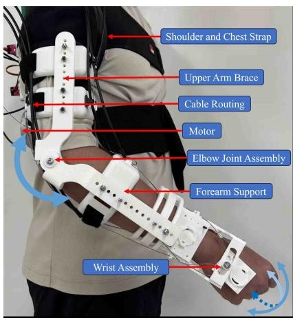  
Fig. 1 Upper limb exoskeleton device.

CURE is designed as a portable, home-based rehabilitation system capable of assisting three degrees of freedom (DoFs): elbow flexion/extension, wrist flexion/extension, and wrist supination/pronation, while also accommodating three passive DoFs at the shoulder joint. A cable-driven mechanism is employed for its lightweight nature and flexibility, allowing motors to be positioned away from the exoskeleton’s moving components to minimize direct weight burden on the user’s arm. Four compact motors are secured on a supportive backboard, worn comfortably by users via waist and shoulder straps. Specifically, one motor drives elbow flexion/extension, while three servo motors facilitate wrist movements.

To enhance intuitive robotic assistance based on user intention, we developed a real-time sEMG control system comprising four key components: (1) Signal preprocessing using embedded Myo device filters (Butterworth high-pass, notch, and normalization) combined with RMS sliding window filtering; (2) A Lite Temporal Convolutional Network with spatio-temporal attention mechanisms; (3) Regression layer mapping 256-channel features to motion outputs; (4) Quantitative evaluation through MAE, RMSE , and R² metrics. The workflow progresses sequentially from raw sEMG acquisition to real-time performance validation.

## B. Experimental Protocol

1) Participants: A total of six healthy adults—three males and three females, aged 22 to 25—were enrolled in this research. None reported any history of neuromuscular disorders. Each volunteer, labeled A through F. All participants received an explanation of the experimental procedure and signed an informed consent form.

2) Experimental Setup: The data acquisition platform, shown in Fig. 2, employs a Myo armband (Thalmic Labs Inc.) fitted with eight evenly spaced sEMG sensors. Fig. 2 (b) illustrates the placement of these electrodes on the armband. The Myo device transmits sEMG signals wirelessly via Bluetooth Low Energy (BLE) to a computer, and data are sampled in real time at 200 Hz using the Myo SDK. An Inertial Measurement Unit (IMU) (JY901, WIT Motion, Shenzhen, China; as shown in Fig. 2(c)) was attached to the forearm and sampled at 20 Hz to record elbow motion for validating sEMG-based predictions.

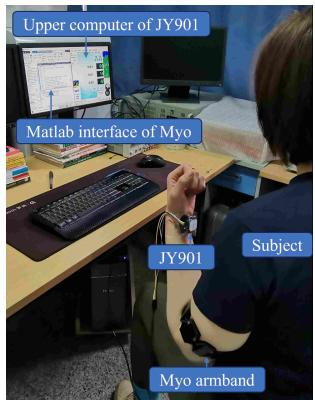

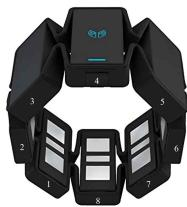

(b) Electrode arrangement.  
(a) Schematic of the experimenta data acquisition.  
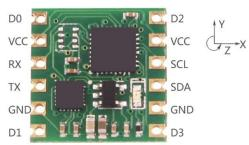  
(c) The IMU sensor.  
Fig. 2 (a) Schematic of the experimental data acquisition. (b) Electrode arrangement. (c) The IMU sensor.

3) Channel Selection for Myo Armband: In accordance with the recommendation in [19], three channels were deemed optimal. Consequently, channels 4, 7, and 1 were selected, corresponding respectively to the biceps, triceps (long head), and triceps (lateral head).

4) Data Acquisition: Participants performed a synchronization movement, confirmed by tactile feedback and a solid LED indicator, to ensure stable electrode-muscle contact. Each one-minute trial consisted of resting, elbow flexionextension, and a return to rest, repeated five times with twominute breaks to prevent fatigue.

5) sEMG Signal Preprocessing: Raw sEMG signals are weak and prone to noise, requiring preprocessing for reliable analysis. The Myo armband includes a built-in 50 Hz notch filter to eliminate power line interference and the Myo SDK provides pre-normalized signals in the range of [−1, 1]. A fourth-order Butterworth high-pass filter at 20 Hz was applied to remove DC offset and low-frequency noise. To account for the non-stationary nature of sEMG, a sliding window Root Mean Square (RMS) filter was used to extract muscle activation intensity. For each selected channel (1, 4, 7), signals were smoothed over a 100-sample (0.5 s) window, and square-rooted to obtain the RMS envelope used in subsequent analysis.

## C. Modeling and Angle Estimation of the CURE

To address cross-subject variability in sEMG-based joint angle estimation, we propose a hierarchical architecture integrating dual attention pathways with temporal convolution operations (Fig. 3). Key innovations include:

• Decoupled spatio-temporal attention pathways capturing spatial and temporal dependencies

• Lightweight temporal convolutional backbone opti mized for real-time processing.

1) Spatio-Temporal Attention Mechanism:

a) Spatial Attention Pathway: The spatial attention pathway models neuromuscular activation patterns through learnable channel interactions. The spatial attention weights $\alpha _ { s } \in \mathbb { R } ^ { C }$ are computed via multi-scale temporal convolution followed by channel bottleneck projection:

$$
\alpha_ {s} = \operatorname{Sigmoid} \left(\mathcal {P} _ {b} \left(\operatorname{Conv1D} _ {1 5} (X)\right)\right),\tag{1}
$$

where Conv $\mathrm { . D _ { 1 5 } }$ denotes 15-tap temporal convolution with padding, and $\mathcal { P } _ { b } : \mathbb { R } ^ { 6 4 \times T }  \mathbb { R } ^ { \bar { C } \times T }$ represents the bottleneck projection through $1 \times 1$ convolutions. This design captures inter-channel muscle synergies.

b) Temporal Attention Pathway: The temporal attention pathway employs relative positional encoding $P _ { t } \in \mathbb { R } ^ { T \times T }$ to model phase continuity in limb movements. The attention computation is formulated as:

$$
\mathbf {A} _ {t} = \mathrm{Softmax} \Bigl (\frac {Q _ {t} K _ {t} ^ {\top}}{\sqrt {d _ {k}}} + P _ {t} \Bigr) V _ {t},\tag{2}
$$

where queries $Q _ { t } ,$ keys $K _ { t } ,$ , and values $V _ { t }$ are derived from layer-normalized input features. The positional encoding matrix $P _ { t }$ is learned through gradient descent, enabling automatic discovery of movement phase relationships without explicit kinematic constraints.

The temporal features are obtained through value aggregation:

$$
X _ {t} = \mathbf {A} _ {t} V.\tag{3}
$$

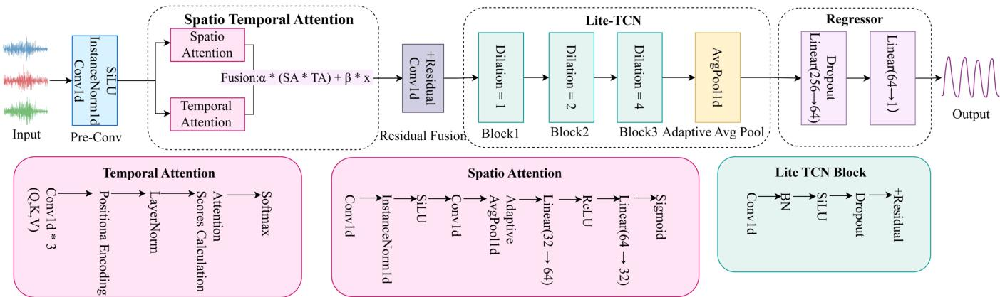  
Fig. 3 Dual-path spatio-temporal attention network with hierarchical temporal convolutions.

c) Adaptive Feature Fusion: The spatial and temporal attention features are combined through parametric fusion with residual connections:

$$
X _ {\mathrm{fusion}} = \gamma \cdot (\alpha_ {s} \odot X _ {s}) + (1 - \gamma) \cdot X _ {t} + \mathcal {P} _ {r} (X)\tag{4}
$$

where dynamic coefficient $\gamma \in [ 0 , 1 ]$ automatically balances spatial muscle synergy and temporal phase features.

2) Lightweight Temporal Network:

a) Depthwise separable convolutions with geometric dilation:

$$
\operatorname{DSConv} (k = 1 5, d = 2 ^ {l - 1}), \quad \mathrm{RF} = 1 + \sum_ {i = 1} ^ {L} 1 4 \cdot 2 ^ {i - 1}\tag{5}
$$

With kernel size $k = 1 5$ and dilation rates $d = [ 2 ^ { 0 } , 2 ^ { 1 } , 2 ^ { 2 } ]$ this achieves a 425 ms temporal window (at 200 Hz sampling rate), enabling effective modeling of complete movement cycles.

b) Bottleneck Architecture: Channel expansion 32 → $6 4  1 2 8  2 5 6$ prevents overfitting while maintaining feature abstraction.

3) Implementation Details: The model was implemented in PyTorch with mixed-precision training (FP16/FP32) and optimized using AdamW $( \beta _ { 1 } ~ = ~ 0 . 9 , ~ \beta _ { 2 } ~ = ~ 0 . 9 9 9 )$ with cosine annealing learning rate scheduling $( T _ { m a x } = 1 0 0 )$ . The temporal convolutional blocks employ dropout $( p = 0 . 1 )$ ) and batch normalization for regularization.

4) Evaluation Criteria: For quantitative evaluation, the selected criteria include the Root Mean Square Error (RMSE), Mean Absolute Error (MAE), and the coefficient of determination (R2).

## III. EXPERIMENTAL RESULTS

This section presents the evaluation of the proposed STA-TCN model’s performance through offline experiments. A baseline TCN model is used as the primary benchmark, with comparisons made against other existing approaches for a comprehensive performance analysis. All experiments were conducted on a Linux server running Ubuntu and equipped with an NVIDIA GeForce RTX 4090 GPU. Model training and inference were implemented in Python using the PyTorch framework, while raw sEMG data from the Myo armband was transmitted via Bluetooth Low Energy (BLE) for integration with the exoskeleton control system.

## A. Comparative Performance with Baseline

A direct comparison was conducted between the proposed STA-TCN approach and a baseline TCN model to assess predictive performance in estimating joint angles from sEMG signals. As shown in Table I, STA-TCN achieves significantly lower Mean Absolute Error (MAE) and Root Mean Square Error (RMSE) while attaining a higher coefficient of determination $( R ^ { 2 } )$ , demonstrating superior performance in both error reduction and variance explanation.

TABLE I  
PERFORMANCE COMPARISON BETWEEN THE PROPOSED STA-TCN AND THE BASELINE TCN

<table><tr><td>Method</td><td>MAE</td><td>RMSE</td><td> $R^2$ </td></tr><tr><td>STA-TCN</td><td>11.53°</td><td>14.77°</td><td>0.91</td></tr><tr><td>TCN</td><td>17.04°</td><td>21.27°</td><td>0.89</td></tr></table>

Fig. 4 further illustrates the comparative results and underlying mechanisms. The columns (a, d, g), (b, e, h), and (c, f, i) correspond to data from three distinct subjects respectively. Subfigures (a)–(c) display the predicted and ground-truth angles for both STA-TCN and TCN under representative motion sequences. Subfigures (d)–(f) quantify the error differences between methods. Subfigures (g)–(i) represent the attention-weight heatmaps derived from the STA module, underscoring how the network emphasizes consistent movement patterns while effectively downplaying subject variability.

## B. Comparison with Existing Studies

Beyond the baseline assessment, additional comparisons were made to prior research on sEMG-driven joint angle estimation, illustrating how our method surpasses established approaches (Table II). The proposed model demonstrates lower RMSE and superior $\bar { R } ^ { 2 }$ values, highlighting its effectiveness in decoding multi-channel sEMG.

Notably, our model achieves an RMSE of 14.77◦, outperforming several alternative methods in terms of both prediction accuracy and stability. Furthermore, the $R ^ { 2 }$ value of 0.91 highlights a strong correlation between the estimated and ground-truth angles, emphasizing the robustness of our model’s performance across different subjects.

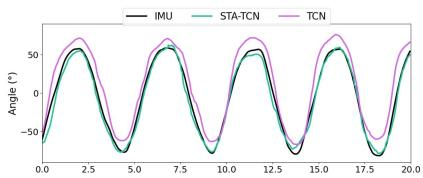  
(a)

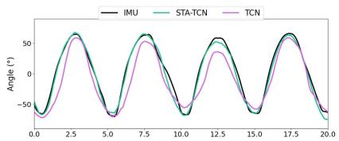

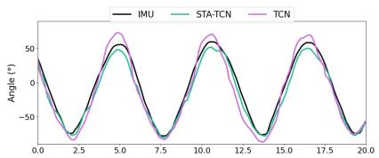

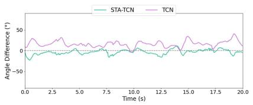  
(b)  
(c)

(d)  
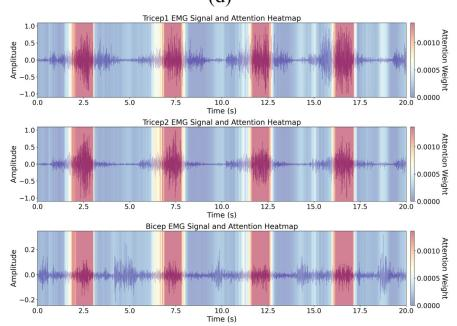

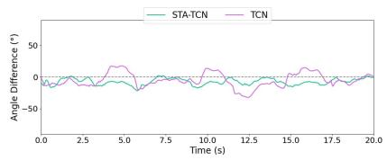

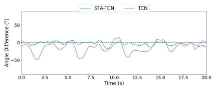

(g)  
(e)  
(f)  
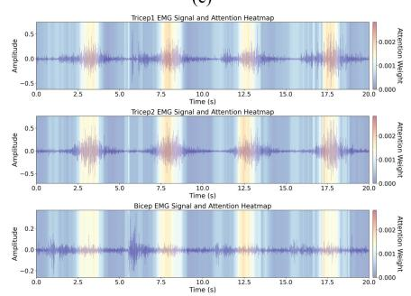  
(h)

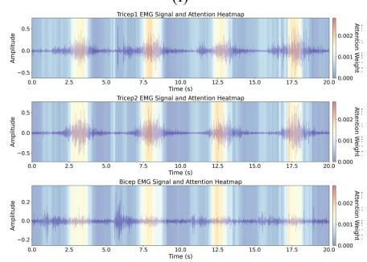  
(i)  
Fig. 4 Outcomes comparison and attention patterns from three subjects. Subfigures (a)–(c): predicted joint angles of STA-TCN and TCN versus ground-truth data. Subfigures (d)–(f): error distributions of the two methods. Subfigures (g)–(i): STA attention heatmaps.

TABLE II  
COMPARATIVE RESULTS WITH OTHER METHODS

<table><tr><td>Method</td><td>RMSE</td><td> $R^2$ </td></tr><tr><td>Yang [20]</td><td>20.44°</td><td>0.89</td></tr><tr><td>Li [8]</td><td>17.40°</td><td>0.90</td></tr><tr><td>Li [10]</td><td>15.25°</td><td>0.93</td></tr><tr><td>Zhao [21]</td><td>17.59°</td><td>0.91</td></tr><tr><td>This Paper</td><td>14.77°</td><td>0.91</td></tr></table>

## IV. DISCUSSION

This study introduces a novel spatio-temporal attention mechanism integrated with a lightweight Temporal Convolutional Network (STA-TCN) for real-time, cross-subject joint angle estimation using surface electromyography (sEMG) signals. The experimental results demonstrate that the proposed method outperforms both a baseline Temporal Convolutional Network (TCN) and several approaches in terms of RMSE and $R ^ { 2 }$

A direct comparison between the STA-TCN model and the baseline TCN model revealed significant improvements in joint angle estimation accuracy. As shown in Table I, STA-TCN achieved a reduction in Mean Absolute Error (MAE) from $1 7 . 0 4 ^ { \circ }$ to 11.53◦ and a reduction in Root Mean Square Error (RMSE) from 21.27◦ to 14.77◦. In addition, the $R ^ { 2 }$ value for STA-TCN was 0.91, surpassing the baseline TCN’s $R ^ { 2 }$ of 0.89. These results highlight the superior performance of the proposed spatio-temporal attention mechanism in capturing complex, high-dimensional relationships within the sEMG signals. The attention mechanism helps the model selectively focus on relevant features both spatially (across muscle channels) and temporally (across time segments), leading to improved accuracy in predicting joint angles.

In addition to some indicators of prediction accuracy, this method also outperforms some existing methods in terms of generalizability and real-time performance. Yang et al.’s approach requires individual training, limiting its ability to generalize across different users. Li et al. [10] did not explicitly address the challenge of generalization across different subjects, as it was evaluated only on a small, fixed group of participants. In contrast, the proposed STA-TCN method demonstrated strong generalization across multiple subjects, as verified by the leave-one-out experiment we used, which covered six different participants without the need for specific retraining for each individual. Li et al. [9] introduced a multi-source domain adaptation (MDA) approach to enhance generalization across subjects. While their method showed promising results, it suffered from high computational complexity, resulting in serious delay and cannot meet the requirements of HRIs. This limitation makes their approach unsuitable for real-time rehabilitation applications where low latency is critical. In contrast, our method achieves real-time performance with 1.5 ms latency per IMU angle prediction on 1500-sample input sequences when running on an NVIDIA GeForce RTX 4090 GPU. This low-latency processing meets the real-time requirements for prosthetic control, making our method suitable for practical rehabilitation systems.

Despite the promising results, the proposed method currently has some limitations. The model was validated and run on a GPU and had not yet been implemented on portable hardware, such as embedded systems or edge devices. Deploying the model on lightweight, portable devices would make it more suitable for home-based rehabilitation applications. Additionally, this method has been validated only for simple periodic movements of the elbow joint, which involves relatively few muscles. It remains unclear whether this approach can achieve comparable performance in situations involving other joints with more and redundant muscles, or if the movements become random or less structured. Exploring the model’s effectiveness in these more complex scenarios presents an important direction for future research.

## V. CONCLUSION

This paper proposed the spatial temporal attention and light-weight temporal convolutional network (STA-TCN) model to improve joint angle estimation in upper limb rehabilitation systems. The proposed method effectively addressed the challenges of inter-subject variability and realtime estimation, offering superior performance in both prediction accuracy and generalization across multiple subjects. By leveraging spatio-temporal attention, the model selectively emphasized relevant features in sEMG signals, leading to more precise motion estimation without the need for subject-specific retraining. Specifically, the STA-TCN model achieved an RMSE of 14.77◦, outperforming the TCN-only model’s RMSE of 21.27◦. The integration of the lightweight TCN architecture ensured computational efficiency, with only 1.5 ms latency per angle prediction, making the model suitable for real-time applications in robotic rehabilitation. Future work will focus on its deployment on portable, embedded devices, as well as investigating the model’s performance on more complex joints and less structured movements.

## ACKNOWLEDGMENT

This work was supported in part by the High level of special funds under Grant G03034K003 from Southern University of Science and Technology, Shenzhen, China, in part by the Shenzhen ”Medical Engineering Integration” Special Support Program Project under Grant F-2024-Z99-502365, Shenzhen, China.

## REFERENCES

[1] V. L. Feigin, M. Brainin, B. Norrving et al., ”World Stroke Organization (WSO): Global Stroke Fact Sheet 2022,” Int. J. Stroke, vol. 17, no. 1, pp. 18-29, 2022.

[2] J. Shahid, A. Kashif and M. K. Shahid, ”A Comprehensive Review of Physical Therapy Interventions for Stroke Rehabilitation: Impairment-Based Approaches and Functional Goals,” Brain Sci., vol. 13, no. 5, p. 717, 2023.

[3] R. Raghavan, E.E. Fitzsimmons-Craft, R.R. Welch, et al., “Costeffectiveness of train-the-trainer versus expert consultation training models for implementing interpersonal psychotherapy in college mental health settings: evidence from a national cluster randomized trial,” Implement. Sci., vol. 19, Art. no. 55, 2024.

[4] L. Song, C. Ju, H. Cui et al., ”Research on Control Strategy Technology of Upper Limb Exoskeleton Robots: Review,” Machines, vol. 13, no. 3, Art. no. 3, Mar. 2025.

[5] S. P. Sitole and F. C. Sup, “Continuous Prediction of Human Joint Mechanics Using EMG Signals: A Review of Model-Based and Model-Free Approaches,” IEEE Trans. Med. Robot. Bionics, vol. 5, pp. 528-546, 2023.

[6] Z. Wei, Z.Q. Zhang and S.Q. Xie, “Continuous Motion Intention Prediction Using sEMG for Upper-Limb Rehabilitation: A Systematic Review of Model-Based and Model-Free Approaches,” IEEE Trans. Neural Syst. Rehabil. Eng., vol. 32, pp. 1487-1504, 2024.

[7] H. Li, S. Guo, D. Bu and H. Wang, “Inter-subject variability evaluation of continuous elbow angle from sEMG using BPNN,” in Proc. IEEE Int. Conf. Mechatron. Autom. (ICMA), Guangxi, China, pp. 388-393, 2022.

[8] H. Li, S. Guo, D. Bu and H. Wang, “A two-stage GA-based sEMG feature selection method for user-independent continuous estimation of elbow angles,” IEEE Trans. Instrum. Meas., vol. 72, pp. 1-9, 2023.

[9] H. Li, S. Guo, H. Wang and D. Bu, “Subject-Independent Continuous Estimation of sEMG-Based Joint Angles Using Both Multisource Domain Adaptation and BP Neural Network,” IEEE Trans. Instrum. Meas., vol. 72, pp. 1-10, 2023.

[10] H. Li, S. Guo, D. Bu, H. Wang and M. Kawanishi, “Subject-Independent Estimation of Continuous Movements Using CNN-LSTM for a Home-Based Upper Limb Rehabilitation System,” IEEE Robot. Autom. Lett., vol. 8, pp. 6403-6410, 2023.

[11] T. Bao, S.A.R. Zaidi, S. Xie, P. Yang and Z.-Q. Zhang, “A CNN-LSTM Hybrid Model for Wrist Kinematics Estimation Using Surface Electromyography,” IEEE Trans. Instrum. Meas., vol. 70, Art. no. 2503809, pp. 1-9, 2021.

[12] M. Zanghieri et al., “sEMG-based regression of hand kinematics with temporal convolutional networks on a low-power edge microcontroller,” in Proc. IEEE Int. Conf. Omni-Layer Intell. Syst. (COINS), Barcelona, Spain, pp. 1-6, 2021.

[13] S. Zabihi, E. Rahimian, A. Asif and A. Mohammadi, “TraHGR: Transformer for Hand Gesture Recognition via Electromyography,” IEEE Trans. Neural Syst. Rehabil. Eng., vol. 31, pp. 4211-4224, 2023.

[14] L. Zhang, J. Long, R.G. Zhao, H. Cao and K. Zhang, “Estimation of the continuous pronation-supination movement by using multichannel EMG signal features and Kalman filter: Application to control an exoskeleton,” Front. Bioeng. Biotechnol., vol. 9, Art. no. 771255, 2022.

[15] W. Wu, K.R. Saul and H. Huang, “Using reinforcement learning to estimate human joint moments from electromyography or joint kinematics: An alternative solution to musculoskeletal-based biomechanics,” J. Biomech. Eng., vol. 143, Art. no. 044502, 2021.

[16] Y. Long, Y. Geng, C. Dai and G. Li, “A transfer learning based crosssubject generic model for continuous estimation of finger joint angles from a new user,” IEEE J. Biomed. Health Inform., vol. 27, pp. 1914-1925, 2023.

[17] C. Yan et al., “STAT: Spatial-Temporal Attention Mechanism for Video Captioning,” IEEE Trans. Multimedia, vol. 22, no. 1, pp. 229-241, 2020.

[18] Y. Luo, Q. Liu, and Z. Liu, ”STAN: Spatio-Temporal Attention Network for Next Location Recommendation,” in Proc. Web Conf. 2021, Ljubljana Slovenia, pp. 2177-2185, 2021.

[19] S. Y. Shirazi, J. Welzel, S. Jeung and L. Godbersen, “A standardized framework for sensor placement in human motion capture and wearable applications,” arXiv preprint arXiv:2412.21159, 2024.

[20] Z. Yang, S. Guo, Y. Liu, H. Hirata and T. Tamiya, “An intention-based online bilateral training system for upper limb motor rehabilitation,” Microsyst. Technol., vol. 27, pp. 211-222, 2021.

[21] Y. Zhao, Z. Zhang, Z. Li, Z. Yang, A. A. Dehghani-Sanij and S. Xie, “An EMG-driven musculoskeletal model for estimating continuous wrist motion,” IEEE Trans. Neural Syst. Rehabil. Eng., vol. 28, pp. 3113-3120, 2020.