文章

# 基于表面肌电信号的人体下肢多关节连续运动估计

Yonglin Han 1 , Qing Tao 1,\* 以及 Xiaodong Zhang 2

1 新疆大学机械工程学院（School of Mechanical Engineering, Xinjiang University），乌鲁木齐 830047，中国

2 西安交通大学机械工程学院（School of Mechanical Engineering, Xi’an Jiaotong University），西安 710049，中国

通信作者：taoqing@xju.edu.cn

摘要：多关节角度估计在下肢康复、运动控制和外骨骼机器人等领域具有重要意义。精确的关节角度估计有助于评估关节功能、辅助康复训练并优化机器人控制策略。然而，利用表面肌电（surface electromyography, sEMG）信号估计不同运动模式（如行走、越障、深蹲和膝关节屈伸）下的多关节角度仍是一项挑战。在本研究中，提出了一种用于下肢多关节角度连续运动估计的模型（CB-TCN：时间卷积网络 + 卷积块注意力模块 + 时间卷积网络 [temporal convolutional network + convolutional block attention module + temporal convolutional network]）。该模型将时间卷积网络（TCN）与卷积块注意力模块（CBAM）相结合，以增强特征提取能力并提高预测精度。该模型能够有效捕获下肢运动中的时序特征，同时通过 CBAM 的注意力机制增强对关键特征的关注。为了提高模型的泛化能力，本研究采用滑动窗口数据增强方法扩充训练样本，从而提高模型对不同运动模式的适应能力。通过对 8 名受试者在行走、越障、深蹲和膝关节屈伸这四种典型下肢运动下的实验验证，结果表明 CB-TCN 模型在准确性和鲁棒性方面均优于传统模型。具体而言，在行走过程中的膝关节角度预测中，该模型的 R2 值高达 0.9718，RMSE 低至 1.2648◦，NRMSE 值低至 0.05234。这些发现表明，结合 TCN 和 CBAM 的模型在预测下肢关节角度方面具有显著优势。所提出的方法在促进下肢康复和运动分析方面具有广阔的应用前景。

学术编辑：Luca Miceli

收稿日期：2024年12月21日 修订日期：2025年1月21日 录用日期：2025年1月21日 发表日期：2025年1月24日

引用格式：Han, Y.; Tao, Q.; Zhang, X. Multijoint Continuous Motion Estimation for Human Lower Limb Based on Surface Electromyography. Sensors 2025, 25, 719. https://doi.org/10.3390/s25030719

版权：© 2025 作者所有。由瑞士巴塞尔 MDPI 出版。本文是一篇遵循知识共享署名 (CC BY) 许可协议 (https://creativecommons.org/ licenses/by/4.0/) 条款和条件分发的开放获取文章。

关键词：sEMG；不同运动模式；TCN；多关节角度估计；TCN: CBAM

## 1. 引言

表面肌电（Surface electromyography, sEMG）作为一种反映肌肉活动的生物电信号，在下肢运动估计中具有重要的应用价值 [1,2]。它能够捕获与关节运动高度相关的动态肌肉活动信息，为下肢康复 [3]、运动控制 [4] 以及外骨骼机器人 [5] 提供关键的技术支持。行走、爬楼梯、坐下和站立等日常活动对研究而言具有重要意义 [6]。对这些运动模式进行连续运动估计，不仅有助于理解人体运动控制的复杂性，还为机器人设计以及人机交互系统的开发提供了理论基础和技术支持 [7]。然而，在不同的运动模式和个体差异下，基于表面肌电（sEMG）信号保持下肢多关节连续运动估计的准确性，一直是一项长期的挑战。

当前，基于表面肌电（surface electromyography, sEMG）信号的下肢运动意图识别研究主要分为两部分。一种方法侧重于利用 sEMG 信号识别离散的人体运动模式 [8–10]。许多研究人员致力于利用 sEMG 信号识别更广泛的运动模式并获得更高的识别准确率。这些研究的重点在于特征提取方法和分类算法。另一种方法涉及利用 sEMG 信号估计人体关节的连续运动 [11–13]。基于 sEMG 信号的运动模式分类仅能预测预先定义的运动模式，并识别有限数量的离散姿态。它不能直接用作控制器的输入来实现连续控制，这严重影响了外骨骼的协调性与顺应性。因此，研究人员已逐渐将理论和应用研究的重点转向基于 sEMG 信号的连续运动估计。在构建 sEMG 信号与下肢关节连续运动之间的回归模型时，大多数研究人员都集中于 sEMG 特征工程和模型选择，以实现更好的估计性能。例如，L. F. Sommer 等人 [14] 提出了一种维纳模型（Wiener model）方法，利用手臂肌肉的 sEMG 信号来估计肘关节角度。Xie 等人 [15] 采用通过黄金分割算法优化的广义回归神经网络（generalized regression neural network, GRNN）模型（GS-GRNN），以大腿肌肉 sEMG 信号的均方根特征和髋关节角度作为输入来预测下肢关节角度。Liu 等人 [16] 提出了一种改进的基于特征的卷积神经网络（convolutional neural network, CNN）模型，用于膝关节角度的连续估计。研究使用 6 通道 sEMG 采集系统和光学动作捕捉系统记录了正常行走过程中的 EMG 信号和关节角度。结果表明，改进后的 CNN 模型能够以更高的精度预测膝关节角度。

近年来，许多研究人员利用深度学习方法基于表面肌电（sEMG）信号来估计人体运动的连续关节角度 [17–19]。时间卷积网络（TCN）是一种适用于处理时序数据的神经网络架构。与循环神经网络（RNN）相比，TCN 在处理长期依赖关系和并行计算方面具有显著优势 [20]。例如，Chen 等 [21] 提出了一种大规模时间卷积网络（LS-TCN），专注于基于 sEMG 信号的连续运动估计。该模型用于预测六种抓握动作过程中 10 个关节的角度，取得了 71.6% 的准确率。Wang 等 [22] 提出了一种跨受试者的 TCN-BiLSTM 深度学习模型。与长短期记忆网络（LSTM）、人工神经网络（ANN）以及门控循环单元（GRU）相比，结合双向长短期记忆的时间卷积网络（TCN-BiLSTM）模型在估计髋、膝和踝关节的角度与力矩时展现出了更高的准确率，证明了其鲁棒性和实用性。Du 等 [23] 提出了一种基于 sEMG 信号的关节角度预测模型，用于腕部运动角度变化的连续估计。该模型结合了 TCN 和 LSTM 网络的优势；利用 TCN 提取 sEMG 信号的局部特征和深层信息，而 LSTM 则利用其时间记忆能力弥补 TCN 在捕获长期依赖关系方面的局限性，从而提升预测性能。

本研究的主要贡献如下：

(1) 提出了一种 CB-TCN 网络，该网络结合了 TCN 与 CBAM，用于估计下肢髋、膝和踝关节的角度。TCN 捕获时间特征，而 CBAM 通过其注意力机制增强模型对关键时刻和特征的关注，从而提高预测精度。

(2) 通过步态、跨越障碍物、深蹲和膝关节屈伸这四种常见的下肢运动对模型的性能进行了验证。在不同运动场景下测试了其性能，并与以下四种经典模型进行了对比：编码器-解码器时间卷积网络（ED-TCN）、TCN、LSTM 以及 Wiener 滤波器。本研究对其优势和性能提升进行了全面评估。

本研究旨在评估利用从 sEMG 信号中提取的包络来估计各种日常活动中关节角度的 CB-TCN 模型。本文的结构安排如下：第 2 节介绍实验设置；第 3 节详细讨论研究方法；第 4 节讨论实验结果及其分析；第 5 节总结研究发现并概述未来研究的潜在方向。

## 2. 实验设置

## 2.1. 实验设计

本研究招募了 8 名健康志愿者（6 名男性和 2 名女性），平均年龄为 23 ± 1.73 岁，平均身高为 173.75 ± 7.3 cm，平均体重为 $6 2 . 5 \pm 1 1 . 4 6 \mathrm { k g } .$ 。所有参与者均签署了知情同意书，并同意将实验数据和图像用于科学研究目的。该实验获得了西安交通大学（Xi’an Jiaotong University）伦理委员会的批准，批准编号为：2024YS239。所有实验程序均按照《赫尔辛基宣言》（Declaration of Helsinki）的相关规定进行。

实验设计包括以下四种运动模式：步态、跨越障碍、深蹲和膝关节屈伸。具体安排如下：

1. 步态：每位参与者在大约 5.5 s 内完成此实验，步行速度控制在 2 $\mathbf { m } / \mathbf { s } ,$，共进行 5 次试验。步态涉及行走过程中下肢关节的动态变化，有助于分析正常行走的关节角度变化和步态周期。尽管该速度（相当于 7.2 km/h）超过了典型的步行速度（通常在 1.2–1.5 m/s 左右），但特意选择该速度是为了模拟快走或快速移动状态，从而更全面地评估模型在此类场景下的性能。

2. 跨越障碍：每位参与者在大约 5 s 内完成此实验，共进行 5 次试验。跨越障碍模拟了跨过障碍物时的下肢运动，提供了短时间内快速运动的角度变化数据。

3. 深蹲：每位参与者在大约 25 s 内完成此实验，每次深蹲动作重复 10 次，共进行 5 次试验。该运动模式旨在模拟日常生活中的深蹲和起立动作，适用于研究下肢的动态控制和关节角度变化。

4. 膝关节屈伸：每位参与者在大约 20 s 内完成此实验，每次膝关节屈伸动作重复 10 次，共进行 5 次试验。该运动模式主要侧重于膝关节的屈伸，可有效测试膝关节角度的连续变化。

在此实验过程中，参与者被要求以其自然节奏完成每项任务。每节实验后提供 5 min 的休息时间以确保恢复。

## 2.2. 数据采集

人体下肢的持续行走能力源于驱动下肢完成所需动作的多块肌肉的协调作用。采样频率设置为 100 Hz。在本次实验动作中。下肢每侧至少包含 30 块肌肉，协同工作以使用表面肌电传感器记录肌电……实现 7 个自由度的运动。

为了更好地采集与下肢运动密切相关的表面肌电（sEMG）信号，本研究选取了 7 块主要肌肉作为信号采集目标，包括股直肌（RF）、胫骨前肌（TA）、比目鱼肌（SOL）、腓肠肌（GAS）、股内侧肌（VM）、股外侧肌（VL）和股二头肌（BF）[24]。肌电传感器的放置两个系统的数据采集、记录和分析遵循了肌肉无创评估表面肌电图（SENIAM）指南，以确保最佳的信号质量 [25]。SENIAM 提供了电极放置的标准化方案，以确保肌肉活动测量的可靠和一致性。此外，反射标记遵循标准动作捕捉协议并符合 VICON 系统的规范和下肢运动期间 sEMG 传感器的具体位置如图 1 所示，从而确保了数据采集的准确性。

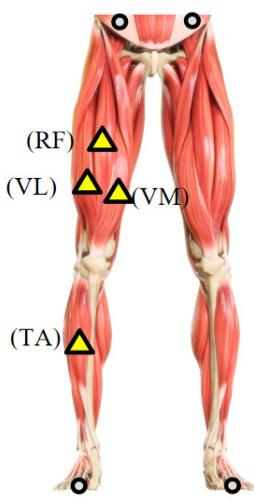

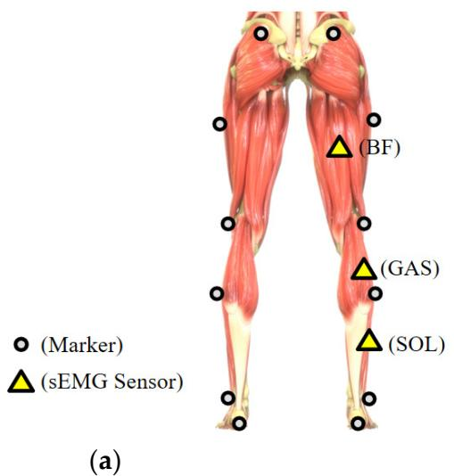

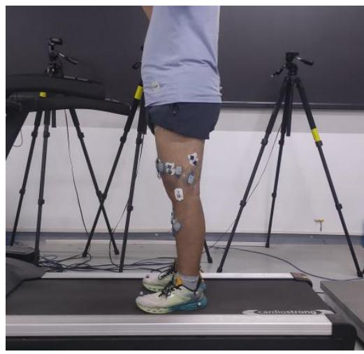  
(b)  
Figure 1. 展示了传感器的具体放置位置，其中 (a) 表示右腿上表面肌电（sEMG）传感器和反光标记点的布置，(b) 描绘了参与者在跑步机上进行行走实验的场景。

在本研究中，采用了一个由 10 台摄像机组成的 VICON 动作捕捉系统，主要用于采集放置在下肢的 16 个动作捕捉标记点的运动数据。采样频率设置为 100 Hz。在本实验中，共使用了 7 个 (1) sEMG 信号预处理：在本研究中，使用四阶 But表面肌电传感器记录肌电信号，采用 Noraxon 无线设备，采样频率为 2000 Hz。在本实验中，MX-Giganet 模块用于连接主机 PC 和 MX 摄像机，作为 VICON 系统与 sEMG 系统之间的接口，以确保两个系统在 Vicon Nexus 2.7 中的同步 r 线对 sEMG 信号质量的干扰，50 Hz 陷波滤波器（Q 因数据 采集、 记录 和 分析。 此 滤除工频噪声。该配置最大程度地实现了信号同步，并将软硬件误差引起的信号偏差降至最低。在本研究中，摄像机和标记点的放置遵循标准动作捕捉协议，并符合 VICON 系统的操作规范，确保了数据采集的准确性。

## 2.3. 数据处理

(1) sEMG 信号预处理：在本研究中，应用四阶巴特沃斯（Butterworth）滤波器（20–450 Hz）对肌电信号进行预处理，滤除高频和低频噪声。此外，为消除工频干扰对 sEMG 信号质量的影响，使用 50 Hz 陷波滤波器（品质因数 Q factor = 35）滤除工频噪声。随后，应用 10 Hz 低通滤波器提取肌电信号的包络。

(2) 运动信号预处理：从高精度动作捕捉系统采集的运动数据，采用四阶零相位巴特沃斯低通滤波器（截止频率为 15 Hz）和临界阻尼低通滤波器（截止频率为 15 Hz）进行预处理，以去除高频噪声并平滑信号 [26]。随后根据动作捕捉数据，利用余弦定理推导出关节角度，确保从相关身体节段的位置准确估计关节角度。

此外，为了解决采样频率不一致的问题，对预处理后的 sEMG 信号进行了重采样。关节角度信号的采样频率为 100 Hz，而 sEMG 信号的采样频率为 2000 Hz。由于下肢关节运动的带宽相对较低，对采样频率的要求并不严格。为降低计算负荷，所有信号均被重采样至统一的 20 Hz 采样频率。

## 2.4. 滑动窗口数据扩充策略

在本研究中，采用了一种滑动窗口数据扩充策略，将原始时间序列数据划分为重叠的片段，每个片段作为独立的训练样本 [27,28]。窗口大小（W）为 10，步长（S）为 1，使得每个时间点可以成为多个窗口的中心。这增加了训练样本的数量，并有助于模型捕获细粒度的时间模式，从而提高预测精度和泛化能力。上述滑动窗口数据扩充策略的核心思想可以用以下公式表示：

假设原始时间序列数据表示为 $X = [ x _ { 1 } , x _ { 2 } , \cdot \cdot \cdot , x _ { T } ]$ ，其中 $x _ { t }$ 表示第 t 个时间步的数据，T 为数据的总长度。定义滑动窗口的大小为 W（在本例中为 10），步长为 S（在本例中为 1）。窗口 $w _ { i }$ 表示从第 i 个时间步开始的 W 个连续数据点的集合，具体如下：

$$
w _ {i} = [ x _ {i}, x _ {i + 1}, \dots , x _ {i + w - 1} ]\tag{1}
$$

对于 $\mathbf { i } = 1 , 2 , \cdots , \mathrm { T } - \mathbf { w } + 1$ ，每个窗口包含 w 个连续数据点。通过将步长设置为 $S = 1$ ，窗口每次滑动一个时间步，从而生成多个重叠的窗口。

因此，窗口集合如下：

$$
W = \left\{\mathrm{w} _ {1}, w _ {2}, \dots w _ {T - W + 1} \right\}\tag{2}
$$

每个窗口都用作模型的独立输入，使模型能够捕获数据中的时间依赖性和局部特征。

## 3. 方法

## 3.1. TCN

TCN（时间卷积网络）是一种基于卷积运算的深度学习模型，广泛用于处理时间序列数据 [29]。与传统的 RNN（循环神经网络）相比，TCN 提供了一种高效的替代方案，由于其并行计算和更长记忆能力，在时间序列建模任务中表现优越。其主要结构包括因果卷积、空洞卷积和残差块 [30]。

## 3.1.1. 因果卷积

因果卷积的核心目标是确保模型的输出仅取决于当前和过去的输入数据，而不取决于未来的输入，从而严格遵循因果性原则，如图 2a 所示。在此，k 明确定义为卷积核大小（kernel size），它决定了卷积滤波器中的系数数量。

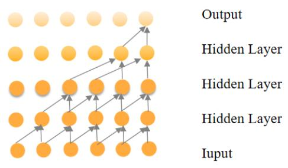  
(a)

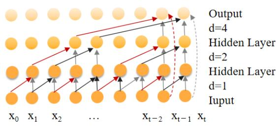  
(b)

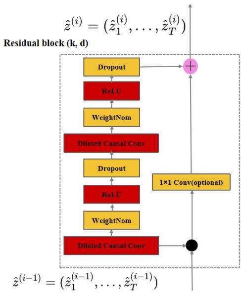  
(c)  
Figure 2. 时间卷积网络（TCN）的结构，包括 (a) 因果卷积、(b) 空洞卷积和 (c) 残差模块

假设卷积滤波器表示为 $F = \left( f _ { 1 } , f _ { 2 } , \cdots , f _ { k } \right)$，输入序列表示为 $X = ( x _ { 1 } , x _ { 2 } , \cdot \cdot \cdot x _ { T } )$，则在位置 t 处的因果卷积可表示如下：

$$
\mathrm{y} _ {\mathfrak {t}} ^ {\text { causal }} = \sum_ {k = 1} ^ {K} f _ {k} x _ {t - k}\tag{3}
$$

1 2  k此处，k 明确定义为卷积核大小（kernel size），它决定了卷积滤波器中系数的数量。

## 3.1.2. 空洞卷积

空洞卷积（Dilated convolution）可以通过间隔采样获得更大的感受野，从而弥补因果卷积的局限性，如图 2b 所示。

假设卷积滤波器表示为 $F = \left( f _ { 1 } , f _ { 2 } , \cdots , f _ { k } \right)$，输入序列表示为 $X = ( x _ { 1 } , x _ { 2 } , \cdot \cdot \cdot x _ { T } )$，则在位置 t 处的空洞卷积可以表示如下：

$$
\mathrm{y} _ {\mathrm{t}} ^ {\mathrm{dilated}} = \sum_ {k = 1} ^ {K} f _ {k} x _ {t - d \cdot k}\tag{4}
$$

此处，k 是卷积滤波器中系数的数量。d 是空洞率（dilation rate），用于控制卷积中使用的输入序列元素之间的间距。

## 3.1.3. 残差模块

TCN 使用残差模块来缓解随着网络加深而出现的梯度消失和梯度爆炸问题，使信息能够在各层之间稳定传输，从而提高泛化能力，如图 2c 所示。TCN 中的残差模块包括因果卷积、批归一化（BN）层和 ReLU 激活函数。在残差模块中，还添加了 dropout 层进行正则化以防止过拟合。残差模块的输入通过恒等映射（或 $1 \times 1$ 卷积）与经过两次卷积操作后的输出相加，以确保维度一致。

## 3.2. CBAM

CBAM 是一个结合了空间注意力机制和通道注意力机制的集成模块。通过使用 CBAM 注意力机制，它能够在抑制不相关特征的同时聚焦于重要特征 [31]。

通道注意力通过增加有效通道的权重并降低低效通道的权重来聚焦于最有意义的特征，如图 3 所示。输入特征图首先分别沿宽度和高度维度进行全局最大池化和全局平均池化。然后，池化操作的输出通过一个 MLP。MLP 输出的特征随后进行逐元素相加，    F = AvgPool(F) ∈ R , F = MaxPool(F) ∈ R 接着进行 sigmoid 激活以生成最终的通道注意力特征图。该(5) 通道 注意力 特征 图 随后 与 输入 特征 图 逐元素 相乘( ) ( ( eLU( ( ))) ( eLU( ( )))), c 1 0 1 0 max  M F = σ W R W Favg + W R W F 以生成空间注意力模块所需的输入特征。

$$
F _ {a v g} ^ {c} = A v g P o o l (F) \in R ^ {C}, F _ {\max} ^ {c} = M a x P o o l (F) \in R ^ {C}
$$

$$
M _ {\mathrm{c}} (F) = \sigma (W _ {1} (R e L U (W _ {0} (F _ {a v g} ^ {c}))) + W _ {1} (R e L U (W _ {0} (F _ {\max} ^ {c}))))\tag{5}
$$

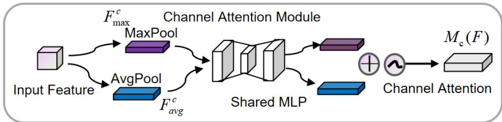  
Figure 3. 通道注意力模块。

此处，σ 为 sigmoid 激活函数；$W _ { 0 } \in R ^ { C \times \mathbf { k } }$ 和 $W _ { 1 } \in R ^ { \mathbf { k } \times 1 }$ 表示权重；k 为注意力单元的数量。$F \in R ^ { C \times H \times W }$ 表示特征图，通道注意力权重 $M _ { \mathrm { c } } ( F ) \in R ^ { C }$ 位于 [0, 1] 范围内，其中 C 为通道数，H 和 W 分别表示特征图的高度和宽度。

空间注意力通过沿通道维度使用最大池化和平均池化来获取两种不同的特征，如图 4 所示。通道注意力模块输出的特征图用作该模块的输入特征图。首先，基于通道执行全局最大池化和全局平均池化。然后将这两个操作的结果沿通道维度进行拼接。之后，应用卷积操作将维度降至单个通道。Favg = AvgPool(F') ∈ R , Fmax = MaxPool(F') ∈ R生成的 特征 图 通过 sigmoid 函数 以 生成 空间 注意力 特征。最后，该特征与模块的输入特征图进行逐元素相乘 s s = 以获得最终生成的特征。

$$
F _ {a v g} ^ {s} = A v g P o o l (F ^ {\prime}) \in R ^ {C}, F _ {\max} ^ {s} = M a x P o o l (F ^ {\prime}) \in R ^ {C}
$$

$$
F _ {\mathrm{cat}} ^ {s} = [ F _ {a v g} ^ {s}; F _ {\mathrm{max}} ^ {s} ], F _ {\mathrm{cat}} ^ {s} \in R ^ {2 \times T}\tag{6}
$$

$$
M _ {s} (F ^ {\prime}) = \sigma (C o n v 1 D (F _ {\mathrm{cat}} ^ {s}))\tag{7}
$$

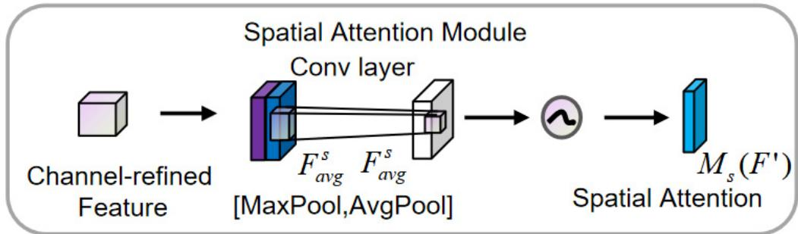  
Figure 4. 空间注意力模块。

式中，$\sigma$ 为 Sigmoid 激活函数；卷积核的大小通常为 3；$M _ { s } ( F ^ { \prime } ) \in R ^ { \bar { T } }$ 表示空间注意力权重。

## 3.3. CB-TCN

本文提出的 CB-TCN 是一种结合了时间卷积网络（temporal convolutional networks, TCN）与卷积块注意力模块（convolutional block attention module, CBAM）的深度学习模型。其结构为 CB-TCN（时间卷积网络 + 卷积块注意力模块 + 时间卷积网络）。CBAM 增强了特征提取能力，而前后的两层 TCN 则能对序列数据进行高效建模。该架构适用于连续运动回归以及其他时间序列预测任务。CB-TCN 模型的整体框架如图 5 所示。该模型采用级联结构。

CB-TCN 模型的总体框架如图 5 所示。该模型采用 TCN → CBAM → TCN 的级联结构，其中初始 TCN 模块从输入的时间序列数据中提取时间特征。随后，卷积块注意力模块（Convolutional Block Attention Module, CBAM）通过强调最相关的时间和空间信息来增强提取出的特征。最后，第二个 TCN 模块对增强后的特征进行进一步建模，并输出预测的关节角度。在该架构中，初始 TCN 模块可视为编码器，负责从原始输入序列中提取时间特征并将其转换为潜在特征表示，而第二个 TCN 模块则充当解码器，对增强特征进行建模并生成最终的输出预测。这种设计充分利用了 TCN 在时间特征提取方面的优势以及 CBAM 在特征精细化处理方面的优势，确保了在建模复杂时间依赖性时的准确性和鲁棒性。

在本研究中，设置了 500 次迭代以观察模型损失曲线的变化趋势。经过广泛的实验测试，最终选择了 50 个训练轮次（epochs），这完全满足了损失要求。采用均方误差（MSE）损失函数作为模型的损失函数，并在训练过程中采用了 L2 正则化（weight\_decay）以及 Adam 优化器。MSE 损失用作衡量预测值与真实值之间差异的损失函数。MSE 损失通过计算预测值与实际真实值之间平方差的平均值来获得。L2 正则化通过惩罚较大的权重值来帮助防止过拟合，而 Adam 优化器结合了动量和自适应学习率的优势，从而实现更高效的参数更新、更快的训练速度和稳定的收敛 [32]。该方法还引入了学习率调度器，初始学习率设置为 LR = 0.001，并且每 10 个轮次学习率衰减为其原始值的 50%（即 gamma = 0.5）[33]。整个训练过程中使用的批大小（batch size）为 50。

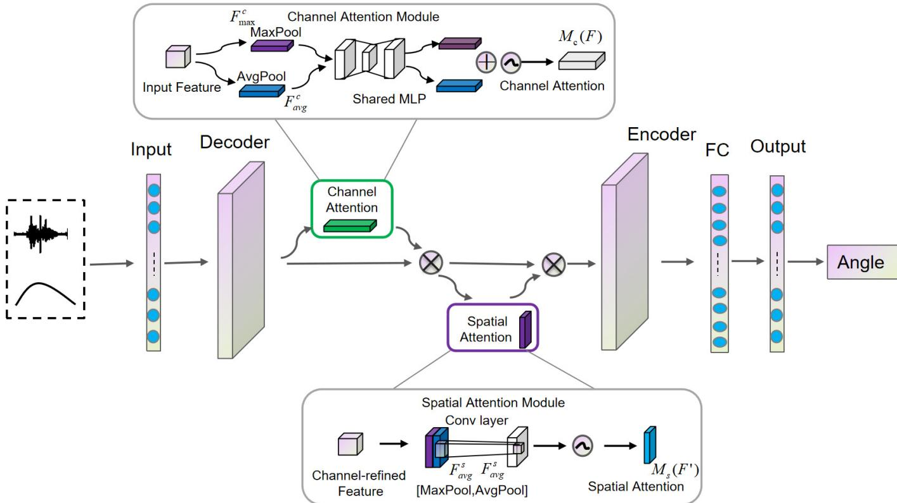  
Figure 5. 所提出的用于角度估计的 CB-TCN 模型完整框架。Figure 5. 所提出的用于角度估计的 CB-TCN 模型完整框架。

## 3.4. 评估指标

在本文中，引入了均方根误差（RMSE）、归一化均方根误差（NRMSE）和决定系数（R2）来评估模型的估计结果。RMSE 衡量预测值与实际值之间的平均误差，RMSE 越低表示预测越准确。NRMSE 根据观测值的范围对 RMSE 进行归一化，使得比较不同数据集之间的误差更加容易。$\mathrm { R } ^ { 2 }$ 表示模型解释观测数据方差的能力，其值接近 1 表示拟合良好，接近 0 则表示预测性能较差。RMSE、NRMSE 和 $\mathbb { R } ^ { 2 }$ 的公式如下：

$$
\mathrm{R} ^ {2} = 1 - \frac {\sum_ {t = 1} ^ {N} (\hat {y} _ {t} - y _ {t}) ^ {2}}{\sum_ {t = 1} ^ {N} (\overline {{y}} - y _ {t}) ^ {2}}\tag{8}
$$

$$
\mathrm{RMSE} = \sqrt {\frac {1}{N} \sum_ {t = 1} ^ {N} \left(\hat {y} _ {t} - y _ {t}\right) ^ {2}}\tag{9}
$$

$$
\mathrm{NRMSE} = \frac {\mathrm{RMSE}}{\max \left(y _ {t}\right) - \min \left(y _ {t}\right)}\tag{10}
$$

其中 $\hat { y } _ { t }$ 是时间 $t$ 处的预测值；$y _ { t }$ 是时间 $t$ 处的测量值；$\overline { { y } }$ 是观测值的均值；$N$ 是样本数量。

## 3.5. 模型对比 (Model Comparison)

## (1) ED-TCN

预测性能。RMSE、NRMSE 和 R2 的公式如下：ED-TCN 是传统 TCN 的增强版本，它采用编码器–解码器（encoder–decoder）架构来更有效地对序列数据进行建模，特别是对于时间序列预测 t ty y− 任务。在该架构中，ED-TCN 采用两个独立的 TCN 层：一个作为 2N编码器从输入中提取时序特征，而另一个充当解码器将这些特征转换为最终的预测结果。该模型与 CB-TCN 具有相同的超参数设置，包括卷积核大小、卷积层数以及其他参数。

## (2) TCN

TCN 是一种专门为处理时间序列数据而设计的基于 CNN 的模型。通过使用因果卷积和扩张卷积，它能够在避免增加计算负担的同时有效捕获长时间跨度内的依赖关系。TCN 与 CB-TCN 具有相同的超参数设置，例如卷积核大小、卷积层数以及其他参数。

## (3) LSTM

LSTM 是一种特殊类型的循环神经网络（RNN），能够有效捕获序列中的长期依赖关系。通过遗忘门、输入门和输出门等门控机制，LSTM 能够在保留时间序列中重要信息的同时忽略无关信息，从而提高处理长序列时的性能和稳定性。该模型与 CB-TCN 具有相同的超参数设置，包括卷积核大小、层数以及其他参数。

## (4) 维纳滤波器 (Wiener Filter)

维纳滤波器（Wiener filter）是一种广泛应用于信号处理和噪声抑制的经典线性滤波器。其目标是通过最小化均方误差（MSE）来优化输入信号与输出信号之间的差异。在时间序列预测中，维纳滤波器通常用于信号去噪和平滑，但由于其线性特性，通常不适用于捕获复杂的非线性依赖关系。

## 4. 结果 (Results)

在本研究中，使用来自四种不同运动模式（步行、越障、深蹲和膝关节屈伸）的 sEMG 包络信号和关节角度作为模型的输入。评估指标包括 $\mathbb { R } ^ { 2 }$、RMSE 和 NRMSE。所有指标值均通过 5 折交叉验证获得，并作为最终结果。在屈伸运动中，重点主要集中在膝关节和踝关节的动作上，因为髋关节的活动范围和变化相对有限。因此，通常不对髋关节进行详细分析。

## 4.1. 角度估计曲线分析

Figure 6 展示了使用五种不同模型对下肢髋关节、膝关节和踝关节的角度估计曲线。黑色实线代表实际关节曲线，蓝色虚线代表 CB-TCN 模型的预测结果，绿色虚线代表 ED-TCN 模型的预测结果，红色虚线代表 TCN 模型的预测结果，黄色虚线代表 LSTM 模型的预测结果，紫色虚线代表 Wiener 模型的预测结果。模型结构参数的对比见表 S1。

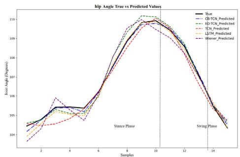

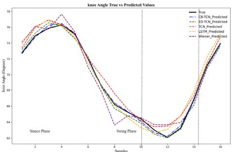  
(a)

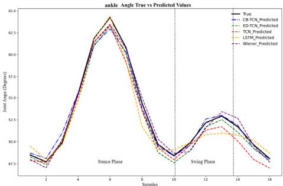

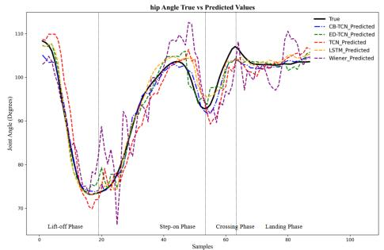

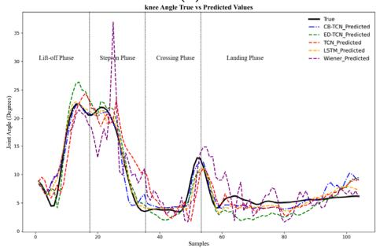  
(b)

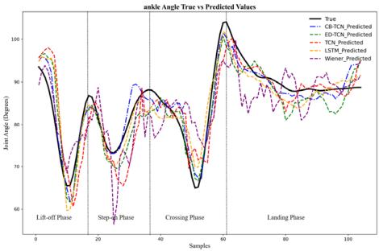

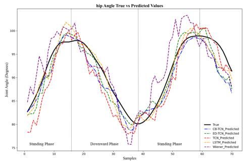

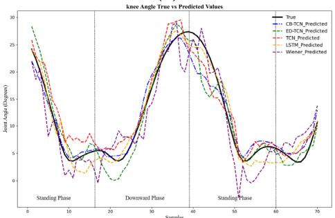  
(c)

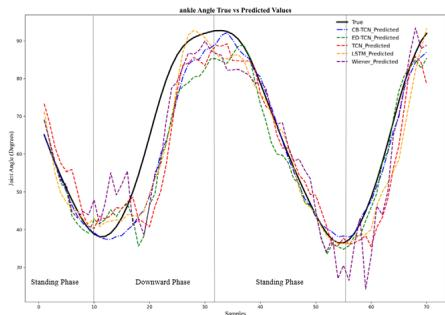

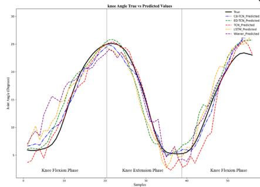

(d)  
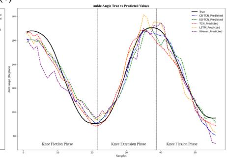  
Figure 6. (a) 步态运动；(b) 越障运动；(c) 深蹲运动；(d) 膝关节屈伸Figure 6. (a) 步态运动；(b) 越障运动；(c) 深蹲运动；(d) 膝关节屈伸运动。运动。

如图 6 所示，所有模型均能有效捕捉关节角度的变化。然而，各模型之间存在显著差异。所提出的 CB-TCN 模型展现出优越的性能，其预测曲线与实际数据高度吻合，与其他模型相比表现出更好的拟合精度。以下是对不同运动模式下预测曲线的分析：

## (1) 步态运动

在步态运动中，由于重复的步态周期，关节角度呈现出周期性模式，并以规律的方式波动。所有模型均能捕捉到这些周期性模式，但在跟踪实际关节角度变化的准确性上存在细微差异。值得注意的是，CB-TCN 模型与实际数据的贴合更为精确，尤其是在过渡阶段（例如，从支撑相到摆动相），这凸显了其对步态周期中动态变化的卓越建模能力。在其他模型中观察到的细微差异表明，它们可能难以捕捉对行走至关重要的细粒度运动细节。

## (2) 越障运动

在越障运动中，由于跨步阶段身体姿态的动态转变，关节角度会发生突变。虽然所有模型都能捕捉到总体趋势，但 CB-TCN 模型在处理这些突变方面表现优异，能紧密贴合实际数据，特别是在脚跨越障碍物的瞬间。相比之下，其他模型在这些时刻表现出更明显的抖动，表明其对此类快速姿态调整的预测能力较弱。

## (3) 蹲起运动

随着身体的下蹲与起立，蹲起运动引起关节角度的显著变化，尤其是在膝关节和髋关节处。所有模型的预测曲线总体上与实际数据吻合良好，但 CB-TCN 模型表现更为突出，它能更平滑、更准确地描绘起伏动作，特别是膝关节角度。在其他模型中观察到的细微差异可能表明其难以适应蹲起运动复杂的非线性动态特征。

## (4) 膝关节屈伸运动

膝关节屈伸运动表现出相对简单但快速的波动，尤其是在膝关节屈曲和伸展阶段。由于该运动中存在剧烈的转变，准确预测这些变化更具挑战性。在本次实验中，由于受试者坐在椅子上，膝关节和踝关节在膝关节屈伸过程中表现出显著变化，而髋关节变化极小，且采集到的曲线变化不规则。因此，此处未展示模型对膝关节屈伸过程中髋关节运动的估计结果。同样地，CB-TCN 模型表现更佳，紧密贴合实际数据，并准确捕捉了膝关节角度的细微变化。其他模型的预测曲线往往表现出一定的滞后或不够平滑的过渡，表明它们捕捉快速精细动作的能力可能有限。

CB-TCN 模型在追踪各种运动中的关节角度变化方面始终表现出优异的性能，特别是在动作转换和某些高动态场景中。它擅长捕获精细的运动细节和快速转换，这对于理解行走、越障、深蹲和膝关节屈伸等活动中的关节行为至关重要。然而，CB-TCN 模型在处理快速且复杂的动作（如深蹲和越障）时存在一些局限性。具体而言，该模型在捕捉关节角度的快速变化方面表现欠佳，尤其是在动态变化较快的情况下，导致难以精确预测关节运动轨迹。此外，肌肉激活模式通常是非线性的，而该模型未能有效处理这种复杂的时变肌肉响应，导致在某些复杂动作中的预测误差较大。为了提高模型的准确性和鲁棒性，可以引入多任务学习或多尺度特征学习方法，以更好地捕获关节之间的相互作用与协调性，从而增强模型对下肢运动中多关节协调的建模能力。此外，增加包含更复杂运动模式的训练数据可以提升模型的泛化能力，确保其在不同运动场景和实际应用中保持良好的预测精度。

## 4.2. CB-TCN 模型与其他模型的对比分析

在五种模型（CB-TCN、ED-TCN、TCN、LSTM、Wiener）关于 $\mathrm { R } ^ { 2 }$ 和 RMSE 的对比中，采用了单因素方差分析（ANOVA），随后进行了显著性水平为 0.05 的事后 Tukey 检验。如图 $^ { 7 , }$ 所示，五种模型在髋关节、膝关节和踝关节运动的 $\mathrm { R } ^ { 2 }$ 和 RMSE 值上存在统计学显著差异 $( p < 0 . 0 5 )$。图 $7$ 显示了 8 名参与者的 $\mathrm { R } ^ { 2 } .$、RMSE 和 NRMS 平均值。表 S2 总结了所有参与者的平均统计指标。age statistical metrics for all particip

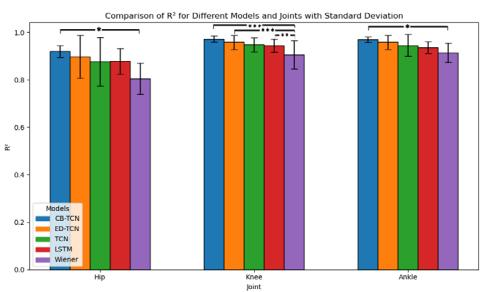

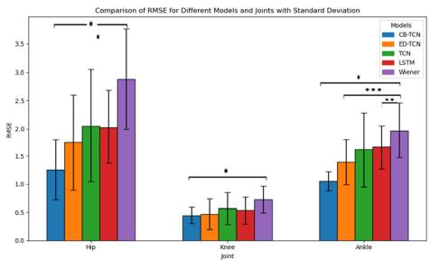

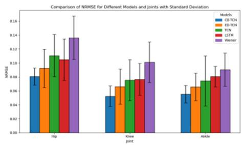

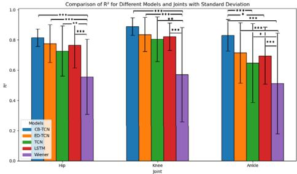

(a)  
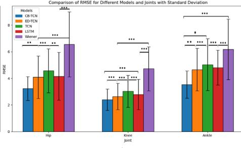

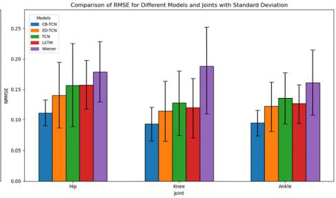  
(b)

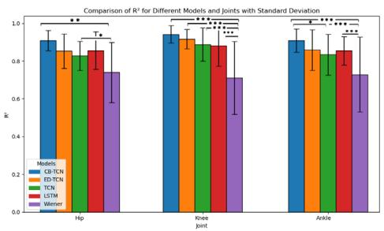

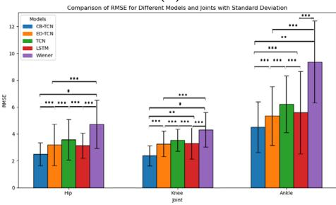

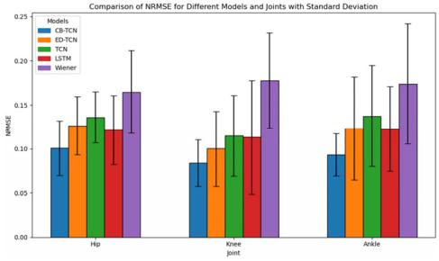

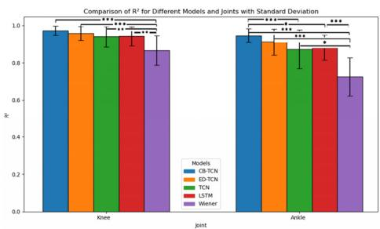

(c)  
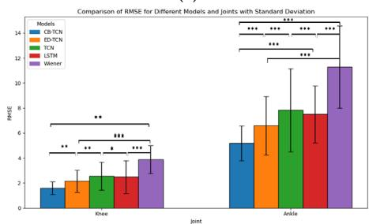  
(d)

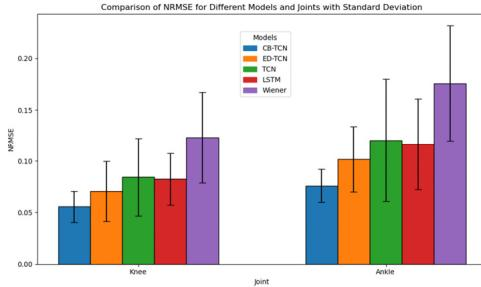  
Figure 7. 五种模型在四种动作（髋、膝、踝关节）下的 $\mathrm { R } ^ { 2 }$、RMSE 和 NRMSE 在 $\mathbb { R } ^ { 2 }$ 与 RMSE 上表现出统计学显著差异 $( p < 0 . 0 5 ; \ast ; 0 . 0 5 \geq p > 0 . 0 0 1 ; \ast \ast ; 0 . 0 0 1 \geq p > 0 . 0 0 0 1 ;$ \*\*\*. $p < 0 . 0 0 0 1 )$，结果为 8 名受试者的平均值。(a) 步态运动；(b) 越障运动；(c) 深蹲运动；(d) 膝关节屈伸运动。

## (1) 步态运动

髋关节：CB-TCN 模型的 $\mathbb { R } ^ { 2 }$ 为 0.9190，在所有模型中表现最佳。它比次优模型 ED-TCN $( \mathrm { R } ^ { 2 } = 0 . 8 9 6 5 )$ 高出 0.0225，相较于 Wiener 模型则展现出更为显著的提升（提高了 0.1148）。其 RMSE 为 1.2648◦，同样低于其他模型，尤其是与 Wiener 模型相比（差异达 1.6318◦）。在 NRMSE 方面，CB-TCN 的值为 0.08075，低于其他模型。

膝关节：CB-TCN 模型的 $\mathbb { R } ^ { 2 }$ 为 0.9718，显著高于其他模型。它比次优模型 ED-TCN $( \mathrm { R } ^ { 2 } = 0 . 9 5 7 9 )$ 高出 0.0139，相较于 Wiener 模型有显著提升（提高了 0.0667）。在 RMSE 方面，CB-TCN 为 0.4991◦，低于其他模型，尤其是与 Wiener 模型相比（差异为 0.2234◦）。在 NRMSE 方面，CB-TCN 的值为 0.05234，低于其他模型。

踝关节：CB-TCN 模型的 $\mathrm { R } ^ { 2 }$ 为 0.9701，优于其他模型。与次优模型 ED-TCN $( \mathrm { R } ^ { 2 } = 0 . 9 5 8 0 )$ 相比提升了 0.0121，相较于 Wiener 模型差异显著（提升了 0.0566）。其 RMSE 为 1.0526◦，优于其他模型，尤其是与 Wiener 模型相比（差异为 0.9147◦）。在 NRMSE 方面，CB-TCN 的值为 0.05531，同样低于其他模型。

## (2) 越障运动

髋关节：CB-TCN 模型的 $\mathrm { R } ^ { 2 }$ 为 0.8220，优于其他模型。相较于次优模型 ED-TCN $( \mathrm { R } ^ { 2 } = 0 . 7 7 8 8 )$ 提升了 0.0432，相较于 Wiener 模型则具有 0.2954 的显著差异。在 RMSE 方面，CB-TCN 为 3.2414◦，低于其他模型，尤其是 Wiener 模型（相差 3.3052◦）。在 NRMSE 方面，CB-TCN 的值为 0.112，低于其他模型的值。

膝关节：CB-TCN 模型的 $\mathbb { R } ^ { 2 }$ 为 0.8999，优于其他模型。相较于次优模型 ED-TCN $( \mathrm { R } ^ { 2 } = 0 . 8 5 1 4 )$ 提升了 0.0485，相较于 Wiener 模型存在 0.2879 的显著差异。其 RMSE 为 2.4017◦，低于其他模型，尤其是 Wiener 模型（相差 2.3222◦）。在 NRMSE 方面，CB-TCN 的值为 0.09267，低于其他模型。

踝关节：CB-TCN 模型的 $\mathbb { R } ^ { 2 }$ 为 0.8315，高于其他模型。相较于次优模型 ED-TCN $( \mathrm { R } ^ { 2 } = 0 . 7 1 4 6 5 )$ 提升了 0.11685，相较于 Wiener 模型存在 0.3200 的显著差异。其 RMSE 为 3.5349◦，处于相对较低水平，尤其是相较于 Wiener 模型（相差 1.2344◦）。在 NRMSE 方面，CB-TCN 的值为 0.0945，相对低于其他模型的值。

## (3) 深蹲与起立动作

髋关节：CB-TCN 模型的 $\mathbb { R } ^ { 2 }$ 为 0.9089，优于其他模型。相较于次优模型 ED-TCN $( \mathrm { R } ^ { 2 } = 0 . 8 5 2 8 5 )$ 提升了 0.05605，相较于 Wiener 模型具有 0.1689 的显著差异。其 RMSE 为 2.4053◦，低于其他模型，尤其是 Wiener 模型（相差 1.9422◦）。在 NRMSE 方面，CB-TCN 的值为 0.1008，低于其他模型的值。

膝关节：CB-TCN 模型的 $\mathrm { R } ^ { 2 }$ 为 0.9406，显著高于其他模型。相较于次优模型 ED-TCN $( \mathrm { R } ^ { 2 } = 0 . 9 1 5 2 5 )$ ) 提升了 0.02535，相较于 Wiener 模型具有 0.2308 的显著差异。其 RMSE 为 2.5121◦，低于其他模型，特别是 Wiener 模型（相差 2.2364◦）。在 NRMSE 方面，CB-TCN 的值为 0.08422，低于其他模型。

踝关节：CB-TCN 模型的 $\mathbb { R } ^ { 2 }$ 为 0.9092，表现出相对于其他模型的明显优势，尤其是相比 Wiener 模型相差 0.1803。与次优模型 ED-TCN $( \mathrm { R } ^ { 2 } = 0 . 8 5 8 7 ) .$ 相比，CB-TCN 也显示出显著的提升。RMSE 为 4.7484◦，相对较低，尤其是与 Wiener 模型相比（相差 0.8446◦）。对于 NRMSE，CB-TCN 的值为 0.0932，低于其他模型。

## (4) 屈曲-伸展运动

膝关节：CB-TCN 模型的 $\mathbb { R } ^ { 2 }$ 为 0.9717，优于其他模型，尤其是相比 Wiener 模型相差 0.1042。与次优模型 ED-TCN $( \mathrm { R } ^ { 2 } = 0 . 9 5 7 9 )$ 相比，CB-TCN 也表现出更优越的性能。RMSE 为 1.5891◦，显著低于其他模型，尤其是相比 Wiener 模型（相差 2.2909◦）。对于 NRMSE，CB-TCN 的值为 0.05583，低于其他模型。

踝关节：CB-TCN 模型的 $\mathrm { R } ^ { 2 }$ 为 0.9459，显著高于其他模型，尤其是相比 Wiener 模型相差 0.1042。与次优模型 ED-TCN $( \mathrm { R } ^ { 2 } = 0 . 9 1 1 4 )$ 相比，CB-TCN 也显示出显著的性能优势。RMSE 为 5.1833◦，低于其他模型，尤其是相比 Wiener 模型（相差 6.0915◦）。对于 NRMSE，CB-TCN 的值为 0.07585，低于其他模型。

CB-TCN 模型在所有运动类型中均优于所有其他模型，尤其是在 $\mathrm { R } ^ { 2 }$、RMSE 和 NRMSE 方面，表现出更高的预测精度和更小的误差。对 $\mathrm { R } ^ { 2 }$ 和 RMSE 的 p 值结合 Tukey HSD 检验的综合分析表明，与其他模型相比，所提出的 CB-TCN 模型在拟合能力和预测性能上均表现出显著差异。在步态运动中，CB-TCN 在髋关节、膝关节和踝关节中表现出尤为优异的性能，具有高精度和小误差。这些关节在正常行走中起着至关重要的作用，其中髋关节屈曲-伸展和膝关节屈曲提供主要运动，而踝关节在推进和减震中起着关键作用。该模型的高精度反映了其在常规、低动态运动中精确捕捉这些关节协调运动的能力。

然而，在越障、深蹲和屈伸运动等更复杂的动作中，模型在预测精度上表现出一定的偏差。这些偏差主要是由于这些运动过程中变化的动态范围和非线性肌肉激活模式所致，从而导致 RMSE 和 NRMSE 值略高。从生理学角度来看，越障和深蹲涉及更复杂的肌肉协同，特别是体重分布和稳定性的快速变化，需要更高程度的肌肉激活和关节协调。具体而言，在深蹲过程中，股直肌（rectus femoris, RF）和股二头肌（biceps femoris, BF）必须高度同步工作以控制膝关节屈曲并维持稳定的姿态。关节角度的快速波动（尤其是在深蹲期间）对模型捕捉这些动态变化的能力提出了挑战。此外，在深蹲和越障过程中，腓肠肌（gastrocnemius, GAS）和比目鱼肌（soleus, SOL）共同作用以稳定踝关节。由于负荷和姿态的变化，这些肌肉的激活模式呈现高度非线性，进一步增加了预测难度。在屈伸运动中，模型同样面临挑战，因为肌肉激活模式通常是非线性的，并且随着运动速度、负荷和姿态的变化而显著改变。胫骨前肌（tibialis anterior, TA）、股直肌（RF）和股二头肌（BF）等肌肉在屈伸过程中会发生快速变化，这显著增加了模型预测能力的复杂性，尤其是在快速变化的关节角度和负荷条件下。

尽管存在这些挑战，与其他模型相比，CB-TCN 模型整体上仍表现出较低的 RMSE 和 NRMSE，且 $\mathbb { R } ^ { 2 }$ 保持在较高水平，表明其具有较强的泛化能力。

## 4.3. 实时性分析

Table 1 展示了本研究所提出的模型在不同关节（髋关节、膝关节、踝关节）和不同运动（步行、越障、深蹲、膝关节屈伸）下单次操作所需的计算时间（以毫秒为单位）。数据以均值 ± 标准差的形式呈现，反映了模型在多次实验中的平均推理时间与稳定性。

Table 1. 不同运动类型下关节运动的预测时间（单位：ms）。

<table><tr><td>活动</td><td>髋关节 (ms)</td><td>膝关节 (ms)</td><td>踝关节 (ms)</td></tr><tr><td>步行</td><td>13.20 ± 0.048</td><td>13.53 ± 0.124</td><td>13.46 ± 0.056</td></tr><tr><td>越障</td><td>34.59 ± 0.068</td><td>34.31 ± 0.044</td><td>34.01 ± 0.072</td></tr><tr><td>深蹲</td><td>28.68 ± 0.064</td><td>28.68 ± 0.076</td><td>27.77 ± 0.060</td></tr><tr><td>膝关节屈伸</td><td>27.17 ± 0.060</td><td>27.18 ± 0.048</td><td>27.18 ± 0.048</td></tr></table>

如上表所示，本研究提出的模型在所有测试条件下的推理时间均始终低于 50 ms，满足了实时性要求。在步行运动中，该模型表现出最短的推理时间，证明了其在简单运动任务中的优异性能。在越障等更复杂的运动中，该模型仍保持着较高的效率水平。这些结果表明，该模型能够适应多种运动模式并满足实时反馈的需求。本研究中的所有网络均使用 Python 3.8 和 PyTorch 2.4.1 实现。训练和评估过程在一台配备 NVIDIA GeForce RTX 4060 GPU 的计算机上进行，确保了高效的计算与可靠的性能。

## 5. 结论

本研究重点关注利用 CB-TCM 模型预测下肢运动中的关节角度，并将其应用于康复和运动分析。关节角度预测对于推进康复技术至关重要，特别是对于因损伤或神经系统疾病而导致运动功能受损的个体。通过对关节运动进行精确建模，该方法促进了自适应疗法的发展，改进了外骨骼和假肢等辅助设备的设计，并增强了对人体生物力学的理解。该方法包括利用来自步行、越障、下蹲和膝关节屈伸运动的数据训练模型，并使用 $\mathrm { R } ^ { 2 }$ 、RMSE 和 NRMSE 等关键指标对其进行评估。该模型在所有运动中均表现出色，尤其是在步行和伸膝运动中。在步行过程中，膝关节的 $\mathbb { R } ^ { 2 }$ 值达到 0.9718，RMSE 低至 1.2648◦。尽管 RMSE 和 NRMSE 略有增加，该模型在深蹲和越障任务中仍然表现良好。

在未来的研究中，我们旨在评估所提模型在临床环境中的实际可行性，重点关注其对不同患者群体的适用性并确保用户友好性。为了提高研究结果的泛化性，我们计划扩大参与者库，以纳入具有不同健康状况、年龄、性别和体型的个体。这将有助于验证该模型的广泛适用性，并探索其在不同群体中的性能，确保其在现实应用中的可持续性、安全性和可用性。此外，我们还将评估该模型在不同临床环境和患者群体（如神经损伤、运动障碍或肢体缺失患者）中的表现，以探索其潜在的挑战与优势。为确保其临床可行性，我们将解决几个关键方面的问题，包括该技术与现有医疗设备和康复工具的兼容性、各种因素（如皮肤状况和传感器放置位置）对信号质量的影响，以及为医护专业人员和患者开发用户友好型界面。此外，保护患者数据隐私并确保安全的数据处理将是重中之重，以符合伦理和监管标准。

补充材料：以下支持信息可在 https: //www.mdpi.com/article/10.3390/s25030719/s1 下载，表 S1：模型结构参数；表 S2：统计指标。

作者贡献：概念构思，Y.H.；方法学，Y.H.；软件，Y.H.；资源，Q.T.；数据整理，Y.H.；论文初稿撰写，Y.H.；论文审阅与编辑，Q.T. 和 X.Z.；可视化，Y.H.；监督，Q.T.；项目管理，Q.T.；资金获取，Q.T.。所有作者均已阅读并同意发表该文稿。

资助：本研究由国家自然科学基金（National Natural Science Foundation of China，52365039）、天山英才培养计划（Tianshan Talent Training Program，2023TSYCLJ0051）以及优秀博士研究生创新项目（The Excellent Doctoral Graduate Innovation Program，XJU2024BS103）资助。

机构审查委员会声明：本实验已获得西安交通大学（Xi’an Jiaotong University）伦理委员会的批准，批准编号：2024YS239。所有实验程序均严格按照《赫尔辛基宣言》（Declaration of Helsinki）的相关规定进行。

知情同意声明：本研究涉及的所有受试者均已获得知情同意。

数据可用性声明：如需数据，请联系通讯作者。

致谢：我们感谢 X.Z. 在实验中提供的帮助，并向所有参与实验的受试者表示感谢。

利益冲突：作者声明不存在利益冲突。

## 参考文献

1. Sarajchi, M.; Al-Hares, M.K.; Sirlantzis, K. Wearable lower-limb exoskeleton for children with cerebral palsy: A systematic review of mechanical design, actuation type, control strategy, and clinical evaluation. IEEE Trans. Neural Syst. Rehabil. Eng. 2021, 29, 2695–2720. [CrossRef] [PubMed]

2. Wang, G.; Jin, L.; Zhang, J.; Duan, X.; Yi, J.; Zhang, M.; Sun, Z. Recurrent Neural Network Enabled Continuous Motion Estimation of Lower Limb Joints from Incomplete sEMG Signals. IEEE Trans. Neural Syst. Rehabil. Eng. 2024, 32, 3577–3589. [CrossRef] [PubMed]

3. Zhou, J.; Yang, S.; Xue, Q. Lower limb rehabilitation exoskeleton robot: A review. Adv. Mech. Eng. 2021, 13, 16878140211011862. [CrossRef]

4. Li, W.Z.; Cao, G.Z.; Zhu, A.B. Review on control strategies for lower limb rehabilitation exoskeletons. IEEE Access 2021, 9, 123040–123060. [CrossRef]

5. Gordleeva, S.Y.; Lobov, S.A.; Grigorev, N.A.; Savosenkov, A.O.; Shamshin, M.O.; Lukoyanov, M.V.; Khoruzhko, M.A.; Kazantsev, l h h f b d l f l l b k l IEEE Access 2020 8 84070–84081. [CrossRef]

6. Chen, D.; Cai, Y.; Qian, X.; Ansari, R.; Xu, W.; Chu, K.-C.; Huang, M.-C. Bring gait lab to everyday life: Gait analysis in terms of activities of daily living. IEEE Internet Things J. 2019, 7, 1298–1312. [CrossRef]

7. Scherpereel, K.; Molinaro, D.; Inan, O.; Shepherd, M.; Young, A. A human lower-limb biomechanics and wearable sensors dataset during cyclic and non-cyclic activities. Sci. Data 2023, 10, 924. [CrossRef]

8. Kuang, Y.; Wu, Q.; Shao, J.; Wu, J.; Wu, X. Extreme learning machine classification method for lower limb movement recognition. Clust. Comput. 2017, 20, 3051–3059. [CrossRef]

9. Qin, P.; Shi, X. Evaluation of feature extraction and classification for lower limb motion based on sEMG signal. Entropy 2020, 22, 852. [CrossRef]

10. Wu, X.; Yuan, Y.; Zhang, X.; Wang, C.; Xu, T.; Tao, D. Gait phase classification for a lower limb exoskeleton system based on a graph convolutional network model. IEEE Trans. Ind. Electron. 2021, 69, 4999–5008. [CrossRef]

11. Sun, Z.; Zhang, X.; Liu, K.; Shi, T.; Wang, J. A multi-joint continuous motion estimation method of lower limb using least squares support vector machine and zeroing neural network based on semg signals. Neural Process. Lett. 2023, 55, 2867–2884. [CrossRef]

12. Wang, F.; Lu, J.; Fan, Z.; Ren, C.; Geng, X. Continuous motion estimation of lower limbs based on deep belief networks and random forest. Rev. Sci. Instrum. 2022, 93, 044106. [CrossRef] [PubMed]

13. Li, W.; Liu, K.; Sun, Z.; Li, C.; Chai, Y.; Gu, J. A neural network-based model for lower limb continuous estimation against the disturbance of uncertainty. Biomed. Signal Process. Control 2022, 71, 103115. [CrossRef]

14. Sommer, L.F. EMG-Driven Exoskeleton Control; Universidade de São Paulo: São Paulo, Brazil, 2019

15. Xie, H.; Li, G.; Zhao, X.; Li, F. 基于 GS-GRNN 与多源信号的外骨骼穿戴者肢体关节角度预测（Prediction of limb joint angles based on multi-source signals by GS-GRNN for exoskeleton wearer）. Sensors 2020, 20, 1104. [CrossRef] [PubMed]

16. Liu, G.; Zhang, L.; Han, B.; Zhang, T.; Wang, Z.; Wei, P. 基于卷积神经网络深度学习的 sEMG 连续膝关节角度估计（sEMG-based continuous estimation of knee joint angle using deep learning with convolutional neural network）. In Proceedings of the 2019 IEEE 15th international conference on automation science and engineering (CASE), Vancouver, BC, Canada, 22–26 August 2019; pp. 140–145.

17. Song, Q.; Ma, X.; Liu, Y. 基于深度学习方法的 sEMG 信号下肢关节角度连续在线预测（Continuous online prediction of lower limb joints angles based on sEMG signals by deep learning approach）. Comput. Biol. Med. 2023, 163, 107124. [CrossRef] [PubMed]

18. Ma, C.; Guo, W.; Zhang, H.; Samuel, O.W.; Ji, X.; Xu, L.; Li, G. 一种用于基于深度学习的连续估计的新颖高效特征提取方法（A novel and efficient feature extraction method for deep learning based continuous estimation）. IEEE Robot. Autom. Lett. 2021, 6, 7341–7348. [CrossRef]

19. Ding, G.; Plummer, A.; Georgilas, I. 结合注意力机制的深度学习用于跨多种活动的连续生物力学运动估计（Deep learning with an attention mechanism for continuous biomechanical motion estimation across varied activities）. Front. Bioeng. Biotechnol. 2022, 10, 1021505. [CrossRef]

20. Fan, J.; Zhang, K.; Huang, Y.; Zhu, Y.; Chen, B. 基于并行时空注意力的 TCN 用于多元时间序列预测（Parallel spatio-temporal attention-based TCN for multivariate time series prediction）. Neural Comput. Appl. 2023, 35, 13109–13118. [CrossRef]

21. Chen, C.; Guo, W.; Ma, C.; Yang, Y.; Wang, Z.; Lin, C. 基于大规模时间卷积网络的 sEMG 手指运动学连续估计（sEMG-based continuous estimation of finger kinematics via large-scale temporal convolutional network）. Appl. Sci. 2021, 11, 4678. [CrossRef]

22. Wang, F.; Liang, W.; Afzal, H.M.R.; Fan, A.; Li, W.; Dai, X.; Liu, S.; Hu, Y.; Li, Z.; Yang, P. 使用惯性测量单元和混合深度学习模型估计不同运动活动期间的下肢关节角度和关节力矩（Estimation of Lower Limb Joint Angles and Joint Moments during Different Locomotive Activities Using the Inertial Measurement Units and a Hybrid Deep Learning Model）. Sensors 2023, 23, 9039. [CrossRef]

23. Du, J.; Liu, Z.; Dong, W.; Zhang, W.; Miao, Z. 一种用于基于 sEMG 的腕关节角度连续估计的新型 TCN-LSTM 混合模型（A Novel TCN-LSTM Hybrid Model for sEMG-Based Continuous Estimation of Wrist Joint Angles）. Sensors 2024, 24, 5631. [CrossRef] [PubMed]

24. Hamner, S.R.; Delp, S.L. 在不同跑步速度范围内肌肉对前后向和垂直向身体质心加速度的贡献（Muscle contributions to fore-aft and vertical body mass center accelerations over a range of running speeds）. J. Biomech. 2013, 46, 780–787. [CrossRef]

25. Hermens, H.; Frenks, H.B. 表面肌电图应用领域与参数（Surface electromyography application areas and parameters）. In Proceedings of the Third General SENIAM Workshop, Aachen, Germany, 15–16 May 1998.

26. Liang, J.; Shi, Z.; Zhu, F.; Chen, W.; Chen, X.; Li, Y. 基于 sEMG 信号的高斯过程自回归用于关节角度预测（Gaussian process autoregression for joint angle prediction based on sEMG signals）. Front. Public Health 2021, 9, 685596. [CrossRef]

27. Wahid, M.F.; Tafreshi, R.; Langari, R. 一种利用肌电信号提高手势识别准确率的多窗口多数投票策略（A multi-window majority voting strategy to improve hand gesture recognition accuracies using electromyography signal）. IEEE Trans. Neural Syst. Rehabil. Eng. 2019, 28, 427–436. [CrossRef]

28. Ma, C.; Li, W.; Cao, J.; Du, J.; Li, Q.; Gravina, R. 用于辅助生活环境的自适应滑动窗口活动识别（Adaptive sliding window based activity recognition for assisted livings）. Inf. Fusion 2020, 53, 55–65. [CrossRef]

29. Hewage, P.; Behera, A.; Trovati, M.; Pereira, E.; Ghahremani, M.; Palmieri, F.; Liu, Y. Temporal convolutional neural (TCN) network for an effective weather forecasting using time-series data from the local weather station. Soft Comput. 2020, 24, 16453–16482. [CrossRef]

30. Tsinganos. P.: Jansen, B.: Cornelis. L.: Skodras. A. Real-time analysis of hand gesture recognition with temporal convolutional networks. Sensors 2022, 22, 1694. [CrossRef]

31. Wang, S.; Huang, L.; Jiang, D.; Sun, Y.; Jiang, G.; Li, J.; Zou, C.; Fan, H.; Xie, Y.; Xiong, H.; et al. Improved multi-stream convolutional block attention module for sEMG-based gesture recognition. Front. Bioeng. Biotechnol. 2022, 10, 909023. [CrossRef]

32. Zanghieri, M.; Benatti, S.; Burrello, A.; Kartsch, V.; Conti, F.; Benini, L. Robust real-time embedded EMG recognition framework using temporal convolutional networks on a multicore IoT processor. IEEE Trans. Biomed. Circuits Syst. 2019, 14, 244–256. [CrossRef]

33. Kirti; Rajpal, N. A multi-crop disease identification approach based on residual attention learning. J. Intell. Syst. 2023, 32, 20220248. [CrossRef]

免责声明/出版商声明：所有出版物中包含的陈述、观点和数据仅代表个人作者和贡献者的观点，并不代表 MDPI 和/或编辑的观点。MDPI 和/或编辑对因内容中提及的任何想法、方法、说明或产品而导致的人身或财产损害不承担任何责任。