研究论文

# 用于上肢关节角度连续估计的 SE-TCN 网络

Xiaoguang Liu1,2, Jiawei Wang1,2, Tie Liang1,2, Cunguang Lou1,2, Hongrui Wang1,2 and Xiuling Liu1,2,\*

1 College of Electronic and Information Engineering, Hebei University, Baoding, Hebei, China（河北大学电子信息工程学院，中国河北保定）

2 Key Laboratory of Digital Medical Engineering of Hebei Province, Hebei University, Baoding, Hebei, China（河北省数字医疗工程重点实验室，河北大学，中国河北保定）

\* 通信作者：Email: liuxiuling121@hotmail.com.

摘要：人机交互（human-computer interaction）技术的成熟使得利用表面肌电信号（surface electromyographic signals, sEMG）控制外骨骼机器人和智能假肢成为可能。然而，现有的由 sEMG 控制的上肢康复机器人存在关节不灵活的缺点。本文提出了一种基于时间卷积网络（temporal convolutional network, TCN）的方法，通过 sEMG 预测上肢关节角度。通过扩展原始 TCN 的深度以提取时间特征并保留原始信息。由于主导上肢运动的肌群的时序特征并不明显，导致关节角度估计的准确性较低。因此，本研究采用挤压和激励网络（squeeze-and-excitation networks, SE-Net）来改进 TCN 网络模型。最后，针对 10 名人类受试者选取了 7 个人体上肢动作，记录其运动过程中的肘部角度（elbow angle, EA）、肩部垂直角度（shoulder vertical angle, SVA）和肩部水平角度（shoulder horizontal angle, SHA）值。设计的实验将所提出的 SE-TCN 模型与反向传播（backpropagation, BP）网络以及长短期记忆（long short-term memory, LSTM）网络进行了对比。所提出的 SE-TCN 在平均 RMSE 值上系统性地优于 BP 网络和 LSTM 模型：EA 分别降低了 25.0% 和 36.8%，SHA 分别降低了 38.6% 和 43.6%，SVA 分别降低了 45.6% 和 49.5%。因此，其 $R ^ { 2 }$ 值在 EA 上分别超过 BP 和 LSTM 13.6% 和 39.20%，在 SHA 上分别超过 19.01% 和 31.72%，在 SVA 上分别超过 29.22% 和 31.89%。这表明所提出的 SE-TCN 模型具有良好的准确性，未来可用于上肢康复机器人的角度估计。

关键词：连续角度估计；人机交互；sEMG；SE-TCN 网络

## 1. 引言

人口老龄化已成为一个全球性的社会问题。老年人更容易罹患帕金森病（Parkinson’s disease）和遭遇意外事故，从而导致各种类型的肢体残疾。临床研究表明，合理的康复训练可以帮助患者恢复部分肢体功能，并帮助患者重获部分生活和工作能力。目前，机器人技术已广泛应用于各个行业。机器人也已陆续开始应用于社会服务、医疗护理、康复等领域。

表面肌电信号（Surface electromyography, sEMG）已被认为是人机交互控制中可靠的生物信号来源 [1]。sEMG 不易受外部环境的影响，例如光照和环境声音的变化。在人体运动过程中，sEMG 由与运动相关的肌群产生。sEMG 可以在一定程度上反映人体的具体运动意图 [2]，并且能够更好地为康复机器人建立人机协作控制系统。与惯性传感器相比，基于 sEMG 的控制系统在实现人机协作方面具有更大的潜力。

在远程控制中，机器人可作为替代品用于执行安全且多样化的任务。然而，在任务执行过程中，与人类的控制和交互能力相比，当前机器人系统的性能远低于预期水平 [3]。因此，通过神经接口将人类的运动或控制能力传递给机器人，以增强机器人的功能和交互能力 [4]。对连续关节角度进行 sEMG 解码，为实现人机交互提供了一种更自然且有效的解决方案 [5]。例如，sEMG 信号可用于远程控制机械臂 [6]。用于医疗人机交互的人类活动感知共享控制方案是一个研究热点。基于 sEMG 的人机交互能够产生更符合人类感知的远程物体操作。例如，人机共享控制结合了人类和机器人两者的优势，是促进高效手术流程的有效途径 [7]。基于 sEMG 的视角预测应用于医疗人机交互中感知人类活动的共享控制方案。

医疗领域的康复机器人是人机交互的一个成功范例。由于康复机器人能够提供实用的康复训练，它们可以在满足患者康复训练需求的同时，缓解康复资源的匮乏 [8]。此外，康复机器人可以改善人机交互的实际运动并提供行为预测。尽管传统康复机器人的触发控制能够满足训练需求，但在一定程度上无法保障控制的安全性和舒适性 [9]。基于 sEMG 对康复机器人进行连续控制是一种更可行的控制策略。其关键在于通过 sEMG 获取肩部和肘部的角运动。

早期，仅有少数离散动作能够预测关节角度，这对于实现贴近自然手的控制方案而言不够直观。利用表面肌电（surface electromyography, sEMG）信号对上肢康复机器人进行连续控制，能够模拟人体上肢的连续运动，并指导患者的康复训练。因此，基于 sEMG 的连续关节角度估计已成为当前的研究热点。原始 sEMG 信号包含大量指示上肢运动意图的信息。然而，原始信号的随机性和非平稳性使其无法直接应用于动作识别，因此需要对 sEMG 信号进行特征提取 [10]。特征提取的质量决定了输出效果。因此，良好的特征工程有助于预测上肢的连续角度 [11]。研究人员通常选择时域、频域和时频域特征来进行 sEMG 特征提取 [12]。时域特征较为常用，例如平均绝对值（mean absolute value, MAV）、均方根值（root mean square, RMS）和过零率（zero crossings, ZC）。MAV 是 sEMG 信号幅值绝对值的平均值，RMS 反映肌肉活动期间 sEMG 的能量水平，而 ZC 则是 sEMG 信号值穿过横坐标的次数 [13]。

研究人员采用了各种回归模型来建立 sEMG 与关节角度之间的映射关系。Wang 等人 [14] 提出利用特定子空间中的小波包能量熵作为 sEMG 信号的特征，并利用遗传算法优化的 Elman 神经网络来预测肩关节和肘关节角度。Jing 等人 [15] 使用 BP 人工神经网络建立了 sEMG 信号与肘关节角度之间的映射模型，以预测肘关节角度。Tang 等人 [16] 采用粒子群优化（particle swarm optimization, PSO）算法对 LSTM 进行优化，并利用优化后的网络建立了 sEMG 信号与关节角度之间的映射。

为了提高上肢关节连续运动角度预测的效果以及模型的鲁棒性，我们提出了一种 SE-TCN 神经网络。我们对 TCN 网络模型进行了改进，以提高关节角度预测的准确性。实验结果表明，本文提出的方法具有较高的准确性和鲁棒性。本文的主要贡献如下：

1) 我们记录了人体七种上肢动作的 sEMG，作为该模型的数据集。

2) 本文扩展了 TCN 的深度，以便在保留原始数据的同时提取 sEMG 特征信息。

3) 主导上肢运动的肌群时序特征不够明显，导致关节角度精度较低。在本文中，模型中融合的 SE-Net 可以增加重要特征信息的权重，从而提高关节角度预测的准确性。

4) 为了证明本文提出的 SE-TCN 模型在人机交互中的预测性能，本文绘制了预测的关节角度曲线和相应的实际关节角度曲线，以直观展示模型性能。同时，还利用 RMSE、R2 和相关系数分析了各模型的学习能力与泛化能力。

本文其余部分的结构安排如下：第 2 节描述了数据集中 sEMG 信号的采集、呈现和预处理过程，并介绍了 SE-TCN 的基本原理。第 3 节展示了通过所提模型及两个参考模型获得的实验结果及其对比分析。第 4 节对结论和未来工作进行了讨论。

## 2. 材料与方法

## 2.1. 数据采集

共有十名健康受试者（五男五女）受邀参加本次数据采集实验，以采集上肢关节的连续运动角度和 sEMG 信号。受试者的身高、体重和身体质量指数（BMI）统计数据见 Table 1。

采用来自美国 NORAXON 的 16 通道无线肌电（EMG）设备采集 sEMG 信号和关节角度，采样频率为 1500 Hz。无线 EMG 传感器分别放置在三角肌前束、三角肌中束、三角肌后束、肱二头肌、肱三头肌外侧头和肱三头肌内侧头。电极的放置位置如图 Figure 1 所示。传感器名称和部位

列于 Table 2 中。

Table 1. 受试者信息。

<table><tr><td>受试者人数</td><td>男女比例</td><td>平均身高 (cm)</td><td>平均体重 (kg)</td><td>平均 BMI (kg/m2)</td></tr><tr><td>10</td><td>1:1</td><td>170.6 ± 9.49</td><td>62.19 ± 3.12</td><td>21.37 ± 3.28</td></tr></table>

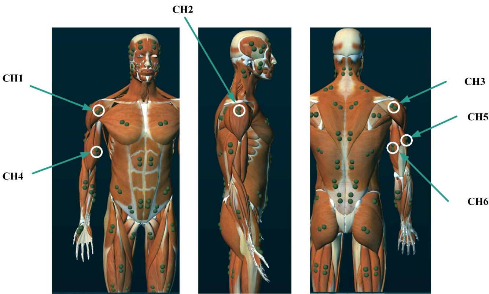  
Figure 1. EMG 传感器放置位置。

Table 2. 传感器名称。

<table><tr><td>序号</td><td>标记名称</td><td>位置</td></tr><tr><td>1.</td><td>CH1</td><td>三角肌前束</td></tr><tr><td>2.</td><td>CH2</td><td>三角肌中束</td></tr><tr><td>3.</td><td>CH3</td><td>三角肌后束</td></tr><tr><td>4.</td><td>CH4</td><td>肱二头肌</td></tr><tr><td>5.</td><td>CH5</td><td>肱三头肌外侧头</td></tr><tr><td>6.</td><td>CH6</td><td>肱三头肌内侧头</td></tr></table>

角度采集设备使用了 NORAXON 的角度传感器。如图 Figure 2 所示，角度传感器放置在受试者的肩关节和肘关节处。

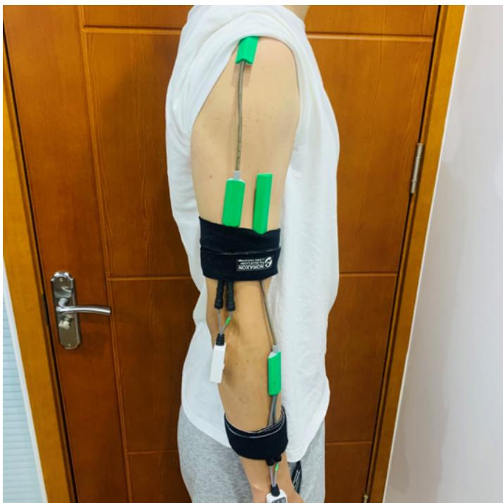  
Figure 2. 角度传感器放置位置。

所使用的 EMG 和角度传感器的详细信息见 Table 3。

Table 3. 传感器信息。

<table><tr><td>设备</td><td>信息</td></tr><tr><td rowspan="4">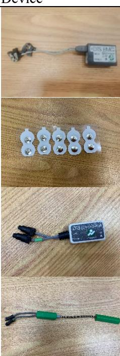</td><td>无线肌电采集传感器</td></tr><tr><td>NORAXON 双电极贴片（电极间距为 18 mm）</td></tr><tr><td>两个内置 1D/2D 电子测角计</td></tr><tr><td>X-Y 测角计传感器</td></tr></table>

为了确保传感器与手臂肌肉之间的良好接触，在放置传感器之前，用酒精将记录区域的皮肤表面擦拭干净。当受试者的皮肤干燥缺水时，用医用胶带轻拍该区域以去除皮肤死皮细胞。这有助于提高所采集到的 sEMG 信号的质量。在本文中，设计了如图 3 所示的七种动作，以模拟实际运动中肘关节和肩关节的角度。这些动作分别为：(i) 肘关节屈曲/伸展，(ii) 肩关节屈曲/伸展，(iii) 肩关节水平内收/外展，(iv) 肩关节垂直内收/外展，(v) 肩关节水平内收/外展与肘关节屈曲/伸展复合动作，(vi) 肩关节屈曲/伸展与肘关节屈曲/伸展复合动作，以及 (vii) 肩关节垂直内收/外展与肘关节屈曲/伸展复合动作。

为了模拟实际的上肢运动，受试者执行了以下动作：肘关节屈曲/伸展（在 XZ 平面内，图 3(b)）、肩关节屈曲/伸展（在 XZ 平面内，图 3(c)）、肩关节水平内收/外展（在 YZ 平面内，图 3(d)）、肩关节垂直内收/外展（在 XY 平面内，图 3(e)），以及三种肩关节内收/外展与肘关节屈曲/伸展的同时运动（在 YZ 平面内——图 3(f)、XZ 平面内——图 3(g) 和 XY 平面内——图 3(g)）。例如，图 3(b) 显示在测量肘关节角度时，肩关节保持不变。同时，在测量肩关节时，肘关节保持不变，如图 3(c)–(e) 所示。当同时测量肘关节和肩关节角度时，曲轴在肩关节之前发生位移（图 3(f)–(h)）。同时还进行了 EA、SVA 和 SHA 角度的同步测量。

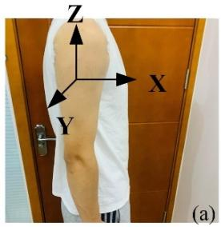  
运动轴

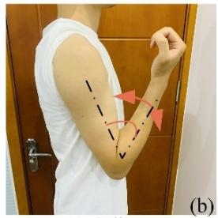  
EA（肘关节屈曲/伸展角）

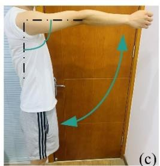  
SHA（肩关节水平屈曲/伸展角）

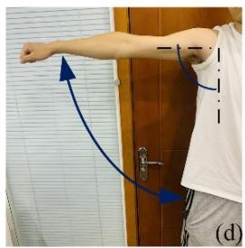  
SHA（肩关节水平内收/外展角）

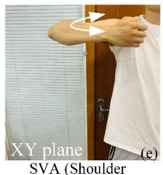  
垂直内收/外展角）

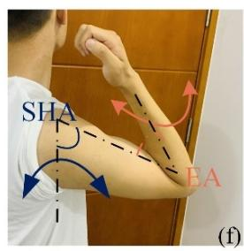  
EA 和 SHA

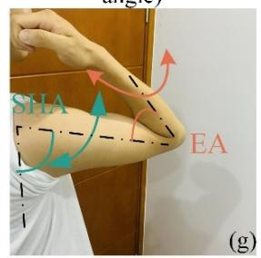  
EA 和 SHA

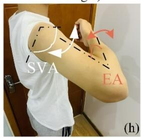  
EA 和 SVA  
Figure 3. 模拟上肢运动。

在采集 sEMG 信号和角度信号之前，受试者必须熟悉这些基本动作。同时采集 sEMG 信号和上肢关节角度以保持对应关系。受试者被要求在三分钟内以相同的速度完成这些动作，每个动作重复五次。在动作开始时，采集设备以 1500 Hz 的采样频率记录 sEMG 信号和角度传感器信号，并在完成所有动作后保存数据。例如，受试者 1 用时 3 min 完成所有活动并存储了 270,000 个数据样本。我们通过保存每位受试者的数据构建了数据集，然后将采集到的实验数据的 70% 用作训练集，20% 用作验证集，10% 用作测试集。本研究符合《赫尔辛基宣言》（Declaration of Helsinki）的相关规定，且该方案已获得伦理委员会的批准。所有受试者均签署了书面知情同意书，并允许将其照片和数据用于科学和教育目的的出版物中。

## 2.2. 数据预处理

采集 sEMG 信号可能会受到环境噪声的干扰，因此必须对接收到的 sEMG 信号进行降噪处理。由于 sEMG 信号的有效信息主要分布在 20 至 200 Hz 之间，本文采用三阶巴特沃斯（Butterworth）带通滤波器保留 20 至 200 Hz 之间的频率。该滤波器的衰减率为每倍频程 18 dB。同时，本文采用陷波滤波器去除 50 Hz 的工频干扰。为了证明滤波器的有效性，获取了 sEMG 滤波前后的信号频谱图并绘制在 Figure 4 中。从 Figure 4 中的虚线可以看出，该滤波器能够有效滤除 0 至 20 Hz 的低频信号以及 50 Hz 的工频干扰信号。

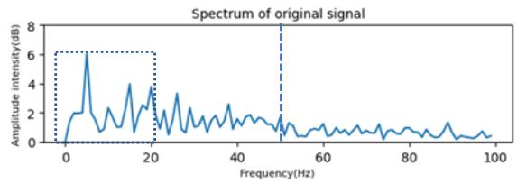

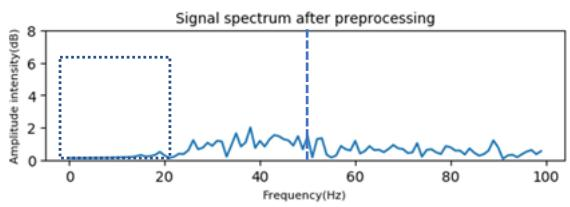  
Figure 4. 预处理结果。

## 2.3. 特征提取

本文选择滑动时间窗口方法进行数据分割，通过获取若干 sEMG 子数据段来计算和分析信号特征。选取 100 ms 的滑动窗口，以单采样点的滑动步长进行特征提取来表征信号。目前，时域、频域和时频域特征已被广泛用于分析和处理 sEMG 信号 [17,18]。本研究使用了方差（VAR）、平均绝对值（MAV）、均方根（RMS）三种时域特征以及中值频率（MF）。这些 sEMG 信号特征可描述如下：

VAR：

$$
V A R = \frac {1}{n} \sum_ {i = 1} ^ {n} (x _ {i} - \bar {x}) ^ {2}\tag{1}
$$

MAV：

$$
M A V = \frac {1}{n} \sum_ {i = 1} ^ {n} | x _ {i} |\tag{2}
$$

RMS：

$$
R M S = \sqrt {\frac {1}{n} \sum_ {i = 1} ^ {n} x _ {i} ^ {2}}\tag{3}
$$

MF：

$$
M F = \frac {1}{2} \sum_ {i = 1} ^ {n} P (f _ {i})\tag{4}
$$

## 2.4. SE-TCN

近年来，时间卷积网络（temporal convolutional network, TCN）在处理时序特征回归和多分类任务中取得了显著成果。TCN 网络具有以下特点 [19]。

并行性：由于卷积神经网络在每一层使用相同的卷积核，TCN 可以并行处理长序列输入，这与按顺序处理的 RNN [20] 和 LSTM [21] 不同。

灵活的感受野：引入空洞卷积可以在不增加池化操作的情况下扩大感受野，因此 TCN 网络具有灵活的感受野。

可变输入长度：在时间卷积网络中加入 0 填充（0-padding），使网络能够输入不同长度的数据。

更稳定的梯度：由于在不同时间步共享参数，梯度不会发生爆炸或消失。

更低的内存占用：时间卷积网络中同一层的卷积核是共享的，因而占用更少的内存 [22]。

TCN 由因果卷积（causal convolution）、膨胀卷积（inflation convolution）和残差连接（residual links）组成。因果卷积与传统卷积神经网络的区别在于它无法看到未来的数据，且为单向结构而非双向结构。因果卷积在某一时刻的值仅取决于上一层该时刻及其之前时刻的值，因此因果卷积严格遵循时间约束。

因果卷积的结构图如图 Figure 5 所示。因果卷积层的输入序列为 $X = ( x _ { 1 } , x _ { 2 } , \cdots , x _ { T } )$ ，滤波器为 $F = ( f _ { 1 } , f _ { 2 } , , \cdots f _ { k } )$ 。在 $x _ { t }$ 处的因果卷积可定义为式 (5)：

$$
(F * X) (x _ {t}) = \sum_ {k = 1} ^ {K} f _ {k} x _ {t - K + k}\tag{5}
$$

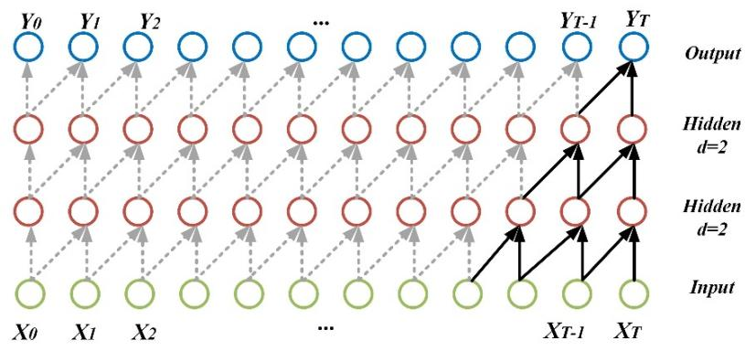  
Figure 5. 因果卷积结构图。

因果卷积还存在卷积核大小限制时间建模长度的缺陷。为了捕获更长距离的相关性，必须线性堆叠多个网络层。研究人员提出了膨胀卷积来解决这一问题，如图 6 所示 [23]。

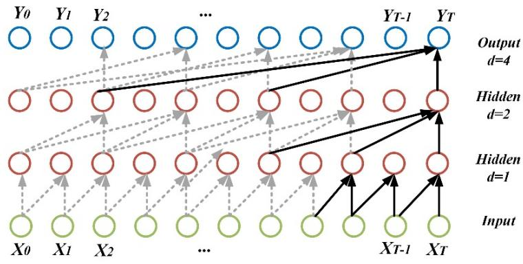  
Figure 6. 膨胀卷积结构图。

膨胀卷积允许在卷积过程中进行间隔输入采样，采样率由图 6 中的  控制。当  ൌ 1 时，扩展卷积即为常规因果卷积操作。通常， 的取值为 1、2、4 等。随着网络结构层数的增加， 的值也随之增大。在网络训练过程中，加深网络结构层数、增大滤波器尺寸以及增大膨胀因子  可以有效扩大卷积网络的感受野。在具有大感受野的网络中，神经元可以将更广泛范围的序列数据纳入该层的卷积操作中，有助于提取更多的全局信息。相反，感受野较小的网络可以在序列中获取更详细的信息。假设 $x _ { t }$ 处的膨胀系数为 ，则膨胀卷积可以定义如下：

$$
(F * d X) (x _ {t}) = \sum_ {k = 1} ^ {K} f _ {k} x _ {t - (K - k) d}\tag{6}
$$

随着网络层数的加深，输入数据需要与不断更新的权重参数进行多次运算，网络结构也会变得更加复杂。为了缓解网络退化等问题，改进后的 TCN 结构引入了残差连接，其结构图如图 7 所示 [19]。

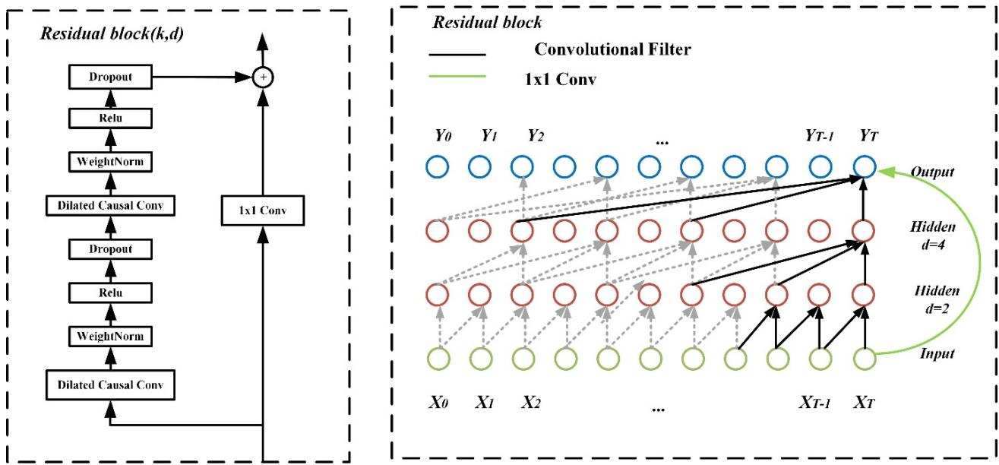  
Figure 7. 带有残差连接的 TCN。

TCN 网络的输入是提取的 sEMG（表面肌电）特征，但在卷积池化过程中存在不同特征通道重要性损失的问题。挤压与激励网络（Squeeze and Excitation Networks, SE-Net）的出现解决了传统卷积过程中出现的特征重要性损失问题 [24]。SE-Net 默认每个特征通道同等重要，而在实际问题中不同通道的重要性是各不相同的。

SE-Net 包含压缩（squeeze）和激励（excitation）两个部分，其结构如图 8 所示。这里 $w$ 和 $h$ 分别是特征图的宽度和高度；$c$ 是通道数；输入特征图的尺寸为 $h \times w \times c$。假设输入是 $h \times w \times c$ 的特征通道，首先对其进行全局平均池化，在压缩操作之后，特征图被压缩为 $1 \times 1 \times c$ 的特征图，然后使用两个全连接层对压缩结果进行非线性变换。最后是 Scale（缩放）部分，将利用激励得到的结果与对应通道的输入特征相乘 [25]。

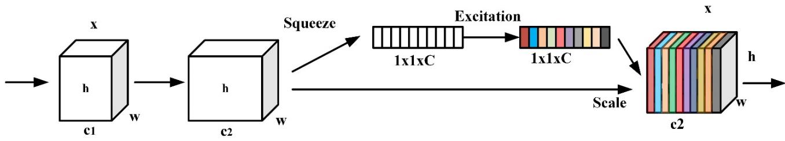  
Figure 8. SE-Net 模块结构图。

由于使用 SE-Net 解决了特征通道重要性缺失的问题，因此将后者置于 TCN 网络之前。输入到 TCN 的 sEMG（表面肌电）信号特征首先通过 SE-Net 进行权重调整，然后由 TCN 预测上肢关节角度。网络根据损失函数调整 SE-Net 的权重，使得输入模型的各个 sEMG 信号特征能够调整其所占的权重。这使得在预测肩关节或肘关节角度时，主导肌肉能够根据其主导作用占据更高的权重。

此外，拓展了 TCN 的深度，并在原始 TCN 网络中继续添加卷积模块和残差模块。将原始输入信息与卷积后的特征进行连接。最后一个全连接层的输出数量与预测的关节角度数量相同。为了保持初始输入信息的完整性，残差模块中的卷积膨胀因子 $d = 1$，串联 TCN 的结构如图 9 所示。每块肌肉提取的特征输入到 SE-TCN 模块中，算法流程图如图 10 所示。

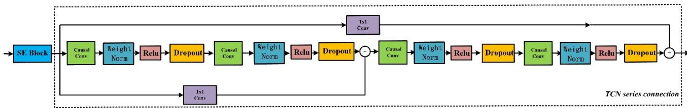

Figure 9. 串联 TCN 模块结构图。  
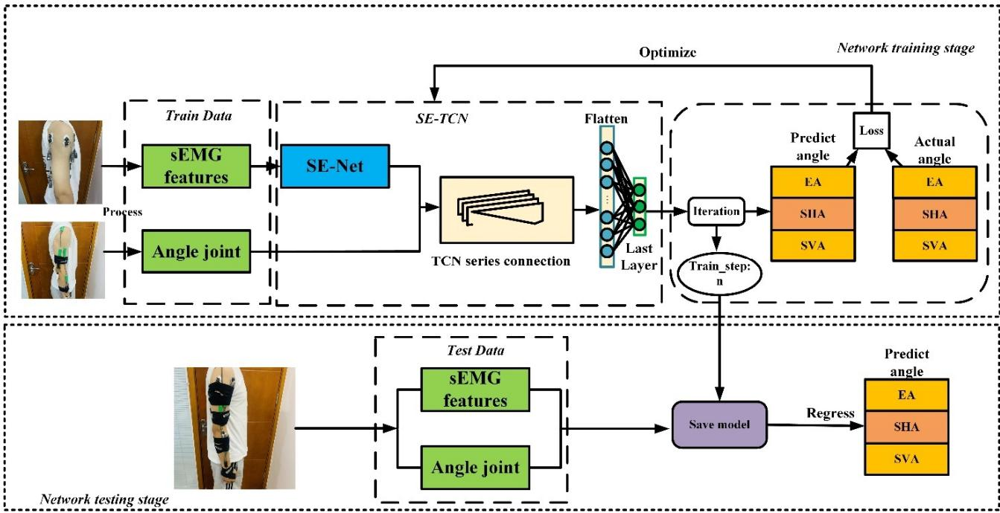  
Figure 10. SE-TCN 结构图。

在图 10 中，在网络训练阶段使用训练集对 SE-TCN 模型进行训练。网络参数根据模型预测角度与实际角度之间的均方误差进行更新。在训练网络的 $n$ 次迭代中保留训练效果最好的模型（图 10 中的 Save model）。在网络测试阶段，使用保存的模型根据测试集数据预测关节角度。

在网络模型参数的选择上，我们进行了多次尝试，最终选出了一组最佳参数。最终得到的 SE-TCN 模型的 SE-Net 滤波器尺寸为 32，第二个全连接层包含 21 个神经元。第一个 TCN 输入层的滤波器尺寸为 16，卷积核大小为 $k = 3$，扩张因子（expansion factor）为 $d = 2$。隐藏层的滤波器尺寸为 16，卷积核大小为 $k = 2$，$d = 4 .$。第二个 TCN 输入层的滤波器尺寸为 32，卷积核大小为 $k = 3$，扩张因子为 $d = 8$，隐藏层的滤波器尺寸为 64，感受野（perceptual field）$k = 3$，$d = 1 6 .$，输出层的滤波器尺寸为 64，卷积核为 $k = 1$。因此，我们采用均方误差（MSE）作为损失函数，如公式 (7) 所示：

$$
l _ {m s e} = \frac {\sum_ {i = 1} ^ {n} [ y _ {i} - y ^ {\prime} ] ^ {2}}{n}\tag{7}
$$

优化器采用 Adam，该算法是一种可以替代传统随机梯度下降过程的一阶优化算法，能够基于训练数据迭代更新网络权重。它具有实现简单、计算效率高和内存占用小等优点。本文中 Adam 的学习率设置为 0.01。

## 2.5. 其他模型

## 2.5.1. 反向传播（BP）网络

BP 网络由输入层、隐藏层和输出层组成。研究人员已经应用 BP 网络来预测上肢关节角度 [26]。本研究中 BP 网络的输入为 20 维的 sEMG（表面肌电）信号特征和角度信号，输出为三维角度信号。BP 网络输入层的神经元数量为 20，中间层的神经元数量为 15，输出层的神经元数量为 3。

## 2.5.2. 长短期记忆（LSTM）网络

LSTM 是一种循环神经网络（RNN）架构，由遗忘门、输入门和输出门组成。研究人员已经提出了基于 LSTM 的连续关节角度运动估计方法 [16]。LSTM 模型的输入为 20 维的 sEMG 信号特征和角度信号，输出为三维角度信号。该模型包含三层 LSTM，每层 LSTM 的神经元数量为 50。学习率为 0.001，损失函数为 MSE，优化器为 Adam 算法。

## 2.6. 评估指标

本研究使用均方根误差（RMSE）和平均决定系数 $( R ^ { 2 } )$ 来评估角度预测性能。相关系数（correlation coefficient）是用于准确描述估计性能的分析指标。使用相关系数（CC）分别对 10 名受试者进行了测试。

RMSE 的值越小，代表模型的预测结果越好。RMSE 的计算公式如下：

$$
R M S E = \sqrt {\frac {\sum_ {n = 0} ^ {N} (y _ {n} ^ {\prime} - y _ {n}) ^ {2}}{N}}\tag{8}
$$

其中  表示关节角度序列的长度，$y _ { n } ^ { \prime }$ 表示估计的关节角度，$y _ { n }$ 表示实际关节角度。$R ^ { 2 }$ 计算如下：

$$
R ^ {2} = 1 - \frac {\sum_ {n = 0} ^ {N} (y _ {n} ^ {\prime} - y _ {n}) ^ {2}}{\sum_ {n = 0} ^ {N} (y _ {n} - \overline {{y _ {n}}}) ^ {2}}\tag{9}
$$

其中 $y _ { n }$ 为实际关节角度，$\overline { { y _ { n } } }$ 为 $y _ { n } .$ 的均值，$y _ { n } ^ { \prime }$ 为估计的关节角度。$R ^ { 2 }$ 介于 0 和 1 之间。$R ^ { 2 }$ 的结果越接近 1，回归拟合效果越好。当拟合度大于 0.8 时，认为模型具有较好的拟合效果。

相关系数用于衡量两组序列之间关联的强度，可用于评估预测关节角度与实际关节角度的匹配程度。

$$
r (y ^ {\prime}, y) = \frac {c o v (y ^ {\prime} , y)}{\sqrt {V a r [ y ^ {\prime} ] V a r [ y ]}}\tag{10}
$$

其中  表示相关系数，$c o v ( y ^ { \prime } , y )$ 表示 $y ^ { \prime }$ 与 $y$ 的协方差， 表示方差。相关系数越接近 1，相关性越强且正相关性越显著。

## 3. 结果

所有分析结果均基于 Table 1 中汇总的十名健康受试者的数据。研究共设计了七个动作来模拟肘关节和肩关节的运动，每个动作重复五次。采集的实验数据中，70% 用作训练集，20% 用作验证集，10% 用作测试集。在本文中，我们利用角度估计结果来验证该模型相较于其他现有模型的准确性和可行性。

## 3.1. 加入与未加入 SE-Net 的性能表现

在对比各模型之前，先进行了实验以检验 SE-Net 是否能改进 TCN 网络。未加入 SE-Net 前训练集的预测结果如 Figure 11 所示。关节角度拟合效果较差的原因在于，卷积池化过程中不同通道的特征重要性存在差异导致了特征损失。例如，三角肌主导肩关节的伸展，但在预测肩关节角度时，由于三角肌特征在输入的多维特征中不占主导地位，导致关节角度拟合较差。引入 SE-Net 后，训练集的预测结果如 Figure 12 所示。从图中可以看出，角度预测结果优于未加入 SE-Net 的网络。输入的 sEMG（表面肌电）信号特征首先经过 SE-TCN 预测角度，网络根据损失函数调整 SE-Net 的权重，从而使主导运动肌肉的特征占据更高的权重。

此外，在测试过程中网络模型的参数保持一致。为了准确比较结果，所有左轴单位均为角度（°）。可以看出，在加入 SE-Net 后，TCN 预测的角度变得更加精确。

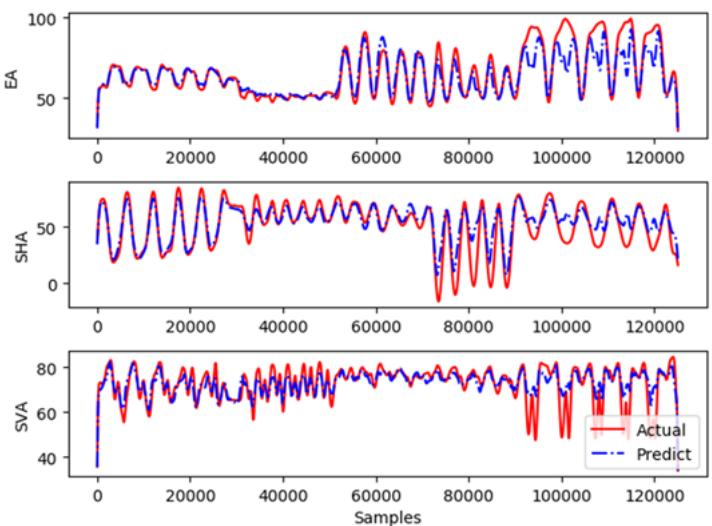

Figure 11. 无 SE-Net 时 TCN 训练集的角度预测结果。  
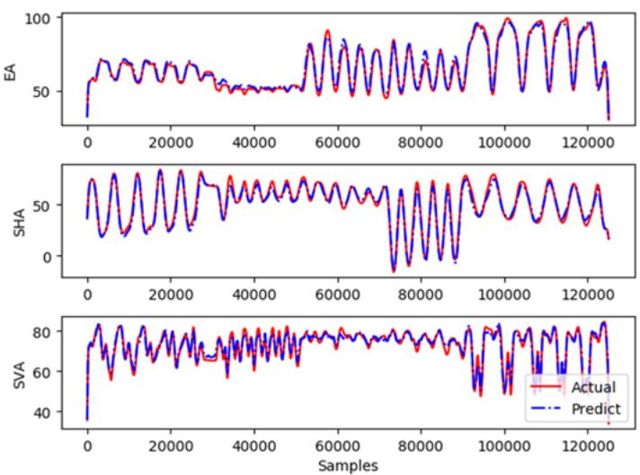  
Figure 12. 包含 SE-Net 时 TCN 训练集的角度预测结果。

## 3.2. 不同模型角度估计结果的比较

在本节中，研究了所提出的 SE-TCN 模型在关节角度估计方面的性能，并与 BP 网络和 LSTM 模型进行了比较。在模型比较中，所提出的模型与其他两个模型均基于 TensorFlow 和 Keras [27] 框架，且经预处理和特征提取后的 sEMG 数据被用作各输入验证模型之间的比较。为了估计受试者的肩关节和肘关节角度，将处理后的 sEMG 信号输入 BP、LSTM 和 SE-TCN 网络进行训练。所提出的 SE-TCN 模型的拟合能力显著优于 BP 网络和 LSTM 模型。

如图 Figure 13 所示，BP 和 LSTM 的角度预测结果均逊于 SE-TCN。当关节运动幅度较大时，BP 和 LSTM 模型的预测误差更为明显。同时，所提出的 SE-TCN 模型能够最精确地预测关节运动，其预测曲线与实际曲线几乎重叠。

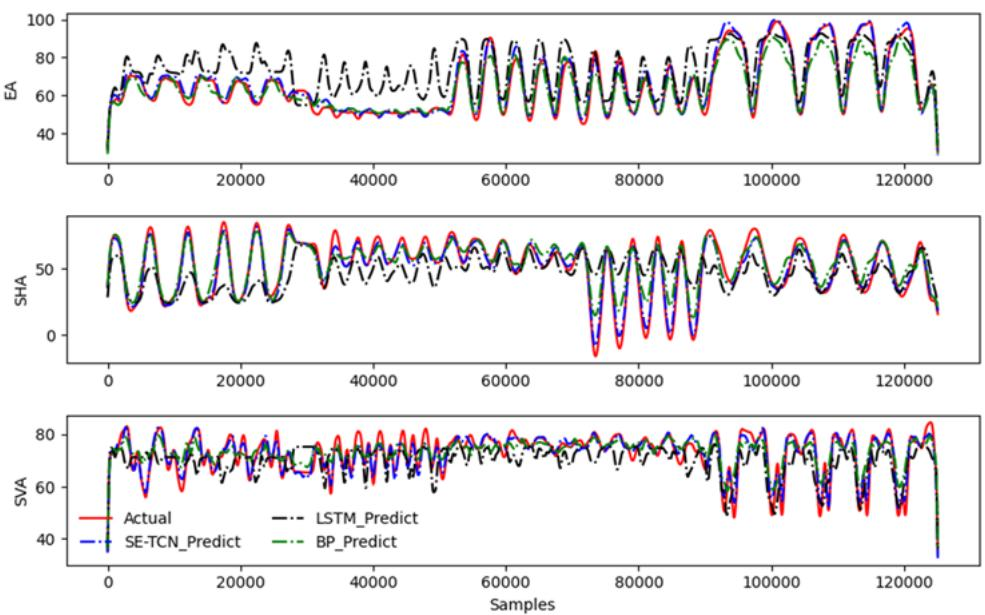  
Figure 13. BP、LSTM 和 SE-TCN 网络的训练集结果。

训练完成后，将测试集输入 BP 网络（Figure 14(a)）、LSTM 模型（Figure 14(b)）和 SE-TCN 模型（Figure 14(c)）进行预测。BP 网络在预测 SVA 角度时的准确性和平滑度较低，LSTM 网络略有改善，但在精细角度预测方面仍显不足。在连续的三种动作中，所提出的 SE-TCN 网络比 BP 和 LSTM 网络具有更精确、更平滑的角度。由于在输入网络之前未进行有效的特征加权，主导关节运动的肌肉特征在预测关节角度时并未占据更高的权重。

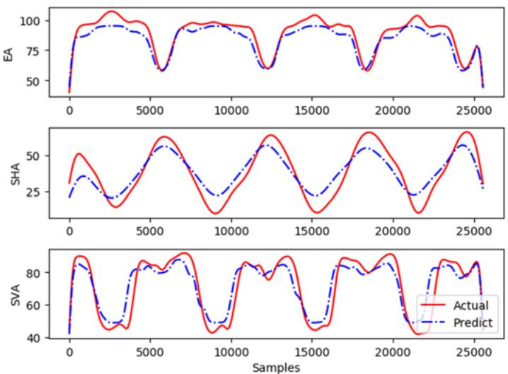  
(a)

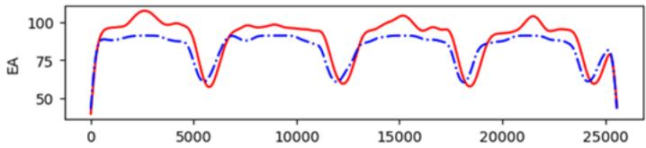

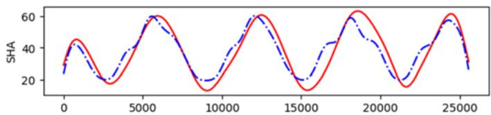

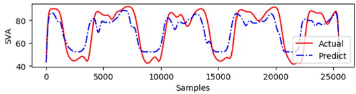

(b)  
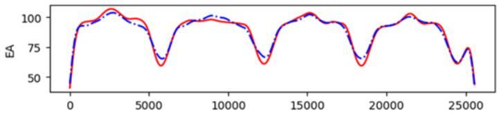

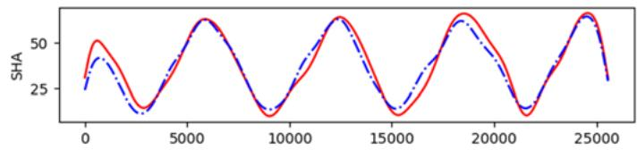

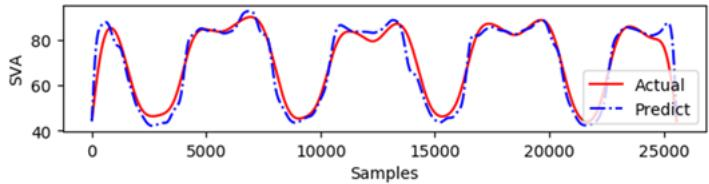  
(c)  
Figure 14. 三种模型验证集的预测结果：(a) BP 网络结果，(b) LSTM 网络结果，以及 (c) SE-TCN 结果。

## 3.3. 三种模型性能的对比分析

表 4 列出了十位受试者通过 BP 网络、LSTM 和 SE-TCN 模型进行关节角度预测的 RMSE 结果。当预处理和特征提取后的 sEMG 信号输入到网络结构中时，BP 网络（EA: 8.479, SHA: 10.854, SVA: 11.530）和 LSTM 网络（EA: 7.168, SHA: 9.974, SVA: 10.705）的连续估计值显著高于 SE-TCN 网络（EA: 5.353, SHA: 6.121, SVA: 5.818）的连续估计值。与 BP 和 LSTM 相比，SE-TCN 的平均 RMSE 分别降低了（EA: 25.3%, SHA: 38.6%, SVA: 45.6%）和（EA: 36.8%, SHA: 43.6%, SVA: 49.5%）。RMSE 结果越低，模型的拟合性能越好。因此，SE-TCN 的预测结果显著优于 BP 和 LSTM。

Table 4. 三种模型平均关节角度预测的 RMSE 结果。

<table><tr><td>受试者</td><td colspan="3">BP Networks</td><td colspan="3">LSTM</td><td colspan="3">SE-TCN</td></tr><tr><td></td><td>EA</td><td>SHA</td><td>SVA</td><td>EA</td><td>SHA</td><td>SVA</td><td>EA</td><td>SHA</td><td>SVA</td></tr><tr><td>1</td><td>7.891</td><td>6.367</td><td>12.104</td><td>11.645</td><td>11.944</td><td>12.640</td><td>6.489</td><td>5.904</td><td>2.763</td></tr><tr><td>2</td><td>11.359</td><td>17.648</td><td>8.256</td><td>7.013</td><td>10.646</td><td>16.217</td><td>6.139</td><td>4.416</td><td>3.169</td></tr><tr><td>3</td><td>10.594</td><td>17.115</td><td>8.724</td><td>7.105</td><td>10.163</td><td>13.580</td><td>6.648</td><td>8.228</td><td>7.497</td></tr><tr><td>4</td><td>5.075</td><td>10.954</td><td>16.622</td><td>4.750</td><td>13.678</td><td>11.576</td><td>3.567</td><td>7.200</td><td>5.691</td></tr><tr><td>5</td><td>4.221</td><td>9.709</td><td>17.019</td><td>5.450</td><td>10.766</td><td>6.044</td><td>4.353</td><td>7.629</td><td>7.020</td></tr><tr><td>6</td><td>13.377</td><td>9.633</td><td>8.784</td><td>6.604</td><td>7.903</td><td>9.039</td><td>6.007</td><td>7.839</td><td>8.498</td></tr><tr><td>7</td><td>8.609</td><td>14.616</td><td>11.541</td><td>5.010</td><td>10.018</td><td>7.746</td><td>4.526</td><td>7.727</td><td>7.776</td></tr><tr><td>8</td><td>8.930</td><td>10.646</td><td>18.606</td><td>6.725</td><td>8.600</td><td>19.618</td><td>5.146</td><td>6.666</td><td>6.357</td></tr><tr><td>9</td><td>6.417</td><td>4.037</td><td>6.680</td><td>6.907</td><td>7.423</td><td>7.143</td><td>5.331</td><td>2.521</td><td>5.994</td></tr><tr><td>10</td><td>8.317</td><td>7.813</td><td>6.967</td><td>10.467</td><td>8.598</td><td>3.446</td><td>5.319</td><td>3.081</td><td>3.413</td></tr><tr><td>平均值</td><td>8.479</td><td>10.854</td><td>11.530</td><td>7.168</td><td>9.974</td><td>10.705</td><td>5.353</td><td>6.121</td><td>5.818</td></tr></table>

BP、LSTM 和 SE-TCN 网络的连续估计 $R ^ { 2 }$ 评估结果总结于 Table 5。当经过预处理和特征提取后的 sEMG 信号输入到网络结构中时，BP 网络（EA: 0.721，SHA: 0.708，SVA: 0.640）和 LSTM 网络（EA: 0.588，SHA: 0.640，SVA: 0.627）的连续估计 $R ^ { 2 }$ 值显著低于 SE-TCN 网络的连续估计 $R ^ { 2 }$ 值（EA: 0.819，SHA: 0.843，SVA: 0.827）。与 BP 和 LSTM 相比，SE-TCN 的平均 $R ^ { 2 }$ 分别提高了（EA: 13.60%，SHA: 19.01%，SVA: 29.22%）和（EA: 39.20%，SHA: 31.72%，SVA: 31.89%）。$R ^ { 2 }$ 的结果越高，表明表面模型的拟合性能越好。结果表明，SE-TCN 的预测效果显著优于 BP 和 LSTM。

Table 5．三种模型平均关节角度预测的 $R ^ { 2 }$ 结果。

<table><tr><td>受试者</td><td colspan="3">BP Networks</td><td colspan="3">LSTM</td><td colspan="3">SE-TCN</td></tr><tr><td></td><td>EA</td><td>SHA</td><td>SVA</td><td>EA</td><td>SHA</td><td>SVA</td><td>EA</td><td>SHA</td><td>SVA</td></tr><tr><td>1</td><td>0.765</td><td>0.748</td><td>0.759</td><td>0.478</td><td>0.369</td><td>0.640</td><td>0.832</td><td>0.813</td><td>0.851</td></tr><tr><td>2</td><td>0.674</td><td>0.607</td><td>0.560</td><td>0.643</td><td>0.668</td><td>0.632</td><td>0.849</td><td>0.803</td><td>0.813</td></tr><tr><td>3</td><td>0.723</td><td>0.572</td><td>0.672</td><td>0.663</td><td>0.697</td><td>0.610</td><td>0.786</td><td>0.748</td><td>0.766</td></tr><tr><td>4</td><td>0.645</td><td>0.683</td><td>0.693</td><td>0.508</td><td>0.465</td><td>0.665</td><td>0.801</td><td>0.853</td><td>0.803</td></tr><tr><td>5</td><td>0.661</td><td>0.705</td><td>0.566</td><td>0.423</td><td>0.639</td><td>0.626</td><td>0.793</td><td>0.824</td><td>0.774</td></tr><tr><td>6</td><td>0.761</td><td>0.801</td><td>0.795</td><td>0.771</td><td>0.812</td><td>0.729</td><td>0.805</td><td>0.841</td><td>0.821</td></tr><tr><td>7</td><td>0.702</td><td>0.821</td><td>0.605</td><td>0.416</td><td>0.640</td><td>0.732</td><td>0.928</td><td>0.870</td><td>0.810</td></tr><tr><td>8</td><td>0.716</td><td>0.891</td><td>0.748</td><td>0.732</td><td>0.817</td><td>0.731</td><td>0.750</td><td>0.890</td><td>0.971</td></tr><tr><td>9</td><td>0.760</td><td>0.584</td><td>0.529</td><td>0.555</td><td>0.695</td><td>0.517</td><td>0.730</td><td>0.838</td><td>0.791</td></tr><tr><td>10</td><td>0.804</td><td>0.665</td><td>0.473</td><td>0.690</td><td>0.595</td><td>0.390</td><td>0.916</td><td>0.948</td><td>0.874</td></tr><tr><td>平均值</td><td>0.721</td><td>0.708</td><td>0.640</td><td>0.588</td><td>0.640</td><td>0.627</td><td>0.819</td><td>0.843</td><td>0.827</td></tr></table>

十名受试者的 RMSE 和 $R ^ { 2 }$ 值分别绘制于 Figure 15 和 Figure 16 中。SE-TCN 具有最低的 RMSE 和最高的 $R ^ { 2 }$ 值。三种网络的预测结果表明，SE-TCN 网络的性能最佳。

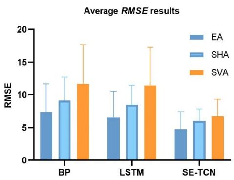

Figure 15. 三种模型中十名受试者的平均 RMSE 结果。  
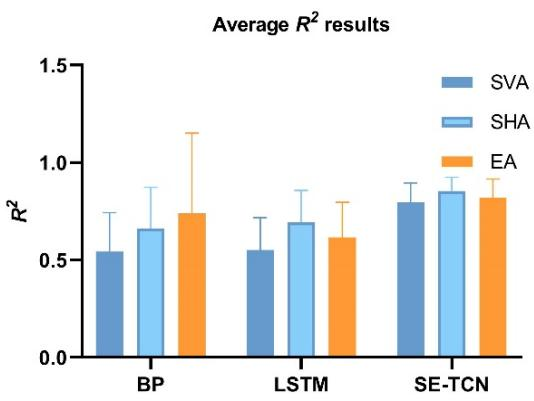

Figure 16. 三种模型中十名受试者的平均 $R ^ { 2 }$ 结果。  
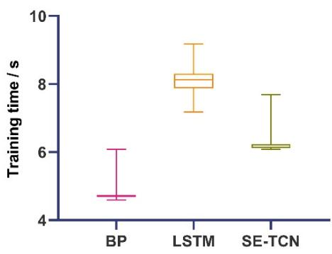  
Figure 17. 不同网络训练时间的对比。

缩短训练时间可以提高系统的响应速度，从而改善系统的实时性能。因此，对这些模型进行了更全面的对比分析。本研究使用相同的数据集和同一台计算机来训练 LSTM 和 SE-TCN 网络，并根据对比实验记录了这两种模型的运行时间。每次训练的时间均被记录下来，如 Figure 17 所示。可以看出，SE-TCN 的模型训练速度远快于 LSTM。

## 3.4. 模型显著性对比

对这十名受试者进行了测试，以系统地验证该方法的可重现性和准确性。每个模型均进行了十次运行，并记录了三个角度的相关系数。受试者相关系数的均值列于 Table 6 中。SE-TCN 网络的结果（EA: 89.4%, SHA: 90.8%, SVA: 87.2%）优于 LSTM 网络（EA: 80.9%, SHA: 83.7%, SVA: 80.9%）和 BP 网络（EA: 79.9%, SHA: 82.7%, SVA: 73.3%）。为了进一步验证所提出的 SE-TCN 模型是否优于 BP 和 LSTM 模型，进行了 t-test（t 检验）。十名受试者的测试结果和相关系数如 Figure 18 所示，证实了 SE-TCN 模型显著优于 BP 和 LSTM 模型。星号（\*）表示显著性。

Table 6. 通过三种模型获得的十名研究所涉受试者测量关节角度与估计关节角度的相关系数。

<table><tr><td>受试者</td><td colspan="3">BP Networks</td><td colspan="3">LSTM</td><td colspan="3">SE-TCN</td></tr><tr><td></td><td>EA</td><td>SHA</td><td>SVA</td><td>EA</td><td>SHA</td><td>SVA</td><td>EA</td><td>SHA</td><td>SVA</td></tr><tr><td>1</td><td>0.853</td><td>0.907</td><td>0.730</td><td>0.832</td><td>0.901</td><td>0.803</td><td>0.911</td><td>0.936</td><td>0.902</td></tr><tr><td>2</td><td>0.790</td><td>0.809</td><td>0.746</td><td>0.789</td><td>0.815</td><td>0.677</td><td>0.874</td><td>0.864</td><td>0.859</td></tr><tr><td>3</td><td>0.659</td><td>0.693</td><td>0.624</td><td>0.697</td><td>0.683</td><td>0.672</td><td>0.878</td><td>0.808</td><td>0.831</td></tr><tr><td>4</td><td>0.816</td><td>0.891</td><td>0.830</td><td>0.772</td><td>0.804</td><td>0.673</td><td>0.861</td><td>0.949</td><td>0.882</td></tr><tr><td>5</td><td>0.843</td><td>0.830</td><td>0.754</td><td>0.865</td><td>0.861</td><td>0.682</td><td>0.906</td><td>0.914</td><td>0.865</td></tr><tr><td>6</td><td>0.854</td><td>0.829</td><td>0.800</td><td>0.932</td><td>0.912</td><td>0.873</td><td>0.959</td><td>0.932</td><td>0.918</td></tr><tr><td>7</td><td>0.779</td><td>0.829</td><td>0.649</td><td>0.779</td><td>0.885</td><td>0.686</td><td>0.867</td><td>0.952</td><td>0.847</td></tr><tr><td>8</td><td>0.933</td><td>0.733</td><td>0.885</td><td>0.922</td><td>0.898</td><td>0.798</td><td>0.943</td><td>0.968</td><td>0.879</td></tr><tr><td>9</td><td>0.779</td><td>0.893</td><td>0.896</td><td>0.794</td><td>0.865</td><td>0.709</td><td>0.883</td><td>0.955</td><td>0.881</td></tr><tr><td>10</td><td>0.621</td><td>0.610</td><td>0.636</td><td>0.488</td><td>0.767</td><td>0.230</td><td>0.875</td><td>0.877</td><td>0.855</td></tr><tr><td>平均值</td><td>0.793</td><td>0.802</td><td>0.755</td><td>0.787</td><td>0.839</td><td>0.680</td><td>0.896</td><td>0.916</td><td>0.872</td></tr></table>

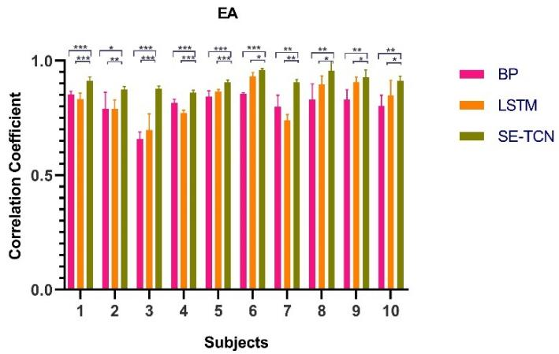  
(a)

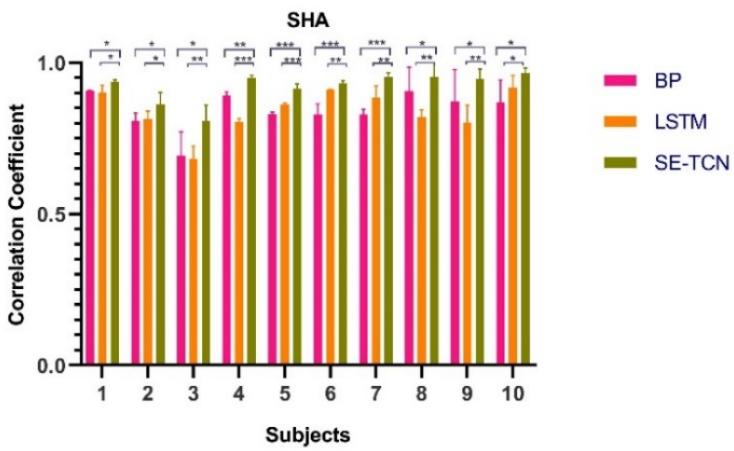

(b)  
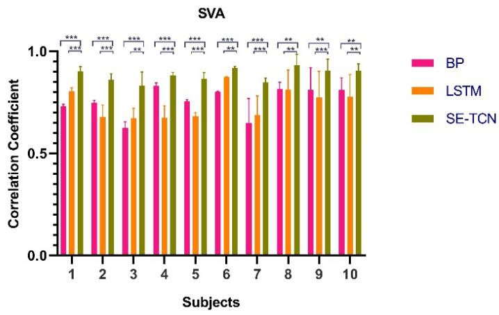  
(c)  
Figure 18. 基于统计分析结果的 SE-TCN 针对 BP 和 LSTM 的 T 检验。“\*”表示具有统计学显著性 $( \mathtt { p } < 0 . 0 5 )$ 2 “\*\*”表示具有统计学显著性 $( \mathtt { p } < 0 . 0 1 )$ “\*\*\*”表示具有统计学显著性 $( \mathtt { p } < 0 . 0 0 1 )$。

## 4. 讨论

本研究试图通过综合结合 SE-Net 和串联 TCN 网络组件，来改进利用 sEMG 信号预测上肢关节角度的效果。上肢多个关节角度的预测结果表明，所提出的 SE-TCN 具备可调节的特征通道权重以及 TCN 的无梯度爆炸特性。在预测角度的任务中，它展现出了高精度与高性能。

经过多次评估，所提出的 SE-TCN 以及现有的 BP 和 LSTM 网络均能基于 sEMG 信号预测上肢关节角度。通过综合实验发现，这三种网络在训练过程中均能拟合实际的关节角度。统计结果表明，与 BP 和 LSTM 相比，SE-TCN 的平均 RMSE 分别降低了（EA: 25.3%, SHA: 38.6%, SVA: 45.6%）和（EA: 36.8%, SHA: 43.6%, SVA: 49.5%）。与 BP 和 LSTM 相比，SE-TCN 的平均 $R ^ { 2 }$ 分别提高了（EA: 13.60%, SHA: 19.01%, SVA: 29.22%）和（EA: 39.20%, SHA: 31.72%, SVA: 31.89%）。SE-TCN 具有优于其他网络的性能。通过显著性比较，在 10 名受试者中，SE-TCN 模型显著优于 BP $( \rho < 0 . 0 0 1 )$ 和 LSTM $( \rho < 0 . 0 1 )$ 模型。尽管 BP 网络存在对时间序列预测不足的缺点，但它在某些方面优于 LSTM，如在受试者 4 中所示。

BP 网络在处理时间序列时无法挖掘序列数据的相关性，导致 BP 网络的拟合效果较差。此外，尽管 LSTM 的性能确实优于 BP 网络，但由于其线性处理模式，通常情况下需要更长的训练时间。由于 TCN 网络可以进行并行卷积，因此训练时间大大缩短。此外，TCN 克服了 LSTM 梯度爆炸的缺点。本文采用的 SE-Net 缓解了传统卷积过程中特征重要性缺失的问题。SE-TCN 模型在关节角度预测方面展现出了最佳的综合估计性能。

然而，本研究也存在一定的局限性。我们使用的传感器是 NORAXON 配套角度传感器。当受试者运动时，传感器会随着隆起的肌肉而拱起。在机器人辅助微创手术等人机交互应用中，需要更精细的传感器来捕获角度数据。

在后续研究中，将采用更精细的传感器，并改进网络结构以更好地提取隐藏在时间序列中的信息。还将招募涵盖更广泛年龄、体重和 BMI 范围的更多受试者，并提取更显著的 sEMG 特征，以进一步提高上肢关节角度的预测精度。

## 5. 结论

人机交互技术的成熟使得利用 sEMG 控制外骨骼机器人和智能假肢成为可能。然而，上肢康复机器人的角度控制仍存在不够灵活的缺点。尽管 BP 和 LSTM 能够预测关节角度，但它们存在平滑度差、内存消耗大和精度低等缺点。此外，LSTM 通常需要较长的训练时间。

在本文中，我们提出了 SE-TCN 算法。通过加深和拓展 TCN 的网络深度，解决了 LSTM 训练时间过长的问题。此外，针对主导上肢运动的肌群时序特征不明显而导致关节角度精度较低的问题，引入了 SE-Net 以调整网络的特征权重。最后，我们设计了实验，将所提出的 SE-TCN 网络与 BP 和 LSTM 网络进行对比。结果表明，本文提出的 SE-TCN 在角度预测方面表现出较高的精度和性能。

本文提出的方法在包括精度和训练时间在内的多个方面均有所改善。未来，我们将进一步利用该网络拓展生物电信号和人机交互的应用。

## 致谢

作者感谢所有支持这项工作的同事。本工作得到了河北省自然科学基金（编号：F2021201002、F2021201005）、河北省教育厅科学技术研究项目（编号：ZD2020146）、保定市科学技术局重点研发计划（编号：1911Q001）以及河北省高校优秀创新人才支持计划（编号：SLRC2017022）的共同资助。

## 利益冲突

我们声明，我们与其他可能不当影响本工作的人员或组织不存在任何经济或个人关系；在任何产品、服务和/或公司中，均不存在任何可能被解释为会影响题为“SE-TCN network for continuous estimation of upper limb joint angles”的手稿中所述立场或评审的任何性质或形式的专业或其他个人利益。

## 参考文献

1. L. Vodovnik, C. Long, J. B. Reswick, A. Lippay, D. Starbuck, Myo-electric control of paralyzed muscles, IEEE Trans. Biomed. Eng., BME-12 (1965), 169–172. https://doi.org/10.1109/tbme.1965.4502374

2. W. Geng, Y. Du, W. Jin, W. Wei, Y. Hu, J. Li, Gesture recognition by instantaneous surface EMG images, Sci. Rep., 6 (2016), 36571. https://doi.org/10.1038/srep36571

3. P. Tsarouchi, S. Makris, G. Chryssolouris, Human-robot interaction review and challenges on task planning and programming, Int. J. Comput. Integr. Manuf., 29 (2016), 916–931. https://doi.org/10.1080/0951192X.2015.1130251

4. C. Yang, C. Zeng, P. Liang, Z. Li, R. Li, C. Su, Interface design of a physical human–robot interaction system for human impedance adaptive skill transfer, IEEE Trans. Autom. Sci. Eng., 15 (2017), 329–340.

5. M. Bowman, J. Zhang, X. Zhang, An intent-based task-aware shared control framework for intuitive hands free telemanipulation, preprint, arXiv:2003.03677. https://doi.org/10.48550/arXiv.2003.03677

6. S. Li, H. Wang, M. U. Rafique, A novel recurrent neural network for manipulator control with improved noise tolerance, IEEE Trans. Neural Networks Learn. Syst., 29 (2017), 1908–1918. https://doi.org/10.1109/TNNLS.2017.2672989

7. D. Zhang, Z. Wu, J. Chen, R. Zhu, A. Munawar, B. Xiao, et al., Human-robot shared control for surgical robot based on context-aware sim-to-real adaptation, preprint, arXiv:2204.11116. https://doi.org/10.48550/arXiv.2204.11116

8. R. Bertani, C. Melegari, M. C. De Cola, A. Bramanti, P. Bramanti, R. S. Calabrò, Effects of robotassisted upper limb rehabilitation in stroke patients: a systematic review with meta-analysis, Neurol. Sci., 38 (2017), 1561–1569. https://doi.org/10.1007/s10072-017-2995-5

9. P. Maciejasz, J. Eschweiler, K. Gerlach-Hahn, A. Jansen-Troy, S. Leonhardt, A survey on robotic devices for upper limb rehabilitation, J. NeuroEng. Rehabil., 11 (2014), 1–29. https://doi.org/10.1186/1743-0003-11-3

10. A. J. Young, L. H. Smith, E. J. Rouse, L. J. Hargrove, Classification of simultaneous movements using surface EMG pattern recognition, IEEE Trans. Biomed. Eng., 60 (2012), 1250–1258. https://doi.org/10.1109/TBME.2012.2232293

11. X. Wu, W. Hou, X. Zheng, H. Wang, M. Zha, Relationship between surface EMG and angle of elbow joint, Space Med. Med. Eng., 6 (2006).

12. N. K. Karnam, A. C. Turlapaty, S. R. Dubey, B. Gokaraju, Classification of sEMG signals of hand gestures based on energy features, Biomed. Signal Process. Control, 70 (2021), 102948. https://doi.org/10.1016/j.bspc.2021.102948

13. B. Hudgins, P. Parker, R. N. Scott, A new strategy for multifunction myoelectric control, IEEE Trans. Biomed. Eng., 40 (1993), 82–94. https://doi.org/10.1109/10.204774

14. J. Rafiee, M. A. Rafiee, F. Yavari, M. P. Schoen, Feature extraction of forearm EMG signals for prosthetics, Expert Syst. Appl., 38 (2011), 4058–4067. https://doi.org/10.1016/j.eswa.2010.09.068

15. J. Wang, Q. Hao, X. Xi, J. Cao, A. Xue, H. Wang, Estimation of continuous joint angles of upper limb based on sEMG by using GA-Elman neural network, Math. Probl. Eng., 2020 (2020).

16. G. Tang, J. Sheng, D. Wang, S. Men, Continuous estimation of human upper limb joint angles by using PSO-LSTM model, IEEE Access, 9 (2020), 17986–17997. https://doi.org/10.1109/ACCESS.2020.3047828

17. A. Phinyomark, P. Phukpattaranont, C. Limsakul, Feature reduction and selection for EMG signal classification, Expert Syst. Appl., 39 (2012), 7420–7431. https://doi.org/10.1016/j.eswa.2012.01.102

18. A. Phinyomark, R. N. Khushaba, E. Scheme, Feature extraction and selection for myoelectric control based on wearable EMG sensors, Sensors, 18 (2018), 1615. https://doi.org/10.3390/s18051615

19. S. Bai, J. Z. Kolter, V. Koltun, An empirical evaluation of generic convolutional and recurrent networks for sequence modeling, preprint, arXiv:1803.01271. https://doi.org/10.48550/arXiv.1803.01271

20. P. Liu, X. Qiu, X. Huang, Recurrent neural network for text classification with multi-task learning, preprint, arXiv:1605.05101. https://doi.org/10.48550/arXiv.1605.05101

21. S. Hochreiter, J. Schmidhuber, Long short-term memory, Neural Comput., 9 (1997), 1735–1780. https://doi.org/10.1162/neco.1997.9.8.1735

22. C. Lea, M. D. Flynn, R. Vidal, A. Reiter, G. D. Hager, Temporal convolutional networks for action segmentation and detection, in 2017 IEEE Conference on Computer Vision and Pattern Recognition (CVPR), (2017), 156–165. https://doi.org/10.1109/CVPR.2017.113

23. J. Zhu, L. Su, Y. Li, Wind power forecasting based on new hybrid model with TCN residual modification, Energy AI, 10 (2022), 100199. https://doi.org/10.1016/j.egyai.2022.100199

24. X. Guo, Q. Wang, J. Zheng, An intelligent computer-aided diagnosis approach for atrial fibrillation detection based on multi-scale convolution kernel and Squeeze-and-Excitation network, Biomed. Signal Process. Control, 68 (2021), 102778. https://doi.org/10.1016/j.bspc.2021.102778

25. J. Hu, L. Shen, G. Sun, Squeeze-and-excitation networks, in 2018 IEEE/CVF Conference on Computer Vision and Pattern Recognition, (2018), 7132–7141. https://doi.org/10.1109/CVPR.2018.00745

26. Y. M. Aung, A. Al-Jumaily, Estimation of upper limb joint angle using surface EMG signal, Int. J. Adv. Rob. Syst., 10 (2013), 369. https://doi.org/10.5772/56717

27. M. Abadi, P. Barham, J. Chen, Z. Chen, A. Davis, J. Dean, et al., {TensorFlow}: a system for {Large-Scale} machine learning, in 12th USENIX symposium on operating systems design and implementation (OSDI 16), (2016), 265–283.

AIMS Press

©2023 作者保留所有权利，由 AIMS Press 授权。这是一篇根据知识共享署名许可协议（Creative Commons Attribution License，http://creativecommons.org/licenses/by/4.0）条款分发的开放获取文章。