# Edge-deployable pelvic IMU temporal convolution for real time hip and knee joint angle estimation

Shu Xiaolong , Luo Shengli, Wang Xu , Qin Yiyao, Liu Qiwen, Yu Hongliu ∗

Institute of Intelligent Rehabilitation Engineering, University of Shanghai for Science and Technology, Shanghai, 200093, China

Shanghai Engineering Research Center of Assistive Devices, Shanghai, 200093, China

School of Health Science and Engineering, University of Shanghai for Science and Technology, Shanghai, 200093, China

## A R T I C L E I N F O

Keywords: Pelvic kinematics Inertial measurement unit Temporal convolutional network Joint angle estimation Edge computing

## A B S T R A C T

Accurate and low-latency estimation of lower-limb joint kinematics is important for powered prosthesis control, particularly for hip disarticulation (HD) users who rely heavily on compensatory pelvic motions during walking. This study proposes an edge-deployable framework for estimating continuous bilateral hip and knee flexion angles using only a single pelvic inertial measurement unit (IMU). The task was formulated as tempora regression from six-channel pelvic kinematics to four lower-limb joint-angle outputs. Eight model families were benchmarked under a unified training, validation, and ONNX deployment protocol to evaluate the accuracy– latency trade-off. The transformer achieved the lowest error (RMSE = 1.698°, MAE = 1.290°), whereas the temporal convolutional network (TCN) provided the most favorable edge-deployment balance on Raspberry Pi 5 (RMSE = 1.921°. MAE = 1.484°, p95 latency = 0.229 ms). Generalization analyses showed relatively stable hip-angle estimation, whereas knee-angle estimation contributed more to speed-dependent and subject dependent errors. These findings suggest that pelvic-IMU-driven temporal convolution can serve as a practical preliminary perception module for future powered HD prosthesis studies, with further validation required in HD users and real-world walking conditions.

## 1. Introduction

Hip disarticulation (HD) is the most proximal level of lower-limb amputation, and restoring natural gait remains one of the most challenging tasks for individuals with HD [1]. With passive HD prostheses, the lack of active torque at the prosthetic hip often forces users to generate large pelvic swings to drive the prosthesis through swing and stepping, which imposes high physical demands; this is particularly challenging for elderly users who require substantial endurance to maintain stable walking [2,3]. Moreover, long-term excessive pelvic tilt and rotation used to achieve forward progression may increase low-back loading and further elevate the risk of spinal or soft-tissue injury [4]. To reduce physical burden and improve mobility for indi viduals with HD, introducing powered actuation and intelligent control at the prosthetic hip is a potential direction [5–7]. However, powered hip control must infer user intent, and for individuals with HD the loss of an intact hip joint and distal lower-limb segments substantially limits available physiological signals and motion cues, making reliable user-input recognition a key challenge [8,9].

In recent years, advances in 3D gait biomechanics and actuator/sensor technologies have enabled a range of effective control systems for lower-limb prostheses [10,11]. For example, in complex terrains such as stairs and ramps, powered knee prostheses can actively assist propulsion and reduce compensatory motions, thereby decreasing metabolic cost and joint loading [12,13]. In contrast, research on powered hip prostheses for HD remains at an early stage, and evidence regarding control strategies and usable input signals is still limited [14,15]. Brannen et al. developed an anteriorly mounted microprocessor-controlled powered hip prototype that has been mechanically tested and functionally validated, yet further optimization is needed for routine clinical use [16]. Similarly, Botros et al. investigated a powered four-bar hip prosthesis prototype and highlighted challenges in adaptability and stability across diverse scenarios [17].

Existing methods for generating joint trajectories (angles/angular velocities) or torque references for powered HD systems can be broadly grouped into three paradigms: (1) intact-side mirroring/echo-based references; (2) gait event- or phase-driven hierarchical control with finite-state reference profiles; and (3) regression/learning-based references derived from controllable human information, particularly pelvic kinematics.

First, Ueyama et al. constructed a prototype with actuated hip– knee joints and adopted a mirroring/echo control strategy: intact-side motion served as a cue, and a virtual elastic energy storage–release mechanism was used to drive prosthetic swing, producing a rela tively natural gait appearance under steady-state conditions [18,19]. However, such approaches rely heavily on gait periodicity. In non steady daily activities (e.g., speed changes, obstacle avoidance, turning, and asymmetric tasks), additional rule-based compensation is often required to maintain usability. Moreover, these methods are sensitive to the end-to-end chain from intact-side sensing to response generation: latency and phase errors can reduce users’ real-time regulation capability and may compromise stability in closed-loop assistance.

Second, to improve adaptability and reduce reliance on intact-side mirroring, a ‘‘high–mid–low’’ hierarchical architecture is increasingly adopted: gait event detection or phase segmentation drives a finitestate machine (or sub-phase machine); within each sub-phase, target hip states (e.g., desired angle/angular velocity) are defined and tracked via impedance or torque control. Golshan et al. proposed a ‘‘Power Hip’’ control framework for HD, using internal sensors (IMU, load sensors, encoders, etc.) to recognize gait sub-phases and switch target hip states and impedance parameters, enabling a degree of speed adaptation [20]. Likewise, for systems integrating a powered hip with a microprocessor knee, when intent recognition is not yet sufficiently reliable, prototypes often adopt preprogrammed hip angle/angular velocity profiles for validation; for example, Bader et al. set the hip joint to a predefined angular-velocity curve during prototype testing, yielding a fixed range-of-motion hip trajectory for level walking simulation [21,22]. A common limitation of this ‘‘phase machine + reference curve/parameters’’ paradigm is its dependence on robust event detection and repeated parameter tuning; across users, walking speeds, and tasks, retuning or rule switching is often required. Moreover, when extending from steady-state to non-steady scenarios (speed changes, turning, and complex terrain), finite-state transitions and fixed reference curves may induce phase drift, switching chatter, or trajectory discontinuities, which can adversely affect usability and safety.

The third paradigm aims to use more controllable and stable human inputs to compute or infer joint reference trajectories more directly. Some studies still use gait phase/intent as an intermediate variable. For example, Chen et al. proposed a TCN-based gait phase decoder that estimates phase from limited sensing, providing a temporal baseline for subsequent reference generation and control [23]. Li et al. used hierarchical control for swing assistance and constructed an ideal swing-phase assistive torque reference using a quadratic Bézier curve, enabling adjustment with speed and gait characteristics [24]. Other work focuses on impedance/stiffness modulation, altering reference response characteristics through variable joint stiffness or semi-active strategies to adapt to different gait demands [25]. Overall, ‘‘phase decoding + curve parameterization’’ still follows a chained process of ‘‘phase first, trajectory later’’: once phase estimation is perturbed in non-steady scenarios, the reference trajectory may drift accordingly. Furthermore, many methods output references for a single joint (often the hip) and do not sufficiently address hip–knee coordination or continuous bilateral joint-angle trajectories needed for control-oriented estimation.

In addition, Golshan et al. proposed a pelvic-kinematics-based ap proach to compute hip angles: leveraging correlations and linear regression, key hip angles and key time points were estimated stepwise from pelvic tilt/rotation and stance-time features, achieving high corre lation (up to approximately 0.94) and small differences compared with motion-capture results in certain metrics [26]. This work supports the premise that pelvic kinematics can serve as an effective observation of hip motion; however, it remains primarily based on handcrafted features and stepwise regression, focusing on key events/points rather than providing continuous bilateral hip/knee trajectories suitable for real-time edge deployment. Motivated by these gaps, this study proposes an end-to-end deep temporal regression framework targeting edge deployment. Compared with cloud-based inference, edge execution reduces round-trip latency, mitigates connectivity dependence, and supports privacy-preserving assistive control. Using only a 6-channel pelvic IMU sequence, the model directly learns a mapping from pelvic kinematics to continuous bilateral hip/knee flexion/extension angle trajectories, avoiding explicit gait-cycle segmentation, complex phasemachine rules, and intact-side mirroring, and thereby providing a more direct signal interface for reference generation and tracking in powered prosthesis control.

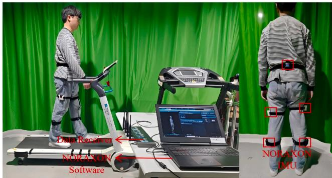  
Fig. 1. Schematic of the experimental setup and IMU placement on the pelvis, thigh, and shank segments.

In this study, healthy-participant gait was used as an initial normative reference for learning this pelvic-to-hip/knee temporal coupling, consistent with the goal of restoring prosthesis-assisted walking toward more physiological lower-limb kinematics. The main contributions of this paper are:

(1) We propose a causal temporal regression framework that predicts continuous bilateral hip/knee flexion/extension angles from a single six-channel pelvic IMU sequence, providing a minimal-sensor perception module for future HD prosthesis studies.

(2) Under a unified training, evaluation, and ONNX deployment protocol, we benchmark eight representative model families and characterize the accuracy–latency trade-off using both average and tail-latency metrics.

(3) We implement a PyTorch→ONNX→ONNX Runtime pipeline and benchmark deployment on Raspberry Pi 5. We further analyze the selected TCN model using joint-specific errors, speed- and subject-level generalization, LOSO validation, and trajectory-level waveform metrics to clarify both deployability and generalization boundaries.

## 2. Data acquisition and processing

Data were organized by subject and walking speed. Eight healthy participants (4 male, 4 female) were recruited and recorded under eight speed conditions (speed labels: 1.5–5.0 km/h). Participant age was 24.75 ± 1.04 years, height was 1.685 ± 0.048 m, and weight was 54.06 ± 6.81 kg. All participants provided informed consent, and the study protocol was approved by the Ethics Committee of Shanghai University of Medicine & Health Sciences (No. 2019ZYXM104). For each speed condition, participants walked for two minutes while a NORAXON IMU system recorded kinematic signals from pelvic, thigh, and shank units at 100 Hz. In this study, the pelvic IMU stream served as the model input, and the bilateral hip/knee flexion/extension angles exported by the NORAXON system were used as IMU-derived reference joint angles. The experimental setup and sensor placement are shown in Fig. 1.

Input features included three-axis pelvic rotation (Pelvis Rot X/Y/Z) and three-axis pelvic acceleration (Pelvis Accel Sensor X/Y/Z). Output targets included bilateral hip/knee flexion/extension angles (Hip Flex ion LT/RT, Knee Flexion LT/RT), in degrees. After export, all selected input and output channels were inspected for missing or non-finite values. Samples with missing or non-finite values in any of the six pelvic IMU input channels or four target joint-angle channels were excluded before window construction. No additional post-export lowpass filtering was applied beyond the NORAXON system’s built-in signal processing and orientation-estimation procedures. No manual gait-cycle-based artifact rejection was used for data splitting or model training.

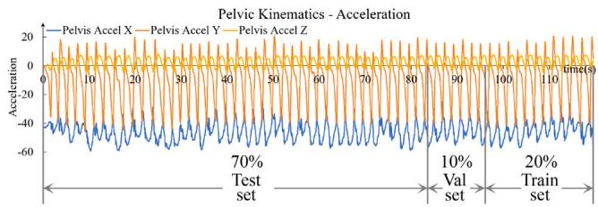  
Fig. 2. Chronological (time-continuous) split within each subject and walking speed recording: the sequence is partitioned into training, validation, and test segments in temporal order.

To reflect deployment settings where future gait cycles are unavail able and explicit segmentation may be unreliable, we did not segment gait cycles for model training and evaluation. Instead, within each continuous ‘‘subject–speed’’ sequence, we performed a chronological split: the first 70% for training, the subsequent 10% for validation, and the remaining 20% for testing, as illustrated in Fig. 2. This split preserves temporal continuity and avoids information leakage that can occur with random shuffling in time-series data.

## 3. Model training and selection

## 3.1. Candidate models and training settings

To enable an interpretable trade-off among estimation accuracy, real-time performance, and deployment complexity, we compare eight representative models: ridge\_linear (linear baseline), mlp (nonlinear regression baseline), cnn1d (local temporal patterns), tcn (dilated convolution for longer-range dependencies), gru (lightweight gated RNN), lstm\_uni (classic RNN baseline), bilstm (bidirectional context for offline fitting), and transformer\_base (attention-based baseline). Convolutional models (CNN/TCN) are highly parallelizable and often favorable for edge inference; RNN variants explicitly model temporal dependencies with recurrent computation; Transformer is included to evaluate potential benefits of attention under the same input/output setting. The ridge\_linear model was included as a same-input classical regression baseline under the single-pelvic-IMU input constraint. Table 1 summarizes architectural highlights and key hyperparameters.

## 3.2. Windowed training and ONNX benchmarking protocol

All models were trained using fixed-length sliding windows. The window length was WINDOW\_SIZE = 50 (0.5 s) with stride 1, where each input window was a $5 0 \times 6$ pelvic IMU sequence and the output was a 4D joint-angle vector at the last time step of the window. This design is causal and compatible with online use because only historical samples within the window are required. Standardization used training statistics only: channel-wise mean and standard deviation were computed after flattening the training IMU sequences, and inputs were normalized as $( x - \mu ) / \sigma$ during the forward pass.

Training was implemented in PyTorch with DataLoader setting consistent with the code: batch size 256 for training and 512 for validation/testing, with num\_workers = 4. When CUDA was used, pin\_memory was enabled; otherwise it was disabled. We adopted the Adam optimizer (learning rate $1 0 ^ { - 3 }$ , weight decay $1 0 ^ { - 5 } )$ with MSE loss. Learning rate scheduling used ReduceLROnPlateau (factor 0.5, patience 10), and early stopping on validation loss (patience 15) selected the best checkpoint for evaluation and deployment.

Table 1  
Candidate model families and key hyperparameters under the unified windowed regression setting.

<table><tr><td>Model</td><td>Architecture</td><td>Key hyperparameters</td></tr><tr><td>ridge_linear</td><td>linear regression</td><td>L2 regularization</td></tr><tr><td>mlp</td><td>MLP regression</td><td>2-layer MLP: hidden sizes 128 and 64</td></tr><tr><td>cnn1d</td><td>1D CNN</td><td>3 Conv1D layers, kernel = 3, channels: 32→64→128, adaptive pooling</td></tr><tr><td>tcn</td><td>Temporal convolution network</td><td>4 layers, dilations [1,2,4,8], channels = 64, kernel = 3, dropout = 0.1</td></tr><tr><td>gru</td><td>GRU</td><td>hidden = 64, layers = 2</td></tr><tr><td>lstm_uni</td><td>LSTM</td><td>hidden = 64, layers = 2</td></tr><tr><td>bilstm</td><td>BiLSTM</td><td>hidden = 64, layers = 2</td></tr><tr><td>transformer_base</td><td>Transformer</td><td>2 encoder layers, d_model = 64, nhead = 4, FF = 128</td></tr></table>

For desktop ONNX benchmarking, the trained PyTorch models were exported to ONNX and evaluated under the same input features and inference environment. Models were compared using macro-average RMSE and MAE across the four target outputs, together with inferencelatency statistics including mean, $p 5 0 , p 9 5 ,$ , and $p 9 9$ . The desktop ONNX benchmark was used for model-family comparison and model selection, whereas Raspberry Pi 5 benchmarking was used to evaluate on-device deployment performance.

Statistical analysis for generalization. For generalization analyses, RMSE was computed within each ‘‘subject × speed’’ condition after excluding the first 50 samples to reduce warm-up bias. When reporting hip/knee summaries, left/right outputs were averaged. Speed effects were assessed using repeated-measures ANOVA across subjects with walking speed as the within-subject factor, followed by Holm-corrected post-hoc tests. Inter-subject variability beyond speed was quantified using the residual intra-class correlation coefficient (ICC) after removing the speed-wise mean RMSE. For deployment-oriented reporting, we further summarized mean, �95, and maximum RMSE across all subject × speed conditions.

Subject-independent and waveform-level evaluation. To further evaluate subject-independent generalization, we performed leave-one subject-out (LOSO) validation using the selected TCN model. In each fold, all recordings from one participant were held out as the test set, while the remaining participants were used for model development. Normalization statistics were computed only from the training participants within each fold.

Waveform-level metrics were additionally computed after prediction to assess peak-angle error, peak-timing error, cross-correlationbased temporal alignment, normalized spectral error, and waveform correlation. These analyses used gait-cycle detection only after prediction and did not affect training, model selection, or data splitting.

## 4. Results

## 4.1. Desktop ONNX model comparison and TCN selection

Under identical input features and ONNX inference environment, the eight candidate models were compared using macro-average RMSE and MAE across the four target outputs, together with inference-latency statistics including mean, �50, �95, and �99. The same-input classical baseline ridge\_linear was extremely fast but exhibited large errors, serving as a lower-bound reference under the single-pelvic-IMU input setting. The MLP maintained very low latency while substantially re ducing error, whereas CNN1D did not provide a favorable trade-off in this setting.

Table 2  
Desktop ONNX benchmarking results on the test set.

<table><tr><td>Model</td><td>RMSE</td><td>MAE</td><td> $R^2$ </td><td>Mean (ms)</td><td>p50</td><td>p95</td><td>p99</td><td>Note</td></tr><tr><td>ridge_linear</td><td>9.01</td><td>6.98</td><td>0.70</td><td>0.006</td><td>0.005</td><td>0.006</td><td>0.009</td><td>Same-input classical baseline</td></tr><tr><td>mlp</td><td>2.25</td><td>1.63</td><td>0.98</td><td>0.013</td><td>0.012</td><td>0.015</td><td>0.021</td><td>Fast nonlinear baseline</td></tr><tr><td>cnn1d</td><td>2.56</td><td>1.89</td><td>0.97</td><td>0.056</td><td>0.054</td><td>0.061</td><td>0.083</td><td>Local patterns only</td></tr><tr><td>tcn</td><td>2.03</td><td>1.48</td><td>0.98</td><td>0.113</td><td>0.109</td><td>0.116</td><td>0.132</td><td>Stable tail latency</td></tr><tr><td>gru</td><td>1.92</td><td>1.37</td><td>0.99</td><td>0.266</td><td>0.258</td><td>0.277</td><td>0.336</td><td>Higher overhead</td></tr><tr><td>lstm_uni</td><td>1.94</td><td>1.36</td><td>0.99</td><td>0.328</td><td>0.315</td><td>0.347</td><td>0.462</td><td>Higher overhead</td></tr><tr><td>bilstm</td><td>1.88</td><td>1.33</td><td>0.99</td><td>0.624</td><td>0.601</td><td>0.721</td><td>1.523</td><td>Long tail latency</td></tr><tr><td>transformer_base</td><td>1.81</td><td>1.29</td><td>0.99</td><td>1.053</td><td>1.019</td><td>1.165</td><td>1.602</td><td>Best accuracy, slowest</td></tr></table>

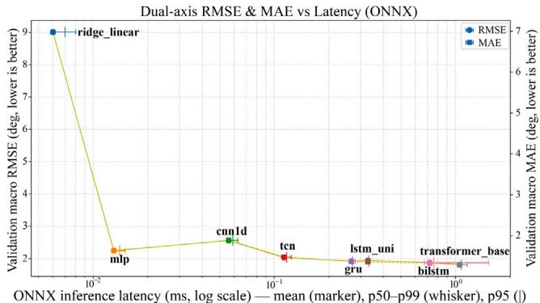  
Table 3  
Fig. 3. Accuracy–latency trade-off under ONNX deployment. The x-axis shows inference latency (ms, log scale); horizontal error bars indicate the latency range from $p 5 0$ to $p 9 9 ,$ and the vertical tick marks denote $p 9 5 .$ The left ${ \bf y } -$ axis reports macro RMSE (circles) and the right y-axis reports macro MAE (squares).

Among deep temporal models, the transformer achieved the lowest error but had the highest latency among the tested models. Recurrent models also achieved low errors but incurred higher inference latency than convolutional or feed-forward models. In contrast, the TCN provided a favorable accuracy–latency balance, achieving low error with sub-millisecond latency and stable tail behavior (Table 2 and Fig. 3). Considering the need to reserve computational budget for real-time control components, including sensing, safety monitoring, and feedback control loops, we selected the TCN as the default model for subsequent TCN-focused analyses and deployment experiments. This choice prioritizes a practical balance between prediction accuracy, inference latency, and edge-deployment scalability rather than minimizing prediction error alone.

## 4.2. TCN ablation

To analyze how TCN hyperparameters affect prediction performance and deployment overhead, we use a baseline configuration (hidden channels 64, 4 TCN layers, kernel size 3, dropout 0.1) as a balanced setting and conduct ablations along three axes: model capacity, temporal receptive field, and regularization strength. Table 3 lists ablation configurations. To assess model capacity, smaller\_channels (32) and larger\_channels (128) vary channel width, where fewer channels reduce capacity and computation while more channels may improve fitting at the cost of higher latency and potential overfitting. To assess temporal modeling and receptive field, we adjust depth and kernel size: fewer\_levels (3 layers) and more\_levels (5 layers) shrink or expand the receptive field, and larger\_kernel (kernel $= 5 )$ enlarges local context at fixed depth. To assess regularization, no\_dropout (0) and higher\_dropout (0.2) remove or strengthen dropout to examine impacts on generalization and stability. All other hyperparameters remain identical to the baseline so that observed differences can be attributed to the targeted factor.

TCN ablation configurations under the same ONNX deployment setting.

<table><tr><td>Configuration</td><td>Key setting</td></tr><tr><td>baseline</td><td>channels = 64, levels = 4, kernel = 3, dropout = 0.1</td></tr><tr><td>smaller_channels</td><td>channels = 32</td></tr><tr><td>larger_channels</td><td>channels = 128</td></tr><tr><td>fewer_levels</td><td>levels = 3</td></tr><tr><td>more_levels</td><td>levels = 5</td></tr><tr><td>larger_kernel</td><td>kernel = 5</td></tr><tr><td>no_dropout</td><td>dropout = 0</td></tr><tr><td>higher_dropout</td><td>dropout = 0.2</td></tr></table>

TCN Ablation: Accuracy-Latency Trade-off (ONNX)  
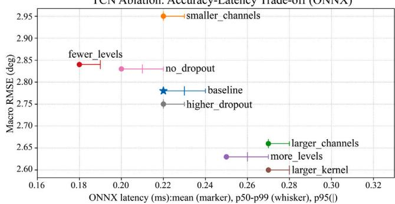  
Fig. 4. Accuracy–latency trade-off of TCN ablations (ONNX). The x-axis shows mean inference latency; horizontal error bars indicate the latency range from $p 5 0$ to $p 9 9$ with $p 9 5$ marked. The y-axis reports macro RMSE (lower is better). The baseline configuration is marked with a star.

Fig. 4 and Table 4 summarize macro RMSE/MAE and ONNX inference latency (mean and quantiles). Overall, the ablation results reveal a clear accuracy–latency trade-off. For capacity, smaller\_channels increases errors (RMSE 2.78→2.95) with nearly unchanged latency (mean ≈0.22 ms), whereas larger\_channels reduces errors (RMSE 2.66, MAE 1.70) but increases compute cost (mean 0.27 ms, �99 0.28 ms). For receptive field, fewer\_levels reduces latency (mean 0.18 ms, �99 0.19 ms) but increases RMSE to $2 . 8 4 ;$ expanding the re ceptive field (more\_levels and larger\_kernel) further reduces errors (RMSE 2.63 and $2 . 6 0 ,$ respectively; larger\_kernel achieves the lowest RMSE) at the cost of higher latency (mean ≈ 0.25–0.27 ms, �99 ≈ 0.27–0.28 ms). For regularization, no\_dropout slightly reduces latency (mean 0.20 ms) but increases error (RMSE 2.83) and degrades fit for some joints (e.g., Hip Flexion RT $R ^ { 2 } = 0 . 9 4 )$ , suggesting that dropout regularization is beneficial in this setting; higher\_dropout yields limited RMSE improvement (2.75) but larger MAE (1.87).

Considering overall error, inference latency, and tail stability $( p 9 5 / p 9 9 )$ , the baseline configuration provided a balanced reference setting for the TCN ablation analysis.

Table 4  
TCN ablation results: macro error and ONNX latency.

<table><tr><td>Config</td><td>Macro RMSE (°)</td><td>Macro MAE (°)</td><td>Macro  $R^2$ </td><td>Mean (ms)</td><td>p50 (ms)</td><td>p95 (ms)</td><td>p99 (ms)</td></tr><tr><td>baseline</td><td>2.780</td><td>1.833</td><td>0.969</td><td>0.222</td><td>0.220</td><td>0.226</td><td>0.237</td></tr><tr><td>smaller_channels</td><td>2.948</td><td>1.957</td><td>0.965</td><td>0.217</td><td>0.215</td><td>0.220</td><td>0.230</td></tr><tr><td>larger_channels</td><td>2.656</td><td>1.704</td><td>0.971</td><td>0.271</td><td>0.269</td><td>0.276</td><td>0.283</td></tr><tr><td>fewer_levels</td><td>2.835</td><td>1.887</td><td>0.966</td><td>0.177</td><td>0.175</td><td>0.181</td><td>0.189</td></tr><tr><td>more_levels</td><td>2.633</td><td>1.710</td><td>0.972</td><td>0.247</td><td>0.245</td><td>0.252</td><td>0.272</td></tr><tr><td>larger_kernel</td><td>2.597</td><td>1.696</td><td>0.973</td><td>0.269</td><td>0.268</td><td>0.275</td><td>0.282</td></tr><tr><td>no_dropout</td><td>2.834</td><td>1.857</td><td>0.965</td><td>0.200</td><td>0.198</td><td>0.205</td><td>0.212</td></tr><tr><td>higher_dropout</td><td>2.752</td><td>1.870</td><td>0.968</td><td>0.222</td><td>0.220</td><td>0.227</td><td>0.239</td></tr></table>

Table 5  
Raspberry Pi 5 on-device deployment results.

<table><tr><td>Model</td><td>Macro RMSE (°)</td><td>Macro MAE (°)</td><td>Macro  $R^2$ </td><td>Mean (ms)</td><td>p50 (ms)</td><td>p95 (ms)</td><td>p99 (ms)</td></tr><tr><td>ridge_linear</td><td>8.441</td><td>6.989</td><td>0.6602</td><td>0.019</td><td>0.018</td><td>0.020</td><td>0.029</td></tr><tr><td>mlp</td><td>2.081</td><td>1.634</td><td>0.9741</td><td>0.035</td><td>0.034</td><td>0.042</td><td>0.047</td></tr><tr><td>cnn1d</td><td>2.490</td><td>1.939</td><td>0.9661</td><td>0.116</td><td>0.111</td><td>0.125</td><td>0.158</td></tr><tr><td>tcn</td><td>1.921</td><td>1.484</td><td>0.9779</td><td>0.225</td><td>0.215</td><td>0.229</td><td>0.722</td></tr><tr><td>gru</td><td>1.801</td><td>1.381</td><td>0.9805</td><td>0.846</td><td>0.841</td><td>0.862</td><td>0.959</td></tr><tr><td>lstm_uni</td><td>1.804</td><td>1.351</td><td>0.9799</td><td>0.771</td><td>0.752</td><td>0.784</td><td>1.187</td></tr><tr><td>bilstm</td><td>1.736</td><td>1.317</td><td>0.9819</td><td>1.836</td><td>1.816</td><td>1.941</td><td>2.223</td></tr><tr><td>transformer_base</td><td>1.698</td><td>1.290</td><td>0.9833</td><td>5.299</td><td>5.150</td><td>5.783</td><td>6.018</td></tr></table>

## 4.3. Raspberry Pi 5 on-device deployment

We deploy the eight models on Raspberry Pi 5 using the PyTorch→ONNX→ONNX Runtime pipeline and benchmark offline inference to compare edge accuracy and inference latency (Table 5 and Fig. 5). To be consistent with the generalization analysis, edge metrics are computed after excluding the first 50 test windows in each subject × speed condition to avoid warm-up effects and runtime stabilization bias; each subject × speed condition contributes equally to the macroaverage. Overall, ridge\_linear is extremely fast $( \mathtt { p 9 5 } = 0 . 0 2 0$ ms) but has large errors (macro $\mathrm { R M S E } = 8 . 4 4 1 ^ { \circ } )$ , serving only as a lowerbound baseline. MLP maintains very low latency $( \mathsf { p 9 5 } = 0 . 0 4 2$ ms) but is less accurate than deep temporal models $( \mathrm { R M S E } = 2 . 0 8 1 ^ { \circ } )$ . CNN1D is not competitive in either accuracy or latency (RMSE = 2.490◦, p95 = 0.125 ms). Among temporal models, transformer\_base achieves the best accuracy (RMSE = 1.698◦, MAE = 1.290◦) but incurs the largest latency $( \mathrm { p 9 5 } = 5 . 7 8 3$ ms); bilstm is second-best in accuracy $( \mathrm { R M S E } = 1 . 7 3 6 ^ { \circ } )$ but also increases inference time substantially (p95 = 1.941 ms). In contrast, TCN maintains relatively low error while achieving smaller and more stable tail latency $( \mathrm { R M S E } = 1 . 9 2 1 ^ { \circ }$ , p95 = 0.229 ms), clearly reducing on-device inference overhead compared with GRU/LSTM $( \mathrm { p } 9 5 = 0 . 8 6 2 / 0 . 7 8 4$ ms, respectively). Note that TCN shows rare tail latency spikes $( \mathbf { p } 9 9  0 . 7 2 2 ~ \mathrm { m } s )$ , but its overall tail behavior remains significantly lower than GRU/LSTM and Transformer.

## 4.4. Qualitative waveform analysis

To visually inspect the selected TCN model, Fig. 6 shows a representative segment comparing TCN predictions with IMU-derived reference hip/knee flexion trajectories. TCN follows angle dynamics over a full gait cycle with good alignment in peak timing and phase. Errors are mainly concentrated in rapid-transition regions (e.g., near the onset and end of swing), while overall deviations remain small and waveform shapes remain stable. Such shape-consistent and phase-stable behavior is particularly relevant to control-oriented use, including reference tracking, phase-aware modulation, and safety monitoring. To further characterize waveform fidelity beyond pointwise RMSE, MAE, and $R ^ { 2 }$ , we quantified gait-cycle-level peak-angle error, peak-timing error, cross-correlation-based temporal alignment, normalized spectral error, and waveform correlation for the selected TCN model (Table 6, Panel B). Across the four joint-angle outputs, peak-angle errors were approximately 1–2◦, cross-correlation lags were close to zero (generally below one sample on average), and waveform correlations remained high (>0.99), indicating that the selected TCN preserved both the amplitude and temporal structure of the IMU-derived reference trajectories.

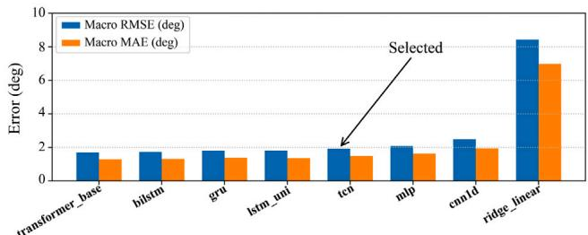  
(a) Accuracy (RMSE/MAE).

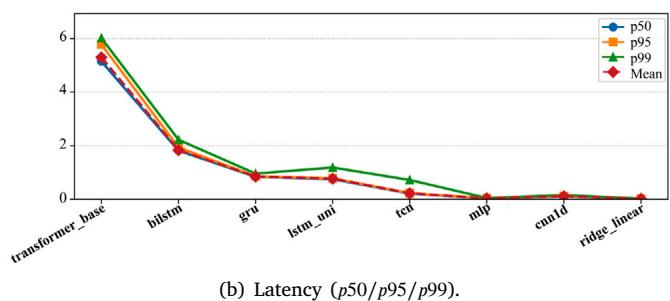  
Fig. 5. Raspberry Pi 5 on-device benchmarking (ONNX Runtime): (a) accuracy and (b) latency. Models are ordered by macro RMSE.

## 4.5. Generalization across speed and joint outputs

Beyond aggregate metrics, we analyze generalization across the full grid of ‘‘subject × speed’’ conditions (8 subjects × 8 speeds). For each cell, RMSE is computed after excluding the first 50 samples (to remove warm-up transients) and then aggregated over time; left/right outputs are further averaged to obtain concise summaries for hip and knee, respectively. Fig. 7 visualizes the resulting error patterns. Overall, hip estimation is more stable across conditions, whereas knee estimation shows larger variability, with more pronounced error increases for a subset of subjects and at extreme speeds.

To quantify speed effects while respecting within-subject dependence, we perform repeated-measures ANOVA on the cell-level RMSE with walking speed as the within-subject factor (Fig. 8(a)). The speed effect is not significant for hip RMSE $( F ( 7 , 4 9 ) \ = \ 1 . 0 8 , \ p \ = \ 0 . 3 9 4 ) _ { \mathrm { \scriptsize ~ \cdot ~ } }$ suggesting that hip-angle estimation is relatively insensitive to speed changes in this dataset. In contrast, knee RMSE shows a significant main effect of speed $( F ( 7 , 4 9 ) = 6 . 3 2 , p = 2 . 6 4 \times 1 0 ^ { - 5 } , \eta _ { \upsilon } ^ { 2 } \approx 0 . 4 7 )$ . The mean trend indicates higher knee RMSE at slower speeds and lower error at moderate-to-fast speeds.

Table 6  
Joint-specific pointwise and waveform-level performance of the selected TCN model.  
Panel A. Pointwise per-joint performance

<table><tr><td>Joint angle</td><td>RMSE (°)</td><td>MAE (°)</td><td> $R^2$ </td><td>Notes</td></tr><tr><td>Hip Flexion LT</td><td>1.494</td><td>1.071</td><td>0.9838</td><td>Speed-level macro average</td></tr><tr><td>Hip Flexion RT</td><td>1.657</td><td>1.121</td><td>0.9797</td><td>Speed-level macro average</td></tr><tr><td>Knee Flexion LT</td><td>1.921</td><td>1.411</td><td>0.9901</td><td>Speed-level macro average</td></tr><tr><td>Knee Flexion RT</td><td>1.975</td><td>1.391</td><td>0.9892</td><td>Speed-level macro average</td></tr></table>

Panel B. Gait-cycle-level waveform metrics

<table><tr><td>Joint angle</td><td>Peak-angle error (°)</td><td>Timing error (% cycle)</td><td>XCorr lag (samples)</td><td>Spectral error</td><td>Waveform corr.</td></tr><tr><td>Hip Flexion LT</td><td>1.31 ± 1.17</td><td>1.77 ± 2.87</td><td>0.00 ± 0.00</td><td>0.069 ± 0.046</td><td>0.994 ± 0.014</td></tr><tr><td>Hip Flexion RT</td><td>1.23 ± 1.10</td><td>3.33 ± 11.26</td><td>0.07 ± 0.32</td><td>0.069 ± 0.047</td><td>0.994 ± 0.010</td></tr><tr><td>Knee Flexion LT</td><td>1.48 ± 1.30</td><td>1.02 ± 3.71</td><td>0.26 ± 0.55</td><td>0.068 ± 0.073</td><td>0.993 ± 0.026</td></tr><tr><td>Knee Flexion RT</td><td>1.73 ± 1.41</td><td>1.08 ± 4.28</td><td>0.13 ± 0.48</td><td>0.068 ± 0.071</td><td>0.993 ± 0.029</td></tr></table>

Note: Panel A reports pointwise joint-specific metrics macro-averaged across the eight walking-speed labels; these values use speed-level aggregation and are not the same aggregation as the model-level Raspberry Pi 5 summary. Panel B reports values as mean $\pm \nobreakspace \mathrm { ~ \ } S \mathrm { D } \nobreakspace$ across detected gait cycles. Peak-angle error is the absolute difference between predicted and IMU-derived reference peak angles. Timing error is the absolute peak-phase difference within each gait cycle. XCorr lag denotes the absolute cross-correlation-based temporal lag in samples; one sample corresponds to 10 ms at the 100-Hz sampling rate. Spectral error denotes normalized frequency-domain difference.

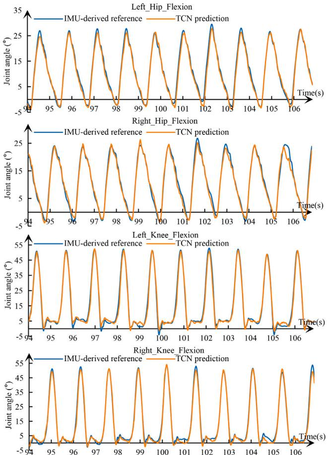  
Fig. 6. Representative TCN inference: predicted versus IMU-derived reference bilateral hip and knee flexion/extension angles (four outputs).

We further characterize inter-subject variability by computing the residual intra-class correlation coefficient (ICC) after removing the speed-wise mean RMSE (Fig. 8(b)). The residual ICC is moderate for both hip $( \mathrm { I C C } \approx 0 . 3 9 )$ and knee $( \mathrm { I C C } \approx 0 . 4 0 )$ , suggesting a non-negligible subject-dependent component beyond speed. From a deployment perspective, we summarize a risk boundary across all subject × speed conditions by reporting the mean, �95, and maximum RMSE (Fig. 8(c)). The upper-tail errors reach Hip: $p 9 5 = 2 . 8 5 ^ { \circ }$ and $\mathrm { { m a x } = 4 . 0 7 ^ { \circ } ; }$ ; Knee: $p 9 5 \ = \ 3 . 3 7 ^ { \circ }$ and max $= \ 4 . 6 6 ^ { \circ }$ , highlighting tail-risk under extreme conditions.

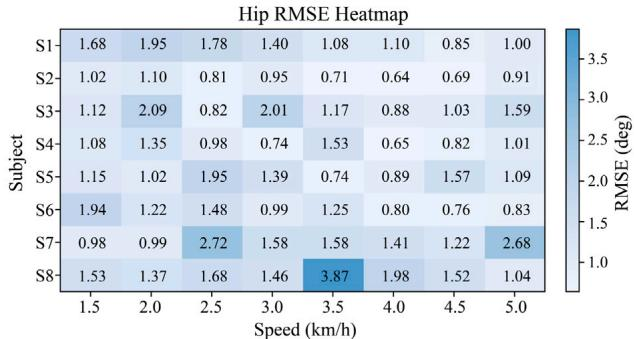  
(a) Hip RMSE (heatmap).

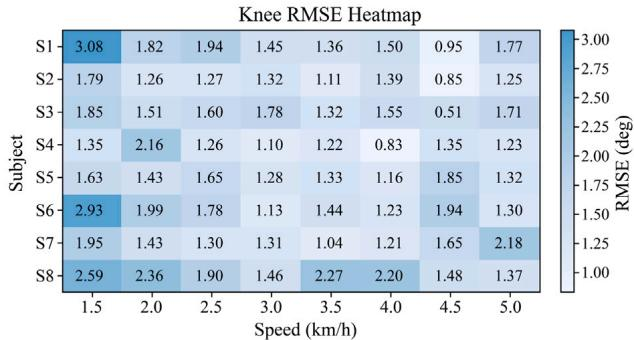  
(b) Knee RMSE (heatmap).  
Fig. 7. Generalization error landscape across the full ‘‘subject × speed’’ grid (8 subjects × 8 speeds). Hip RMSE is more stable across conditions, whereas knee RMSE shows larger variability and increases at extreme speeds for a subset of subjects.

To examine joint-specific behavior of the selected TCN model, we further summarized the per-joint errors across the eight walking-speed labels. The speed-level macro-average RMSE ranged from $1 . 4 9 4 ^ { \circ }$ to $\boldsymbol { 1 . 9 7 5 ^ { \circ } }$ across the four target outputs, with knee-flexion outputs showing slightly larger errors than hip-flexion outputs (Table 6, Panel A). This joint-specific pattern was consistent with the subject–speed generalization analysis, in which knee estimation contributed more to upper-tail and speed-dependent errors.

Table 7  
Leave-one-subject-out validation of the selected TCN model.

<table><tr><td>Validation setting</td><td>Macro RMSE (°)</td><td>Macro MAE (°)</td><td>Macro  $R^{2}$ </td><td>Notes</td></tr><tr><td>LOSO, all 8 folds</td><td> $5.521 \pm 1.701$ </td><td> $3.871 \pm 1.198$ </td><td> $0.9474 \pm 0.1145$ </td><td>Mean ± SD across held-out subjects</td></tr></table>

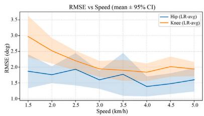  
(a) Speed effect (CI).

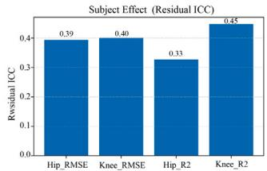  
(b) Residual ICC.

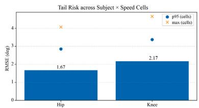  
(c) Risk boundary.  
Fig. 8. Generalization statistics for TCN across subjects and walking speeds: (a) mean RMSE with 95% CI at each speed, (b) residual ICC after removing the speed-wise mean, and (c) mean/�95/max RMSE across all subject × speed cells.

## 4.6. Subject-independent validation

To further assess subject-independent generalization, we performed leave-one-subject-out (LOSO) validation using the selected TCN model. Across all eight held-out folds, LOSO yielded a macro RMSE of $5 . 5 2 1 \pm$ $1 . 7 0 1 ^ { \circ }$ , macro MAE of $3 . 8 7 1 \pm 1 . 1 9 8 ^ { \circ }$ , and macro $R ^ { 2 }$ of $0 . 9 4 7 4 \pm 0 . 1 1 4 5$ (Table 7). Compared with within-subject chronological testing, LOSO validation resulted in higher errors, indicating that subject-independent estimation remains more challenging. Nevertheless, the relatively high macro $R ^ { 2 }$ suggests that the model preserved a substantial portion of the pelvic-to-joint-angle relationship across unseen participants. These results support the feasibility of subject-independent pelvic-IMU-based estimation while also motivating future personalization, transfer learning, and domain-adaptation strategies.

## 5. Discussion

This study presents an edge-deployable framework for continuous bilateral hip/knee joint-angle estimation using only a single pelvic IMU stream. The main finding is that pelvic kinematics contain useful temporal information for estimating lower-limb joint-angle trajectories under controlled treadmill walking, consistent with prior pelvic kinematics-based estimation work for active HD prosthesis control [26]. Although the Transformer achieved the lowest prediction error, the

TCN provided a more favorable balance between estimation accuracy and deployment efficiency, with substantially lower inference latency and more stable tail latency on Raspberry Pi 5. Therefore, the selected TCN is better interpreted as an edge-deployable perception module rather than a complete prosthesis controller.

The use of healthy-participant data should be interpreted carefully. Healthy gait cannot reproduce the compensatory pelvic motion, gait asymmetry, socket–prosthesis interaction, and altered dynamics of individuals with HD, which have been emphasized in prior reviews and multimodal gait-characterization studies of amputation and prosthetic components [8,9]. However, normative healthy gait remains an important reference because one objective of intelligent powered HD prostheses is to restore prosthesis-assisted walking toward more physiological lower-limb kinematics. Thus, the present results indicate that pelvic motion contains useful temporal information for estimating normative bilateral hip/knee trajectories, but they do not establish direct performance in HD users.

From an edge-deployment perspective, tail latency is as important as mean latency. Rare slow frames may degrade tracking, safety monitoring, and closed-loop responsiveness. Across both desktop ONNX and Raspberry Pi 5 benchmarking, the TCN maintained competitive accuracy with smaller latency overhead than recurrent and attention-based models. This makes the TCN suitable for integration into downstream modules such as reference generation, phase-aware safety checks, impedance modulation, and adaptive assistance, which are common components in powered lower-limb prosthesis control frameworks [12, 13,20], provided that the full prosthesis-control loop is validated in future work.

Generalization analyses revealed structured variability across walk ing speeds and subjects. Hip-angle estimation was comparatively stable, whereas knee-angle estimation contributed more to speed-dependent and upper-tail errors. LOSO validation further showed that subjectindependent estimation is feasible but less accurate than within-subject chronological testing. Although the model maintained a relatively high macro $R ^ { 2 }$ across held-out participants, the increased RMSE and MAE indicate residual inter-subject variability. This finding supports the need for user-specific calibration, transfer learning, uncertainty-aware filtering, and sensor-fusion strategies before prosthesis-level deployment. In future HD applications, pelvic IMU information should likely be integrated with prosthesis-side encoders, load sensors, socket or residual-limb IMUs, plantar-pressure information, or EMG to improve robustness under asymmetric and non-steady gait conditions. This is consistent with multimodal sensing strategies used in prosthetic gait analysis and control [9,20].

Several limitations should be considered. First, the study was conducted in healthy participants during two-minute controlled treadmill recordings, and the current results cannot be directly generalized to HD prosthesis users, overground walking, terrain transitions, turning, or long-term use. Second, the reference joint angles were derived from a commercial multi-IMU system rather than simultaneous optical motion capture. Although IMU sensing is closer to the deployable sensing modality used in powered prosthesis systems, residual drift, sensor to-segment calibration error, and soft-tissue artifacts may still affect the exported reference angles. Third, the edge benchmark focused on model inference latency under ONNX Runtime and did not measure full closed-loop latency, actuator response, thermal stability, or system-level power consumption. Finally, although ridge\_linear was included as a same-input classical baseline, full inverse kinematics was not used as a direct comparator because conventional inversekinematics pipelines typically require optical marker trajectories, multisegment orientations, or at least thigh, shank, and foot kinematic observations. Such information is not available under the single-pelvic IMU input constraint and would make the comparison sensor-unequal. Overall, the present results should be interpreted as an engineering feasibility evaluation of a pelvic-IMU-based, edge-deployable percep tion module. Future work should validate the framework in HD users, multi-terrain walking, long-term recordings, and closed-loop poweredprosthesis experiments, while jointly investigating sensor fusion, transfer learning, and user-specific calibration. Future work should also further quantify reference-label uncertainty using synchronized optical motion capture or other multimodal biomechanical reference measurements. Extending the output space beyond sagittal-plane flexion/extension to include hip and knee abduction/adduction and axial rotation is another important direction for future control-oriented studies.

## 6. Conclusion

We presented an edge-deployable framework for real-time estima tion of continuous bilateral hip and knee flexion/extension angles from a single pelvic IMU stream. Systematic benchmarking across eight model families showed that the Transformer achieved the highest accuracy, whereas the TCN provided a more favorable accuracy–latency balance with stable tail latency for edge deployment. TCN ablations further clarified how model capacity, temporal receptive field, and reg ularization influenced prediction performance and inference overhead. Generalization analyses indicated that hip-angle estimation was rela tively stable, while knee-angle estimation was more affected by walking speed and inter-subject variability. LOSO validation further supported the feasibility of subject-independent estimation, while the remaining performance gap motivates future personalization and domain adaptation strategies. Overall, the proposed approach provides a practical preliminary joint-angle estimation module for edge-deployable gait perception and offers a feasible signal interface for future powered HD prosthesis studies. Before prosthesis-level deployment, the framework should be further validated in HD users, multi-terrain walking, long-term recordings, and closed-loop powered-prosthesis experiments.

## CRediT authorship contribution statement

Shu Xiaolong: Writing – original draft, Software, Methodology, Conceptualization. Luo Shengli: Writing – review & editing, Valida tion, Data curation. Wang Xu: Validation, Data curation. Qin Yiyao: Writing – review & editing, Visualization, Formal analysis. Liu Qiwen: Investigation, Data curation. Yu Hongliu: Writing – review & editing, Supervision, Project administration, Methodology, Conceptualization.

Declaration of generative AI and AI-assisted technologies in the manuscript preparation process

During the preparation of this work the author(s) used ChatGPT (OpenAI) in order to improve the language, readability, and overall or ganization of the manuscript. After using this tool/service, the author(s) reviewed and edited the content as needed and take full responsibility for the content of the published article.

## Declaration of competing interest

The authors declare that they have no known competing finan cial interests or personal relationships that could have appeared to influence the work reported in this paper.

## Acknowledgments

This work was supported by the National Natural Science Founda tion of China (Grant No. 62473263).

## Data availability

The data that has been used is confidential

## References

[1] A. Fernández, J. Formigo, Are Canadian prostheses used? A long-term experience, Prosthet. Orthot. Int. 29 (2005) 177–181, http://dx.doi.org/10.1080 03093640500217208.

[2] T. Chin, H. Oyabu, Y. Maeda, I. Takase, K. Machida, Energy consumption during prosthetic walking and wheelchair locomotion by elderly hip disarticulation amputees, Am. J. Phys. Med. Rehabil. 88 (2009) 399–403, http://dx.doi.org 10.1097/PHM.0b013e3181a0dbe2

[3] X. Li, Y. Xie, H. Chen, B. Huang, H. Yu, A gait simulation and evaluation system for hip disarticulation prostheses, IEEE Trans. Autom. Sci. Eng. 18 (2021) 448–457, http://dx.doi.org/10.1109/TASE.2020.3035438.

[4] E. Ludwigs, M. Bellmann, T. Schmalz, S. Blumentritt, Biomechanical differences between two exoprosthetic hip joint systems during level walking, Prosthet. Orthot. Int. 34 (2010) 449–460, http://dx.doi.org/10.3109/03093646.2010. 499551.

[5] L. Devillez, B. Herman, R. Ronsse, Design of a compact active hip prosthesis with human-like range of motion and torque, in: Proc. 2024 10th IEEE RAS/EMBS Int. Conf. Biomed. Robot. Biomechatron., BioRob, 2024, pp. 160–166, http: //dx.doi.org/10.1109/BioRob60516.2024.10719919.

[6] M. Song, Z. Li, J. Jiang, W. Chen, S. Guo, H. Zheng, et al., Design, simulation and kinematic validation of a hip prosthetic mechanism with a multimotor function, J. Bionic Eng. 21 (2024) 1321–1333, http://dx.doi.org/10.1007/s42235-024- 00490-x.

[7] S. Mroz, Design and Prototype Validation of a Laterally Mounted Powered Hip Joint for Hip Disarticulation Prostheses (M.Sc. thesis), University of Ottawa, 2023, http://hdl.handle.net/10393/45011 (accessed 25 September 2025).

[8] H. Gholizadeh, N. Baddour, M. Botros, K. Brannen, F. Golshan, E.D. Lemaire, Hip disarticulation and hemipelvectomy prostheses: a review of the literature, Prosthet. Orthot. Int. 45 (2021) 434–439, http://dx.doi.org/10.1097/PXR. 0000000000000029.

[9] C. De Marchis, S. Ranaldi, T. Varrecchia, M. Serrao, S.F. Castiglia, A. Tatarelli, et al., Characterizing the gait of people with different types of amputation and prosthetic components through multimodal measurements: a methodological perspective, Front. Rehabil. Sci. 3 (2022) 804746, http://dx.doi.org/10.3389/ fresc.2022.804746

[10] D. Kim, R. Triolo, H. Charkhkar, Plantar somatosensory restoration enhances gait, speed perception, and motor adaptation, Sci. Robot. 8 (2023) eadf8997, h d d b df

[11] M. Tran, L. Gabert, S. Hood, T. Lenzi, A lightweight robotic leg prosthesis replicating the biomechanics of the knee, ankle, and toe joint, Sci. Robot. 7 (2022) eabo3996, http://dx.doi.org/10.1126/scirobotics.abo3996.

[12] T.K. Best, C.G. Welker, E.J. Rouse, R.D. Gregg, Data-driven variable impedance control of a powered knee–ankle prosthesis for adaptive speed and incline walking, IEEE Trans. Robot. 39 (2023) 2151–2169, http://dx.doi.org/10.1109 TRO.2022.3226887.

[13] S. Cheng, C.A. Laubscher, T.K. Best, R.D. Gregg, Ambilateral activity recognition and continuous adaptation with a powered knee–ankle prosthesis, IEEE Trans. Robot. 41 (2025) 2251–2267, http://dx.doi.org/10.1109/TRO.2025.3539206.

[14] S. Luo, X. Shu, J. Du, H. Li, H. Yu, Enhancing gait symmetry via intact limb kinematic mapping control of a hip disarticulation prosthesis, Biomimetics 10 (2025).714. http://dx doi org/10.3390/biomimetics10100714

[15] S. Luo, X. Shu, H. Zhu, H. Yu, Early prediction of lower limb prostheses locomotion mode transition based on terrain recognition, IEEE Sens. J. 23 (2023) 27941–27948, http://dx.doi.org/10.1109/JSEN.2023.3320274.

[16] K. Brannen, N. Baddour, L. Cho, D. Langlois, P. Dumond, E.D. Lemaire, Development and evaluation of an anteriorly mounted microprocessor-controlled powered hip joint prosthesis, Can. Prosthet. Orthot. J. 7 (2024) 44494, http: //dx.doi.org/10.33137/cpoj.v7i2.44494.

[17] M. Botros, H. Gholizadeh, F. Golshan, D. Langlois, N. Baddour, E.D. Lemaire, Development of a powered four-bar prosthetic hip joint prototype, Prosthesis 7 (2025) 105. http://dx.doi.org/10.3390/prosthesis7050105.

[18] Y. Uevama, T. Kubo, M. Shibata, Robotic hip-disarticulation prosthesis: evaluation of prosthetic gaits in a non-amputee individual, Adv. Robot. 34 (2020) 37–44. http://dx.doi.org/10.1080/01691864.2019.1705908.

[19] N. Hata, T. Kubo, T. Inoue, Development and experimental evaluation of a swing phase controller for a powered hip disarticulation prosthesis (in Japanese), Trans. Jpn. Soc. Mech. Eng. Ser. C 75 (2009) 404–412, http://dx.doi.org/10.1299 kikaic 75 404

[20] F. Golshan, E. Lemaire, H. Gholizadeh, D. Nielen, N. Baddour, Design and preliminary evaluation of a gait control strategy for hip–knee–ankle–foot prostheses with motorized hip joint, JEEE Trans, Neural Syst, Rehabil. Eng, 33 (2025) 3432=3442.http://dx doi org/10.1109/TNSRE 2025.3602715

[21] Y. Bader, D. Langlois, N. Baddour, E.D. Lemaire, Development of an integrated powered hip and microprocessor-controlled knee for a hip– knee–ankle–foot prosthesis, Bioengineering 10 (2023) 614, http://dx.doi.org/10. 3390/bioengineering10050614.

[22] Y. Bader, Design and Prototyping of an Integrated Powered Hip and Microprocessor-Controlled Knee Unit for Hip-Knee-Ankle-Foot Prostheses (M.Sc. thesis), University of Ottawa, 2023, http://hdl.handle.net/10393/45116 (ac cessed 25 September 2025).

[23] Y. Chen, X. Li, H. Su, D. Zhang, H. Yu, Design of a bio-inspired gait phase decoder based on temporal convolution network architecture with contralateral surface electromyography toward hip prosthesis control, Front. Neurorobot. 16 (2022) 791169, http://dx.doi.org/10.3389/fnbot.2022.791169.

[24] L. Li, H. Luo, S. Luo, X. Wang, X. Shu, Q. Meng, H. Yu, Design and swing control of a power-assisted hip disarticulation prosthesis, IEEE/ASME Trans. Mechatronics (2025) 1–11, http://dx.doi.org/10.1109/TMECH.2025.3586300

[25] M. Fan, Y. Chen, B. He, Q. Meng, H. Yu, Study on adaptive adjustment of variable joint stiffness for a semi-active hip prosthesis, in: H. Liu, Z. Yin, L. Liu, L. Jiang, G. Gu, X. Wu, et al. (Eds.), Intelligent Robotics and Applications, Springer, Cham, 2022, pp. 13–23, http://dx.doi.org/10.1007/978-3-031-13822-5\_2.

[26] F. Golshan, E.D. Lemaire, H. Gholizadeh, D. Nielen, N. Baddour, A pelvic kinematic approach for calculating hip angles for active hip disarticulation prosthesis control, J. Neuroeng. Rehabil. 20 (2023) 152, http://dx.doi.org/10. 1186/s12984-023-01273-x.