<!-- 本文件是 MinerU 自动抽取的**英文结构化正文**，不是中文翻译。 -->
<!-- 中文翻译若需要，须另走 06_附录/pdf2zh调用脚本/translate_all.py，不得把本文件当译文引用。 -->
<!-- 抽取来源：01_参考论文/整合系统/宋嵘_双参与与肌间耦合/Jian2021-JNeuralEng：用二维肌电接口调制并恢复卒中患者的肌间协调/Jian2021-JNeuralEng：用二维肌电接口调制并恢复卒中患者的肌间协调.pdf -->
<!-- DOI：10.1088/1741-2552/abc29a -->
<!-- 图片：26 张，位于同级 images/，已按正文引用相对路径改写。 -->

PAPER

# Modulating and restoring inter-muscular coordination in stroke patients using two-dimensional myoelectric computer interface: a cross-sectional and longitudinal study

To cite this article: Chuyao Jian et al 2021 J. Neural Eng. 18 036005

View the article online for updates and enhancements.

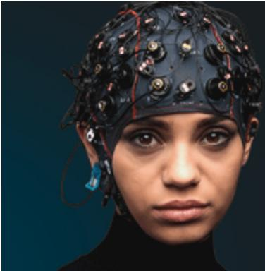

EEG/ECOG AMPLIFIERS &ELECTRODES   
ELECTRICAL/CORTICAL STIMULATORS   
REAL-TIME PROCESSING

g.tec

gtec.at/shop

SHOP NOW

# Journal of Neural Engineering

PAPER

RECEIVED 26 July 2020

REVISED 24 September 2020

# Modulating and restoring inter-muscular coordination in stroke patients using two-dimensional myoelectric computer interface: a cross-sectional and longitudinal study

ACCEPTED FOR PUBLICATION 19 October 2020

PUBLISHED

Chuyao Jian1, Linchuan Deng1, Huihua Liu2, Tiebin Yan2, Xianyun Wang3 and Rong Song1,4

8 March 2021

1 Key Laboratory of Sensing Technology and Biomedical Instrument of Guangdong Province, School of Biomedical Engineering, Sun Yat-sen University, Guangzhou 510275, People’s Republic of China

2 Sun Yat-sen Memorial Hospital, Sun Yat-sen University, Guangzhou 510120, People’s Republic of China

Guangdong Work Injury Rehabilitation Center, Guangzhou 510440, People’s Republic of China

4 Shenzhen Research Institute of Sun Yat-sen University, Shenzhen 518057, People’s Republic of China

E-mail: songrong@mail.sysu.edu.cn

Keywords: stroke rehabilitation, upper limb, inter-muscular coordination, cortical reorganization, EMG, fNIRS

## Abstract

Objective. Traditional training focuses on improving the motor function level of the limbs or joint levels, while inter-muscular coordination plays an important role in fine motor control and is often overlooked. The purpose of this study was to investigate the changes in inter-muscular coordination induced by the myoelectric-controlled interface (MCI) and the therapeutic effects of MCI-based inter-muscular coordination training on stroke patients. Approach. Eleven stroke patients, twenty young subjects and thirteen age-matched subjects were recruited to determine the dimensionality effect of MCI on inter-muscular coordination in the evaluation test. In addition, a stroke patient participated in a 20-day training session to test the therapeutic effects as a case study analysis in the training test. In these two tests, all subjects performed tracking tasks by flexing/extending their elbows according to the biofeedback from one-dimensional and two-dimensional (2D) MCI. Meanwhile, the electromyography and functional near infrared spectroscopy signals were recorded simultaneously to reflect the muscle and cortical activations. Main results. In all groups, as the MCI dimensionality increased, the antagonist activation decreased significantly, while the involvement in prefrontal cortex and primary motor cortex increased significantly. A significant reduction in muscle activation and an increase in cortical activation were found in the stroke patient, which might be due to a progressive normalization of patient after the training. Significance. These findings suggested that 2D MCI could be an effective tool to directly modulate inter-muscular coordination for stroke patients. Inter-muscular coordination training may restore the ability to coordinate agonist-antagonist muscle of stroke patient and this improvement may be accompanied by cortical reorganization.

## 1. Introduction

The majority of stroke patients suffer from deficits in upper limb function, typically manifested as muscle weakness, hypertonia/reflexia and inter-muscular incoordination [1–4]. A previous study has reported that inter-muscular incoordination may result in abnormal muscle activation patterns, muscle spasticity and impaired torque production [5]. Stroke patients are able to recover part of their motor functions by traditional rehabilitation training to improve their quality oflife [6, 7]. After completing traditional training, stroke patients are still unable to perform the fine manual movement, while inter-muscular coordination is expected to be important in the control of fine movement in the upper limbs [8, 9]. But inter-muscular coordination is often overlooked in traditional training. The inability of traditional training on improving inter-muscular coordination underlines the need for other rehabilitation training. However, there are relatively few studies which have investigated inter-muscular coordination and the training effects on the fine motor control for stroke patients.

The use of visual biofeedback to improve motor function of stroke patients has revealed promising results in functional assessment and rehabilitation training. Visual biofeedback can provide patients with real-time information for being aware of their movement performance and adjusting the movement [10, 11]. The myoelectric-controlled interface (MCI) is specific visual biofeedback on muscle activation, which has been proven to assist users in directly modulating the activation by mapping the electromyography (EMG) signals of each muscle onto cursor movements. Young et al have demonstrated that dystonia patients were able to significantly reduce muscle co-activation with visual biofeedback of muscle activation [12]. Luo et al have revealed that the increased MCI dimensionality can be harnessed for efficient modulation of co-activating muscles and inhibition of targeted muscle activation in healthy subjects and stroke patients [13]. Several studies have employed MCI in combination with rehabilitation training, and found that MCI has a positive and longterm effect on decoupling abnormal co-activation, as well as improves muscle control and motor performance of the upper limbs for healthy subjects and stroke patients [14–16]. These results have implied that MCI has the potential to provide tasks-specific and interactive therapy for stroke patients to restore inter-muscular coordination.

It is known that this modulated and coordinated muscle activation is controlled by the cortex [17, 18]. Visual biofeedback is integrated by the cortex to alter the motor performance by modulating muscle activation. The improvements ofmotor performance deficits of stroke patients after rehabilitation training are caused by repeated exercise of the activated muscle, and are also associated with cortical reorganization [19–21]. Recently, functional near infrared spectroscopy (fNIRS), an emerging neuroimaging technology, has been widely used to non-invasively monitor cortical activation which results from the change in hemodynamic signal during movements [22]. Compared with the lower temporal resolution of functional magnetic resonance imaging and lower spatial resolution of electroencephalographic (EEG) signals, fNIRS is more suitable for measuring cortical activation during motor tasks [23, 24]. fNIRS has already been applied to measure cortical activation during motor tasks in healthy subjects or stroke patients, such as finger tapping, hand grasping and cycling [25–27]. Different cortical areas have been to be involved in motor tasks, such as prefrontal cortex (PFC) and primary motor cortex (M1). PFC has been reported to participate in the process of motor command generation [28, 29], and M1 plays an important role in the precise motor control [30]. Our past work, which used a system combining the EMG and fNIRS signals, has demonstrated that MCI can alter the activation in PFC and M1 to modulate the coordination between agonist and antagonist muscles in healthy subjects [31]. Despite that it has been confirmed that stroke patients can modulate muscle activation based on MCI, the dimensionality effects of MCI on cortical activation following the shortterm intervention and on brain reorganization following the long-term training for stroke patientsremains unclear.

This study aimed to investigate how the dimensionality of MCI influences inter-muscular coordination and cortical activation after stroke in a cross-sectional test and to determine whether inter-muscular coordination training could restore inter-muscular coordination and produce cortical reorganization in a longitudinal test. In both tests, we measured changes in the activation of agonistantagonist muscles and activation in motor-related cortical areas in different dimensional MCIs. We hypothesized that stroke patients would improve inter-muscular coordination with the increasing dimensionality of MCI. We also predicted that intermuscular coordination training could lead to altering cortical activation patterns and hence restore intermuscular coordination in stroke patients.

## 2. Methods

## 2.1. Subjects

Three groups of subjects were recruited, including stroke patients, healthy age-matched subjects and young subjects. The stroke patients were seven females and four males and they were an average ( standard deviation) age of 45.7 ( 7.6) years. The average time since onset of stroke was 11.1  5.4 months. The descriptive data of stroke patients were listed in table 1. The age-matched subjects were seven females and six males and they were an average age of 55.2 ( 6.4) years. Twenty healthy young control subjects were 15 females and five males and they were an average age of 23.9 ( 1.86) years. All healthy subjects were self-reported right-hand dominant with no history of a neurological symptom or other medical condition. All subjects were enrolled in an evaluation test, and a stroke patient (subject 1 in table 1) was recruited in a training test. This study was approved by the ethics committee of Guangdong Work Injury Rehabilitation Center (AF/SC-07/2017.09) and all the subjects provided written consent before participation.

The stroke patients met the following inclusion criteria in the evaluation test: (a) all stroke patients had to be between 18–70 years of age; (b) unilateral brain lesion occurred at least six months of onset; (c) all stroke patients exhibited impaired motor function of the upper limb; (d) all stroke patients were able to lift their affected upper limb from their lap to a height parallel to their shoulder without shoulder pain; (e) they were capable of performing both elbow flexion and extension with their affected upper limb; (f) they could understand and follow task-related instructions. The exclusion criteria for stroke patients were the following: (a) any history of other concomitants musculoskeletal or neurological disorders; (b) significant vision and hearing impairments; (c) presence of cognitive impairments; (d) other conditions that influence the collection of fNIRS and EMG data. Upper extremity fugl-meyer motor assessment (UE-FMA) was used to evaluate the motor impairments of the affected upper limb, and all the clinical assessments were measured by the same investigator.

Table 1. Patient information. Abbreviations: F, female; M, male; UE-FMA, upper extremity fugl-meyer assessment.
<table><tr><td>Subject</td><td>Age (years)</td><td>Sex</td><td>Lesion side</td><td>Time since(month) stroke</td><td>UE-FMA scores</td><td>Lesion location</td></tr><tr><td>1</td><td>33</td><td>M</td><td>Right</td><td>7</td><td>24</td><td>Right internal Capsule</td></tr><tr><td>2</td><td>45</td><td>M</td><td>Left</td><td>1.5</td><td>22</td><td>Left thalamus</td></tr><tr><td>3</td><td>16</td><td>M</td><td>Right</td><td>4</td><td>28</td><td>Right corona radiate and basal</td></tr><tr><td>4</td><td>50</td><td>F</td><td>Right</td><td>12</td><td>43</td><td>ganglia Right precentral gyus</td></tr><tr><td>5</td><td>41</td><td>F</td><td>Left</td><td>8</td><td>31</td><td>Left basal ganglia</td></tr><tr><td>6</td><td>39</td><td>M</td><td>Right</td><td>2</td><td>20</td><td>Right middle frontal gyus</td></tr><tr><td>7</td><td>35</td><td>F</td><td>Left</td><td>9.5</td><td>36</td><td>Left internal capsule</td></tr><tr><td>8</td><td>61</td><td>F</td><td>Left</td><td>5</td><td>29</td><td>Left precentral gyus</td></tr><tr><td>9</td><td>45</td><td>M</td><td>Left</td><td>14</td><td>42</td><td>Left lateral Sylvian sulcus</td></tr><tr><td>10</td><td>58</td><td>M</td><td>Right</td><td>24</td><td>22</td><td>Right internal capsule and striatum</td></tr><tr><td>11</td><td>42</td><td>F</td><td>Right</td><td>17</td><td>34</td><td>Right inferior parior parietal cortex</td></tr></table>

## 2.2. Evaluation test protocol

After familiarizing with the process of the evaluation test, each subject straightly sat in a chair and faced to a computer screen as shown in figure 1(D). There was a customized arm instrument to provide upperlimb weight support and limit movement ranges of the upper limb. The affected upper limb of stroke patients and the dominant arms of heathy subjects were set in the arm instrument with the upper limb at $9 0 ^ { \circ }$ of shoulder abduction and $9 0 ^ { \circ }$ of elbow flexion. The flow of the evaluation test was described in figure 1(A). Initially, each subject performed a 5 s maximum voluntary contraction (MVC) of isometric elbow flexion and extension, which repeated three times with an interval of 2 min. The EMG maximal amplitude (EMG-MA) of biceps muscle (BIC) and triceps muscle (TRI) were calculated. Then, each subject was asked to perform isometric elbow flexion and extension under two visual conditions: onedimensional (1D) and two-dimensional (2D) MCI. They performed tracking tasks in a sequence: elbow flexion within 1D MCI, elbow extension within 1D MCI, elbow flexion within 2D MCI and elbow extension within 2D MCI. Each task was performed three times, and 12 trials were arranged totally. There were a 7 s preparing period, a 60 s tracking period and a 10 s resting period in each trial. During the preparing and resting periods, all the subjects needed to maintain the resting position. During the tracking period, the real-time visual biofeedback was provided from a LabVIEWTM program including a red square and a green square representing the tracking target and controllable cursor, respectively. The subjects tried to track the tracking target as possible with careful elbow flexion and extension.

During the evaluation test, the tracking target was set up as moving along a coordinate axis at a constant speed, and the controllable cursor moved according to the activation of BIC and TRI. In each trial, the tracking target stayed at the origin of the coordinate at the preparing period, and then it began 60 s sweep back and forth over a region from the origin of the coordinate to the destination along the coordinate axis at the tracking period. The destination was set at 10% of EMG-MA to avoid fatigue. When the tracking target moved along the Y-axis, the subjects should perform elbow flexion. When the tracking target moved along the X-axis, the subjects should perform elbow extension. Within one-dimensionality MCI, the controllable cursor moved only referring to the activation of agonist muscle (agonist muscle: BIC for elbow flexion; TRI for elbow extension). Within two-dimensionality MCI, x- and y-coordinates of the controllable cursor represented the activation of TRI and BIC, respectively. The 2D coordinates of the controllable cursor and target could be recorded and stored by the LabVIEWTM program.

## 2.3. Training test protocol

The scheme of the training test was shown in figure 1(B). A stroke patient was required to finish a training test with 23 training sessions, including three evaluation sessions and 20 tracking sessions. The setup of the evaluation session was the same as that of the evaluation test. The evaluation sessions and clinical assessments were performed before the 1st day training (pre-training), after the 10th day training (mid-training) and after the 20th day training (post-training) to evaluate the training effects. A given tracking session lasted 90 min a day and the frequency of the tracking session varied between four and five per week. For each tracking session, the stroke patient was asked to sit in a chair, face to a computer screen and hold the affected upper limb in the arm instrument. The stroke patient firstly performed 5 s MVC of isometric elbow flexion and extension three times to calculate EMG-MA of BIC and TRI, respectively. Three training games were designed based on the LabVIEWTM program of the evaluation test and displayed in figure 1(C): tracking game (TG), single fruit game (SFG) and multi fruits game (MFG). The stroke patient played these games in a sequence: TG, SFG, MFG and TG. Each game repeated three times with 2 min interval, so there was a total of 12 trials.

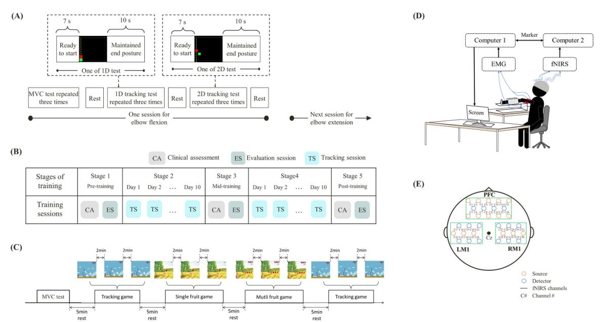  
Figure 1. The experimental design of the evaluation test and training test. (A) The flow of the evaluation test. (B) Scheme of the training test. (C) The flow of a whole training session. (D) Experimental set-up. (E) The arrangement of the probe and channel on a plane graph.

These training games aimed to provide an interesting and challenging environment for stroke patients to improve abnormal inter-muscular coordination. In TG, there was a head ofSuper Mario and two mushrooms respectively representing the controllable cursor and tracking target. At the beginning of TG, the investigator clicked on one of the mushrooms in the upper right corner of the screen. If the red mushroom was chosen, the patient should perform elbow flexion. If the green mushroom was chosen, the patient should perform elbow extension. When the mushroom started moving, the head of Super Mario could be controlled by the activation of BIC and TRI. In SFG, there was a monkey in the lower left corner of the screen. When the game started, a fruit would appear on the random coordinate of the screen and last for 5 s. The stroke patients were required to control the monkey by modulating the activation of BIC and TRI to ‘reach’ more fruits in 60 s. When the patient activated BIC, the monkey would move to the right. When the patients contracted TRI, the monkey would move up. At the end of the SFG, there was a score counted and represented the number of the fruit that reached by the stroke patient. MFG was similar to SFG, but the difference between the two games is the number and the duration time of fruits. In MFG, five fruits would equidistantly arrange in a row or a line and appear on the random coordinate of the screen for 10 s.

## 2.4. Data acquisition

In the evaluation test, the skin overlying BIC and TRI was firstly shaved and cleaned with alcohol. Ag-AgCl bipolar electrodes were placed over the muscle belly of BIC and TRI with a constant inter-electrode distance of 20 mm. The EMG signals were recorded by a two-channel customized EMG amplifier and sampled by a data converter (DAQ-6341, National Instruments, Austin, TX, USA) with a 16-bit resolution at 1000 Hz. Moreover, the activation in PFC, left primary motor cortex (LM1) and right primary motor cortex (RM1) was measured by a commercial fNIRS equipment (NirSmart, Danyang Huichuang Medical Equipment Co. Ltd, China). This fNIRS system used two wavelengths at 760 and 850 nm to measure relative changes in the concentration of oxyhemoglobin (HbO) and deoxy-hemoglobin, respectively. The fNIRS data was sampled with a frequency of 10 Hz. A customized brain cap consisting of32 probes (16 sources, 16 detectors) in a 36-channel arrangement with an inter-probe distance of 30 mm were placed on the head of each subject (figure 1(E)), covering the area linking Fp1 and Fp2, the area linking Cz, C3 and T3 and the area linking Cz, C4 and T4 according to the international EEG 10–20 system, corresponding to the PFC (channels 1–16), LM1 (channels 17–26) and RM1 (channels 27–36), respectively. The fNIRS and EMG signals were synchronized by a LabVIEWTM program.

In the training test, the EMG signals of BIC and TRI in the affected upper limb and the fNIRS signals in PFC and bilateral M1 were recorded during three evaluation sessions. We only measured the EMG signals BIC and TRI during each tracking session.

## 2.5. Data processing

The primary outcome measures were tracking error, muscle activation and cortical activation, which were calculated based on the signals recorded in the evaluation test and the evaluation sessions. All the analysis were conducted off-line with MATLAB (MathWorksTM Inc., Massachusetts, USA). The root mean square error (RMSE) between the coodinateds of the target and controllable cursor was computed to assess the tracking performance within each MCI in the evaluation test and training test. The RMSE could be calculated as the following formula:

$$
\begin{array} { r l } & { \mathrm { R M S E } } \\ & { = \sqrt { \frac { \sum _ { i } \left( \left( C _ { ( x _ { i 1 } ) } - C _ { ( x _ { i 0 } ) } \right) ^ { 2 } + \left( C _ { ( y _ { i 1 } ) } - C _ { ( y _ { i 0 } ) } \right) ^ { 2 } \right) } { N } } } \end{array}\tag{1}
$$

where $C _ { ( x i l ) }$ and $C _ { ( y i l ) }$ were the coordinates of the controllable cursor at the ith sampling instant. $C _ { ( x i 0 ) }$ and $C _ { ( y i 0 ) }$ were the coordinates of the tracking target at the ith sampling. N was the length of samples in a tracking trial.

The raw EMG signals of BIC and TRI in the tracking period were firstly filtered with a 4th-order bandpass Butterworth filter (20–450 Hz) and then a notch filter (50 Hz). The filtered EMG signals were normalized by EMG-MA. For the analysis of muscle activation, the normalized EMG signals at the tracking period were chosen and quantified by the root mean square (RMS). The RMS could be calculated as follows:

$$
\mathrm { R M S } = \sqrt { \frac { \sum _ { i } \mathrm { E M G } ( i ) ^ { 2 } } { N } }\tag{2}
$$

where EMG(i) has been the normalized EMG signals after filtered $( i = 0 , 1 , . . . , N { - } 1 )$ and N has represented the length of the normalized EMG signals.

The raw fNIRS signals in PFC, LM1 and RM1 were used to quantify task-related concentration of HbO according to the modified Beer–Lambert law. The concentration of HbO data was exported to MATLAB for future data processing. A Butterworth band-pass filter with a band of 0.002–0.5 Hz was applied to filter the concentration of HbO to eliminate physiological noise such as cardiac pulsation. For the analysis of cortical activation, the data from the last 2 s at preparing period to the beginning 5 s at the rest period were chosen. To identify the task-related cortical activation, the changes in concentration of HbO (∆HbO) was defined as follows:

$$
\Delta \mathrm { H b O } = \mathrm { H b O } _ { \mathrm { t a s k } } - \mathrm { H b O } _ { \mathrm { b a s e l i n e } }\tag{3}
$$

where ${ \mathrm { H b O } } _ { \mathrm { b a s e l i n e } }$ has defined as the mean hemodynamic data at the end 2 s at the preparing period. $\mathrm { H b } { \mathrm { O } } _ { \mathrm { t a s k } }$ has represented the mean hemodynamic data from 7 to 72 s after trial onset. Furthermore, the ∆HbO of all channels in each cortical area was averaged to represent cortical activation.

## 2.6. Statistical analysis

The statistical analysis was performed on SPSS version 22.0 (SPSS Inc., Chicago, IL, USA) in this study. In the evaluation test, the differences in levels of each variable among the group (i.e. stroke patients, age-matched healthy subjects and young subjects), dimensionality (i.e. 1D MCI and 2D MCI) and direction (i.e. elbow flexion and elbow extension) were analyzed using a three-way repeated measurese analysis of variance (ANOVA), including the interaction among the group, dimensionality and direction. If any significant difference was found, a pair t-test was applied to investigate each variable among three groups within each MCI, between the 1D and 2D tasks in the same group and between two tracking directions within each MCI in the same group, respectively. In the training test, one-way ANOVA was used to analyze the differences among three evaluation sessions (pre-training, mid-training and post-training) in each variable. When a significant difference was found, post hoc paired t-test was used for each pairwise comparison between different evaluation sessions. The significance level was set at 0.05 in this study.

## 3. Results

## 3.1. The dimensionality effect of MCI in the evaluation test

Figure 2 and table 2 displayed RMSE of three groups under each tracking condition. The results of three-way ANOVA showed significant main effects of group $( p \ : = \ : 0 . 0 0 1 )$ and dimensionality $( p = 0 . 0 3 )$ , but no significant main effect of direction $( p = 0 . 7 7 )$ was observed. Moreover, no significant interaction effect was found among three main factors (group dimensionality: $p = 0 . 5 9 ;$ group  direction: $p = 0 . 5 7$ ; dimensionality  direction: $p = 0 . 6 5 ;$ (group  dimensionality  direction: $p \ : = \ : 0 . 6 8 )$ The stroke patients made more errors during elbow tracking within both 1D and 2D MCI than the agematched subjects and young subjects (stroke versus young subject: $\mathnormal { p } = 0 . 0 1 9$ , stroke versus age-matched subject: $p = 0 . 0 1 4 )$ . A slightly higher tracking error also found in the age-matched subjects than that in young subjects with no significance $( p = 0 . 1 2 6 )$ Compared to the 1D tracking, an increased tracking error was observed in each group during the 2D tracking, but only stroke patients exhibited significant differences (young subject: $ p = 0 . 2 6 3$ , age-matched subject: $\begin{array} { r } { p = 0 . 0 8 5 . } \end{array}$ , stroke: $\begin{array} { r } { p = 0 . 0 3 1 ) } \end{array}$ .

(A)  
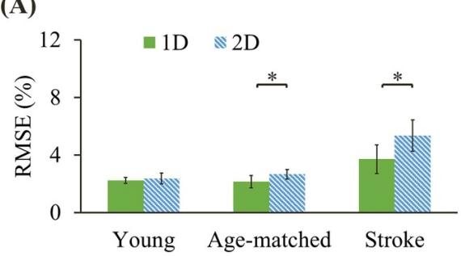

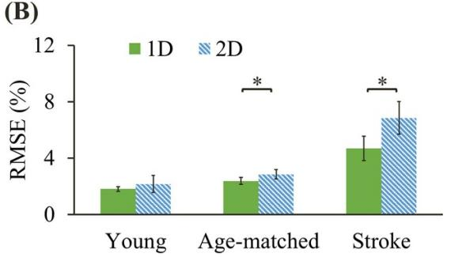  
Figure 2. Mean RMSE value within the one-dimensional (1D) and two-dimensional (2D) MCIs in each group during elbow flexion (A) and extension (B). An asterisk represented significant difference with pair-t test at $\textstyle P < 0 . 0 5$ between one-dimensional (1D) and two-dimensional (2D) MCIs in the same group.

Table 2. The tracking error, muscle activation and cortical activation in three groups under each visual condition during elbow flexion and extension. Abbreviations: RMSE, root mean square error; EMG-MA, EMG maximal amplitude; ∆HbO, the change in the concentration of oxy-hemoglobin; PFC, prefrontal cortex; M1, primary motor cortex; 1D, one-dimensional; 2D, two-dimensional; SD, standard deviation.
<table><tr><td rowspan="2"></td><td rowspan="2"></td><td rowspan="2"></td><td colspan="2">Young subjects</td><td colspan="2">Age-matched subjects</td><td colspan="2">Stroke patients</td></tr><tr><td>Mean</td><td>SD</td><td>Mean</td><td>SD</td><td>Mean</td><td>SD</td></tr><tr><td>RMSE</td><td>1D</td><td>Elbow flexion</td><td>2.23</td><td>0.22</td><td>2.14</td><td>0.43</td><td>3.71</td><td>1.00</td></tr><tr><td rowspan="4"></td><td></td><td>Elbow extension</td><td>1.81</td><td>0.17</td><td>2.37</td><td>0.25</td><td>4.69</td><td>0.86</td></tr><tr><td>2D</td><td>Elbow flexion</td><td>2.37</td><td>0.36</td><td>2.66</td><td>0.34</td><td>5.35</td><td>1.10</td></tr><tr><td></td><td>Elbow extension</td><td>2.16</td><td>0.60</td><td>2.85</td><td>0.34</td><td>6.84</td><td>1.16</td></tr><tr><td>1D</td><td>Elbow flexion</td><td>0.05</td><td>0.01</td><td>0.07</td><td>0.02</td><td>0.08</td><td>0.02</td></tr><tr><td rowspan="6">Agonist activation (% EMG-MA)</td><td>2D</td><td>Elbow extension</td><td>0.05</td><td>0.01</td><td>0.07</td><td>0.02</td><td>0.07</td><td>0.01</td></tr><tr><td></td><td>Elbow flexion</td><td>0.06</td><td>0.01</td><td>0.06</td><td>0.01</td><td>0.06</td><td>0.02</td></tr><tr><td></td><td>Elbow extension</td><td>0.05</td><td>0.01</td><td>0.06</td><td>0.02</td><td>0.07</td><td>0.02</td></tr><tr><td>1D</td><td>Elbow flexion</td><td>0.05</td><td>0.01</td><td>0.06</td><td>0.01</td><td>0.07</td><td>0.02</td></tr><tr><td>2D</td><td>Elbow extension</td><td>0.05</td><td>0.01</td><td>0.06</td><td>0.02</td><td>0.07</td><td>0.02</td></tr><tr><td rowspan="3">∆HbO in PFC (µM 1−1)</td><td></td><td>Elbow flexion</td><td>0.04</td><td>0.01</td><td>0.04</td><td>0.01</td><td>0.04</td><td>0.01</td></tr><tr><td></td><td>Elbow extension</td><td>0.03</td><td>0.01</td><td>0.04</td><td>0.02</td><td>0.04</td><td>0.01</td></tr><tr><td>1D</td><td>Elbow flexion</td><td>0.15</td><td>0.05</td><td>0.25</td><td>0.04</td><td>0.15</td><td>0.10</td></tr><tr><td rowspan="4">∆HbO in</td><td>2D</td><td>Elbow extension</td><td>0.18</td><td>0.06</td><td>0.21</td><td>0.02</td><td>0.13</td><td>0.10</td></tr><tr><td></td><td>Elbow flexion</td><td>0.34</td><td>0.06</td><td>0.33</td><td>0.04</td><td>0.28</td><td>0.19</td></tr><tr><td>1D</td><td>Elbow extension</td><td>0.24</td><td>0.05</td><td>0.32</td><td>0.05</td><td>0.25</td><td>0.12</td></tr><tr><td></td><td>Elbow flexion</td><td>0.18</td><td>0.08</td><td>0.22</td><td>0.08</td><td>-0.10</td><td>0.17</td></tr><tr><td rowspan="6">∆HbO in ipsilteral ml  $( \mu \mathrm { M } 1 ^ { - 1 } )$ </td><td></td><td>Elbow extension</td><td>0.18</td><td>0.06</td><td>0.24</td><td>0.10</td><td>-0.03</td><td>0.24</td></tr><tr><td>2D</td><td>Elbow flexion</td><td>0.31</td><td>0.07</td><td>0.33</td><td>0.04</td><td>0.28</td><td>0.12</td></tr><tr><td></td><td>Elbow extension</td><td>0.31</td><td>0.06</td><td>0.36</td><td>0.10</td><td>0.31</td><td>0.15</td></tr><tr><td>1D</td><td>Elbow flexion</td><td>0.12</td><td>0.05</td><td>0.28</td><td>0.09</td><td>0.10</td><td>0.11</td></tr><tr><td></td><td>Elbow extension</td><td>0.11</td><td>0.05</td><td>0.23</td><td>0.06</td><td>0.13</td><td>0.11</td></tr><tr><td rowspan="3">2D</td><td></td><td>Elbow flexion</td><td>0.25</td><td>0.05</td><td>0.33</td><td>0.05</td><td>0.32</td><td>0.17</td></tr><tr><td></td><td>Elbow extension</td><td>0.13</td><td>0.08</td><td>0.34</td><td>0.08</td><td>0.32</td><td>0.10</td></tr><tr><td></td><td></td><td></td><td></td><td></td><td></td><td></td><td></td></tr></table>

Figure 3 and table 2 displayed RMS of agonist and antagonist muscle in three groups under each tracking condition. Regarding agonist activation, there were significant effects of groups $( p = 0 . 0 1 )$ , but no significant effect of dimensionality $( p = 0 . 1 4 )$ and direction $\left( p = 0 . 5 8 \right)$ . The interactions among three main factors were not significant (group  dimensionality: $p = 0 . 3 6 ;$ group  direction: $\begin{array} { r } { p = 0 . 3 4 ; } \end{array}$ ; dimensionality direction: $\begin{array} { r } { p = 0 . 4 7 7 ; } \end{array}$ group dimensionality direction: $p \ = \ 0 . 2 8 )$ The results of post hoc analysis showed that the age-matched subjects and stroke patients exhibited higher agonist activation to complete the same tracking tasks than young subjects (stroke versus young subject: $\begin{array} { r } { p = 0 . 0 2 3 } \end{array}$ , age-matched subject versus young subject: $\begin{array} { r } { p = 0 . 0 1 6 ) } \end{array}$ . Regarding antagonist activation, three-way ANOVA results showed that there yielded significant main effects of group $( p = 0 . 0 0 3 )$ and dimensionality $( p = 0 . 0 1 )$ , whereas no significant main effect of direction $( p = 0 . 3 7 )$ was found. The interactions among three main factors had also no significant effect (group dimensionality: $p = 0 . 1 4 ;$ group  direction: $p = 0 . 3 1 ;$ dimensionality  direction: $p = 0 . 4 6 ;$ group  dimensionality  direction: $p = 0 . 2 4 )$ . According to the results of pairwise comparison, both stroke patients and age-matched subjects had larger antagonist muscle compared to young subjects (stroke versus young subject: $p = 0 . 0 3 2$ , agematched subject versus young subject: $p = 0 . 0 1 7 )$ The antagonist activation significantly reduced during 2D tracking than during 1D tracking in each group (young subject: $p = 0 . 0 3 2$ , age-matched subject: $\mathnormal { p } = 0 . 0 4 1$ , stroke: $\begin{array} { r } { p = 0 . 0 0 9 ) } \end{array}$

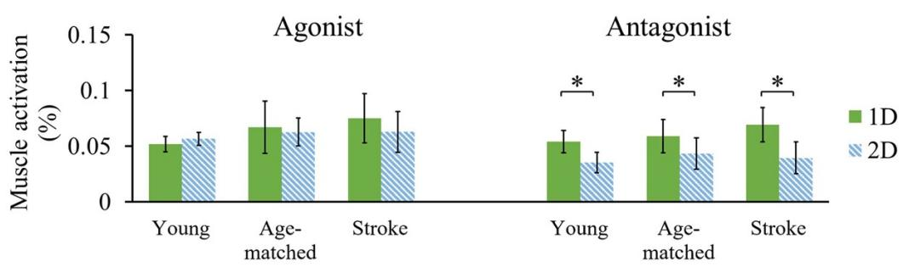

(A)  
(B)  
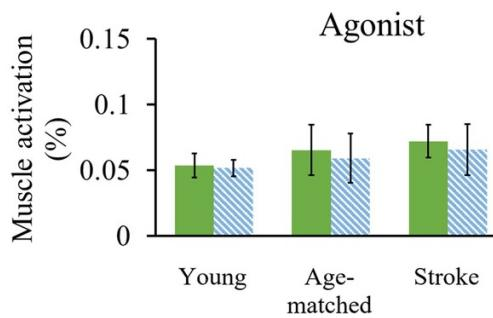

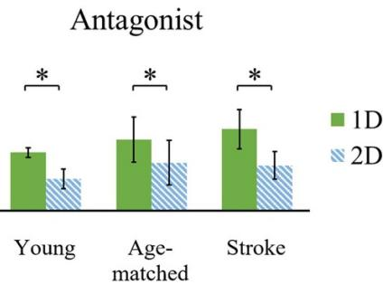  
Figure 3. Mean RMS value for agonist and antagonist muscles within the one-dimensional (1D) and two-dimensional (2D) MCIs in each group during elbow flexion (A) and extension (B). An asterisk represented significant difference with pair-t test at $\textstyle P < 0 . 0 5$ between one-dimensional (1D) and two-dimensional (2D) MCIs in the same group.

In order to facilitate analysis ofhemodynamic signals among three groups, LM1 in the healthy subjects and affected M1 in stroke patients were combined with contralateral M1. Similarly, both RM1 in the healthy subjects and unaffected M1 in stroke patients were combined with ipsilateral M1. Figure 4 and table 2 displayed the hemodynamic response in PFC, contralateral M1 and ipsilateral M1 of three groups under each tracking condition. The ANOVA results revealed that the significant main effects of groups and dimensionality were found in each cortical area (group: PFC, $p = 0 . 0 3 8 ;$ ipsilateral M1, $p = 0 . 0 1 2 ;$ contralateral M1, $p = 0 . 0 0 0 ;$ dimensionality: PFC, $p = 0 . 0 4 8 ;$ ipsilateral M1, $\begin{array} { r } { p = 0 . 0 4 9 ; } \end{array}$ ; contralateral M1, $p = 0 . 0 0 3 )$ , while no significant direction effect (PFC, $p = 0 . 1 7 ;$ ipsilateral M1, $p = 0 . 5 4 ;$ contralateral M1, $p = 0 . 4 7 )$ and three-way interaction was noted in each cortical area $( p > 0 . 0 5$ for all). Pairwise comparison showed that the higher activation was found in each brain area along with the increase ofdimensionality ofMCI, which was found in young subjects (PFC, $\begin{array} { r }  p = 0 . 0 3 2 \ \end{array}$ ; ipsilateral M1, $\begin{array} { r } { p = 0 . 0 4 2 ; } \end{array}$ contralateral M1, $p = 0 . 0 2 )$ , age-matched subjects (PFC, $p = 0 . 0 2 1 ;$ ipsilateral M1, $p = 0 . 0 6 1 ;$ contralateral M1, $ { p } =  { 0 . 0 4 6 } )$ and stroke patients (PFC, $p = 0 . 0 3 6 ;$ ipsilateral M1, $p = 0 . 0 0 9 ;$ contralateral M1, $p = 0 . 0 0 4 )$ ). In addition, PFC and contralateral M1 excitability of stroke patients were lower than those of healthy subjects. But these significant differences were only found in 1D MCI, which revealed the increase ofdimensionality could improve activation in PFC and contralateral M1 in stroke patients. Regarding ipsilateral M1, age-matched subjects showed significantly greater excitability than young subjects within each MCI, while the excitability in stroke patients was distinctly stronger than that in young subjects within 2D MCI. Compared to the age-matched subjects, a lower activation was found in stroke patients within each MCI with no significance.

3.2. Therapeutic effects of MCI in the training test Since the stroke patient performed well in the whole training test, it allowed us to make meaningful comparisons from pre-training to post-training to investigate the therapeutic effects on inter-muscular coordination following stroke. The changes in tracking error, muscle activation and cortical activation in stroke patient from pre-training to post-training were displayed in figures 5–7, respectively, and the changes of each index from pre-training to post-training were summarized in table 3. In figure 5, the patient showed significantly lower post-training tracking error than pre-training $( p \ : = \ : 0 . 0 0 4 )$ , which represented that the stroke patient improved tracking performance after the training test. In figure 6, the patient also showed significant decrease in the agonist and antagonist activation in the affected upper limb (agonist: $p = 0 . 0 0 1$ ; antagonist: $\textstyle p = 0 . 0 0 5 )$ . In the meanwhile, the stroke patient could still suppress the antagonist activation according to additional visual biofeedback of antagonist muscle. In figure 7, significant higher activation occurred in PFC and contralateral M1 after training (PFC: p = 0.016; contralateral M1: $p = 0 . 0 1 5 )$ , whereas there was no significant effect on the activation in ipsilateral M1 (ipsilateral M1: $p = 0 . 1 4 5 )$ . The increasing score of clinical assessment demonstrated a 16.67%–29.16% improvement in motor function ofthe affected upper limb ofstroke patient after training (pre-training: UE-FMA = 24; mid-training: UE-FMA = 28; post-training: UE-$\mathrm { F M A } = 3 1 )$ .

(A)  
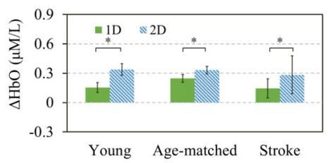

(B)  

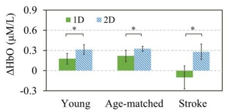

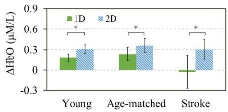

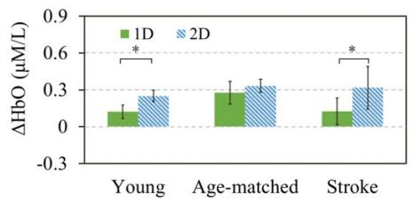

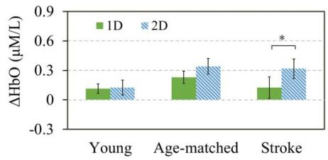  
Figure 4. Mean ∆HbO value in PFC, contralateral M1 and ipsilateral M1 within the one-dimensional (1D) and two-dimensional (2D) MCIs in each group during elbow flexion (A) and extension (B). An asterisk represented significant difference with pair-t test at p < 0.05 between one-dimensional (1D) and two-dimensional (2D) MCIs in the same group.

## 4. Discussion

This study aimed to investigate the short-term and long-term effects of MCI dimensionality on intermuscular coordination and cortical activation patterns in stroke patients using EMG and fNIRS signals. There were two important findings. In contrast to 1D MCI, evidence of higher activation in detected cortical areas and lower activation in antagonist muscle could demonstrate that 2D MCI could alter cortical activation patterns to effectively modulating the coordination of agonist-antagonist muscles in stroke patients. Furthermore, the results of the training test showed that the stroke patient could be trained to restore inter-muscular coordination through 2D MCI, which could be attributed to the progressive normalization of cortical activation pattern and muscle activation in stroke patient follow the training.

## 4.1. Influence of MCI dimensionality on the performance and control of coordination

Compared to 1D MCI, the antagonist activation decreased noticeably within 2D MCI in all groups, which demonstrated that all the subjects successfully decoupled agonist-antagonist muscles within 2D MCI. This finding was in consistent with previous studies which had also demonstrated that the patients could be aware of co-contraction and reduce abnormal co-activation between BIC and TRI by receiving visual biofeedback of each muscle [12, 15]. The main contribution of 2D MCI was to provide additional visual biofeedback of antagonist muscle to help stroke patients realize the antagonist activation, modulate the activation of agonistantagonist muscles and improve the ability to coordinate their agonist-antagonist muscles. Besides, compared to 1D MCI, a larger tracking error was also found within 2D MCI in age-matched and patient groups. This might be resulted from the increase of task complexity with the increasing dimensionality of MCI, since the subjects were asked to simultaneously focus on the visual biofeedback about agonist and antagonist muscles within 2D MCI. This finding was in agreement with the previous study which found a larger tracking error with the increasing difficulty level of task induced by the increase of tracking velocity in stroke patients [32]. Human movement is a consequence of force produced by muscles [33], and muscles are controlled by descending corticobulbar projections from the motor-related cortex [34]. In this study, the inhibition of antagonist activation in stroke patients within 2D MCI might be due to the changes of cortical activation caused by the additional visual biofeedback resulting in additional cognitive load. It was proposed that both the additional cognitive load and increasing difficulty would lead to the increased activation in PFC in healthy subjects and stroke patients [35–37]. Also, greater activation in contralateral M1 was reported during complex motor tasks for healthy subjects and stroke patients, when compared to simple motor tasks [37, 38]. The findings of these previous studies were in consistent with the results in this study which showed the increased activation in PFC and contralateral M1 within 2D MCI in all the groups and had demonstrated that the additional visual biofeedback of antagonist muscle was likely to influence cortical activation [39]. Another explanation for changing cortical activation might possibly be attributed to inhibitory functions induced by 2D MCI. The subjects were asked to consciously inhibit antagonist activation in the 2D tasks, which might activate the cortical inhibitory circuit. It was suggested that the inhibitory control signal might be one of the top-down control signals between PFC and M1 [40, 41]. PFC might be associated with generating motor inhibition and M1 was likely one of the targeted sites of this inhibition. Therefore, we speculated that when M1 received a specific modulation of inhibitory control from PFC, the firing properties of motor neurons in M1 might be altered and the inhibitory signal would descend from the M1 to the motoneuron of the antagonist muscle [42]. In such a process, increased recruitment in PFC and M1 was known [43, 44], which was in consistent with the finding in this study.

Table 3. The changes of the stroke patient through inter-muscular training. Abbreviations: RMSE, root mean square error; EMG-MA, EMG maximal amplitude; ∆HbO, the change in the concentration of oxy-hemoglobin; PFC, prefrontal cortex; M1, primary motor cortex; SD, standard deviation.
<table><tr><td></td><td></td><td colspan="2">Pre-training</td><td colspan="2">Mid-training</td><td colspan="2">Post-training</td></tr><tr><td></td><td></td><td>Mean</td><td>SD</td><td>Mean</td><td>SD</td><td>Mean</td><td>SD</td></tr><tr><td>RMSE</td><td>Elbow flexion</td><td>7.86</td><td>2.10</td><td>6.68</td><td>2.66</td><td>4.48</td><td>2.04</td></tr><tr><td></td><td>Elbow extension</td><td>7.78</td><td>2.07</td><td>6.08</td><td>3.06</td><td>5.47</td><td>2.05</td></tr><tr><td>Agonist activation</td><td>Elbow flexion</td><td>0.09</td><td>0.03</td><td>0.08</td><td>0.02</td><td>0.06</td><td>0.03</td></tr><tr><td>(% EMG-MA)</td><td>Elbow extension</td><td>0.08</td><td>0.04</td><td>0.06</td><td>0.04</td><td>0.05</td><td>0.03</td></tr><tr><td>Agonist activation</td><td>Elbow flexion</td><td>0.05</td><td>0.02</td><td>0.04</td><td>0.01</td><td>0.02</td><td>0.01</td></tr><tr><td>(% EMG-MA)</td><td>Elbow extension</td><td>0.05</td><td>0.02</td><td>0.04</td><td>0.02</td><td>0.03</td><td>0.01</td></tr><tr><td>∆HbO in PFC</td><td>Elbow flexion</td><td>0.21</td><td>0.10</td><td>0.46</td><td>0.08</td><td>0.35</td><td>0.09</td></tr><tr><td> $\mu \mathrm { M l ^ { - 1 } }$ </td><td>Elbow extension</td><td>0.15</td><td>0.09</td><td>0.58</td><td>0.24</td><td>0.43</td><td>0.15</td></tr><tr><td> $\Delta \mathrm { H b O }$  in contralateral Ml</td><td>Elbow flexion</td><td>0.03</td><td>0.07</td><td>0.23</td><td>0.15</td><td>0.18</td><td>0.09</td></tr><tr><td> $\mu \mathrm { M l ^ { - 1 } }$ </td><td>Elbow extension</td><td>0.12</td><td>0.24</td><td>0.35</td><td>0.15</td><td>0.32</td><td>0.23</td></tr><tr><td>∆HbO in ipsilteral Ml</td><td>Elbow flexion</td><td>0.32</td><td>0.22</td><td>0.27</td><td>0.18</td><td>0.24</td><td>0.12</td></tr><tr><td> $\mu \mathrm { M l ^ { - 1 } }$ </td><td>Elbow extension</td><td>0.38</td><td>0.27</td><td>0.32</td><td>0.20</td><td>0.30</td><td>0.13</td></tr></table>

(A)  
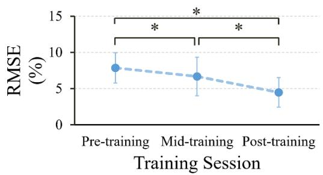

(B)  
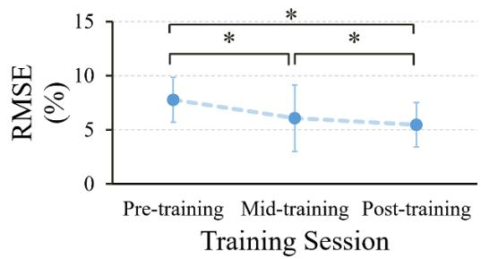  
Figure 5. The change of tracking error from pre-training to post-training during elbow flexion (A) and extension (B). An asterisk represented significant difference with pair-t test at p < 0.05 between two different stages.

(A)  
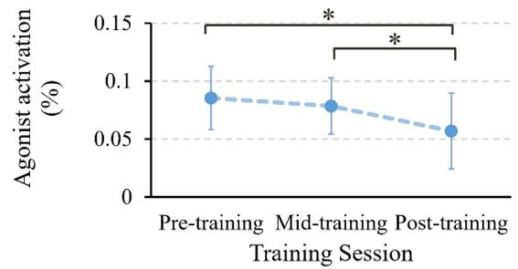

(B)  
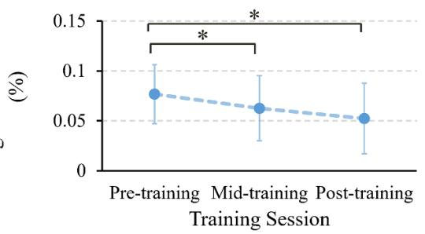

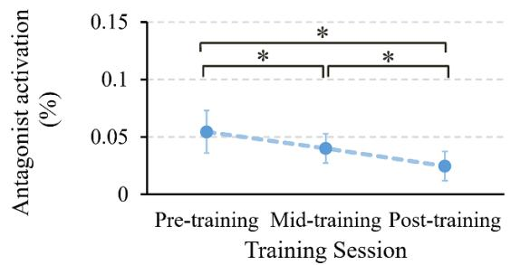

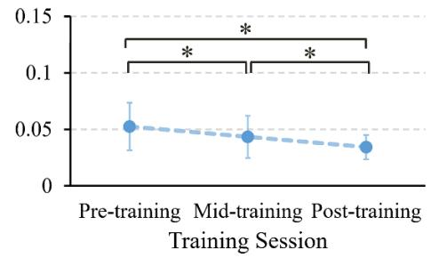  
Figure 6. The changes of normalized agonist and antagonist activation from pre-training to post-training during elbow flexion (A) and extension (B). An asterisk represented significant difference with pair-t test at p < 0.05 between two different stages.

(A)  
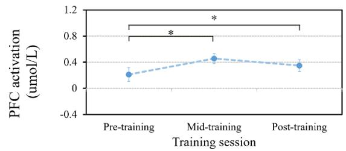

(B)  
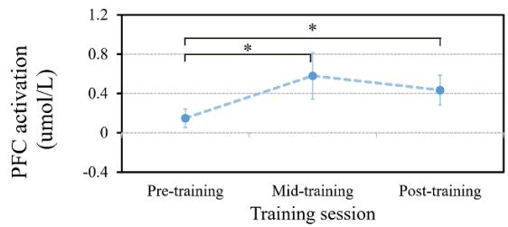

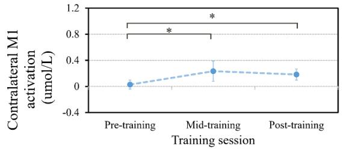

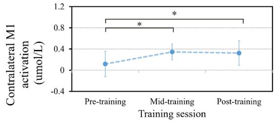

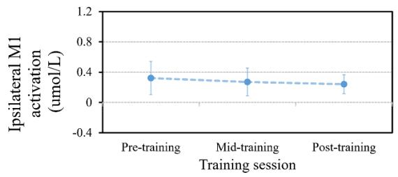

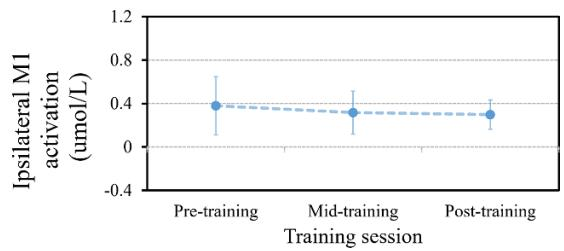  
Figure 7. The changes of cortical activation in each cortical area from pre-training to post-training during elbow flexion (A) and extension (B). An asterisk represented significant difference with pair-t test at p < 0.05 between two different stages.

Compared to young subjects, stroke patients showed higher agonist and antagonist activation within each MCI, which might be associated with agerelated muscular degeneration or excessive muscle activation after stroke [45, 46]. The inappropriate inter-muscular coordination might account for the largest tracking error in stroke patients, which might be related with the impairment in the motor-related brain areas after stroke [47]. The decreased activation in PFC and contralateral M1 in stroke patients within each MCI revealed that the motor performance deficits after stroke might be associated with the reduced cortical activation [48]. In this study, stroke patients also showed higher activation in ipsilateral M1 when compared with young subjects in the same tasks. There were two possible explanations for the higher activation in ipsilateral M1 in stroke patients. One was the age-induced effect. Because the declining motor function is a common consequence of aging due to neuronal loss in M1 [49], older subjects would recruit additional neurons in ipsilateral M1 to compensate for maintaining function [50]. The other explanation was neural changes after stroke. The activation in ipsilateral M1 played an important role in motor recovery for stroke patients [51]. We could hypothesize that the increased activation in ipsilateral M1 might reflect a compensatory strategy to counteracted the neurological lesion in contralateral M1 after stroke, which was consistent with previous work that also observed a shift in activation toward the ipsilateral M1 in stroke patients without therapy [52].

## 4.2. The impact of inter-muscular coordination training on inter-muscular coordination

Although many rehabilitation training can improve motor function for stroke patients, few training has targeted inter-muscular coordination. As we knew, the incoordination ofagonist-antagonist muscle after stroke was attributed to the increased activation in antagonist muscle due to impaired antagonist inhibition [53]. After impairment of the inhibitory control, the stroke patient has lost the ability to relax antagonist muscle, which resulted in the increase of motor unit recruitment and the change of discharge behavior in antagonist muscle [54, 55]. The inappropriate antagonist activation might lead to larger tracking error and energy consumption for stroke patient. The results of the single-case longitudinal study showed the reduction of tracking error and muscle activation from pre-training to post-training, which indicated that inter-muscular coordination training might produce long-term positive effects on restoring intermuscular coordination for the stroke patient. A previous study has also demonstrated that stroke patients could quickly learn to modulate the activation of targeted muscle and exhibit long-term improvement in motor function following training based on MCI [15], which was in consist of this study. Moreover, the ability to coordinate agonist-antagonist muscles acquired during inter-muscular coordination training in the stroke patient might be independent of the given task and could be transferred to a new task or a new environment [16, 56]. Comparing the antagonist activation and cortical activation in the stroke patient in three evaluation sessions with that in healthy groups, we also found that the muscle performance and cortical involvement after training were more similar to the healthy, which might imply that the stroke patient progressively changed towards normality.

The increased activation in PFC and bilateral M1 after training might be interpreted as cortical plasticity to progressively normalize cortical activation and compensate for injuries caused by stroke [57, 58]. It was also suggested that increased cortical activation was an expression ofthe operation ofan efficient mechanism associated with restoring inter-muscular coordination for stroke patient [59]. Bilateral M1 showed different trends following the training: the increased contralateral activation and the decreased ipsilateral activation, and this finding was in consistent with previous studies which explained that there might be a shift in neural recruitment from ipsilateral hemisphere to contralateral hemisphere inducing following the training [60, 61]. On the other hand, we assumed that inter-muscular coordination training might influence the activation in PFC of the stroke patient. Qi et al had demonstrated that the neural firing in PFC could be altered due to learning and performance of a cognitive task [62]. The stroke patient likely relied on adding the activation in PFC to perform the task when they were learning a motor task [63], which might reflect the increased cognitive demands for him [64]. These findings might explain the increased activation in PFC after training. In addition, in consideration of the contribution of PFC to inhibition control, the stroke patient was able to skillfully decouple abnormal co-activation muscles after training, which might imply the stroke patient increased the recruitment of neural pathways in PFC to improve inhibitory control of antagonist muscle.

Therefore, inter-muscular coordination training could promote cortical reorganization and regaining the ability to coordinate the agonist-antagonist muscles for the stroke patient. These improvements were long-term effective and task independent. The inter-muscular coordination training might play an important role in restoring inter-muscular coordination and improving fine motor control in the clinic.

## 5. Conclusion

The purpose of this study is to investigate the shortterm and long-term effects of MCI dimensionality on inter-muscular coordination and cortical activation pattern in stroke patients. The 2D MCI can help stroke patients improve the coordination of agonistantagonist muscles by simultaneously activating agonist muscle and inhibiting antagonist muscle. This process is associated with the increased activation in PFC and M1 in stroke patients. After intermuscular coordination training, the stroke patient shows a significant recovery in the coordination of agonist-antagonist muscles, which are accompanied by cortical reorganization. The 2D MCI is supposed as an effective training approach to promote further recovery of inter-muscular coordination and cortical reorganization in the stroke patient. Future work will be required by raising muscle activation levels to validate this generalization of the cross-sectional study. Moreover, the longitudinal study is a pilot study with one patient. Although the findings in the training test were promising, future work with a large number of stroke patients should be undertaken to ensure the effectiveness of inter-muscular coordination training.

## Acknowledgments

We would like to thank Xianyi Zhang, Liuke Liang, Xianming Li and Xiaolu Wang for their important assistances, suggestions and editing throughout this study. This work was supported in part by Guangdong Science and Technology Plan Project under Grant 2015B020214003, Grant 2017B010110015, and Grant 2017B020210011, in part by the Science and Technology Program of Guangzhou under Grant 201604020108, and in part by the Science and Technology Project of Shenzhen under Grant JCYJ20170818155028942.

## Conflicts of interest

All the authors declared no potential conflicts of interest with respect to the authorship and/or publication of this study.

## ORCID iD

Rong Song  https://orcid.org/0000-0003-3662- 116X

## References

[1] Wade D T, Langton-Hewer R, Wood V A, Skilbeck C E and Ismail H M 1983 The hemiplegic arm after stroke: measurement and recovery J. Neurol. Neurosurg. Psychiatr. 46 521–4

[2] Bourbonnais D and Vanden N S 1989 Weakness in patients with hemiparesis Am. J. Occup. Ther. 43 313–9

[3] Levin M F 1996 Interjoint coordination during pointing movements is disrupted in spastic hemiparesis Brain 119 281–93

[4] Tropea P, Monaco V, Coscia M, Posteraro F and Micera S 2013 Effects of early and intensive neuro-rehabilitative treatment on muscle synergies in acute post-stroke patients: a pilot study J. Neuroeng. Rehabil. 10 103

[5] Lum P S, Patten C, Kothari D and Yap R 2004 Effects of velocity on maximal torque production in poststroke hemiparesis Muscle Nerve 30 732–42

[6] Takahashi C D, Der-Yeghiaian L, Le V, Motiwala R R and Cramer S C 2008 Robot-based hand motor therapy after stroke Brain 131 425–37

[7] Teasell R W and Kalra L 2004 What’s new in stroke rehabilitation Stroke 35 383–5

[8] Cancel N, Fischer M, Gulotta L, Koo J Y and McKittrick S 2014 Moderate aerobic exercise has an inconclusive effect on fine motor control

[9] Board ADAME 2013 Fine motor control U.S. National Library of Medicine: A.D.A.M.

[10] Yang Y, Chen Y, Chang H, Chan R, Wei S and Wang R 2015 Effects of interactive visual feedback training on post-stroke pusher syndrome: a pilot randomized controlled study Clin. Rehabil. 29 987–93

[11] Rose D J and Christina R W 2006 A Multilevel Approach to the Study of Motor Control and Learning (Reading, MA: Addison-Wesley)

[12] Young S J, Van Doornik J and Sanger T D 2011 Visual feedback reduces co-contraction in children with dystonia J. Child Neurol. 26 37–43

[13] Luo J, Sun W, Wu Y, Liu H, Wang X, Yan T and Song R 2018 Characterization of the coordination of agonist and antagonist muscles among stroke patients, healthy late middle-aged and young controls using a myoelectric-controlled interface J. Neural. Eng. 15 056015

[14] Ellis M D, Holubar B G, Acosta A M, Beer R F and Dewald J P A 2005 Modifiability of abnormal isometric elbow and shoulder joint torque coupling after stroke Muscle Nerve 32 170–8

[15] Wright Z A, Rymer W Z and Slutzky M W 2013 Reducing abnormal muscle coactivation after stroke using a myoelectric-computer interface: a pilot study Neurorehabil. Neural Repair 28 443–51

[16] Mugler E M et al 2019 Myoelectric computer interface training for reducing co-activation and enhancing arm movement in chronic stroke survivors: a randomized trial Neurorehabil. Neural Repair 33 284–95

[17] Bradnam L V, Stinear C M, Lewis G N and Byblow W D 2010 Task-dependent modulation of inputs to proximal upper limb following transcranial direct current stimulation of primary motor cortex J. Neurophysiol. 103 2382–9

[18] Lemon R N 2007 Descending pathways in motor control Annu. Rev. Neurosci. 31 195–218

[19] Heidi J B, Helen D, Claire G, Smith S M, Wade D T and Matthews P M 2002 Correlation between motor improvements and altered fMRI activity after rehabilitative therapy Brain 125 2731–42

[20] Calautti C, Naccarato M, Jones P S, Sharma N, Day D D, Carpenter A T, Bullmore E T, Warburton E A and Baron J-C 2007 The relationship between motor deficit and hemisphere activation balance after stroke: a 3T fMRI study NeuroImage 34 322–31

[21] Ward N S, Brown M M, Thompson A J and Frackowiak R S J 2003 Neural correlates of outcome after stroke: a cross-sectional fMRI study Brain 126 1430–48

[22] Irani F, Platek S M, Bunce S, Ruocco A C and Chute D 2007 Functional near infrared spectroscopy (fNIRS): an emerging neuroimaging technology with important applications for the study of brain disorders Clin. Neuropsychol. 21 9–37

[23] Kamran M A and Hong K S 2013 Linear parameter-varying model and adaptive filtering technique for detecting neuronal activities: an fNIRS study J. Neural. Eng. 10 056002

[24] Paolo B A, Onur K H, Ahmet O and Bin H 2016 Hybrid EEG-fNIRS asynchronous brain-computer interface for multiple motor tasks PLoS One 11 e0146610

[25] Matsuzaki S, Morihiro M, Tsubone T and Wada Y 2010 Brain activation during finger tapping and circle-drawing tasks measured by functional near-infrared spectroscopy (fNIRS) Neurosci. Res. 68 e442–e43

[26] Leff D R, Orihuela-Espina F, Elwell C E, Athanasiou T, Delpy D T, Darzi A W and Yang G-Z 2011 Assessment of the cerebral cortex during motor task behaviours in adults: a systematic review of functional near infrared spectroscopy (fNIRS) studies Neuroimage 54 2922–36

[27] Lin P Y, Chen J J J and Lin S I 2013 The cortical control of cycling exercise in stroke patients: an fNIRS study Hum. Brain Mapp. 34 2381–90

[28] GoldmanRakic P S 1987 Motor control function of the prefrontal cortex Ciba Foundation Symp. vol 132 (Wiley)

[29] Fallgatter A J, Susanne J, Bartsch A J, Bernhard H and Peter L K 1999 Serotonin transporter promoter polymorphism influences topography of inhibitory motor control Int. J. Neuropsychopharmacol. 2 115–20

[30] Carey J R, Greer K R, Grunewald T K, Steele J L, Wiemiller J W, Bhatt E, Nagpal A, Lungu O and Auerbach E J 2006 Primary motor area activation during precision-demanding versus simple finger movement Neurorehabil. Neural Repair 20 361–70

[31] Jian C, Deng L, Liang L, Luo J, Wang X and Song R 2020 Neuromuscular control of the agonist—antagonist muscle

coordination affected by visual dimension: an EMG-fNIRS study IEEE Access 8 100768–77

[32] Ju M, Lin C K, Chen J, Cheng H and Lin C 2002 Performance of elbow tracking under constant torque disturbance in normotonic stroke patients and normal subjects Clin. Biomech. 17 640–9

[33] Yoshitake Y 2014 Relation between motor unit/muscle activity and fine motor performance J. Phys. Fitness Sports Med. 3 283–90

[34] Shenoy K V, Sahani M and Churchland M M 2013 Cortical control of arm movements: a dynamical systems perspective Annu. Rev. Neurosci. 36 337–59

[35] Daan M, Emad A Y, Helen D, Penny M F and Carmen P 2014 Associations between prefrontal cortex activation and H-reflex modulation during dual task gait Front. Hum. Neurosci. 8 78

[36] Seidler R D, Bernard J A, Burutolu T B, Fling B W, Gordon M T, Gwin J T, Kwak Y and Lipps D B 2010 Motor control and aging: links to age-related brain structural, functional, and biochemical effects Neurosci. Biobehav. Rev. 34 721–33

[37] Puh U K, Vovk A, Sevšek F and DA S 2007 Increased cognitive load during simple and complex motor tasks in acute stage after stroke Int. J. Psychophysiol. 63 0–180

[38] Tinazzi M, Farina S, Tamburin S, Facchini S, Fiaschi A, Restivo D and Berardelli A 2003 Task-dependent modulation of excitatory and inhibitory functions within the human primary motor cortex Exp. Brain Res. 150 222–9

[39] Stein B E 1998 Neural mechanisms for synthesizing sensory information and producing adaptive behaviors Exp. Brain Res. 123 124–35

[40] Ridderinkhof K R, Wildenberg W P M V D, Segalowitz S J and Carter C S 2004 Neurocognitive mechanisms of cognitive control: the role of prefrontal cortex in action selection, response inhibition, performance monitoring, and reward-based learning Brain Cogn. 56 129–40

[41] Narayanan N S and Laubach M 2007 Top-down control of motor cortex ensembles by dorsomedial prefrontal cortex Neuron 52 921–31

[42] Yang H D, Minn Y K, Son I H and Suk S H 2006 Facilitation and reciprocal inhibition by imagining thumb abduction J. Clin. Neurosci. 13 245–8

[43] Maso F D, Longcamp M and Amarantini D 2012 Training-related decrease in antagonist muscles activation is associated with increased motor cortex activation: evidence of central mechanisms for control of antagonist muscles Exp. Brain Res. 220 287–95

[44] Matthias L, Inga P, Elinor T and Kraemer U M 2017 Temporal dynamics of proactive and reactive motor inhibition Front. Hum. Neurosci. 11 204

[45] Kamper D G and Rymer W Z 2010 Impairment of voluntary control of finger motion following stroke: role of inappropriate muscle coactivation Muscle Nerve 24 673–81

[46] Naik S K, Patten C, Lodha N, Coombes S A and Cauraugh J H 2011 Force control deficits in chronic stroke: grip formation and release phases Exp. Brain Res. 211 1–15

[47] Tang Q et al 2015 Modulation of interhemispheric activation balance in motor-related areas of stroke patients with motor recovery: systematic review and meta-analysis of fMRI studies Neurosci. Biobehav. Rev. 57 392–400

[48] Promjunyakul N 2012 Pedaling-related brain activation in people post-stroke: an fMRI study Dissertations and Theses—Gradworks

[49] Ward N S 2006 Compensatory mechanisms in the aging motor system Ageing Res. Rev. 5 239–54

[50] Zimerman M, Liuzzi G P, Heise K, Nitsch M, Cohen L G, Gerloff C and Hummel F C 2009 Functional relevance of ipsilateral motor cortex in the process of motor sequence learning in the elder Aktuelle Neurol. 36 S02 437

[51] Cramer S C, Nelles G, Benson R R, Kaplan J D, Parker R A, Kwong K K, Kennedy D N, Finklestein S P and Rosen B R 1997 A functional MRI study of subjects recovered from hemiparetic stroke Stroke 28 2518–27

[52] Michielsen M E, Selles R W, Geest J N V D, Eckhardt M and Bussmann J B J 2010 Motor recovery and cortical reorganization after mirror therapy in chronic stroke patients: a phase II randomized controlled trial Neurorehabil. Neural Repair 25 223–33

[53] Hufschmidt A and Mauritz K H 1985 Chronic transformation of muscle in spasticity: a peripheral contribution to increased tone J. Neurol. Neurosurg. Psychiatr. 48 676–85

[54] Blaschak M J, Powers R K and Rymer W Z 1988 Disturbances of motor output in a cat hindlimb muscle after acute dorsal spinal hemisection Exp. Brain Res. 71 377–87

[55] Powers R K and Rymer W Z 1988 Effects of acute dorsal spinal hemisection on motoneuron discharge in the medial gastrocnemius of the decerebrate cat J. Neurophysiol. 59 1540–56

[56] Schmidt R A and Lee T D 1999 Motor Control and Learning: A Behavioral Emphasis 3rd edn (Champaign, IL: Human Kinetics)

[57] Nudo R J and Friel K M 1999 Cortical plasticity after stroke: implications for rehabilitation Rev. Neurol. 155 713–7

[58] Brauer S G, Barker R N and Carson R G 2006 Training-induced brain plasticity in stroke survivors with severe and chronic upper limb paresis as revealed with TMS Society for Neuroscience Annual Meeting (Atlanta)

[59] Nudo R J 2007 Postinfarct cortical plasticity and behavioral recovery Stroke 38 840–5

[60] Carey J R, Kimberley T J, Lewis S M, Auerbach E J, Dorsey L, Rundquist P and Ugurbil K 2002 Analysis of fMRI and finger tracking training in subjects with chronic stroke Brain 125 773–88

[61] Liepert J, Bauder H, Miltner W H R, Taub E and Weiller C 2000 Treatment-induced cortical reorganization after stroke in humans Stroke 31 1210–6

[62] Qi X L and Constantinidis C 2012 Correlated discharges in the primate prefrontal cortex before and after working memory training Eur. J. Neurosci. 36 3538–48

[63] Dennis A, Bosnell R, Dawes H, Howells K, Cockburn J, Kischka U, Matthews P and Johansen-Berg H 2011 Cognitive context determines premotor and prefrontal brain activity during hand movement in patients after stroke Stroke 42 1056

[64] Sharma N, Simmons L H, Jones P S, Day D J, Carpenter T A, Pomeroy V M, Warburton E A and Baron J-C 2009 Motor imagery after subcortical stroke: a functional magnetic resonance imaging study Stroke 40 1315–24