论文

# 利用二维肌电计算机接口调节和恢复中风患者的肌间协调：一项横断面与纵向研究

引用本文：Chuyao Jian et al 2021 J. Neural Eng. 18 036005

在线查看文章以获取更新和增强内容。

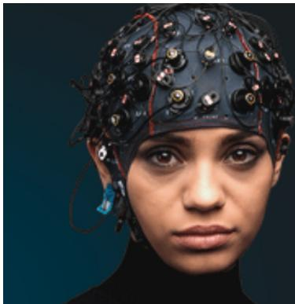

EEG/ECOG 放大器与电极 电刺激/皮层刺激器 实时处理

g.tec

gtec.at/shop

立即购买

此内容于 2021年6月8日 08:55 从 IP 地址 210.42.120.104 下载

# Journal of Neural Engineering

CrossMark

论文

收稿日期：2020年7月26日

修回日期：2020年9月24日

# 利用二维肌电计算机接口调节和恢复中风患者的肌间协调：一项横断面与纵向研究

接受发表日期：2020年10月19日

出版日期：

Chuyao Jian1、Linchuan Deng1、Huihua Liu2、Tiebin Yan2、Xianyun Wang3 和 Rong Song1,4

2021年3月8日

1 广东省传感技术与生物医疗仪器重点实验室，中山大学生物医学工程学院，广州 510275，中华人民共和国

2 中山大学孙逸仙纪念医院，广州 510120，中华人民共和国

3 广东省工伤康复中心，广州 510440，中华人民共和国

4 中山大学深圳研究院，深圳 518057，中华人民共和国

电子邮箱：songrong@mail.sysu.edu.cn

关键词：中风康复、上肢、肌间协调、皮层重组、EMG、fNIRS

## 摘要

目的。传统的康复训练侧重于改善肢体或关节水平的运动功能水平，而肌间协调在精细运动控制中起着重要作用且常被忽视。本研究的目的是探讨肌电控制接口（myoelectric-controlled interface, MCI）诱导的肌间协调变化，以及基于 MCI 的肌间协调训练对中风患者的治疗效果。方法。在评估测试中招募了 11 名中风患者、20 名年轻受试者和 13 名年龄匹配的受试者，以确定 MCI 维度对肌间协调的影响。此外，一名中风患者参加了为期 20 天的训练课程，作为个案研究分析以检验训练测试中的治疗效果。在这两项测试中，所有受试者均根据来自一维和二维（2D）MCI 的生物反馈，通过屈/伸肘关节来执行追踪任务。同时，同步采集肌电图（electromyography, EMG）和功能性近红外光谱技术（functional near infrared spectroscopy, fNIRS）信号，以反映肌肉与大脑皮层的激活情况。主要结果。在所有组别中，随着 MCI 维度的增加，拮抗肌激活显著降低，而前额叶皮层和初级运动皮层的参与度显著增加。在中风患者中观察到肌肉激活显著减少且皮层激活增加，这可能是由于患者在训练后逐渐趋于正常化所致。意义。这些发现表明，2D MCI 可以作为直接调节中风患者肌间协调的有效工具。肌间协调训练有望恢复中风患者主动肌与拮抗肌的协调能力，并且这种改善可能伴随着大脑皮层的重组。

## 1. 引言

大多数脑卒中患者饱受上肢功能障碍的困扰，通常表现为肌无力、肌张力过高/反射亢进以及肌间不协调 [1–4]。先前的一项研究报道，肌间不协调可能导致异常的肌肉激活模式、肌肉痉挛以及力矩生成受损 [5]。脑卒中患者可以通过传统康复训练恢复部分运动功能，以改善其生活质量 [6, 7]。在完成传统训练后，脑卒中患者仍无法完成精细的手部动作，而肌间协调被认为在上肢精细运动控制中至关重要 [8, 9]。但肌间协调在传统训练中往往被忽视。传统训练在改善肌间协调方面的不足，凸显了对其他康复训练的需求。然而，针对脑卒中患者肌间协调及其对精细运动控制训练效果的研究相对较少。

利用视觉生物反馈改善脑卒中患者的运动功能，在功能评估和康复训练中展现出了良好的应用前景。视觉生物反馈能够为患者提供实时信息，以帮助其感知自身的运动表现并调整动作 [10, 11]。肌电控制接口（MCI）是一种针对肌肉激活的特定视觉生物反馈，已被证实能够通过将各肌肉的肌电（EMG）信号映射到光标移动上，辅助用户直接调节肌肉激活。Young 等人证实，肌张力障碍患者借助肌肉激活的视觉生物反馈能够显著减少肌肉协同激活 [12]。Luo 等人表明，在健康受试者和脑卒中患者中，增加 MCI 维度可用于有效调节协同激活的肌肉并抑制目标肌肉的激活 [13]。多项研究将 MCI 与康复训练相结合，发现 MCI 在解耦异常协同激活方面具有积极且长期的效果，并能改善健康受试者和脑卒中患者的上肢肌肉控制与运动表现 [14–16]。这些结果表明，MCI 有潜力为脑卒中患者提供针对特定任务的交互式疗法，以恢复其肌间协调。

众所周知，这种受到调制且协调的肌肉激活是由大脑皮层控制的 [17, 18]。视觉生物反馈被大脑皮层整合，通过调节肌肉激活来改变运动表现。脑卒中（stroke）患者在康复训练后运动功能障碍的改善，是由受激活肌肉的重复锻炼引起的，并且也与大脑皮层重组相关 [19–21]。近年来，功能性近红外光谱技术（fNIRS，functional near infrared spectroscopy）作为一种新兴的神经成像技术，已被广泛用于无创监测运动过程中由血流动力学信号变化引起的皮层激活 [22]。相比于功能磁共振成像（fMRI）较低的时间分辨率和脑电图（EEG，electroencephalographic）信号较低的空间分辨率，fNIRS 更适合用于测量运动任务期间的皮层激活 [23, 24]。fNIRS 已被应用于测量健康受试者或脑卒中患者在进行手指敲击、抓握和骑自行车等运动任务期间的皮层激活 [25–27]。研究表明，不同的皮层区域参与了运动任务，例如前额叶皮层（PFC，prefrontal cortex）和初级运动皮层（M1，primary motor cortex）。据报道，PFC 参与运动指令的生成过程 [28, 29]，而 M1 在精细运动控制中起着重要作用 [30]。我们以往结合 EMG 和 fNIRS 信号系统开展的研究表明，MCI 可以改变健康受试者 PFC 和 M1 的激活，从而调节主动肌与拮抗肌之间的协调 [31]。尽管已证实脑卒中患者可以基于 MCI 调节肌肉激活，但 MCI 维度对短期干预后皮层激活以及长期训练后脑卒中患者大脑重组的维度效应仍不清楚。

本研究旨在通过横断面测试探讨 MCI 的维度如何影响脑卒中后的肌间协调和皮层激活，并通过纵向测试确定肌间协调训练是否能够恢复肌间协调并产生皮层重组。在这两项测试中，我们测量了不同维度 MCI 下主动肌-拮抗肌激活的变化以及运动相关皮层区域的激活。我们假设，随着 MCI 维度的增加，脑卒中患者的肌间协调将得到改善。我们还预测，肌间协调训练可以改变皮层激活模式，从而恢复脑卒中患者的肌间协调。

## 2. 方法

## 2.1. 受试者

共招募了三组受试者，包括脑卒中患者、年龄匹配的健康受试者以及年轻受试者。脑卒中患者包括 7 名女性和 4 名男性，平均（标准差）年龄为 45.7（7.6）岁。自脑卒中发病以来的平均时间为 11.1 5.4 个月。脑卒中患者的描述性数据列于 Table 1 中。年龄匹配的受试者包括 7 名女性和 6 名男性，平均年龄为 55.2（6.4）岁。20 名健康年轻对照受试者包括 15 名女性和 5 名男性，平均年龄为 23.9（1.86）岁。所有健康受试者均为自述右利手，且无神经系统症状或其他疾病史。所有受试者均参与了评估测试，其中一名脑卒中患者（Table 1 中的受试者 1）被招募参加了训练测试。本研究已获得广东省工伤康复中心伦理委员会的批准（AF/SC-07/2017.09），所有受试者在参与前均签署了书面知情同意书。

评估测试中脑卒中患者符合以下纳入标准：(a) 所有脑卒中患者年龄必须在 18–70 岁之间；(b) 单侧脑损伤发病至少 6 个月；(c) 所有脑卒中患者均表现出上肢运动功能障碍；(d) 所有脑卒中患者均能够将患侧上肢从大腿处抬起至与肩同高且无肩部疼痛；(e) 患侧上肢能够完成肘关节的屈曲和伸展动作；(f) 能够理解并遵循与任务相关的指令。脑卒中患者的排除标准如下：(a) 有任何其他伴随的肌肉骨骼或神经系统疾病史；(b) 严重的视力和听力障碍；(c) 存在认知障碍；(d) 影响 fNIRS 和 EMG 数据采集的其他情况。使用上肢 Fugl-Meyer 运动评估（UE-FMA）来评估患侧上肢的运动功能障碍，所有临床评估均由同一位研究人员测量。

Table 1. 患者信息。缩写：F，女性；M，男性；UE-FMA，上肢 Fugl-Meyer 评估。

<table><tr><td>受试者</td><td>年龄（岁）</td><td>性别</td><td>病灶侧</td><td>卒中后时间（月）</td><td>UE-FMA 评分</td><td>病灶位置</td></tr><tr><td>1</td><td>33</td><td>男</td><td>右侧</td><td>7</td><td>24</td><td>右侧内囊</td></tr><tr><td>2</td><td>45</td><td>男</td><td>左侧</td><td>1.5</td><td>22</td><td>左侧丘脑</td></tr><tr><td>3</td><td>16</td><td>男</td><td>右侧</td><td>4</td><td>28</td><td>右侧辐射冠及基底节</td></tr><tr><td>4</td><td>50</td><td>女</td><td>右侧</td><td>12</td><td>43</td><td>右侧中央前回</td></tr><tr><td>5</td><td>41</td><td>女</td><td>左侧</td><td>8</td><td>31</td><td>左侧基底节</td></tr><tr><td>6</td><td>39</td><td>男</td><td>右侧</td><td>2</td><td>20</td><td>右侧额中回</td></tr><tr><td>7</td><td>35</td><td>女</td><td>左侧</td><td>9.5</td><td>36</td><td>左侧内囊</td></tr><tr><td>8</td><td>61</td><td>女</td><td>左侧</td><td>5</td><td>29</td><td>左侧中央前回</td></tr><tr><td>9</td><td>45</td><td>男</td><td>左侧</td><td>14</td><td>42</td><td>左侧外侧裂</td></tr><tr><td>10</td><td>58</td><td>男</td><td>右侧</td><td>24</td><td>22</td><td>右侧内囊及纹状体</td></tr><tr><td>11</td><td>42</td><td>女</td><td>右侧</td><td>17</td><td>34</td><td>右侧顶下皮层</td></tr></table>

## 2.2. 评估测试方案

在熟悉评估测试流程后，每位受试者端坐在椅子上并面向计算机屏幕，如图 1(D) 所示。有一个定制的手臂装置用于提供上肢重量支撑并限制上肢的运动范围。中风患者的患侧上肢和健康受试者的优势臂被放置在手臂装置中，上肢处于肩外展 $9 0 ^ { \circ }$ 和肘屈曲 $9 0 ^ { \circ }$ 的位置。评估测试的流程如图 1(A) 所示。最初，每位受试者进行了 5 s 的等长肘屈和肘伸最大自主收缩（MVC），重复三次，间隔 2 min。计算肱二头肌（BIC）和肱三头肌（TRI）的肌电最大幅值（EMG-MA）。然后，要求每位受试者在两种视觉条件下进行等长肘屈和肘伸：一维（1D）和二维（2D）MCI。他们按以下顺序执行追踪任务：1D MCI 下的肘屈、1D MCI 下的肘伸、2D MCI 下的肘屈以及 2D MCI 下的肘伸。每项任务执行三次，总共安排了 12 次试验。每次试验包含 7 s 的准备期、60 s 的追踪期和 10 s 的休息期。在准备期和休息期，所有受试者都需要保持静息位置。在追踪期，通过 LabVIEWTM 程序提供实时视觉生物反馈，其中包括分别代表追踪目标和可控光标的红色方块与绿色方块。受试者尝试通过细致的肘屈和肘伸尽可能追踪该目标。

在评估测试期间，追踪目标被设置为沿坐标轴匀速移动，可控光标则根据 BIC 和 TRI 的激活情况移动。在每次试验中，追踪目标在准备期停留在坐标原点，然后在追踪期开始沿坐标轴在从坐标原点到终点的区域内往返扫动 60 s。终点设定为 10% EMG-MA 以避免疲劳。当追踪目标沿 Y 轴移动时，受试者应进行肘屈。当追踪目标沿 X 轴移动时，受试者应进行肘伸。在一维 MCI 下，可控光标仅根据主动肌的激活程度移动（主动肌：肘屈时为 BIC；肘伸时为 TRI）。在二维 MCI 下，可控光标的 x 坐标和 y 坐标分别代表 TRI 和 BIC 的激活程度。可控光标和目标的 2D 坐标可通过 LabVIEWTM 程序进行记录和存储。

## 2.3. 训练测试方案

训练测试的方案如图 1(B) 所示。一名脑卒中患者需要完成包含 23 次训练阶段的训练测试，其中包括 3 次评估阶段和 20 次追踪训练阶段。评估阶段的设置与评估测试相同。评估阶段和临床评估分别在第 1 天训练前（训练前）、第 10 天训练后（训练中）和第 20 天训练后（训练后）进行，以评估训练效果。每次追踪训练阶段每天持续 90 min，每周进行 4 到 5 次。在每次追踪训练阶段中，脑卒中患者被要求坐在椅子上，面向电脑屏幕，并将患侧上肢置于手臂仪器中。脑卒中患者首先进行 3 次 5 s 的等长屈肘和伸肘 MVC，以分别计算 BIC 和 TRI 的 EMG-MA。基于评估测试的 LabVIEWTM 程序设计了三款训练游戏，如图 1(C) 所示：追踪游戏（TG）、单水果游戏（SFG）和多水果游戏（MFG）。脑卒中患者按以下顺序进行这些游戏：TG、SFG、MFG 和 TG。每款游戏重复 3 次，间隔 2 min，因此共有 12 次试验。

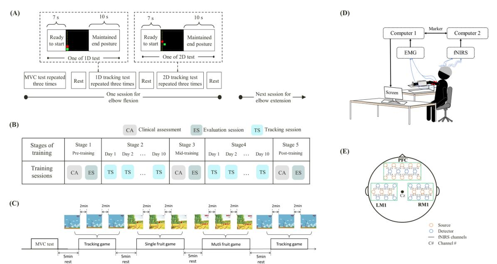  
Figure 1. 评估测试和训练测试的实验设计。(A) 评估测试流程。(B) 训练测试方案。(C) 完整训练阶段的流程。(D) 实验装置。(E) 平面图上的探头和通道排布。

这些训练游戏旨在为脑卒中患者提供一个有趣且富有挑战性的环境，以改善异常的肌间协调。在 TG 中，有一个超级马里奥（Super Mario）头像和两个蘑菇，分别代表可控光标和追踪目标。在 TG 开始时，研究人员点击屏幕右上角的一个蘑菇。如果选择红色蘑菇，患者应进行屈肘动作；如果选择绿色蘑菇，患者应进行伸肘动作。当蘑菇开始移动时，超级马里奥头像可以通过 BIC 和 TRI 的激活来控制。在 SFG 中，屏幕左下角有一只猴子。游戏开始后，一个水果会出现在屏幕的随机坐标处并持续 5 s。脑卒中患者需要通过调节 BIC 和 TRI 的激活来控制猴子，以便在 60 s 内“触及”更多水果。当患者激活 BIC 时，猴子会向右移动。当患者收缩 TRI 时，猴子会向上移动。在 SFG 结束时，会统计一个得分，代表脑卒中患者触及的水果数量。MFG 与 SFG 类似，但两款游戏之间的区别在于水果的数量和持续时间。在 MFG 中，五个水果会等距排列成一行或一列，并在屏幕的随机坐标处显示 10 s。

## 2.4. 数据采集

在评估测试中，首先对覆盖 BIC 和 TRI 的皮肤进行备皮并用酒精清洁。将 Ag-AgCl 双极电极放置在 BIC 和 TRI 的肌腹上，电极间距恒定为 20 mm。EMG 信号通过双通道定制 EMG 放大器进行记录，并由数据转换器（DAQ-6341, National Instruments, Austin, TX, USA）以 16 位分辨率和 1000 Hz 的采样率进行采集。此外，采用商用 fNIRS 设备（NirSmart, Danyang Huichuang Medical Equipment Co. Ltd, China）测量前额叶皮层（PFC）、左侧初级运动皮层（LM1）和右侧初级运动皮层（RM1）的激活情况。该 fNIRS 系统使用 760 和 850 nm 两个波长分别测量氧合血红蛋白（HbO）和脱氧血红蛋白浓度的相对变化。fNIRS 数据的采样频率为 10 Hz。根据国际脑电 10–20 系统（international EEG 10–20 system），在每位受试者头部放置一个由 32 个探头（16 个光源，16 个探测器）组成、呈 36 通道排列且探头间距为 30 mm 的定制脑帽（figure 1(E)），覆盖连接 Fp1 和 Fp2 的区域、连接 Cz、C3 和 T3 的区域以及连接 Cz、C4 和 T4 的区域，分别对应 PFC（通道 1–16）、LM1（通道 17–26）和 RM1（通道 27–36）。fNIRS 和 EMG 信号通过 LabVIEWTM 程序实现同步。

在训练测试中，在三次评估阶段记录了患侧上肢 BIC 和 TRI 的 EMG 信号以及 PFC 和双侧 M1 的 fNIRS 信号。在每个追踪阶段，我们仅测量了 BIC 和 TRI 的 EMG 信号。

## 2.5. 数据处理

主要结局指标为追踪误差、肌肉激活度和皮层激活度，它们均基于评估测试和评估阶段记录的信号进行计算。所有分析均使用 MATLAB（MathWorksTM Inc., Massachusetts, USA）离线进行。计算评估测试和训练测试中每个 MCI 内目标与可控光标坐标之间的均方根误差（RMSE），以评估追踪性能。RMSE 可按以下公式计算：

$$
\begin{array}{l} \text { RMSE } \\ = \sqrt {\frac {\sum_ {i} \left(\left(C _ {(x _ {i 1})} - C _ {(x _ {i 0})}\right) ^ {2} + \left(C _ {(y _ {i 1})} - C _ {(y _ {i 0})}\right) ^ {2}\right)}{N}} \end{array}\tag{1}
$$

其中 $C _ { ( x i l ) }$ 和 $C _ { ( y i l ) }$ 为第 i 个采样时刻可控光标的坐标。$C _ { ( x i 0 ) }$ 和 $C _ { ( y i 0 ) }$ 为第 i 个采样时刻追踪目标的坐标。N 为追踪试验中的样本长度。

追踪期间 BIC 和 TRI 的原始 EMG 信号首先经过 4 阶带通巴特沃斯滤波器（20–450 Hz）滤波，随后经过陷波滤波器（50 Hz）滤波。滤波后的 EMG 信号通过 EMG-MA 进行归一化。对于肌肉激活度分析，选取追踪期间归一化的 EMG 信号并通过均方根（RMS）进行量化。RMS 可按如下公式计算：

$$
\mathrm{RMS} = \sqrt {\frac {\sum_ {i} \mathrm{EMG} (i) ^ {2}}{N}}\tag{2}
$$

其中 EMG(i) 为滤波后归一化的 EMG 信号 $( i = 0 , 1 , . . . , N { - } 1 )$，N 代表归一化 EMG 信号的长度。

根据修正的比尔-朗伯定律（modified Beer–Lambert law），使用 PFC、LM1 和 RM1 中的原始 fNIRS 信号来量化与任务相关的 HbO 浓度。HbO 浓度数据被导出至 MATLAB 进行后续数据处理。采用通带为 0.002–0.5 Hz 的巴特沃斯带通滤波器对 HbO 浓度进行滤波，以消除诸如心脏搏动等生理噪声。对于皮层激活度分析，选取从准备期最后 2 s 至休息期开始 5 s 的数据。为了确定与任务相关的皮层激活，HbO 浓度变化（∆HbO）定义如下：

$$
\Delta \mathrm{HbO} = \mathrm{HbO} _ {\text { task }} - \mathrm{HbO} _ {\text { baseline }}\tag{3}
$$

其中，${ \mathrm { H b O } } _ { \mathrm { b a s e l i n e } }$ 定义为准备期最后 2 s 的平均血流动力学数据。$\mathrm { H b } { \mathrm { O } } _ { \mathrm { t a s k } }$ 代表试验开始后 7 至 72 s 的平均血流动力学数据。此外，将每个皮质区域中所有通道的 ∆HbO 取平均值，以代表皮质激活。

## 2.6. 统计分析

本研究中使用 SPSS 22.0 版本（SPSS Inc., Chicago, IL, USA）进行统计分析。在评估测试中，使用三因素重复测量方差分析（three-way repeated measures analysis of variance, ANOVA）分析了各变量在组别（即中风患者、年龄匹配的健康受试者和年轻受试者）、维度（即 1D MCI 和 2D MCI）以及方向（即屈肘和伸肘）水平之间的差异，包括组别、维度与方向之间的交互作用。若发现任何显著性差异，则分别采用配对 t 检验探讨各 MCI 内三组之间的各变量差异、同组内 1D 与 2D 任务之间的差异，以及同组内各 MCI 两种跟踪方向之间的差异。在训练测试中，采用单因素方差分析（one-way ANOVA）分析各变量在三个评估阶段（训练前、训练中和训练后）之间的差异。当发现显著性差异时，使用事后配对 t 检验对不同评估阶段进行两两比较。本研究中的显著性水平设定为 0.05。

## 3. 结果

## 3.1. 评估测试中 MCI 的维度效应

Figure 2 和 Table 2 展示了三组受试者在各跟踪条件下的 RMSE。三因素 ANOVA 的结果显示，组别 $( p \ : = \ : 0 . 0 0 1 )$ 和维度 $( p = 0 . 0 3 )$ 具有显著的主效应，但未观察到方向 $( p = 0 . 7 7 )$ 的显著主效应。此外，三个主要因素之间未发现显著的交互作用（组别 × 维度：$p = 0 . 5 9 ;$ 组别 × 方向：$p = 0 . 5 7$ ；维度 × 方向：$p = 0 . 6 5 ;$ 组别 × 维度 × 方向：$p \ : = \ : 0 . 6 8 )$。在 1D 和 2D MCI 中，中风患者在肘部跟踪过程中的误差均多于年龄匹配的受试者和年轻受试者（中风对比年轻受试者：$\mathnormal { p } = 0 . 0 1 9$ ，中风对比年龄匹配受试者：$p = 0 . 0 1 4 )$。年龄匹配受试者的跟踪误差也略高于年轻受试者，但无显著性差异 $( p = 0 . 1 2 6 )$。与 1D 跟踪相比，各组在 2D 跟踪过程中均观察到跟踪误差增加，但仅中风患者表现出显著性差异（年轻受试者：$ p = 0 . 2 6 3$ ，年龄匹配受试者：$\begin{array} { r } { p = 0 . 0 8 5 . } \end{array}$ ，中风患者：$\begin{array} { r } { p = 0 . 0 3 1 ) } \end{array}$ ）。

(A)  
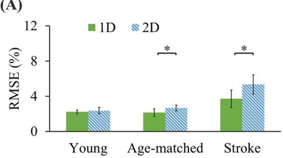

(B)  
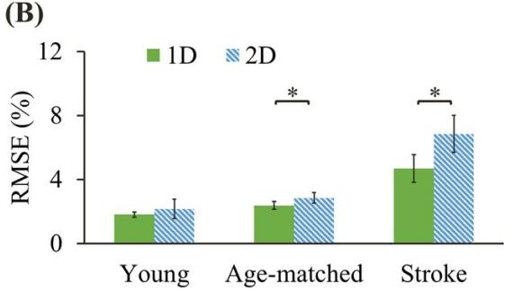  
Figure 2. 屈肘 (A) 和伸肘 (B) 期间各组在一维（1D）和二维（2D）MCI 中的平均 RMSE 值。星号表示同组内一维（1D）和二维（2D）MCI 之间经配对 t 检验存在显著性差异（$\textstyle P < 0 . 0 5$）。

Table 2. 三组在屈肘和伸肘过程中各视觉条件下的跟踪误差、肌肉激活度和皮层激活度。缩写：RMSE，均方根误差；EMG-MA，肌电最大振幅；∆HbO，氧合血红蛋白浓度变化；PFC，前额叶皮层；M1，初级运动皮层；1D，一维；2D，二维；SD，标准差。

<table><tr><td rowspan="2" colspan="3"></td><td colspan="2">青年受试者</td><td colspan="2">年龄匹配受试者</td><td colspan="2">脑卒中患者</td></tr><tr><td>均值</td><td>标准差</td><td>均值</td><td>标准差</td><td>均值</td><td>标准差</td></tr><tr><td rowspan="4">RMSE</td><td rowspan="2">1D</td><td>屈肘</td><td>2.23</td><td>0.22</td><td>2.14</td><td>0.43</td><td>3.71</td><td>1.00</td></tr><tr><td>伸肘</td><td>1.81</td><td>0.17</td><td>2.37</td><td>0.25</td><td>4.69</td><td>0.86</td></tr><tr><td rowspan="2">2D</td><td>屈肘</td><td>2.37</td><td>0.36</td><td>2.66</td><td>0.34</td><td>5.35</td><td>1.10</td></tr><tr><td>伸肘</td><td>2.16</td><td>0.60</td><td>2.85</td><td>0.34</td><td>6.84</td><td>1.16</td></tr><tr><td rowspan="4">主动肌激活度 (% EMG-MA)</td><td rowspan="2">1D</td><td>屈肘</td><td>0.05</td><td>0.01</td><td>0.07</td><td>0.02</td><td>0.08</td><td>0.02</td></tr><tr><td>伸肘</td><td>0.05</td><td>0.01</td><td>0.07</td><td>0.02</td><td>0.07</td><td>0.01</td></tr><tr><td rowspan="2">2D</td><td>屈肘</td><td>0.06</td><td>0.01</td><td>0.06</td><td>0.01</td><td>0.06</td><td>0.02</td></tr><tr><td>伸肘</td><td>0.05</td><td>0.01</td><td>0.06</td><td>0.02</td><td>0.07</td><td>0.02</td></tr><tr><td rowspan="4">主动肌激活度 (% EMG-MA)</td><td rowspan="2">1D</td><td>屈肘</td><td>0.05</td><td>0.01</td><td>0.06</td><td>0.01</td><td>0.07</td><td>0.02</td></tr><tr><td>伸肘</td><td>0.05</td><td>0.01</td><td>0.06</td><td>0.02</td><td>0.07</td><td>0.02</td></tr><tr><td rowspan="2">2D</td><td>屈肘</td><td>0.04</td><td>0.01</td><td>0.04</td><td>0.01</td><td>0.04</td><td>0.01</td></tr><tr><td>伸肘</td><td>0.03</td><td>0.01</td><td>0.04</td><td>0.02</td><td>0.04</td><td>0.01</td></tr><tr><td rowspan="4"> $\Delta HbO in PFC (\mu M l^{-1})$ </td><td rowspan="2">1D</td><td>屈肘</td><td>0.15</td><td>0.05</td><td>0.25</td><td>0.04</td><td>0.15</td><td>0.10</td></tr><tr><td>伸肘</td><td>0.18</td><td>0.06</td><td>0.21</td><td>0.02</td><td>0.13</td><td>0.10</td></tr><tr><td rowspan="2">2D</td><td>屈肘</td><td>0.34</td><td>0.06</td><td>0.33</td><td>0.04</td><td>0.28</td><td>0.19</td></tr><tr><td>伸肘</td><td>0.24</td><td>0.05</td><td>0.32</td><td>0.05</td><td>0.25</td><td>0.12</td></tr><tr><td rowspan="4"> $\Delta HbO in contralateral ml (\mu M l^{-1})$ </td><td rowspan="2">1D</td><td>屈肘</td><td>0.18</td><td>0.08</td><td>0.22</td><td>0.08</td><td>-0.10</td><td>0.17</td></tr><tr><td>伸肘</td><td>0.18</td><td>0.06</td><td>0.24</td><td>0.10</td><td>-0.03</td><td>0.24</td></tr><tr><td rowspan="2">2D</td><td>屈肘</td><td>0.31</td><td>0.07</td><td>0.33</td><td>0.04</td><td>0.28</td><td>0.12</td></tr><tr><td>伸肘</td><td>0.31</td><td>0.06</td><td>0.36</td><td>0.10</td><td>0.31</td><td>0.15</td></tr><tr><td rowspan="4"> $\Delta HbO in ipsilateral ml (\mu M l^{-1})$ </td><td rowspan="2">1D</td><td>屈肘</td><td>0.12</td><td>0.05</td><td>0.28</td><td>0.09</td><td>0.10</td><td>0.11</td></tr><tr><td>伸肘</td><td>0.11</td><td>0.05</td><td>0.23</td><td>0.06</td><td>0.13</td><td>0.11</td></tr><tr><td rowspan="2">2D</td><td>屈肘</td><td>0.25</td><td>0.05</td><td>0.33</td><td>0.05</td><td>0.32</td><td>0.17</td></tr><tr><td>伸肘</td><td>0.13</td><td>0.08</td><td>0.34</td><td>0.08</td><td>0.32</td><td>0.10</td></tr></table>

Figure 3 和 Table 2 展示了在各追踪条件下三组的主动肌和拮抗肌 RMS 值。关于主动肌激活，组别效应显著 $( p = 0 . 0 1 )$，但维度效应 $( p = 0 . 1 4 )$ 和方向效应 $\left( p = 0 . 5 8 \right)$ 均不显著。三个主因素之间的交互作用均不显著（组别 $\times$ 维度：$p = 0 . 3 6 ;$ 组别 $\times$ 方向：$\begin{array} { r } { p = 0 . 3 4 ; } \end{array}$ ；维度 $\times$ 方向：$ { p = 0 . 4 7 7 ; }$ 组别 $\times$ 维度 $\times$ 方向：$p \ = \ 0 . 2 8 )$。事后分析结果表明，为完成相同的追踪任务，年龄匹配受试者和脑卒中患者表现出比年轻受试者更高水平的主动肌激活（脑卒中患者对比年轻受试者：$\begin{array} { r } { p = 0 . 0 2 3 } \end{array}$，年龄匹配受试者对比年轻受试者：$\begin{array} { r } { p = 0 . 0 1 6 ) } \end{array}$。关于拮抗肌激活，三因素方差分析结果表明，组别 $( p = 0 . 0 0 3 )$ 和维度 $( p = 0 . 0 1 )$ 具有显著的主效应，而未发现显著的方向主效应 $( p = 0 . 3 7 )$。三个主因素之间的交互作用同样不显著（组别 $\times$ 维度：$p = 0 . 1 4 ;$ 组别 $\times$ 方向：$p = 0 . 3 1 ;$ 维度 $\times$ 方向：$p = 0 . 4 6 ;$ 组别 $\times$ 维度 $\times$ 方向：$p = 0 . 2 4 )$。根据两两比较的结果，与年轻受试者相比，脑卒中患者和年龄匹配受试者均具有更大的拮抗肌激活（脑卒中患者对比年轻受试者：$p = 0 . 0 3 2$，年龄匹配受试者对比年轻受试者：$p = 0 . 0 1 7 )$。各组在 2D 追踪期间的拮抗肌激活均显著低于 1D 追踪期间（年轻受试者：$p = 0 . 0 3 2$，年龄匹配受试者：$\mathnormal { p } = 0 . 0 4 1$，脑卒中患者：$\begin{array} { r } { p = 0 . 0 0 9 ) } \end{array}$。

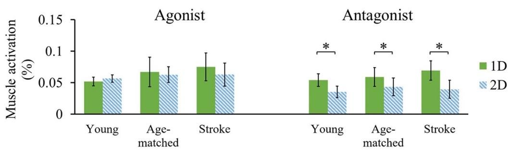

(A)  
(B)  

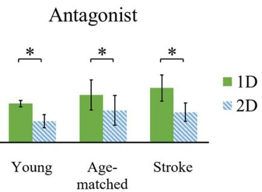  
Figure 3. 各组在肘屈 (A) 和肘伸 (B) 期间一维 (1D) 和二维 (2D) MCI 内主动肌和拮抗肌的平均 RMS 值。星号表示同一组内一维 (1D) 与二维 (2D) MCI 之间经配对 t 检验在 $\textstyle P < 0 . 0 5$ 水平上存在显著性差异。

为了便于分析三组之间的血流动力学信号，健康受试者的 LM1 与脑卒中患者的患侧 M1 合并为对侧 M1。同样，健康受试者的 RM1 与脑卒中患者的健侧 M1 合并为同侧 M1。Figure 4 和 Table 2 展示了在各追踪条件下三组受试者 PFC、对侧 M1 和同侧 M1 的血流动力学响应。方差分析（ANOVA）结果显示，在每个皮层区域均发现了显著的组别和维度主效应（组别：PFC，$p = 0 . 0 3 8 ;$ 同侧 M1，$p = 0 . 0 1 2 ;$ 对侧 M1，$p = 0 . 0 0 0 ;$ 维度：PFC，$p = 0 . 0 4 8 ;$ 同侧 M1，$\begin{array} { r } { p = 0 . 0 4 9 ; } \end{array}$ ; 对侧 M1，$p = 0 . 0 0 3 )$，而在各皮层区域均未观察到显著的方向效应（PFC，$p = 0 . 1 7 ;$ 同侧 M1，$p = 0 . 5 4 ;$ 对侧 M1，$p = 0 . 4 7 )$ 以及三向交互作用（全部 $ p > 0 . 0 5$）。两两比较显示，随着 MCI 维度的增加，各脑区均呈现出更高的激活，这一现象在青年受试者（PFC，$\begin{array} { r }  p = 0 . 0 3 2 \ \end{array}$ ; 同侧 M1，$\begin{array} { r } { p = 0 . 0 4 2 ; } \end{array}$ 对侧 M1，$p = 0 . 0 2 )$、年龄匹配受试者（PFC，$p = 0 . 0 2 1 ;$ 同侧 M1，$p = 0 . 0 6 1 ;$ 对侧 M1，$ { p } =  { 0 . 0 4 6 } )$ 和脑卒中患者（PFC，$p = 0 . 0 3 6 ;$ 同侧 M1，$p = 0 . 0 0 9 ;$ 对侧 M1，$p = 0 . 0 0 4 )$ ）中均被观察到。此外，脑卒中患者的 PFC 和对侧 M1 兴奋性低于健康受试者。但这些显著差异仅在 1D MCI 中存在，这表明维度的增加可以改善脑卒中患者 PFC 和对侧 M1 的激活。对于同侧 M1，在各个 MCI 条件下，年龄匹配受试者均表现出显著高于青年受试者的兴奋性，而在 2D MCI 条件下，脑卒中患者的兴奋性显著强于青年受试者。与年龄匹配受试者相比，脑卒中患者在各个 MCI 条件下的激活程度均较低，但差异无统计学意义。

3.2. 训练测试中 MCI 的治疗效果 由于中风患者在整个训练测试中表现良好，这使我们能够对训练前与训练后进行有意义的比较，以研究其对中风后肌间协调的治疗效果。中风患者从训练前到训练后的追踪误差、肌肉激活度和皮层激活度的变化分别如图 5–7 所示，各指标从训练前到训练后的变化汇总于表 3 中。在图 5 中，患者在训练后的追踪误差显著低于训练前 $( p \ : = \ : 0 . 0 0 4 )$ ，这表明中风患者在训练测试后追踪表现有所改善。在图 6 中，患者患侧上肢的主动肌和拮抗肌激活度也显著下降（主动肌： $p = 0 . 0 0 1$ ；拮抗肌： $\textstyle p = 0 . 0 5 )$ 。同时，中风患者仍能根据拮抗肌的附加视觉生物反馈抑制拮抗肌的激活。在图 7 中，训练后 PFC 和对侧 M1 出现了显著更高的激活（PFC：p = 0.016；对侧 M1： $p = 0 . 0 1 5 )$ ，而对同侧 M1 的激活没有显著影响（同侧 M1： $p = 0 . 1 4 5 )$ 。临床评估分数的增加表明中风患者训练后患侧上肢的运动功能改善了 16.67%–29.16%（训练前：UE-FMA = 24；训练中期：UE-FMA = 28；训练后：UE-$\mathrm { F M A } = 3 1 )$ 。

(A)  

(B)  
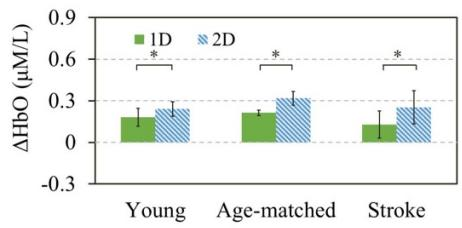

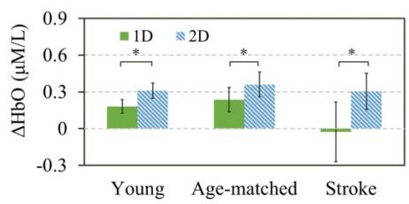

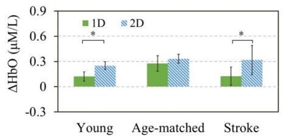

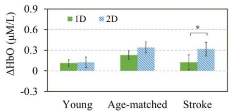  
Figure 4. 肘关节屈曲 (A) 和伸展 (B) 期间各组在一维 (1D) 和二维 (2D) MCI 内 PFC、对侧 M1 和同侧 M1 的平均 ∆HbO 值。星号表示同一组内一维 (1D) 和二维 (2D) MCI 之间配对 t 检验在 p < 0.05 水平具有显著差异。

## 4. 讨论

本研究旨在利用 EMG 和 fNIRS 信号，探讨 MCI 维度对脑卒中患者肌间协调和皮层激活模式的短期与长期影响。研究有两项重要发现：与 1D MCI 相比，所检测皮层区域的更高激活以及拮抗肌更低激活的证据表明，2D MCI 能够改变皮层激活模式，从而有效调节脑卒中患者主动肌与拮抗肌的协调；此外，训练测试的结果表明，脑卒中患者可以通过 2D MCI 进行训练以恢复肌间协调，这可归因于患者在训练后皮层激活模式和肌肉激活的渐进性正常化。

## 4.1. Influence of MCI dimensionality on the performance and control of coordination

与 1D MCI 相比，在 2D MCI 下各组的拮抗肌激活均明显降低，这表明所有受试者在 2D MCI 下均成功实现了主动肌与拮抗肌的解耦。这一发现与先前的研究一致，先前的研究也表明患者可以通过接收每块肌肉的视觉生物反馈来感知协同收缩，并减少 BIC 和 TRI 之间的异常共同激活 [12, 15]。2D MCI 的主要贡献在于提供了拮抗肌的额外视觉生物反馈，以帮助脑卒中患者意识到拮抗肌的激活，调节主动肌-拮抗肌的激活，并提高其

Table 3. 脑卒中患者通过肌间训练的变化情况。缩写：RMSE，均方根误差（root mean square error）；EMG-MA，EMG 最大振幅（EMG maximal amplitude）；∆HbO，氧合血红蛋白浓度变化（the change in the concentration of oxy-hemoglobin）；PFC，前额叶皮层（prefrontal cortex）；M1，初级运动皮层（primary motor cortex）；SD，标准差（standard deviation）。

<table><tr><td rowspan="2" colspan="2"></td><td colspan="2">训练前</td><td colspan="2">训练中</td><td colspan="2">训练后</td></tr><tr><td>均值</td><td>标准差</td><td>均值</td><td>标准差</td><td>均值</td><td>标准差</td></tr><tr><td rowspan="2">RMSE</td><td>屈肘</td><td>7.86</td><td>2.10</td><td>6.68</td><td>2.66</td><td>4.48</td><td>2.04</td></tr><tr><td>伸肘</td><td>7.78</td><td>2.07</td><td>6.08</td><td>3.06</td><td>5.47</td><td>2.05</td></tr><tr><td rowspan="2">主动肌激活度(% EMG-MA)</td><td>屈肘</td><td>0.09</td><td>0.03</td><td>0.08</td><td>0.02</td><td>0.06</td><td>0.03</td></tr><tr><td>伸肘</td><td>0.08</td><td>0.04</td><td>0.06</td><td>0.04</td><td>0.05</td><td>0.03</td></tr><tr><td rowspan="2">主动肌激活度(% EMG-MA)</td><td>屈肘</td><td>0.05</td><td>0.02</td><td>0.04</td><td>0.01</td><td>0.02</td><td>0.01</td></tr><tr><td>伸肘</td><td>0.05</td><td>0.02</td><td>0.04</td><td>0.02</td><td>0.03</td><td>0.01</td></tr><tr><td rowspan="2">PFC 中的 ΔHbO μM l-1</td><td>屈肘</td><td>0.21</td><td>0.10</td><td>0.46</td><td>0.08</td><td>0.35</td><td>0.09</td></tr><tr><td>伸肘</td><td>0.15</td><td>0.09</td><td>0.58</td><td>0.24</td><td>0.43</td><td>0.15</td></tr><tr><td rowspan="2">对侧 M1 中的 ΔHbO μM l-1</td><td>屈肘</td><td>0.03</td><td>0.07</td><td>0.23</td><td>0.15</td><td>0.18</td><td>0.09</td></tr><tr><td>伸肘</td><td>0.12</td><td>0.24</td><td>0.35</td><td>0.15</td><td>0.32</td><td>0.23</td></tr><tr><td rowspan="2">同侧 M1 中的 ΔHbO μM l-1</td><td>屈肘</td><td>0.32</td><td>0.22</td><td>0.27</td><td>0.18</td><td>0.24</td><td>0.12</td></tr><tr><td>伸肘</td><td>0.38</td><td>0.27</td><td>0.32</td><td>0.20</td><td>0.30</td><td>0.13</td></tr></table>

(A)  
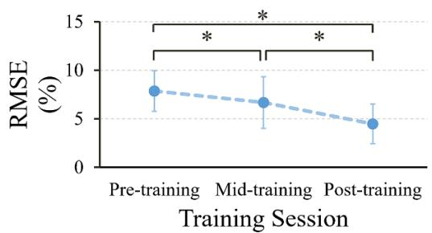

(B)  
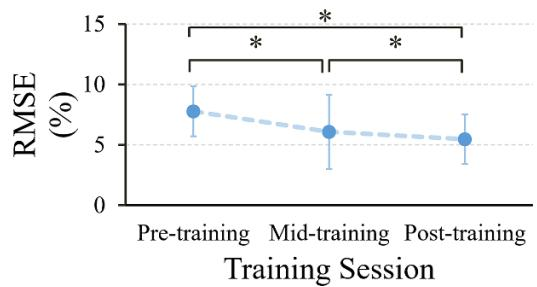  
Figure 5. 屈肘 (A) 和伸肘 (B) 过程中从训练前到训练后的跟踪误差变化。星号表示两个不同阶段之间配对 t 检验在 p < 0.05 水平具有显著性差异。

协调其主动肌-拮抗肌。此外，与 1D MCI 相比，在年龄匹配组和患者组中，2D MCI 也表现出更大的追踪误差。这可能是由于随着 MCI 维度的增加导致任务复杂度提高所致，因为受试者在 2D MCI 中需要同时关注主动肌和拮抗肌的视觉生物反馈。这一发现与先前的研究一致，该研究发现脑卒中患者随着追踪速度增加引起任务难度提高，其追踪误差也随之增大 [32]。人体运动是肌肉产生力量的结果 [33]，而肌肉受到来自运动相关皮层的皮质下行投射的控制 [34]。在本研究中，2D MCI 下脑卒中患者拮抗肌激活的抑制可能是由于额外的视觉生物反馈引起了认知负荷增加，进而导致皮层激活发生改变。有研究提出，额外的认知负荷和不断增加的难度都会导致健康受试者和脑卒中患者的 PFC（前额叶皮层）激活增加 [35–37]。此外，与简单运动任务相比，健康受试者和脑卒中患者在执行复杂运动任务时，对侧 M1 区表现出更强的激活 [37, 38]。这些先前研究的发现与本研究的结果一致，即在所有组别中，2D MCI 均表现出 PFC 和对侧 M1 激活的增加，并表明拮抗肌的额外视觉生物反馈很可能会影响皮层激活 [39]。皮层激活改变的另一种解释可能归因于 2D MCI 诱发的抑制功能。受试者在 2D 任务中被要求有意识地抑制拮抗肌激活，这可能会激活皮层抑制回路。有研究表明，抑制性控制信号可能是 PFC 和 M1 之间自上而下的控制信号之一 [40, 41]。PFC 可能与产生运动抑制相关，而 M1 很可能是该抑制的目标靶点之一。因此，我们推测当 M1 接收到来自 PFC 抑制控制的特定调节时，M1 中运动神经元的放电特性可能会发生改变，抑制信号将从 M1 下行至拮抗肌的运动神经元 [42]。在这一过程中，PFC 和 M1 的神经募集增加是已知的 [43, 44]，这与本研究的发现是一致的。

(A)  
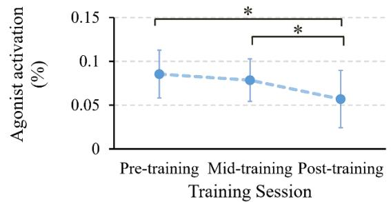

(B)  
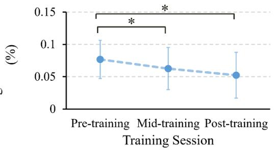

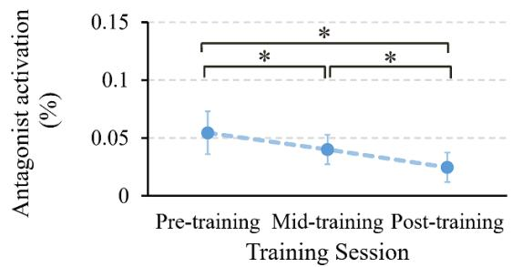

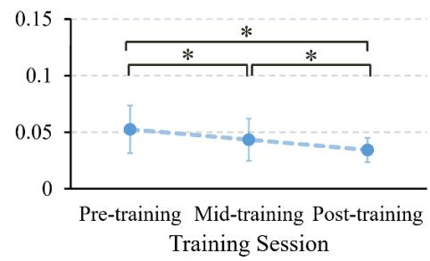  
Figure 6. 肘屈（A）和肘伸（B）期间归一化主动肌与拮抗肌激活从训练前到训练后的变化。星号表示两个不同阶段之间配对 t 检验在 $p < 0.05$ 时的显著性差异。

(A)  
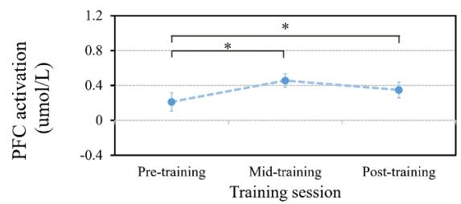

(B)  
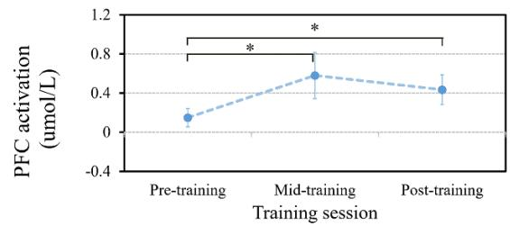

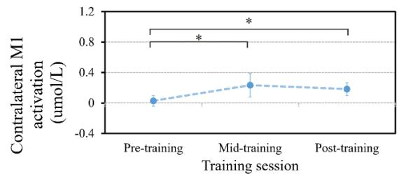

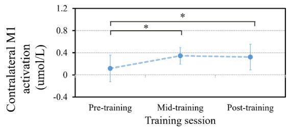

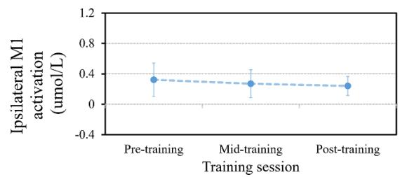

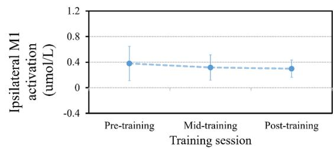  
Figure 7. 肘屈（A）和肘伸（B）期间各皮层区域皮层激活从训练前到训练后的变化。星号表示两个不同阶段之间配对 t 检验在 $p < 0.05$ 时的显著性差异。

与年轻受试者相比，脑卒中患者在每个 MCI 内表现出更高强度的肌电主动肌和拮抗肌激活，这可能与年龄相关的肌肉退化或脑卒中后的肌肉过度激活有关 [45, 46]。不恰当的肌间协调可能是导致脑卒中患者跟踪误差最大的原因，这可能与脑卒中后运动相关脑区的损伤有关 [47]。在每个 MCI 内，脑卒中患者 PFC 和对侧 M1 的激活降低，表明脑卒中后的运动功能缺陷可能与皮层激活减弱相关 [48]。在本研究中，在执行相同任务时，与年轻受试者相比，脑卒中患者在同侧 M1 中也表现出更高的激活水平。脑卒中患者同侧 M1 激活增高有两种可能的解释。其一是年龄引起的影响。由于 M1 区神经元丢失导致运动功能衰退是衰老的常见后果 [49]，老年受试者会招募同侧 M1 中的额外神经元进行代偿以维持功能 [50]。另一种解释是脑卒中后的神经变化。同侧 M1 的激活在脑卒中患者的运动恢复中发挥着重要作用 [51]。我们可以假设，同侧 M1 激活的增加可能反映了一种代偿策略，以抵消脑卒中后对侧 M1 的神经损伤，这与先前在未接受治疗的脑卒中患者中观察到激活向同侧 M1 转移的研究结果一致 [52]。

## 4.2. 肌肉间协调训练对肌肉间协调的影响

尽管许多康复训练能够改善卒中患者的运动功能，但鲜有训练针对肌间协调。众所周知，卒中后主动肌-拮抗肌的不协调归因于拮抗肌抑制受损导致的拮抗肌激活增加 [53]。在抑制控制受损后，卒中患者失去了放松拮抗肌的能力，从而导致运动单位募集增加以及拮抗肌放电行为发生改变 [54, 55]。这种不当的拮抗肌激活可能会导致卒中患者产生更大的跟踪误差和能量消耗。该单个案纵向研究的结果显示，从训练前到训练后，跟踪误差和肌肉激活均有所减少，这表明肌间协调训练可能对恢复卒中患者的肌间协调产生长期的积极效果。先前的一项研究也表明，卒中患者在接受基于 MCI 的训练后，能够快速学会调节目标肌肉的激活，并在运动功能上表现出长期改善 [15]，这与本研究的结果一致。此外，卒中患者在肌间协调训练中获得的主动肌-拮抗肌协调能力可能独立于特定任务，并能够迁移到新任务或新环境中 [16, 56]。通过将卒中患者在三个评估阶段中的拮抗肌激活和皮层激活与健康对照组进行比较，我们还发现训练后的肌肉表现和皮层参与程度与健康人群更为相似，这可能意味着卒中患者正逐步向正常状态转变。

训练后 PFC 和双侧 M1 激活程度的增加，可解释为逐步使皮层激活正常化并代偿脑卒中所致损伤的皮层可塑性 [57, 58]。亦有研究表明，皮层激活的增加是脑卒中患者恢复肌间协调相关的高效机制运作的一种表现 [59]。双侧 M1 在训练后表现出不同的趋势：对侧激活增加而同侧激活减少，这一发现与先前的研究一致，即训练可能诱导神经募集从同侧大脑半球向对侧大脑半球转移 [60, 61]。另一方面，我们推测肌间协调训练可能会影响脑卒中患者 PFC 的激活。Qi 等人已经证实，认知任务的学习与执行可改变 PFC 中的神经元放电 [62]。脑卒中患者在学习运动任务时可能依赖于增加 PFC 的激活来执行任务 [63]，这可能反映了对其认知需求的增加 [64]。这些发现或许可以解释训练后 PFC 激活增加的现象。此外，考虑到 PFC 对抑制控制的贡献，脑卒中患者在训练后能够熟练地解耦异常共激活的肌肉，这可能意味着患者增加了 PFC 中神经通路的募集，以改善对拮抗肌的抑制控制。

因此，肌间协调训练可以促进脑卒中患者的皮层重组，并重新获得协调主动肌-拮抗肌的能力。这些改善具有长期有效性且独立于具体任务。肌间协调训练在临床上恢复肌间协调和改善精细运动控制方面可能发挥重要作用。

## 5. 结论

本研究的目的是探讨 MCI（肌电-计算机接口）维度对中风患者肌间协调和皮层激活模式的短期与长期影响。2D MCI 可以通过同时激活主动肌和抑制拮抗肌，帮助中风患者改善主动肌-拮抗肌的协调性。这一过程与中风患者 PFC（前额叶皮层）和 M1（初级运动皮层）激活程度的增加相关。在进行肌间协调训练后，中风患者表现出主动肌-拮抗肌协调性的显著恢复，并伴有皮层重组。2D MCI 被认为是一种有效的训练方法，可促进中风患者肌间协调和皮层重组的进一步恢复。未来的工作需要通过提高肌肉激活水平来验证该横断面研究的普适性。此外，该纵向研究是一项针对单例患者的初步研究。尽管训练测试中的发现很有前景，但未来应在中风患者大样本中开展工作，以确保肌间协调训练的有效性。

## 致谢

感谢 Xianyi Zhang、Liuke Liang、Xianming Li 和 Xiaolu Wang 在本研究过程中给予的重要帮助、建议和审校。本工作得到了广东省科技计划项目（项目编号：2015B020214003、2017B010110015 和 2017B020210011）、广州市科技计划项目（项目编号：201604020108）以及深圳市科技计划项目（项目编号：JCYJ20170818155028942）的部分资助。

## 利益冲突

所有作者声明就本研究的署名和/或发表不存在潜在的利益冲突。

## ORCID iD

Rong Song  https://orcid.org/0000-0003-3662- 116X

## 参考文献

[1] Wade D T, Langton-Hewer R, Wood V A, Skilbeck C E and Ismail H M 1983 The hemiplegic arm after stroke: measurement and recovery J. Neurol. Neurosurg. Psychiatr. 46 521–4

[2] Bourbonnais D and Vanden N S 1989 Weakness in patients with hemiparesis Am. J. Occup. Ther. 43 313–9

[3] Levin M F 1996 Interjoint coordination during pointing movements is disrupted in spastic hemiparesis Brain 119 281–93

[4] Tropea P, Monaco V, Coscia M, Posteraro F and Micera S 2013 Effects of early and intensive neuro-rehabilitative treatment on muscle synergies in acute post-stroke patients: a pilot study J. Neuroeng. Rehabil. 10 103

[5] Lum P S, Patten C, Kothari D and Yap R 2004 Effects of velocity on maximal torque production in poststroke hemiparesis Muscle Nerve 30 732–42

[6] Takahashi C D, Der-Yeghiaian L, Le V, Motiwala R R and Cramer S C 2008 Robot-based hand motor therapy after stroke Brain 131 425–37

[7] Teasell R W and Kalra L 2004 What’s new in stroke rehabilitation Stroke 35 383–5

[8] Cancel N, Fischer M, Gulotta L, Koo J Y and McKittrick S 2014 中等强度有氧运动对精细运动控制的影响尚无定论

[9] Board ADAME 2013 精细运动控制 U.S. National Library of Medicine: A.D.A.M.

[10] Yang Y, Chen Y, Chang H, Chan R, Wei S and Wang R 2015 交互式视觉反馈训练对脑卒中后推挤综合征的影响：一项先导性随机对照研究 Clin. Rehabil. 29 987–93

[11] Rose D J and Christina R W 2006 运动控制与学习的多层次研究方法 (Reading, MA: Addison-Wesley)

[12] Young S J, Van Doornik J and Sanger T D 2011 视觉反馈可减少肌张力障碍患儿的肌肉协同收缩 J. Child Neurol. 26 37–43

[13] Luo J, Sun W, Wu Y, Liu H, Wang X, Yan T and Song R 2018 基于肌电控制接口对脑卒中患者、健康中老年人及青年对照组的主动肌与拮抗肌协调性表征 J. Neural. Eng. 15 056015

[14] Ellis M D, Holubar B G, Acosta A M, Beer R F and Dewald J P A 2005 脑卒中后异常等长肘肩关节力矩耦合的可调控性 Muscle Nerve 32 170–8

[15] Wright Z A, Rymer W Z and Slutzky M W 2013 使用肌电-计算机接口减少脑卒中后异常肌肉共激活：一项先导研究 Neurorehabil. Neural Repair 28 443–51

[16] Mugler E M et al 2019 用于减少慢性脑卒中康复者肌肉共激活并增强手臂运动的肌电计算机接口训练：一项随机试验 Neurorehabil. Neural Repair 33 284–95

[17] Bradnam L V, Stinear C M, Lewis G N and Byblow W D 2010 初级运动皮层经颅直流电刺激后近端上肢输入的任务依赖性调制 J. Neurophysiol. 103 2382–9

[18] Lemon R N 2007 运动控制中的下行通路 Annu. Rev. Neurosci. 31 195–218

[19] Heidi J B, Helen D, Claire G, Smith S M, Wade D T and Matthews P M 2002 康复治疗后运动功能改善与fMRI活动改变之间的相关性 Brain 125 2731–42

[20] Calautti C, Naccarato M, Jones P S, Sharma N, Day D D, Carpenter A T, Bullmore E T, Warburton E A and Baron J-C 2007 脑卒中后运动功能缺损与半球激活平衡之间的关系：一项3T fMRI研究 NeuroImage 34 322–31

[21] Ward N S, Brown M M, Thompson A J and Frackowiak R S J 2003 脑卒中后结局的神经相关性：一项横断面fMRI研究 Brain 126 1430–48

[22] Irani F, Platek S M, Bunce S, Ruocco A C and Chute D 2007 功能性近红外光谱技术（fNIRS）：一种在脑部疾病研究中具有重要应用的新兴神经影像技术 Clin. Neuropsychol. 21 9–37

[23] Kamran M A and Hong K S 2013 用于检测神经元活动的线性参数变化模型与自适应滤波技术：一项fNIRS研究 J. Neural. Eng. 10 056002

[24] Paolo B A, Onur K H, Ahmet O and Bin H 2016 Hybrid EEG-fNIRS asynchronous brain-computer interface for multiple motor tasks PLoS One 11 e0146610

[25] Matsuzaki S, Morihiro M, Tsubone T and Wada Y 2010 Brain activation during finger tapping and circle-drawing tasks measured by functional near-infrared spectroscop (fNIRS) Neurosci. Res. 68 e442–e43

[26] Leff D R, Orihuela-Espina F, Elwell C E, Athanasiou T, Delpy D T, Darzi A W and Yang G-Z 2011 Assessment of the cerebral cortex during motor task behaviours in adults: a systematic review of functional near infrared spectroscopy (fNIRS) studies Neuroimage 54 2922–36

[27] Lin P Y, Chen J J J and Lin S I 2013 The cortical control of cycling exercise in stroke patients: an fNIRS study Hum. Brain Mapp. 34 2381–90

[28] GoldmanRakic P S 1987 Motor control function of the prefrontal cortex Ciba Foundation Symp. vol 132 (Wiley)

[29] Fallgatter A J, Susanne J, Bartsch A J, Bernhard H and Peter L K 1999 Serotonin transporter promoter polymorphism influences topography of inhibitory motor control Int. J. Neuropsychopharmacol. 2 115–20

[30] Carey J R, Greer K R, Grunewald T K, Steele J L, Wiemiller J W, Bhatt E, Nagpal A, Lungu O and Auerbach E J 2006 Primary motor area activation during precision-demanding versus simple finger movement Neurorehabil. Neural Repair 20 361–70

[31] Jian C, Deng L, Liang L, Luo J, Wang X and Song R 2020 Neuromuscular control of the agonist—antagonist muscle

coordination affected by visual dimension: an EMG-fNIRS study IEEE Access 8 100768–77

[32] Ju M, Lin C K, Chen J, Cheng H and Lin C 2002 Performance of elbow tracking under constant torque disturbance in normotonic stroke patients and normal subjects Clin. Biomech. 17 640–9

[33] Yoshitake Y 2014 Relation between motor unit/muscle activity and fine motor performance J. Phys. Fitness Sports Med. 3 283–90

[34] Shenoy K V, Sahani M and Churchland M M 2013 Cortical control of arm movements: a dynamical systems perspective Annu. Rev. Neurosci. 36 337–59

[35] Daan M, Emad A Y, Helen D, Penny M F and Carmen P 2014 Associations between prefrontal cortex activation and H-reflex modulation during dual task gait Front. Hum. Neurosci. 8 78

[36] Seidler R D, Bernard J A, Burutolu T B, Fling B W, Gordon M T, Gwin J T, Kwak Y and Lipps D B 2010 Motor control and aging: links to age-related brain structural, functional, and biochemical effects Neurosci. Biobehav. Rev. 34 721–33

[37] Puh U K, Vovk A, Sevšek F and DA S 2007 Increased cognitive load during simple and complex motor tasks in acute stage after stroke Int. J. Psychophysiol. 63 0–180

[38] Tinazzi M, Farina S, Tamburin S, Facchini S, Fiaschi A, Restivo D and Berardelli A 2003 Task-dependent modulation of excitatory and inhibitory functions within the human primary motor cortex Exp. Brain Res. 150 222–9

[39] Stein B E 1998 Neural mechanisms for synthesizing sensory information and producing adaptive behaviors Exp. Brain Res. 123 124–35

[40] Ridderinkhof K R, Wildenberg W P M V D, Segalowitz S J and Carter C S 2004 认知控制的神经认知机制：前额叶皮层在动作选择、反应抑制、表现监控以及基于奖励的学习中的作用 Brain Cogn. 56 129–40

[41] Narayanan N S and Laubach M 2007 背内侧前额叶皮层对运动皮层细胞群的自上而下控制 Neuron 52 921–31

[42] Yang H D, Minn Y K, Son I H and Suk S H 2006 想象拇指外展所引起的易化与交互抑制 J. Clin. Neurosci. 13 245–8

[43] Maso F D, Longcamp M and Amarantini D 2012 与训练相关的拮抗肌激活减少伴随着运动皮层激活增加：拮抗肌控制中枢机制的证据 Exp. Brain Res, 220 287–95

[44] Matthias L, Inga P, Elinor T and Kraemer U M 2017 前瞻性与反应性运动抑制的时间动力学 Front. Hum. Neurosci. 11 204

[45] Kamper D G and Rymer W Z 2010 卒中后手指自主运动控制受损：不当肌肉共激活的作用 Muscle Nerve 24 673–81

[46] Naik S K, Patten C, Lodha N, Coombes S A and Cauraugh J H 2011 慢性期脑卒中的力量控制缺陷：握持形成和释放阶段 Exp. Brain Res. 211 1–15

[47] Tang Q et al 2015 卒中患者运动功能康复中运动相关区域半球间激活平衡的调节：fMRI 研究的系统评价与荟萃分析 Neurosci. Biobehav. Rev. 57 392–400

[48] Promjunyakul N 2012 卒中后人群踩踏踏板相关的大脑激活：一项 fMRI 研究 Dissertations and Theses—Gradworks

[49] Ward N S 2006 老化运动系统中的代偿机制 Ageing Res. Rev. 5 239–54

[50] Zimerman M, Liuzzi G P, Heise K, Nitsch M, Cohen L G, Gerloff C and Hummel F C 2009 老年人运动序列学习过程中同侧运动皮层的功能相关性 Aktuelle Neurol. 36 S02 437

[51] Cramer S C, Nelles G, Benson R R, Kaplan J D, Parker R A, Kwong K K, Kennedy D N, Finklestein S P and Rosen B R 1997 偏瘫卒中恢复期受试者的功能性磁共振成像（fMRI）研究 Stroke 28 2518–27

[52] Michielsen M E, Selles R W, Geest J N V D, Eckhardt M and Bussmann J B J 2010 慢性期脑卒中患者镜像治疗后的运动功能恢复与皮层重组：一项 II 期随机对照试验 Neurorehabil. Neural Repair 25 223–33

[53] Hufschmidt A and Mauritz K H 1985 痉挛状态下肌肉的慢性转化：外周因素对肌张力增加的贡献 J. Neurol. Neurosurg. Psychiatr. 48 676–85

[54] Blaschak M J, Powers R K and Rymer W Z 1988 猫急性脊髓背侧半切后后肢肌肉运动输出的紊乱 Exp. Brain Res. 71 377–87

[55] Powers R K and Rymer W Z 1988 急性脊髓背侧半切对去大脑猫腓肠肌内侧头运动神经元放电的影响 J. Neurophysiol. 59 1540–56

[56] Schmidt R A and Lee T D 1999 Motor Control and Learning: A Behavioral Emphasis 3rd edn (Champaign, IL: Human Kinetics)

[57] Nudo R J and Friel K M 1999 Cortical plasticity after stroke: implications for rehabilitation Rev. Neurol. 155 713–7

[58] Brauer S G, Barker R N and Carson R G 2006 Training-induced brain plasticity in stroke survivors wit severe and chronic upper limb paresis as revealed with TMS Society for Neuroscience Annual Meeting (Atlanta)

[59] Nudo R J 2007 Postinfarct cortical plasticity and behavioral recovery Stroke 38 840–5

[60] Carey J R, Kimberley T J, Lewis S M, Auerbach E J, Dorsey L, Rundquist P and Ugurbil K 2002 Analysis of fMRI and finger tracking training in subjects with chronic stroke Brain 125 773–88

[61] Liepert J, Bauder H, Miltner W H R, Taub E and Weiller C 2000 Treatment-induced cortical reorganization after stroke in humans Stroke 31,1210–6

[62] Qi X L and Constantinidis C 2012 Correlated discharges in the primate prefrontal cortex before and after working memory training Eur. J. Neurosci. 36 3538–48

[63] Dennis A, Bosnell R, Dawes H, Howells K, Cockburn J, Kischka U, Matthews P and Johansen-Berg H 2011 Cognitive context determines premotor and prefrontal brain activity during hand movement in patients after stroke Stroke 42 1056

[64] Sharma N, Simmons L H, Jones P S, Day D J, Carpenter T A, Pomeroy V M, Warburton E A and Baron J-C 2009 Motor imagery after subcortical stroke: a functional magnetic resonance imaging study Stroke 40 1315–24