<!-- 本文件是 MinerU 自动抽取的**英文结构化正文**，不是中文翻译。 -->
<!-- 中文翻译若需要，须另走 06_附录/pdf2zh调用脚本/translate_all.py，不得把本文件当译文引用。 -->
<!-- 抽取来源：01_参考论文/整合系统/宋嵘_双参与与肌间耦合/Jian2021-JNeuralEng：肌电控制接口调节下卒中皮层-运动系统多层信息传递的改变/Jian2021-JNeuralEng：肌电控制接口调节下卒中皮层-运动系统多层信息传递的改变.pdf -->
<!-- DOI：10.1088/1741-2552/ac18ae -->
<!-- 图片：29 张，位于同级 images/，已按正文引用相对路径改写。 -->

ACCEPTED MANUSCRIPT

# Stroke-induced alteration in multi-layer information transmission of cortico-motor system during elbow isometric contraction modulated by myoelectric-controlled interfaces

To cite this article before publication: Chuyao Jian et al 2021 J. Neural Eng. in press https://doi.org/10.1088/1741-2552/ac18ae

## Manuscript version: Accepted Manuscript

Accepted Manuscript is “the version of the article accepted for publication including all changes made as a result of the peer review process and which may also include the addition to the article by IOP Publishing of a header, an article ID, a cover sheet and/or an ‘Accepted Manuscript’ watermark, but excluding any other editing, typesetting or other changes made by IOP Publishing and/or its licensors”

This Accepted Manuscript is © 2021 IOP Publishing Ltd.

During the embargo period (the 12 month period from the publication of the Version of Record of this article), the Accepted Manuscript is fully protected by copyright and cannot be reused or reposted elsewhere.   
As the Version of Record of this article is going to be / has been published on a subscription basis, this Accepted Manuscript is available for reuse under a CC BY-NC-ND 3.0 licence after the 12 month embargo period.

After the embargo period, everyone is permitted to use copy and redistribute this article for non-commercial purposes only, provided that they adhere to all the terms of the licence https://creativecommons.org/licences/by-nc-nd/3.0

Although reasonable endeavours have been taken to obtain all necessary permissions from third parties to include their copyrighted content within this article, their full citation and copyright line may not be present in this Accepted Manuscript version. Before using any content from this article, please refer to the Version of Record on IOPscience once published for full citation and copyright details, as permissions will likely be required. All third party content is fully copyright protected, unless specifically stated otherwise in the figure caption in the Version of Record.

View the article online for updates and enhancements.

# Stroke-induced Alteration in Multi-layer Information Transmission of Cortico-motor System During Elbow Isometric Contraction Modulated by Myoelectric-controlled Interfaces

Chuyao Jian1, 4, #, Huihua Liu2, #, Linchuan Deng1, 4, Xiaoyun Wang3, Tiebin Yan2, \* and Rong Song1, 4, \*

1 Key Laboratory of Sensing Technology and Biomedical Instrument of Guangdong Province, School of Biomedical Engineering, Sun Yat-sen University, Guangzhou 510275, China

2 Sun Yat-sen Memorial Hospital, Sun Yat-sen University, Guangzhou 510120, China

3 Guangdong Work Injury Rehabilitation Center, Guangzhou 510440, China

4 Shenzhen Research Institute of Sun Yat-sen University, Shenzhen 518057, China # Co-first authors.

\* Corresponding author.

E-mail: songrong@mail.sysu.edu.cn

## Abstract

Human movement is a complex process requiring information transmission in inter-cortical, cortico-muscular and inter-muscular networks. Though motor deficits after stroke are associated with impaired networks in the cortico-motor system, the mechanisms underlying these networks are to date not fully understood. The purpose of this study is to investigate the changes in information transmission of the inter-cortical, cortico-muscular and inter-muscular networks after stroke and the effect of myoelectric-controlled interface (MCI) dimensionality on such information transmission in each network. Fifteen healthy control subjects and eleven post-stroke patients were recruited to perform elbow tracking tasks within different dimensional MCIs in this study. Their electromyographic (EMG) and functional near infrared spectroscopy (fNIRS) signals were recorded simultaneously. Transfer entropy (TE) was used to analyse the functional connection that represented the information transmission in each network based on the fNIRS and EMG signals. The results found that post-stroke patients showed the increased inter-cortical connection versus healthy control subjects, which might be attributed to cortical reorganization to compensate for motor deficits. Compared to healthy control subjects, a lower strength cortico-muscular connection was found in post-stroke patients due to the reduction of information transmission following a stroke. Moreover, the increased MCI dimensionality strengthened inter-cortical, cortico-muscular and intermuscular connections because of higher visual information processing demands. These findings not only provide a comprehensive overview to evaluate changes in the cortico-motor system due to stroke, but also suggest that increased MCI dimensionality may serve as a useful rehabilitation tool for boosting information transmission in the cortico-motor system of post-stroke patients.

Keywords: Stroke, visual dimension, motor control, cortico-motor system, transfer entropy

## 1. Introduction

Human movement is a complex task that requires ongoing interactions between the brain and muscles. The control of movement depends on information transmission in the intercortical, cortico-muscular and inter-muscular networks of the cortico-motor system. The information transmission between cortical areas plays a crucial role in generating and sending motor commands related to initiating and adjusting movement [1]. The commands are carried to the motor neurons of targeted muscles along the cortico-muscular pathway [2], and peripheral information including afferent feedback of muscle contraction, is conducted along the cortico-muscular pathway to the cortex for the purposes of motor command regulation [3]. After receiving the motor command, the targeted muscles coordinate with each other and contract to generate movement.

Post-stroke patients usually suffer from motor deficits in the upper limbs [4]. This is presumably due to impairments of the cortico-motor system [5]. The brain injury after stroke will cause impaired cortical neurons and neural pathways [6], and this results in the disruption or reduction of information transmission between the connected cortical areas [7-9]. A previous study has reported increased coupling between taskrelated cortical areas in post-stroke patients during grip tasks [10]. The information transmission between cortical areas in the affected hemisphere was diminished in the acute poststroke patients but enhanced in the well-recovered post-stroke patients [11]. As cortical commands are mainly generated by the inter-cortical network, the impairment of information transmission between cortical areas may contribute to a reduction in the transmission of descending information in post-stroke patients. Moreover, the disruption of the corticomuscular conduction pathways after stroke also results in a loss of information transmission in the cortico-muscular network [12, 13]. Specifically, weakened cortico-muscular coupling between cortical areas in the affected hemisphere and the muscles in the upper limbs was found in post-stroke patients [14-16]. Poor muscle coordination might also be caused by impaired inter-muscular connections and the decreased capacity for information transmission between the targeted muscles [8].

The cortex can employ visual feedback to control and regulate movement. There is strong evidence to support the fact that visual feedback can restore brain function and enhance motor function control in post-stroke patients [17, 18]. This is related to the influence of visual feedback on information processing between motor-related cortical areas and on motor unit coherence between the targeted muscles [19]. Previous studies have converged to propose that visual feedback is an effective way to change the information transmission in the cortico-motor system. Myoelectriccontrolled interface (MCI) is a specific visual feedback, which can provide real-time information about the electromyography (EMG) signals of the targeted muscles. Recent studies have suggested that MCI can improve abnormal muscle coactivation patterns in post-stroke patients [20, 21] and in patients suffering dystonia [22]. The abnormal muscle coactivation patterns displayed in patients might be related to the poor communication between the targeted muscles, which is attributed to impaired information transmission in the intermuscular network following a stroke. Not only can MCI be used to modulate the activation of the target muscles, it can also serve to alter the cortical response. Previous study has already reported that cortical activation significantly increased in response to the increased MCI dimensionality in post-stroke patients [23], which might imply that the change in the MCI dimensionality could influence the information transmission in the cortico-motor system. However, just how the information is transferred in the inter-cortical, corticomuscular and inter-muscular networks during increased MCI dimensionality is unclear.

The purpose of this study is to investigate the strokeinduced changes of information transmission in the intercortical, cortico-muscular and inter-muscular networks and the effect of MCI dimensionality on the information transmission in the above networks. Employing functional near-infrared spectroscopy (fNIRS) with high temporalspatial resolution and anti-interference ability, we simultaneously conducted fNIRS and EMG measurement on the healthy control subjects and the post-stroke patients under different MCIs. Since transfer entropy (TE) is superior to coherent analysis in terms of directional and nonlinear characteristics [24], it was applied to analyze the information transmission in inter-cortical, cortico-muscular and intermuscular networks in this study. We hypothesised that the information transmission in each network could be enhanced when the MCI dimensionality was increased in the healthy control subjects and the post-stroke patients. We also predicted that the information transmission in each network might change and hence the motor function in the affected upper limbs in post-stroke patients could be improved.

## 2. Methods

## 2.1 Subjects

Fifteen age-matched healthy control subjects (mean age: 55.2 ± 6.4 years old; 6 males and 9 females) and eleven poststroke patients (mean age: 45.0 ± 8.7 years old; 5 males and 6 females) were recruited for this study. All healthy control subjects were right-hand dominant with normal vision and without any history of musculoskeletal or neurological illness.

All post-stroke patients were first‐time stroke survivors and their detailed information is listed in table Ι. The post-stroke patients were included when they met the following inclusion criteria: (1) all the post-stroke patients had to be between 18

<table><tr><td>Patient Age</td><td></td><td>Gender</td><td>Lession side</td><td>Type of stroke</td><td>Months after stroke</td><td>UE-FMA score</td></tr><tr><td></td><td></td><td></td><td></td><td></td><td></td><td></td></tr><tr><td>Patient 1</td><td>33</td><td>M</td><td>R</td><td>Isch</td><td>7</td><td>24</td></tr><tr><td>Patient 2</td><td>45</td><td>M</td><td>L</td><td>Hemo</td><td>1.5</td><td>22</td></tr><tr><td>Patient 3</td><td>46</td><td>F</td><td>L</td><td>Isch</td><td>7</td><td>33</td></tr><tr><td>Patient 4</td><td>50</td><td>F</td><td>R</td><td>Hemo</td><td>12 8</td><td>43</td></tr><tr><td>Patient 5</td><td>41</td><td>F</td><td>L R</td><td>Hemo Isch</td><td>2</td><td>20</td></tr><tr><td>Patient 6</td><td>39 35</td><td>M F</td><td>L</td><td>Hemo</td><td>9.5</td><td>36</td></tr><tr><td>Patient 7 Patient 8</td><td>61</td><td>F</td><td>L</td><td>Isch</td><td></td><td>29</td></tr><tr><td>Patient 9</td><td>45</td><td>M</td><td>L</td><td>Isch</td><td>14</td><td>42</td></tr><tr><td>Patient 10</td><td>58</td><td>M</td><td>R</td><td>Isch</td><td>24</td><td>22</td></tr><tr><td>Patient 11</td><td>42</td><td>F</td><td>R</td><td>Hemo</td><td>17</td><td>34</td></tr></table>

Table Ⅰ Basic data of post-stroke patients. Abbreviation: F, female; M, male; R, right; L left; Isch, ischemic stroke; Hemo, hemorrhagic stroke; UE-FMA, upper extremity fugl-meyer motor assessment.

to 70 years of age; (2) unilateral brain lesion occurred at least six months of onset; (3) post-stroke patients exhibited impaired motor function of the upper limb; (4) patients were able to lift their affected upper limb from their lap to a height parallel to their shoulder without shoulder pain; (5) they were capable of performing both elbow flexion and extension with their affected upper limb; (6) they could understand and follow task-related instructions. The exclusion criteria for the post-stroke patients were the following: (1) any history of previous stroke or other concomitant musculoskeletal or neurological disorders; (2) significant vision and hearing impairments; (3) presence of cognitive and language impairments; (4) other conditions that influence fNIRS and EMG data collection. The experiment was in accordance with the approval of the Ethics Committee of Guangdong Work Injury Rehabilitation Centre (AF/SC-07/2017.09). All subjects were apprised of the details of the experiment and they gave written informed consent before taking part in the experiment.   
1

## 2.2 Data recording and experimental paradigm

## 2.2.1 The EMG and fNIRS signals recording.

After cleaning the skin surface with alcohol, two circular silver-silver chloride (Ag-AgCl) bipolar surface electrodes were attached to the biceps (BIC) and triceps (TRI) muscles in the dominant arms of the healthy control subjects and the affected arms of the post-stroke patients. The center-to-center distance of the two electrodes was 20mm. The EMG signals were recorded using a two-channel customised EMG amplifier with a gain of 5000. The amplified EMG signals were sampled at 1000 Hz using a 16-bit data converter (DAQ-6341, National Instruments, Austin, TX, USA). A LabVIEWTM (LabVIEW 2012, National Instruments, Austin, TX, USA) program was used to store the raw EMG signals.

A commercial fNIRS device (NirSmart, Danyang Huichuang Medical Equipment Co. Ltd., Beijing, China) was used to measure the fNIRS signals at 10 Hz sampling rate in real-time. The 16 source probes and 16 detector probes were plugged into a customised brain cap. A source probe and an adjacent detector probe formed one measurement channel, and there was a total of 36 measurement channels employed in this study. The distance between adjacent probes was 30mm. Referring to the international EEG 10-20 system, all the source probes and detector probes were respectively located over the bilateral prefrontal cortex (PFC) and primary motor cortex (M1). This is displayed in figure 1(c). The source probes were able to transmit near infrared light at two wavelengths (760 and 850 nm) to the adjacent detector probes, when measuring bilateral PFC and M1. To avoid unnecessary motor artifacts from interfering with the fNIRS signals, all of the subjects were required to avoid undesired movements during the whole experiment, including saccadic eye movement, speaking, and movements of the head, trunk and other limbs. Moreover, the EMG and fNIRS signals were aligned using a synchronized program which was developed in LabVIEWTM.

## 2.2.2 Experimental paradigm.

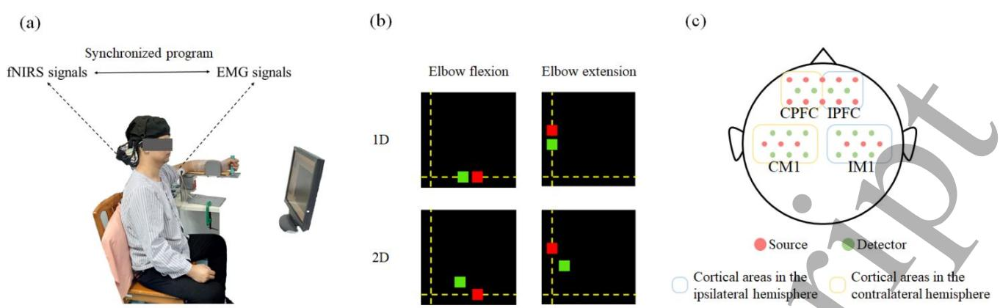  
Figure 1. Experiment set-up. (a) A post-stroke patient performing the tracking task. (b) Schematic about two kinds of visual feedback: one-dimensional MCI (1D) and two-dimensional MCI (2D); (c) 36-channel scalp positions.

Before the experiment, an operator would explain the whole experiment to each subject until they fully understood. Figure 1(a) shows the experimental set-up in this study. During the experiment, the subject was asked to sit in a chair and to face a screen. The dominant forearm of healthy controls or the affected forearm of post-stroke patients was strapped to a trough in a self-made armrest. Their elbow joints were set at 90 degrees of flexion and their shoulders were set at 90 degrees of abduction. All the subjects were instructed to learn how to modulate muscle activation to track the target on the screen according to visual feedback. Visual feedback was provided by a customized LabVIEWTM program. Once familiarized, the subjects were asked to respectively produce a continuous maximal isometric voluntary contraction (MVC) of BIC and TRI lasting 5 sec, which was to be repeated three times with a rest interval of 2 min to avoid muscle fatigue. The largest EMG amplitude (LA-EMG) of each muscle was calculated and applied to normalize the activation of the corresponding muscle in the following experiment. Secondly, the subjects were instructed to preform two movements (elbow flexion and extension) under two kinds of visual feedback (one-dimensional MCI and two-dimensional MCI). Each trial included a combination of one movement and a kind of visual feedback and would be repeated three times. There were in total 12 trials, and each trial consisted of a 7-sec preparing phase, a 60-sec tracking phase and a 10-sec resting phase.

Visual feedback displayed the real-time position of red target cursor and green controllable cursor on the screen. The EMG signals of BIC and TRI of the subjects were recorded and mapped to the vertical and horizontal direction of the screen, respectively. During elbow flexion and extension, the subjects could manipulate the position of the controllable cursor to track target cursor by modulating the BIC and TRI activation within one-dimensional and two-dimensional MCI. In each tracking phase, the target cursor would move to a destination and then back to the coordinate origin along the coordinate axis of the screen at a constant speed, which was continuously repeated three times. During elbow flexion, BIC acts as agonist muscle, and the destination is set at (0, 10%LA-EMG of BIC). During elbow extension, TRI acts as agonist muscle, and the destination is set at (10%LA-EMG of TRI, 0). Within one-dimensional MCI, the controllable cursor can only be controlled by agonist activation and move along the coordinate axis. Within two-dimensional MCI, the controllable cursor can be controlled by both the agonist and antagonist activation, and the trajectory of the controllable cursor is in two-dimensional plane. The trajectory of target cursor was the same within one-dimensional and twodimensional MCI. Figure1(b) showed the schematic diagram of visual feedback.

## 2.3 Data analysis

## 2.3.1 Transfer entropy.

TE is able to directionally detect non-linear interactions and this can be applied to measure the dynamic information transmission between two variables [24]. If given time series $X = \left\{ \boldsymbol { x } _ { 1 } , \boldsymbol { x } _ { 2 } , . . . , \boldsymbol { x } _ { N } \right\}$ and $Y = \left\{ y _ { 1 } , y _ { 2 } , . . . , y _ { N } \right\}$ , where N is the length of these time series, the TE from Y to X is defined as $\mathrm { T E } _ { Y  X }$ and the equation was as follows:

$$
\begin{array} { r } { [ 1 ] \quad \mathrm { T E _ { Y _ {  } X } } = \sum _ { x _ { i + 1 } , ~ x _ { i } , ~ y _ { i } } \Bigl ( p ( x _ { i + 1 } , x _ { i } , y _ { i } ) \log \frac { p ( x _ { i + 1 } , ~ x _ { i } , y _ { i } ) p ( x _ { i } ) } { p ( x _ { i } , ~ y _ { i } ) p ( x _ { i + 1 } , ~ x _ { i } ) } \Bigr ) , } \end{array}
$$

where i was the discrete time index $( 1 \leq i \leq N ) ; \ p ( \cdot )$ represented the probability distribution.

Because TE is inherently asymmetric, the $\mathrm { T E } _ { Y  X }$ is not equal to the $\mathrm { T E } _ { X  Y . }$ Considering an inherent time delay arose from cortex to muscle as the consequence of signal propagation effects [25, 26], the equation was expressed as follows:

$$
\begin{array} { r l r } { } & { [ 2 ] } & { \mathrm { T E } _ { \mathrm { Y } _ { + } \mathrm { X } } ( u ) = } \\ { } & { \sum _ { x _ { i + 1 } , ~ x _ { i } , ~ y _ { i - _ { \mathrm { u } } - 1 } } \Bigl ( p ( x _ { i + 1 } , x _ { i } , y _ { i - u - 1 } ) \log \frac { p ( x _ { i + 1 } , ~ x _ { i } , ~ y _ { i } - u - 1 ) p ( x _ { i } ) } { p ( x _ { i } , ~ y _ { i - u - 1 } ) p ( x _ { i + 1 } , ~ x _ { i } ) } \Bigr ) , } \end{array}
$$

where u represented the time delay which might differ depending on transfer directions. Previous study has demonstrated that there were different time delays between from brain to muscle and from muscle to brain [3], so selecting the appropriate values of u in different transfer directions was important for evaluation information transmission between cortex and muscle. In order to test appropriate values of u in this study, the values of TE and werefNIRS EMG TEEMG fNIRS calculated using the signals of a healthy control subject as the typical example with increased value of u from 1 to 50 according to previous reference [27]. When the largest value of TE in each transfer direction was found, the corresponding value of u was chosen in each transfer direction and was used in the following analysis of the cortico-muscular network. According to the result showed in figure 5, u was set as 27 during calculating information transmission from cortex to muscle and set as 31 during calculating information transmission from muscle to cortex.

## 2.3.2 Data Processing.

Off-line data pre-processing and analyses were performed using MATLABTM (R2012a, MathWorks, USA) in this study. For the pre-processing of the EMG signal, the raw EMG signals were filtered by a 4th-order Butterworth filter with a frequency band between 20 to 450Hz and a notch filter with a notch point at 50Hz. The filtered EMG signals were normalised by LA-EMG of each muscle. The normalised EMG signals were cut out and chosen in 60-s tracking phase. For the pre-processing of the fNIRS signal, the raw fNIRS signals were firstly transferred into hemodynamic signals using the modified Beer-Lambert law, and each fNIRS channel could obtain an oxy-hemoglobin concentrations $\left( \mathrm { H b } \mathrm { O } _ { 2 } \right)$ signal and a deoxy-hemoglobin concentrations (HbR) signal. Because the $\mathrm { H b } { \mathrm { O } } _ { 2 }$ signal was more vigorous in effect [28] and displayed better signal-to-noise ratios [29] than the HbR signal, the ${ \mathrm { H b } } { \mathrm { O } } _ { 2 }$ signal was chosen as the marker of cortical activation to calculate $\mathrm { t h e }$ task-related HbO2 concentration $( \Delta \mathrm { H b } 0 _ { 2 } )$ . After removing the invalid channels, the obvious motion artifacts and physiological noise, a bandpass Butterworth filter (0.009-0.05Hz) was performed on the HbO2 signals [28, 30]. The of each channel was∆���2 computed as following:

$$
\Delta H b O _ { 2 } = H b O _ { 2 t r a c k i n g } - H b O _ { 2 b a s e l i n e }
$$

where $\mathrm { H } _ { \mathsf { b } { \mathsf { O } } 2 }$ represented the HbO2 signals recorded in tracking the tracking phase in each channel; $\mathrm { H } _ { \mathsf { b } { \mathsf { O } } 2 }$ was thebaseline average value of the HbO2 signals recorded in the last 5s during the preparation phase in each channel. The $\Delta H b O _ { 2 }$ of fNIRS channels were grouped into four cortical areas according to probes location in figure 1(c). In order to facilitate analysis of the fNIRS signals between healthy controls and patients after stroke, PFC/M1 in the left hemisphere of healthy controls and in the affected hemisphere of patients were marked as contralateral PFC/M1 (CPFC/CM1). Similarly, PFC/M1 in the right hemisphere of healthy controls and in the unaffected hemisphere of patients were marked as ipsilateral PFC/M1 (IPFC/IM1). The activation in each cortical area was the average of the $\Delta \mathrm { H b } 0 _ { 2 }$ signals grouped into the same cortical area.

After data preprocessing, two sets of the EMG and $\Delta \mathrm { H b } 0 _ { 2 }$ signals, including the EMG signals of two muscles and the hemodynamic signals in four cortical areas, could be analysed by the TE under different kinds of visual feedback in the healthy controls and the post-stroke patients. The intercortical connections were computed using any two averaged ∆ $H b O _ { 2 }$ signals to represent the information transmission from a cortical area to another cortical area. Subsequently, the averaged fNIRS signal of each cortical area and the EMG signal of each muscle were used to assess the cortico-muscular connections in two transfer directions: from cortex to muscle (TEcortex to muscle) and from muscle to cortex ( TEmuscle to cortex). The total information transferred from four cortical areas to two muscles was the average of TEcortex to muscle and expressed as ATEcortex to muscle. Similarly, the total information transferred from two muscles to four cortical areas was the average of TEmuscle to cortex and expressed as ATEmuscle to cortex. Finally, the inter-muscular connections were calculated using the EMG signals of two muscles. In general, the larger value of TE, the larger strength of the connection, which means the more information is transferred between two signals in such transfer direction.

## 2.3.3 Statistical analysis.

Data were imported into SPSS 22.0 for windows (SPSS Inc., Chicago, IL, USA) for statistical analysis in this study. Firstly, to evaluate whether the amounts of information transferred from cortex to muscle and from muscle to cortex were different, we preformed pair t-tests to compare A TEcortex to muscle and ATEmuscle to cortex in healthy control subjects and post-stroke patients within each MCI. According to the results in previous study, we hypothesised that A TEcortex to muscle was significantly stronger than ATEmuscle to cortex . Thus, if the results of pair t-tests showed that the ATEcortex to muscle value was significant larger in this study, we would focus on TEcortex to muscle and further analyze cortico-muscular connection in unidirectional direction (from cortex to muscle). Secondly, the dimensionality effect on the inter-cortical, cortico-muscular and inter-muscular connections in different directions between healthy controls and patients after stroke were respectively assessed using a two-way repeated measures analysis of variance (ANOVA) (groups × dimensionality: 2 ×2). Independent t-test was performed for post hoc analysis when any significant difference was found. The level of statistical significance was set at p<0.05.

## 3. Results

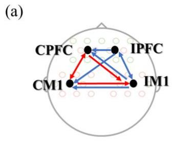

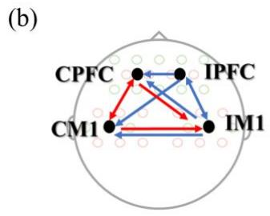

IM1 to IPFC than healthy control subjects (p=0.012, p=0.008, $p { = } 0 . 0 3 3 , p { = } 0 . 0 3 8 , p { = } 0 . 0 2 7 )$ during elbow flexion and extension. Post-stroke patients also showed significantly lower connections from CPFC to CM1, from CM1to CPFC and from CM1 to IM1 (p=0.005, p=0.013, p=0.020) in figure 2 and figure 3, compared to healthy control subjects. On the other hand, compared to one-dimensional MCI, bidirectional

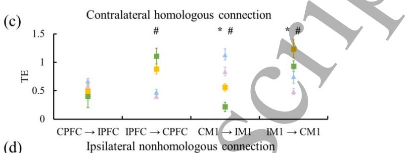

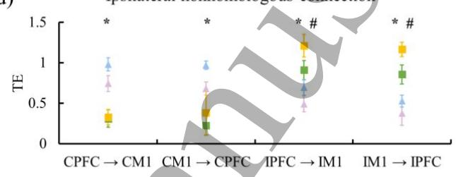

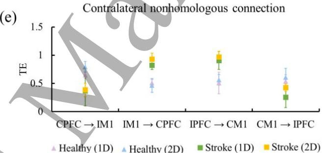  
Figure 2. The inter-cortical connection in healthy control subjects and post-stroke patients within each MCI during elbow flexion. The significant differences were found in healthy control subjects versus post-stroke patients within one-dimensional MCI (a) and two-dimensional MCI (b). Red lines indicate significantly stronger connections in healthy control subjects than in post-stroke patients, and blue lines indicate the opposite. The inter-cortical connections were divided into contralateral homologous connection (c), contralateral nonhomologous connection (d) and ipsilateral nonhomologous connection (e). The "\*" and "#" indicate a significant difference between two kinds of visual feedback in healthy subject and patients, respectively. Abbreviation: 1D = one-dimensional, 2D = two-dimensional.

## 3.1 The inter-cortical and inter-muscular connections

Results of the inter-cortical connection within each MCI in healthy control subjects and post-stroke patients were displayed in figure 2 and figure 3. The ANOVA on the intercortical connection showed that there was a significant effect on both groups $( p { = } 0 . 0 0 1 )$ and dimensionality (p=0.036), with the significant interaction effect between them (p=0.025). Post hoc analysis showed that post-stroke patients had significantly stronger inter-cortical connections from IPFC to CPFC, from IM1 to CM1, from IM1 to CPFC, from IPFC to IM1, from inter-cortical connections between bilateral M1 and between IPFC and IM1 were distinctly larger within two-dimensional MCI in both healthy control subjects and post-stroke patients $( p \mathrm { = } 0 . 0 2 8 , p \mathrm { = } 0 . 0 3 1 , p \mathrm { = } 0 . 0 1 1 , p \mathrm { = } 0 . 0 4 1 )$ during elbow flexion and extension.

Table Ⅱ listed the inter-muscular connection in both healthy control subjects and post-stroke patients within different MCIs. According to the results of ANONA, only the groups exerted main effects on inter-muscular connection (groups: p=0.041; dimensionality: $\scriptstyle { p = 0 . 1 3 5 ) }$ , and no interaction effects were presented (groups ✕ dimensionality: p=0.635). Significantly larger inter-muscular connections were yielded in healthy control subjects as opposed to poststroke patients (p=0.038). Compared to one-dimensional tasks, the stronger connections could be found in the twodimensional tasks with no significance (p=0.550), except for the inter-muscular connection from antagonist to agonist muscles in post-stroke patients (p=0.003). Additionally, we found the inter-muscular connection from agonist to antagonist muscles was slightly larger than the inter-muscular connection from antagonist to agonist muscles in each group within MCIs (p=0.380).

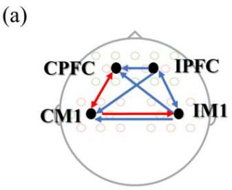  
(c)  
(d)

(b)  
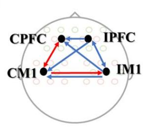  
(e)

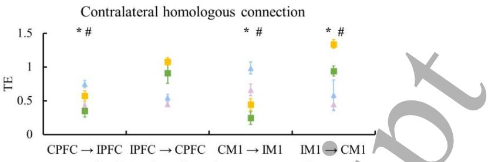

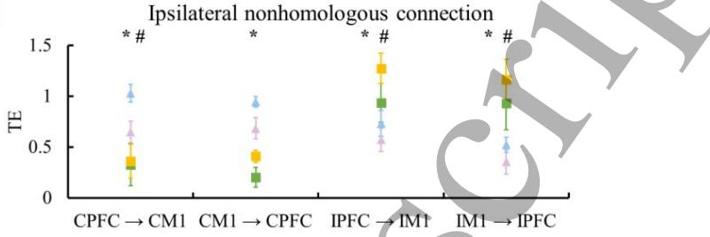

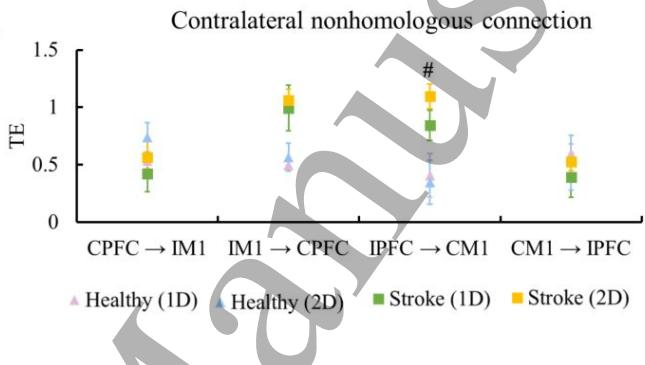  
Figure 3. The inter-cortical connection in both groups within each MCI during elbow extension. The significant group differences were found within one-dimensional MCI (a) and two-dimensional MCI (b). The colour of lines represented the stronger connection in control subjects (red) or in post-stroke patients (blue). The arrow represented the transmission direction. The significant differences induced by MCI dimensionality and groups were respectively marked with \*" and "#" in contralateral homologous connection (c), contralateral nonhomologous connection (d) and ipsilateral nonhomologous connection (e). Abbreviation: 1D = one-dimensional, 2D = two-dimensional.

<table><tr><td rowspan="3"></td><td rowspan="3"></td><td colspan="2">Elbow flexion</td><td colspan="2"></td><td colspan="4">Elbow extension</td></tr><tr><td colspan="2">Healthy</td><td colspan="2">Stroke</td><td colspan="2">Healthy</td><td colspan="2">Stroke</td></tr><tr><td>1D</td><td>2D</td><td>1D</td><td>2D</td><td>1D</td><td>2D</td><td>1D</td><td>2D</td></tr><tr><td>Agonist  Antagonist</td><td>0.11±0.01</td><td></td><td>0.12±0.02</td><td>0.05±0.01</td><td>0.07±0.01</td><td></td><td>0.09±0.02 0.10±0.02</td><td>0.05±0.02</td><td>20.06±0.01</td></tr><tr><td>Antagonist  Agonist</td><td></td><td>0.09±0.01</td><td>0.10±0.02</td><td>0.04±0.01</td><td>0.06±0.02*</td><td>0.08±0.01 0.08±0.01</td><td></td><td></td><td>0.03±0.01 0.06±0.01*</td></tr></table>

Table Ⅱ The inter-muscular connections in two groups within each MCI. Abbreviation: 1D = one-dimensional, 2D = two-dimensional. \*: Significantly difference between one-dimensional and two-dimensional MCI (p < 0.05).

## 3.2 The cortico-muscular connections

Because of the propagation effects between cortex and muscle, the time delay has arisen in information transmission

Brain to muscle (1D)Muscle to brain (1D) Brain to muscle (2D)Muscle to brain (2D)

(a)  
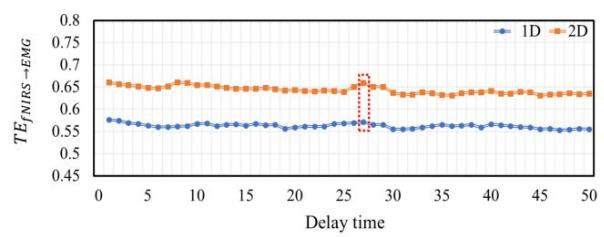

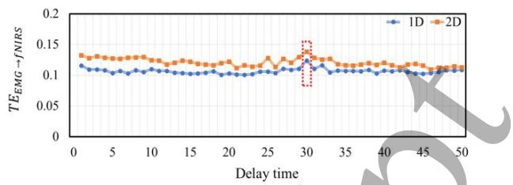

(b)  
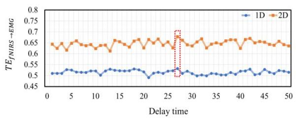

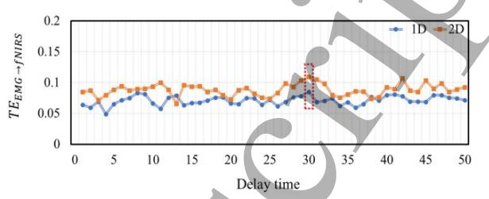  
Figure 4. The TE analysis performed in the cortico-muscular connection from fNIRS to EMG and from EMG to fNIRS with parameter u from 1 to 50 within each MCI during elbow flexion (a) and extension (b). Abbreviation: 1D = one-dimensional, 2D = two-dimensional.

in the cortico-muscular network. Figure 4 displayed the TE value in both transmission directions between cortex and muscle when parameter u was varied from 1 to 50, which demonstrated that the cortico-muscular connection would be affected by the value of parameter u. We found the maximal $\mathrm { T E } _ { \mathrm { f N I R S } } \mathrm { _ { \Delta E M G } }$ , when parameter u equaled 27. The maximal $\mathrm { T E } _ { \mathrm { E M G }  \mathrm { f N I R S } }$ was found, when parameter u was 31. The overall results also indicated that the influence of MCI dimensionality on the time delay was tiny. Previous studies have also reported similar results in that the time delays in both transmission directions were generally concentrated around 20–31 [3], which is consistent with the results in this study.

It was worth noting that ATEcortex to muscle was significantly stronger than ATEmuscle to cortex within each MCI in both the healthy control subjects and the post-stroke patients, which was showed in figure 5. Thus, the corticomuscular connection from muscle to cortex could be ruled out in the following analysis. According to the results of $\mathbf { A N O V A } .$ there were significant main effects of groups $\scriptstyle ( p = 0 . 0 0 2 )$ and dimensionality (p=0.021) on A $\mathrm { T E } _ { \mathrm { c o r t e x  t o m u s c l e } . }$ The interaction analysis showed that there was no significant interaction effect between groups and dimensionality (p=0.067). Moreover, the TE value in the cortico-muscular network (from cortex to muscle) of both groups within different MCIs was listed in table Ⅲ. There was significantly group difference $\scriptstyle ( p = 0 . 0 0 1 )$ , which was showed in figure 6. Within each MCI, the post-stroke patients showed significantly lower cortico-muscular connection than the healthy control subjects. The strength of cortico-muscular connection was significantly larger during two-dimensional tasks than during one-dimensional tasks in all subjects $( p { = } 0 . 0 4 9 )$ . Both bilateral PFC and M1 had stronger effect on agonist muscle than antagonist muscle in healthy control subjects within both MCI. Post-stroke patients only exhibited similar trends within one-dimensional MCI. The cortico-muscular connections from the contralateral hemisphere were more pronounced than in the ipsilateral hemisphere in the healthy control subjects, while the poststroke patients showed the opposite result. With the increase of the dimensionality, the cortico-muscular connections from the CPFC to antagonist muscle, from the CM1 to agonist muscle, from the CM1 to antagonist muscle, and from the IM1 to agonist muscle were stronger. This was found in all of the subjects.

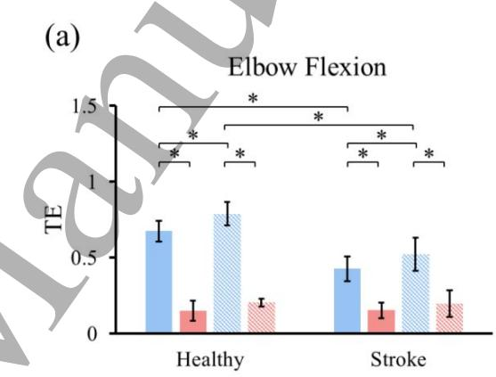

(b)  
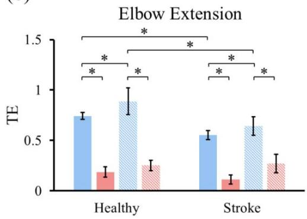  
Figure 5. The sum of cortico-muscular connection strengths between brain and muscle within each MCI in in healthy control subjects and post-stroke patients during elbow flexion (a) and extension (b). Abbreviation: 1D = one-dimensional, 2D = two-dimensional.

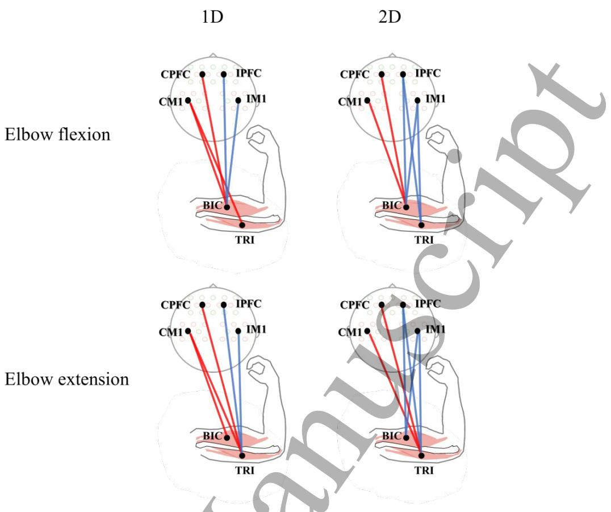  
Figure 6. The group difference of cortico-muscular connection from cortex to muscle. Red lines indicated significantly stronger connections in healthy control subjects than in post-stroke patients, and blue lines indicated the opposite. Abbreviation: 1D = one-dimensional, 2D = two-dimensional.

<table><tr><td rowspan="3"></td><td rowspan="3">Elbow flexion</td><td colspan="2"></td><td colspan="2"></td><td colspan="4">Elbow extension</td></tr><tr><td colspan="2">Healthy</td><td colspan="2">Stroke</td><td colspan="2">Healthy</td><td colspan="2">Stroke</td></tr><tr><td>2D</td><td></td><td>1D</td><td>2D</td><td>1D</td><td>2D</td><td>1D</td><td>2D</td></tr><tr><td>CPFC I Agonist</td><td>0.82±0.06</td><td></td><td> $1 . 0 2 { \pm } 0 . 3 5 ^ { \ast }$ </td><td>0.44±0.19#</td><td>0.50±0.10#</td><td>0.39±0.05</td><td> $\overline { { 0 . 7 2 { \pm } 0 . 0 9 ^ { * } } }$ </td><td>0.28±0.07</td><td>0.42±0.09*#</td></tr><tr><td>IPFC → Agonist</td><td></td><td> $0 . 4 0 { \pm } 0 . 0 6 ^ { }$ </td><td> $0 . 4 8 { \pm } 0 . 0 7$ </td><td>0.55±0.30</td><td> $0 . 7 1 { \pm } 0 . 2 8 { ^ { \ast } } { \# }$ </td><td>0.44±0.05</td><td> $0 . 5 6 { \pm } 0 . 0 5 ^ { * }$ </td><td> $0 . 4 2 { \pm } 0 . 0 4 $ </td><td>0.86±0.24*#</td></tr><tr><td>CM1 → Agonist</td><td></td><td> $0 . 7 9 { \pm } 0 . 1 7$ </td><td> $1 . 0 3 { \pm } 0 . 0 8 ^ { * }$ </td><td>0.24±0.13#</td><td> $0 . 4 5 { \pm } 0 . 1 9 ^ { \ast } { \# }$ </td><td> $0 . 5 3 { \pm } 0 . 1 0 $ </td><td> $0 . 6 6 { \pm } 0 . 1 4 ^ { \ast }$ </td><td> $0 . 2 1 { \pm } 0 . 0 6 \#$ </td><td>0.62±0.10*</td></tr><tr><td>IM1 → Agonist</td><td></td><td> $0 . 3 7 { \pm } 0 . 0 6 $ </td><td> $0 . 4 9 { \pm } 0 . 1 9 ^ { \ast }$ </td><td> $\begin{array} { r l } { 0 . 4 9 \pm 0 . 1 3 } \end{array}$ </td><td> $0 . 7 1 { \pm } 0 . 0 5 ^ { \ast } { \# }$ </td><td> $0 . 2 6 { \pm } 0 . 1 8$ </td><td> $0 . 3 8 { \pm } 0 . 0 7$ </td><td>0.36±0.06</td><td>0.72±0.09*#</td></tr><tr><td>CPFC I Antagonist</td><td></td><td> $0 . 4 7 { \pm } 0 . 0 8 \ $ </td><td> $0 . 6 8 { \pm } 0 . 1 3 ^ { \ast }$ </td><td> $0 . 3 3 { \pm } 0 . 2 5 { \# }$ </td><td> $0 . 5 8 { \pm } 0 . 2 3 ^ { \ast }$ </td><td> $0 . 5 1 { \pm } 0 . 1 1$ </td><td> $0 . 6 0 { \pm } 0 . 1 1 ^ { \ast }$ </td><td>0.18±0.03#</td><td>0.29±0.05#</td></tr><tr><td>IPFC → Antagonist</td><td></td><td> $0 . 3 4 \pm 0 . 0 8$ </td><td> $0 . 4 5 { \pm } 0 . 0 4 ^ { * }$ </td><td> $0 . 4 1 \pm 0 . 2 1$ </td><td> $0 . 7 7 { \pm } 0 . 2 8 ^ { \ast \# }$ </td><td> $0 . 3 9 { \pm } 0 . 0 7$ </td><td> $0 . 4 6 { \pm } 0 . 0 7$ </td><td>0.54±0.07</td><td>0.96±0.20*#</td></tr><tr><td>CM1 → Antagonist</td><td></td><td> $0 . 4 4 \pm 0 . 0 4$ </td><td>0.70±0.06</td><td> $0 . 2 3 { \pm } 0 . 1 3 { \# }$ </td><td> $0 . 5 2 { \pm } 0 . 2 2 { ^ { \ast } } \#$ </td><td> $0 . 7 0 { \pm } 0 . 0 6$ </td><td> $0 . 9 0 { \pm } 0 . 1 1 ^ { \ast }$ </td><td></td><td>0.18±0.05# 0.49±0.13*#</td></tr><tr><td> $\underline { { \mathrm { I M 1 } \to \mathrm { A n t a g o n i s t } } }$ </td><td></td><td> $0 . 3 9 { \pm } 0 . 0 1$ </td><td>0.47±0.03</td><td> $0 . 4 6 { \pm } 0 . 1 3$ </td><td> $0 . 6 7 { \pm } 0 . 1 8 ^ { * } { \# }$ </td><td> $0 . 2 5 { \pm } 0 . 0 9$ </td><td> $0 . 3 9 { \pm } 0 . 0 6 ^ { \ast }$ </td><td> $0 . 5 6 { \pm } 0 . 0 4 \#$ </td><td> $1 . 0 2 { \pm } 0 . 1 3 ^ { \ast } \#$ </td></tr></table>

Table Ⅲ The cortico-muscular connections from cortex to muscle in two groups within each MCI. Abbreviation: 1D = one-dimensional, 2D = twodimensional. \*: Significantly difference between one-dimensional and two-dimensional MCI (p < 0.05). #: Significantly difference between healthy control subjects and post-stroke patients (p < 0.05).

## 4. Discussion

This study mainly investigated the changes of information transmission in the inter-cortical, cortico-muscular and intermuscular networks after stroke and whether these changes can be modulated by different MCI dimensionalities. There were three major findings in this study as follows: 1) the increased and decreased information transmission were respectively found in the inter-cortical and cortico-muscular networks for post-stroke patients, compared to healthy control subjects; 2) the information transmission from the ipsilateral cortical areas to muscles in post-stroke patients was stronger than from the contralateral areas; 3) the information transmission in each network enhanced with the increase of MCI dimensionality in all of the subjects.

## 4.1 The stroke-induced changes in the cortico-motor system

In this study, the stronger inter-cortical connection was found in post-stroke patients than in healthy control subjects. This was not consistent with previous studies that had found a lower connection between different cortical areas in patients during the acute phase of stroke. This inconsistent result might be attributed to the varying degrees of recovery in patients. The brain can reorganise the surviving inter-cortical network to compensate for damage induced by stroke [31]. A previous study had reported that the ipsilateral and interhemispheric connections would be strengthened to play an important role to improve motor function [32]. Moreover, TEcortex to muscle was significantly larger than TEmuscle to cortex within each MCI in both healthy control subjects and post-stroke patients in this study, which might suggest that more information is transferred from the cortex to the muscle due to the cortica motor control. Compared to healthy control subjects, lower cortico-muscular connection from the cortex to the muscle was found in post-stroke patients. This suggests a weakened functional connection between the impaired cortical areas and targeted muscles due to the reduction of information transmission after stroke. This finding was in agreement with previous studies showing lower cortico-muscular coherence which might be related to poor communication between the cortex and the muscle or poor integration between the hemodynamic and EMG signal after stroke [5, 14]. Specifically, the stronger cortico-muscular connection was observed from cortical areas to agonist muscle than to antagonist muscle, which showed that agonist muscle might receive more control information from cortical areas in poststroke patients. We speculated that this might be attributed to the role of agonist muscle which might provide main power for patients performing the elbow tracking task. On the other hand, the lower cortico-muscular connection from cortica areas to antagonist muscle could be caused by failure to suppress antagonist muscle after a stroke [33]. The cortical inhibitory circuit could suppress the undesired muscle activation in healthy control subjects [34, 35], but this inhibitory function was impaired in post-stroke patients. We have assumed that the activation of cortical areas in relation to the damaged inhibitory circuit was reduced in post-stroke patients, and hence the inhibitory information was less frequently transmitted to antagonist muscle during elbow movement. The higher cortico-muscular connection from cortical areas to antagonist muscle in post-stroke patients within two-dimensional MCI might support such assumption. In this study, reduced strength of inter-muscular connection was observed in post-stroke patients as compared to healthy control subjects, which was in accordance with a previous study which reported the weakened functional coupling between the targeted muscles [36]. The lower inter-muscular connection might reflect the reduced information transmission between muscles, which could be attributed to the weakened cortical control; that is, the less control command, in particular inhibitory command, transferred to the targeted muscles caused by the impaired neural function in cortical areas after stroke [36].

## 4.2 The influence of MCI dimensionality on the corticomotor system

One of the main findings in the current study was that the stronger inter-cortical connections that bilaterally interconnect M1 in both hemispheres were observed in two-dimensional tasks than in one-dimensional tasks, which might indicate augmented communication between M1 in the bilateral hemispheres. This finding was compatible with the results in a previous study which suggested that the increase of functional connection between M1 in both hemispheres might be caused by more synchronisation between bilateral M1 to strengthen their output [37]. Because the subjects were asked to precisely modulate the activation of their agonist and antagonist muscles at the same time within two-dimensional MCI, the tasks became more complex. In order to perform such complex tasks, M1 in both hemispheres should enhance the descending motor command for precise regulation of muscle activation, which may be the reason for the increase of information transmission between right M1 and left M1. In addition, the increase of homolateral connection from PFC to ipsilateral M1 in both hemispheres in the two-dimensional tasks was in accordance with a previous study [38], in which significantly increased functional connection between similar brain areas was observed. One speculation was that the connection between PFC and ipsilateral M1 was related to cognitive motor control. A recent study suggested that PFC had close collaborations with ipsilateral M1 to form a fundamental brain circuit, which was activated in complex motor tasks [39]. Brown et al. proved that PFC had a small impact on ipsilateral M1 during a simple motor task [40], which revealed that the cortical circuit described above might only work in complex motor tasks. It was therefore suggested that when PFC and M1 participated in complex motor tasks, such as the two-dimensional tasks in this study, they required more cognitive control which could lead to an increase in the functional connection from PFC to ipsilateral M1. On the other hand, a stronger connection from PFC to ipsilateral M1 might be associated with motor inhibition within twodimensional MCI. Several studies had demonstrated that PFC played a key role in motor inhibition [41, 42]. Narayanan et al. reported that PFC might exert a top-down control signal on M1 to suppress response, because of the functional interactions between PFC and M1 [43]. The subjects were asked to inhibit the activation of their antagonist muscle within two-dimensional MCI, which might strengthen the functional connection from PFC to M1. At the corticomuscular layer, the larger cortico-muscular connection was found in both groups with an increase in MCI dimensionality, which was in accordance with previous research. The corticomuscular connection could reflect the cortical drive associated with control of an individual muscle, which could be altered by visual feedback [44]. In this study, the stronger corticomuscular connection during the two-dimensional task might indicate that additional information was transferred from cortical areas to muscles with the increase in sensory information. Previous studies had reported that more corticomuscular information transmission was associated with better motor performance [45], which might in turn result in the improvement of inter-muscular coordination.

## 5. Conclusion

This study mainly investigated the effect of MCI dimensionality and stroke on information transmission in the inter-cortical, cortico-muscular and inter-muscular networks. The enhanced information transmission in the inter-cortical network was found in post-stroke patients, which might be related to cortical reorganisation after stroke. The information transmission in the cortico-muscular network decreased in post-stroke patients when compared to healthy control subjects, and this was related to the reduction of complex neural commands transmitted to the targeted muscles. Finally, this study revealed that increased MCI dimensionality might be useful to enhance the connections in the cortico-motor system for post-stroke patients, which might imply that twodimensional MCI would be an effective rehabilitation tool to enhance the information transmission in each network for post-stroke patients. Moreover, future work with other analysis methods, such as fuzzy synchronization likelihood (FSL) with the merits of reliability and validity in weak and nonlinear coupling analysis [46], should be undertaken to comprehensively investigate the complex and dynamic interactions between the brain and targeted muscle.

## Acknowledgements

This study was supported in part by National Key R&D Program of China (Grant 2018YFC2001600), Special Foundation of Science and Technology Innovation Strategy of

Guangdong Province (Grant 2020B212060077) and National Natural Science Foundation of China (Grant 81902286).

## References

[1] T. Drew, W. Jiang, B. Kably, and S. Lavoie. Role of the motor cortex in the control of visually triggered gait modifications. Canadian Journal of Physiology and Pharmacology. 74: 426-442, 1996. 一

[2] C. Babiloni, F. Vecchio, M. Bares, M. Brazdil, I. Nestrasil, F. Eusebi, P. M. Rossini, and I. Rektor. Functional coupling between anterior prefrontal cortex (BA10) and hand muscle contraction during intentional and imitative motor acts. NeuroImage. 39: 1314-1323, 2008.

[3] C. L. Witham, C. N. Riddle, M. R. Baker, and S. N. Baker. Contributions of descending and ascending pathways to corticomuscular coherence in humans. Journal of Physiology. 589: 3789-3800, 2011.

[4] P. Langhorne, F. Coupar, and A. Pollock. Motor recovery after stroke: a systematic review. Lancet Neurology. 8: 741- 754, 2009.

[5] X. Chen, P. Xie, Y. Zhang, Y. Chen, F. Yang, L. Zhang, and X. Li. Multiscale information transfer in functional corticomuscular coupling estimation following stroke: a pilot study. Frontiers in Neurology. 9: 287, 2018.

[6] G. H., B. E., Tomlinson, P. H., and Gibson. Cell counts in human cerebral cortex in normal adults throughout life using an image analysing computer. Journal of the Neurological Sciences. 46: 1980.

[7] E. B. Plow, D. A. Cunningham, C. Bonnett, D. Gohar, M. Bayram, A. Wyant, N. Varnerin, B. Mamone, V. Siemionow, and J. Hou. Neurophysiological correlates of aging-related muscle weakness. Journal of Neurophysiology. 110: 2563- 2573, 2013.

[8] Y. Sun, and E. P. Zehr. Training-induced neural plasticity and strength are amplified after stroke. Exercise and Sport Sciences Reviews. 47: 223, 2019.

[9] K. P. Westlake, and S. S. Nagarajan. Functional Connectivity in Relation to Motor Performance and Recovery After Stroke. Frontiers in Systems Neuroence. 5, 2011.

[10] L. H. A. Strens, P. Asselman, A. Pogosyan, C. Loukas, and P. Brown. Corticocortical coupling in chronic stroke: its relevance to recovery. Neurology. 63: 475-484, 2005.

[11] G. Christian, B. Khalaf, S. Alexandra, E. M. Wassermann, C. Robert, M. Takahiro, W. Daniel, G. F. Wittenberg, I. Kenji, and L. G. Cohen. Multimodal imaging of brain reorganization in motor areas of the contralesional hemisphere of well recovered patients after capsular stroke. Brain A Journal of Neurology. 791-808, 2006.

[12] K. Kato, M. Sawada, and Y. Nishimura. Bypassing stroke-damaged neural pathways via a neural interface induces targeted cortical adaptation. Nature Communications. 10: 4699, 2019.

[13] Y. Yuan, S. E. Teodoro, V. D. R. Mark, d. H. F. C. T. Van, and A. C. Schouten. Nonlinear coupling between cortical oscillations and muscle activity during isotonic wrist flexion. Frontiers in Computational Neuroence. 10, 2016.

[14] Y. Fang, J. J. Daly, J. Sun, K. Hvorat, E. Fredrickson, S. Pundik, V. Sahgal, and G. H. Yue. Functional corticomuscular connection during reaching is weakened following stroke. Clinical Neurophysiology. 120: 994-1002, 2009.

[15] F. Meng, K. Y. Tong, S. T. Chan, W. W. Wong, K. H. Lui, K. W. Tang, X. Gao, and S. Gao. Cerebral plasticity after subcortical stroke as revealed by cortico-muscular coherence. IEEE Transactions on Neural Systems & Rehabilitation Engineering. 17: 234-243, 2009.

[16] T. Mima, K. Toma, B. Koshy, and M. Hallett. Coherence between cortical and muscular activities after subcortical stroke. Stroke. 32: 2597-2601, 2001.

[17] I. V. Bonan, F. M. Colle, J. P. Guichard, E. Vicaut, M. Eisenfisz, P. T. B. Huy, and A. P. Yelnik. Reliance on visual information after stroke. Part I: balance on dynamic posturography. Archives of Physical Medicine and Rehabilitation. 85: 268-273, 2004.

[18] A. J. Westerveld, A. C. Schouten, P. H. Veltink, and H. V. D. Kooij. Control of thumb force using surface functional electrical stimulation and muscle load sharing. Journal of NeuroEngineering and Rehabilitation. 10: 2013.

[19] T. Watanabe, I. Nojima, T. Mima, H. Sugiura, and H. Kirimoto. Magnification of visual feedback modulates corticomuscular and intermuscular coherences differently in young and elderly adults. NeuroImage. 220: 117089, 2020.

[20] Michael, D., Ellis, Bradley, G., Holubar, Ana, Maria, Acosta, and Randall. Modifiability of abnormal isometric elbow and shoulder joint torque coupling after stroke. Muscle and Nerve. 32: 170-178, 2005.

[21] Z. A. Wright, W. Z. Rymer, and M. W. Slutzky. Reducing abnormal muscle coactivation after stroke using a myoelectric-computer interface: a pilot study. Neurorehabilitation and Neural Repair. 28: 443-451, 2013.

[22] S. J. Young, J. Van Doornik, and T. D. Sanger. Visual feedback reduces co-contraction in children with dystonia. Journal of Child Neurology. 26: 37-43, 2011.

[23] C. Jian, L. Deng, H. Liu, T. Yan, X. Wang, and R. Song. Modulating and restoring inter-muscular coordination in stroke patients using two-dimensional myoelectric computer interface: a cross-sectional and longitudinal study. Journal of Neural Engineering. 18: 36005-36018, 2021.

[24] Schreiber, and Thomas. Measuring Information Transfer. Physical Review Letters. 85: 461-464, 2000.

[25] L. Faes, D. Marinazzo, A. Montalto, and G. Nollo. Lagspecific transfer entropy as a tool to assess cardiovascular and cardiorespiratory information transfer. IEEE Transactions on Biomedical Engineering. 61: 2556-2568, 2014.

[26] S. Salenius, and R. Hari. Synchronous cortical oscillatory Current Opinion in Neurobiology. 13: 678-684, 2003.

[27] X. Ping, Y. Fangmei, C. Xiaoling, D. Yihao, and W. Xiaoguang. Functional coupling analyses of electroencephalogram and electromyogram based on multiscale transfer entropy. Chinese Journal of Physics. 64: 2015.

[28] Q. Zhang, G. E. Strangman, and G. Ganis. Adaptive filtering to reduce global interference in non-invasive NIRS

measures of brain activation: How well and when does it work? NeuroImage. 45: 788-794, 2009.

[29] J. Yao, A. Chen, C. Carmona, and J. P. A. Dewald. Cortical overlap of joint representations contributes to the loss of independent joint control following stroke. NeuroImage. 45: 490-499, 2009.

[30] Y. Li, and D. Yu. Weak network efficiency in young children with autism spectrum disorder: evidence from a functional near-infrared spectroscopy study. Brain and Cognition. 108: 47-55, 2016. 7

[31] S. Bajaj, A. J. Butler, D. Drake, and M. Dhamala. Brain effective connectivity during motor-imagery and execution following stroke and rehabilitation. NeuroImage: Clinical. 8: 572-582, 2015.

[32] Y. Peng, J. Liu, M. Hua, M. Liang, and C. Yu. Enhanced effective connectivity from ipsilesional to contralesional M1 in well-recovered subcortical stroke patients. Frontiers in Neurology. 10, 2019.

[33] L. V. Bradnam, C. M. Stinear, and W. D. Byblow. Theta burst stimulation of human primary motor cortex degrades selective muscle activation in the ipsilateral arm. Journal of Neurophysiology. 104: 2594-2602, 2010.

[34] V. DE, M. MA, and C. DM. Intermittent visuomotor processing in the human cerebellum, parietal cortex, and premotor cortex. Journal of Neurophysiology. 95: 922-931, 2006.

[35] N. Sander, and Y. Nick. Neural mechanisms of attention and control: losing our inhibitions? Nature Neuroscience. 8: 1631-1633, 2005.

[36] K. Kisiel-Sajewicz, Y. Fang, K. Hrovat, G. H. Yue, and J. J. Daly. Weakening of synergist muscle coupling during reaching movement in stroke patients. Neurorehabilitation and Neural Repair. 25: 359-368, 2011.

[37] Z. Jiang, X. F. Wang, K. Kisiel-Sajewicz, J. H. Yan, and G. H. Yue. Strengthened functional connectivity in the brain during muscle fatigue. NeuroImage. 60: 728-737, 2012.

[38] H. Rao, X. Di, R. C. K. Chan, Y. Ding, B. Ye, and D. Gao. A regulation role of the prefrontal cortex in the fist-edgepalm task: evidence from functional connectivity analysis. NeuroImage. 41: 804-813, 2008.

[39] A. R. Anwar, M. Muthalib, S. Perrey, A. Galka, O. Granert, S. Wolff, U. Heute, G. Deuschl, J. Raethjen, and M. Muthuraman. Effective connectivity of cortical sensorimotor networks during finger movement tasks: a simultaneous fNIRS, fMRI, EEG study. Brain Topography. 29: 645–660, 2016.

[40] M. J. Brown, E. R. Goldenkoff, R. Chen, C. Gunraj, and M. Vesia. Using dual-site transcranial magnetic stimulation to probe connectivity between the dorsolateral prefrontal cortex and ipsilateral primary motor cortex in humans. Brain Sciences. 9: 2019.

[41] M. Jaffard, M. Longcamp, J. L. Velay, J. L. Anton, M. Roth, B. Nazarian, and P. Boulinguez. Proactive inhibitory control of movement assessed by event-related fMRI. NeuroImage. 42: 1196-1206, 2008.

[42] Marjan, Jahanshahi, Ignacio, Obeso, C. John, Rothwell, and J. A. A fronto-striato-subthalamic-pallidal network for

goal-directed and habitual inhibition. Nature Reviews Neuroscience. 16: 719-732, 2015.

[43] N. S. Narayanan, and M. Laubach. Top-down control of motor cortex ensembles by dorsomedial prefrontal cortex. Neuron. 52: 921-931, 2006.

[44] I. E. J. De Vries, A. Daffertshofer, D. F. Stegeman, and T. W. Boonstra. Functional connectivity in the neuromuscular system underlying bimanual coordination. Journal of Neurophysiology. 116: jn.00460.2016, 2016.

[45] R. Kristeva, L. Patino, and W. Omlor. Beta-range cortical motor spectral power and corticomuscular coherence as a mechanism for effective corticospinal interaction during steady-state motor output. NeuroImage. 36: 785-792, 2007.

[46] M. Ahmadlou, H. Adeli, and A. Adeli. Fuzzy synchronization likelihood-wavelet methodology for diagnosis of autism spectrum disorder. Journal of Neuroence Methods. 211: 203-209, 2012.