已接收手稿 (ACCEPTED MANUSCRIPT)

# 肌电接口调控肘部等长收缩过程中脑-运动系统多层信息传递的脑卒中诱发改变

出版前引用本文：Chuyao Jian et al 2021 J. Neural Eng. in press https://doi.org/10.1088/1741-2552/ac18ae

## 手稿版本：已接收手稿 (Accepted Manuscript)

已接收手稿是指“该文章被接受发表的版本，包含同行评审过程产生的所有修改，并且可能还包括 IOP Publishing 为文章添加的页眉、文章 ID、封面页和/或‘Accepted Manuscript’水印，但不包括由 IOP Publishing 和/或其许可方进行的任何其他编辑、排版或其他更改”。

本已接收手稿版权归 © 2021 IOP Publishing Ltd 所有。

在禁运期内（自本文章正式出版版本 [Version of Record] 发表之日起 12 个月），已接收手稿受版权完全保护，不得在其他地方重复使用或重新发布。由于本文的正式出版版本将以/已以订阅形式发表，因此在 12 个月禁运期之后，该已接收手稿可在 CC BY-NC-ND 3.0 许可协议下重新使用。

禁运期结束后，只要遵守许可协议 https://creativecommons.org/licences/by-nc-nd/3.0 的所有条款，任何人都可以仅出于非商业目的使用、复制和重新分发本文。

尽管已尽合理努力从第三方获取将其受版权保护的内容包含在本文中的所有必要许可，但在此已接收手稿版本中可能未提供其完整的引用和版权声明行。在使用本文的任何内容之前，请在 IOPscience 发表后参考正式出版版本，以获取完整的引用和版权详细信息，因为很可能需要获得许可。除非在正式出版版本的图注中另有明确说明，否则所有第三方内容均受版权全面保护。

在线查看本文以获取更新和增强内容。

# 肌电接口调控肘部等长收缩过程中脑-运动系统多层信息传递的脑卒中诱发改变

Chuyao Jian1, 4, #, Huihua Liu2, #, Linchuan Deng1, 4, Xiaoyun Wang3, Tiebin Yan2, \* and Rong Song1, 4, \*

Biomedical Engineering, Sun Yat-sen University（中山大学生物医学工程）, Guangzhou 510275, China

2 Sun Yat-sen Memorial Hospital, Sun Yat-sen University（中山大学孙逸仙纪念医院）, Guangzhou 510120, China 3 Guangdong Work Injury Rehabilitation Center（广东省工伤康复中心）, Guangzhou 510440, China 4 Shenzhen Research Institute of Sun Yat-sen University（中山大学深圳研究院）, Shenzhen 518057, China # 共同第一作者 (Co-first authors)。

\* 通讯作者。

E-mail: songrong@mail.sysu.edu.cn

## 摘要

人类运动是一个复杂的过程，需要在皮层间（inter-cortical）、皮层-肌肉（cortico-muscular）以及肌肉间（inter-muscular）网络中进行信息传递。尽管中风后的运动功能障碍与皮层-运动系统中的受损网络密切相关，但这些网络的潜在机制迄今尚未完全明确。本研究旨在探讨中风后皮层间、皮层-肌肉和肌肉间网络信息传递的变化，以及肌电控制接口（myoelectric-controlled interface, MCI）维度对各网络中该信息传递的影响。本研究招募了15名健康对照受试者和11名中风后患者，在不同维度的MCI下执行肘部追踪任务。同时记录了他们的肌电（electromyographic, EMG）和功能性近红外光谱（functional near-infrared spectroscopy, fNIRS）信号。基于fNIRS和EMG信号，采用传递熵（transfer entropy, TE）分析代表各网络信息传递的功能连接。结果发现，与健康对照受试者相比，中风后患者表现出增强的皮层间连接，这可能归因于代偿运动缺陷的皮层重组。与健康对照受试者相比，由于中风后信息传递的减少，中风后患者的皮层-肌肉连接强度较低。此外，由于对视觉信息处理的需求更高，增加MCI维度增强了皮层间、皮层-肌肉和肌肉间的连接。这些发现不仅为评估中风引起的皮层-运动系统改变提供了全面的视角，而且表明增加MCI维度可作为一种有用的康复工具，以促进中风后患者皮层-运动系统中的信息传递。

关键词：中风，视觉维度，运动控制，皮层-运动系统，传递熵

## 1. 引言

人类运动是一项复杂的任务，需要大脑与肌肉之间持续不断的相互作用。运动控制依赖于皮层-运动系统的皮层间、皮层-肌肉以及肌肉间网络中的信息传递。皮层区域之间的信息传递在生成和发送与启动及调整运动相关的运动指令中起着至关重要的作用 [1]。指令沿着皮层-肌肉通路传递至目标肌肉的运动神经元 [2]，而包括肌肉收缩传入反馈在内的外周信息也沿着皮层-肌肉通路传导至大脑皮层，以用于调节运动指令 [3]。在接收到运动指令后，目标肌肉相互协调并收缩以产生运动。

脑卒中后患者通常伴有上肢运动功能障碍 [4]。这推测是由于皮质-运动系统（cortico-motor system）受损所致 [5]。卒中后的脑损伤会导致皮质神经元和神经通路受损 [6]，从而造成相连皮质区域之间信息传递的中断或减弱 [7-9]。此前的一项研究报道，在抓握任务中，卒中后患者任务相关皮质区域之间的耦合增强 [10]。在急性期卒中后患者中，患侧半球皮质区域间的信息传递有所减弱，但在恢复良好的卒中后患者中则有所增强 [11]。由于皮质指令主要由皮质间网络生成，皮质区域间信息传递的受损可能导致卒中后患者下行信息传递的减少。此外，卒中后皮质-肌肉传导通路的破坏还会导致皮质-肌肉网络中信息传递的丧失 [12, 13]。具体而言，在卒中后患者中观察到患侧半球皮质区域与上肢肌肉之间的皮质-肌肉耦合减弱 [14-16]。肌肉协调能力差也可能是由肌肉间连接受损以及目标肌肉之间信息传递能力下降所导致的 [8]。

大脑皮质可以利用视觉反馈来控制和调节运动。有强有力的证据表明，视觉反馈能够恢复脑卒中后患者的大脑功能并增强其运动功能控制 [17, 18]。这与视觉反馈对运动相关皮质区域间的信息处理以及对目标肌肉间运动单位相干性的影响有关 [19]。先前的研究一致认为，视觉反馈是改变皮质-运动系统中信息传递的有效途径。肌电控制接口（MCI）是一种特殊的视觉反馈，能够提供目标肌肉肌电（EMG）信号的实时信息。近期研究表明，MCI 可以改善脑卒中后患者 [20, 21] 和肌张力障碍患者 [22] 的异常肌肉协同激活模式。患者所表现出的异常肌肉协同激活模式可能与目标肌肉之间的不良通信有关，这归因于脑卒中后肌肉间网络中信息传递受损。MCI 不仅可用于调节目标肌肉的激活，还可用于改变皮质响应。先前的研究已经报道，脑卒中后患者的皮质激活随着 MCI 维度的增加而显著增强 [23]，这可能意味着 MCI 维度的改变会影响皮质-运动系统中的信息传递。然而，在 MCI 维度增加的过程中，信息究竟如何在皮质间、皮质-肌肉以及肌肉间网络中传递尚不清楚。

本研究旨在探讨脑卒中引起的皮质间、皮质-肌肉和肌肉间网络中信息传递的变化，以及 MCI 维度对上述网络中信息传递的影响。我们利用具有高时空分辨率和抗干扰能力的功能性近红外光谱技术（fNIRS），对健康对照受试者和脑卒中后患者在不同 MCI 条件下同时进行了 fNIRS 和 EMG 测量。由于传递熵（TE）在方向性和非线性特征方面优于相干性分析 [24]，本研究应用 TE 来分析皮质间、皮质-肌肉和肌肉间网络中的信息传递。我们假设，当健康对照受试者和脑卒中后患者的 MCI 维度增加时，各个网络中的信息传递均会增强。我们还预测，各个网络中的信息传递可能会发生改变，从而改善脑卒中后患者患侧上肢的运动功能。

## 2. 方法

## 2.1 受试者

本研究招募了15名年龄匹配的健康对照受试者（平均年龄：55.2 ± 6.4 岁；6名男性，9名女性）和11名脑卒中后患者（平均年龄：45.0 ± 8.7 岁；5名男性，6名女性）。所有健康对照受试者均为右利手，视力正常，且无任何肌肉骨骼或神经系统疾病史。

所有脑卒中后患者均为初次脑卒中幸存者，其详细信息列于表 Ι 中。脑卒中后患者符合以下纳入标准时被纳入研究：(1) 所有脑卒中后患者年龄必须在18至70岁之间；(2) 单侧脑损伤发病至少6个月；(3) 脑卒中后患者表现出上肢运动功能受损；(4) 患者能够将患侧上肢从膝部抬起至与肩平行的高度且无肩部疼痛；(5) 能够使用患侧上肢完成肘关节屈曲和伸展；(6) 能够理解并遵从与任务相关的指令。脑卒中后患者的排除标准如下：(1) 既往有脑卒中史或其他伴随的肌肉骨骼或神经系统疾病；(2) 存在严重的视力和听力障碍；(3) 存在认知和语言障碍；(4) 影响 fNIRS 和 EMG 数据采集的其他情况。本实验获得了广东省工伤康复中心（Guangdong Work Injury Rehabilitation Centre）伦理委员会的批准（AF/SC-07/2017.09）。所有受试者在参与实验前均知晓实验细节并签署了书面知情同意书。

<table><tr><td>患者</td><td>年龄</td><td>性别</td><td>病变侧</td><td>卒中类型</td><td>卒中后月数</td><td>UE-FMA 评分</td></tr><tr><td>患者 1</td><td>33</td><td>M</td><td>R</td><td>Isch</td><td>7</td><td>24</td></tr><tr><td>患者 2</td><td>45</td><td>M</td><td>L</td><td>Hemo</td><td>1.5</td><td>22</td></tr><tr><td>患者 3</td><td>46</td><td>F</td><td>L</td><td>Isch</td><td>7</td><td>33</td></tr><tr><td>患者 4</td><td>50</td><td>F</td><td>R</td><td>Hemo</td><td>12</td><td>43</td></tr><tr><td>患者 5</td><td>41</td><td>F</td><td>L</td><td>Hemo</td><td>8</td><td>31</td></tr><tr><td>患者 6</td><td>39</td><td>M</td><td>R</td><td>Isch</td><td>2</td><td>20</td></tr><tr><td>患者 7</td><td>35</td><td>F</td><td>L</td><td>Hemo</td><td>9.5</td><td>36</td></tr><tr><td>患者 8</td><td>61</td><td>F</td><td>L</td><td>Isch</td><td>5</td><td>29</td></tr><tr><td>患者 9</td><td>45</td><td>M</td><td>L</td><td>Isch</td><td>14</td><td>42</td></tr><tr><td>患者 10</td><td>58</td><td>M</td><td>R</td><td>Isch</td><td>24</td><td>22</td></tr><tr><td>患者 11</td><td>42</td><td>F</td><td>R</td><td>Hemo</td><td>17</td><td>34</td></tr></table>

FMA，上肢 Fugl-Meyer 运动评估（upper extremity fugl-meyer motor assessment）。

## 2.2 数据采集与实验范式

## 2.2.1 EMG 与 fNIRS 信号采集。

用酒精清洁皮肤表面后，将两个圆形银-氯化银（Ag-AgCl）双极表面电极分别贴附在健康对照受试者的利手侧以及脑卒中后患者的患侧肱二头肌（biceps, BIC）和肱三头肌（triceps, TRI）上。两电极的中心间距为 20mm。EMG 信号采用增益为 5000 的双通道定制 EMG 放大器进行记录。放大的 EMG 信号通过 16 位数据采集卡（DAQ-6341, National Instruments, Austin, TX, USA）以 1000 Hz 的采样率进行采样。使用 LabVIEWTM（LabVIEW 2012, National Instruments, Austin, TX, USA）程序存储原始 EMG 信号。

使用商用 fNIRS 设备（NirSmart, Danyang Huichuang Medical Equipment Co. Ltd., Beijing, China）以 10 Hz 的采样率实时采集 fNIRS 信号。将 16 个发射探头和 16 个接收探头插入定制的脑电帽中。一个发射探头和一个相邻的接收探头构成一个测量通道，本研究共使用了 36 个测量通道。相邻探头之间的距离为 30mm。参考国际脑电 10-20 系统（EEG 10-20 system），所有发射探头和接收探头分别放置在双侧前额叶皮层（prefrontal cortex, PFC）和初级运动皮层（primary motor cortex, M1）上方。如图 1(c) 所示。在测量双侧 PFC 和 M1 时，发射探头能够向相邻的接收探头传输两种波长（760 和 850 nm）的近红外光。为避免不必要的运动伪影干扰 fNIRS 信号，要求所有受试者在整个实验过程中避免不必要的动作，包括眼球快速扫视、说话以及头部、躯干和其他肢体的运动。此外，使用在 LabVIEWTM 中开发的同步程序对 EMG 和 fNIRS 信号进行了时间对齐。

## 2.2.2 实验范式。

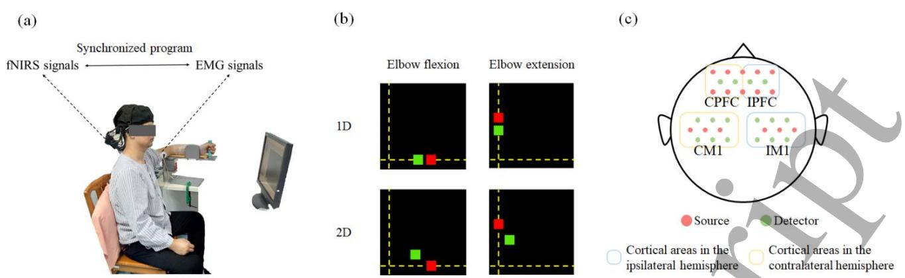  
Figure 1. 实验设置。(a) 正在执行追踪任务的脑卒中后患者。(b) 两种视觉反馈的示意图：一维 MCI（1D）和二维 MCI（2D）；(c) 36 通道头皮位置。

实验前，操作人员向每位受试者讲解整个实验流程，直至其完全理解。Figure 1(a) 展示了本研究中的实验装置。实验期间，受试者坐在椅子上面对屏幕。健康对照组的优势侧前臂或脑卒中后患者的患侧前臂被固定在自制扶手的凹槽中。其肘关节保持屈曲 90 度，肩关节保持外展 90 度。指导所有受试者学习如何根据视觉反馈调节肌肉激活程度以追踪屏幕上的目标。视觉反馈由定制的 LabVIEWTM 程序提供。熟悉流程后，受试者需分别进行 BIC 和 TRI 持续 5 秒的最大等长自主收缩（maximal isometric voluntary contraction, MVC），重复三次，每次间隔休息 2 分钟以避免肌肉疲劳。计算每块肌肉的最大肌电幅度（largest EMG amplitude, LA-EMG），并用于在后续实验中对相应肌肉的激活程度进行归一化。随后，指导受试者在两种视觉反馈（一维 MCI 和二维 MCI）下执行两种动作（肘关节屈曲和伸展）。每个试验包含一种动作与一种视觉反馈的组合，并重复三次。共计 12 次试验，每次试验由 7 秒的准备阶段、60 秒的追踪阶段和 10 秒的休息阶段组成。

视觉反馈在屏幕上实时显示红色目标光标和绿色可控光标的位置。记录受试者 BIC 和 TRI 的肌电信号，并分别映射到屏幕的垂直和水平方向。在肘关节屈曲和伸展过程中，受试者可通过在一维和二维 MCI 中调节 BIC 和 TRI 的激活程度来操控可控光标的位置以追踪目标光标。在每个追踪阶段，目标光标沿屏幕坐标轴以恒定速度移动至目标位置，然后返回坐标原点，连续重复三次。在肘关节屈曲过程中，BIC 作为主动肌，目标位置设定为 (0, 10%LA-EMG of BIC)。在肘关节伸展过程中，TRI 作为主动肌，目标位置设定为 (10%LA-EMG of TRI, 0)。在一维 MCI 中，可控光标仅能由主动肌的激活来控制并沿坐标轴移动。在二维 MCI 中，可控光标可同时由主动肌和拮抗肌的激活来控制，且可控光标的轨迹位于二维平面内。在一维和二维 MCI 中，目标光标的轨迹是相同的。Figure 1(b) 展示了视觉反馈的示意图。

## 2.3 数据分析

## 2.3.1 传递熵

传递熵（Transfer Entropy, TE）能够定向检测非线性相互作用，因此可用于测量两个变量之间的动态信息传递 [24]。若给定时间序列 $X = \left\{ \boldsymbol { x } _ { 1 } , \boldsymbol { x } _ { 2 } , . . . , \boldsymbol { x } _ { N } \right\}$ 和 $Y = \left\{ y _ { 1 } , y _ { 2 } , . . . , y _ { N } \right\}$，其中 N 为这些时间序列的长度，则从 Y 到 X 的 TE 定义为 $\mathrm { T E } _ { Y  X }$，其计算公式如下：

$$
{ [ 1 ] } { \mathrm{TE} _ { \mathrm{Y} _ { \rightarrow } \mathrm{X} } = \sum _ { x _ { i + 1 } , x _ { i } , y _ { i } } \Bigl ( p ( x _ { i + 1 } , x _ { i } , y _ { i } ) \log \frac { p ( x _ { i + 1 } , x _ { i } , y _ { i } ) p ( x _ { i } ) } { p ( x _ { i } , y _ { i } ) p ( x _ { i + 1 } , x _ { i } ) } \Bigr ) , }
$$

其中 i 为离散时间索引 $( 1 \leq i \leq N )$；$p ( \cdot )$ 表示概率分布。

由于 TE 具有固有的不对称性，因此 $\mathrm { T E } _ { Y  X }$ 不等于 $\mathrm { T E } _ { X  Y . }$。考虑到信号传播效应会导致从皮层到肌肉产生固有时间延迟 [25, 26]，该公式表示如下：

$$
\begin{array}{l} [ 2 ] \qquad \qquad \qquad \mathrm{TE} _ {\mathrm{Y} _ {-} \mathrm{X}} (u) = \\ \sum_ {x _ {i + 1}, x _ {i}, y _ {i - u - 1}} \left(p (x _ {i + 1}, x _ {i}, y _ {i - u - 1}) \log \frac {p (x _ {i + 1} , x _ {i} , y _ {i} - u - 1) p (x _ {i})}{p (x _ {i} , y _ {i - u - 1}) p (x _ {i + 1} , x _ {i})}\right), \end{array}
$$

其中 u 表示时间延迟，该延迟可能因传递方向的不同而有所差异。以往的研究表明，从大脑到肌肉以及从肌肉到大脑之间存在不同的时间延迟 [3]，因此在不同传递方向上选择合适的 u 值对于评估皮层与肌肉之间的信息传递至关重要。为了在本研究中测试合适的 u 值，根据以往的参考文献 [27]，以一名健康对照受试者的信号作为典型范例，将 u 的值从 1 增加到 50，计算了 $\text{TE}_{\text{fNIRS}\to\text{EMG}}$ 和 $\text{TE}_{\text{EMG}\to\text{fNIRS}}$ 的值。当找到每个传递方向上 TE 的最大值时，便确定了每个传递方向上对应的 u 值，并将其用于随后的皮层-肌肉网络分析中。根据图 5 所示的结果，在计算从皮层到肌肉的信息传递时，u 设置为 27；在计算从肌肉到皮层的信息传递时，u 设置为 31。

## 2.3.2 数据处理

本研究中的离线数据预处理和分析均使用 MATLABTM (R2012a, MathWorks, USA) 进行。对于 EMG 信号的预处理，原始 EMG 信号通过频带为 20 至 450Hz 的 4 阶巴特沃斯滤波器以及陷波点为 50Hz 的陷波滤波器进行滤波。滤波后的 EMG 信号通过每块肌肉的 LA-EMG 进行归一化。归一化后的 EMG 信号在 60 秒的追踪阶段中被截取并选用。对于 fNIRS 信号的预处理，首先使用改良比尔-朗伯定律（modified Beer-Lambert law）将原始 fNIRS 信号转换为血流动力学信号，每个 fNIRS 通道均可获得氧合血红蛋白浓度 $\left( \mathrm { H b } \mathrm { O } _ { 2 } \right)$ 信号和脱氧血红蛋白浓度（HbR）信号。由于 $\mathrm { H b } { \mathrm { O } } _ { 2 }$ 信号的效果更显著 [28]，且比 HbR 信号表现出更好的信噪比 [29]，因此选择 ${ \mathrm { H b } } { \mathrm { O } } _ { 2 }$ 信号作为皮层激活的标志物，以计算任务相关的 HbO 浓度 $( \Delta \mathrm { H b } 0 _ { 2 } )$。在去除无效通道、明显的运动伪影和生理噪声后，对 HbO2 信号进行了带通巴特沃斯滤波（0.009-0.05Hz）[28, 30]。每个通道的 $\Delta\mathrm{HbO}_2$ 计算如下：

$$
\Delta H b O _ {2} = H b O _ {2 t r a c k i n g} - H b O _ {2 b a s e l i n e}
$$

其中 $\mathrm { H } _ { \mathsf { b } { \mathsf { O } } 2 }$ 代表每个通道在追踪阶段记录的 HbO 信号；$\mathrm { H } _ { \mathsf { b } { \mathsf { O } } 2 }$baseline 是每个通道在准备阶段最后 5 秒内记录的 HbO 信号的平均值。根据图 1(c) 中的探头位置，各 fNIRS 通道的 $\Delta H b O _ { 2 }$ 被归入四个皮层区域。为了便于分析健康对照组和卒中患者之间的 fNIRS 信号，健康对照组左半球以及患者患侧半球的 PFC/M1 被标记为对侧 PFC/M1（CPFC/CM1）。同样，健康对照组右半球以及患者健侧半球的 PFC/M1 被标记为同侧 PFC/M1（IPFC/IM1）。每个皮层区域的激活程度为归入同一皮层区域的 $\Delta \mathrm { H b } 0 _ { 2 }$ 信号的平均值。

数据预处理后，健康对照组和卒中后患者在不同视觉反馈下的两组 EMG 和 $\Delta \mathrm { H b } 0 _ { 2 }$ 信号（包括两块肌肉的 EMG 信号和四个皮质区域的血流动力学信号）均可通过 TE 进行分析。皮质间连接是通过任意两个平均 ∆ $H b O _ { 2 }$ 信号计算得出，用以表征从一个皮质区域到另一个皮质区域的信息传递。随后，利用每个皮质区域的平均 fNIRS 信号和每块肌肉的 EMG 信号评估两个传递方向上的皮质-肌肉连接：从皮质到肌肉（TEcortex to muscle）以及从肌肉到皮质（ TE ）。从四个皮质区域传递到两块肌肉的总信息量为 TEcortex to muscle 的平均值，表示为 ATEcortex to muscle。类似地，从两块肌肉传递到四个皮质区域的总信息量为 TE 的平均值，表示为 ATEmuscle to cortex。最后，利用两块肌肉的 EMG 信号计算肌肉间连接。通常，TE 值越大，连接强度越高，这意味着在该传递方向上两个信号之间传递的信息越多。

## 2.3.3 统计分析。

本研究将数据导入 SPSS 22.0 for Windows（SPSS Inc., Chicago, IL, USA）进行统计分析。首先，为了评估从皮质到肌肉与从肌肉到皮质传递的信息量是否存在差异，我们在每个 MCI 内对健康对照受试者和卒中后患者分别进行了配对 t 检验，以比较 A TEcortex to muscle 与 ATEmuscle to cortex。根据以往研究的结果，我们假设 A TEcortex to muscle 显著强于 ATEmuscle to cortex。因此，若配对 t 检验结果显示本研究中 ATEcortex to muscle 值显著更大，我们将重点关注 TEcortex to muscle，并进一步分析单向（从皮质到肌肉）的皮质-肌肉连接。其次，采用双因素重复测量方差分析（ANOVA）（组别 × 维度：2 × 2）分别评估健康对照组与卒中后患者在不同方向上的皮质间、皮质-肌肉及肌肉间连接的维度效应。当发现任何显著性差异时，进行独立样本 t 检验用于事后分析。统计学显著性水平设定为 p<0.05。

## 3. 结果

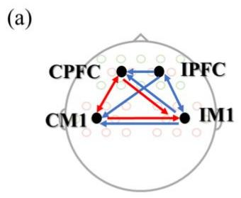  
(d)

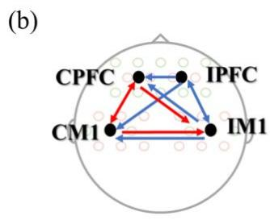  
(e)

在肘关节屈曲和伸展期间，从 IM1 到 IPFC 的连接显著高于健康对照受试者（p=0.012, p=0.008, $p { = } 0 . 0 3 3 , p { = } 0 . 0 3 8 , p { = } 0 . 0 2 7 )$。如图 2 和图 3 所示，与健康对照受试者相比，脑卒中后患者从 CPFC 到 CM1、从 CM1 到 CPFC 以及从 CM1 到 IM1 的连接也显著较低 $( p { = } 0 . 0 0 5 , p { = } 0 . 0 1 3 , p { = } 0 . 0 2 0 )$。另一方面，与一维 MCI 相比，双向

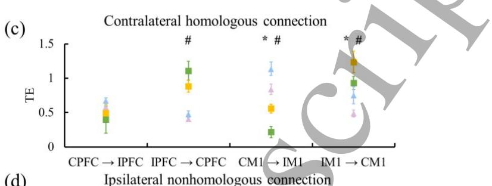

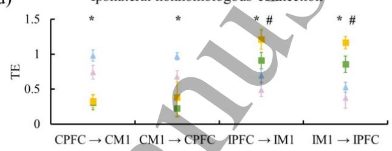

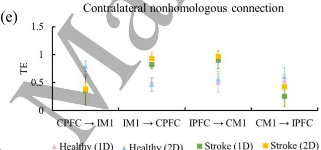  
Figure 2. 肘关节屈曲期间，健康对照受试者和脑卒中后患者在各 MCI 内的皮层间连接。在一维 MCI (a) 和二维 MCI (b) 中均发现了健康对照受试者与脑卒中后患者之间的显著差异。红线表示健康对照受试者中显著强于脑卒中后患者的连接，蓝线表示相反情况。皮层间连接被分为对侧同源连接 (c)、对侧非同源连接 (d) 和同侧非同源连接 (e)。“*”和“#”分别表示健康受试者和患者在两种视觉反馈之间的显著差异。缩写：1D = 一维，2D = 二维。

## 3.1 皮层间与肌肉间连接

健康对照受试者和脑卒中后患者在各 MCI 内的皮层间连接结果如图 2 和图 3 所示。对皮层间连接进行的方差分析（ANOVA）表明，组别 $( p { = } 0 . 0 0 1 )$ 和维度 (p=0.036) 均具有显著效应，且两者之间存在显著的交互效应 (p=0.025)。事后分析显示，脑卒中后患者在从 IPFC 到 CPFC、从 IM1 到 CM1、从 IM1 到 CPFC、从 IPFC 到 IM1 以及双侧 M1 之间与 IPFC 和 IM1 之间的皮层间连接，在肘关节屈曲和伸展期间的二维 MCI 中明显强于健康对照受试者 $( p \mathrm { = } 0 . 0 2 8 , p \mathrm { = } 0 . 0 3 1 , p \mathrm { = } 0 . 0 1 1 , p \mathrm { = } 0 . 0 4 1 )$。

Table Ⅱ 列出了在不同 MCI 下健康对照受试者和脑卒中后患者的肌间连接。根据方差分析（ANOVA）的结果，仅组别对肌间连接产生了主效应（组别：p=0.041；维度：p=0.135），未呈现

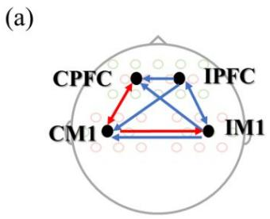  
(c)  
(d)

(b)  
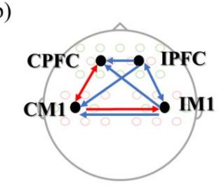  
(e)

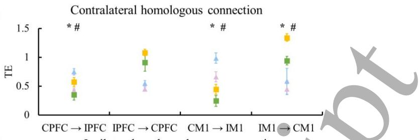

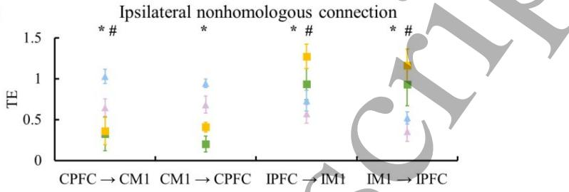

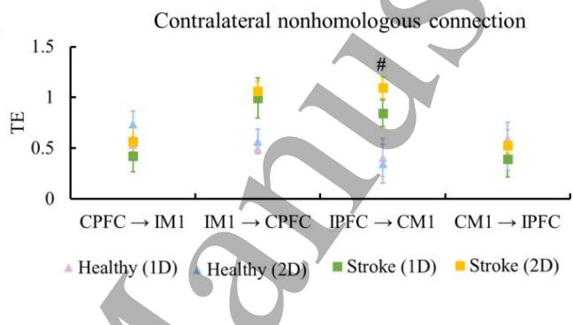  
Figure 3. 肘部伸展期间各 MCI 下两组的皮层间连接。在一维 MCI (a) 和二维 MCI (b) 中均发现了显著的组间差异。线条颜色代表对照受试者中更强的连接（红色）或脑卒中后患者中更强的连接（蓝色）。箭头代表传递方向。由 MCI 维度和组别引起的显著差异分别在对侧同源连接 (c)、对侧非同源连接 (d) 和同侧非同源连接 (e) 中用“*”和“#”标出。缩写：1D = 一维，2D = 二维。

<table><tr><td rowspan="3"></td><td colspan="4">肘部屈曲</td><td colspan="4">肘部伸展</td></tr><tr><td colspan="2">健康</td><td colspan="2">脑卒中</td><td colspan="2">健康</td><td colspan="2">脑卒中</td></tr><tr><td>1D</td><td>2D</td><td>1D</td><td>2D</td><td>1D</td><td>2D</td><td>1D</td><td>2D</td></tr><tr><td>主动肌 □ 拮抗肌</td><td>0.11±0.01</td><td>0.12±0.02</td><td>0.05±0.01</td><td>0.07±0.01</td><td>0.09±0.02</td><td>0.10±0.02</td><td>0.05±0.02</td><td>0.06±0.01</td></tr><tr><td>拮抗肌 □ 主动肌</td><td>0.09±0.01</td><td>0.10±0.02</td><td>0.04±0.01</td><td>0.06±0.02*</td><td>0.08±0.01</td><td>0.08±0.01</td><td>0.03±0.01</td><td>0.06±0.01*</td></tr></table>

Table Ⅱ 各 MCI 下两组的肌间连接。缩写：1D = 一维，2D = 二维。*：一维与二维 MCI 之间存在显著差异（p < 0.05）。

交互效应（组别 ✕ 维度：p=0.635）。与脑卒中后患者相比，健康对照受试者表现出显著更强的肌间连接（p=0.038）。与一维任务相比，二维任务中可以观察到更强的连接，但无统计学显著性（p=0.550），唯独脑卒中后患者中从拮抗肌到主动肌的肌间连接除外（p=0.003）。此外，我们发现在 MCI 内的各个组别中，从主动肌到拮抗肌的肌间连接略大于从拮抗肌到主动肌的肌间连接（p=0.380）。

## 3.2 皮质-肌肉连接

由于大脑皮质与肌肉之间的传播效应，信息传递中产生了时间延迟

大脑到肌肉 (1D) 肌肉到大脑 (1D) 大脑到肌肉 (2D) 肌肉到大脑 (2D)

(a)  
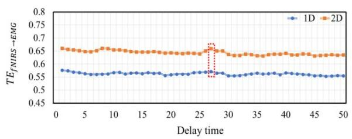

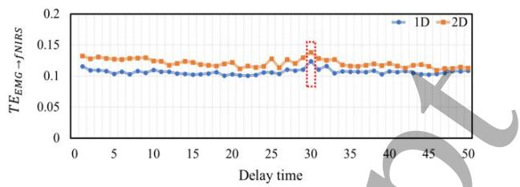

(b)  

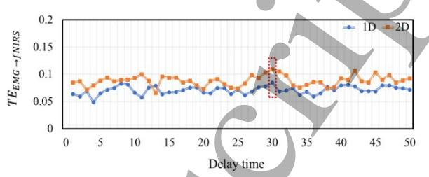  
Figure 4. 在屈肘 (a) 和伸肘 (b) 过程中，各个 MCI 内参数 u 取值从 1 到 50 时，从 fNIRS 到 EMG 以及从 EMG 到 fNIRS 的皮质-肌肉连接中进行的 TE 分析。缩写：1D = 一维，2D = 二维。

在皮质-肌肉网络中。Figure 4 展示了当参数 u 在 1 到 50 之间变化时，大脑皮质与肌肉之间双向传递的 TE 值，这表明皮质-肌肉连接会受到参数 u 取值的影响。我们发现当参数 u 等于 27 时，$\mathrm { T E } _ { \mathrm { f N I R S } } \mathrm { _ { \Delta E M G } }$ 达到最大值。当参数 u 为 31 时，发现 $\mathrm { T E } _ { \mathrm { E M G }  \mathrm { f N I R S } }$ 达到最大值。总体结果还表明，MCI 维度对时间延迟的影响微乎其微。先前的研究也报道了类似的结果，即两个传递方向上的时间延迟通常集中在 20–31 左右 [3]，这与本研究的结果一致。

值得注意的是，在健康对照受试者和中风后患者中，每个 MCI 内的 ATEcortex to muscle 均显著强于 ATE，如图 5 所示。因此，在接下来的分析中可以排除从肌肉到皮层的皮质肌肉连接。根据 $\mathbf { A N O V A }$ 的结果，组别 $\scriptstyle ( p = 0 . 0 0 2 )$ 和维度 $( p { = } 0 . 0 2 1 )$ 对 A $\mathrm { T E } _ { \mathrm { c o r t e x  t o m u s c l e } . }$ 具有显著的主效应。交互作用分析表明，组别与维度之间没有显著的交互效应 (p=0.067)。此外，两组在不同 MCI 内皮质-肌肉网络（从皮层到肌肉）中的 TE 值列于表 Ⅲ 中。存在显著的组间差异 $\scriptstyle ( p = 0 . 0 0 1 )$，如图 6 所示。在每个 MCI 内，中风后患者的皮质-肌肉连接均显著低于健康对照受试者。在所有受试者中，二维任务期间的皮质-肌肉连接强度显著大于一维任务期间 $( p { = } 0 . 0 \dot { 4 } 9 )$。双侧 PFC 和 M1 对主动肌的作用均强于拮抗肌，在

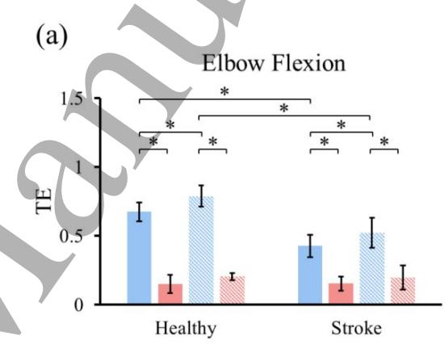

(b)  
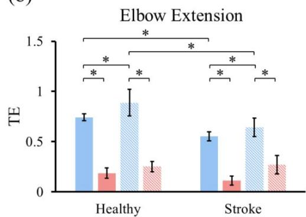  
Figure 5. 屈肘 (a) 和伸肘 (b) 期间健康对照受试者和中风后患者在各 MCI 内大脑与肌肉之间皮质-肌肉连接强度的总和。缩写：1D = 一维，2D = 二维。

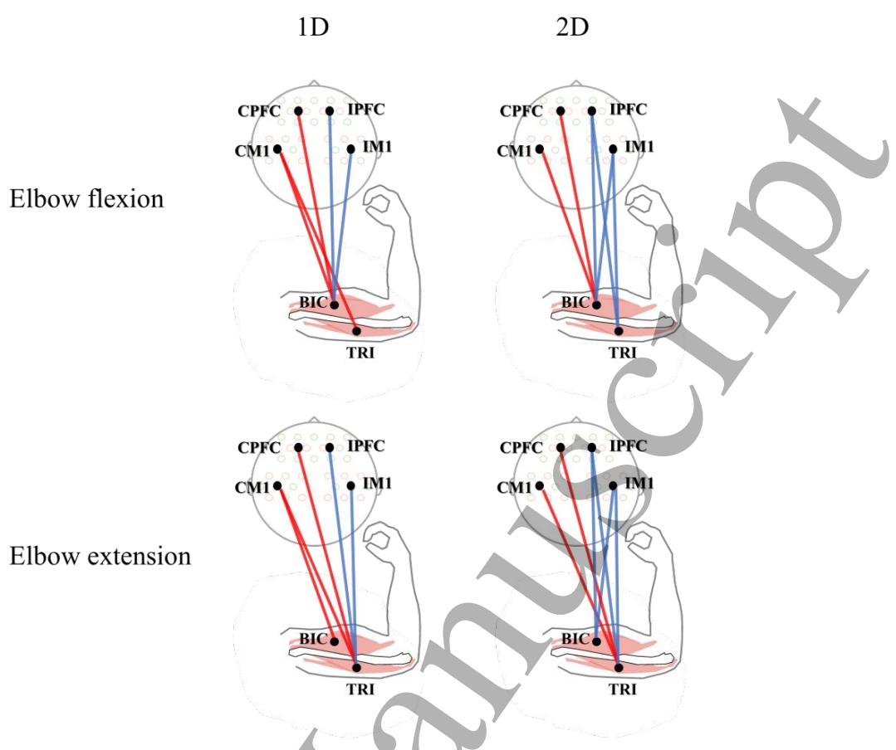  
Figure 6. 从皮层到肌肉的皮质-肌肉连接的组间差异。红线表示健康对照受试者中的连接显著强于中风后患者，蓝线表示相反情况。缩写：1D = 一维，2D = 二维。

<table><tr><td rowspan="3"></td><td colspan="4">屈肘</td><td colspan="4">伸肘</td></tr><tr><td colspan="2">健康组</td><td colspan="2">脑卒中组</td><td colspan="2">健康组</td><td colspan="2">脑卒中组</td></tr><tr><td>1D</td><td>2D</td><td>1D</td><td>2D</td><td>1D</td><td>2D</td><td>1D</td><td>2D</td></tr><tr><td>CPFC 主动肌</td><td>0.82±0.06</td><td>1.02±0.35*</td><td>0.44±0.19#</td><td>0.50±0.10#</td><td>0.39±0.05</td><td>0.72±0.09*</td><td>0.28±0.07</td><td>0.42±0.09*#</td></tr><tr><td>IPFC → 主动肌</td><td>0.40±0.06</td><td>0.48±0.07</td><td>0.55±0.30</td><td>0.71±0.28*#</td><td>0.44±0.05</td><td>0.56±0.05*</td><td>0.42±0.04</td><td>0.86±0.24*#</td></tr><tr><td>CM1 → 主动肌</td><td>0.79±0.17</td><td>1.03±0.08*</td><td>0.24±0.13#</td><td>0.45±0.19*#</td><td>0.53±0.10</td><td>0.66±0.14*</td><td>0.21±0.06#</td><td>0.62±0.10*</td></tr><tr><td>IM1 → 主动肌</td><td>0.37±0.06</td><td>0.49±0.19*</td><td>0.49±0.13</td><td>0.71±0.05*#</td><td>0.26±0.18</td><td>0.38±0.07</td><td>0.36±0.06</td><td>0.72±0.09*#</td></tr><tr><td>CPFC 拮抗肌</td><td>0.47±0.08</td><td>0.68±0.13*</td><td>0.33±0.25#</td><td>0.58±0.23*</td><td>0.51±0.11</td><td>0.60±0.11*</td><td>0.18±0.03#</td><td>0.29±0.05#</td></tr><tr><td>IPFC → 拮抗肌</td><td>0.34±0.08</td><td>0.45±0.04*</td><td>0.41±0.21</td><td>0.77±0.28*#</td><td>0.39±0.07</td><td>0.46±0.07</td><td>0.54±0.07</td><td>0.96±0.20*#</td></tr><tr><td>CM1 → 拮抗肌</td><td>0.44±0.04</td><td>0.70±0.06</td><td>0.23±0.13#</td><td>0.52±0.22*#</td><td>0.70±0.06</td><td>0.90±0.11*</td><td>0.18±0.05#</td><td>0.49±0.13*#</td></tr><tr><td>IM1 → 拮抗肌</td><td>0.39±0.01</td><td>0.47±0.03</td><td>0.46±0.13</td><td>0.67±0.18*#</td><td>0.25±0.09</td><td>0.39±0.06*</td><td>0.56±0.04#</td><td>1.02±0.13*#</td></tr></table>

Table Ⅲ 每种 MCI 下两组受试者皮层至肌肉的皮层-肌肉连接。缩写：1D = 一维，2D = 二维。*：一维与二维 MCI 之间存在显著性差异（$p < 0.05$）。#：健康对照受试者与脑卒中患者之间存在显著性差异（$p < 0.05$）。

健康对照受试者在两种 MCI 下均是如此。脑卒中患者仅在一维 MCI 下表现出类似趋势。在健康对照受试者中，来自对侧半球的皮层-肌肉连接比同侧半球更为显著，而脑卒中患者则表现出相反的结果。随着维度的增加，从 CPFC 到拮抗肌、从 CM1 到主动肌、从 CM1 到拮抗肌以及从 IM1 到主动肌的皮层-肌肉连接均更强。这一现象在所有受试者中均被发现。

## 4. 讨论

本研究主要探讨了脑卒中后皮层间、皮层-肌肉以及肌肉间网络中信息传递的变化，以及这些变化是否能被不同的 MCI 维度所调控。本研究有以下三项主要发现：1）与健康对照受试者相比，脑卒中患者在皮层间网络和皮层-肌肉网络中分别表现出信息传递的增加和减少；2）脑卒中患者从同侧皮层区到肌肉的信息传递强于对侧区域；3）在所有受试者中，各个网络中的信息传递均随着 MCI 维度的增加而增强。

## 4.1 脑卒中引起的皮层-运动系统变化

在本研究中，发现脑卒中患者的皮质间连接强于健康对照受试者。这与以往发现脑卒中急性期患者不同皮质区域之间连接较低的研究不一致。这一不一致的结果可能是由于患者康复程度的不同所致。大脑可以重组存活的皮质间网络，以代偿脑卒中所致的损伤 [31]。先前的一项研究报道，同侧和半球间的连接会被加强，从而在改善运动功能方面发挥重要作用 [32]。此外，在本研究中，健康对照受试者和脑卒中患者的 TEcortex to muscle 均显著大于各 MCI 内部的 TE，这可能表明由于皮质运动控制，有更多的信息从皮质传递到了肌肉。与健康对照受试者相比，脑卒中患者从皮质到肌肉的皮质-肌肉连接较低。这表明在脑卒中后，由于信息传递减少，受损皮质区域与目标肌肉之间的功能连接减弱。这一发现与以往显示皮质-肌肉相干性较低的研究一致，后者可能与脑卒中后皮质与肌肉之间的不良沟通，或血流动力学与 EMG 信号之间的不良整合有关 [5, 14]。具体而言，观察到从皮质区域到激动肌的皮质-肌肉连接强于到拮抗肌的连接，这表明在脑卒中患者中，激动肌可能从皮质区域接收到了更多的控制信息。我们推测这可能是由于激动肌的作用，其可能为患者执行肘部追踪任务提供主要动力。另一方面，从皮质区域到拮抗肌的皮质-肌肉连接较低，可能是由于脑卒中后未能抑制拮抗肌所致 [33]。皮质抑制回路能够抑制健康对照受试者中不必要的肌肉激活 [34, 35]，但这种抑制功能在脑卒中患者中受损。我们推测脑卒中患者与受损抑制回路相关的皮质区域激活减少，因此在肘部运动期间，抑制信息向拮抗肌的传递频率降低。在二维 MCI 内，脑卒中患者从皮质区域到拮抗肌的皮质-肌肉连接较高，这可能支持该假设。在本研究中，与健康对照受试者相比，脑卒中患者的肌间连接强度有所降低，这与以往报道目标肌肉间功能耦合减弱的研究一致 [36]。较低的肌间连接可能反映了肌肉间信息传递的减少，这可以归因于皮质控制的减弱；即脑卒中后皮质区域神经功能受损，导致传递到目标肌肉的控制指令（尤其是抑制指令）减少 [36]。

## 4.2 MCI 维度对皮质运动系统的影响

本研究的主要发现之一是，在二维任务中观察到双侧大脑半球 M1 之间的皮质间连接强于一维任务，这可能表明双侧大脑半球 M1 之间的信息交流有所增强。这一发现与以往研究的结果相一致，该研究指出，双侧半球 M1 之间功能连接的增加可能是由于双侧 M1 之间更强的同步性以强化其输出所致 [37]。由于受试者被要求在二维 MCI 中同时精确调节其主动肌和拮抗肌的激活，任务变得更加复杂。为了完成此类复杂任务，双侧半球的 M1 应当增强用于精确调控肌肉激活的下行运动指令，这可能是左右 M1 之间信息传递增加的原因。此外，在二维任务中，双侧半球 PFC 到同侧 M1 的同侧连接增加，这与以往的一项研究 [38] 一致，该研究观察到类似脑区之间的功能连接显著增加。一种推测是，PFC 与同侧 M1 之间的连接与认知运动控制有关。最近的一项研究表明，PFC 与同侧 M1 具有紧密的协作关系，构成了一个在复杂运动任务中被激活的基本脑回路 [39]。Brown 等人证实，在简单运动任务中，PFC 对同侧 M1 的影响较小 [40]，这表明上述皮质回路可能仅在复杂运动任务中起作用。因此，这表明当 PFC 和 M1 参与复杂运动任务（如本研究中的二维任务）时，它们需要更多的认知控制，这可能导致从 PFC 到同侧 M1 的功能连接增加。另一方面，从 PFC 到同侧 M1 更强的连接可能与二维 MCI 内的运动抑制有关。多项研究已经证明 PFC 在运动抑制中发挥了关键作用 [41, 42]。Narayanan 等人报道，由于 PFC 与 M1 之间的功能相互作用，PFC 可能会对 M1 施加自上而下的控制信号以抑制反应 [43]。受试者被要求在二维 MCI 中抑制其拮抗肌的激活，这可能会加强从 PFC 到 M1 的功能连接。在皮质-肌肉层面上，随着 MCI 维度的增加，两组中均发现了更强的皮质-肌肉连接，这与先前的研究相符。皮质-肌肉连接可以反映与单块肌肉控制相关的皮质驱动，这种驱动可受到视觉反馈的改变 [44]。在本研究中，二维任务期间更强的皮质-肌肉连接可能表明，随着感觉信息的增加，有额外的信息从皮质区域传递到肌肉。以往的研究报道，更多的皮质-肌肉信息传递与更好的运动表现相关 [45]，这反过来可能会促进肌间协调性的改善。

## 5. 结论

本研究主要探讨了 MCI（肌肉-计算机接口）维度和卒中对皮层间、皮层-肌肉及肌肉间网络中信息传输的影响。研究发现，脑卒中后患者皮层间网络的信息传输有所增强，这可能与卒中后的皮质重构有关。与健康对照受试者相比，脑卒中后患者皮层-肌肉网络中的信息传输有所减弱，这与传递至目标肌肉的复杂神经指令减少有关。最后，本研究揭示了增加 MCI 维度可能有助于增强脑卒中后患者皮层-运动系统中的连接，这可能意味着二维 MCI 将成为一种有效的康复工具，用以增强脑卒中后患者各个网络中的信息传输。此外，未来应开展结合其他分析方法（例如在弱耦合和非线性耦合分析中具有可靠性与有效性优势的模糊同步似然（FSL）[46]）的研究工作，以全面探究大脑与目标肌肉之间复杂且动态的相互作用。

## 致谢

本研究得到了国家重点研发计划（National Key R&D Program of China，项目编号：2018YFC2001600）、广东省科技创新战略专项资金（Special Foundation of Science and Technology Innovation Strategy of Guangdong Province，项目编号：2020B212060077）以及国家自然科学基金（National Natural Science Foundation of China，项目编号：81902286）的部分资助。

## 参考文献

[1] T. Drew, W. Jiang, B. Kably, and S. Lavoie. Role of the motor cortex in the control of visually triggered gait modifications. Canadian Journal of Physiology and Pharmacology. 74: 426-442, 1996. N

[2] C. Babiloni, F. Vecchio, M. Bares, M. Brazdil, I. Nestrasil, F. Eusebi, P. M. Rossini, and I. Rektor. Functional coupling between anterior prefrontal cortex (BA10) and hand muscle contraction during intentional and imitative motor acts. NeuroImage. 39: 1314-1323, 2008.

[3] C. L. Witham, C. N. Riddle, M. R. Baker, and S. N. Baker. Contributions of descending and ascending pathways to corticomuscular coherence in humans. Journal of Physiology. 589: 3789-3800, 2011.

[4] P. Langhorne, F. Coupar, and A. Pollock. Motor recovery after stroke: a systematic review. Lancet Neurology. 8: 741- 754, 2009.

[5] X. Chen, P. Xie, Y. Zhang, Y. Chen, F. Yang, L. Zhang, and X. Li. Multiscale information transfer in functional corticomuscular coupling estimation following stroke: a pilot study. Frontiers in Neurology. 9: 287, 2018.

[6] G. H., B. E., Tomlinson, P. H., and Gibson. Cell counts in human cerebral cortex in normal adults throughout life using an image analysing computer. Journal of the Neurological Sciences. 46: 1980.

[7] E. B. Plow, D. A. Cunningham, C. Bonnett, D. Gohar, M. Bayram, A. Wyant, N. Varnerin, B. Mamone, V. Siemionow, and J. Hou. Neurophysiological correlates of aging-related muscle weakness. Journal of Neurophysiology. 110: 2563- 2573, 2013.

[8] Y. Sun, and E. P. Zehr. Training-induced neural plasticity and strength are amplified after stroke. Exercise and Sport Sciences Reviews. 47: 223, 2019.

[9] K. P. Westlake, and S. S. Nagarajan. Functional Connectivity in Relation to Motor Performance and Recovery After Stroke. Frontiers in Systems Neuroence. 5, 2011.

[10] L. H. A. Strens, P. Asselman, A. Pogosyan, C. Loukas, and P. Brown. Corticocortical coupling in chronic stroke: its relevance to recovery. Neurology. 63: 475-484, 2005.

[11] G. Christian, B. Khalaf, S. Alexandra, E. M. Wassermann, C. Robert, M. Takahiro, W. Daniel, G. F. Wittenberg, I. Kenji, and L. G. Cohen. Multimodal imaging of brain reorganization in motor areas of the contralesional hemisphere of well recovered patients after capsular stroke. Brain A Journal of Neurology. 791-808, 2006.

[12] K. Kato, M. Sawada, and Y. Nishimura. Bypassing stroke-damaged neural pathways via a neural interface induces targeted cortical adaptation. Nature Communications. 10: 4699, 2019.

[13] Y. Yuan, S. E. Teodoro, V. D. R. Mark, d. H. F. C. T. Van, and A. C. Schouten. Nonlinear coupling between cortical oscillations and muscle activity during isotonic wrist flexion. Frontiers in Computational Neuroence. 10, 2016.

[14] Y. Fang, J. J. Daly, J. Sun, K. Hvorat, E. Fredrickson, S. Pundik, V. Sahgal, and G. H. Yue. Functional corticomuscular connection during reaching is weakened following stroke. Clinical Neurophysiology. 120: 994-1002, 2009.

[15] F. Meng, K. Y. Tong, S. T. Chan, W. W. Wong, K. H. Lui, K. W. Tang, X. Gao, and S. Gao. Cerebral plasticity after subcortical stroke as revealed by cortico-muscular coherence. IEEE Transactions on Neural Systems & Rehabilitation Engineering. 17: 234-243, 2009.

[16] T. Mima, K. Toma, B. Koshy, and M. Hallett. Coherence between cortical and muscular activities after subcortical stroke. Stroke. 32: 2597-2601, 2001.

[17] I. V. Bonan, F. M. Colle, J. P. Guichard, E. Vicaut, M. Eisenfisz, P. T. B. Huy, and A. P. Yelnik. Reliance on visual information after stroke. Part I: balance on dynamic posturography. Archives of Physical Medicine and Rehabilitation. 85: 268-273, 2004.

[18] A. J. Westerveld, A. C. Schouten, P. H. Veltink, and H. V. D. Kooij. Control of thumb force using surface functional electrical stimulation and muscle load sharing. Journal of NeuroEngineering and Rehabilitation. 10: 2013.

[19] T. Watanabe, I. Nojima, T. Mima, H. Sugiura, and H. Kirimoto. Magnification of visual feedback modulates corticomuscular and intermuscular coherences differently in young and elderly adults. NeuroImage. 220: 117089, 2020.

[20] Michael, D., Ellis, Bradley, G., Holubar, Ana, Maria, Acosta, and Randall. Modifiability of abnormal isometric elbow and shoulder joint torque coupling after stroke. Muscle and Nerve. 32: 170-178, 2005.

[21] Z. A. Wright, W. Z. Rymer, and M. W. Slutzky. Reducing abnormal muscle coactivation after stroke using a myoelectric-computer interface: a pilot study. Neurorehabilitation and Neural Repair. 28: 443-451, 2013.

[22] S. J. Young, J. Van Doornik, and T. D. Sanger. Visual feedback reduces co-contraction in children with dystonia. Journal of Child Neurology. 26: 37-43, 2011.

[23] C. Jian, L. Deng, H. Liu, T. Yan, X. Wang, and R. Song. Modulating and restoring inter-muscular coordination in stroke patients using two-dimensional myoelectric computer interface: a cross-sectional and longitudinal study. Journal of Neural Engineering. 18: 36005-36018, 2021.

[24] Schreiber, and Thomas. Measuring Information Transfer. Physical Review Letters. 85: 461-464, 2000.

[25] L. Faes, D. Marinazzo, A. Montalto, and G. Nollo. Lagspecific transfer entropy as a tool to assess cardiovascular and cardiorespiratory information transfer. IEEE Transactions on Biomedical Engineering. 61: 2556-2568, 2014.

[26] S. Salenius, and R. Hari. Synchronous cortical oscillatory Current Opinion in Neurobiology. 13: 678-684, 2003.

[27] X. Ping, Y. Fangmei, C. Xiaoling, D. Yihao, and W. Xiaoguang. Functional coupling analyses of electroencephalogram and electromyogram based on multiscale transfer entropy. Chinese Journal of Physics. 64: 2015.

[28] Q. Zhang, G. E. Strangman, and G. Ganis. Adaptive filtering to reduce global interference in non-invasive NIRS

measures of brain activation: How well and when does it work? NeuroImage. 45: 788-794, 2009.

[29] J. Yao, A. Chen, C. Carmona, and J. P. A. Dewald. Cortical overlap of joint representations contributes to the loss of independent joint control following stroke. NeuroImage. 45: 490-499, 2009.

[30] Y. Li, and D. Yu. Weak network efficiency in young children with autism spectrum disorder: evidence from a functional near-infrared spectroscopy study. Brain and Cognition. 108: 47-55, 2016.

[31] S. Bajaj, A. J. Butler, D. Drake, and M. Dhamala. Brain effective connectivity during motor-imagery and execution following stroke and rehabilitation. NeuroImage: Clinical. 8: 572-582, 2015.

[32] Y. Peng, J. Liu, M. Hua, M. Liang, and C. Yu. Enhanced effective connectivity from ipsilesional to contralesional M1 in well-recovered subcortical stroke patients. Frontiers in Neurology. 10, 2019.

[33] L. V. Bradnam, C. M. Stinear, and W. D. Byblow. Theta burst stimulation of human primary motor cortex degrades selective muscle activation in the ipsilateral arm. Journal of Neurophysiology. 104: 2594-2602, 2010.

[34] V. DE, M. MA, and C. DM. Intermittent visuomotor processing in the human cerebellum, parietal cortex, and premotor cortex. Journal of Neurophysiology. 95: 922-931, 2006.

[35] N. Sander, and Y. Nick. Neural mechanisms of attention and control: losing our inhibitions? Nature Neuroscience. 8: 1631-1633, 2005.

[36] K. Kisiel-Sajewicz, Y. Fang, K. Hrovat, G. H. Yue, and J. J. Daly. Weakening of synergist muscle coupling during reaching movement in stroke patients. Neurorehabilitation and Neural Repair. 25: 359-368, 2011.

[37] Z. Jiang, X. F. Wang, K. Kisiel-Sajewicz, J. H. Yan, and G. H. Yue. Strengthened functional connectivity in the brain during muscle fatigue. NeuroImage. 60: 728-737, 2012.

[38] H. Rao, X. Di, R. C. K. Chan, Y. Ding, B. Ye, and D. Gao. A regulation role of the prefrontal cortex in the fist-edgepalm task: evidence from functional connectivity analysis. NeuroImage. 41: 804-813, 2008.

[39] A. R. Anwar, M. Muthalib, S. Perrey, A. Galka, O. Granert, S. Wolff, U. Heute, G. Deuschl, J. Raethjen, and M. Muthuraman. Effective connectivity of cortical sensorimotor networks during finger movement tasks: a simultaneous fNIRS, fMRI, EEG study. Brain Topography. 29: 645–660, 2016.

[40] M. J. Brown, E. R. Goldenkoff, R. Chen, C. Gunraj, and M. Vesia. Using dual-site transcranial magnetic stimulation to probe connectivity between the dorsolateral prefrontal cortex and ipsilateral primary motor cortex in humans. Brain Sciences. 9: 2019.

[41] M. Jaffard, M. Longcamp, J. L. Velay, J. L. Anton, M. Roth, B. Nazarian, and P. Boulinguez. Proactive inhibitory control of movement assessed by event-related fMRI. NeuroImage. 42: 1196-1206, 2008.

[42] Marjan, Jahanshahi, Ignacio, Obeso, C. John, Rothwell, and J. A. A fronto-striato-subthalamic-pallidal network for

goal-directed and habitual inhibition. Nature Reviews Neuroscience. 16: 719-732, 2015.

[43] N. S. Narayanan, and M. Laubach. Top-down control of motor cortex ensembles by dorsomedial prefrontal cortex. Neuron. 52: 921-931, 2006.

[44] I. E. J. De Vries, A. Daffertshofer, D. F. Stegeman, and T. W. Boonstra. Functional connectivity in the neuromuscular system underlying bimanual coordination. Journal of Neurophysiology. 116: jn.00460.2016, 2016.

[45] R. Kristeva, L. Patino, and W. Omlor. Beta-range cortical motor spectral power and corticomuscular coherence as a mechanism for effective corticospinal interaction during steady-state motor output. NeuroImage. 36: 785-792, 2007.

[46] M. Ahmadlou, H. Adeli, and A. Adeli. Fuzzy synchronization likelihood-wavelet methodology for diagnosis of autism spectrum disorder. Journal of Neuroence Methods. 211: 203-209, 2012.