# Phase-Dependent Modulation of Muscle Activity and Intermuscular Coupling During Walking in Patients After Stroke

Yifan Li, Yueling Lyu, and Rong Song , Senior Member, IEEE

Abstract— Many patients experience motor and sensory impairments after stroke, leading to gait disturbances. Analysis of muscle modulation mode during walking can provide evidence for neurological changes after stroke, while how stroke affects individual muscle activity and muscular coordination in certain gait sub-phases remains unclear. The purpose of the present study is to comprehensively investigate phase-dependent ankle muscle activity and intermuscular coupling patterns in poststroke patients. In this experiment, 10 post-stroke patients, 10 young healthy subjects and 10 elderly healthy subjects were recruited. All subjects were asked to walk at their preferred speeds on the ground, and surface electromyography (sEMG) and marker trajectory data were collected simultaneously. The gait cycle of each subject was divided into four substages according to the labeled trajectory data. On this basis, fuzzy approximate entropy (fApEn) was used to analyze the complexity of ankle muscle activity during walking. And the transfer entropy (TE) was applied to reflect directed information transmission between ankle muscles. Results found that complexity of ankle muscles activities in patients after stroke showed similar trends to that in healthy subjects. Different from healthy subjects, the complexity of ankle muscle activity in patients with stroke tends to increase in most of the gait sub-phases. While TE values between the ankle muscles in patients with stroke tend to decrease throughout the gait cycle, especially in the second double support stage. Compared with age-matched healthy subjects, patients recruit more motor units throughout their gait while increasing muscle coupling to achieve gait function. The combined application of fApEn and TE provide a more comprehensive understanding of phase-dependent muscle modulation mechanisms in post-stroke patients.

Index Terms— Stroke, gait phase-dependent, muscle activity complexity, muscular coordination.

## I. INTRODUCTION

TROKE is a global health problem and a leading cause S of long-term disability [1], [2]. Many patients experience motor impairments after stroke, leading to gait disturbances, which directly reduce their ability to adapt to movement patterns and subsequently affect the quality of life [3]. It was reported that a large percentage of patients could regain ability to walk, but their gait patterns changed compared with healthy individuals [4]. Gait analysis is an essential component in a physical rehabilitation program for stroke survivors, considering that it can provide important information for rehabilitation process monitoring and disease diagnosis [5].

Chronic gait deficits after stroke was reported to be associated with abnormal muscle activation patterns [6], [7]. Proper ankle control during walking is important for normal gait patterns. The triceps surae (TS) and tibialis anterior (TA) muscles, as plantar flexors and dorsiflexors, play important roles in support, postural balance and dynamic stability during walking [8]. The surface electromyography (sEMG) has been used as a non-invasive method to measure muscle activity, which can provide a more complete understanding of gait function in patients after stroke [9]. Linear and nonlinear dynamic analysis methods based on sEMG have been introduced into the motor control and gait analysis [10]. Parameters widely used for muscle activity measurement are often related to sEMG amplitude and root mean square (RMS), etc [11], [12]. However, the biological systems and processes are inherently complex and nonlinear, and the properties of simple linear models are limited in characterizing muscle dynamics [13]. Using nonlinear time series analysis methods to assess the complexity of tasks such as walking may help to better understand the recovery process after stroke. Entropy is an effective method to measure the complexity of dynamic systems. It has been widely used to evaluate the dynamic characteristics of biological systems by estimating the information complexity of physiological sequences, that is, the uncertainty of random variables [14], [15]. Entropy-based methods, such as approximate entropy (ApEn) and sample entropy (SampEn), have been used for the physiological signals analysis [16]. Chen et al. developed fApEn as another complexity analysis method, which combines zadeh’s fuzzy sets with entropybased methods [17]. Because fApEn has the advantages of good robustness and consistency, it can be used to analyze the muscle activity complexity and further explore the adaptability of the neuromotor system after stroke [17], [18].

Not only the individual muscle activity can be used to analyse the changes in muscle function caused by hemiplegia, but also the quantification of intermuscular interactions will contribute to further understanding of the coupling and coordination mechanisms between muscles [19]. Park et al. investigated the coordination of upper limb muscles during isokinetic movement after stroke and showed that the regulation of coactivation coefficients was altered after stroke [20]. Clark et al. reported that motor module activity in lower extremity muscle coordination, also known as muscle synergy, is reduced during walking in poststroke patients [21]. Wang et al. found that muscle fatigue significantly increased the coupling of the antagonist muscles in patients after stroke, which may be related to the increase in the common corticospinal drive from the motor cortex to the antagonist muscles [22]. In general, abnormal muscular coordination may lead to severe gait defects and further restrict walking ability. Chris et al. reported that alterations in the intermuscular coupling may indicate pathological muscle synergism and compensatory coordination strategies [23]. The study of intermuscular coupling may provide valuable information on neuromuscular coordination in hemiplegic gait. Therefore, it is necessary to conduct further muscular coordination analysis in the gait of post-stroke patients. Information theory methods, such as mutual information (MI) and transfer entropy (TE), provide effective tools for the quantification of information transfer. They have the potential to detect and quantify functional neurophysiological coupling due to their model-free characteristics and ability to capture linear and non-linear relationships [24], [25]. Among them, transfer entropy (TE) was proposed as a promising indicator with ability to capture nonlinear coupling effects and directivity, which provides a basis for further analysis of intermuscular coupling strength changes after stroke [26], [27].

Walking requires complex neuromusculoskeletal control to support and propel the body [28], as well as muscle activation and intermuscular coordination at different sub-phases of the gait cycle [29]. Den Otter et al. found that there was no improvement in the temporal asymmetry of muscle activity during the recovery of gait ability in stroke patients [30]. However, changes in the temporal layout of the gait cycle after hemiplegia may be in response to the altered biomechanical and neurophysiological characteristics of patients. As part of the reorganization of gait-related muscle activity recovery, abnormal muscle activity patterns in stroke patients at different sub-phases of gait may represent a neuromuscular compensatory strategy rather than a pathologic disorder in the temporal layout regulation of muscle activity [31]. Studies also reported that periodic task-dependent coordination patterns of gait between muscles, suggesting that functional interactions between muscles are controlled by dynamic connectivity between the musculoskeletal system and the central nervous system [32]. Since it may be implied that increased dependence on cortical control after stroke is more likely to occur in specific phases of gait, it is important to analyse each sub-phase of poststroke hemiplegic gait separately. In addition, although studies on muscle regulation patterns in subphases of gait have been reported, there is a lack of comprehensive studies on muscle activity and muscle coordination patterns at different gait stages on the basis of complexity, especially in patients after stroke.

Therefore, the present study combined the fApEn and TE methods to investigate gait phase-dependent modulation of the activity complexity and directional interactions of ankle muscles in post-stroke patients. We hypothesized that the effects of stroke induced nerve damage on muscle activity and intermuscular coupling during walking are related to different gait sub-phases. The analysis of muscle activity and intermuscular coupling can more comprehensively explore underlying mechanisms behind the changes in muscles regulation.

## II. METHODS

## A. Participants

A total of 10 participants (age: 52.0±12.9 years; 6 males, 4 females) after stroke were recruited in this study. All patients met the following inclusion criterias: (1) with no difficulty understanding and following the experimental instructions because of cognition, auditory and visual impairment; (2) the ability to walk independently without an ankle-foot orthosis for at least 5 m. The basic information for the post-stroke patients is shown in Table I. In addition, 10 young healthy subjects (age: 23.2±1.55 years; 7 males,3 females) and 10 elderly healthy subjects (age: 56.6±6.85 years; 6 males,4 females) were recruited as controls. None of the subjects in the control group had a history of neurological or orthopedic diseases that might affect walking ability. This study was approved by the School of Medicine, Sun Yat-sen University Institutional Review Board and the ethical approval document number is Medical Ethics 2021 No. 24. All subjects signed the informed consent form before participating in the experiment.

## B. Experimental Procedures and Data Recording

The post-stroke patients and the controls were asked to walk at their preferred speeds on the ground. Subjects walked along a 4-meter sidewalk for a walking trial, and each subject performed 3 or 4 walking trials. The sEMG and marker trajectories data were collected from the hemiplegic leg of stroke patients and the right leg of healthy subjects. The sEMG signals were sampled at 1000HZ in young healthy subjects and stroke patients, and 2148HZ in elderly healthy subjects. The sEMG was recorded using a telemetered EMG system (Noraxon, Scottsdale, USA). The Ag/AgCl surface electrode (diameter 2 cm) was placed on four ankle muscles: tibialis anterior (TA), soleus (SOL), gastrocnemius lateral (GAL) and gastrocnemius medial (GAM). Marker trajectories were simultaneously recorded at 100 Hz using a 6-camera motion capture system (Motion Analysis Corporation, Santa Rosa, USA), with retroreflective markers placed on their lower limbs.

The gait cycle is defined by two consecutive initial foot contacts of the same foot, and its substages are as follows according to the marked trajectory data: the first double support phase (DS1), the single support phase (SS), the second double support phase (DS2) and the swing phase (SW). The graphic of gait sub-phases and typical sEMG signals from the ankle muscles during a gait cycle are shown in Fig. 1.

TABLE I  
BASIC DATA OF PATIENTS AFTER STROKE

<table><tr><td>Subject</td><td>Age</td><td>Gender</td><td>Lesion side</td><td>Type of stroke</td><td>Muscle strength</td><td>Muscle tension</td></tr><tr><td>1</td><td>55</td><td>M</td><td>R</td><td>CI</td><td>4-</td><td>1</td></tr><tr><td>2</td><td>55</td><td>M</td><td>L</td><td>CI</td><td>5-</td><td>1+</td></tr><tr><td>3</td><td>67</td><td>M</td><td>L</td><td>ICH</td><td>4-</td><td>1</td></tr><tr><td>4</td><td>52</td><td>M</td><td>L</td><td>CI</td><td>4</td><td>1+</td></tr><tr><td>5</td><td>43</td><td>M</td><td>L</td><td>ICH</td><td>5-</td><td>1+</td></tr><tr><td>6</td><td>56</td><td>F</td><td>L</td><td>CI</td><td>4</td><td>1</td></tr><tr><td>7</td><td>59</td><td>M</td><td>R</td><td>CI</td><td>5-</td><td>0</td></tr><tr><td>8</td><td>21</td><td>F</td><td>L</td><td>ICH</td><td>4</td><td>1+</td></tr><tr><td>9</td><td>58</td><td>F</td><td>R</td><td>CI</td><td>4+</td><td>1</td></tr><tr><td>10</td><td>63</td><td>M</td><td>R</td><td>CI</td><td>4</td><td>0</td></tr></table>

M: male; F: female; L=left; R=right; CI: Cerebral infarction; ICH: Intracerebral hemorrhage.

## C. Muscle Activity Complexity and Intermuscular Coupling Analysis

1) Preprocess: The de-averaging and high-pass Butterworth filter filters were used to remove baseline and attenuate motion artifacts. And the sEMG signals were filtered by a bandpass 4th-order Butterworth filter with a frequency band of 10-300 Hz and a 50 Hz digital notch filter. The filtered signal is normalized to avoid the influence of signal and individual differences.

2)fApEn method: fApEn algorithm is an effective and robust algorithm to evaluate the complexity of physiological signals, which can be used to characterize the stability or regularity of the system. The detailed calculation steps are as follows:

If given a series $N = N _ { 1 } , N _ { 2 } , \cdots , N _ { l } ,$ l is the length of N, then a m dimension vector sequences can be constructed as follows:

$$
N _ {i} ^ {m} = \left\{N (i), N (i + 1), \dots , N (i + m - 1) \right\} - N _ {0} (i),
$$

$$
i = 1, 2, \dots l - m + 1\tag{1}
$$

$$
N _ {0} (i) = \frac {1}{m} \sum_ {j = 0} ^ {m - 1} N (i + j)\tag{2}
$$

The maximum absolute distance $d _ { i j } ^ { m }$ of $N _ { i } ^ { m }$ and $N _ { j } ^ { m }$ is calculated according to:

$$
\begin{array}{c} d _ {i j} ^ {m} = \max _ {p \in (0, m - 1)} \{| (N (i + p) - N _ {0} (i)) - (N (j + p) \\ - N _ {0} (j)) | \}   i, \quad j = 1, 2, \dots , N - m; i \neq j \end{array}\tag{3}
$$

The $D _ { i j } ^ { m } \left( n , r \right)$ is the similarity degree between $N _ { i } ^ { m }$ and $N _ { j } ^ { m }$

$$
D _ {i j} ^ {m} (n, r) = e x p \left(- \left(d _ {i j} ^ {m}\right) ^ {n} / r\right)\tag{4}
$$

where r is the width or similarity tolerance in exponential function, n determines the gradient of boundary.

Then calculate the average similarity from each vector to another.

$$
\emptyset^ {m} (n, r) = \frac {1}{n - m} \sum_ {i = 1} ^ {n - m} \left(\frac {1}{n - m - 1} \sum_ {j = 1, j \neq i} ^ {n - m} D _ {i j} ^ {m}\right)\tag{5}
$$

Construct $m + 1$ dimensional vector sequences and repeat $( 2 ) – ( 5 ) , \emptyset ^ { m + 1 } ( n , r )$ was as follow:

$$
\emptyset^ {m + 1} (n, r) = \frac {1}{n - m} \sum_ {i = 1} ^ {n - m} \left(\frac {1}{n - m - 1} \sum_ {j = 1, j \neq i} ^ {n - m} D _ {i j} ^ {m + 1}\right)\tag{6}
$$

Finally, the FuzzyEn $\left( \mathrm { m } , \mathrm { n } , \mathrm { r } \right) = \left[ \ln \mathcal { V } ^ { \mathrm { m } } \left( \mathrm { n } , \mathrm { r } \right) - \ln \mathcal { V } ^ { \mathrm { m } + 1 } \left( \mathrm { n } , \mathrm { r } \right) \right]$ fApEn can be calculated as:

$$
f A p E n (m, n, r) = \ln \emptyset^ {m} (n, r) - \ln \emptyset^ {m + 1} (n, r)\tag{7}
$$

Here, $m \ : = \ : 2$ and $r \ : = \ : 0 . 2 5 ^ { * }$ std were set according to the previous study [33].

3) TE method: The TE was calculated to quantify coupling strength and directional information between the ankle muscles during walking. If given time series $M = m _ { 1 } , m _ { 2 } , \ldots , m _ { l }$ and $N = n _ { 1 } , n _ { 2 } , \ldots , n _ { l }$ , where l is the length of the time sequences. The TE of M to N is defined as $T E _ { M  \acute { \mathrm { u } } N }$ showing as follows:

$$
\begin{array}{l}T E _ {M \rightarrow N} = \sum_ {n _ {i}, n _ {i - t}, m _ {i - \tau}} \rho (n _ {i}, n _ {i - t}, m _ {i - \tau})\\\times \log \frac {\rho (n _ {i} | n _ {i - t} , m _ {i - \tau})}{\rho (n _ {i} | n _ {i - t})}\end{array}\tag{8}
$$

where $\rho \left( n _ { i } , n _ { i - t } , m _ { i - \tau } \right)$ is the joint probability for the occurrence of $n _ { i } , n _ { i - t }$ and $m _ { i - \tau } ; \mathrm { ~ t ~ }$ and τ are the time lags in N and M, respectively. Here t is set to 1 assuming that the maximum automatic transfer of information occurs at the data point before the target value in N. It is suitable for biomedical experimental data where the absolute value of autocorrelation function increases with time lag and decreases monotonically.

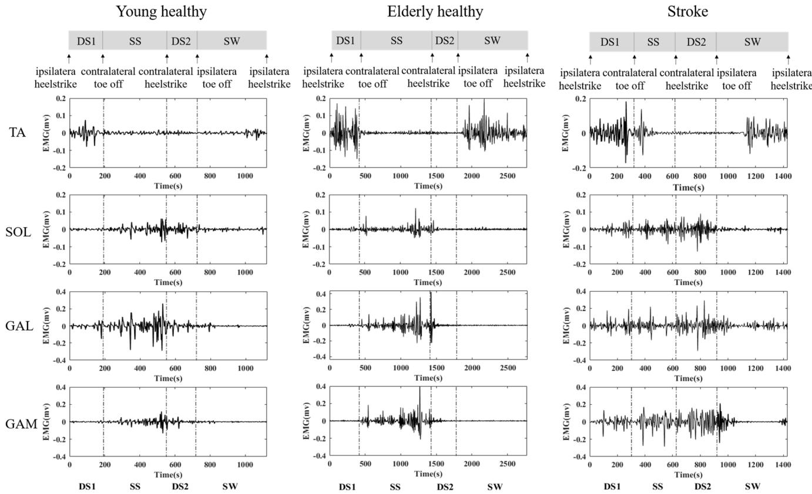  
Fig. 1. A typical example of (a) four sub-phases of a gait cycle in young healthy subjects, elderly healthy subjects and stroke patients, (b) with corresponding ankle muscle EMG data. young healthy: young healthy subjects; elderly healthy: elderly healthy subjects; Stroke: subjects after stroke; DS1: the first double support phase; SS: the single support phase; DS2: the second double support phase; SW: the swing phase; TA: tibialis anterior; SOL: soleus; GAL: gastrocnemius lateral; GAM: gastrocnemius medial.

The formula (9) can be simplified as follow:

$$
\begin{array}{l} T E _ {M \to N} = \sum_ {n _ {i}, n _ {i - 1}, m _ {i - \tau}} p (n _ {i}, n _ {i - 1}, m _ {i - \tau}) \\ \times \log \frac {p (n _ {i} , n _ {i - 1} , m _ {i - \tau}) p (n _ {i - 1})}{p (n _ {i - 1} , m _ {i - \tau}) p (n _ {i} , n _ {i - 1})} \end{array}\tag{9}
$$

## D. Statistical Analysis

The indices were calculated using Matlab (Mathworks, USA), and statistical study is conducted to verify if significant differences are present using SPSS (version 22.0.0.0 SPSS Inc). To investigate differences in muscle activity and intermuscle coordination between subjects at different gait subphases, we performed a repeated measures ANOVA with gait sub-phases as the within-subject factor and subject groups as the between-subject factor. For all repeated-measures ANOVA, we performed Mauchly’s test of sphericity and the Greenhouse-Geisser correction was used if assumption of sphericity was violated. And the Bonferroni correction was applied to post hoc analyses. In addition, the independent sample t-test was used to analyze the difference of TE between the two directions, in order to further determine whether there was a significant difference in information transmission between the two directions of ankle muscle pairs. p<0.05 represents statistically significant.

## III. RESULTS

The typical muscle activation and the sEMG signals of the ankle muscles from a young healthy subject, an elderly healthy subject and a patient after stroke during a gait circle were illustrated in Fig.1. Compared to both young healthy subject and elderly healthy subject, the distribution of gait phases was significantly altered in stroke patients. The activity of TA is mainly concentrated at DS1 and SW in both healthy subjects and stroke patients. The muscle activities of SOL, GAL and GAM are mainly concentrated at SS and DS2 in healthy subjects, while concentrated at DS1, SS, and DS2 in stroke patients.

Repeated measures were performed using a mixed-design analysis of variance (ANOVA) to verify which factors in the “gait sub-phase” and “subject group” influenced the indicators related to muscle activity during walking. The fApEn during walking were calculated to measure the complexity of the muscle activity. There was a significant main effect of the subject groups on fApEn values in four ankle muscles during gait (TA: $\mathrm { F } _ { ( 2 , 2 7 ) } = 5 . 2 9 , \mathrm { p } = 0 . 0 1 ; \mathrm { S O L } \colon \mathrm { F } _ { ( 2 , 2 7 ) } = 7 . 9 6 , \mathrm { p } =$ 0.002; GAL: F(2,27) = 22.08, p < 0.001; GAM: $\mathrm { F } _ { ( 2 , 2 7 ) } =$ $4 . 1 7 , { \mathfrak { p } } = 0 . 0 3 )$ . There was also significant main effect of the gait sub-phases on fApEn values in four ankle muscles during gait $( { \mathrm { T A } } { \mathrm { : ~ F } } _ { ( 3 , 8 1 ) } = 2 3 . 7 1 , { \mathrm { ~ p ~ } } < 0 . 0 0 1 ; { \mathrm { ~ S O L : ~ F } } _ { ( 3 , 8 1 ) } = 8 6 . 6 2$ $\mathrm { ~ p ~ < ~ 0 . 0 0 1 ; ~ G A L : ~ F _ { ( 2 . 1 6 , 5 8 . 1 8 ) } ~ = ~ 5 1 . 7 2 , ~ p ~ < ~ 0 . 0 0 1 ; ~ G A M : }$ F(2.37,64.04) = 45.56, p < 0.001). And there was significant interaction effect between the subject groups and gait subphases $( \mathrm { T A } \colon \mathrm { F } _ { ( 6 , 8 1 ) } = 5 . 6 7 , \mathrm { p } < 0 . 0 0 1 ; \mathrm { S O L } \colon \mathrm { F } _ { ( 6 , 8 1 ) } = 6 . 3 7 ,$ $\mathrm { { \mathrm { ~ p ~ < ~ 0 . 0 0 1 ; ~ G A L : ~ F _ { ( 4 . 3 1 , 5 8 . 1 8 ) } ~ = ~ 9 . 1 1 , ~ p ~ < ~ 0 . 0 0 1 ; ~ G A M : } } }$ $\mathrm { F } _ { ( 4 . 7 4 , 6 4 . 0 4 ) } = 3 . 7 2 , \mathrm { p } = 0 . 0 0 6 )$ , which indicated that the effect of gait sub-phase factor on muscle activity complexity varied with different groups of subjects. The comparison results of fApEn among subject groups in each gait sub-phase and among gait sub-phases in each subject group are shown in in Fig. 2.

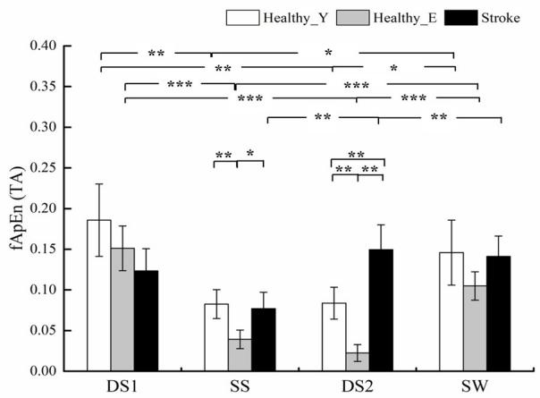

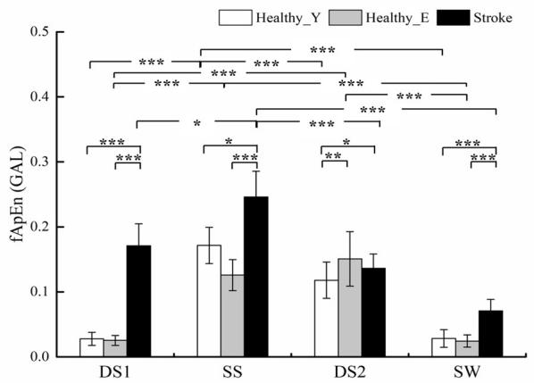

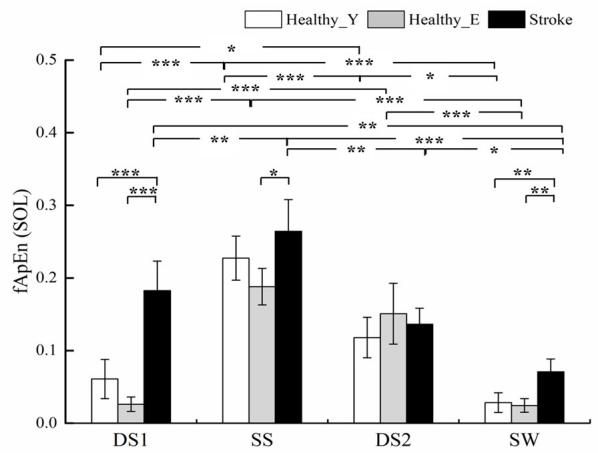

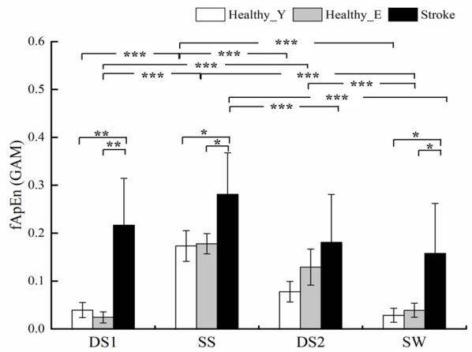  
Fig. 2. The mean fApEn values of ankle muscles for the young healthy subjects, elderly healthy subjects and stroke patients. fApEn: fuzzy approximate entropy; TA: tibialis anterior; SOL: soleus; GAL: gastrocnemius lateral; GAM: gastrocnemius medial; DS1: the first double support phase; SS: the single support phase; DS2: the second double support phase; SW: the swing phase; Healthy\_Y: young healthy subjects; Healthy\_E: elderly healthy subjects; Stroke: patients after stroke; ∗, ∗∗, ∗ ∗ ∗ represents statistically significant difference $\dot { \mathsf { p } } < \dot { 0 . } 0 5 , \mathsf { p } < 0 . 0 \dot { 1 }$ and $\mathsf { p } < 0 . \dot { 0 } 0 1$ respectively.

When focusing on the entire gait cycle, the fApEn values of the ankle muscle in the three groups of subjects have similar trends in the whole gait cycle. The fApEn values of TA first shows a trend of descending and then an ascending trend. While the fApEn values of the other three muscles (SOL, GAL, and GAM) show an opposite trend, which falls after rising during the gait circle. In addition, the fApEn of three groups of subjects in different gait sub-phases were analyzed. In DS1 and SW, the fApEn values of the triplantar flexors of stroke patients were significantly higher than those of young healthy subjects and elderly healthy subjects. In SS and SW, stroke patients showed higher fApEn values in four muscles compared with elderly healthy adults. The fApEn of tibialis anterior muscle in SS and DS2 is different between young healthy subjects and elderly healthy subjects. In general, muscle activity complexity tends to increase in stroke patients compared with healthy subjects during most of the gait subphases.

TE was calculated for information transmission between any two muscles of the ankle joint. There was a significant main effect of the subject groups on TE values between ankle muscle pairs during gait (TA&SOL: $\mathrm { F } _ { ( 2 , 2 7 ) } ~ = ~ 2 4 . 3 4 , \mathrm { ~ p ~ } <$ $0 . 0 0 1 ; \ { \mathrm { T A g G A L : ~ F } } _ { ( 2 , 2 7 ) } \ = \ 4 0 . 0 8 , \ { \mathrm { p ~ < ~ 0 . 0 0 1 ; ~ T A \& G A M : } }$ $\mathrm { F } _ { ( 2 , 2 7 ) } = 4 2 . 9 1 , \mathrm { p } < 0 . 0 0 1 ; \mathrm { S O L } \& \mathrm { G A L } ; \mathrm { F } _ { ( 2 , 2 7 ) } = 2 7 . 1 1 , \mathrm { p } <$ $0 . 0 0 1 ; \mathrm { S O L } \& \mathrm { G A M : F } _ { ( 2 , 2 7 ) } = 2 7 . 5 9 , \mathrm { p } < 0 . 0 0 1 ; \mathrm { G A L } \& \mathrm { G A M : }$ $\mathrm { F } _ { ( 2 , 2 7 ) } = 3 5 . 1 3 , \mathrm { p } < 0 . 0 0 1 )$ . There was also significant main effect of the gait sub-phases on TE values between ankle muscle pairs during gait (TA&SOL: F(3,81) = 10.25, p < 0.001; TA&GAL: F(3,81) = 18.46, p < 0.001; TA&GAM: $\mathrm { F _ { ( 3 , 8 1 ) } = 1 5 . 8 2 , \ p < 0 . 0 0 1 ; { \ S O L } \& G A L : { \ F _ { ( 2 . 1 6 , 5 8 . 2 7 ) } = 2 9 . 1 3 } }$ $\mathrm { \mathrm { ~ p ~ < ~ } ~ 0 . 0 0 1 ; ~ \mathrm { \ S O L } \& G A M : ~ \mathrm { F } _ { ( 3 , 8 1 ) } ~ = ~ 2 7 . 7 7 , ~ \mathrm { ~ p ~ < ~ } 0 . 0 0 1 }$ GAL&GAM: $\operatorname { F } _ { ( 2 . 4 1 , 6 4 . 9 5 ) } = 2 6 . 0 4 , \mathrm { ~ p ~ < ~ 0 . 0 0 1 ) }$ . There was significant interaction effect between the subject groups and the gait sub-phases in muscle pairs of TA&SOL $( \mathrm { F } _ { ( 6 , 8 1 ) } =$ $2 . 2 1 , \ \mathrm { p } \ = \ 0 . 0 5 ) , \ \mathrm { T A E G A L } ( \mathrm { F } _ { ( 6 , 8 1 ) } \ = \ 4 . 1 4 , \ \mathrm { p } \ = \ 0 . 0 0 1 )$ GAL&GAM $( \mathrm { F } _ { ( 4 . 8 1 , 6 4 . 9 5 ) } = 2 . 4 2 , \mathrm { p } = 0 . 0 4 )$ . But there was no significant interaction effect between the subject groups and the gait sub-phases in muscle pairs of TA&GAM $\left( \mathrm { F } _ { ( 6 , 8 1 ) } = \right.$ $2 . 6 3 , \mathtt { p } = 0 . 2 2 ) , \mathtt { S O L } \& \mathtt { G A L } ( \mathtt { F } _ { ( 2 . 1 6 , 5 8 . 2 7 ) } = 2 . 1 2 , \mathtt { p } = 0 . 0 9 )$ SOL&GAM $( \mathrm { F } _ { ( 6 , 8 1 ) } ~ = ~ 2 . 3 2 , ~ \mathrm { p } ~ = ~ 0 . 4 1 )$ . Specifically, the comparison results of TE among subject groups in each gait sub-phase and among gait sub-phases in each subject group are shown in Fig. 3.

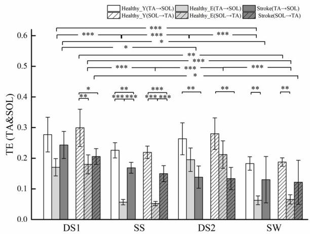

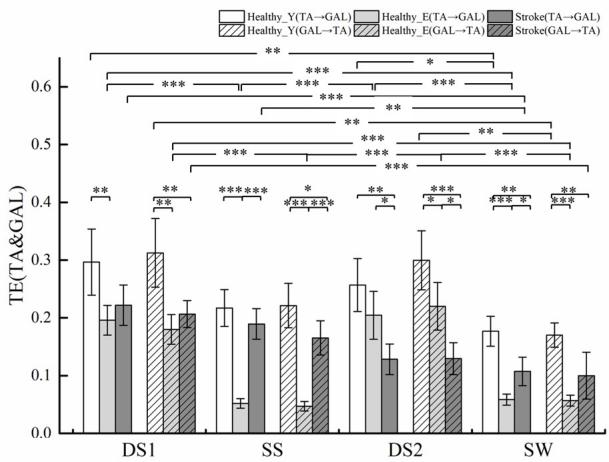

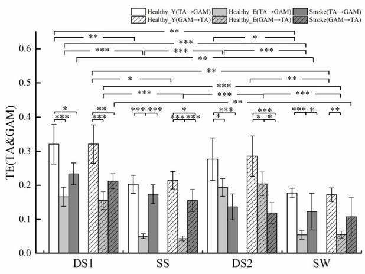

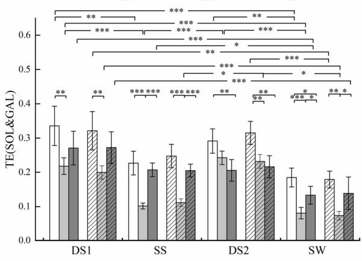

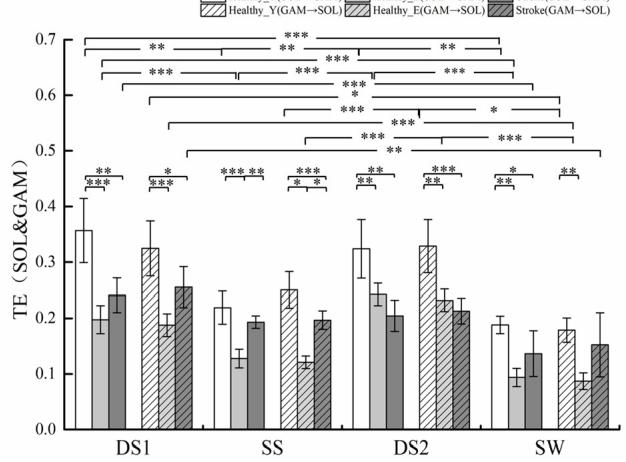

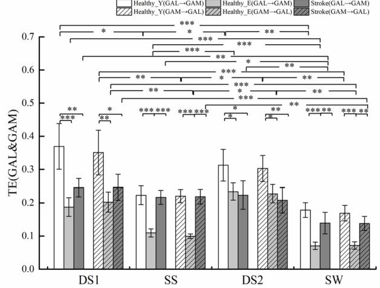  
Fig. 3. The mean TE values of ankle muscles for the for the young healthy subjects, elderly healthy subjects and stroke patients. TE: transfer entropy; TA: tibialis anterior; SOL: soleus; GAL: gastrocnemius lateral; GAM: gastrocnemius medial; DS1: the first double support phase; SS: the single support phase; DS2: the second double support phase; SW: the swing phase; Healthy\_Y: young healthy subjects; Healthy\_E: elderly healthy subjects; Stroke: patients after stroke; The shaded bar graph represents the TE value in the other direction, and the arrow in the legend represents the direction of information transmission, for example, TA→SOL: the TE from muscle TA to SOL; SOL→ TA: the TE from muscle SOL to TA; $^ { * } , ^ { * * } , ^ { * * * }$ represents statistically significant difference p < 0.05, p < 0.01 and p < 0.001, respectively.

Throughout the gait cycle, TE of young healthy subjects and elderly healthy subjects showed similar trends. The TE values of two dual support phases (DS1 and DS2) of gait are greater than which of the SS and SW, and both directions of TE have the same trend. During DS2, TE was significantly reduced in stroke patients. TE in stroke patients generally showed a downward trend from DS1 to SW, reaching the maximum and minimum values in DS1 and SW, respectively. Compared with young healthy subjects, TE of both stroke patients and elderly healthy subjects tends to decrease at each gait phase of the whole gait cycle. In DS1, the TE values in both elderly healthy subjects and stroke patients are significantly smaller than that of young healthy subjects. In SS and SW, TE values were significantly different between elderly healthy subjects and young healthy subjects and between elderly healthy subjects and stroke patients. In DS2, TE values gradually decreased in both directions from young healthy subjects to elderly healthy subjects and then to stroke patients. In general, the complexity of the intermuscular coupling tends to decrease in both stroke patients and elderly healthy subjects. Moreover, the complexity of intermuscular coupling during DS2 was significantly reduced in stroke patients compared with elderly healthy subjects. In addition, when focusing on the two directions of transfer entropy, it can be seen from the figure that although the TE results of the two directions are similar between most muscle pairs, there are also cases where the TE value of one direction can significantly distinguish different subjects or different gait sub-phases. However, there was no significant difference in TE values between the two directions.

## IV. DISCUSSIONS

This study mainly investigated the phase-dependent modulation of ankle muscles during walking after stroke. The fApEn and TE were used to analyze the muscle activity complexity and intermuscular coupling of ankle joint, respectively. Primary findings of the current study include: (a) the complexity of the ankle muscle activity in patients after stroke has a tendency to increase during most gait sub-phases; (b) the information transmission between muscles in poststroke patients generally decreased, which is more significantly during DS2; (c) although both age and stroke lead to abnormal muscle function, there may be different neuromuscular adaptations between the hemiplegic gait and the geriatric gait.

## A. Changes of Muscle Activity in Gait Circle After Stroke

Neuromuscular control of gait after stroke is unstable in terms of temporal organization and complexity of muscle activity. The temporal characteristics of muscle activity in healthy gait followed regular patterns. The short activation at the beginning of the gait cycle and further activation before the end of the swing phase have been determined to be normal electromyographic activity of the dorsiflexor muscle. While the activation of plantar flexor is mainly concentrated in the pre-swing phase [34]. In this study, the abnormal temporal patterns of gait cycle can be observed in post-stroke patients. By extending the time legs stay on the ground, the duration of single support phase was significantly shortened in post-stroke patients to ensure dynamic balance and physical support [25]. In addition, the premature muscle activity occurs in the plantar flexors during standing, preventing dorsiflexion of the ankle and thus impeding gait development [29]. These findings were consistent with results in the previous studies, which suggested that disordered temporal distribution might be attributed to impaired muscle function and reduced propulsive force on paralyzed legs [35], [36].

Not only the abnormal muscle activity associated with disordered temporal distribution were analyzed, but also fApEn was used to further assess changes in muscle activity complexity in patients after stroke. The complex pattern of EMG signals can be attributed to the mechanism of their generation and changes with fiber contraction during muscle activation [37]. The decrease of EMG signal complexity means that there are fewer degrees of freedom in the motor system, that is, fewer motor units. Ao et al. proved that the number of functional motor units reduced after stroke [38]. Focusing on the entire gait cycle, complexity of the ankle muscle activity of patients after stroke showed a similar trend to that of healthy subjects. Muscle activity complexity in ankle muscles, especially plantar flexors, tends to increase after stroke in most gait subphases compared with both young healthy subjects and elderly healthy subjects. The increased complexity of muscle activity may be due to the need of recruiting more motor units to complete gait compensatory strategies in poststroke patients with muscle impairment [38]. This may be the result of a regulatory mechanism in the neuromuscular system that distributes muscle load more broadly to avoid muscle injury. Moreover, it has been reported that a large amount of variability could mean that the system is unable to accurately achieve the intended goal, which is detrimental to the motion control system [39].

## B. Changes of Intermuscular Coupling in Gait Circle After Stroke

The coordination between muscles is an important factor in judging motor ability and abnormal gait, considering its involvement in the regulation of human motion and joint stability [40]. Jonkers et al. suggested that the coordination of multiple muscles may be required in gait to compensate for the weakness of individual muscle [41]. Previous studies have found that muscular coupling may originate in the corticospinal pathway [40]. Among the current results, there is a general trend of decreased muscular coupling in stroke patients, which may reflect abnormal decreased motor commands or lack of mutually inhibiting spinal circuits [42]. Considering that muscle coordination plays a role in regulating joint stiffness and postural stability, the decrease in intermuscular coupling of stroke patients may also be due to coordinated control of corticospinal pathways in response to high joint stiffness and reduced postural control freedom [43]. On the other hand, the changes in muscular coordination of stroke patients with walking disorder may result from impaired connections between muscles and a reduced ability to transmit information between target muscles. Although some muscle pairs have different intermuscular coupling in the two directions, the information flow between the muscles has no obvious directionality. Previous studies have suggested that abnormal intermuscular coupling is the result of compensatory neuromuscular regulation strategies [44]. Compared with agematched healthy subjects, stroke patients recruit more motor units throughout the gait process, while achieving gait function in a manner that increases muscle coupling. It can also be seen from the results that the influence of age on the muscle regulation pattern of gait is mainly reflected in the intermuscular coupling ability, compared with the change in the complexity of muscle activity. In addition, although both age and stroke lead to abnormal muscle function, there may be different neuromuscular adaptations between the hemiplegic gait and the geriatric gait.

Moreover, Considering that the modulation of motion patterns during walking is phase-dependent, it is significant to analyze each sub-phase of gait in unilateral hemiplegia after stroke [29]. In the dual support phases of a healthy gait, body weight is rapidly transferred to the other side [45]. Since there is a dependence between muscle synergy and the activation patterns of individual muscle, the increased intermuscular coupling during the dual support phases of normal gait may be due to burst of activity of TA and TS. Compared with young healthy subjects and elderly healthy subjects, the connections between the ankle muscles in poststroke patients are significantly weakened at DS2. This may be due to the inability of the hemiplegic lateral plantar flexors to make a short, strong forward thrusts. It could be inferred from the results that cortical control disorder caused by a stroke that reduced the ability of muscle coordination was more likely to occur in a specific phase of gait. Lamontagne et al. suggested that the co-activated regulation of the ankle plantar flexor and dorsiflexor muscles may be used as an adaptive mechanism for gait [46]. Therefore, the change in intensity of gait phase-dependent intermuscular coupling also provides evidence for the idea that the neuromuscular system adjusts control strategies in response to external demands at different phases of gait.

## C. Clinical Implication

Clinical gait analysis requires quantitative assessment of abnormal muscle activation patterns in patients with hemiplegia. Changes in the biomechanical and neurophysiological characteristics of patients after stroke lead to altered muscle activity and intermuscular coupling during walking [47]. It has been shown that sEMG signals exhibit many features of complexity that merit evaluation, and complexity measures are thought to focus more on the expression of internal randomness [48]. In present study, a comprehensive study based on complex muscle activity and intermuscular coordination provides a nonlinear and quantitative assessment of patterns of muscle regulation after stroke. The phase-dependent modulation of ankle muscles is a promoting marker that can be characterized by these nonlinear indicators. The assessment of stroke-induced abnormalities in muscle regulation patterns between different gait sub-phases may not only provide an assessment of movement disorders or gait improvement, but also provide more detailed guidance to physiotherapists. Abnormal muscle coordination caused by cortical control disorders after stroke is more likely to occur in specific sub-phases of gait, which requires special attention when developing rehabilitation programs. In addition, it can also help to better understand how stroke affects muscle strategies in gait and neuromotor system adaptation after stroke.

However, this study has some limitations. First, the processing of EMG signals does not include special processing of baseline and motion artifacts, and the length of gait sequence of each trial was not uniform, both of which may affect subsequent analysis of EMG signals to some extent. Second, neuromuscular adaptation is the basis of lower limb muscle activity patterns during gait after stroke, which is not only associated with primary injury, but also plays an important role in compensating strategies that reflect the demands of motor tasks [49], [50]. Considering that the reduction of walking speed alters the demands of motor tasks and leads to changes in muscle activity patterns during walking, the effect of walking speed should be further explored in future study. Finally, we only analyzed the ankle muscles on the affected side after stroke. Future studies will further focus on the muscle modulation of the knee and hip, as well as the unaffected side of the leg during walking.

## V. CONCLUSION

In this study, fApEn and TE were used to calculate the complexity of muscle activity and intermuscular coupling during walking after stroke. Results indicated that the complexities of ankle muscles activity tended to increase, while the information transmission between muscles generally decreased after stroke. It could also be inferred from the results that stroke affected the modulation mode of muscle activity and information transmission in a gait phase-dependent manner. These findings have the potential to further reveal neuromuscular mechanisms related to stroke and gait phases, providing important information for improving motor control and developing appropriate rehabilitation strategies.

## ACKNOWLEDGMENT

The authors confirm that there are no financial, personal or other conflicts of interest.

## REFERENCES

[1] C. M. Stinear, C. E. Lang, S. Zeiler, and W. D. Byblow, “Advances and challenges in stroke rehabilitation,” Lancet Neurol., vol. 19, no. 4, pp. 348–360, 2020.

[2] S. Wu et al., “Stroke in China: Advances and challenges in epidemiology, prevention, and management,” Lancet Neurol., vol. 18, no. 4, pp. 394–405, 2019.

[3] E. H. Lo, T. Dalkara, and M. A. Moskowitz, “Mechanisms, challenges and opportunities in stroke,” Nature Rev. Neurosci., vol. 4, no. 5, pp. 399–414, May 2003.

[4] A. Heshmatollah, S. K. Darweesh, L. J. Dommershuijsen, P. J. Koudstaal, M. A. Ikram, and M. K. J. S. Ikram, “Quantitative gait impairments in patients with stroke or transient ischemic attack: A population-based approach,” Stroke, vol. 51, no. 8, pp. 2464–2471, 2020.

[5] S. Dai, C. Piscicelli, E. Clarac, M. Baciu, M. Hommel, and D. Pérennou, “Balance, lateropulsion, and gait disorders in subacute stroke,” Neurology, vol. 96, no. 17, pp. e2147–e2159, Apr. 2021.

[6] S. A. Acuña, M. E. Tyler, Y. P. Danilov, and D. G. Thelen, “Abnormal muscle activation patterns are associated with chronic gait deficits following traumatic brain injury,” Gait Posture, vol. 62, pp. 510–517, May 2018.

[7] J. H. Buurke, A. V. Nene, G. Kwakkel, V. Erren-Wolters, M. J. IJzerman, and H. J. Hermens, “Recovery of gait after stroke: What changes?” Neurorehabilitation Neural Repair, vol. 22, no. 6, pp. 676–683, Nov. 2008.

[8] H. K. Lim et al., “Analysis of sEMG during voluntary movement— Part II: Voluntary response index sensitivity,” IEEE Trans. Neural Syst. Rehabil. Eng., vol. 12, no. 4, pp. 416–421, Dec. 2004.

[9] Y. Fan and Y. Yin, “Active and progressive exoskeleton rehabilitation using multisource information fusion from EMG and force-position EPP,” IEEE Trans. Biomed. Eng., vol. 60, no. 12, pp. 3314–3321, Jun. 2013.

[10] R. Luo, S. Sun, X. Zhang, Z. Tang, and W. Wang, “A low-cost endto-end sEMG-based gait sub-phase recognition system,” IEEE Trans. Neural Syst. Rehabil. Eng., vol. 28, no. 1, pp. 267–276, Jan. 2020.

[11] N. J. Cronin, S. Kumpulainen, T. Joutjarvi, T. Finni, and H. Piitulainen, “Spatial variability of muscle activity during human walking: The effects of different EMG normalization approaches,” Neuroscience, vol. 300, pp. 19–28, Aug. 2015.

[12] G. Rasool, B. Afsharipour, N. L. Suresh, and W. Z. Rymer, “Spatial analysis of multichannel surface EMG in hemiplegic stroke,” IEEE Trans. Neural Syst. Rehabil. Eng., vol. 25, no. 10, pp. 1802–1811, Oct. 2017.

[13] E. A. Clancy, L. Liu, P. Liu, and D. V. Z. Moyer, “Identification of constant-posture EMG–torque relationship about the elbow using nonlinear dynamic models,” IEEE Trans. Biomed. Eng., vol. 59, no. 1, pp. 205–212, Jan. 2012.

[14] H. Azami, M. Rostaghi, D. Abásolo, and J. Escudero, “Refined composite multiscale dispersion entropy and its application to biomedical signals,” IEEE Trans. Biomed. Eng., vol. 64, no. 12, pp. 2872–2879, Dec. 2017.

[15] M. D. Costa and A. L. Goldberger, “Generalized multiscale entropy analysis: Application to quantifying the complex volatility of human heartbeat time series,” Entropy, vol. 17, no. 3, pp. 1197–1203, 2015.

[16] J. S. Richman and J. R. Moorman, “Physiological time-series analysis using approximate entropy and sample entropy,” Amer. J. Physiol.-Heart Circulatory Physiol., vol. 278, no. 6, pp. H2039–H2049, Jun. 2000.

[17] W. Chen, Z. Wang, H. Xie, and W. Yu, “Characterization of surface EMG signal based on fuzzy entropy,” IEEE Trans. Neural Syst. Rehabil. Eng., vol. 15, no. 2, pp. 266–272, Jun. 2007.

[18] Y. Li, S. Wu, Q. Yang, G. Liu, and L. Ge, “Application of the variance delay fuzzy approximate entropy for autonomic nervous system fluctuation analysis in obstructive sleep apnea patients,” Entropy, vol. 22, no. 9, p. 915, Aug. 2020.

[19] J. Missitzi, N. Geladas, and V. Klissouras, “Heritability in neuromuscular coordination: Implications for motor control strategies,” Med. Sci. Sports Exercise, vol. 36, no. 2, pp. 233–240, Feb. 2004.

[20] J.-H. Park, J.-H. Shin, H. Lee, J. Roh, and H.-S. Park, “Alterations in intermuscular coordination underlying isokinetic exercise after a stroke and their implications on neurorehabilitation,” J. NeuroEng. Rehabil., vol. 18, no. 1, pp. 1–17, Dec. 2021.

[21] D. J. Clark, L. H. Ting, F. E. Zajac, R. R. Neptune, and S. A. Kautz, “Merging of healthy motor modules predicts reduced locomotor performance and muscle coordination complexity post-stroke,” J. Neurophys., vol. 103, no. 2, pp. 844–857, Dec. 2009.

[22] L.-J. Wang et al., “Muscle fatigue enhance beta band EMG-EMG coupling of antagonistic muscles in patients with post-stroke spasticity,” Frontiers Bioeng. Biotechnol., vol. 8, p. 1007, Aug. 2020.

[23] C. A. McGibbon, “Toward a better understanding of gait changes with age and disablement: Neuromuscular adaptation,” Exercise Sport Sci. Rev., vol. 31, no. 2, pp. 102–108, Apr. 2003.

[24] T. Schreiber, “Measuring information transfer,” Phys. Rev. Lett., vol. 85, no. 2, p. 461, Jul. 2000.

[25] P. S. Baboukani, C. Graversen, E. Alickovic, and J. Østergaard, “Estimating conditional transfer entropy in time series using mutual information and nonlinear prediction,” Entropy, vol. 22, no. 10, p. 1124, Oct. 2020.

[26] X. Chen, Y. Zhang, S. Cheng, and P. Xie, “Transfer spectral entropy and application to functional corticomuscular coupling,” IEEE Trans. Neural Syst. Rehabil. Eng., vol. 27, no. 5, pp. 1092–1102, May 2019.

[27] P. Duan, F. Yang, T. Chen, and S. L. Shah, “Direct causality detection via the transfer entropy approach,” IEEE Trans. Control Syst. Technol., vol. 21, no. 6, pp. 2052–2066, Nov. 2013.

[28] N. Kaneko, H. Yokoyama, Y. Masugi, K. Watanabe, and K. Nakazawa, “Phase dependent modulation of cortical activity during action observation and motor imagery of walking: An EEG study,” NeuroImage, vol. 225, Jan. 2021, Art. no. 117486.

[29] J. Lo et al., “Functional implications of muscle co-contraction during gait in advanced age,” Gait Posture, vol. 53, pp. 110–114, Mar. 2017.

[30] A. Denotter, A. Geurts, T. Mulder, and J. Duysens, “Gait recovery is not associated with changes in the temporal patterning of muscle activity during treadmill walking in patients with post-stroke hemiparesis,” Clin. Neurophysiol., vol. 117, no. 1, pp. 4–15, Jan. 2006.

[31] A. Leroux, J. Fung, and H. Barbeau, “Adaptation of the walking pattern to uphill walking in normal and spinal-cord injured subjects,” Exp. Brain Res., vol. 126, no. 3, pp. 359–368, May 1999.

[32] J. N. Kerkman, A. Daffertshofer, L. L. Gollo, M. Breakspear, and T. W. Boonstra, “Network structure of the human musculoskeletal system shapes neural interactions on multiple time scales,” Sci. Adv., vol. 4, no. 6, Jun. 2018, Art. no. eaat0497.

[33] W. Chen, J. Zhuang, W. Yu, and Z. Wang, “Measuring complexity using FuzzyEn, ApEn, and SampEn,” Med. Eng. Phys., vol. 31, no. 1, pp. 61–68, 2009.

[34] S. Li, G. E. Francisco, and P. Zhou, “Post-stroke hemiplegic gait: New perspective and insights,” Frontiers Physiol., vol. 9, p. 1021, Aug. 2018.

[35] A. R. D. Otter, A. C. H. Geurts, T. Mulder, and J. Duysens, “Abnormalities in the temporal patterning of lower extremity muscle activity in hemiparetic gait,” Gait Posture, vol. 25, no. 3, pp. 342–352, Mar. 2007.

[36] A. Denotter, A. Geurts, T. Mulder, and J. Duysens, “Gait recovery is not associated with changes in the temporal patterning of muscle activity during treadmill walking in patients with post-stroke hemiparesis,” Clin. Neurophysiol., vol. 117, no. 1, pp. 4–15, Jan. 2006.

[37] S. Rampichini, T. M. Vieira, P. Castiglioni, and G. Merati, “Complexity analysis of surface electromyography for assessing the myoelectric manifestation of muscle fatigue: A review,” Entropy, vol. 22, no. 5, p. 529, May 2020.

[38] D. Ao, R. Sun, K.-Y. Tong, and R. Song, “Characterization of stroke- and aging-related changes in the complexity of EMG signals during tracking tasks,” Ann. Biomed. Eng., vol. 43, no. 4, pp. 990–1002, Apr. 2015.

[39] M. F. Vieira, F. B. Rodrigues, G. S. de Sá e Souza, R. M. Magnani, G. C. Lehnen, and A. O. Andrade, “Linear and nonlinear gait features in older adults walking on inclined surfaces at different speeds,” Ann. Biomed. Eng., vol. 45, no. 6, pp. 1560–1571, Jun. 2017.

[40] H.-J. Yoo et al., “Quantifying coordination between agonist and antagonist muscles during a gait,” J. Mech. Sci. Technol., vol. 30, no. 11, pp. 5321–5328, Nov. 2016.

[41] I. Jonkers, C. Stewart, and A. Spaepen, “The complementary role of the plantarflexors, hamstrings and gluteus maximus in the control of stance limb stability during gait,” Gait Posture, vol. 17, no. 3, pp. 264–272, Jun. 2003.

[42] M. Rinaldi et al., “Increased lower limb muscle coactivation reduces gait performance and increases metabolic cost in patients with hereditar spastic paraparesis,” Clin. Biomech., vol. 48, pp. 63–72, Oct. 2017.

[43] R. Kitatani et al., “Ankle muscle coactivation during gait is decreased immediately after anterior weight shift practice in adults after stroke,” Gait Posture, vol. 45, pp. 35–40, Mar. 2016.

[44] B. H. Dobkin, “Strategies for stroke rehabilitation,” Lancet Neurol., vol. 3, no. 9, pp. 528–536, Sep. 2004.

[45] R. Kitatani et al., “Ankle muscle coactivation and its relationship with ankle joint kinematics and kinetics during gait in hemiplegic patients after stroke,” Somatosensory Motor Res., vol. 33, no. 2, pp. 79–85, Apr. 2016.

[46] A. Lamontagne, C. L. Richards, and F. Malouin, “Coactivation during gait as an adaptive behavior after stroke,” J. Electromyogr. Kinesiol., vol. 10, no. 6, pp. 407–415, Dec. 2000.

[47] J. Roh, W. Z. Rymer, E. J. Perreault, S. B. Yoo, and R. F. Beer, “Alterations in upper limb muscle synergy structure in chronic stroke survivors,” J. Neurophysiol., vol. 109, no. 3, pp. 768–781, Feb. 2013.

[48] H. Azami, M. Rostaghi, D. Abásolo, and J. Escudero, “Refined composite multiscale dispersion entropy and its application to biomedical signals,” IEEE Trans. Biomed. Eng., vol. 64, no. 12, pp. 2872–2879, Dec. 2017.

[49] J. H. Buurke, A. V. Nene, G. Kwakkel, V. Erren-Wolters, M. J. IJzerman, and H. J. Hermens, “Recovery of gait after stroke: What changes,” Neurorehabilitation Neural Repair, vol. 22, no. 6, pp. 676–683, Nov. 2008.

[50] A. R den Otter, A. C. H Geurts, T. Mulder, and J. Duysens, “Speed related changes in muscle activity from normal to very slow walking speeds,” Gait Posture, vol. 19, pp. 270–278, Jun. 2004.