# Investigating the Stroke- and Aging-related Changes in Global and Instantaneous Intermuscular Coupling using Cross-fuzzy Entropy

Na Tian, Ying Chen, Wenbo Sun, Huihua Liu, Xiaoyun Wang, Tiebin Yan and Rong Song, Senior Member, IEEE

Abstract—Intermuscular coupling is essential in the coordination of agonist and antagonist muscles. However, its dynamic characteristics are not fully understood, especially the alterations of intermuscular coupling induced by stroke and aging. This study aimed to investigate the aging- and stroke-related changes in the global and instantaneous intermuscular coupling between agonist and antagonist muscles. In the experiment, 8 patients after stroke, 18 healthy young subjects and 10 healthy middle-aged subjects were recruited and instructed to finish the elbow flexion and extension tasks. Cross-fuzzy entropy (C-FuzzyEn) and instantaneous C-FuzzyEn (iC-FuzzyEn) based on a sliding window were used to analyze the global and instantaneous intermuscular coupling, respectively. Instantaneous FuzzyEn (i-FuzzyEn) based on a sliding window was also applied to investigate the dynamic complexity of the EMG segment. Pearson correlation analysis revealed that i-FuzzyEn values were negatively correlated with iC-FuzzyEn values in most cases, which implied that there was a positive correlation between EMG complexity and intermuscular coupling. The C-FuzzyEn values between agonist and antagonist muscles increased significantly in both tasks of the patients after stroke than those of the healthy subjects (p<0.05), which might be due to the decrease in intermuscular coupling induced by the damage of the corticospinal pathways after stroke. The combined application of C-FuzzyEn, iC-FuzzyEn and i-FuzzyEn provides a more comprehensive understanding of the global and instantaneous intermuscular coupling.

Index Terms—stroke, aging, intermuscular coupling, crossfuzzy entropy (C-FuzzyEn), global, instantaneous

## I. INTRODUCTION

the coordination of the agonist and antagonist muscles around joints, which can maintain the stability and prevent accidental injuries of the joints during movement [1]. Regarding the control of muscle activation in coordinated movement, Farmer et al. and Kattla et al. revealed that motor neurons of synergistic muscles shared a common corticospinal drive, resulting in intermuscular coupling [2, 3]. This coupling could reflect the oscillatory presynaptic drives to the spinal motor neurons, causing the motor unit (MU) discharge and the muscle activity [4]. Intermuscular coupling could reflect not only the interaction between different muscles in coordinated movements but also the mechanism of neuromuscular control [5].

Individuals with declined motor neuron function commonly exhibit uncoordinated agonist and antagonist muscle activities, which might lead to abnormal intermuscular coupling. Previous studies suggested that the aged exhibited declined neuromuscular systems, which may cause the altered coupling among muscles, especially the coupling of agonist and antagonist muscles [6, 7]. Asaka et al. applied cross-correlation analysis to investigate the effects of aging on the coupling between the trunk flexor and extensor muscles, and found that there is an aging-induced transition from the mutual activation mode to the coactivation mode [8]. John et al. used EMG-EMG coherence to reflect the coupling of hand muscles and suggested that the MU coherence was higher in the elderly than in young adults [9]. Stroke might also influence the coupling between the agonist and antagonist muscles due to the impairment of the corticospinal pathways [10]. McCrea et al. demonstrated that the coordination of shoulder flexors and elbow extensors was impaired in patients after stroke, resulting in insufficient shoulder abduction power and poor hand motion performance [11]. Dewald et al. illustrated that the abnormal coordination of different muscle pairs occurred in the affected side of the patients based on correlation analysis, which might result from more reliance on residual descending brainstem pathways [12]. Fisher et al. measured the intermuscular coherence in the upper and lower limbs to reflect the intermuscular coupling and found that there was significant intermuscular coherence in the limbs of the control subjects rather than the patients with spinal cord injury [13].

Since neuromuscular activities are inherently nonlinear [14, 15], some nonlinear methods were introduced to measure intermuscular coupling. Multi-spectral coherence and crossspectral coherence are frequency-based methods to quantify the nonlinear information interaction between different frequency components [16, 17]. Mutual information and cross entropybased measures were widely used to evaluate the time-domainbased interaction between dynamic systems [15, 18]. In view of the characteristics of short and noisy physiological signals, the cross entropy-based measure, which characterizes the pattern synchronization (PS) between two signals, was employed to quantify intermuscular coupling. The higher the PS, the tighter the coupling, and the dynamic interactions between physiological systems could be captured well [19]. Pincus et al. developed cross-approximate entropy (C-ApEn) based on approximate entropy (ApEn), but it had no self-matches, and it also resulted in a "direction dependence" [20]. Richmann et al. introduced cross-sample entropy (C-SampEn) based on sample entropy, which was superior to C-ApEn in relative consistency [21]. However, it did not count self-matches, and the definition of C-ApEn was not always defined [22]. Xie et al. developed cross-fuzzy entropy (C-FuzzyEn) based on fuzzy entropy (FuzzyEn), which possessed better independence of signal length than C-SampEn [18]. Wang et al. also demonstrated that the C-FuzzyEn was superior to C-SampEn in the classification of Alzheimer's disease group and control group [22]. Hwang et al. applied C-FuzzyEn to characterize the relationship between the EMG signals in the different error feedback conditions [23]. Although the previous studies demonstrated that the global measures of abnormal intermuscular coupling could be characterized by C-FuzzyEn, the instantaneous intermuscular coupling during the dynamic movement was also essential but absent. The entropy-based method with a sliding window was only used to study the dynamic complexity properties of physiological signals rather than their instantaneous interaction[24, 25].

The purpose of this research was to explore the aging- and stroke-related changes in the global and instantaneous intermuscular coupling between the agonist and antagonist muscles. The C-FuzzyEn was applied to characterize the global intermuscular coupling. Meanwhile, instantaneous C-FuzzyEn (iC-FuzzyEn) and instantaneous FuzzyEn (i-FuzzyEn) based on a sliding window were proposed to characterize the instantaneous intermuscular coupling and dynamic complexity. We hypothesize that there is an intermuscular relationship in muscle activation and information interaction between different muscles. The other hypothesis was that stroke- and aginginduced neurological impairments can affect the intermuscular coupling between the agonist and antagonist muscles.

## II. METHOD

## A. Participants

Eight patients after stroke (mean age: $4 8 . 1 \pm 1 6 . 2 $ years; 6 males, 2 females) were recruited for this study, whose basic information was shown in table I. The selection criteria for patients after stroke were as follows: (1) without apparent loss of vision and hearing; (2) with onset of at least 1month; (3) normal cognition (mini-mental state examination, MMSE>23); and (4) without significant dystonia (modified Ashworth scale, MAS>2). Moreover, 18 right-handed healthy young subjects (age: $2 3 . 7 \pm 1 . 8$ years; 10 males, 8 females) and10 righthanded healthy middle-aged subjects (age:50.0 ± 6.4 years; 5 males, 5 females) volunteered to participate in the experiment. All subjects signed informed consent prior to the experiment, and this study was approved by the Ethics Committee of the Guangdong Work Injury Rehabilitation Center.

## B. Experimental Procedures

The experimental setup was shown in Fig.1a. All subjects were instructed to sit on a height-adjusted chair and to place their arms (the dominant arms of healthy subjects and impaired arms of patients after stroke) on the horizontal armrest with their elbow flexed at 90°and shoulders abducted at 90°[26].The subjects were asked to grasp the handle attached to the armrest. After cleaning the skin with alcohol, four Ag-AgCl electrodes were fixed to the bellies of the biceps and triceps, respectively. The EMG signals were collected with a sampling rate of 1000 Hz by a data acquisition system (DAQ USB-6341, National

TABLE I  
BASIC DATA OF PATIENTS AFTER STROKE

<table><tr><td>Subject</td><td>Age</td><td>Sex</td><td>Lesion side</td><td>Type of stroke</td><td>Months after stroke</td><td>FMA-UE Scale</td></tr><tr><td>1</td><td>53</td><td>M</td><td>L</td><td>Hemo</td><td>1.5</td><td>23</td></tr><tr><td>2</td><td>61</td><td>F</td><td>R</td><td>Hemo</td><td>18</td><td>47</td></tr><tr><td>3</td><td>53</td><td>F</td><td>L</td><td>Hemo</td><td>1.5</td><td>23</td></tr><tr><td>4</td><td>27</td><td>M</td><td>R</td><td>Isch</td><td>1</td><td>19</td></tr><tr><td>5</td><td>25</td><td>M</td><td>L</td><td>Isch</td><td>8</td><td>61</td></tr><tr><td>6</td><td>38</td><td>M</td><td>R</td><td>Isch</td><td>3</td><td>51</td></tr><tr><td>7</td><td>71</td><td>M</td><td>R</td><td>Hemo</td><td>12</td><td>54</td></tr><tr><td>8</td><td>52</td><td>M</td><td>L</td><td>Isch</td><td>5</td><td>35</td></tr></table>

M=male; F=female; L=left; R=right; Isch=ischemic stroke; Hemo=hemorrhagic stroke; FMA-UE =Fugl-Meyer Assessment for Upper Extremity.

Instruments, USA) and amplified with a gain of 5000 by a customized EMG amplifier. Real-time tracking tasks and data processing were programmed using LabVIEW software (Version 2012, National Instruments, USA).

Before the tracking tasks, subjects were instructed to execute a 5-s maximum voluntary contraction (MVC) task 5 times and rest for 2 mins between each test. The maximal amplitudes of the EMG signals during the MVC tests were recorded to normalize the activation of the biceps and triceps to prepare for the following tracking experiment. After the MVC measurements, subjects were asked to control the green cursor by their muscle activation in order to track the red cursor (target activation) as well as possible. The highest target of muscle activation was set at 15% MVC to avoid muscle fatigue [27]. Following familiarization with the task, subjects were instructed to carry out two tracking tasks: elbow flexion and extension. Fig.1b showed the myoelectric-controlled interface (MCI) of the elbow flexion task, where the biceps were the agonist muscles, and the triceps were the antagonist muscles. The activation of the agonist muscles (biceps) was mapped on the Y-axis. The MCI of the elbow extension task is displayed in Fig.1c, in which the triceps were the agonist muscles and the biceps were the antagonist muscles. The activation of agonist muscles (triceps) was mapped on the X-axis. In both MCIs, the red cursor represented the target of the agonist muscle activation, and the green cursor represented the real-time activation of the agonist muscle. Seven seconds after the beginning of each trial, the red cursor performed the movement at a constant speed, and the green cursor was displayed in the interface. Then, the subjects could adjust the muscle force according to the real-time feedback in the MCIs. During the tracking tasks of elbow flexion and extension, the activation of the agonist muscle was increased from 0 to 15% MVC in 0-5s, and then gradually relaxed within 5-10s and returned to 0. Each round movement was performed at a constant speed (15%MVC/5s) from the origin to the target point, which was point (0, 15%) under the elbow flexion and point (15%, 0) under the elbow extension. The above process was repeated 3 times as a trial. The subjects randomly performed 10 trials (5 flexion trials and 5 extension trails) and rested for 30 s after each trial.

## C. Instantaneous Fuzzy Entropy

The instantaneous FuzzyEn (i-FuzzyEn) of a given N-points time series $\{ \mu ( \tilde { n } )  { : } 1 \leq \tilde { n } \leq N \}$ was calculated as follows [28]:

Firstly, a non-overlapping sliding window with a length of L was allowed to move from the first point to the end along the whole sequence. Then, we formed a sequence $y ( \tilde { k } ) =$ $\{ \mu ( \widetilde K + 1 ) , \mu ( \widetilde K + 2 ) , \dots , \mu ( \widetilde K + L ) \}$ , w h e r e $\widetilde { K } = L \big ( \widetilde { k } -$ $1 ) , 1 \le \tilde { k } \le N / L$

$$
y (\tilde {k})
$$

$$
\begin{array}{c} X _ {i} ^ {m} = \bigl \{\mu \bigl (\widetilde {K} + i \bigr), \mu \bigl (\widetilde {K} + i + 1 \bigr), \ldots , \mu \bigl (\widetilde {K} + i + m - 1 \bigr) \bigr \} \\ - \mu_ {0} \bigl (\widetilde {K} + i \bigr) \end{array}\tag{1}
$$

where, $\begin{array} { r } { \mu _ { 0 } ( i ) = 1 / m \sum _ { j = 0 } ^ { m - 1 } \mu \bigl ( \widetilde { K } + i + j \bigr ) } \end{array}$

We defined the distance between $X _ { i } ^ { m }$ and $X _ { j } ^ { m } \ ( 1 \leq i , j \leq$ $N - m + 1 ; i \neq j )$ by:

$$
\begin{array}{c} d _ {i j} ^ {m} = \max _ {k \in (0, m - 1)} \bigl | \mu \bigl (\widetilde {K} + i + k \bigr) - \mu \bigl (\widetilde {K} + j + k \bigr) \\ - \mu_ {0} \bigl (\widetilde {K} + i \bigr) + \mu_ {0} \bigl (\widetilde {K} + j \bigr) \bigr | \end{array}\tag{2}
$$

The similarity degree between vectors $X _ { i } ^ { m }$ and $X _ { j } ^ { m }$ was computed as follows:

$$
D _ {i j} ^ {m} = e x p \bigl (- \bigl (d _ {i j} ^ {m} / r \bigr) ^ {n} \bigr),\tag{3}
$$

where, r was the width, and n was the gradient of the boundary. Then, we defined the function $\varphi ^ { m }$ as:

$$
\varphi^ {m} (n, r)
$$

$$
= \frac {1}{N - m + 1} \sum_ {i = 1} ^ {N - m + 1} \ln \left(\frac {1}{N - m + 1} \sum_ {j = 1, j \neq i} ^ {N - m + 1} D _ {i j} ^ {m}\right)\tag{4}
$$

Finally, i-FuzzyEn was computed by:

$$
i - \text { FuzzyEn } (m, n, r, N, L) = \varphi^ {m} (n, r) - \varphi^ {m + 1} (n, r)\tag{5}
$$

In the present study, we set $\mathrm { m } { = } 2 , \ \mathrm { r } { = } 0 . 1 5 ^ { \ast } \mathrm { s t d }$ of the EMG signal, and L=500 [29].

(a)  
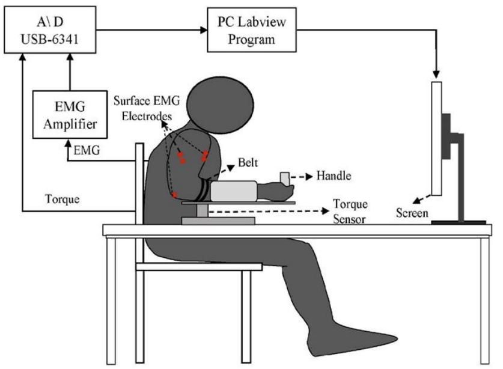

(b)  
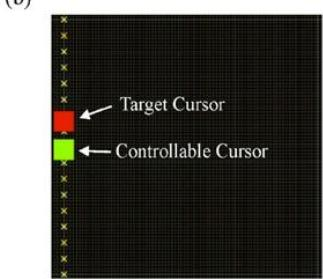

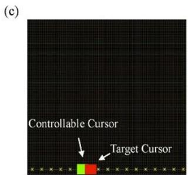  
Fig. 1. (a) Block diagram of experimental setup; (b) computer interface of flexion task; (c) computer interface of extension task.

## D. Cross-Fuzzy Entropy and Instantaneous Cross-Fuzzy Entropy

The C-FuzzyEn was developed from the FuzzyEn, and the calculation process is as follows [18]:

For two given N sample time series $\{ \mu ( i ) \colon 1 \leq i \leq N \}$ and $\left\{ v ( j ) \colon 1 \leq j \leq N \right\}$ , two vectors of length m can be defined as:

$$
X _ {i} ^ {m} = \{\mu (i), \mu (i + 1), \dots , \mu (i + m - 1) \} - \mu_ {0} (i)\tag{6}
$$

$$
Y _ {j} ^ {m} = \{v (j), v (j + 1), \dots , v (j + m - 1) \} - v _ {0} (j)\tag{7}
$$

Here, $\begin{array} { r } { \mu _ { 0 } ( i ) = 1 / m \sum _ { k = 0 } ^ { m - 1 } \mu ( i + k ) } \end{array}$ $v _ { 0 } ( j ) =$ 1⁄� ∑ �(� + �)�−1�=0 .

Then, the distance $d _ { i j } ^ { m }$ between $X _ { i } ^ { m }$ and $Y _ { j } ^ { m }$ is computed as follows:

$$
\begin{array}{c} d _ {i j} ^ {m} = m a x _ {k \in (0, m - 1)} | \mu (i + k) - v (j + k) \\ - \mu_ {0} (i) + v _ {0} (j) | \end{array}\tag{8}
$$

The similarity degree $D _ { i j } { } ^ { m }$ between $X _ { i } ^ { m }$ and $Y _ { j } ^ { m }$ and the function $\varphi ^ { m }$ are defined through Eq. (3) and Eq. (4) respectively.

Finally, the C-FuzzyEn is calculated as:

$$
\mathrm{C-FuzzyEn} (m, n, r, N) = \varphi^ {m} (n, r) - \varphi^ {m + 1} (n, r)\tag{9}
$$

In the present study, we set m=2 and r=0.2. The C-FuzzyEn values based on the whole sequence of two given time series can be computed to characterize the global coupling. Meanwhile, the coupling changes over time can be computed by combining C-FuzzyEn and a sliding window, which is named instantaneous C-FuzzyEn (iC-FuzzyEn). The calculation steps are as follows: a non-overlapping sliding window with a length of 500 data points was allowed to move from the first point to the end point along the whole sequence [29]. Then, the C-FuzzyEn value in each window was calculated to obtain the iC-FuzzyEn series reflecting the coupling change over time.

## E. Signal Processing and Statistical Analysis

The raw EMG signals collected in the experiment were bandpass filtered by a 4th-order Butterworth filter at 20-300 Hz and a 50-Hz notch filter. To avoid the influence of signal amplitude and individual differences on the entropy parameters, the filtered signals were normalized. For a given series $\mathbf { x } ( i )$ , the normalized series $x ^ { * } ( i )$ was calculated by $x ^ { * } ( i ) =$ $[ x ( i ) - m e a n ( x ) ] / S D ( x )$ [30]. Then, the C-FuzzyEn values between the whole EMG sequence of the agonist and antagonist muscles were computed to characterize the global intermuscular coupling. Meanwhile, to characterize the instantaneous intermuscular coupling during the dynamic tracking tasks, the iC-FuzzyEn and i-FuzzyEn of the agonist and antagonist muscles with the muscle activation were calculated by applying a sliding window with a length of 500 points (0.5s) and a step of 500 points (0.5s).

In order to characterize the relationship between the complexity of the EMG signals and the intermuscular coupling during the dynamic tracking process, Pearson correlation analysis was performed on the results of iC-FuzzyEn and i-FuzzyEn. In this process, the 30s experimental data were divided into 60 segments (500 points per segment) by applying a sliding window, so the final analysis results of iC-FuzzyEn or i-FuzzyEn contained 60 C-FuzzyEn or FuzzyEn values. Then

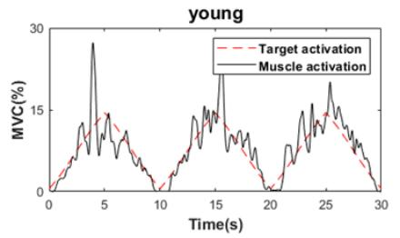

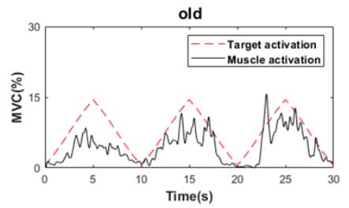

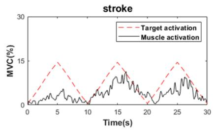

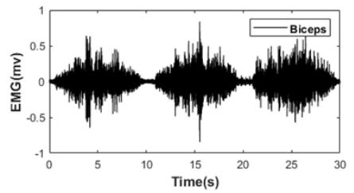

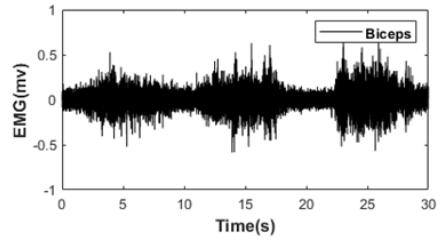

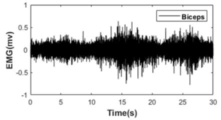

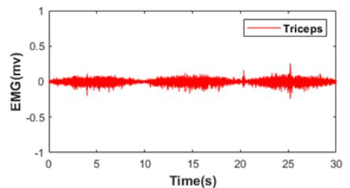  
(a)

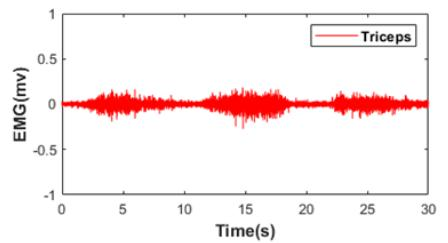  
(b)

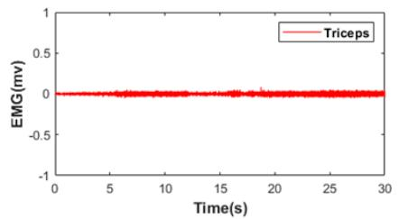  
(c)  
Fig. 2. Typical muscle activation and EMG data of the biceps and triceps recorded during the elbow flexion task in one performance. (a) young: a healthy young subject; (b) old: a healthy middle-aged subject; (c) stroke: a patient after stroke.

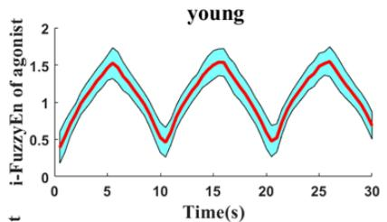

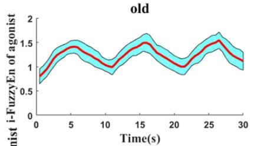

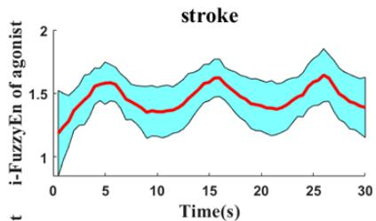

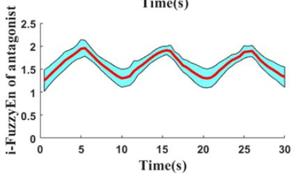

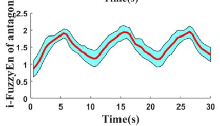

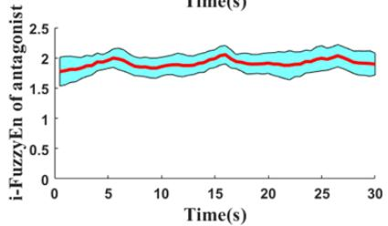

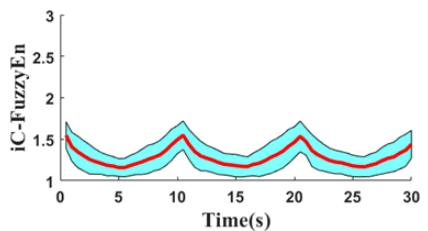  
(a)

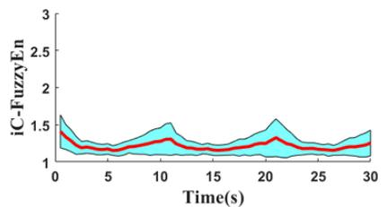  
(b)

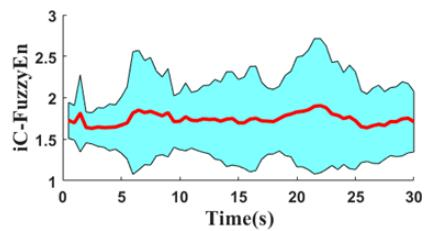  
(c)

Fig. 3. The i-FuzzyEn values of the agonist and antagonist muscles and the iC-FuzzyEn values between the agonist and antagonist muscles during the elbow flexion task. (a) young: healthy young subjects; (b) old: healthy middle-aged subjects; (c) stroke: patients after stroke. Notes: red line: the mean value of each group; blue area: standard deviation range.  
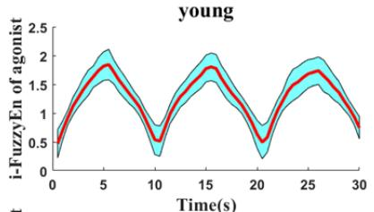

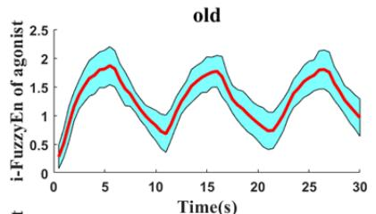

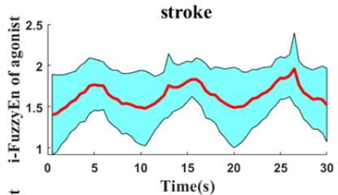

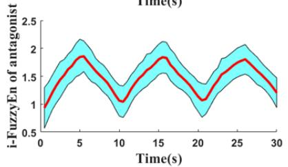

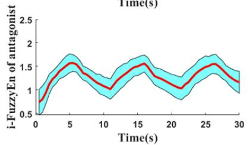

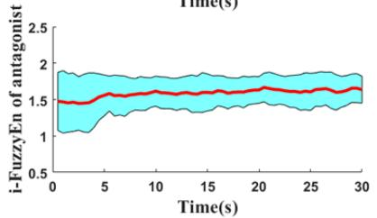

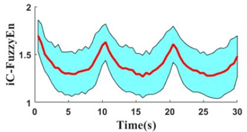  
(a)

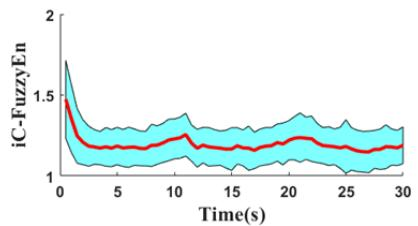  
(b)

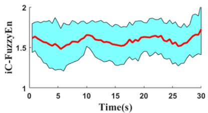  
(c)  
Fig. 4. The i-FuzzyEn values of the agonist and antagonist muscles and iC-FuzzyEn values between the agonist and antagonist muscles during the elbow extension task. (a) young: healthy young subjects; (b) old: healthy middle-aged subjects; (c) stroke: patients after stroke. Notes: red line: the mean value of each group; blue area: standard deviation range.

Pearson correlation analysis was used to calculate the correlation between iC-FuzzyEn and i-FuzzyEn, and the results were characterized by correlation coefficient (R). The C-FuzzyEn or R values for each subject were averaged over 5 trials, and these values for each group were the average of all of the subjects. Two-factor ANOVA with repeated measures was used to assess the effects of the group (patients after stroke, healthy young and middle-aged subjects) and task (flexion and extension) on the C-FuzzyEn or R values. If any significance was observed, a post-hoc analysis (an independent sample t-test)

> REPLACE THIS LINE WITH YOUR PAPER IDENTIFICATION NUMBER (DOUBLE-CLICK HERE TO EDIT) <

was made to compare the differences among the three groups while performing the same tasks. The paired t-test was also utilized to analyze the differences between the different tasks in the same group. It is regarded as statistically significant when p<0.05, and the statistical analysis was performed with SPSS 21.0 (SPSS Inc., USA).

## III. RESULTS

The typical muscle activation of the agonist and the surface EMG signals of the biceps and triceps from a healthy young subject, a healthy middle-aged subject and a patient after stroke in an elbow flexion test were illustrated in Fig.2. The i-FuzzyEn values of the agonist and antagonist muscles and the iC-FuzzyEn values under the elbow flexion were presented in Fig.3, and the results during elbow flexion were presented in Fig.4. According to Fig.3a and Fig.4a, the changes in the i-FuzzyEn values of the young subjects were consistent over time, while the changes in the iC-FuzzyEn values were completely opposite to the i-FuzzyEn values, and there was a strong linear relationship. As shown in Fig.3b and Fig.4b, the change trends of the results of the healthy middle-aged subjects were similar to those of the healthy young subjects, and there was a weak linear relationship between the iC-FuzzyEn values and the i-FuzzyEn values. In Fig.3c and Fig.4c, the change trends of the results of patients after stroke were also similar to those of the healthy subjects, but we hardly observed any linear relationship between the iC-FuzzyEn values and the i-FuzzyEn values.

The correlation coefficients between the i-FuzzyEn values and the iC-FuzzyEn values were shown in Table II. The Pearson correlation analysis results indicated that the i-FuzzyEn values of the agonist and antagonist muscles were negatively correlated with the iC-FuzzyEn values during both tasks, except for the antagonist muscle results during the elbow extension task in patients after stroke. For the correlation coefficient between the i-FuzzyEn values of the agonist muscles and the iC-FuzzyEn values, there was a significant group impact $( \mathrm { p } { < } 0 . 0 1 , \mathrm { F } { = } 7 . 0 6 4 , \eta _ { p } ^ { 2 } { = } 0 . 1 7 6 )$ . The correlation coefficient was significantly higher in the patients after stroke than in the young subjects during both tasks (flexion: p< 0.05; extension: p<0.01). During the elbow flexion task, the correlation coefficient was significantly higher in healthy middle-aged subjects than in healthy young subjects (p<0.05). The two-factor ANOVA analysis indicated that both the group and the task significantly influenced the correlation coefficient between the i-FuzzyEn values of the antagonist muscles and the iC-FuzzyEn values (group: p<0.01, F=21.926, $\eta _ { p } ^ { 2 } { = } 0 . 3 9 9 ;$ ; task: p<0.01, F=7.084, $\eta _ { p } ^ { 2 } { = } 0 . 0 9 7 )$ . The correlation coefficient was significantly higher in the healthy middle-aged subjects and patients after stroke than in the young subjects during both tasks (p<0.05). During the elbow extension task, there was a significant difference between the healthy middle-aged subjects and the patients after stroke for the correlation coefficient (p<0.05). Simultaneously, the correlation coefficient between the i-FuzzyEn values of the antagonist muscles and the iC-FuzzyEn values was significantly lower in the healthy middle-aged subjects than in the patients after stroke (p<0.05). From the overall correlation,

The linear fitting results of the i-FuzzyEn values and the iC-FuzzyEn values under the elbow flexion were shown in Fig.5, and the results under the elbow extension were shown in Fig.6.

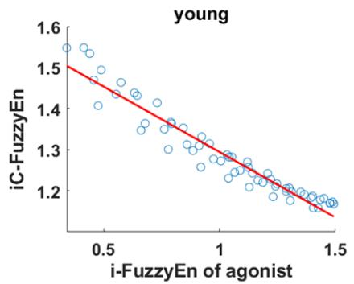

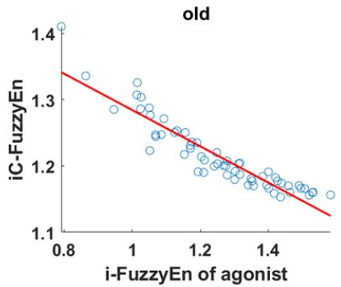

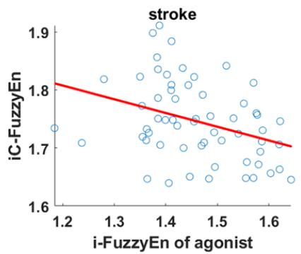

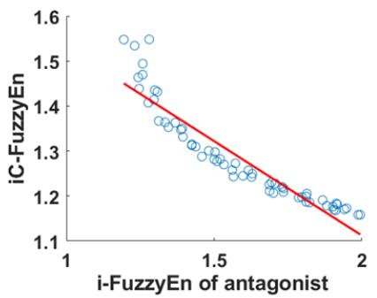  
(a)

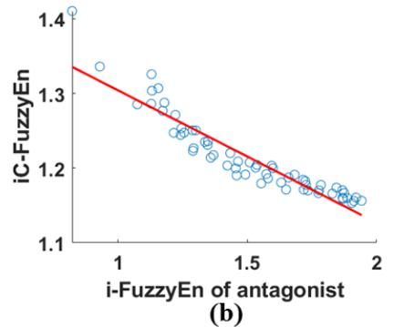

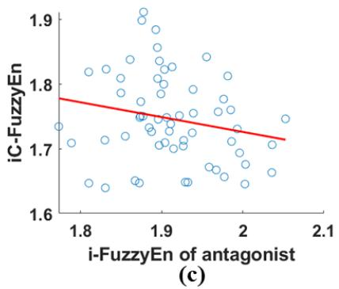  
Fig. 5. Fitting-figures of the i-FuzzyEn values of the agonist and antagonist muscles and the iC-FuzzyEn values between the agonist and antagonist muscles during the elbow flexion task. (a) young: healthy young subjects; (b) old: healthy middle-aged subjects; (c) stroke: patients after stroke.

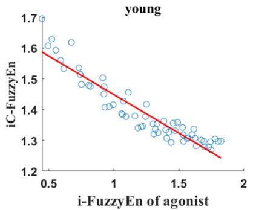

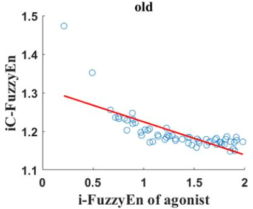

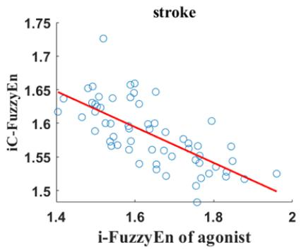

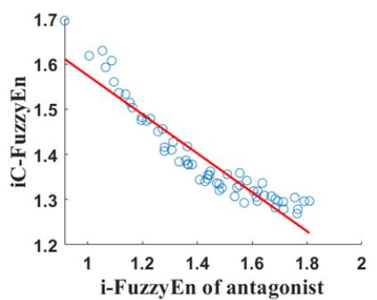  
(a)

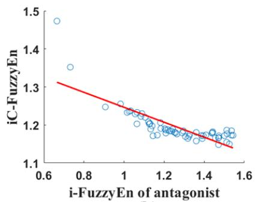  
(b)

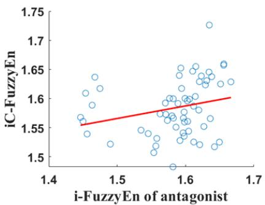  
(c)  
Fig. 6. Fitting-figures of the i-FuzzyEn values of the agonist and antagonist muscles and the iC-FuzzyEn values between the agonist and antagonist muscles during the elbow extension task. (a) young: healthy young subjects; (b) old: healthy middle-aged subjects; (c) stroke: patients after stroke.

TABLE II  
STATISTICAL TABLE OF CORRELATION COEFFICIENT BETWEEN i-FuzzyEn AND iC-FuzzyEn

<table><tr><td rowspan="2">Group</td><td colspan="2">Flexion</td><td colspan="2">Extension</td></tr><tr><td>i-FuzzyEn of agonist</td><td>i-FuzzyEn of antagonist</td><td>i-FuzzyEn of agonist</td><td>i-FuzzyEn of antagonist</td></tr><tr><td>young</td><td> $-0.814 \pm 0.195^{+*}$ </td><td> $-0.787 \pm 0.154^{+*}$ </td><td> $-0.725 \pm 0.234^{*}$ </td><td> $-0.747 \pm 0.194^{+*}$ </td></tr><tr><td>old</td><td> $-0.586 \pm 0.365$ </td><td> $-0.606 \pm 0.372$ </td><td> $-0.429 \pm 0.431$ </td><td> $-0.389 \pm 0.437^{\&}$ </td></tr><tr><td>stroke</td><td> $-0.541 \pm 0.329$ </td><td> $-0.355 \pm 0.514^{\#}$ </td><td> $-0.421 \pm 0.359$ </td><td> $0.081 \pm 0.328$ </td></tr></table>

\* indicates significant difference $( \mathrm { P } < 0 . 0 5 )$ between healthy young subjects and patients after stroke; + indicates significant difference (P<0.05) between healthy young and middle-aged subjects; & indicates significant difference (P<0.05) between healthy middle-aged subjects and patients after stroke; # indicates significant difference $( \mathbf { P } < 0 . 0 5 )$ between elbow flexion task and elbow extension task. Notes: young: healthy young subjects; old: healthy middle-aged subjects; stroke: patients after stroke.

the healthy young subjects had the best correlation, followed by the healthy middle-aged subjects and then the patients after stroke.

The mean C-FuzzyEn values in the elbow flexion and extension tasks were displayed in Fig.7. The two-factor ANOVA analysis indicated that the group’s factor significantly influenced the mean C-FuzzyEn values (p<0.01, F=20.772， $\eta _ { p } ^ { 2 } = 0 . 3 8 8 )$ , but the task’s factor had no significant effect. Meanwhile, the independent sample t-test suggested that the C-FuzzyEn values of the healthy young subjects were significantly smaller than those of patients after stroke during both tasks (flexion: p<0.05; extension: p<0.01). Compared with the patients after stroke, the C-FuzzyEn values of middle-aged subjects were significantly smaller during both tasks (p<0.05). Additionally, the mean C-FuzzyEn values of the healthy young subjects were significantly greater than those of healthy middleaged subjects during the elbow extension (p<0.01). Table III showed the correlations between the C-FuzzyEn values and the FMA-UE, and all the correlations were non-significant.

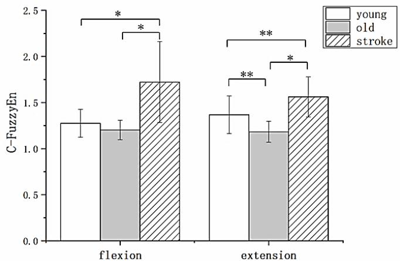  
Fig. 7. The mean C-FuzzyEn values between the agonist and antagonist muscles. Notes: young: healthy young subjects; old: healthy middle-aged subjects; stroke: patients after stroke. \* indicates significant difference (\* means $\mathrm { p } { \mathrm { < } } 0 . 0 5 ;$ \*\* means p<0.01)

TABLE III  
PEARSON CORRELATION ANALYSIS BETWEEN C-FUZZYEN AND FMA-UE

<table><tr><td></td><td>Flexion</td><td>Extension</td></tr><tr><td>r</td><td>-0.178</td><td>0.306</td></tr><tr><td>p</td><td>0.673</td><td>0.461</td></tr></table>

r means the correlation coefficient between C-FuzzyEn and $\overline { { \mathrm { F M A } \mathrm { - } \mathrm { U E } } } ; \mathfrak { p }$ means the value of statistical difference.

## IV. DISCUSSIONS

In this study, the C-FuzzyEn and iC-FuzzyEn were used to analyze the global and instantaneous intermuscular coupling, respectively. The effect of stroke and aging on intermuscular coupling between the agonist and antagonist muscles during the dynamic tracking tasks was demonstrated through the results. Meanwhile, the i-FuzzyEn was applied to analyze the dynamic complexity of EMG, and the correlation between i-FuzzyEn values and iC-FuzzyEn values was also explored.

## A. i-FuzzyEn vs. iC-FuzzyEn

The i-FuzzyEn and iC-FuzzyEn were applied in this study to assess the dynamic activity of muscles in the instantaneous intermuscular coupling during elbow flexion and extension. Similar to our research, Pincus et al. noted a reduction in signal complexity, which indicated a decreased coupling between components in the motor system [31]. Istenic et al. found that as the contraction level of the biceps muscle increased, the multiscale entropy values at various scales in the healthy and patient groups increased [32]. Zhu et al. reported that the FuzzyEn values of the four forearm muscles increased with the muscle contraction level in the grip control experiment [33]. Ao et al. proved that the reduction of the FuzzyEn values might be caused by the decreased number and firing rate of MUs [34]. Moreover, Sun et al. reported a reduction in the intermuscular coupling, indicating that the activation of the antagonist muscles was less correlated with the activation of the agonist muscles, which implies reduced reciprocal activation or increased coactivation [35]. The existence of coactivation indicated that the nervous system controlled the firing rates of the MUs of both muscles in a uniform fashion [36]. Flood et al. observed that the increase in intermuscular coherence was associated with the enhancement in MU synchrony which influenced the MU firing patterns [37]. Thus, the negative correlation between the i-FuzzyEn values and iC-FuzzyEn values indicated a positive correlation between EMG complexity and intermuscular coupling, which might result from the alterations in the MU firing pattern.

The correlation between the i-FuzzyEn values and iC-FuzzyEn values took the following order: young subjects> middle-aged subjects> patients after stroke. The difference in the correlation between middle-aged subjects and young subjects indicated that the ability to control the antagonistic muscles in the middle-aged subjects was superior under elbow extension. Previous studies showed that elderly people have lower force control and slower neuromuscular contractile characteristics than young people, which might be due to the neurodegenerative changes and neurochemical changes induced by aging [38, 39]. The difference in the correlation between patients after stroke and healthy subjects might reflect the poor tracking ability and muscle control ability of patients during the dynamic tracking task. Canning et al. suggested that the impairment of neural pathways in stroke patients led to abnormal muscle activation, making it impossible for patients to coordinate muscle activity in a motor task [40]. Other research results showed that stroke reduced the firing rate of MUs on the affected side, and often led to lower neuromuscular efficiency in patients [41, 42]. In addition, there was no correlation between the i-FuzzyEn of the antagonist muscles and iC-FuzzyEn in the elbow extension, which might be due to the continuous activation of the MU pool of biceps caused by the changes of the central or peripheral nervous system after stroke, resulting in spasms and an inability to relax the biceps [43].

## B. Aging- and Stroke-related Changes in the Global Intermuscular Coupling

The significantly smaller C-FuzzyEn values of the middleaged subjects compared with the young subjects during elbow extension generally represented tighter intermuscular coupling. Consistent with our results, the previous studies found an increase in the MU coherence in the elderly rather than the young adults, which does not necessarily improve the movement performance in the elderly [9, 44]. Watanabe et al. demonstrated that the medial-lateral gastrocnemius coherence was larger in the elderly rather than the young adults during the unipedal stance [45]. This appears to be because the elderly selectively increased the corticospinal drive to these muscles. The increase of corticospinal activity might be due to the dysfunction caused by aging, led which led to relatively more noise input [46]. Therefore, the elderly has to increase corticospinal activity or try to integrate the sensory information of these muscles more extensively in order to cope with the noise produced by the coordination of these muscles. Another study showed that aging could cause structural damage to the motor cortex of the brain, making it possible for the central nervous system to recruit other compensatory neural pathways [47]. The results in this study might be due to the increased corticospinal activity induced by aging, which caused tighter intermuscular coupling.

The significantly higher C-FuzzyEn values were observed in patients after stroke, indicating a decrease in intermuscular coupling compared to healthy subjects. This result was consistent with the findings of previous research which indicated that less mutual information between the biceps and triceps was found in the stroke patients than in the healthy subjects, showing the weakening of intermuscular coupling after stroke [48]. Fisher et al. reported that intermuscular coupling in the beta-band decreased in patients after stroke with upper motor neuron dysfunction, which indicated that the intermuscular coupling depended on an intact corticospinal tract [13]. Kisielsajewicz et al. also demonstrated that intermuscular coupling in low frequencies during reaching tasks decreased in the patients after stroke, which might result from the interruption of corticospinal communication [49]. Previous studies found that the intermuscular coupling had similar patterns with cortico-muscular coupling, which suggested that both kinds of coupling originated from the corticospinal pathway[50-52]. Moreover, intermuscular coupling was also associated with MUs and might even be affected by changes in the MU action potential (MUAP) and firing rates [53-55]. Li et al. and Mcnulty et al. proved that stroke could cause changes in not only the MUAP and firing rates but also in the number of MUs [41, 56].

> REPLACE THIS LINE WITH YOUR PAPER IDENTIFICATION NUMBER (DOUBLE-CLICK HERE TO EDIT) <

## C. Clinical Implication

Although FuzzyEn is superior in terms of robustness and validity with small parameters, it can only be used to analyze and characterize a single modal signal. C-FuzzyEn provided a nonlinear method to observe the global intermuscular coupling between two separate but interconnected EMG signals [18]. In the present study, i-FuzzyEn and iC-FuzzyEn were also used to investigate the dynamic activity of muscles in the instantaneous intermuscular coupling. The combined application of the above methods provides a more comprehensive understanding of the global and instantaneous intermuscular coupling during the dynamic process. According to the Pearson correlation analysis, the correlations between C-FuzzyEn values and FMA-UE were not significant, which might suggest that the C-FuzzyEn analysis can reflect the intermuscular changes after a stroke in a different way to that of the clinical scales. Since intermuscular coupling was helpful to understand the characteristics of neuromuscular control, iC-FuzzyEn and C-FuzzyEn have the potential to be applied in the clinical diagnosis and evaluation of neurological changes caused by stroke and aging. Especially for dynamic rehabilitation tasks, these two measures have the potential to provide guidance for doctors to adjust the rehabilitation program in real time to optimize the therapeutic effect. There are also several limitations to this research. First, the disease stages of the patients after stroke recruited in this study were not taken into account. Second, we only asked the patients after stroke to perform tasks using their affected arms. In the future, more subjects with moderate and severe strokes should be recruited, and the subjects should be asked to perform tasks with both arms to confirm the findings further.

## V. CONCLUSION

C-FuzzyEn and iC-FuzzyEn were two main indexes in this study to characterize the stroke- and aging-related global and instantaneous intermuscular coupling, respectively. These findings have the potential to uncover the stroke- and agingrelated neuromuscular mechanisms and can be used in clinics to evaluate changes in intermuscular coupling.

## ACKNOWLEDGMENT

The authors thank Dr. Hairong Yu, Miss Yifan Li and Miss Tian Xie for their help in the revision of this manuscript. Additionally, we thank all of the participants in this study.

## REFERENCES

[1] I. Bazzucchi, M. E. Riccio, F. Felici, and Kinesiology, “Tennis players show a lower coactivation of the elbow antagonist muscles during isokinetic exercises,” J. Electromyogr. Kinesiol., vol. 18, no. 5, pp. 752- 759, Oct, 2008.

[2] S. F. Farmer, J. Gibbs, D. M. Halliday, L. M. Harrison, L. James, M. J. Mayston, and J. A. Stephens, “Changes in EMG coherence between long and short thumb abductor muscles during human development,” J. Physiol., vol. 579, no. 2, pp. 389-402, Mar 2007.

[3] S. Kattla, and M. M. Lowery, “Fatigue related changes in electromyographic coherence between synergistic hand muscles,” Exp. Brain Res., vol. 202, no. 1, pp. 89-99, Apr, 2010.

[4] P. Grosse, M. J. Cassidy, and P. Brown, “EEG-EMG, MEG-EMG and EMG-EMG frequency analysis: physiological principles and clinical

applications,” Clin. Neurophysiol., vol. 113, no. 10, pp. 1523-1531, 2002.

[5] H. A. Power, J. A. Norton, C. L. Porter, Z. Doyle, I. Hui, and K. M. Chan, “Transcranial direct current stimulation of the primary motor cortex affects cortical drive to human musculature as assessed by intermuscular coherence,” J. Physiol., vol. 577, no. 3, pp. 795-803, Aug, 2010.

[6] O. Delbono, “Neural control of aging skeletal muscle,” Aging Cell, vol. 2, no. 1, pp. 21-29, 2003.

[7] N. S. Ward, O. B. C. Swayne, and J. M. Newton, “Age-dependent changes in the neural correlates of force modulation: An fMRI study,” Neurobiol. Aging, vol. 29, no. 9, pp. 1434-1446, 2008.

[8] T. Asaka, and Y. Wang, “Effects of aging on feedforward postural synergies,” J. Hum. Kinet., vol. 20, pp. 63-70, Dec, 2008.

[9] J. G. Semmler, K. W. Kornatz, and R. M. Enoka, “Motor-unit coherence during isometric contractions is greater in a hand muscle of older adults,” J. Neurophysiol., vol. 90, no. 2, pp. 1346-1349, Aug, 2003.

[10] M. F. Levin, R. W. Selles, M. H. G. Verheul, and O. G. Meijer, “Deficits in the coordination of agonist and antagonist muscles in stroke patients: implications for normal motor control,” Brain Res., vol. 853, no. 2, pp. 352-369, 2000.

[11] P. H. McCrea, J. J. Eng, and A. J. Hodgson, “Saturated muscle activation contributes to compensatory reaching strategies after stroke,” J. Neurophysiol., vol. 94, no. 5, pp. 2999-3008, Nov, 2005.

[12] J. P. A. Dewald, P. S. Pope, J. D. Given, T. S. Buchanan, and W. Z. Rymer, “Abnormal muscle coactivation patterns during isometric torque generation at the elbow and shoulder in hemiparetic subjects,” Brain, vol. 118, no. 2, pp. 495-510, 1995.

[13] K. M. Fisher, Z. Boubker, T. L. Williams, S. N. Baker, and M. R. Baker, “Beta-band intermuscular coherence: a novel biomarker of upper motor neuron dysfunction in motor neuron disease,” Brain, vol. 135, no. 9, pp. 2849-64, Sep, 2012.

[14] R. Sun, R. Song, and K. Y. Tong, “Complexity Analysis of EMG Signals for Patients After Stroke During Robot-Aided Rehabilitation Training Using Fuzzy Approximate Entropy,” IEEE Trans. Neural Syst. Rehabil. Eng., vol. 22, no. 5, pp. 1013-1019, Sep, 2013.

[15] S. H. Jin, P. Lin, and M. Hallett, “Linear and nonlinear information flow based on time-delayed mutual information method and its application to corticomuscular interaction,” Clin. Neurophysiol., vol. 121, no. 3, pp. 392-401, 2010.

[16] F. He, and Y. Yang, “Nonlinear System Identification of Neural Systems from Neurophysiological Signals,” Neuroscience, vol. 458, pp. 213-228, Mar 15, 2021.

[17] Y. Yang, J. P. A. Dewald, F. C. T. van der Helm, and A. C. Schouten, “Unveiling neural coupling within the sensorimotor system: directionality and nonlinearity,” Eur. J. Neurosci., vol. 48, no. 7, pp. 2407-2415, Oct, 2018.

[18] H. B. Xie, Y. P. Zheng, J. Y. Guo, and X. Chen, “Cross-fuzzy entropy: A new method to test pattern synchrony of bivariate time series,” Information Sciences, vol. 180, no. 9, pp. 1715-1724, May, 2010.

[19] P. Li, C. Liu, X. Wang, L. Li, L. Yang, Y. Chen, and C. Liu, “Testing pattern synchronization in coupled systems through different entropybased measures,” Med. Biol. Eng. Comput., vol. 51, no. 5, pp. 581-591, Jul, 2013.

[20] S. Pincus, and B. H. Singer, “Randomness and degrees of irregularity,” Proceedings of the National Academy of Sciences of the United States of America, vol. 93, no. 5, pp. 2083, 1996.

[21] J. S. Richman, and J. R. Moorman, “Physiological time-series analysis using approximate entropy and sample entropy,” Am. J. Physiol. Heart. Circ. Physiol., vol. 278, no. 6, pp. H2039-H2049, Jun, 2000.

[22] R. Wang, D. Li, J. Wang, L. Cai, and L. Shi, “Synchrony Analysis Using Different Cross-entropy Measures of The Electroencephalograph Activity in Alzheimer's Disease,” in 2016 9th International Congress on Image and Signal Processing, Biomedical Engineering and Informatics, 2016, pp. 1541-1545.

[23] I. S. Hwang, Y. T. Lin, W. M. Huang, Z. R. Yang, C. L. Hu, and Y. C. Chen, “Alterations in Neural Control of Constant Isometric Contraction with the Size of Error Feedback,” Plos One, vol. 12, no. 1, pp. e0170824, 2017.

[24] L. Chen, W. Luo, Y. Deng, Z. Wang, and S. Zeng, “Characterizing the complexity of spontaneous Electrical Signals in Cultured Neuronal Networks Using Approximate Entropy,” IEEE Trans. Inf. Technol. Biomed., vol. 13, no. 3, pp. 405-410, 2009.

[25] Y. Li, W. Pan, K. Li, Q. Jiang, and G. Liu, “Sliding Trend Fuzzy Approximate Entropy as a Novel Descriptor of Heart Rate Variability in Obstructive Sleep Apnea,” IEEE J. Biomed. Health., vol. 23, no. 1, pp. 175-183, Jan, 2019.

[26] O. Missenard, D. Mottet, and S. Perrey, “The role of cocontraction in the

impairment of movement accuracy with fatigue,” Exp. Brain Res., vol. 185, no. 1, pp. 151-156, Feb, 2008.

[27] K. Gordon, and D. Ferris, “Proportional myoelectric control of a virtual object to investigate human efferent control,” Exp. Brain Res., vol. 159, no. 4, pp. 478-486, Dec, 2004.

[28] W. Chen, J. Zhuang, W. Yu, and Z. Wang, “Measuring complexity using FuzzyEn, ApEn, and SampEn,” Med. Eng. Phys., vol. 31, no. 1, pp. 61- 68, Jan, 2009.

[29] P. Zhou, P. E. Barkhaus, X. Zhang, and W. Z. Rymer, “Characterizing the complexity of spontaneous motor unit patterns of amyotrophic lateral sclerosis using approximate entropy,” J. Neural. Eng., vol. 8, no. 6, Dec, 2011.

[30] B. Hong, Q. Tang, F. Yang, and T. Chen, “ApEn and Cross-ApEn: Property, Fast Algorithm and Preliminary Application to the Study of EEG and Cognition,” Signal Processing, vol. 15, no. 2, 1999.

[31] S. M. Pincus, “Greater signal regularity may indicate increased system isolation,” Math. Biosci., vol. 122, no. 2, pp. 161-181, 1994.

[32] R. Istenic, P. A. Kaplanis, C. S. Pattichis, and D. Zazula, “Multiscale entropy-based approach to automated surface EMG classification of neuromuscular disorders,” Med. Biol. Eng. Comput., vol. 48, no. 8, pp. 773-781, 2010.

[33] P. Zhu, Y. Wu, J. Liang, Y. Ye, H. Liu, T. Yan, and R. Song, “Characterization of the Stroke-Induced Changes in the Variability and Complexity of Handgrip Force,” Entropy, vol. 20, no. 5, pp. 377, 2018.

[34] D. Ao, R. Sun, K. Y. Tong, and R. Song, “Characterization of Stroke- and Aging-Related Changes in the Complexity of EMG Signals During Tracking Tasks,” Ann. Biomed. Eng., vol. 43, no. 4, pp. 990-1002, 2015.

[35] W. Sun, J. Liang, Y. Yang, Y. Wu, T. Yan, and R. Song, “Investigating Aging-Related Changes in the Coordination of Agonist and Antagonist Muscles Using Fuzzy Entropy and Mutual Information,” Entropy, vol. 18, no. 6, pp. 229, 2016.

[36] C. J. De Luca, and B. Mambrito, “Voluntary control of motor units in human antagonist muscles: coactivation and reciprocal activation,” J. Neurophysiol., vol. 58, no. 3, pp. 525-542, Sep, 1987.

[37] M. W. Flood, B. R. Jensen, A.-S. Malling, and M. M. Lowery, “Increased EMG intermuscular coherence and reduced signal complexity in Parkinson's disease,” Clin. Neurophysiol., vol. 130, no. 2, pp. 259-269, Feb, 2019.

[38] M. R. Roos, C. L. Rice, A. A. J. M. Vandervoort, and Nerve, “Age-related changes in motor unit function,” Muscle Nerve, vol. 20, no. 6, pp. 679- 690, 1997.

[39] N. S. Ward, and R. S. J. Frackowiak, “Age-related changes in the neural correlates of motor performance,” Brain, vol. 126, no. 4, pp. 873-888, 2003.

[40] C. G. Canning, L. Ada, and N. Odwyer, “Abnormal muscle activation characteristics associated with loss of dexterity after stroke,” J. Neurol. Sci., vol. 176, no. 1, pp. 45-56, 2000.

[41] X. Li, Y. Wang, N. L. Suresh, W. Rymer, and P. Zhou, “Motor Unit Number Reductions in Paretic Muscles of Stroke Survivors,” IEEE Trans. Inf. Technol. Biomed., vol. 15, no. 4, pp. 505-512, 2011.

[42] T. G. Balshaw, G. J. Massey, T. M. Madenwilkinson, M. B. Lanza, and J. P. Folland, “Neural adaptations after 4 years vs. 12 weeks of resistance training vs. untrained,” Scand. J. Med. Sci. Sports, vol. 29, no. 3, pp. 348- 359, Mar, 2018.

[43] C. Mottram, C. L. Wallace, C. N. Chikando, and W. Z. Rymer, “Origins of Spontaneous Firing of Motor Units in the Spastic–Paretic Biceps Brachii Muscle of Stroke Survivors,” J. Neurophysiol., vol. 104, no. 6, pp. 3168-3179, 2010.

[44] A. N. Johnson, and M. Shinohara, “Corticomuscular coherence with and without additional task in the elderly,” J. Appl. Physiol., vol. 112, no. 6, pp. 970-981, Mar, 2012.

[45] T. Watanabe, K. Saito, K. Ishida, S. Tanabe, and I. Nojima, “Coordination of plantar flexor muscles during bipedal and unipedal stances in young and elderly adults,” Exp. Brain Res., vol. 236, no. 5, pp. 1229-1239, May, 2018.

[46] T. Watanabe, I. Nojima, T. Mima, H. Sugiura, and H. Kirimoto, “Magnification of visual feedback modulates corticomuscular and intermuscular coherences differently in young and elderly adults,” NeuroImage, vol. 220, no. Pt 5, pp. 117089, 2020.

[47] T. Hortobagyi, and P. Devita, “Mechanisms Responsible for the Age-Associated Increase in Coactivation of Antagonist Muscles,” Exerc. Sport Sci. Rev., vol. 34, no. 1, pp. 29-35, Jan, 2006.

[48] J. Z. Wang, and M. J. McKeown, “Relevance network modeling for muscle association pattern in reaching movements,” in 2007 IEEE International Conference on Acoustics, Speech, and Signal Processing,

2007, pp. I-389-392.

[49] K. Kisiel-Sajewicz, Y. Fang, K. Hrovat, G. H. Yue, V. Siemionow, C.-K. Sun, A. Jaskolska, A. Jaskolski, V. Sahgal, and J. J. Daly, “Weakening of synergist muscle coupling during reaching movement in stroke patients,” Neurorehabil. Neural Repair, vol. 25, no. 4, pp. 359-368, May, 2011.

[50] J. M. Kilner, S. N. Baker, S. Salenius, V. Jousmaki, R. Hari, and R. N. Lemon, “Task-dependent modulation of 15-30 Hz coherence between rectified EMGs from human hand and forearm muscles,” J. Physiol., vol. 516, no. 2, pp. 559-570, Apr 15, 1999.

[51] P. Brown, S. F. Farmer, D. M. Halliday, J. Marsden, and J. R. Rosenberg, “Coherent cortical and muscle discharge in cortical myoclonus,” Brain, vol. 122, pp. 461-472, Mar, 1999.

[52] S. F. Farmer, F. D. Bremner, D. M. Halliday, J. R. Rosenberg, and J. A. Stephens, “The frequency content of common synaptic inputs to motoneurones studied during voluntary isometric contraction in man,” J. Physiol., vol. 470, pp. 127-55, Oct, 1993.

[53] T. W. Boonstra, “The potential of corticomuscular and intermuscular coherence for research on human motor control,” Front. Hum. Neurosci., vol. 7, no. 50, pp. 855, Dec, 2013.

[54] T. W. Boonstra, A. Daffertshofer, M. Roerdink, I. Flipse, K. Groenewoud, and P. J. Beek, “Bilateral motor unit synchronization of leg muscles during a simple dynamic balance task,” Eur. J. Neurosci., vol. 29, no. 3, pp. 613- 622, 2009.

[55] D. Farina, F. Negro, and N. Jiang, “Identification of common synaptic inputs to motor neurons from the rectified electromyogram,” J. Physiol., vol. 591, no. 10, pp. 2403-2418, 2013.

[56] P. A. Mcnulty, L. Gaven, and C. G. Doust, “Single motor unit firing rate after stroke is higher on the less-affected side during stable low-level voluntary contractions,” Front. Hum. Neurosci., vol. 8, pp. 518, 2014.