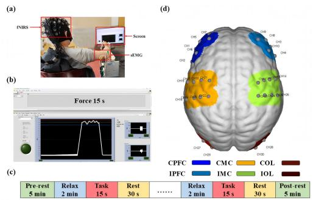
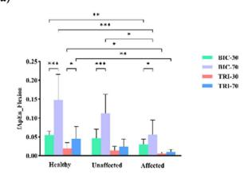
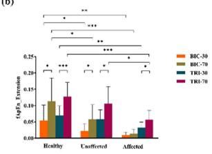
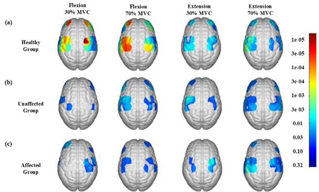
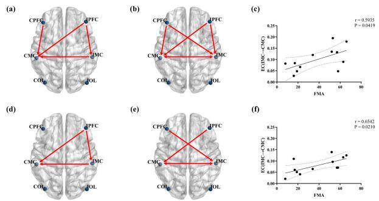
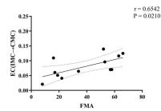
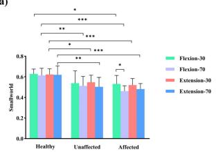
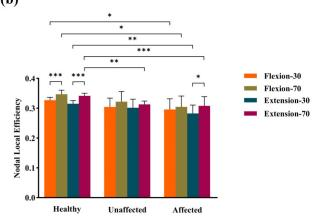
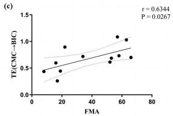

<!-- 本文件是 MinerU 自动抽取的**英文结构化正文**，不是中文翻译。 -->
<!-- 中文翻译若需要，须另走 06_附录/pdf2zh调用脚本/translate_all.py，不得把本文件当译文引用。 -->
<!-- 抽取来源：01_参考论文/整合系统/宋嵘_双参与与肌间耦合/Wang2025-TNSRE：卒中患者肘等长收缩时皮层-肌电耦合改变与临床评分相关/Wang2025-TNSRE：卒中患者肘等长收缩时皮层-肌电耦合改变与临床评分相关.pdf -->
<!-- DOI：10.1109/TNSRE.2025.3535928 -->
<!-- 图片：12 张，位于同级 images/，已按正文引用相对路径改写。 -->

# Corticomuscular Coupling Alterations During Elbow Isometric Contraction Correlated With Clinical Scores: An fNIRS-sEMG Study in Stroke Survivors

Xiaohan Wang , Weidong Li, Rong Song , Senior Member, IEEE, Di Ao , Huijing Hu, and Le Li

Abstract— The study aimed to investigate changes in corticomuscular coupling during elbow flexion and extension in stroke survivors using functional near-infrared spectroscopy (fNIRS) and surface electromyography (sEMG), and to evaluate the relationship between coupling characteristics and clinical assessment scales. This study recruited 12 stroke survivors and 12 age-matched healthy subjects, and further divided the subjects into the affected side group, healthy-side group and age-matched healthy group. They performed elbow flexion and extension tasks at 30% and 70% of the maximum voluntary contraction (MVC). The cerebral blood flow dynamics of the bilateral prefrontal cortex, motor cortex, and occipital lobe, along with sEMG signals from the biceps brachii and triceps brachii, were simultaneously recorded. At matched force levels, the fuzzy approximate entropy values of both agonist and antagonistic muscles were notably lower in the affected group compared to the healthy group (P < 0.05). The effective connectivity from the ipsilateral motor cortex to the contralateral motor cortex during elbow movements in the affected group showed a meaningful positive association with the Fugl-Meyer Assessment

(FMA) scale. Additionally, the transfer entropy from the contralateral motor cortex to the agonist muscle in the affected group demonstrated a significant positive correlation with the FMA scale at 70% MVC during elbow flexion. This research identified differences in intermuscular coordination, brain network connectivity, and corticomuscular coupling between stroke survivors and healthy individuals during motor tasks and our findings suggest that it can serve as a potential quantitative marker for assessing upper limb motor function post-stroke. The relationship between these characteristics and clinical scales signifies potential quantitative assessment parameters for stroke rehabilitation, underscoring the importance of exploring corticomuscular coupling in the recovery of upper limb motor function post-stroke.

Index Terms— Corticomuscular coupling, motor function, functional near-infrared spectroscopy (fNIRS), surface electromyography (sEMG), stroke.

## I. INTRODUCTION

TROKE is a prevalent cerebrovascular disease caused S by abnormal blood supply to cortical tissue, leading to damage to cerebral nerves due to the rupture or obstruction of cerebral blood vessels [1]. Survivors of stroke frequently experience a range of sequelae, with motor dysfunction significantly influencing their quality of life [2]. Studies showed that around 80% of stroke survivors suffer from motor dysfunction, presenting as abnormal gait and impaired upper limb function [3]. At present, clinical assessment scales, such as FMA and ARAT, are still used in the rehabilitation assessment of stroke motor function [4]. However, the clinical assessment scales were inevitably subjective, stereotypical and semi-quantitative. Therefore, it is important to quantitatively investigate changes in motor function during the rehabilitation intervention of stroke survivors, which help to understand the mechanisms underlying the process of training.

Previous studies have shown that upper limb movement is regulated by the cerebral cortex, which coordinates multiple muscles and transmits motor instructions to specific target muscles [5], [6]. As a result, a comprehensive investigation into the mechanisms of the central nervous system is essential for a thorough understanding of upper limb motor function in stroke survivors. Functional near-infrared spec troscopy (fNIRS) is a non-invasive brain imaging technique that enables real-time detection of cerebral cortex blood oxygen activity [7], [8]. Compared to functional magnetic resonance imaging (fMRI) and electroencephalogram (EEG), fNIRS offers superior temporal and spatial resolution, as well as robust anti-motion and electromagnetic interference resistance [9]. Hence, an increasing number of studies have utilized fNIRS for evaluating effects of stroke rehabilitation interventions. Huo et al. demonstrated that fNIRS can evaluate cerebral cortical alterations in stroke survivors during various rehabilitation training [10], [11]. Nevertheless, the understanding of alterations in the overall brain network and its interaction with the peripheral nervous system in stroke survivors remains ambiguous.

Brain network analysis and graph theory are essential for examining changes in complex brain systems and investigating interconnections between different brain regions in dynamic networks [12]. The communication and interaction among different brain regions could greatly affect brain function and regulate behavior and cognitive processes [13]. Studies on stroke survivors have revealed substantial impairments in their brain networks during hand grasping tasks, compared to healthy individuals [14], [15]. Meanwhile, Cresearch has demonstrated the transfer of intercortical information within the affected hemispheres of stroke survivors [16], [17]. Nonetheless, limited research has investigated variations in graph theory concerning elbow isometric contraction among stroke survivors. By utilizing the intricate brain networks and analyzing the information transfer among various brain regions using effective connectivity, researchers can enhance their understanding of the collaborative processes between brain regions and their impact on motor behavior [18].

Motor control in humans operates as a closed-loop system in which the central nervous system interacts with the peripheral nervous system [19], [20]. Corticomuscular coupling pertains to the communication process where the cerebral cortex transmits control signals, leading to synchronized oscillations between the cortex and peripheral neuromuscular system [21]. Given that cortical instructions are primarily governed by the intercortical network, impaired intercortical communication post-stroke could hinder downstream information propagation in stroke survivors [22]. Several studies have shown that in stroke survivors, the coupling between cerebral cortex and muscles is weakened, resulting in reduced coordination of upper limb muscles [23], [24]. Thus, changes in corticomuscular coupling following a stroke could provide a pivotal insight into motor dysfunction, indicating the progression of motor function recovery and the development of neuroplasticity in motor impairment [25]. The association between the complexity and the co-contraction of surface electromyography (sEMG) signals and the central nervous system among stroke survivors has been seldom documented.

This study aimed to explore alterations in corticomuscular coupling during elbow isometric contractions at various levels of force in stroke survivors and age-matched healthy individuals using fNIRS and sEMG, and to explore their relationship with clinical assessment scales. A hypothesis was formulated that stroke survivors would exhibit distinct changes in corticomuscular coupling and would be associated with clinical assessment parameters. The findings of current study may establish a conceptual foundation for understanding the mechanisms underlying the assessment of motor function rehabilitation in stroke survivors.

TABLE I  
STATISTICS OF SUBJECTS
<table><tr><td></td><td>Age-matched healthy</td><td>Stroke</td></tr><tr><td>Age (years)</td><td>59.65±7.07</td><td>56.58±15.76</td></tr><tr><td>Gender (male/female)</td><td>6/6</td><td>9/3</td></tr><tr><td>Height (cm)</td><td>166.83±8.33</td><td>170.17±5.80</td></tr><tr><td>Weight (kg)</td><td>62.83±4.93</td><td>64.00±6.45</td></tr><tr><td>Lesion side (left/right)</td><td>N/A</td><td>5/7</td></tr><tr><td>Time since stroke (years)</td><td>N/A</td><td>2.11±1.68</td></tr><tr><td>FMA</td><td>N/A</td><td>38.75±21.41</td></tr><tr><td>ARAT</td><td>N/A</td><td>25.33±24.33</td></tr><tr><td>MAS</td><td>N/A</td><td>0.55±0.82</td></tr></table>

## II. MATERIALS AND METHODS

## A. Participants

Twenty-four participants were recruited in this study, comprising 12 stroke survivors and 12 age-matched healthy individuals. For the stroke survivors, both the unaffected side and affected side of them completed the entire experimental task, so we further divided them into the unaffected side group and the affected side group. All the age-matched healthy subjects completed the experimental task under the dominant hand, so we defined them as the healthy control group. The detailed subject information is presented in Table I. All participants were right-hand dominant, had normal vision, and had no history of epilepsy or other psychiatric disorders. This study received ethic approval from the local institutional ethics committee and was registered in the Chinese Clinical Trial Registry (ChiCTR2200057839) and all the participants provided signed consents.

The inclusion criteria for stroke survivors were as follows: (1) stroke confirmed by CT or MRI with upper limb motor dysfunction; (2) the duration of stroke is more than one month; (3) no obvious visual and hearing impairment; (4) can autonomously complete elbow flexion and extension within a certain range; (5) no other motor dysfunction in both upper limbs before stroke; (6) voluntarily cooperate with the experiment. The study was conducted in strict accordance with the Declaration of Helsinki, and all participants provided informed consent before the experiment. Before the experiment, the functional impairments of stroke survivors were evaluated using the Fugl-Meyer Assessment (FMA), Action Research Arm Test (ARAT), and Modified Ashworth Scale (MAS).

## B. Experimental Paradigm

Prior to commencing the experiment, the operator thoroughly explained the experiment procedure to each subject to ensure a comprehensive understanding. The experimental set-up employed in this study is depicted in Fig.1(a). Prior to the formal experiment, a preliminary trial was conducted to confirm normal brain area activation. During the experiment, participants were seated in a chair facing a computer screen, with their forearm secured in the slot of a custom armrest and the height of the table is adjustable to make the sitting position comfortable for the subjects to perform elbow flexion and extension. Their elbows were flexed at 90◦, and their shoulders were turned at $9 0 ^ { \circ }$ of abduction. Detailed instructions were provided to all participants on adjusting muscle activation based on visual feedback to achieve target task values. Visual feedback was provided through a custom LabVIEW program (LabVIEW 2021; National Instruments, Austin, TX, United States), as illustrated in Fig.2(b). Initially, participants were instructed to perform consecutive maximum voluntary contractions (MVC) lasting 5 seconds each, and to repeat three times with 2-minute rest intervals to prevent muscle fatigue. Then, participants completed isometric flexion and extension of their elbow joint while adjusting based on visual feedback. The biceps brachii (BIC) was the agonist muscles in the elbow isometric flexion task and the triceps brachii (TRI) was the agonist muscles in the elbow isometric extension task. The unaffected side and the affected side of stroke survivors completed elbow flexion and extension force tasks respectively, and the healthy subjects completed elbow flexion and extension force tasks with their dominant hands. Each trial involved two conditions, 30% MVC and 70% MVC, repeated three times. The experiment comprised a 2-minute relaxation phase, a 15-second task phase, and a 30-second rest phase, as outlined in Fig.1(c).

  
Fig. 1. The experimental design of the evaluation test. (a) Experimenta set-up. (b) Diagram of elbow flexion and extension real-time control interface (30% MVC). (c) Experiment procedure. (d) The layout of fNIRS channels. The 15 sources and 15 detectors constitute 30 channels, overlaying six brain regions: CPFC, IPFC, CMC, IMC, COL, and IOL.

## C. Data Acquisition

fNIRS signals with near infrared wavelengths of 730 and 850 nm were acquired using a multichannel fNIRS system (NirSmart, Danyang Huichuang Medical Equipment Co. Ltd., China) with a sampling rate of 11 Hz. The layout of the NIR probe was aligned with the international 10–20 system, as shown in Fig.1(d). To cover the bilateral prefrontal cortex (PFC), motor cortex (MC), and occipital lobe (OL), a total of 30 channels were strategically positioned at the midpoint of the detector.

Firstly, the skin above the subject’s BIC and TRI was gently scraped and cleansed with alcohol. Ag-AgCl bipolar electrodes were then precisely positioned on the abdomen of BIC and TRI with a fixed distance of 20 mm. The EMG signals were captured by a dual-channel custom sEMG amplifier and digitized by a data converter with a precision of 1000 Hz. The sampling of sEMG signals occurred at a rate of 1,000 Hz, through a 16-bit data converter (DAQ-6341, National Instruments, Austin, TX, United States). A LabVIEW program was employed to oversee and store the raw sEMG signals. To synchronize the sEMG and fNIRS recording systems, timestamp signals were concurrently sent to both devices at the onset and conclusion of each task recording utilizing the same computer responsible for task presentation and visual feedback [25], [26], [27].

(a)  
(b)  
  
(c)

  
(d)

  
Fig. 2. (a) Comparison of fApEn in elbow flexion task in different experimental groups; (b) Comparison of fApEn in elbow extension task in different experimental groups; (c) Correlation of fApEn of agonist muscle (BIC) and FMA scale under 70% MVC condition in elbow flexion task; (d) Correlation of fApEn of agonist muscle (TRI) and FMA scale under 70% MVC condition in elbow extension task. $( \mathsf { N o t e } ; \mathsf { \Omega } ^ { * } 0 . 0 1 < \mathsf { p } <$ 0.05, ∗∗ $\mathsf { p } < 0 . 0 1$ ∗∗∗ $\mathsf { p } < 0 . 0 0 1 $ ).

## D. Data Analysis

1) EMG Data Analysis: Initially, the off-line sEMG signals underwent digital filtering using a zero-phase-shift fourthorder Butterworth bandpass filter set at 10–490 Hz and a notch filter at 50 Hz to eliminate noise and power-line interference. Each trial underwent manual visual inspection to identify segments of the 5-second sEMG signal exhibiting a consistent, stable, flat response post root mean square (RMS) smoothing.

Subsequently, fApEn was employed to assess the changes in complexity of sEMG signals under various conditions. Entropy serves as a valuable nonlinear analysis method for characterizing the level of complexity of human physiological signals [28]. Building upon the principles of entropy theory, Chen et al. introduced the concept of fuzzy sets, substituted the hard threshold function with an exponential function in sample entropy to define the similarity of reconstructed vectors, and subsequently developed fuzzy approximate entropy (fApEn) [29]. However, the relationship between changes in muscle complexity and brain network during task execution remains unclear. In this study, we utilized fApEn in the nonlinear analysis to assess the changes in complexity of sEMG signals under various conditions. The computation process of fApEn is outlined as follows [30], [31]:

$$
f A p E n \left( m , r , n , N \right) = \ln \varphi ^ { m } \left( n , r \right) - \varphi ^ { m + 1 } \left( n , r \right)\tag{1}
$$

where the function $\varphi ^ { m }$ is defined as:

$$
\begin{array} { c } { { \varphi ^ { m } \left( n , r \right) = \displaystyle \frac { 1 } { N - m + 1 } \sum _ { i = 1 } ^ { N - m + 1 } } } \\ { { \times \ln \left( \displaystyle \frac { 1 } { N - m + 1 } \sum _ { j = 1 , j \neq i } ^ { N - m + 1 } D _ { i j } ^ { m } \right) } } \end{array}\tag{2}
$$

2) fNIRS Data Analysis: The initial processing of fNIRS data consists of three steps. Firstly, the quality of the collected fNIRS signals is verified. Subsequently, the data were filtered using a fourth-order Butterworth bandpass filter with a cutoff frequency ranging from 0.01 to 2 Hz. This process aims to enhance the signal-to-noise ratio and eliminate physiological signal interference, such as that stemming from heartbeat and breathing activity [32]. The initial fNIRS signals are then transformed into hemodynamic signals using the modified Lambert-Beer law. Given that $\mathrm { H b } { \mathrm { O } } _ { 2 }$ signals demonstrate a superior signal-to-noise ratio compared to HbR signals, $\mathrm { H b } { \mathrm { O } } _ { 2 }$ signals are employed as markers of cortical activation, and the task-related $\mathrm { H b } { \mathrm { O } } _ { 2 }$ concentration is computed [33].

Following this, functional connectivity served as the basis for analyzing effective connectivity between different brain regions using Granger causality analysis. In cases where two signals are simultaneously measured, if the predictive accuracy of first signal improves by incorporating historical values of the second signal rather than depending solely on the information from the first signal, the second signal is considered the cause of the first signal. Granger causality analysis is thus utilized to assess directed connections between brain regions [34], [35]. Notably, one advantage of Granger causality analysis lies in its asymmetry, allowing for the detection of effective connectivity.

Graph theory is utilized to depict the topological structure of the functional network in the human brain [36], [37]. To investigate the correlation between sparsity and network characteristics, we established the correlation matrix value within the sparsity range $( 0 . 0 5 < \mathrm { s } < 0 . 4 0 $ , step size = 0.01) [38]. Additionally, a uniform sparsity value $( \mathrm { s } = 0 . 4 0 )$ was applied to normalize the brain’s functional network across all participants in order to examine inter-group variations in the network’s topological structure of the equivalent magnitude. For this study, smallworld and nodal local efficiency were chosen as the metrics for brain network analysis.

Smallworld networks demonstrate efficient information transfer on a global scale while retaining strong local interconnections [39]. The computational procedure of smallworld networks is outlined as follows [40]:

$$
S = \frac { C _ { b r a i n } / C _ { r a n d } } { L _ { b r a i n } / L _ { r a n d } }\tag{3}
$$

where $C _ { b r a i n }$ and $C _ { r a n d }$ are the clustering coefficients, and $L _ { b r a i n }$ and $L _ { r a n d }$ are the characteristic path lengths of the respective tested network and a random network.

The nodal local efficiency of a node is calculated as the inverse of the average shortest path length within a subgraph comprising the node and its neighbors [41]. This metric serves as an indicator of the network’s fault tolerance by assessing the extent to which neighboring nodes exchange information when a node is eliminated [42]. The computation of nodal local efficiency is outlined as follows [43]:

$$
E _ { n o d a l } \left( i \right) = \frac { 1 } { N - 1 } \sum _ { j \in G } \frac { 1 } { d _ { i , j } }\tag{4}
$$

where $E _ { n o d a l } ( i )$ is the local efficiency of node, and $d _ { i , j }$ is the length of the shortest path between i and j, that contains only neighbors of node.

3) Corticomuscular Coupling Analysis: Time series causal using transfer entropy (TE) was utilized to corticomuscular coupling analysis, which relies on information theory principles, and can offer great insight into the directional flow of information [44]. TE enables the examination of connectivity strength among physiological signals in various states, facilitating an objective depiction of information transmission direction. By assessing both connectivity intensity and information flow direction, this method comprehensively unveils the dynamic attributes of physiological networks [45].

If given two time series $X = \{ x _ { 1 } , x _ { 2 } , . . . . , x _ { N } \}$ and $Y = \{ y _ { 1 } ,$ $y _ { 2 } , . . . . , y _ { N } \} ,$ where N is the length of the time series, and TE from Y to X is defined as $T E _ { Y  X }$ , the equation is calculated as follows [22]:

$$
\begin{array} { l } { \displaystyle { T E _ { Y \to X } } } \\ { = \sum _ { x _ { i + 1 } , x _ { i } , y _ { i } } \left( p \left( x _ { i + 1 } , x _ { i } , y _ { i } \right) \log \frac { p \left( x _ { i + 1 } , x _ { i } , y _ { i } \right) p \left( x _ { i } \right) } { p \left( x _ { i } , y _ { i } \right) p \left( x _ { i + 1 } , x _ { i } \right) } \right) } \end{array}\tag{5}
$$

where i is the discrete time index $( I \leq i \leq N ) ;$ ; p represents the probability distribution. At the same time, because TE is inherently asymmetric, $T E _ { Y  X }$ does not equal $T E _ { X  Y } .$ Thus, when $T E _ { X  Y } > T E _ { Y  X } .$ , we call X cause and Y effect, and thus establish a causal relationship between the two signals.

4) Statistical Analysis: All experimental data were analyzed using SPSS Statistics 26 (IBM Inc., WA, United States) and MATLAB R2021a (The MathWorks, United States). Firstly, to examine the variations in muscle complexity, brain information transmission, and corticomuscular coupling among three experimental groups, one-way ANOVA was performed to compare fApEn, graph theory indicators, and TE respectively. The Bonferroni post hoc test was utilized for multiple comparisons within the ANOVA analyses. Additionally, paired t-tests were conducted to evaluate connectivity changes between brain regions at different force levels in both stroke and healthy participants. Furthermore, independent t-tests were employed to assess alterations in cortical activation across the three experimental groups during different force tasks. Furthermore, Pearson correlation analysis was employed to examine the relationship between characteristic parameters and FMA scale scores during various tasks for the affected side group (strong: $\mathrm { r } { > } 0 . 5 ,$ moderate: $0 . 3 < \mathbf { r } < 0 . 5 .$ weak: r<0.3) [46]. Statistical significance was set at $\mathrm { ~ P ~ } < 0 . 0 5$ , with false discovery rate (FDR) correction applied.

## III. RESULTS

## A. EMG Results

Fig.2 demonstrated the fApEn results of sEMG activity during tasks involving elbow flexion and extension across different experimental groups. The one-way ANOVA indicated a significant variability in fApEn values among the three experimental groups during different tasks $( \mathrm { P } < 0 . 0 5 )$ . It was observed that, at matched force levels, the fApEn values of both agonist and antagonistic muscles were notably lower in the affected group compared to the healthy group $( \mathbf { P } < 0 . 0 5 )$ Conversely, in the unaffected group, the fApEn of agonist muscles was only significantly higher than the affected group at the 70% MVC $( \mathbf { P } < 0 . 0 5 )$ , with no significant difference in other conditions. Furthermore, the fApEn of agonist muscles in various experimental groups was notably higher at 70% MVC compared to 30% MVC. Additionally, as exhibited in Fig.2(c) and (d), the correlation between fApEn values of agonist muscles and the FMA scale for elbow flexion and extension tasks in the affected group was examined. The findings revealed a significant positive correlation between the fApEn of agonist muscles in the affected group and the FMA scale for both elbow flexion (r = 0.6593, $\mathrm { P } = 0 . 0 1 9 7 )$ and extension $( \mathrm { r } = 0 . 6 4 7 5 ^ { }$ , P = 0.0228) tasks.

  
Fig. 3. Cortical activation patterns with respect to delta ${ \mathsf { H b } } { \mathsf { O } } _ { 2 }$ during different conditions in subjects (a) healthy group; (b) unaffected group; and (c) affected group.

## B. fNIRS Results

Fig. 3 illustrates the cortical activation results for the healthy control group, the unaffected side group and the affected side group during various motor tasks. In the healthy control group, there was notable activation in the contralateral motor cortex during motor tasks, particularly evident during the 70% MVC of elbow flexion $( \mathrm { P } < 0 . 0 5 )$ . In contrast, stroke survivors demonstrated limited activation across a few brain regions, regardless of whether the unaffected or affected side was engaged in the motor tasks. These findings indicate that stroke survivors fail to exhibit the substantial contralateral motor cortex activation observed in healthy controls during high level force motor tasks. Instead, compensatory activation was noted in the ipsilateral motor cortex (Fig3(b) and (c)).

Fig. 4 presents the results of effective connectivity between brain regions in both the healthy and affected groups during elbow flexion and extension across varying force levels. In the healthy group, comparative analysis during elbow flexion revealed a significant increase in effective connectivity at 70% MVC compared to 30% MVC. Notable enhancements were observed in connectivity from CPFC to CMC $( \mathrm { P } = 0 . 0 3 4 )$ , IPFC to CMC $( \mathrm { P } = 0 . 0 4 8 )$ , IPFC to IMC $( \mathrm { P } = 0 . 0 3 5 )$ , and IMC to CMC (P = 0.018) (Fig. 4(a)). Similarly, in the affected side group, effective connectivity during elbow flexion was significantly higher at 70% MVC compared to 30% MVC, with increased connectivity observed from CPFC to CMC (P = 0.026), CPFC to IMC $( \mathrm { P } = 0 . 0 3 4 )$ , IPFC to CMC $( \mathrm { P } = 0 . 0 3 9 )$ , IPFC to IMC $( \mathrm { P } = 0 . 0 1 4 )$ , IMC to CMC $( \mathrm { P } = 0 . 0 1 8 )$ , and CMC to IMC (P = 0.022) (Fig. 4(b)). Furthermore, a positive correlation was identified between the effective connectivity of IMC to CMC in the affected group during elbow flexion tasks and the FMA scale $( \mathrm { r } = 0 . 5 9 3 5$ , P = 0.0419) (Fig. 4(c)).

  
Fig. 4. (a) Effective connectivity at 70% MVC compared to 30% MVC of elbow flexion in healthy group; (b) Effective connectivity at 70% MVC compared to 30% MVC of elbow flexion in affected group; (c) Correlation of effective connectivity (IMC→CMC) and FMA scale under 70% MVC condition in elbow flexion; (d) Effective connectivity at 70% MVC compared to 30% MVC of elbow extension in healthy group; (e) Effective connectivity at 70% MVC compared to 30% MVC of elbow extension in affected group; (f) Correlation of effective connectivity (IMC→CMC) and FMA scale under 70% MVC condition in elbow extension.

In the elbow extension task, similar observations were noted as in the elbow flexion task, with significantly enhanced effective connectivity between the IMC and CMC in the affected group at 70% MVC compared to the healthy group (Fig. 4(d) and (e)). Additionally, effective connectivity from the IMC to CMC in the affected group demonstrated a positive correlation with the FMA scale $( \mathrm { r } = 0 . 6 5 4 2$ $\mathrm { ~ P ~ } = \ 0 . 0 2 1 0 )$ (Fig. 4(f)).

The one-way ANOVA revealed significant differences in smallworld properties among the three experimental groups under different task conditions $( \mathrm { P } ~ < ~ 0 . 0 5 )$ . As shown in Fig. 5(a), the smallworld properties in both the affected and unaffected groups were significantly lower than those in the healthy group during elbow flexion and extension tasks. Additionally, the results indicated a significantly greater smallworld property at 70% MVC compared to 30% MVC during elbow flexion, but only appearing in the affected group (P < 0.05). The one-way ANOVA also revealed significant differences in the nodal local efficiency of the CMC among the three experimental groups across different tasks $( { \bf P _ { \alpha } < }$ 0.05). Fig. 5(b) illustrates that the nodal local efficiency of the CMC was notably lower in the affected group compared to the healthy group for both flexion and extension tasks at the same force level. Furthermore, the unaffected group exhibited a substantial decrease in nodal local efficiency compared to the healthy group during the 70% MVC elbow extension task. Notably, in the affected group, the nodal local efficiency during the 70% MVC elbow extension task was significantly higher than that observed at 30% MVC $( \mathbf { P } ~ < ~ 0 . 0 5 )$ while no significant difference was found in the unaffected group.

## C. Corticomuscular Coupling Analysis Results

TE in elbow flexion between the affected group and the healthy group was compared at 70% MVC, as depicted in Fig.6(a). The one-way ANOVA analysis indicated a significant difference in the TE from the CMC to both agonist and antagonist muscles of the three experimental groups under 70% MVC (P < 0.05). The results indicated a substantially lower TE from the CMC to both agonist and antagonist muscles in the affected group compared to the healthy group (P < 0.05). Likewise, the one-way ANOVA suggested that the TE from the CMC and IMC to both agonist and antagonist muscles of the three experimental groups significantly varied under 30% MVC (P < 0.05). At the 30% MVC, as illustrated in Fig.6(b), the TE in elbow flexion between the affected and healthy groups was analyzed. It was observed that the TE from the CMC to the agonist and antagonist muscles in the affected group was substantially lower than in the healthy group, and the TE from the IMC to these muscles in the affected group was also notably lower $( \mathbf { P } < 0 . 0 5 )$ . Additionally, a positive correlation was found between the TE from the CMC to the agonist muscle in the affected group and the FMA scale under the 70% MVC of elbow flexion, as shown in Fig.6(c).

(a)  

(b)  

Fig. 5. (a) Comparison of smallworld results under elbow flexion and extension tasks; (b) Comparison of nodal local efficiency results of CMC under elbow flexion and extension tasks. (Note: $^ { * } 0 . 0 \dot { 1 } < \mathsf { p } < 0 . 0 5 ,$ ∗∗ $\mathsf { p } < 0 . 0 1 , \mathsf { \Psi } ^ { * * * } \mathsf { p } < 0 . 0 0 1 )$ .  

  
Fig. 6. (a) Comparison of TE from cerebral cortex to muscle between the healthy group and the affected group under 70% MVC of elbow flexion; (b) Comparison of TE from cerebral cortex to muscle between the healthy group and the affected group under 30% MVC of elbow flexion; (c) Correlation analysis of TE (CMC→BIC) and FMA scale under 70% MVC of elbow flexion.

## IV. DISCUSSION

This study investigated alterations in intermuscular coordination, brain connectivity, and corticomuscular coupling during elbow isometric contraction tasks among stroke survivors. The effective connectivity of cerebral cortex and transfer entropy of corticomuscular coupling was used to investigate its relevance to motor function rehabilitation in stroke survivors. The results revealed significant correlations between different feature values and the clinical scale in stroke survivors of the affected group at 70% MVC during elbow flexion. Moreover, compared to the control group, stroke survivors demonstrated reduced transmission of intermuscular and brain network information, suggesting compromised interaction between the central and peripheral nervous systems in the context of motor function in stroke survivors.

## A. The Change in Intermuscular Coordination During Elbow Flexion and Extension Tasks

Fig.2 illustrated that the fApEn of agonist and antagonist muscles during elbow flexion and extension were significantly lower in the affected group compared to both the healthy and unaffected groups at different force levels, which indicated the diminished complexity of EMG signals and might related to the loss of the motor unite after stroke. For example, Rosenfalck et al. discovered a reduction in the number of active motor units and discharge rate in the muscles of stroke survivors’ affected side [47]. Prior research has also demonstrated that a decrease in active motor units or transmission rate results in diminished complexity of EMG signals, leading to lower fApEn [28]. Therefore, our findings aligned with this pattern, showing an increase in fApEn from the affected group to the unaffected group and then to the healthy group.

Our results indicated a higher fApEn of the sEMG signals during elbow flexion compared to extension, potentially reflecting superior control in accomplishing elbow flexion tasks. This observation aligns with existing literature highlighting the beneficial effects of frequent elbow bending exercises, particularly against gravity, in enhancing elbow flexion control [48]. Meanwhile, our study revealed that at 70% MVC, the fApEn of the agonist muscle demonstrated a significant positive correlation with the FMA scale. Prior researches have shown connections between changes in upper limb motor function and variations in sEMG and kinematic parameters for stroke survivors experiencing rehabilitation [49], [50]. Consequently, our findings suggest that fApEn may offer enhanced responsiveness and sensitivity compared to traditional clinical scales, enabling a more in-depth assessment of rehabilitation progress in stroke survivors.

## B. The Change in Cortical Activation and Brain Connectivity During Elbow Flexion and Extension Tasks

As depicted in Fig.3, our results revealed significantly smaller cortical activation in both the affected and unaffected side groups compared to the healthy group across various motor tasks. Furthermore, our study identified a compensatory activation pattern in the IMC of the affected side group during 70% MVC conditions. Although previous studies have shown that compensatory activation of IMC can promote the rehabilitation of motor function after stroke, other studies have also found that the excitability of contralateral hemisphere after stroke usually increases compensatively, resulting in the destruction of the balance between cerebral hemispheres [51], [52], [53], [54]. Therefore, the mechanism of compensatory activation in stroke survivors remains to be further explored, and the influence of the ipsilateral hemisphere on the motor function of the affected side cannot be ignored. Additionally, our findings indicated that, in comparison to 30% MVC, the stroke group exhibited notably increased cortical activation levels on both affected and unaffected sides at 70% MVC force (Fig.3(b) and (c)). Existing literature suggests that in stroke survivors, heightened grip strength correlates with increased activation in the motor cortex, a trend also observed in elbow flexion and extension tasks in our study [55]. In general, we suggest that higher levels of upper limb force tasks have a stronger effect on motor function rehabilitation of stroke survivors. Previous studies have shown that cortical activation may be related to the intensity and difficulty of tasks [56]. Our results further found significant activation of the prefrontal cortex at 70% MVC force level $( { \mathrm { F i g } } 3$ (b) and (c)). Therefore, in the upper limb rehabilitation training of stroke survivors, we should not focus on a fixed brain area, but should consider the effect of the entire cerebral cortex.

Our findings, illustrated in Fig.4, demonstrated a noteworthy enhancement in effective connectivity between the IMC and the IPFC, as well as the contralateral brain region, among stroke survivors as the upper extremity force level increases. Shibuya et al. found that $\mathrm { H b } { \mathrm { O } } _ { 2 }$ in the M1 region of the ipsilateral hemisphere would also increase with the increase of hand force [57]. Our results further found significant increases in effective connections between the CMC to the IMC and the CPFC to the IMC in stroke survivors at 70% MVC (Fig.4(b) and (e)). Research has established that stroke-induced cerebral cortex injury results in severe damage to the central nervous system, leading to the cessation of cerebral cortex command transmission [58]. Emerging evidence supports significant neuroplasticity in the brain following injury, facilitating compensation through neural recombination and the establishment of new connections among undamaged neurons [59]. Particularly, the contralateral hemisphere exhibits a notable compensatory effect in cases involving the sensorimotor cortex region [59].

Moreover, our data indicated a significant positive correlation between the effective connectivity from the IMC to the CMC in the affected group and scores on the FMA scale (Fig.4(c) and (f)). Recent research has increasingly explored the link between cerebral cortex functional connectivity and clinical scales in stroke survivors’ rehabilitation efforts [60]. Chen et al. showed a positive correlation between the functional connectivity of the resting state of bilateral M1 and FMA in stroke survivors after 12 weeks of telerehabilitation training [61]. The results of this study further found a correlation between brain connectivity and clinical scales during motor tasks. Hence, the results of this study suggested a significant role of the IMC in motor task execution and its potential to facilitate improved motor function recovery in stroke survivors. Meanwhile, future investigations in stroke motor function rehabilitation training could focus on enhancing the function of the injured cerebral hemisphere or boosting the compensatory capacity of the unaffected hemisphere by driving neuroplasticity adaptations.

The findings demonstrated that, regardless of elbow flexion or extension tasks, the smallworld and nodal local efficiency of the CMC were significantly lower in the affected group compared to the healthy group across different force levels (Fig.5). Moreover, it was observed that at 70% MVC, the nodal local efficiency of the CMC in the affected group surpassed that at 30% MVC. Previous studies have identified disruptions in the integration and segregation of neural networks in stroke survivors, leading to brain functional network randomization and potentially decreased modularity in information processing and resilience [62]. This phenomenon persists even among individuals with substantial clinical recovery, as indicated by reduced network efficiency compared to individuals without stroke [63]. Our findings support these conclusions and highlight the value of utilizing fNIRS for brain network analysis in comprehending brain functionality during the rehabilitation evaluation of upper limb motor function in stroke survivors.

## C. The Change in Corticomuscular Coupling During Elbow Flexion and Extension Tasks

Fig.6 illustrated that in elbow flexion tasks, the transfer entropy (TE) between the CMC and the agonist and antagonist muscles is significantly lower in the affected group compared to the healthy group, irrespective of force levels. Additionally, at 30% MVC, the TE from the IMC to the agonist and antagonist muscles in the affected group is also notably lower than in the healthy group, while no significant difference is observed at 70% MVC. Our results showed significant differences in corticomuscular coupling between stroke subjects and healthy subjects at lower force levels (lower task difficulty). However, at higher force level (higher task difficulty), the difference between the two methods decreased. These findings suggested that post-stroke, there is a decrease in neuromuscular information transmission and connectivity between the damaged areas of the cerebral cortex and target muscles. Previous studies have associated reduced corticomuscular coupling after stroke with impaired connections between the cortex and muscles or decreased coupling between hemodynamic and sEMG signals [64], [65]. Our results indicated that corticomuscular coupling, evaluated by the TE between fNIRS and sEMG signals, can quantitatively represent the nonlinear synchronization between the cerebral cortex and peripheral muscles. This presents a novel method for assessing upper limb motor function rehabilitation following stroke.

Our study revealed that at 70% MVC, there was a significant positive correlation between the TE from the CMC to the agonist muscle in the affected group and the FMA scale. Previous research has demonstrated that damage to the cortical motor system and neurons, as well as neural pathways in stroke survivors, can disrupt or diminish information transmission between interconnected cortical regions [66]. This disruption weakens the corticomuscular coupling between the affected cerebral cortex region and the upper limb muscles. Our findings suggest that the coupling parameters between the cerebral cortex and peripheral muscles could offer valuable insights for the clinical rehabilitation of motor functions in stroke survivors. Furthermore, our results provide a comprehensive quantitative evaluation index for assessing changes in the corticomotor system post-stroke and lay a foundation for the expanded use of fNIRS and sEMG in stroke rehabilitation training and assessment.

There were several limitations in this study. Firstly, the sample size of this study is relatively small, and recruiting more stroke survivors at different stages for follow-up experiments is recommended. Secondly, methods such as wavelet transform or neural network can be further used to study the dynamic coupling changes between cerebral cortex and peripheral muscles in stroke survivors in future research. Lastly, integrating the evaluation method of this study with EEG could enhance time resolution in future studies, leading to a more comprehensive understanding of the mechanisms of evaluating stroke motor function rehabilitation.

## V. CONCLUSION

In summary, this study illustrates variations in intermuscular coordination and brain network connectivity between stroke survivors and age-matched healthy individuals during motor task execution. The findings of this study demonstrated a significant correlation between the cerebral network and corticomuscular coupling indexes of stroke survivors with clinical scales. These findings indicate that parameters like sEMG signals, brain network connectivity, and corticomuscular coupling can function as quantitative evaluation tools in stroke rehabilitation. Moreover, the study’s outcomes support further exploration of the corticomuscular coupling mechanism in the post-stroke rehabilitation process of upper limb motor function.

## REFERENCES

[1] F. Z. Caprio and F. A. Sorond, “Cerebrovascular disease: Primary and secondary stroke prevention,” Med. Clinics North Amer., vol. 103, no. 2, pp. 295–308, Mar. 2019.

[2] A. Pollock et al., “Interventions for improving upper limb function after stroke,” Cochrane Database Systematic Rev., vol. 2014, no. 11, Nov. 2014, Art. no. 010820.

[3] H. M. Feys et al., “Effect of a therapeutic intervention for the hemiplegic upper limb in the acute phase after stroke: A single-blind, randomized, controlled multicenter trial,” Stroke, vol. 29, no. 4, pp. 785–792, Apr. 1998.

[4] G. B. Prange-Lasonder et al., “European evidence-based recommendations for clinical assessment of upper limb in neurorehabilitation (CAULIN): Data synthesis from systematic reviews, clinical practice guidelines and expert consensus,” J. NeuroEng. Rehabil., vol. 18, no. 1, p. 162, Dec. 2021.

[5] C. L. Witham, C. N. Riddle, M. R. Baker, and S. N. Baker, “Contributions of descending and ascending pathways to corticomuscular coherence in humans,” J. Physiol., vol. 589, no. 15, pp. 3789–3800, Aug. 2011.

[6] C. Babiloni et al., “Functional coupling between anterior prefrontal cortex (BA10) and hand muscle contraction during intentional and imitative motor acts,” NeuroImage, vol. 39, no. 3, pp. 1314–1323, Feb. 2008.

[7] F. Herold, P. Wiegel, F. Scholkmann, and N. Müller, “Applications of functional near-infrared spectroscopy (fNIRS) neuroimaging in exercise– cognition science: A systematic, methodology-focused review,” J. Clin. Med., vol. 7, no. 12, p. 466, Nov. 2018.

[8] M. Ferrari and V. Quaresima, “A brief review on the history of human functional near-infrared spectroscopy (fNIRS) development and fields of application,” NeuroImage, vol. 63, no. 2, pp. 921–935, Nov. 2012.

[9] H. Kato, M. Izumiyama, H. Koizumi, A. Takahashi, and Y. Itoyama, “Near-infrared spectroscopic topography as a tool to monitor motor reorganization after hemiparetic stroke: A comparison with functional MRI,” Stroke, vol. 33, no. 8, pp. 2032–2036, Aug. 2002.

[10] C. Huo et al., “Cortical response induced by task-oriented training of the upper limb in subacute stroke patients as assessed by functional near-infrared spectroscopy,” J. Biophotonics, vol. 16, no. 3, Mar. 2023, Art. no. 202200228.

[11] C. Huo et al., “FNIRS-based brain functional response to robot-assisted training for upper-limb in stroke patients with hemiplegia,” Frontiers Aging Neurosci., vol. 14, Dec. 2022, Art. no. 1060734.

[12] L. Wang et al., “Dynamic functional reorganization of the motor execution network after stroke,” Brain, vol. 133, no. 4, pp. 1224–1238, Apr. 2010.

[13] M. Thiebaut de Schotten and S. J. Forkel, “The emergent properties of the connected brain,” Science, vol. 378, no. 6619, pp. 505–510, Nov. 2022.

[14] Z. Yuan et al., “Task-state cortical motor network characteristics by functional near-infrared spectroscopy in subacute stroke show hemispheric dominance,” Frontiers Aging Neurosci., vol. 14, Jun. 2022, Art. no. 932318.

[15] R. Li, S. Li, J. Roh, C. Wang, and Y. Zhang, “Multimodal neuroimaging using concurrent EEG/fNIRS for poststroke recovery assessment: An exploratory study,” Neurorehabil. Neural Repair, vol. 34, no. 12, pp. 1099–1110, Dec. 2020.

[16] K. P. Westlake and S. S. Nagarajan, “Functional connectivity in relation to motor performance and recovery after stroke,” Frontiers Syst. Neurosci., vol. 5, p. 8, Aug. 2011.

[17] S. Larivière, N. S. Ward, and M.-H. Boudrias, “Disrupted functional network integrity and flexibility after stroke: Relation to motor impairments,” NeuroImage, Clin., vol. 19, pp. 883–891, Jun. 2018.

[18] J. Zhang et al., “Disrupted structural and functional connectivity networks in ischemic stroke patients,” Neuroscience, vol. 364, pp. 212–225, Nov. 2017.

[19] J. Jia, “Exploration on neurobiological mechanisms of the central– peripheral–central closed-loop rehabilitation,” Frontiers Cellular Neurosci., vol. 16, Sep. 2022, Art. no. 982881.

[20] X. Wang et al., “The interaction between changes of muscle activation and cortical network dynamics during isometric elbow contraction: A sEMG and fNIRS study,” Front Bioeng Biotechnol, vol. 11, Apr. 2023, Art. no. 1176054.

[21] Y. Zu et al., “Characteristics of corticomuscular coupling during wheelchair tai chi in patients with spinal cord injury,” J. NeuroEng. Rehabil., vol. 20, no. 1, p. 79, Jun. 2023.

[22] T. Mima, K. Toma, B. Koshy, and M. Hallett, “Coherence between cortical and muscular activities after subcortical stroke,” Stroke, vol. 32, no. 11, pp. 2597–2601, Nov. 2001.

[23] J. Liu et al., “Correlation evaluation of functional corticomuscular coupling with abnormal muscle synergy after stroke,” IEEE Trans. Biomed. Eng., vol. 68, no. 11, pp. 3261–3272, Nov. 2021.

[24] M. F. Levin, J. M. Solomon, A. Shah, A. K. Blanchette, and A. G. Feldman, “Activation of elbow extensors during passive stretch of flexors in patients with post-stroke spasticity,” Clin. Neurophysiol., vol. 129, no. 10, pp. 2065–2074, Oct. 2018.

[25] C. Jian, H. Liu, L. Deng, X. Wang, T. Yan, and R. Song, “Stroke-induced alteration in multi-layer information transmission of cortico-motor system during elbow isometric contraction modulated by myoelectriccontrolled interfaces,” J. Neural Eng., vol. 18, no. 4, Aug. 2021, Art. no. 0460e1.

[26] P. Ortega, T. Zhao, and A. A. Faisal, “HYGRIP: Full-stack characterization of neurobehavioral signals (fNIRS, EEG, EMG, force, and breathing) during a bimanual grip force control task,” Frontiers Neurosci., vol. 14, p. 919, Oct. 2020.

[27] Y. Wang et al., “Acute effects of two types of dumbbell exercise on oxygenated hemodynamic concentration of cerebral activation in healthy young male adults: A functional near-infrared spectroscopy study,” Frontiers Human Neurosci., vol. 14, Nov. 2020, Art. no. 519171.

[28] D. Ao, R. Sun, K.-Y. Tong, and R. Song, “Characterization of stroke- and aging-related changes in the complexity of EMG signals during tracking tasks,” Ann. Biomed. Eng., vol. 43, no. 4, pp. 990–1002, Apr. 2015.

[29] W. Chen, Z. Wang, H. Xie, and W. Yu, “Characterization of surface EMG signal based on fuzzy entropy,” IEEE Trans. Neural Syst. Rehabil. Eng., vol. 15, no. 2, pp. 266–272, Jun. 2007.

[30] R. Sun, R. Song, and K.-Y. Tong, “Complexity analysis of EMG signals for patients after stroke during robot-aided rehabilitation training using fuzzy approximate entropy,” IEEE Trans. Neural Syst. Rehabil. Eng., vol. 22, no. 5, pp. 1013–1019, Sep. 2014.

[31] H.-B. Xie, J.-Y. Guo, and Y.-P. Zheng, “Fuzzy approximate entropy analysis of chaotic and natural complex systems: Detecting muscle fatigue using electromyography signals,” Ann. Biomed. Eng., vol. 38, no. 4, pp. 1483–1496, Apr. 2010.

[32] Q. Zhang, G. E. Strangman, and G. Ganis, “Adaptive filtering to reduce global interference in non-invasive NIRS measures of brain activation: How well and when does it work?” NeuroImage, vol. 45, no. 3, pp. 788–794, Apr. 2009.

[33] J. Ye, S. Tak, K. Jang, J. Jung, and J. Jang, “NIRS-SPM: Statistical parametric mapping for near-infrared spectroscopy,” NeuroImage, vol. 44, no. 2, pp. 428–447, Jan. 2009.

[34] L. Barnett and A. K. Seth, “The MVGC multivariate Granger causality toolbox: A new approach to granger-causal inference,” J. Neurosci. Methods, vol. 223, pp. 50–68, Feb. 2014.

[35] L. Wang, J. Zhang, Y. Zhang, R. Yan, H. Liu, and M. Qiu, “Conditional Granger causality analysis of effective connectivity during motor imagery and motor execution in stroke patients,” BioMed Res. Int., vol. 2016, pp. 1–9, Aug. 2016.

[36] E. Bullmore and O. Sporns, “The economy of brain network organization,” Nature Rev. Neurosci., vol. 13, no. 5, pp. 336–349, Apr. 2012.

[37] G. Zhou, Y. Chen, X. Wang, H. Wei, Q. Huang, and L. Li, “The correlations between kinematic profiles and cerebral hemodynamics suggest changes of motor coordination in single and bilateral finger movement,” Frontiers Human Neurosci., vol. 16, Aug. 2022, Art. no. 957364.

[38] E. Bullmore and O. Sporns, “Complex brain networks: Graph theoretical analysis of structural and functional systems,” Nature Rev. Neurosci., vol. 10, no. 3, pp. 186–198, Mar. 2009.

[39] D. S. Bassett and E. T. Bullmore, “Small-world brain networks revisited,” Neuroscientist, vol. 23, no. 5, pp. 499–516, Sep. 2017.

[40] M. Rubinov and O. Sporns, “Complex network measures of brain connectivity: Uses and interpretations,” NeuroImage, vol. 52, no. 3, pp. 1059–1069, Sep. 2010.

[41] H. Yang et al., “Disrupted intrinsic functional brain topology in patients with major depressive disorder,” Mol Psychiatry, vol. 26, no. 12, pp. 7363–7371, 2021.

[42] S. Achard and E. Bullmore, “Efficiency and cost of economical brain functional networks,” PLoS Comput. Biol., vol. 3, no. 2, p. e17, Feb. 2007.

[43] V. Latora and M. Marchiori, “Efficient behavior of small-world networks,” Phys. Rev. Lett., vol. 87, no. 19, Oct. 2001, Art. no. 198701.

[44] T. Schreiber, “Measuring information transfer,” Phys. Rev. Lett., vol. 85, no. 2, pp. 461–464, Jul. 2000.

[45] Y. Wang and W. Chen, “Effective brain connectivity for fNIRS data analysis based on multi-delays symbolic phase transfer entropy,” J. Neural Eng., vol. 17, no. 5, Oct. 2020, Art. no. 056024.

[46] J. Cohen, Statistical Power Analysis for the Behavioral Sciences. New York, NY, USA: Academic, 1969, pp. 101–105.

[47] A. Rosenfalck and S. Andreassen, “Impaired regulation of force and firing pattern of single motor units in patients with spasticity,” J Neurol. Neurosurg. Psychiatry, vol. 43, no. 10, pp. 907–916, Oct. 1980.

[48] D. Amarantini and B. Bru, “Training-related changes in the EMG– moment relationship during isometric contractions: Further evidence of improved control of muscle activation in strength-trained men?” J. Electromyogr. Kinesiol., vol. 25, no. 4, pp. 697–702, Aug. 2015.

[49] Q. Yang, Y. Yang, J. Luo, L. Li, T. Yan, and R. Song, “Kinematic outcome measures using target-reaching arm movement in stroke,” Ann. Biomed. Eng., vol. 45, no. 12, pp. 2794–2803, Dec. 2017.

[50] C. Hu, T. Wang, K. W. C. Leung, L. Li, and R. K.-Y. Tong, “Muscle electrical impedance properties and activation alteration after functional electrical stimulation-assisted cycling training for chronic stroke survivors: A longitudinal pilot study,” Frontiers Neurol., vol. 12, Dec. 2021, Art. no. 746263.

[51] D. T. Bundy et al., “Contralesional brain–computer interface control of a powered exoskeleton for motor recovery in chronic stroke survivors,” Stroke, vol. 48, no. 7, pp. 1908–1915, Jul. 2017.

[52] N. Murase, J. Duque, R. Mazzocchio, and L. G. Cohen, “Influence of interhemispheric interactions on motor function in chronic stroke,” Ann. Neurol., vol. 55, no. 3, pp. 400–409, Mar. 2004.

[53] V. Sankarasubramanian et al., “Inhibition versus facilitation of contralesional motor cortices in stroke: Deriving a model to tailor brain stimulation,” Clin. Neurophysiol., vol. 128, no. 6, pp. 892–902, Jun. 2017.

[54] G. Xu et al., “Effective brain network analysis in unilateral and bilateral upper limb exercise training in subjects with stroke,” Med. Phys., vol. 49, no. 5, pp. 3333–3346, May 2022.

[55] Y. Ma, Y. Yu, W. Gao, Y. Hong, and X. Shen, “Cerebral hemodynamic changes during unaffected handgrip exercises in stroke patients: An fNIRS study,” Brain Sci., vol. 13, no. 1, p. 141, Jan. 2023.

[56] W. Wolff, J. L. Thürmer, K.-M. Stadler, and J. Schüler, “Ready, set, go: Cortical hemodynamics during self-controlled sprint starts,” Psychol. Sport Exercise, vol. 41, pp. 21–28, Mar. 2019.

[57] K. Shibuya, N. Kuboyama, and J. Tanaka, “Changes in ipsilateral motor cortex activity during a unilateral isometric finger task are dependent on the muscle contraction force,” Physiological Meas., vol. 35, no. 3, pp. 417–428, Mar. 2014.

[58] M. Chen and B. Zheng, “Axon plasticity in the mammalian central nervous system after injury,” Trends Neurosciences, vol. 37, no. 10, pp. 583–593, Oct. 2014.

[59] T. A. Jones, “Motor compensation and its effects on neural reorganization after stroke,” Nature Rev. Neurosci., vol. 18, no. 5, pp. 267–280, May 2017.

[60] C. Li et al., “Dual-tDCS combined with sensorimotor training promotes upper limb function in subacute stroke patients: A randomized, doubleblinded, sham-controlled study,” CNS Neurosci. Therapeutics, vol. 30, no. 4, p. 14530, Apr. 2024.

[61] J. Chen et al., “Effects of home-based telerehabilitation in patients with stroke: A randomized controlled trial,” Neurology, vol. 95, no. 17, pp. e2318–e2330, Oct. 2020.

[62] Y. Zhu, L. Bai, P. Liang, S. Kang, H. Gao, and H. Yang, “Disrupted brain connectivity networks in acute ischemic stroke patients,” Brain Imag. Behav., vol. 11, no. 2, pp. 444–453, Apr. 2017.

[63] W. Li, Y. Huang, Y. Li, and X. Chen, “Brain network evolution after stroke based on computational experiments,” PLoS ONE, vol. 8, no. 12, Dec. 2013, Art. no. e82845.

[64] R. Merletti, A. Botter, A. Troiano, E. Merlo, and M. A. Minetto, “Technology and instrumentation for detection and conditioning of the surface electromyographic signal: State of the art,” Clin. Biomechanics, vol. 24, no. 2, pp. 122–134, Feb. 2009.

[65] J.-H. Park, J.-H. Shin, H. Lee, J. Roh, and H.-S. Park, “Alterations in intermuscular coordination underlying isokinetic exercise after a stroke and their implications on neurorehabilitation,” J. NeuroEng. Rehabil., vol. 18, no. 1, p. 110, Dec. 2021.

[66] C. Jian, L. Deng, H. Liu, T. Yan, X. Wang, and R. Song, “Modulating and restoring inter-muscular coordination in stroke patients using two-dimensional myoelectric computer interface: A cross-sectional and longitudinal study,” J. Neural Eng., vol. 18, no. 3, Jun. 2021, Art. no. 036005.